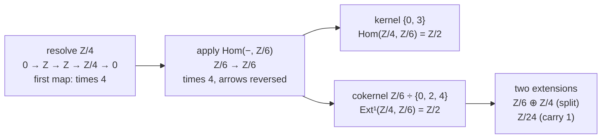

# Ext: resolve, apply Hom, and count the ways to glue two modules together

[Syllabus](../../../SYLLABUS.md) → [Algebraic geometry](../README.md) → [Exact Sequences, Ext and Tor](../README.md#s07) → Ext

---

## General Overview

Take the integers. Split each one into an even part and a parity bit: 7 is 6 plus the bit "odd". The even numbers are a copy of the integers (halve them), and the bits are the two-element group $`\mathbb{Z}/2`$. So the integers are built from a copy of $`\mathbb{Z}`$ underneath and a copy of $`\mathbb{Z}/2`$ on top.

There is a second way to build something from the same two pieces: keep an integer and an on–off bit side by side, never mixing them. That is $`\mathbb{Z} \oplus \mathbb{Z}/2`$. The difference is one rule. In the integers, odd plus odd carries 2 into the even part. In the side-by-side version nothing ever carries.

Those are the only two ways. A gluing like this is an **extension**: a module $`E`$ (here an abelian group: a set with an addition) with a copy of $`N`$ inside it and $`M`$ left when that copy is treated as zero. The group $`\mathrm{Ext}^1(M, N)`$ lists the extensions, one element for each, counting two as the same when a relabelling of E matches them. Here $`\mathrm{Ext}^1(\mathbb{Z}/2, \mathbb{Z}) = \mathbb{Z}/2`$: two elements, the split one (no carry) and the integers (odd plus odd carries).

The same count works for finite pieces. $`\mathbb{Z}/6`$ glued under $`\mathbb{Z}/4`$ can be done in two ways: side by side, or as the 24-hour clock $`\mathbb{Z}/24`$, read as "multiples of 4" under "remainder after 4". But $`\mathbb{Z}/9`$ glued under $`\mathbb{Z}/4`$ has only one way, the split one, because 4 and 9 share no factor.

**Ext is computed in three moves: replace M by a resolution (free modules joined by maps), apply Hom into N, and measure the gaps; the first gap, Ext¹, counts the ways to glue N under M, up to relabelling.**

**What kind of fact this is:** a definition (Ext from a resolution) and three theorems. That Ext does not depend on the resolution is stated and checked, with the proof's shape and a source. That Ext¹ classifies extensions is proved on this card in Why it works. The universal coefficient theorem is proved on [Universal coefficients and Kunneth](../../17-Topology/05-Homology/11-universal-coefficients-and-kunneth.md) and read here.

### The picture: the recipe on Z/4 against Z/6



Every Ext on this card is this picture with other numbers.

---

## The formula

Carried over, each in one line:

- A **module** over a ring R is a set that adds and can be multiplied by members of R; $`\oplus`$ puts modules side by side ([Modules](../06-Schemes%20and%20Modern%20Language/05-modules-and-the-structure-theorem.md)). Here R is mostly $`\mathbb{Z}`$, and a module is an abelian group.
- A sequence of maps is **exact** when the image of each map is the kernel of the next ([Exact sequences of modules](01-exact-sequences-and-the-snake-lemma.md)). An **extension of M by N** is an exact sequence $`0 \to N \to E \to M \to 0`$. Some books swap the words "of" and "by"; this card follows Weibel.
- A **projective** module P is one through which every map lifts along a surjective map; free modules $`R^n`$ are projective ([Projective, injective and flat](02-projective-injective-and-flat-modules.md)).
- A **projective resolution** of M is an exact sequence $`\cdots \to P_2 \to P_1 \to P_0 \to M \to 0`$ of projective modules $`P_i`$ with maps $`d_i : P_i \to P_{i-1}`$ ([Tor](04-free-resolutions-and-tor.md) builds them).

New here. $`\mathrm{Hom}_R(A, N)`$ is the module of R-linear maps from A to N. A map $`d : A \to B`$ gives a map **backwards**, $`d^* : \mathrm{Hom}(B, N) \to \mathrm{Hom}(A, N)`$, by first doing $`d`$ and then the map into N.

Apply that to a resolution, after dropping M itself, and the arrows reverse:

```math
0 \to \mathrm{Hom}(P_0, N) \xrightarrow{\;d_1^*\;} \mathrm{Hom}(P_1, N) \xrightarrow{\;d_2^*\;} \mathrm{Hom}(P_2, N) \to \cdots, \qquad \mathrm{Ext}^i_R(M, N) = \ker d_{i+1}^* \,/\, \mathrm{im}\, d_i^*
```

**Read it aloud:** Ext i of M and N is the set of maps out of the i-th resolution piece that die on the next step, with those that came from the previous piece counted as zero.

Over $`\mathbb{Z}`$, the cyclic group $`\mathbb{Z}/m`$ has the resolution $`0 \to \mathbb{Z} \xrightarrow{\times m} \mathbb{Z} \to \mathbb{Z}/m \to 0`$. Since $`\mathrm{Hom}(\mathbb{Z}, N) = N`$ (a map out of $`\mathbb{Z}`$ is fixed by where 1 goes), the whole complex is $`N \xrightarrow{\times m} N`$:

```math
\mathrm{Hom}(\mathbb{Z}/m, N) = N[m] = \{ x \in N : mx = 0 \}, \qquad \mathrm{Ext}^1(\mathbb{Z}/m, N) = N / mN, \qquad \mathrm{Ext}^i(\mathbb{Z}/m, N) = 0 \text{ for } i \ge 2
```

**Read it aloud:** maps from the m-clock into N are the members m times kills; Ext one is N with the multiples of m counted as zero; nothing above.

The classification theorem says what that number counts:

```math
\mathrm{Ext}^1_R(M, N) \;\longleftrightarrow\; \{\, 0 \to N \to E \to M \to 0 \,\} \,/\, \text{equivalence}, \qquad 0 \;\longleftrightarrow\; N \oplus M
```

**Read it aloud:** the members of Ext one match the extensions of M by N one for one, counted up to equivalence, and zero matches the split extension.

Two extensions are **equivalent** when an isomorphism between their middle modules fixes the copy of N and the map onto M. The **split** extension is $`N \oplus M`$, with no carry.

The universal coefficient theorem for cohomology, for a space X built from cells, with coefficients in an abelian group G:

```math
H^k(X; G) \cong \mathrm{Hom}\big(H_k(X), G\big) \oplus \mathrm{Ext}^1\big(H_{k-1}(X), G\big)
```

**Read it aloud:** cohomology with coefficients in G is the maps from homology into G, plus the Ext of the homology one dimension down.

| Symbol | Plain meaning | In our example | Push it up and the answer… |
| --- | --- | --- | --- |
| $`R`$ | the ring of scalars | $`\mathbb{Z}`$; once, $`\mathbb{Z}/4`$ | a worse ring keeps Ext alive in higher i |
| $`M`$, $`N`$ | the top piece and the piece glued under it | $`\mathbb{Z}/4`$ and $`\mathbb{Z}/6`$ | — |
| $`E`$ | the middle module of an extension | $`\mathbb{Z}/24`$ or $`\mathbb{Z}/6 \oplus \mathbb{Z}/4`$ | — |
| $`P_i`$, $`d_i`$ | resolution pieces and their maps | $`P_1 = P_0 = \mathbb{Z}`$, $`d_1 = \times 4`$ | longer resolutions, same Ext |
| $`\mathrm{Hom}_R(A, N)`$, $`d^*`$ | linear maps A to N; a map run backwards | $`\mathrm{Hom}(\mathbb{Z}, \mathbb{Z}/6) = \mathbb{Z}/6`$ | — |
| $`\mathrm{Ext}^i_R(M, N)`$ | the i-th gap after applying Hom | $`\mathrm{Ext}^1(\mathbb{Z}/4, \mathbb{Z}/6) = \mathbb{Z}/2`$ | more members, more gluings |
| $`m`$, $`n`$, $`q`$ | sizes of clocks: the top piece $`\mathbb{Z}/m`$, a clock $`\mathbb{Z}/n`$ underneath, a twist $`\mathbb{Z}/q`$ in homology | 4, 6, 4 | — |
| $`N[m]`$, $`N/mN`$ | what m times kills; N modulo multiples of m | $`\{0, 3\}`$; $`\mathbb{Z}/6 / \{0, 2, 4\}`$ | — |
| $`s`$, $`f`$, $`c`$ | a lift of M into E; the carry it makes; the carry total $`c = m \cdot s(1)`$ | in $`\mathbb{Z}/24`$, $`s(1) = 1`$ and $`c = 4`$, the copy of 1 in $`\mathbb{Z}/6`$ | — |
| $`t`$, $`E_c`$, $`\varphi`$ | the new member glued on top; the extension with $`mt = c`$; the class as a map $`P_1 \to N`$ | in $`\mathbb{Z}/24`$, $`t = 1`$; $`E_1 = \mathbb{Z}/24`$; $`\varphi(1) = c = 1`$ | — |
| $`H_k(X)`$, $`H^k(X; G)`$ | homology, and cohomology with coefficients in G | for the disc glued 4 times round a loop, $`H_1 = \mathbb{Z}/4`$ | — |
| $`G`$ | the coefficient group | $`\mathbb{Z}/6`$, $`\mathbb{Z}/9`$, $`\mathbb{Z}`$ | — |

### When it holds

- **The resolution is projective.** Resolve $`\mathbb{Z}/2`$ through the non-projective $`\mathbb{Z}/4`$ and Hom into $`\mathbb{Z}`$ sees nothing: $`\mathrm{Ext}^1(\mathbb{Z}/2, \mathbb{Z})`$ reads 0, not $`\mathbb{Z}/2`$.
- **Ext stops at 1 over a PID** (a domain, where no two nonzero members multiply to 0, in which every ideal is the multiples of one member, such as $`\mathbb{Z}`$). Over the ring $`\mathbb{Z}/4`$, where 2 · 2 = 0, every $`\mathrm{Ext}^i(\mathbb{Z}/2, \mathbb{Z}/2)`$ has 2 members.
- **Extensions are counted up to equivalence, not up to the middle module.** $`\mathrm{Ext}^1(\mathbb{Z}/3, \mathbb{Z})`$ has 3 members, but only 2 middle groups appear.
- **The order of M and N matters.** $`\mathrm{Ext}^1(\mathbb{Z}/2, \mathbb{Z}) = \mathbb{Z}/2`$, but $`\mathrm{Ext}^1(\mathbb{Z}, \mathbb{Z}/2) = 0`$, because $`\mathbb{Z}`$ is free and every extension of it splits.
- **The universal coefficient theorem needs free chain groups and a PID**, here $`\mathbb{Z}`$. Cellular and singular chains are free, so it holds for every space built from cells.

---

## Why it works

### Step 0: an extension is a carry rule

Take an extension $`0 \to N \to E \to M \to 0`$ of abelian groups. For each $`a`$ in M choose a member $`s(a)`$ of E above it, with $`s(0) = 0`$: a **lift**. Then $`s(a) + s(b)`$ and $`s(a + b)`$ lie above the same member of M, so they differ by a member of N:

```math
f(a, b) = s(a) + s(b) - s(a + b) \in N
```

**Read it aloud:** the carry of a and b is what adding their lifts leaves over, which always lands in N.

In the integers over $`\mathbb{Z}/2`$, with $`s(1) = 1`$, odd plus odd gives $`f(1, 1) = 2`$, the copy of 1 in N. The split extension has every carry 0.

A carry rule is symmetric, and adding three members in either grouping gives the same answer. That is the **cocycle** condition, $`f(a, b) + f(a + b, c) = f(b, c) + f(a, b + c)`$. Choosing other lifts, $`s'(a) = s(a) + g(a)`$ with $`g(a)`$ in N, changes the carry by $`g(a) + g(b) - g(a + b)`$, a **coboundary**. So extensions are counted by carry rules modulo coboundaries. This road needs no resolution, and the check counts it by brute force.

### Step 1: for a clock, one number decides everything

For $`M = \mathbb{Z}/m`$, choose $`s(a) = a \cdot s(1)`$ for $`a = 0, \ldots, m - 1`$. Then a carry happens only when $`a + b`$ wraps past $`m`$, and its size is always $`c = m \cdot s(1)`$, a member of N.

Changing $`s(1)`$ by $`x`$ in N changes $`c`$ by $`mx`$. So the extension is fixed by $`c`$ modulo $`mN`$: a member of $`N / mN`$. Conversely every $`c`$ in N builds one: glue a new member $`t`$ to N with the single rule $`mt = c`$,

```math
E_c = (N \oplus \mathbb{Z}) \,/\, \langle (c, -m) \rangle
```

**Read it aloud:** take N and a free new member t, and declare m copies of t equal to c.

For $`\mathbb{Z}/4`$ by $`\mathbb{Z}/6`$: $`4 \cdot \mathbb{Z}/6 = \{0, 2, 4\}`$, so $`c`$ is read modulo 2. $`c = 0`$ gives the split $`\mathbb{Z}/6 \oplus \mathbb{Z}/4`$, which Smith normal form writes $`\mathbb{Z}/2 \oplus \mathbb{Z}/12`$ ([Smith normal form](../06-Schemes%20and%20Modern%20Language/06-smith-normal-form-and-canonical-forms.md)). $`c = 1`$ gives $`\mathbb{Z}/24`$: four steps of $`t`$ make the generator of $`\mathbb{Z}/6`$, so $`t`$ has order 24.

### Step 2: the resolution gives the same number

The resolution road reaches $`N / mN`$ with no carries. Hom into N turns $`\mathbb{Z} \xrightarrow{\times m} \mathbb{Z}`$ into $`N \xrightarrow{\times m} N`$. Nothing comes before the first $`N`$, so Ext⁰ is the kernel, $`N[m]`$. Nothing comes after the second, so Ext¹ is the cokernel, $`N / mN`$.

The roads match because the carry total $`c = m \cdot s(1)`$ is a map from $`P_1 = \mathbb{Z}`$ into N, and a new lift changes it by a map from $`P_0`$. Step 5 makes this general.

### Step 3: any resolution gives the same Ext

Two projective resolutions of M can be compared. Projectivity lets the identity on M lift to maps $`P_i \to P'_i`$, one step at a time, and any two lifts differ by a **chain homotopy** (maps $`P_i \to P'_{i+1}`$, one step up the resolution, that account for the difference). Hom turns these into maps that are inverse on the gaps. This is the comparison theorem (Weibel, 2.2.6).

The check takes a wider free resolution of $`\mathbb{Z}/4`$, of the same length 1: $`\mathbb{Z}^2 \to \mathbb{Z}^2`$, with columns $`(1, -1)`$ and $`(4, 0)`$, onto $`\mathbb{Z}/4`$ by $`(a, b) \mapsto a + b`$. Hom into $`\mathbb{Z}/6`$ gives a map on pairs of members of $`\mathbb{Z}/6`$, and its kernel and cokernel both have 2 members, as before.

### Step 4: an injective resolution of N gives the same Ext

Ext can also be built from the other side. Resolve N by **injective** modules (those into which every map extends; over $`\mathbb{Z}`$, the divisible groups, where every member can be divided by every nonzero whole number, such as $`\mathbb{Q}/\mathbb{Z}`$, the fractions with whole numbers counted as zero) and apply $`\mathrm{Hom}(M, -)`$. That the two routes agree is the balancing theorem (Weibel, 2.7.6), stated here and checked.

For $`N = \mathbb{Z}/n`$, the resolution is $`0 \to \mathbb{Z}/n \to \mathbb{Q}/\mathbb{Z} \xrightarrow{\times n} \mathbb{Q}/\mathbb{Z} \to 0`$. Maps from $`\mathbb{Z}/m`$ into $`\mathbb{Q}/\mathbb{Z}`$ send 1 to some $`k/m`$, so there are m of them, and the complex is $`\mathbb{Z}/m \xrightarrow{\times n} \mathbb{Z}/m`$. For $`m = 4`$, $`n = 6`$ the cokernel is again 2 members; for $`n = 9`$ it is 0.

### Step 5: Ext¹ classifies extensions

Here is the general theorem, for any ring and any module M with a projective resolution.

1. **Extension to class.** Given $`0 \to N \to E \to M \to 0`$, lift $`P_0 \to M`$ to a map $`P_0 \to E`$, using projectivity. On $`P_1`$ this lands in N, because $`P_1`$ maps to zero in M. That gives $`\varphi : P_1 \to N`$, which dies on $`P_2`$. Another lift changes $`\varphi`$ by something from $`\mathrm{Hom}(P_0, N)`$. So $`\varphi`$ is a well-defined member of $`\mathrm{Ext}^1(M, N)`$.
2. **Class to extension.** Given such a $`\varphi`$, glue: $`E = (N \oplus P_0) / \{ (\varphi(x), -d_1 x) \}`$, with $`x`$ running over $`P_1`$. This is Step 1's $`E_c`$ when $`P_0 = P_1 = \mathbb{Z}`$.
3. **The two are inverse,** and equivalent extensions give the same class.

The split extension lifts $`P_0 \to M`$ straight into the M summand, so $`\varphi = 0`$. That is why 0 in Ext means "split".

<details>
<summary>Detailed proof: the two constructions undo each other</summary>

Write $`K = d_1(P_1)`$, the kernel of $`P_0 \to M`$. Exactness at $`P_1`$ says $`d_1`$ induces an isomorphism $`P_1 / d_2(P_2) \cong K`$. So a $`\varphi`$ that dies on $`d_2(P_2)`$ is the same as a map $`\psi : K \to N`$.

Class to extension to class. Build $`E = (N \oplus P_0)/\{(\psi(k), -k) : k \in K\}`$. The map $`N \to E`$ is $`y \mapsto (y, 0)`$, and $`E \to M`$ is $`(y, p) \mapsto`$ the image of $`p`$. Both are well defined, the first is injective since $`(y, 0) = (\psi(k), -k)`$ forces $`k = 0`$, and the sequence is exact. The lift $`p \mapsto (0, p)`$ sends $`k`$ in K to $`(0, k) = (\psi(k), 0)`$. It reads back $`\psi`$.

Extension to class to extension. Given E with a lift $`\lambda : P_0 \to E`$ and its $`\psi = \lambda`$ on K, the map

$`\displaystyle (y, p) \mapsto y + \lambda(p) : (N \oplus P_0)/\{(\psi(k), -k)\} \to E`$

kills the relations, fixes N, and covers M. A map between extensions that fixes N and M is an isomorphism, by the five lemma: a map between two short exact sequences that is an isomorphism on both ends is one in the middle. So the rebuilt extension is equivalent to E.

Changing $`\lambda`$ by $`\mu : P_0 \to N`$ changes $`\psi`$ by $`\mu`$ restricted to K, which is $`d_1^* \mu`$: a coboundary. Equivalent extensions give the same $`\psi`$, by composing the lift with the equivalence.

</details>

### Step 6: the other two examples, read off

- **$`\mathbb{Z}/2`$ by $`\mathbb{Z}`$.** $`\mathrm{Ext}^1 = \mathbb{Z}/2\mathbb{Z}`$, 2 members. $`c = 0`$ gives $`\mathbb{Z} \oplus \mathbb{Z}/2`$. $`c = 1`$ gives $`\mathbb{Z}`$, with N inside as the even numbers: the sequence $`0 \to \mathbb{Z} \xrightarrow{\times 2} \mathbb{Z} \to \mathbb{Z}/2 \to 0`$. The middle groups differ, so these really are two classes.
- **$`\mathbb{Z}/4`$ by $`\mathbb{Z}/9`$.** 4 has an inverse modulo 9, so $`4 \cdot \mathbb{Z}/9`$ is everything and Ext¹ is 0. Every $`c`$ gives $`\mathbb{Z}/36`$. That is not a non-split gluing: $`\mathbb{Z}/36 \cong \mathbb{Z}/9 \oplus \mathbb{Z}/4`$ by [The Chinese remainder theorem](../../02-Number%20theory/03-Clock%20Arithmetic/06-chinese-remainder-theorem.md).

### Step 7: reading the universal coefficient theorem

Cochains are Hom of the chain groups into G ([Cohomology and the cup product in outline](../../17-Topology/05-Homology/08-cohomology-and-cup-product-in-outline.md)). Near a twist $`\mathbb{Z}/q`$ in $`H_{k-1}`$, the free chain groups contain a piece $`\mathbb{Z} \xrightarrow{\times q} \mathbb{Z}`$. That piece is the resolution of $`\mathbb{Z}/q`$. Applying Hom gives $`G \xrightarrow{\times q} G`$, and its cokernel $`G / qG = \mathrm{Ext}^1(\mathbb{Z}/q, G)`$ appears one dimension up, in $`H^k`$. The full proof is on [Universal coefficients and Kunneth](../../17-Topology/05-Homology/11-universal-coefficients-and-kunneth.md).

The example: a disc whose rim is glued 4 times round a loop. Its homology is $`H_0 = \mathbb{Z}`$, $`H_1 = \mathbb{Z}/4`$, $`H_2 = 0`$. With coefficients $`\mathbb{Z}/6`$:

- $`H^1 = \mathrm{Hom}(\mathbb{Z}/4, \mathbb{Z}/6) \oplus 0 = \mathbb{Z}/2`$;
- $`H^2 = 0 \oplus \mathrm{Ext}^1(\mathbb{Z}/4, \mathbb{Z}/6) = \mathbb{Z}/2`$, though $`H_2`$ is 0.

With $`\mathbb{Z}/9`$ both are 0: the twist of order 4 is invisible to a 9-clock. With $`\mathbb{Z}`$, $`H^1 = 0`$ and $`H^2 = \mathrm{Ext}^1(\mathbb{Z}/4, \mathbb{Z}) = \mathbb{Z}/4`$.

---

## Worked numbers, by hand

| Step | Arithmetic | Value |
| --- | --- | --- |
| resolve $`\mathbb{Z}/4`$ | $`0 \to \mathbb{Z} \xrightarrow{\times 4} \mathbb{Z} \to \mathbb{Z}/4 \to 0`$ | one map, times 4 |
| apply $`\mathrm{Hom}(-, \mathbb{Z}/6)`$ | $`\mathbb{Z}/6 \xrightarrow{\times 4} \mathbb{Z}/6`$ | 0, 1, 2, 3, 4, 5 go to 0, 4, 2, 0, 4, 2 |
| kernel | what 4 times kills | $`\{0, 3\}`$: Hom has 2 members |
| image | $`4 \cdot \mathbb{Z}/6`$ | $`\{0, 2, 4\}`$, 3 members |
| cokernel | 6 members ÷ 3 | **$`\mathrm{Ext}^1(\mathbb{Z}/4, \mathbb{Z}/6) = \mathbb{Z}/2`$** |
| class $`c = 0`$ | relations $`6a = 0`$, $`4t = 0`$ | $`\mathbb{Z}/2 \oplus \mathbb{Z}/12`$, split |
| class $`c = 1`$ | relations $`6a = 0`$, $`4t = a`$ | **$`\mathbb{Z}/24`$** |
| against $`\mathbb{Z}/9`$ | $`4 \cdot \mathbb{Z}/9`$ is all 9 members | **$`\mathrm{Ext}^1(\mathbb{Z}/4, \mathbb{Z}/9) = 0`$** |
| $`\mathbb{Z}/2`$ by $`\mathbb{Z}`$ | $`\mathbb{Z} / 2\mathbb{Z}`$ | **$`\mathbb{Z}/2`$**: $`\mathbb{Z} \oplus \mathbb{Z}/2`$ and $`\mathbb{Z}`$ |

There are exactly two ways to glue a 6-clock under a 4-clock, and one of them is the 24-hour clock; a 9-clock can only sit beside a 4-clock.

### What breaks if you drop a piece

| Mistake | Comes out at | What went wrong |
| --- | --- | --- |
| Resolve $`\mathbb{Z}/2`$ by $`0 \to \mathbb{Z}/2 \to \mathbb{Z}/4 \to \mathbb{Z}/2 \to 0`$ | $`\mathrm{Ext}^1(\mathbb{Z}/2, \mathbb{Z}) = 0`$, not $`\mathbb{Z}/2`$ | $`\mathbb{Z}/4`$ is not projective; Hom into $`\mathbb{Z}`$ has 0 nonzero maps |
| Count extensions by their middle group | $`\mathbb{Z}/3`$ by $`\mathbb{Z}`$: 2 groups, not 3 classes | $`c = 1`$ and $`c = 2`$ both give $`\mathbb{Z}`$, but no equivalence joins them |
| Read Ext¹ = 0 as "no extension" | there is 1: the split one, $`\mathbb{Z}/36`$ | 0 is the class of the split extension |
| Assume Ext stops at 1 over any ring | over $`\mathbb{Z}/4`$, $`\mathrm{Ext}^2(\mathbb{Z}/2, \mathbb{Z}/2)`$ has 2 members, not 1 | $`\mathbb{Z}/4`$ is not a domain (2 · 2 = 0), so the kernel of doubling is $`\{0, 2\}`$ again and the resolution never ends |
| Universal coefficients without the Ext term | $`H^2`$ of the glued disc with $`\mathbb{Z}`$ coefficients: 0, not $`\mathbb{Z}/4`$ | the twist moves up one dimension |

The code prints all five.

---

## Code, from first principles, and it actually runs

The code computes $`\mathrm{Hom}`$ and $`\mathrm{Ext}^1`$ by four roads that share no step. They are the short free resolution, a wider free resolution on pairs, the injective resolution through $`\mathbb{Q}/\mathbb{Z}`$, and a brute-force count of every symmetric carry rule modulo coboundaries. All four must agree with $`\mathbb{Z}/\gcd(m, n)`$. For $`N = \mathbb{Z}`$ the injective road uses $`0 \to \mathbb{Z} \to \mathbb{Q} \to \mathbb{Q}/\mathbb{Z} \to 0`$ and lists fractions with denominators up to 12; it must give $`\mathrm{Ext}^1(\mathbb{Z}/m, \mathbb{Z}) = \mathbb{Z}/m`$ and match the glued disc's cochains. The middle groups come from Smith normal form of a 2 × 2 relation matrix. The check also covers the glued disc, the ring $`\mathbb{Z}/4`$ and the five mistakes.

### Python

```python
# Ext and extensions -- the check behind the card.  Nothing is imported.
# Ext^i(Z/m, N) over the integers, by four roads that share no step: the short
# free resolution, a wider free resolution, an injective resolution through
# Q/Z, and a brute-force count of the extensions themselves as symmetric carry
# rules (cocycles).  Then the glued groups E, the universal coefficient theorem
# on a disc glued four times round a loop, the ring Z/4, and what breaks.

def gcd(a, b):
    while b:
        a, b = b, a % b
    return abs(a)

def sizes(f, dom, zero):                 # (kernel size, cokernel size) of a map, by listing
    image = {f(x) for x in dom}
    kernel = sum(1 for x in dom if f(x) == zero)
    return kernel, len(dom) // len(image)

def road_short(m, n):                    # Hom(-, Z/n) on 0 -> Z --m--> Z: the map Z/n --m--> Z/n
    return sizes(lambda x: m * x % n, list(range(n)), 0)

def road_wide(m, n):                     # Z^2 --(1,-1),(m,0)--> Z^2 --(a,b) -> a+b--> Z/m
    dom = [(u, v) for u in range(n) for v in range(n)]
    return sizes(lambda p: ((p[0] - p[1]) % n, m * p[0] % n), dom, (0, 0))

def road_injective(m, n):                # Hom(Z/m, -) on 0 -> Z/n -> Q/Z --n--> Q/Z; k means k/m
    return sizes(lambda k: n * k % m, list(range(m)), 0)

def road_z(m, den=12):                   # N = Z by 0 -> Z -> Q -> Q/Z, fractions a/b with b <= den
    hom_q = {(a, b) for b in range(1, den + 1) for a in range(-den, den + 1) if m * a == 0 and gcd(a, b) == 1}
    hom_qz = {(a // gcd(a, b), b // gcd(a, b)) for b in range(1, den + 1) for a in range(b) if m * a % b == 0}
    return sum(1 for a, b in hom_q if b == 1), len(hom_qz) // len({(a % b, b) for a, b in hom_q})

def road_cocycles(m, n):                 # symmetric carry rules f(a, b) on Z/m, values in Z/n
    pairs = [(a, b) for a in range(1, m) for b in range(a, m)]
    def f_of(vals):
        table = [[0] * m for _ in range(m)]
        for (a, b), v in zip(pairs, vals):
            table[a][b] = table[b][a] = v
        return table
    def is_cocycle(t):
        return all((t[a][b] + t[(a + b) % m][c] - t[b][c] - t[a][(b + c) % m]) % n == 0
                   for a in range(1, m) for b in range(1, m) for c in range(1, m))
    count, vals = 0, [0] * len(pairs)
    while True:                          # every table of values, as a counter in base n
        count += is_cocycle(f_of(vals))
        i = 0
        while i < len(vals) and vals[i] == n - 1:
            vals[i], i = 0, i + 1
        if i == len(vals):
            break
        vals[i] += 1
    bounds, homs = set(), 0              # coboundaries g(a) + g(b) - g(a + b) of g with g(0) = 0
    for code in range(n ** (m - 1)):
        g = [0] + [code // n ** j % n for j in range(m - 1)]
        d = tuple((g[a] + g[b] - g[(a + b) % m]) % n for a, b in pairs)
        bounds.add(d)
        homs += all(x == 0 for x in d)
    return homs, count // len(bounds), count, len(bounds)

def glued(n0, c, m):                     # E = (N + Z) / <(c, -m)>, N = Z/n0 (n0 = 0: N = Z), by Smith form
    d1, det = gcd(gcd(n0, c), m), abs(n0 * m)
    parts = ["Z"] if det == 0 else []
    parts += [f"Z/{d}" for d in (d1, det // d1 if det else 0) if d > 1]
    return " + ".join(parts) if parts else "0"

def name(k):
    return "0" if k == 1 else f"Z/{k}"

print("Ext(Z/m, N) by four roads: |Hom| |Ext^1|, then the counts behind the last road")
results, cases = {}, [(4, 6), (4, 9), (3, 3)]
for m, n in cases:
    rs = [road_short(m, n), road_wide(m, n), road_injective(m, n), road_cocycles(m, n)]
    results[(m, n)] = rs
    print(f"Z/{m} by Z/{n}: short {rs[0][0]} {rs[0][1]}; wide {rs[1][0]} {rs[1][1]}; "
          f"injective {rs[2][0]} {rs[2][1]}; carries {rs[3][0]} {rs[3][1]} "
          f"({rs[3][2]} cocycles / {rs[3][3]} coboundaries)")
print(f"Z/4 by Z/6, times 4 on Z/6: {[4 * x % 6 for x in range(6)]}, kernel {[x for x in range(6) if 4 * x % 6 == 0]}, "
      f"image {sorted({4 * x % 6 for x in range(6)})}")
for m in (2, 3, 4):                      # N = Z: coker of Z --m--> Z, residues of -60..60 left by m
    hz, ez = road_z(m)
    print(f"Ext^1(Z/{m}, Z): Z/{m}Z has {len({x % m for x in range(-60, 61)})} elements, through Q/Z {ez}; "
          f"Hom(Z/{m}, Z) = {sum(1 for x in range(-60, 61) if m * x == 0) - 1} nonzero maps, through Q {hz - 1}")
print("the glued groups E_c = (N + Z)/<(c, -m)>: c, its class, E")
for n0, m in [(0, 2), (0, 3), (6, 4), (9, 4), (3, 3)]:
    nn = n0 if n0 else m                 # the class of c lives in N/mN
    cls = [c % gcd(nn, m) for c in range(nn)]
    rows = [f"{c}:{cls[c]}:{glued(n0, c, m)}" for c in range(nn)]
    print(f"Z/{m} by {'Z' if n0 == 0 else f'Z/{n0}'}: " + ", ".join(rows))
s_ok = [s for s in (1, -1) if s * 3 == 3 and all(2 * s * z % 3 == z % 3 for z in range(3))]
print(f"equivalences between c = 1 and c = 2 for Z/3 by Z (s = +1 or -1): {len(s_ok)}")
print("disc glued 4 times round a loop: H_0 = Z, H_1 = Z/4, H_2 = 0")
for n in (6, 9):
    h1, h2 = road_short(4, n)            # cochains: G --0--> G --4--> G
    hom, ext = road_injective(4, n)      # Hom(Z/4, G) and Ext(Z/4, G), another road
    print(f"coefficients Z/{n}: cochains H^1 = {name(h1)}, H^2 = {name(h2)}; "
          f"Hom(H_1) + Ext(H_0) = {name(hom)} + 0, Hom(H_2) + Ext(H_1) = 0 + {name(ext)}")
z1 = sum(1 for x in range(-60, 61) if 4 * x == 0)       # cochains Z --0--> Z --4--> Z: kernel of 4, from a window
z2 = len({x % 4 for x in range(-60, 61)})                # Z / 4Z
hz, ez = road_z(4)                                       # Hom(H_1, Z) and Ext(H_1, Z), through Q and Q/Z
print(f"coefficients Z: cochains H^1 = {name(z1)}, H^2 = {name(z2)}; Hom(H_1) + Ext(H_0) = {name(hz)} + 0, "
      f"Hom(H_2) + Ext(H_1) = 0 + {name(ez)}")
r = list(range(4))                       # over the ring Z/4: ... --2--> Z/4 --2--> Z/4 -> Z/2
exact = {2 * x % 4 for x in r} == {x for x in r if 2 * x % 4 == 0}
homs = [v for v in range(2) if 4 * v % 2 == 0]           # Z/4 -> Z/2 is fixed by where 1 goes
ds, ext_z4 = [2] * 6, []                                  # d_1 .. d_6, each times 2; Hom(d_i) precomposes
for i in range(5):                                        # Ext^i = kernel of Hom(d_(i+1)) / image of Hom(d_i)
    kept = sum(1 for v in homs if ds[i] * v % 2 == 0)
    ext_z4.append(kept // (len({ds[i - 1] * v % 2 for v in homs}) if i else 1))
print(f"ring Z/4: kernel of 2 = image of 2: {'yes' if exact else 'no'}; "
      f"Ext^0..Ext^4(Z/2, Z/2) sizes {ext_z4}")
fake = sum(1 for x in range(-60, 61) if 4 * x == 0) - 1  # nonzero maps Z/4 -> Z: none
print(f"mistake 1, 0 -> Z/2 -> Z/4 -> Z/2 as a resolution: Hom(Z/4, Z) has {fake} nonzero maps, "
      f"so it reads Ext^1(Z/2, Z) = 0, not Z/2")
mids = {glued(0, c, 3) for c in range(3)}
classes3 = road_z(3)[1]                                  # Ext^1(Z/3, Z), through Q/Z
print(f"mistake 2, Z/3 by Z counted by the group E: {len(mids)} groups, but {classes3} classes")
same = len({glued(9, c, 4) for c in range(9)})
print(f"mistake 3, Z/4 by Z/9 read as no extension: there is {results[(4, 9)][0][1]}, the split one; "
      f"all 9 values of c give {same} group, Z/9 + Z/4 = {glued(9, 0, 4)}")
print(f"mistake 4, over Z/4 Ext^2(Z/2, Z/2) has {ext_z4[2]} elements, not 1;"
      f" Ext^1(Z, Z/2) = 0 since Z is free")
h2z = sum(1 for x in range(-60, 61) if 4 * x == 0)      # H_2 = kernel of the boundary x4 = 0, so Hom(H_2, Z) = 0
print(f"mistake 5, H^2(disc glued 4 times; Z) as Hom(H_2, Z) alone: {name(h2z)}, not {name(z2)}")
for m, n in cases:
    rs, g = results[(m, n)], gcd(m, n)
    assert [x[:2] for x in rs] == [(g, g)] * 4                 # four roads, one answer
    assert rs[3][2] == rs[3][3] * g                            # cocycles = coboundaries x |Ext|
assert glued(0, 0, 2) == "Z + Z/2" and glued(0, 1, 2) == "Z"   # split and times-2
assert len({glued(6, c, 4) for c in range(6)}) == 2 and glued(6, 1, 4) == "Z/24"
assert glued(6, 0, 4) == "Z/2 + Z/12" and glued(6, 2, 4) == "Z/2 + Z/12"    # 2 is in 4N: split
assert len(mids) == 2 and classes3 == 3 and s_ok == [] and same == 1 and (z1, z2) == (hz, ez)   # cochains = UCT
assert all(road_z(m) == (1, m) for m in (2, 3, 4))                            # Hom(Z/m, Z) = 0, Ext^1 = Z/m
assert exact and ext_z4 == [2] * 5 and fake == 0
print("ALL CHECKS PASS")
```

**Ran 2026-11-24 on macOS, Python 3.14.10, standard library only. All checks passed. Output, pasted from the run:**

```
Ext(Z/m, N) by four roads: |Hom| |Ext^1|, then the counts behind the last road
Z/4 by Z/6: short 2 2; wide 2 2; injective 2 2; carries 2 2 (216 cocycles / 108 coboundaries)
Z/4 by Z/9: short 1 1; wide 1 1; injective 1 1; carries 1 1 (729 cocycles / 729 coboundaries)
Z/3 by Z/3: short 3 3; wide 3 3; injective 3 3; carries 3 3 (9 cocycles / 3 coboundaries)
Z/4 by Z/6, times 4 on Z/6: [0, 4, 2, 0, 4, 2], kernel [0, 3], image [0, 2, 4]
Ext^1(Z/2, Z): Z/2Z has 2 elements, through Q/Z 2; Hom(Z/2, Z) = 0 nonzero maps, through Q 0
Ext^1(Z/3, Z): Z/3Z has 3 elements, through Q/Z 3; Hom(Z/3, Z) = 0 nonzero maps, through Q 0
Ext^1(Z/4, Z): Z/4Z has 4 elements, through Q/Z 4; Hom(Z/4, Z) = 0 nonzero maps, through Q 0
the glued groups E_c = (N + Z)/<(c, -m)>: c, its class, E
Z/2 by Z: 0:0:Z + Z/2, 1:1:Z
Z/3 by Z: 0:0:Z + Z/3, 1:1:Z, 2:2:Z
Z/4 by Z/6: 0:0:Z/2 + Z/12, 1:1:Z/24, 2:0:Z/2 + Z/12, 3:1:Z/24, 4:0:Z/2 + Z/12, 5:1:Z/24
Z/4 by Z/9: 0:0:Z/36, 1:0:Z/36, 2:0:Z/36, 3:0:Z/36, 4:0:Z/36, 5:0:Z/36, 6:0:Z/36, 7:0:Z/36, 8:0:Z/36
Z/3 by Z/3: 0:0:Z/3 + Z/3, 1:1:Z/9, 2:2:Z/9
equivalences between c = 1 and c = 2 for Z/3 by Z (s = +1 or -1): 0
disc glued 4 times round a loop: H_0 = Z, H_1 = Z/4, H_2 = 0
coefficients Z/6: cochains H^1 = Z/2, H^2 = Z/2; Hom(H_1) + Ext(H_0) = Z/2 + 0, Hom(H_2) + Ext(H_1) = 0 + Z/2
coefficients Z/9: cochains H^1 = 0, H^2 = 0; Hom(H_1) + Ext(H_0) = 0 + 0, Hom(H_2) + Ext(H_1) = 0 + 0
coefficients Z: cochains H^1 = 0, H^2 = Z/4; Hom(H_1) + Ext(H_0) = 0 + 0, Hom(H_2) + Ext(H_1) = 0 + Z/4
ring Z/4: kernel of 2 = image of 2: yes; Ext^0..Ext^4(Z/2, Z/2) sizes [2, 2, 2, 2, 2]
mistake 1, 0 -> Z/2 -> Z/4 -> Z/2 as a resolution: Hom(Z/4, Z) has 0 nonzero maps, so it reads Ext^1(Z/2, Z) = 0, not Z/2
mistake 2, Z/3 by Z counted by the group E: 2 groups, but 3 classes
mistake 3, Z/4 by Z/9 read as no extension: there is 1, the split one; all 9 values of c give 1 group, Z/9 + Z/4 = Z/36
mistake 4, over Z/4 Ext^2(Z/2, Z/2) has 2 elements, not 1; Ext^1(Z, Z/2) = 0 since Z is free
mistake 5, H^2(disc glued 4 times; Z) as Hom(H_2, Z) alone: 0, not Z/4
ALL CHECKS PASS
```

### Rust

Same numbers, same labels, built with `rustc --edition 2021 -O`.

```rust
// Ext and extensions -- the same check as the Python, in Rust.  No crates.
// Ext^i(Z/m, N) over the integers, by four roads that share no step: the short
// free resolution, a wider free resolution, an injective resolution through
// Q/Z, and a brute-force count of the extensions themselves as symmetric carry
// rules (cocycles).  Then the glued groups E, the universal coefficient theorem
// on a disc glued four times round a loop, the ring Z/4, and what breaks.
use std::collections::BTreeSet;

fn gcd(a: i64, b: i64) -> i64 {
    let (mut a, mut b) = (a.abs(), b.abs());
    while b != 0 { (a, b) = (b, a % b) }
    a
}

fn sizes<T: Ord + Clone>(dom: &[T], f: &dyn Fn(&T) -> T, zero: &T) -> (usize, usize) {
    let image: BTreeSet<T> = dom.iter().map(|x| f(x)).collect();   // kernel and cokernel sizes
    let kernel = dom.iter().filter(|x| f(x) == *zero).count();
    (kernel, dom.len() / image.len())
}

fn road_short(m: i64, n: i64) -> (usize, usize) {       // the map Z/n --m--> Z/n
    let dom: Vec<i64> = (0..n).collect();
    sizes(&dom, &|x| m * x % n, &0)
}

fn road_wide(m: i64, n: i64) -> (usize, usize) {        // Z^2 --(1,-1),(m,0)--> Z^2 -> Z/m
    let dom: Vec<(i64, i64)> = (0..n).flat_map(|u| (0..n).map(move |v| (u, v))).collect();
    sizes(&dom, &|p| ((p.0 - p.1).rem_euclid(n), m * p.0 % n), &(0, 0))
}

fn road_injective(m: i64, n: i64) -> (usize, usize) {   // Hom(Z/m, Q/Z) --n--> itself; k means k/m
    let dom: Vec<i64> = (0..m).collect();
    sizes(&dom, &|k| n * k % m, &0)
}

fn road_z(m: i64) -> (usize, usize) {                   // N = Z by 0 -> Z -> Q -> Q/Z, fractions a/b with b <= 12
    let hom_q: BTreeSet<(i64, i64)> = (1..=12).flat_map(|b| (-12..=12).map(move |a| (a, b)))
        .filter(|&(a, b)| m * a == 0 && gcd(a, b) == 1).collect();
    let hom_qz: BTreeSet<(i64, i64)> = (1..=12).flat_map(|b| (0..b).map(move |a| (a, b)))
        .filter(|&(a, b)| m * a % b == 0).map(|(a, b)| (a / gcd(a, b), b / gcd(a, b))).collect();
    let image: BTreeSet<(i64, i64)> = hom_q.iter().map(|&(a, b)| (a.rem_euclid(b), b)).collect();
    (hom_q.iter().filter(|&&(_, b)| b == 1).count(), hom_qz.len() / image.len())
}

fn road_cocycles(m: usize, n: i64) -> (usize, usize, usize, usize) {
    let pairs: Vec<(usize, usize)> = (1..m).flat_map(|a| (a..m).map(move |b| (a, b))).collect();
    let (mut count, mut vals) = (0usize, vec![0i64; pairs.len()]);
    loop {                                               // every table of values, as a counter in base n
        let mut t = vec![vec![0i64; m]; m];
        for (k, &(a, b)) in pairs.iter().enumerate() { t[a][b] = vals[k]; t[b][a] = vals[k]; }
        let ok = (1..m).all(|a| (1..m).all(|b| (1..m).all(|c|
            (t[a][b] + t[(a + b) % m][c] - t[b][c] - t[a][(b + c) % m]).rem_euclid(n) == 0)));
        if ok { count += 1 }
        let mut i = 0;
        while i < vals.len() && vals[i] == n - 1 { vals[i] = 0; i += 1 }
        if i == vals.len() { break }
        vals[i] += 1;
    }
    let (mut bounds, mut homs) = (BTreeSet::new(), 0usize);   // coboundaries of g with g(0) = 0
    for code in 0..n.pow(m as u32 - 1) {
        let mut g = vec![0i64];
        for j in 0..(m as u32 - 1) { g.push(code / n.pow(j) % n) }
        let d: Vec<i64> = pairs.iter().map(|&(a, b)| (g[a] + g[b] - g[(a + b) % m]).rem_euclid(n)).collect();
        if d.iter().all(|&x| x == 0) { homs += 1 }
        bounds.insert(d);
    }
    (homs, count / bounds.len(), count, bounds.len())
}

fn glued(n0: i64, c: i64, m: i64) -> String {           // E = (N + Z) / <(c, -m)>, by Smith form
    let (d1, det) = (gcd(gcd(n0, c), m), (n0 * m).abs());
    let mut parts: Vec<String> = if det == 0 { vec!["Z".to_string()] } else { vec![] };
    for d in [d1, if det != 0 { det / d1 } else { 0 }] { if d > 1 { parts.push(format!("Z/{}", d)) } }
    if parts.is_empty() { "0".to_string() } else { parts.join(" + ") }
}

fn name(k: usize) -> String { if k == 1 { "0".to_string() } else { format!("Z/{}", k) } }

fn window() -> std::ops::RangeInclusive<i64> { -60..=60 }

fn main() {
    println!("Ext(Z/m, N) by four roads: |Hom| |Ext^1|, then the counts behind the last road");
    let cases: [(i64, i64); 3] = [(4, 6), (4, 9), (3, 3)];
    let mut results = Vec::new();
    for &(m, n) in &cases {
        let (a, b, c, d) = (road_short(m, n), road_wide(m, n), road_injective(m, n), road_cocycles(m as usize, n));
        println!("Z/{} by Z/{}: short {} {}; wide {} {}; injective {} {}; carries {} {} ({} cocycles / {} coboundaries)",
                 m, n, a.0, a.1, b.0, b.1, c.0, c.1, d.0, d.1, d.2, d.3);
        results.push((a, b, c, d));
    }
    println!("Z/4 by Z/6, times 4 on Z/6: {:?}, kernel {:?}, image {:?}", (0..6).map(|x| 4 * x % 6).collect::<Vec<i64>>(),
             (0..6).filter(|x| 4 * x % 6 == 0).collect::<Vec<i64>>(), (0..6).map(|x| 4 * x % 6).collect::<BTreeSet<i64>>().into_iter().collect::<Vec<i64>>());
    for m in [2i64, 3, 4] {                              // N = Z: coker of Z --m--> Z
        let res: BTreeSet<i64> = window().map(|x| x.rem_euclid(m)).collect();
        let homz = window().filter(|x| m * x == 0).count() - 1;
        let (hz, ez) = road_z(m);
        println!("Ext^1(Z/{}, Z): Z/{}Z has {} elements, through Q/Z {}; Hom(Z/{}, Z) = {} nonzero maps, through Q {}",
                 m, m, res.len(), ez, m, homz, hz - 1);
    }
    println!("the glued groups E_c = (N + Z)/<(c, -m)>: c, its class, E");
    for (n0, m) in [(0i64, 2i64), (0, 3), (6, 4), (9, 4), (3, 3)] {
        let nn = if n0 != 0 { n0 } else { m };
        let rows: Vec<String> = (0..nn).map(|c| format!("{}:{}:{}", c, c % gcd(nn, m), glued(n0, c, m))).collect();
        let nname = if n0 == 0 { "Z".to_string() } else { format!("Z/{}", n0) };
        println!("Z/{} by {}: {}", m, nname, rows.join(", "));
    }
    let s_ok: Vec<i64> = [1i64, -1].into_iter()
        .filter(|&s| s * 3 == 3 && (0..3).all(|z: i64| (2 * s * z).rem_euclid(3) == z % 3)).collect();
    println!("equivalences between c = 1 and c = 2 for Z/3 by Z (s = +1 or -1): {}", s_ok.len());
    println!("disc glued 4 times round a loop: H_0 = Z, H_1 = Z/4, H_2 = 0");
    for n in [6i64, 9] {
        let (h1, h2) = road_short(4, n);
        let (hom, ext) = road_injective(4, n);
        println!("coefficients Z/{}: cochains H^1 = {}, H^2 = {}; Hom(H_1) + Ext(H_0) = {} + 0, Hom(H_2) + Ext(H_1) = 0 + {}",
                 n, name(h1), name(h2), name(hom), name(ext));
    }
    let z1 = window().filter(|x| 4 * x == 0).count();          // cochains Z --0--> Z --4--> Z
    let z2 = window().map(|x| x.rem_euclid(4)).collect::<BTreeSet<i64>>().len();
    let (hz, ez) = road_z(4);                                   // Hom(H_1, Z) and Ext(H_1, Z), through Q and Q/Z
    println!("coefficients Z: cochains H^1 = {}, H^2 = {}; Hom(H_1) + Ext(H_0) = {} + 0, Hom(H_2) + Ext(H_1) = 0 + {}",
             name(z1), name(z2), name(hz), name(ez));
    let im2: BTreeSet<i64> = (0..4).map(|x| 2 * x % 4).collect();     // ring Z/4, times 2
    let ker2: BTreeSet<i64> = (0..4).filter(|x| 2 * x % 4 == 0).collect();
    let exact = im2 == ker2;
    let homs: Vec<i64> = (0..2).filter(|v| 4 * v % 2 == 0).collect();
    let ds = [2i64; 6];                                         // d_1 .. d_6, each times 2; Hom(d_i) precomposes
    let ext_z4: Vec<usize> = (0..5).map(|i| {                   // Ext^i = kernel of Hom(d_(i+1)) / image of Hom(d_i)
        let kept = homs.iter().filter(|&&v| ds[i] * v % 2 == 0).count();
        kept / if i > 0 { homs.iter().map(|&v| ds[i - 1] * v % 2).collect::<BTreeSet<i64>>().len() } else { 1 }
    }).collect();
    println!("ring Z/4: kernel of 2 = image of 2: {}; Ext^0..Ext^4(Z/2, Z/2) sizes {:?}", if exact { "yes" } else { "no" }, ext_z4);
    let fake = window().filter(|x| 4 * x == 0).count() - 1;
    println!("mistake 1, 0 -> Z/2 -> Z/4 -> Z/2 as a resolution: Hom(Z/4, Z) has {} nonzero maps, so it reads Ext^1(Z/2, Z) = 0, not Z/2", fake);
    let mids: BTreeSet<String> = (0..3).map(|c| glued(0, c, 3)).collect();
    let classes3 = road_z(3).1;                                 // Ext^1(Z/3, Z), through Q/Z
    println!("mistake 2, Z/3 by Z counted by the group E: {} groups, but {} classes", mids.len(), classes3);
    let same = (0..9).map(|c| glued(9, c, 4)).collect::<BTreeSet<String>>().len();
    println!("mistake 3, Z/4 by Z/9 read as no extension: there is {}, the split one; all 9 values of c give {} group, Z/9 + Z/4 = {}",
             (results[1].0).1, same, glued(9, 0, 4));
    println!("mistake 4, over Z/4 Ext^2(Z/2, Z/2) has {} elements, not 1; Ext^1(Z, Z/2) = 0 since Z is free", ext_z4[2]);
    let h2z = window().filter(|x| 4 * x == 0).count();         // H_2 = kernel of the boundary x4 = 0
    println!("mistake 5, H^2(disc glued 4 times; Z) as Hom(H_2, Z) alone: {}, not {}", name(h2z), name(z2));
    for (k, &(m, n)) in cases.iter().enumerate() {
        let (a, b, c, d) = results[k];
        let g = gcd(m, n) as usize;
        assert!([a, b, c, (d.0, d.1)].iter().all(|&x| x == (g, g)));   // four roads, one answer
        assert!(d.2 == d.3 * g);                                       // cocycles = coboundaries x |Ext|
    }
    assert!(glued(0, 0, 2) == "Z + Z/2" && glued(0, 1, 2) == "Z");    // split and times-2
    assert!((0..6).map(|c| glued(6, c, 4)).collect::<BTreeSet<String>>().len() == 2 && glued(6, 1, 4) == "Z/24");
    assert!(glued(6, 0, 4) == "Z/2 + Z/12" && glued(6, 2, 4) == "Z/2 + Z/12");   // 2 is in 4N: split
    assert!(mids.len() == 2 && classes3 == 3 && s_ok.is_empty() && same == 1 && (z1, z2) == (hz, ez));   // cochains = UCT
    assert!([2i64, 3, 4].iter().all(|&m| road_z(m) == (1, m as usize)));   // Hom(Z/m, Z) = 0, Ext^1 = Z/m
    assert!(exact && ext_z4 == vec![2; 5] && fake == 0);
    println!("ALL CHECKS PASS");
}
```

**Ran 2026-11-24 on macOS, rustc 1.98.1, no crates. All checks passed. Output, pasted from the run:**

```
Ext(Z/m, N) by four roads: |Hom| |Ext^1|, then the counts behind the last road
Z/4 by Z/6: short 2 2; wide 2 2; injective 2 2; carries 2 2 (216 cocycles / 108 coboundaries)
Z/4 by Z/9: short 1 1; wide 1 1; injective 1 1; carries 1 1 (729 cocycles / 729 coboundaries)
Z/3 by Z/3: short 3 3; wide 3 3; injective 3 3; carries 3 3 (9 cocycles / 3 coboundaries)
Z/4 by Z/6, times 4 on Z/6: [0, 4, 2, 0, 4, 2], kernel [0, 3], image [0, 2, 4]
Ext^1(Z/2, Z): Z/2Z has 2 elements, through Q/Z 2; Hom(Z/2, Z) = 0 nonzero maps, through Q 0
Ext^1(Z/3, Z): Z/3Z has 3 elements, through Q/Z 3; Hom(Z/3, Z) = 0 nonzero maps, through Q 0
Ext^1(Z/4, Z): Z/4Z has 4 elements, through Q/Z 4; Hom(Z/4, Z) = 0 nonzero maps, through Q 0
the glued groups E_c = (N + Z)/<(c, -m)>: c, its class, E
Z/2 by Z: 0:0:Z + Z/2, 1:1:Z
Z/3 by Z: 0:0:Z + Z/3, 1:1:Z, 2:2:Z
Z/4 by Z/6: 0:0:Z/2 + Z/12, 1:1:Z/24, 2:0:Z/2 + Z/12, 3:1:Z/24, 4:0:Z/2 + Z/12, 5:1:Z/24
Z/4 by Z/9: 0:0:Z/36, 1:0:Z/36, 2:0:Z/36, 3:0:Z/36, 4:0:Z/36, 5:0:Z/36, 6:0:Z/36, 7:0:Z/36, 8:0:Z/36
Z/3 by Z/3: 0:0:Z/3 + Z/3, 1:1:Z/9, 2:2:Z/9
equivalences between c = 1 and c = 2 for Z/3 by Z (s = +1 or -1): 0
disc glued 4 times round a loop: H_0 = Z, H_1 = Z/4, H_2 = 0
coefficients Z/6: cochains H^1 = Z/2, H^2 = Z/2; Hom(H_1) + Ext(H_0) = Z/2 + 0, Hom(H_2) + Ext(H_1) = 0 + Z/2
coefficients Z/9: cochains H^1 = 0, H^2 = 0; Hom(H_1) + Ext(H_0) = 0 + 0, Hom(H_2) + Ext(H_1) = 0 + 0
coefficients Z: cochains H^1 = 0, H^2 = Z/4; Hom(H_1) + Ext(H_0) = 0 + 0, Hom(H_2) + Ext(H_1) = 0 + Z/4
ring Z/4: kernel of 2 = image of 2: yes; Ext^0..Ext^4(Z/2, Z/2) sizes [2, 2, 2, 2, 2]
mistake 1, 0 -> Z/2 -> Z/4 -> Z/2 as a resolution: Hom(Z/4, Z) has 0 nonzero maps, so it reads Ext^1(Z/2, Z) = 0, not Z/2
mistake 2, Z/3 by Z counted by the group E: 2 groups, but 3 classes
mistake 3, Z/4 by Z/9 read as no extension: there is 1, the split one; all 9 values of c give 1 group, Z/9 + Z/4 = Z/36
mistake 4, over Z/4 Ext^2(Z/2, Z/2) has 2 elements, not 1; Ext^1(Z, Z/2) = 0 since Z is free
mistake 5, H^2(disc glued 4 times; Z) as Hom(H_2, Z) alone: 0, not Z/4
ALL CHECKS PASS
```

The two outputs match line for line.

### Lean

Lean proves that Ext¹ from a projective resolution classifies extensions over any ring, and the clock formulas over $`\mathbb{Z}`$.

- Take any ring R and a projective resolution $`P_2 \to P_1 \to P_0 \to M \to 0`$. Then the extensions of M by N, up to equivalence, match the members of $`\mathrm{Ext}^1(M, N)`$ one for one.
- The match is Step 5's recipe. Lift $`P_0 \to M`$ into E, and the extension goes to the class of its $`\varphi`$.
- Zero matches the split extension $`N \oplus M`$.
- Take a clock size m and any abelian group N. Then $`\mathrm{Hom}(\mathbb{Z}/m, N) = N[m]`$.
- Take the resolution $`0 \to \mathbb{Z} \xrightarrow{\times m} \mathbb{Z}`$. Then Ext¹ read off it is $`N / mN`$.
- Take any ring R and any module N. Then every extension of R by N is equivalent to the split one.
- Times 4 on $`\mathbb{Z}/6`$ sends 0 to 5 to 0, 4, 2, 0, 4, 2. Its kernel is $`\{0, 3\}`$ and its image $`\{0, 2, 4\}`$.
- Times 4 on $`\mathbb{Z}/9`$ reaches all 9 members. 4 and 9 share no factor, while 4 and 6 share 2.
- In $`\mathbb{Z}/24`$ the multiples of 4 have 6 members, which leaves a 4-clock on top.
- Over the ring $`\mathbb{Z}/4`$, the kernel of doubling equals its image, $`\{0, 2\}`$.

Ext above 1, the other roads to Ext, the middle groups and universal coefficients are left to the Python and Rust checks.

```lean
-- Ext: Ext¹ built from a projective resolution matches the extensions 0 → N → E → M → 0 one for one up to equivalence, with 0 matching the split one, and over ℤ the resolution of ℤ/m gives Hom(ℤ/m, N) = N[m] and Ext¹(ℤ/m, N) = N/mN.
import Mathlib.Algebra.Exact.Basic
import Mathlib.Algebra.Module.Projective
import Mathlib.Algebra.Group.Subgroup.Pointwise
import Mathlib.GroupTheory.QuotientGroup.Defs
import Mathlib.Data.ZMod.Basic
import Mathlib.LinearAlgebra.Quotient.Basic
import Mathlib.GroupTheory.QuotientGroup.Basic
import Mathlib.LinearAlgebra.Span.Basic

universe u

open Function

namespace ExtCard

variable {R : Type u} [Ring R]

/-- Running a map `d : A → B` backwards: a map `B → N` becomes the map `A → N` that first does `d`. -/
def precomp (N : Type u) [AddCommGroup N] [Module R N] {A B : Type u} [AddCommGroup A] [Module R A]
    [AddCommGroup B] [Module R B] (d : A →ₗ[R] B) : (B →ₗ[R] N) →+ (A →ₗ[R] N) where
  toFun φ := φ ∘ₗ d
  map_zero' := LinearMap.zero_comp d
  map_add' φ ψ := LinearMap.add_comp d ψ φ

/-- Ext¹ read off the resolution pieces `P₂ → P₁ → P₀`: maps `P₁ → N` that die on `P₂`
(the kernel of `d₂*`), with those that come from `P₀` (the image of `d₁*`) counted as zero. -/
abbrev Ext1 (N : Type u) [AddCommGroup N] [Module R N] {P₀ P₁ P₂ : Type u}
    [AddCommGroup P₀] [Module R P₀] [AddCommGroup P₁] [Module R P₁] [AddCommGroup P₂] [Module R P₂]
    (d₁ : P₁ →ₗ[R] P₀) (d₂ : P₂ →ₗ[R] P₁) : Type u :=
  (precomp N d₂).ker ⧸ (precomp N d₁).range.addSubgroupOf (precomp N d₂).ker

/-- An extension of M by N: an exact sequence `0 → N → E → M → 0`. -/
structure Extension (R : Type u) [Ring R] (M N : Type u) [AddCommGroup M] [Module R M]
    [AddCommGroup N] [Module R N] where
  E : Type u
  [addCommGroup : AddCommGroup E]
  [module : Module R E]
  i : N →ₗ[R] E
  p : E →ₗ[R] M
  injective_i : Injective i
  surjective_p : Surjective p
  exact : Exact i p

attribute [instance] Extension.addCommGroup Extension.module

variable {M N : Type u} [AddCommGroup M] [Module R M] [AddCommGroup N] [Module R N]

/-- Two extensions are equivalent when an isomorphism of the middle modules fixes the copy of N
and the map onto M. -/
def Extension.Equiv (X Y : Extension R M N) : Prop :=
  ∃ e : X.E ≃ₗ[R] Y.E, e.toLinearMap ∘ₗ X.i = Y.i ∧ Y.p ∘ₗ e.toLinearMap = X.p

/-- The split extension `0 → N → N ⊕ M → M → 0`, with no carry. -/
def Extension.split (R : Type u) [Ring R] (M N : Type u) [AddCommGroup M] [Module R M]
    [AddCommGroup N] [Module R N] : Extension R M N where
  E := N × M
  i := LinearMap.inl R N M
  p := LinearMap.snd R N M
  injective_i := LinearMap.inl_injective
  surjective_p := LinearMap.snd_surjective
  exact := Exact.inl_snd

/-- Equivalence of extensions runs both ways. -/
theorem Extension.equiv_symm {X Y : Extension R M N} (h : Extension.Equiv X Y) :
    Extension.Equiv Y X := by
  obtain ⟨e, h1, h2⟩ := h
  refine ⟨e.symm, ?_, ?_⟩
  · rw [← h1]; ext x; simp
  · rw [← h2]; ext x; simp

/-- Equivalence of extensions chains. -/
theorem Extension.equiv_trans {X Y Z : Extension R M N} (h : Extension.Equiv X Y)
    (h' : Extension.Equiv Y Z) : Extension.Equiv X Z := by
  obtain ⟨e, h1, h2⟩ := h
  obtain ⟨e', h1', h2'⟩ := h'
  refine ⟨e.trans e', ?_, ?_⟩
  · rw [← h1', ← h1]; ext x; simp
  · rw [← h2, ← h2']; ext x; simp

/-- A map from a projective module whose values lie in the image of `i` factors through `i`. -/
theorem lift_into_range {P E N' : Type u} [AddCommGroup P] [Module R P] [Module.Projective R P]
    [AddCommGroup E] [Module R E] [AddCommGroup N'] [Module R N']
    (i : N' →ₗ[R] E) (g : P →ₗ[R] E) (hg : ∀ x, g x ∈ Set.range i) :
    ∃ h : P →ₗ[R] N', i ∘ₗ h = g := by
  obtain ⟨h, hh⟩ := Module.projective_lifting_property i.rangeRestrict
    (g.codRestrict _ fun x => LinearMap.mem_range.mpr (hg x)) i.surjective_rangeRestrict
  refine ⟨h, ?_⟩
  ext x
  have := congrArg Subtype.val (LinearMap.congr_fun hh x)
  simpa using this

section Std

variable {P₀ P₁ P₂ : Type u} [AddCommGroup P₀] [Module R P₀] [AddCommGroup P₁] [Module R P₁]
    [AddCommGroup P₂] [Module R P₂]
    (ε : P₀ →ₗ[R] M) (d₁ : P₁ →ₗ[R] P₀) (d₂ : P₂ →ₗ[R] P₁)
    (hε : Surjective ε) (h₀ : Exact d₁ ε) (h₁ : Exact d₂ d₁)

/-- The relations of the standard extension: the pairs `(-φ x, d₁ x)`. -/
abbrev stdRel (φ : P₁ →ₗ[R] N) : Submodule R (N × P₀) :=
  LinearMap.range ((-φ).prod d₁)

/-- The standard extension built from `φ`: `(N × P₀)` with `(-φ x, d₁ x)` counted as zero. -/
@[reducible] def stdExt (φ : P₁ →ₗ[R] N) (hφ₂ : φ ∘ₗ d₂ = 0) : Extension R M N where
  E := (N × P₀) ⧸ stdRel d₁ φ
  i := (stdRel d₁ φ).mkQ ∘ₗ LinearMap.inl R N P₀
  p := (stdRel d₁ φ).liftQ (ε ∘ₗ LinearMap.snd R N P₀) (by
    rintro _ ⟨x, rfl⟩
    simp [h₀.apply_apply_eq_zero])
  injective_i := by
    rw [injective_iff_map_eq_zero]
    intro n hn
    simp only [LinearMap.coe_comp, comp_apply, Submodule.mkQ_apply, LinearMap.inl_apply,
      Submodule.Quotient.mk_eq_zero] at hn
    obtain ⟨x, hx⟩ := hn
    have hx1 : -φ x = n := congrArg Prod.fst hx
    have hx2 : d₁ x = 0 := congrArg Prod.snd hx
    obtain ⟨y, rfl⟩ := (h₁ x).mp hx2
    have : φ (d₂ y) = 0 := LinearMap.congr_fun hφ₂ y
    rw [← hx1, this, neg_zero]
  surjective_p := by
    intro m
    obtain ⟨a, rfl⟩ := hε m
    exact ⟨Submodule.Quotient.mk (0, a), by simp⟩
  exact := by
    intro z
    refine ⟨fun hz => ?_, ?_⟩
    · obtain ⟨⟨n, a⟩, rfl⟩ := Submodule.Quotient.mk_surjective _ z
      simp at hz
      obtain ⟨y, rfl⟩ := (h₀ a).mp hz
      refine ⟨n + φ y, ?_⟩
      simp only [LinearMap.coe_comp, comp_apply, Submodule.mkQ_apply, LinearMap.inl_apply]
      rw [Submodule.Quotient.eq]
      exact ⟨-y, by ext <;> simp⟩
    · rintro ⟨n, rfl⟩
      simp

/-- The lift of `ε` into the standard extension. -/
def stdLam (φ : P₁ →ₗ[R] N) : P₀ →ₗ[R] (N × P₀) ⧸ stdRel d₁ φ :=
  (stdRel d₁ φ).mkQ ∘ₗ LinearMap.inr R N P₀

theorem stdLam_p (φ : P₁ →ₗ[R] N) (hφ₂ : φ ∘ₗ d₂ = 0) :
    (stdExt ε d₁ d₂ hε h₀ h₁ φ hφ₂).p ∘ₗ stdLam d₁ φ = ε := by
  ext a; simp [stdLam]

theorem stdLam_i (φ : P₁ →ₗ[R] N) (hφ₂ : φ ∘ₗ d₂ = 0) :
    (stdExt ε d₁ d₂ hε h₀ h₁ φ hφ₂).i ∘ₗ φ = stdLam d₁ φ ∘ₗ d₁ := by
  ext x
  simp only [stdExt, stdLam, LinearMap.coe_comp, comp_apply, Submodule.mkQ_apply,
    LinearMap.inl_apply, LinearMap.inr_apply]
  rw [Submodule.Quotient.eq]
  exact ⟨-x, by ext <;> simp⟩

/-- Any extension with a lift `lam` and its `φ` is equivalent to the standard one built from `φ`. -/
theorem std_equiv (X : Extension R M N) (lam : P₀ →ₗ[R] X.E) (φ : P₁ →ₗ[R] N)
    (hlam : X.p ∘ₗ lam = ε) (hφ : X.i ∘ₗ φ = lam ∘ₗ d₁) (hφ₂ : φ ∘ₗ d₂ = 0) :
    Extension.Equiv (stdExt ε d₁ d₂ hε h₀ h₁ φ hφ₂) X := by
  have hφx : ∀ x, X.i (φ x) = lam (d₁ x) := LinearMap.congr_fun hφ
  have hlam' : ∀ a, X.p (lam a) = ε a := LinearMap.congr_fun hlam
  have hrel : stdRel d₁ φ ≤ LinearMap.ker (X.i.coprod lam) := by
    rintro _ ⟨x, rfl⟩
    simp [hφx]
  let g : (N × P₀) ⧸ stdRel d₁ φ →ₗ[R] X.E := (stdRel d₁ φ).liftQ (X.i.coprod lam) hrel
  have hbij : Bijective g := by
    constructor
    · rw [injective_iff_map_eq_zero]
      intro z hz
      obtain ⟨⟨n, a⟩, rfl⟩ := Submodule.Quotient.mk_surjective _ z
      simp only [g, Submodule.liftQ_apply, LinearMap.coprod_apply] at hz
      have h2 : ε a = 0 := by
        have := congrArg X.p hz
        simpa [hlam', X.exact.apply_apply_eq_zero] using this
      obtain ⟨y, rfl⟩ := (h₀ a).mp h2
      have h3 : X.i (n + φ y) = 0 := by
        rw [map_add, hφx]; exact hz
      have h4 : n + φ y = 0 := X.injective_i (h3.trans (map_zero X.i).symm)
      rw [Submodule.Quotient.mk_eq_zero]
      exact ⟨y, by ext <;> simp [eq_neg_of_add_eq_zero_left h4]⟩
    · intro e
      obtain ⟨a, ha⟩ := hε (X.p e)
      have : X.p (e - lam a) = 0 := by simp [hlam', ha]
      obtain ⟨n, hn⟩ := (X.exact _).mp this
      refine ⟨Submodule.Quotient.mk (n, a), ?_⟩
      simp [g, hn]
  refine ⟨LinearEquiv.ofBijective g hbij, ?_, ?_⟩
  · ext n; simp [g]
  · apply LinearMap.ext; intro z
    obtain ⟨⟨n, a⟩, rfl⟩ := Submodule.Quotient.mk_surjective _ z
    simp [g, hlam', X.exact.apply_apply_eq_zero]

include hε h₀ h₁ in
theorem equiv_of_class_eq (X Y : Extension R M N) (lam : P₀ →ₗ[R] X.E) (φ : P₁ →ₗ[R] N)
    (hlam : X.p ∘ₗ lam = ε) (hφ : X.i ∘ₗ φ = lam ∘ₗ d₁) (hφ₂ : φ ∘ₗ d₂ = 0)
    (lam' : P₀ →ₗ[R] Y.E) (φ' : P₁ →ₗ[R] N)
    (hlam' : Y.p ∘ₗ lam' = ε) (hφ' : Y.i ∘ₗ φ' = lam' ∘ₗ d₁) (hφ₂' : φ' ∘ₗ d₂ = 0)
    (h : (QuotientAddGroup.mk ⟨φ, hφ₂⟩ : Ext1 N d₁ d₂) = QuotientAddGroup.mk ⟨φ', hφ₂'⟩) :
    Extension.Equiv X Y := by
  rw [QuotientAddGroup.eq, AddSubgroup.mem_addSubgroupOf] at h
  obtain ⟨ψ, hψ⟩ := h
  have hψx : ∀ x, ψ (d₁ x) = -φ x + φ' x := fun x => LinearMap.congr_fun hψ x
  refine Extension.equiv_trans
    (Extension.equiv_symm (std_equiv ε d₁ d₂ hε h₀ h₁ X lam φ hlam hφ hφ₂))
    (std_equiv ε d₁ d₂ hε h₀ h₁ Y (lam' - Y.i ∘ₗ ψ) φ ?_ ?_ hφ₂)
  · ext a
    have := LinearMap.congr_fun hlam' a
    simp only [LinearMap.coe_comp, comp_apply] at this
    simp [this, Y.exact.apply_apply_eq_zero]
  · ext x
    have := LinearMap.congr_fun hφ' x
    simp only [LinearMap.coe_comp, comp_apply] at this
    simp [← this, hψx]

variable [Module.Projective R P₀] [Module.Projective R P₁]

include h₀ h₁ in
/-- Every extension has a lift `lam` and a `φ`. -/
theorem exists_data (X : Extension R M N) : ∃ φ : (precomp N d₂).ker, ∃ lam : P₀ →ₗ[R] X.E,
    X.p ∘ₗ lam = ε ∧ X.i ∘ₗ φ.1 = lam ∘ₗ d₁ := by
  obtain ⟨lam, hlam⟩ := Module.projective_lifting_property X.p ε X.surjective_p
  have hlam' : ∀ a, X.p (lam a) = ε a := LinearMap.congr_fun hlam
  obtain ⟨φ, hφ⟩ := lift_into_range X.i (lam ∘ₗ d₁) (fun x => (X.exact _).mp (by
    simp [hlam', h₀.apply_apply_eq_zero]))
  have hφ₂ : φ ∘ₗ d₂ = 0 := by
    ext y; apply X.injective_i
    have := LinearMap.congr_fun hφ (d₂ y)
    simp only [LinearMap.coe_comp, comp_apply] at this
    simp [this, h₁.apply_apply_eq_zero]
  exact ⟨⟨φ, hφ₂⟩, lam, hlam, hφ⟩

omit [Module.Projective R P₁] in
/-- Two choices of lift give the same class. -/
theorem class_eq_of_data (X : Extension R M N) (lam lam' : P₀ →ₗ[R] X.E) (φ φ' : P₁ →ₗ[R] N)
    (hlam : X.p ∘ₗ lam = ε) (hφ : X.i ∘ₗ φ = lam ∘ₗ d₁) (hφ₂ : φ ∘ₗ d₂ = 0)
    (hlam' : X.p ∘ₗ lam' = ε) (hφ' : X.i ∘ₗ φ' = lam' ∘ₗ d₁) (hφ₂' : φ' ∘ₗ d₂ = 0) :
    (QuotientAddGroup.mk ⟨φ, hφ₂⟩ : Ext1 N d₁ d₂) = QuotientAddGroup.mk ⟨φ', hφ₂'⟩ := by
  have e1 : ∀ a, X.p (lam a) = ε a := LinearMap.congr_fun hlam
  have e2 : ∀ a, X.p (lam' a) = ε a := LinearMap.congr_fun hlam'
  obtain ⟨ψ, hψ⟩ := lift_into_range X.i (lam' - lam) (fun a => (X.exact _).mp (by simp [e1, e2]))
  rw [QuotientAddGroup.eq, AddSubgroup.mem_addSubgroupOf]
  refine ⟨ψ, ?_⟩
  show ψ ∘ₗ d₁ = -φ + φ'
  apply LinearMap.ext; intro x
  apply X.injective_i
  have k1 := LinearMap.congr_fun hφ x
  have k2 := LinearMap.congr_fun hφ' x
  have k3 := LinearMap.congr_fun hψ (d₁ x)
  simp only [LinearMap.coe_comp, comp_apply, LinearMap.sub_apply] at k1 k2 k3
  simp only [LinearMap.coe_comp, comp_apply, LinearMap.add_apply, LinearMap.neg_apply, map_add,
    map_neg, k1, k2, k3]
  abel

/-- The class of an extension, from a chosen lift. -/
noncomputable def classOf (X : Extension R M N) : Ext1 N d₁ d₂ :=
  QuotientAddGroup.mk (exists_data ε d₁ d₂ h₀ h₁ X).choose

theorem classOf_spec (X : Extension R M N) (lam : P₀ →ₗ[R] X.E) (φ : P₁ →ₗ[R] N)
    (hlam : X.p ∘ₗ lam = ε) (hφ : X.i ∘ₗ φ = lam ∘ₗ d₁) (hφ₂ : φ ∘ₗ d₂ = 0) :
    classOf ε d₁ d₂ h₀ h₁ X = QuotientAddGroup.mk (⟨φ, hφ₂⟩ : (precomp N d₂).ker) := by
  obtain ⟨lam', h1, h2⟩ := (exists_data ε d₁ d₂ h₀ h₁ X).choose_spec
  exact class_eq_of_data ε d₁ d₂ X lam' lam _ φ h1 h2 _ hlam hφ hφ₂

theorem classOf_respects (X Y : Extension R M N) (h : Extension.Equiv X Y) :
    classOf ε d₁ d₂ h₀ h₁ X = classOf ε d₁ d₂ h₀ h₁ Y := by
  obtain ⟨e, he1, he2⟩ := h
  obtain ⟨φ, lam, h1, h2⟩ := exists_data ε d₁ d₂ h₀ h₁ X
  rw [classOf_spec ε d₁ d₂ h₀ h₁ X lam φ.1 h1 h2 φ.2]
  refine (classOf_spec ε d₁ d₂ h₀ h₁ Y (e.toLinearMap ∘ₗ lam) φ.1 ?_ ?_ φ.2).symm
  · rw [← h1, ← he2]; rfl
  · rw [← he1, LinearMap.comp_assoc, h2]; rfl

end Std

/-- Ext¹ classifies extensions. Take a projective resolution `P₂ → P₁ → P₀ → M → 0` of M
(only its first three pieces matter for Ext¹). Then the members of Ext¹(M, N) match the
extensions `0 → N → E → M → 0`, counted up to equivalence, one for one. The match is the
recipe of the card: lift `P₀ → M` to `λ : P₀ → E`; on `P₁` it lands in N as `φ`, and the
extension goes to the class of `φ`. Zero matches the split extension `N ⊕ M`. -/
theorem ext_one_classifies_extensions
    {P₀ P₁ P₂ : Type u} [AddCommGroup P₀] [Module R P₀] [AddCommGroup P₁] [Module R P₁]
    [AddCommGroup P₂] [Module R P₂]
    [Module.Projective R P₀] [Module.Projective R P₁] [Module.Projective R P₂]
    (ε : P₀ →ₗ[R] M) (d₁ : P₁ →ₗ[R] P₀) (d₂ : P₂ →ₗ[R] P₁)
    (hε : Surjective ε) (h₀ : Exact d₁ ε) (h₁ : Exact d₂ d₁) :
    ∃ f : Quot (@Extension.Equiv R _ M N _ _ _ _) ≃ Ext1 N d₁ d₂,
      (∀ (X : Extension R M N) (lam : P₀ →ₗ[R] X.E) (φ : P₁ →ₗ[R] N)
          (_hlam : X.p ∘ₗ lam = ε) (_hφ : X.i ∘ₗ φ = lam ∘ₗ d₁) (hφ₂ : φ ∘ₗ d₂ = 0),
          f (Quot.mk _ X) = QuotientAddGroup.mk (⟨φ, hφ₂⟩ : (precomp N d₂).ker)) ∧
      f (Quot.mk _ (Extension.split R M N)) = 0 := by
  classical
  let F : Quot (@Extension.Equiv R _ M N _ _ _ _) → Ext1 N d₁ d₂ :=
    Quot.lift (classOf ε d₁ d₂ h₀ h₁) (fun X Y h => classOf_respects ε d₁ d₂ h₀ h₁ X Y h)
  have hspec : ∀ (X : Extension R M N) (lam : P₀ →ₗ[R] X.E) (φ : P₁ →ₗ[R] N)
      (_hlam : X.p ∘ₗ lam = ε) (_hφ : X.i ∘ₗ φ = lam ∘ₗ d₁) (hφ₂ : φ ∘ₗ d₂ = 0),
      F (Quot.mk _ X) = QuotientAddGroup.mk (⟨φ, hφ₂⟩ : (precomp N d₂).ker) :=
    fun X lam φ hlam hφ hφ₂ => classOf_spec ε d₁ d₂ h₀ h₁ X lam φ hlam hφ hφ₂
  have hinj : Injective F := by
    intro a b hab
    induction a using Quot.ind with
    | mk X =>
    induction b using Quot.ind with
    | mk Y =>
    apply Quot.sound
    obtain ⟨φX, lamX, h1, h2⟩ := exists_data ε d₁ d₂ h₀ h₁ X
    obtain ⟨φY, lamY, h3, h4⟩ := exists_data ε d₁ d₂ h₀ h₁ Y
    rw [hspec X lamX φX.1 h1 h2 φX.2, hspec Y lamY φY.1 h3 h4 φY.2] at hab
    exact equiv_of_class_eq ε d₁ d₂ hε h₀ h₁ X Y lamX φX.1 h1 h2 φX.2 lamY φY.1 h3 h4 φY.2 hab
  have hsurj : Surjective F := by
    intro c
    obtain ⟨⟨φ, hφ₂⟩, rfl⟩ := QuotientAddGroup.mk_surjective c
    exact ⟨Quot.mk _ (stdExt ε d₁ d₂ hε h₀ h₁ φ hφ₂),
      hspec _ (stdLam d₁ φ) φ (stdLam_p ε d₁ d₂ hε h₀ h₁ φ hφ₂)
        (stdLam_i ε d₁ d₂ hε h₀ h₁ φ hφ₂) hφ₂⟩
  refine ⟨Equiv.ofBijective F ⟨hinj, hsurj⟩, fun X lam φ hlam hφ hφ₂ => hspec X lam φ hlam hφ hφ₂, ?_⟩
  have hs := hspec (Extension.split R M N) (LinearMap.inr R N M ∘ₗ ε) 0
    (LinearMap.ext fun a => rfl)
    (LinearMap.ext fun x => Prod.ext rfl (h₀.apply_apply_eq_zero x).symm) (by simp)
  exact hs.trans rfl

/-- Ext over ℤ for a clock. Resolve ℤ/m by `0 → ℤ --(× m)--> ℤ → ℤ/m → 0`. Then the maps from
ℤ/m into N are the members m times kills, `Hom(ℤ/m, N) = N[m]`, and Ext¹ read off this
resolution is N with the multiples of m counted as zero, `Ext¹(ℤ/m, N) = N / mN`. -/
theorem hom_and_ext_one_of_cyclic (m : ℕ) (N : Type) [AddCommGroup N] :
    Nonempty ((ZMod m →+ N) ≃+ (zsmulAddGroupHom (α := N) (m : ℤ)).ker) ∧
    Nonempty (Ext1 (R := ℤ) N ((m : ℤ) • LinearMap.id : ℤ →ₗ[ℤ] ℤ) (0 : PUnit →ₗ[ℤ] ℤ) ≃+
      N ⧸ (zsmulAddGroupHom (α := N) (m : ℤ)).range) := by
  refine ⟨⟨?_⟩, ⟨?_⟩⟩
  · exact
    { toFun := fun f => ⟨f 1, by
        show (m : ℤ) • f 1 = 0
        rw [← map_zsmul, zsmul_one]
        simp⟩
      invFun := fun n => ZMod.lift m ⟨zmultiplesHom N n.1, by
        have : (m : ℤ) • n.1 = 0 := n.2
        simpa using this⟩
      left_inv := by
        intro f
        ext x
        obtain ⟨k, rfl⟩ := ZMod.intCast_surjective x
        rw [ZMod.lift_coe]
        simp [← map_zsmul]
      right_inv := by
        intro n
        apply Subtype.ext
        have : (1 : ZMod m) = ((1 : ℤ) : ZMod m) := by simp
        simp only
        rw [this, ZMod.lift_coe]
        simp
      map_add' := by
        intro f g
        rfl }
  · let H : (precomp (R := ℤ) N (0 : PUnit →ₗ[ℤ] ℤ)).ker →+
        N ⧸ (zsmulAddGroupHom (α := N) (m : ℤ)).range :=
      AddMonoidHom.mk' (fun φ => QuotientAddGroup.mk (φ.1 1)) (by intro a b; simp)
    have hsurj : Surjective H := by
      intro c
      obtain ⟨n, rfl⟩ := QuotientAddGroup.mk_surjective c
      refine ⟨⟨LinearMap.toSpanSingleton ℤ N n, ?_⟩, ?_⟩
      · show precomp N _ _ = 0
        ext u
        simp [precomp]
      · show (QuotientAddGroup.mk (LinearMap.toSpanSingleton ℤ N n 1) : N ⧸ _) = _
        simp
    have hker : (precomp N ((m : ℤ) • LinearMap.id : ℤ →ₗ[ℤ] ℤ)).range.addSubgroupOf
        (precomp (R := ℤ) N (0 : PUnit →ₗ[ℤ] ℤ)).ker = H.ker := by
      ext φ
      rw [AddSubgroup.mem_addSubgroupOf, AddMonoidHom.mem_ker, AddMonoidHom.mem_range]
      change (∃ ψ, precomp N _ ψ = φ.1) ↔ (QuotientAddGroup.mk (φ.1 1) : N ⧸ _) = 0
      rw [QuotientAddGroup.eq_zero_iff, AddMonoidHom.mem_range]
      constructor
      · rintro ⟨ψ, hψ⟩
        refine ⟨ψ 1, ?_⟩
        rw [← hψ]
        simp [precomp]
        rw [← map_nsmul, nsmul_one]
      · rintro ⟨n, hn⟩
        refine ⟨LinearMap.toSpanSingleton ℤ N n, ?_⟩
        apply LinearMap.ext_ring
        simp [precomp, ← hn]
    exact (QuotientAddGroup.quotientAddEquivOfEq hker).trans
      (QuotientAddGroup.quotientKerEquivOfSurjective H hsurj)

/-- Order matters: every extension `0 → N → E → R → 0` of a free module R splits, so
Ext¹(ℤ, ℤ/2) = 0 while Ext¹(ℤ/2, ℤ) = ℤ/2. Stated here as: every extension of R by N is
equivalent to the split one. -/
theorem extension_of_free_splits (X : Extension R R N) :
    Extension.Equiv X (Extension.split R R N) := by
  obtain ⟨e0, he0⟩ := X.surjective_p 1
  let l : R →ₗ[R] X.E := LinearMap.toSpanSingleton R X.E e0
  have hl : X.p ∘ₗ l = LinearMap.id := by
    apply LinearMap.ext_ring
    simp [l, he0]
  obtain ⟨e, he1, he2⟩ := X.exact.splitSurjectiveEquiv X.injective_i ⟨l, hl⟩
  refine ⟨e, ?_, ?_⟩
  · rw [he1]; ext n; exact e.apply_symm_apply _
  · rw [he2]; rfl

end ExtCard

open ExtCard

-- Z/4 against Z/6: times 4 on Z/6 sends 0..5 to 0, 4, 2, 0, 4, 2.
example : (List.range 6).map (fun x => 4 * x % 6) = [0, 4, 2, 0, 4, 2] := by decide
-- Its kernel {0, 3} is Hom(Z/4, Z/6) = Z/2; its image {0, 2, 4} leaves Ext¹ = Z/6 ÷ 3 members = Z/2.
example : (Finset.univ.filter (fun x : ZMod 6 => 4 * x = 0)) = {0, 3} := by decide
example : (Finset.univ.image (fun x : ZMod 6 => 4 * x)) = {0, 2, 4} := by decide
-- Z/4 against Z/9: 4 · Z/9 is all of Z/9, so Ext¹(Z/4, Z/9) = 0 (4 and 9 share no factor).
example : (Finset.univ.image (fun x : ZMod 9 => 4 * x)) = Finset.univ := by decide
example : Nat.gcd 4 6 = 2 ∧ Nat.gcd 4 9 = 1 := by norm_num
-- c = 1 gives Z/24: there the multiples of 4 are a 6-clock and leave a 4-clock on top.
example : (Finset.univ.image (fun x : ZMod 24 => 4 * x)).card = 6 ∧ 24 / 6 = 4 := by decide
-- Over the ring Z/4: the kernel of doubling is the image of doubling, {0, 2}, so the resolution never ends.
example : (Finset.univ.filter (fun x : ZMod 4 => 2 * x = 0)) = Finset.univ.image (fun x : ZMod 4 => 2 * x) := by decide

#print axioms ext_one_classifies_extensions
#print axioms hom_and_ext_one_of_cyclic
#print axioms extension_of_free_splits
#print axioms Extension.equiv_symm
#print axioms Extension.equiv_trans
#print axioms lift_into_range
#print axioms stdLam_p
#print axioms stdLam_i
#print axioms std_equiv
#print axioms equiv_of_class_eq
#print axioms exists_data
#print axioms class_eq_of_data
#print axioms classOf_spec
#print axioms classOf_respects
```

**Checked 2026-11-24 on macOS, Lean 4.36.0-rc2, Mathlib v4.36.0-rc2. Every proof is complete and uses only Lean's standard axioms. Output, pasted from the run:**

```
'ExtCard.ext_one_classifies_extensions' depends on axioms: [propext, Classical.choice, Quot.sound]
'ExtCard.hom_and_ext_one_of_cyclic' depends on axioms: [propext, Classical.choice, Quot.sound]
'ExtCard.extension_of_free_splits' depends on axioms: [propext, Classical.choice, Quot.sound]
'ExtCard.Extension.equiv_symm' depends on axioms: [propext, Quot.sound]
'ExtCard.Extension.equiv_trans' depends on axioms: [propext, Quot.sound]
'ExtCard.lift_into_range' depends on axioms: [propext, Classical.choice, Quot.sound]
'ExtCard.stdLam_p' depends on axioms: [propext, Classical.choice, Quot.sound]
'ExtCard.stdLam_i' depends on axioms: [propext, Classical.choice, Quot.sound]
'ExtCard.std_equiv' depends on axioms: [propext, Classical.choice, Quot.sound]
'ExtCard.equiv_of_class_eq' depends on axioms: [propext, Classical.choice, Quot.sound]
'ExtCard.exists_data' depends on axioms: [propext, Classical.choice, Quot.sound]
'ExtCard.class_eq_of_data' depends on axioms: [propext, Classical.choice, Quot.sound]
'ExtCard.classOf_spec' depends on axioms: [propext, Classical.choice, Quot.sound]
'ExtCard.classOf_respects' depends on axioms: [propext, Classical.choice, Quot.sound]
```

> [!TIP]
> **Try changing**
> Guess first, then run it.
> - **A 4-clock by an 8-clock.** In `cases`, the list the four-roads loop runs over, replace `(3, 3)` with `(4, 8)`. Guess how many gluings there are. All four roads print 4 4, with 512 cocycles over 128 coboundaries, and the asserts still pass, since gcd(4, 8) = 4.
> - **The car odometer.** In the glued-groups loop, replace `(3, 3)` with `(10, 10)`: the tens dial glued under the units dial. Guess which c is the decimal carry. c = 1, 3, 7 and 9 give $`\mathbb{Z}/100`$, and ten classes share only four groups.
> - **Break a road.** In `road_wide`, change `m * p[0]` to `(m + 1) * p[0]`. The wider resolution now reads 1 1 for $`\mathbb{Z}/4`$ by $`\mathbb{Z}/6`$, and the first assert stops the run.

---

## The usual mistake

> [!warning]
> **Counting extensions by their middle module.** An extension is the whole sequence, with its two maps, not the group in the middle. $`\mathrm{Ext}^1(\mathbb{Z}/3, \mathbb{Z})`$ has 3 members, but $`c = 1`$ and $`c = 2`$ both give the middle group $`\mathbb{Z}`$. They differ in the map onto $`\mathbb{Z}/3`$: one reads $`z`$ modulo 3, the other $`2z`$. No isomorphism fixes both ends, and the check finds 0 equivalences. Counting middle groups gives 2.
>
> - **Swapping M and N.** $`\mathrm{Ext}^1(\mathbb{Z}/2, \mathbb{Z}) = \mathbb{Z}/2`$, but $`\mathrm{Ext}^1(\mathbb{Z}, \mathbb{Z}/2) = 0`$: every extension with $`\mathbb{Z}`$ on top splits.
> - **Reading 0 as "impossible".** $`\mathrm{Ext}^1(\mathbb{Z}/4, \mathbb{Z}/9) = 0`$ means one extension, the split $`\mathbb{Z}/36`$, not none.
> - **Resolving with a module that is not projective.** $`\mathbb{Z}/4`$ in place of $`\mathbb{Z}`$ makes $`\mathrm{Ext}^1(\mathbb{Z}/2, \mathbb{Z})`$ read 0.
> - **Dropping Ext from universal coefficients.** The glued disc would get $`H^2 = 0`$ with $`\mathbb{Z}`$ coefficients; the truth is $`\mathbb{Z}/4`$.

---

## Where you meet it in real life

- **Crystals.** A crystal's symmetry group is an extension of its point group (the rotations and reflections at a point) by its lattice of translations. In a non-symmorphic crystal some screw or glide cannot be removed by moving the origin, and the extension carries a nonzero class. Those classes are group cohomology, which is Ext over a group ring.
- **Topology software.** Programs that compute homology often count modulo 2 or work with cohomology. The universal coefficient theorem, with its Ext term, says what a twist in homology does to those answers.
- **Algebraic geometry.** For a curve such as the twisted cubic, Ext over the polynomial ring S comes from the same recipe: apply $`\mathrm{Hom}(-, S)`$ to its resolution $`0 \to S(-3)^2 \to S(-2)^3 \to S`$, which [Hilbert's syzygy theorem](06-hilbert-syzygy-theorem.md) builds.
- **Number systems with a carry.** Positional digits are an extension: the tens dial is glued under the units dial by the carry rule, which is a cocycle in Step 0's sense.

> **Say it back**
> To compute Ext, resolve M by free or projective modules, apply Hom into N so the arrows reverse, and measure the gaps. Over the integers, for a clock $`\mathbb{Z}/m`$, that gives Hom as what m kills in N and Ext¹ as N modulo m times N. Ext¹ counts the ways to glue N under M, up to equivalence, with 0 as the split way: two for $`\mathbb{Z}/4`$ under $`\mathbb{Z}/6`$, one for $`\mathbb{Z}/4`$ under $`\mathbb{Z}/9`$. The same Ext is the correction term that moves a twist in homology up one dimension in cohomology.

---

## What this builds on

- [Tor](04-free-resolutions-and-tor.md): free resolutions and the same recipe with tensor in place of Hom; Tor of $`\mathbb{Z}/4`$ and $`\mathbb{Z}/6`$ is also $`\mathbb{Z}/2`$.
- [Projective, injective and flat](02-projective-injective-and-flat-modules.md): why projective modules let maps lift, and the injective modules that give the second road.
- [Cohomology and the cup product in outline](../../17-Topology/05-Homology/08-cohomology-and-cup-product-in-outline.md): cochains as Hom of chains, which the universal coefficient theorem compares with homology.
- [Exact sequences of modules](01-exact-sequences-and-the-snake-lemma.md): exactness and short exact sequences, the language every extension is written in.
- [Universal coefficients and Kunneth](../../17-Topology/05-Homology/11-universal-coefficients-and-kunneth.md): the full proof of the universal coefficient theorem, with Ext built for finitely generated groups.

## Where this goes next

- [Hilbert's syzygy theorem](06-hilbert-syzygy-theorem.md): over a polynomial ring in n variables every resolution can stop after n steps, so Ext vanishes above n.
- [Sheaf cohomology](../08-Sheaf%20Cohomology%20and%20Differentials/05-sheaf-cohomology-as-a-derived-functor.md): the same recipe with global sections in place of Hom, so that the cohomology of a sheaf is Ext from the sheaf of functions into it.
- Derived functors (planned): Ext and Tor as two cases of one construction, and the Yoneda product that multiplies extensions.
- Group cohomology (planned): Ext over a group ring, which classifies group extensions such as the crystal groups.

Left open: Ext¹ counts gluings of two pieces; what do the higher groups Ext², Ext³, … count?

---

## Sources

Verified 2026-11-24: every link below resolves to the publisher's page, except Hatcher's, which is the author's page for the book.

- Weibel, Charles A. *An Introduction to Homological Algebra*. Cambridge University Press, 1994. [doi:10.1017/CBO9781139644136](https://doi.org/10.1017/CBO9781139644136). Sections 2.2 to 2.7 and 3.3 to 3.4: resolutions, the comparison and balancing theorems, Ext over the integers and the classification of extensions.
- Mac Lane, Saunders. *Homology*. Springer, 1963. [doi:10.1007/978-3-642-62029-4](https://doi.org/10.1007/978-3-642-62029-4). Chapter III: extensions and resolutions, with Ext¹ as classes of extensions.
- Hilton, Peter J., and Urs Stammbach. *A Course in Homological Algebra*, 2nd ed. Springer, 1997. [doi:10.1007/978-1-4419-8566-8](https://doi.org/10.1007/978-1-4419-8566-8). Chapter III: extensions of modules and Ext built from them, before general derived functors.
- Hatcher, Allen. *Algebraic Topology*. Cambridge University Press, 2002. [Author's page for the book](https://pi.math.cornell.edu/~hatcher/AT/ATpage.html). Section 3.1: the universal coefficient theorem for cohomology, with Ext of cyclic groups.
