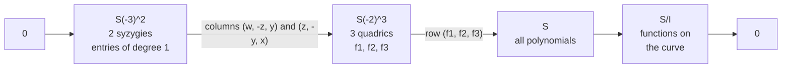
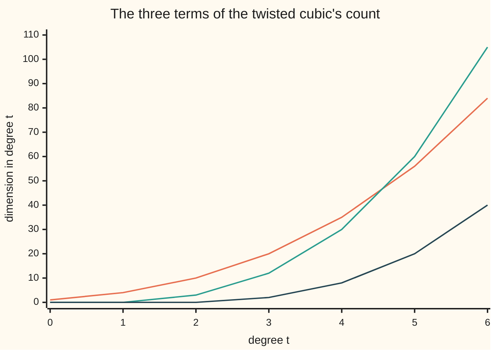

# Hilbert's syzygy theorem: every module over a polynomial ring has a free resolution of length at most the number of variables

[Syllabus](../../../SYLLABUS.md) → [Algebraic geometry](../README.md) → [Exact Sequences, Ext and Tor](../README.md#s07) → Hilbert's syzygy theorem

---

## General Overview

Design software draws a bend in a pipe as a cubic path. The simplest one is the **twisted cubic**, the path $`(u, u^2, u^3)`$ of the [Degree](../02-Affine%20and%20Projective%20Varieties/09-degree-and-the-hilbert-polynomial.md) card. In projective coordinates it is the set of points $`(x : y : z : w) = (1 : u : u^2 : u^3)`$, plus one point at infinity. It is the same curve as on that card, with the coordinates named in a different order.

Three equations cut it out. Each says that two ratios agree, since on the curve $`y/x = z/y = w/z = u`$:

- $`f_1 = xz - y^2`$
- $`f_2 = xw - yz`$
- $`f_3 = yw - z^2`$

The three equations are tied together. Take the point (1, 2, 3, 4), which is not on the curve. There the equations read −1, −2 and −1. Now combine them with the coordinates as weights: $`w f_1 - z f_2 + y f_3 = 4(-1) - 3(-2) + 2(-1) = 0`$. This is no accident of the point. The combination is 0 at every point of space, as polynomials. A second one, $`z f_1 - y f_2 + x f_3`$, is also identically 0. A relation of this kind among equations is a **syzygy**, from a Greek word for "yoked together".

Relations matter because they spoil counts. Multiply each quadric by x, y, z and w: 12 cubic equations hold on the curve, but only 10 are independent, because the two syzygies make two combinations vanish. Each layer of relations corrects the count of the layer before. Relations among relations could go on forever. David Hilbert proved in 1890 that they stop: with n variables, after at most n layers. Here n = 4, and the layers stop after 2, because the two syzygies have no relation between them.

**Every finitely generated module (a system of elements that can be added and multiplied by polynomials) over a polynomial ring in n variables over a field has a free resolution, a chain of relations among relations, that ends after at most n steps; its ranks and degrees, the Betti numbers, give the module's Hilbert function (its count of independent elements in each degree) as a finite alternating sum.**

**What kind of fact this is:** a theorem, proved on this card in Why it works for graded modules, by the Koszul complex and Tor, given that Tor can be computed by resolving either side (stated on the Tor card, proved in Weibel, section 2.7); the ungraded case is stated with its source. Schreyer's algorithm, which computes the syzygies, is a theorem too, stated with its proof idea in a fold. The twisted cubic's resolution is computed and checked exactly by both programs.

### The picture: the twisted cubic's resolution



Read it from the right. All polynomials map onto the functions on the curve. What dies is the ideal of the three quadrics. The relations among the quadrics are the two syzygies. Nothing relates the syzygies, so the chain starts with 0: length 2, below the bound of 4.

---

## The formula

Notation from earlier cards, one line each. The field k is ℚ, so all arithmetic is exact. $`S = k[x, y, z, w]`$ is the ring of polynomials in the n = 4 variables. The ideal $`I = \langle f_1, f_2, f_3 \rangle`$ is all combinations $`a_1 f_1 + a_2 f_2 + a_3 f_3`$ with polynomial weights. A **module** over S adds and is multiplied by polynomials ([Modules](../06-Schemes%20and%20Modern%20Language/05-modules-and-the-structure-theorem.md)); $`S^r`$, lists of r polynomials, is a free one. An **exact sequence** is a chain of maps where each map's image is exactly the next map's kernel ([Exact sequences of modules](01-exact-sequences-and-the-snake-lemma.md)).

New on this card. A **graded** module is one sorted by degree, as polynomials are. $`S(-a)`$ is S with every degree raised by a, so its generator 1 counts as degree a. A **syzygy** is a list $`(a_1, a_2, a_3)`$ with $`a_1 f_1 + a_2 f_2 + a_3 f_3 = 0`$. A **free resolution** of a module M is an exact sequence of free modules ending in M. For the twisted cubic, with $`M = S/I`$, it reads:

```math
0 \longrightarrow S(-3)^2 \xrightarrow{\ \varphi_2\ } S(-2)^3 \xrightarrow{\ \varphi_1\ } S \longrightarrow S/I \longrightarrow 0, \qquad \varphi_1 = \begin{pmatrix} f_1 & f_2 & f_3 \end{pmatrix}, \quad \varphi_2 = \begin{pmatrix} w & z \\ -z & -y \\ y & x \end{pmatrix}
```

**Read it aloud:** the polynomials on the curve are all polynomials modulo the three quadrics; the quadrics' relations are the two columns of the matrix; and the only relation among those columns is zero.

The shifts record degrees: each quadric has degree 2, and each syzygy, linear weights on quadrics, has degree 3.

Hilbert's theorem says the same holds for every finitely generated graded module M over $`S = k[x_1, \dots, x_n]`$:

```math
0 \to F_p \to \cdots \to F_1 \to F_0 \to M \to 0, \qquad F_i = \bigoplus_j S(-j)^{\beta_{i,j}}, \qquad p \le n
```

**Read it aloud:** M has a free resolution whose i-th module is a sum of shifted copies of S, $`\beta_{i,j}`$ copies shifted by j, and the chain stops after p steps, where p is at most the number of variables.

The **Betti numbers** $`\beta_{i,j}`$ count the generators of step i in degree j. They borrow their name from topology's Betti numbers (wing 17), but here they count relations, not holes. In each degree t the sequence is exact, so the dimensions alternate to zero, and the Hilbert function of M follows:

```math
\mathrm{HF}_M(t) = \sum_{i=0}^{p} (-1)^i \sum_j \beta_{i,j} \binom{t - j + n - 1}{n - 1}
```

**Read it aloud:** the number of independent degree-t elements of M is the count of degree-t elements in each free module, added and subtracted step by step.

Each binomial counts the monomials of degree t − j in n variables, and reads 0 when t < j. For the twisted cubic:

```math
\mathrm{HF}(t) = \binom{t+3}{3} - 3\binom{t+1}{3} + 2\binom{t}{3} = 3t + 1
```

That gives 4, 7 and 10 in degrees 1, 2 and 3, as on the [Degree](../02-Affine%20and%20Projective%20Varieties/09-degree-and-the-hilbert-polynomial.md) card.

| Symbol | Plain meaning | In our example | Push it up and the answer… |
| --- | --- | --- | --- |
| $`k`$; $`S`$, $`n`$ | the field; the polynomial ring; its number of variables | ℚ; $`k[x, y, z, w]`$; 4 | the bound n rises |
| $`x, y, z, w`$; $`u`$ | coordinates; the curve's parameter | $`(1 : u : u^2 : u^3)`$ | — |
| $`f_1, f_2, f_3`$; $`I`$; $`\mathrm{LT}`$ | the three equations; their ideal; leading term in lex order | $`xz - y^2`$, $`xw - yz`$, $`yw - z^2`$; LT xz, xw, yw | more equations, more relations |
| $`M`$ | a finitely generated graded module | $`S/I`$, functions on the curve | — |
| $`e_1, e_2, e_3`$; $`(a_1, a_2, a_3)`$ | slots standing for $`f_1, f_2, f_3`$; a syzygy | $`(w, -z, y)`$ | — |
| $`S(-a)`$ | S with degrees raised by a | $`S(-2)`$ for a quadric | later degrees, smaller counts |
| $`F_i`$, $`\varphi_i`$ | the free modules and maps of the resolution | $`F_1 = S(-2)^3`$ | — |
| $`p`$ | the length: the last step with a nonzero module | 2 | at most n |
| $`\beta_{i,j}`$ | Betti numbers: generators of step i in degree j | $`\beta_{1,2} = 3`$, $`\beta_{2,3} = 2`$ | more terms in the sum |
| $`\mathfrak{m}`$; $`\mathrm{Tor}_i(M, k)`$ | the ideal $`\langle x, y, z, w \rangle`$; Tor against the field | $`\dim \mathrm{Tor}_2(M, k) = 2`$ | equals the Betti count |
| $`\mathrm{HF}_M(t)`$; $`t`$, $`d`$ | the Hilbert function; a degree | $`3t + 1`$; 0 to 6 in the code | a polynomial in t for large t |

### When it holds

- **A polynomial ring over a field.** Over the ring ℤ/4, the module ℤ/2 has no finite resolution. Its first relation is "2 is 0", the kernel of doubling is {0, 2} again, and the chain repeats forever. The [Tor](04-free-resolutions-and-tor.md) card met ℤ/4 as a module over ℤ, where one step suffices; used as the ring itself, it never stops.
- **Finitely generated.** [Hilbert's basis theorem](../01-Polynomial%20Systems/08-hilbert-basis-theorem.md) makes every module of relations finitely generated, so each step has finitely many generators. Without it a step can need infinitely many.
- **Graded, for Betti numbers.** Without homogeneous equations a free resolution of length at most n still exists, but shifts and Betti numbers lose their meaning.
- **At most n, not exactly n.** The twisted cubic stops at 2. The field k itself, as $`S/\mathfrak{m}`$, needs all 4 steps.

---

## Why it works

### Step 0: count with free modules, then correct

A free module is easy to count: $`S(-a)`$ has $`\binom{t - a + 3}{3}`$ independent elements of degree t. So cover a module by a free one, correct by the free module of its relations, correct those in turn, and ask whether this stops.

Two facts make it stop. Tor counts the steps of a minimal resolution. And Tor can be computed from a resolution of the field k instead, which needs only n steps, one per variable.

### Step 1: syzygies from S-polynomials

The [Grobner bases](../01-Polynomial%20Systems/03-grobner-bases-and-buchberger.md) card builds an S-polynomial: two equations multiplied to make their leading terms equal, then subtracted. In the lex order with x > y > z > w, the leading terms of $`f_1, f_2, f_3`$ are xz, xw and yw. The S-polynomials divide to remainder 0, so the three quadrics are already a Grobner basis.

Each division to 0 is a relation. Pair 1 and 2 share the leading monomial xzw:

```math
w f_1 - z f_2 = -y^2 w + y z^2 = -y\, f_3, \qquad \text{so} \qquad w f_1 - z f_2 + y f_3 = 0
```

Pair 2 and 3 give $`y f_2 - x f_3 = z f_1`$, the relation $`z f_1 - y f_2 + x f_3 = 0`$. Pair 1 and 3 give $`(yw - z^2) f_1 - (xz - y^2) f_3 = 0`$, which holds for any two equations.

Schreyer's theorem says the relations from all S-pairs generate every syzygy. Substituted back, each gives 0 in the code.

<details>
<summary>Detailed proof idea: why the S-pair relations generate every syzygy</summary>

Order the terms $`m\, e_k`$ of a syzygy by the monomial $`m \cdot \mathrm{LT}(f_k)`$, where LT is the leading term, breaking ties toward the smaller k. This is Schreyer's order.

Take any syzygy and its largest term $`m\, e_k`$. The product $`m\, \mathrm{LT}(f_k)`$ must cancel against another term with the same product, $`m'\, e_l`$. So that monomial is a multiple of the least common multiple of $`\mathrm{LT}(f_k)`$ and $`\mathrm{LT}(f_l)`$, and a multiple of the S-pair relation for k and l has the same leading term.

Subtract that multiple. The leading term drops. Monomial orders have no endless descending chains, so after finitely many subtractions the syzygy is 0. It was therefore a combination of S-pair relations. Eisenbud's Theorem 15.10 adds that these relations are a Grobner basis of the syzygy module in Schreyer's order.

</details>

### Step 2: keep only what is needed

Schreyer's method gives three relations, but the third is not needed. It equals y times the first minus z times the second:

```math
\big(yw - z^2,\ 0,\ y^2 - xz\big) = y\,(w, -z, y) - z\,(z, -y, x)
```

A resolution is **minimal** when no generator is a combination of the others. Then every matrix entry lies in $`\mathfrak{m} = \langle x, y, z, w \rangle`$: no nonzero constants. [Nakayama's lemma](03-nakayamas-lemma.md), in its graded form, says the minimal number of generators of a graded module N is the dimension of $`N / \mathfrak{m} N`$, the module with every multiple of x, y, z, w set to 0. So the Betti numbers do not depend on choices.

The code checks that two are enough. In each degree d from 2 to 6, it counts all relations by exact rank and finds $`2\binom{d}{3}`$. The multiples of the two syzygies give the same number.

### Step 3: the two syzygies are free, so the chain stops

In Schreyer's order the two syzygies lead with $`w\, e_1`$ and $`y\, e_2`$. Dropping the third syzygy loses nothing here either: its lead $`yw\, e_1`$ is a multiple of $`w\, e_1`$, so the two still form a Grobner basis of the relations. They sit in different slots. An S-pair needs two leading terms in the same slot, so there is none. Schreyer's theorem then says the module of relations between the syzygies is 0.

The rank count agrees. The multiples of the two syzygies in degree d number $`2\binom{d}{3}`$, and all are independent. So $`\varphi_2`$ loses nothing, and the resolution ends at length 2.

### Step 4: Hilbert's bound for every module

Take any minimal resolution of M and replace each polynomial by its value at 0. This is the tensor product with $`k = S/\mathfrak{m}`$. Every matrix entry lies in $`\mathfrak{m}`$, so every map becomes 0. The homology of the result is then the free modules themselves:

```math
\dim_k \mathrm{Tor}_i(M, k)_j = \beta_{i,j}
```

**Read it aloud:** the dimension of the i-th Tor of M against the field, in degree j, is the Betti number.

The [Tor](04-free-resolutions-and-tor.md) card states that Tor can be computed by resolving either side, a fact called balance, which Weibel proves in section 2.7. So resolve k instead. Its resolution is the **Koszul complex**: free modules on the subsets of the variables, with each subset mapping to its sub-subsets with alternating signs. In four variables:

```math
0 \to S(-4) \to S(-3)^4 \to S(-2)^6 \to S(-1)^4 \to S \to k \to 0
```

It has n + 1 = 5 free modules, one per subset size from 0 to 4, so it stops at step n. Tor computed from it is 0 beyond step n. So $`\beta_{i,j} = 0`$ for every i > n: the minimal resolution of any graded M has length at most n. A module with no grading has no minimal resolution of this kind; Eisenbud (chapter 15) proves its bound with Schreyer's method instead, ordering the work so that after each step one more variable is missing from the leading terms.

<details>
<summary>Detailed proof: why the Koszul complex resolves k</summary>

With one variable the complex is $`0 \to S(-1) \to S \to S/\langle x_1 \rangle \to 0`$, the map multiplying by $`x_1`$. It is exact because multiplying by $`x_1`$ kills nothing.

Add one variable at a time. The complex on $`x_1, \dots, x_r`$ is built from two copies of the complex on $`x_1, \dots, x_{r-1}`$, joined by multiplication by $`x_r`$. Its long exact sequence of homology (the [Exact sequences of modules](01-exact-sequences-and-the-snake-lemma.md) card) has the step

$`\displaystyle 0 \to S/\langle x_1, \dots, x_{r-1} \rangle \xrightarrow{\ x_r\ } S/\langle x_1, \dots, x_{r-1} \rangle \to S/\langle x_1, \dots, x_r \rangle \to 0.`$

By induction the smaller complex is exact except at the end, where it leaves $`S/\langle x_1, \dots, x_{r-1} \rangle`$. That quotient is a polynomial ring in the remaining variables, so multiplying by $`x_r`$ kills nothing in it. So the bigger complex is exact too, and after n steps it resolves $`S/\mathfrak{m} = k`$.

</details>

The code computes Tor this way for the twisted cubic: it builds the Koszul complex on top of $`S/I`$ and takes ranks. It finds $`\beta_{0,0} = 1`$, $`\beta_{1,2} = 3`$, $`\beta_{2,3} = 2`$, and nothing in steps 3 and 4, in the degrees 0 to 6 it computes. That road never builds a resolution, so it checks Steps 1 to 3 independently.

### Step 5: the alternating sum gives the Hilbert function

In each degree t the resolution is an exact sequence of finite-dimensional spaces. The dimensions then add to zero with alternating signs, by rank-nullity, so the formula follows. At t = 3: 20 monomials, minus 12 multiples of the quadrics, plus 2 relations among the multiples, gives 10.



Orange: all monomials of degree t, the size of S. Green and dark blue are sizes of free modules, not counts of independent polynomials. Green: $`S(-2)^3`$, the formal multiples of the three quadrics, $`3\binom{t+1}{3}`$; it passes orange at t = 6, 105 against 84, because those multiples are not independent. Dark blue: $`S(-3)^2`$, the relations among those multiples, $`2\binom{t}{3}`$. Orange minus green plus dark blue is $`3t + 1`$. Both checks print every point.

Each binomial $`\binom{t - j + n - 1}{n - 1}`$ is a polynomial in t once t ≥ j. A resolution has finitely many terms, so the Hilbert function is a polynomial for all large t. That was Hilbert's own reason for the syzygy theorem: it proves that the Hilbert polynomial exists. Here it is $`3t + 1`$: dimension 1, degree 3.

### Step 6: the bound is reached

The field k itself needs every step. Its Betti numbers are the Koszul ranks 1, 4, 6, 4, 1. The code computes them as the Tor of k against k and asserts that they equal the binomial counts $`\binom{4}{i}`$. So n cannot be lowered.

---

## Worked numbers, by hand

| Step | Arithmetic | Value |
| --- | --- | --- |
| cubic monomials in x, y, z, w | $`\binom{6}{3}`$ | 20 |
| multiples of the three quadrics | 3 quadrics × 4 variables | 12 |
| relations among those multiples | the two syzygies, each of degree 3 | 2 |
| independent cubics that vanish on the curve | 12 − 2 | 10 |
| cubic functions on the curve | 20 − 12 + 2 | **10** |
| the same count in degrees 1 and 2 | 4 − 0 + 0; 10 − 3 + 0 | 4; 7 |
| relations among the syzygies | different Schreyer slots: no S-pair | 0 |
| length of the resolution | steps 0, 1, 2 | **2**, at most 4 |

There are 10 independent cubic functions on the twisted cubic, and the bookkeeping that proves it ends after two corrections. The count grows by 3 per degree, so the curve has degree 3.

### What breaks if you drop a piece

| Mistake | Comes out at | What went wrong |
| --- | --- | --- |
| Drop the shifts: use S for every step | 0 at t = 3, not 10 | 1 − 3 + 2 = 0 copies of $`\binom{6}{3}`$ |
| Ignore the syzygies: 1, then 3 | 8 at t = 3, −21 at t = 6 | 12 multiples are only 10 independent; a count cannot be negative |
| Keep Schreyer's third syzygy | 14 at t = 4, not 13 | a non-minimal resolution needs another step to cancel it |
| Resolve ℤ/2 over the ring ℤ/4 | the kernel of doubling is {0, 2} at every step | ℤ/4 is not a polynomial ring over a field; the chain never ends |

The code prints every row.

---

## Code, from first principles, and it actually runs

The code works exactly over ℚ: polynomials map exponents to integers, and ranks come from integer row reduction. It takes three independent roads to the resolution. Schreyer's road divides each S-polynomial and substitutes every syzygy back. The rank road counts every relation in degrees 2 to 6 and checks that the two syzygies span them, independently. The Koszul road computes Tor and the Betti numbers without building any resolution. The Hilbert function is then found three ways: from the Betti numbers, from monomials minus the rank of the ideal, and from standard monomials, those not divisible by xz, xw or yw.

### Python

```python
# Hilbert's syzygy theorem -- the check behind the card.  Standard library only.
# The twisted cubic: S = Q[x, y, z, w], I = <xz - y^2, xw - yz, yw - z^2>, order lex x > y > z > w.
# Road 1: Schreyer's method turns each S-polynomial reduction into a syzygy (a relation).
# Road 2: exact ranks count every relation in each degree and test that two generate them all.
# Road 3: Koszul homology gives the Betti numbers by a route that never builds a resolution.
from itertools import combinations
from math import comb, gcd, prod
V = 4
def mm(a, b): return tuple(u + v for u, v in zip(a, b))
def add(p, q, c=1):
    r = dict(p)
    for m, a in q.items():
        r[m] = r.get(m, 0) + c * a
        if r[m] == 0: del r[m]
    return r
def mul(p, q):
    r = {}
    for m, c in q.items(): r = add(r, {mm(k, m): c * v for k, v in p.items()})
    return r
def lt(p): return max(p)                # lex: tuples compare powers of x, then y, z, w
def divides(a, b): return all(u <= v for u, v in zip(a, b))
def quo(b, a): return tuple(v - u for u, v in zip(a, b))
def var(i): return {tuple(int(k == i) for k in range(V)): 1}
x, y, z, w = (var(i) for i in range(V))
F = [add(mul(x, z), mul(y, y), -1), add(mul(x, w), mul(y, z), -1), add(mul(y, w), mul(z, z), -1)]
def divide(p, G):                       # division algorithm; every leading coefficient here is +1 or -1
    q, r = [{} for _ in G], {}
    while p:
        m = lt(p); c = p[m]
        for k, g in enumerate(G):
            if divides(lt(g), m):
                t = {quo(m, lt(g)): c * g[lt(g)]}
                q[k] = add(q[k], t); p = add(p, mul(t, g), -1); break
        else:
            r[m] = c; del p[m]
    return q, r
def mstr(m): return ''.join(v + (f'^{e}' if e > 1 else '') for v, e in zip('xyzw', m) if e) or '1'
def pstr(p):
    s = ''
    for m in sorted(p, reverse=True):
        c, t = p[m], mstr(m)
        b = t if abs(c) == 1 and t != '1' else str(abs(c)) + (t if t != '1' else '')
        s += ((' - ' if c < 0 else ' + ') if s else ('-' if c < 0 else '')) + b
    return s or '0'
def vstr(v): return '(' + ', '.join(pstr(p) for p in v) + ')'
def slt(v, G):                          # Schreyer's order: m e_k ranks by m * LT(g_k), ties to the smaller k
    return max((mm(m, lt(G[k])), -k, m, k) for k, p in enumerate(v) for m in p)
def schreyer(G):
    out = []
    for i, j in combinations(range(len(G)), 2):
        L = tuple(max(a, b) for a, b in zip(lt(G[i]), lt(G[j])))
        ti, tj = {quo(L, lt(G[i])): G[j][lt(G[j])]}, {quo(L, lt(G[j])): -G[i][lt(G[i])]}
        q, r = divide(add(mul(ti, G[i]), mul(tj, G[j])), G)
        v = [add(add(ti if k == i else {}, tj if k == j else {}), q[k], -1) for k in range(len(G))]
        p0 = next(p for p in v if p)
        out.append(((i + 1, j + 1), r, v if p0[lt(p0)] > 0 else [{u: -c for u, c in p.items()} for p in v]))
    return out
def monos(d, n=V):
    if d < 0: return []
    return [(d,)] if n == 1 else [(a,) + m for a in range(d, -1, -1) for m in monos(d - a, n - 1)]
def rank(rows):                         # exact rank over Q: integer elimination, each row divided by its gcd
    rows, rk = [r[:] for r in rows if any(r)], 0
    for c in range(len(rows[0]) if rows else 0):
        piv = next((i for i in range(rk, len(rows)) if rows[i][c]), None)
        if piv is None: continue
        rows[rk], rows[piv] = rows[piv], rows[rk]
        for i in range(rk + 1, len(rows)):
            if rows[i][c]:
                a, b = rows[rk][c], rows[i][c]
                row = [a * u - b * v for u, v in zip(rows[i], rows[rk])]
                g = gcd(*row)
                rows[i] = [u // g for u in row] if g else row
        rk += 1
    return rk
def rank_I(d, gens):                    # rank of the degree-d part of the ideal: all monomial multiples
    return rank([[mul(f, {m: 1}).get(c, 0) for c in monos(d)] for f in gens for m in monos(d - 2)])
def rank_syz(d, syz):                   # rank of the degree-d multiples of the syzygies, coordinates in S^3
    return rank([[mul(p, {m: 1}).get(c, 0) for p in s for c in monos(d - 2)] for s in syz for m in monos(d - 3)])
def std(e, G): return [m for m in monos(e) if not any(divides(lt(g), m) for g in G)]
def koszul_rank(i, j, G):               # rank of the Koszul map K_i -> K_(i-1) in degree j, over S/<G>
    if i < 1 or i > V or j < i: return 0
    tgt = {bm: n for n, bm in enumerate((B, m) for B in combinations(range(V), i - 1) for m in std(j - i + 1, G))}
    rows = []
    for A in combinations(range(V), i):
        for m in std(j - i, G):
            row = [0] * len(tgt)
            for r, a in enumerate(A):
                for u, c in divide({mm(m, lt(var(a))): 1}, G)[1].items():
                    row[tgt[(A[:r] + A[r + 1:], u)]] += (-1) ** r * c
            rows.append(row)
    return rank(rows)
def tor(i, j, G): return comb(V, i) * len(std(j - i, G)) - koszul_rank(i, j, G) - koszul_rank(i + 1, j, G)
def dimS(e): return comb(e + 3, 3) if e >= 0 else 0
def ev(p, pt): return sum(c * prod(b ** e for b, e in zip(pt, m)) for m, c in p.items())
def hf(betti, t): return sum((-1) ** i * sum(dimS(t - a) for a in shifts) for i, shifts in enumerate(betti))

print("generators: " + ", ".join(pstr(f) for f in F) + "; leading terms " + ", ".join(mstr(lt(f)) for f in F))
syz = schreyer(F)
for pair, r, v in syz:
    _, _, m, k = slt(v, F)
    back = add(add(mul(v[0], F[0]), mul(v[1], F[1])), mul(v[2], F[2]))
    print(f"S-pair {pair}: remainder {pstr(r)}; syzygy {vstr(v)}, Schreyer lead {mstr(m)} e{k + 1}, put back: {pstr(back)}")
s12, s23, s13 = syz[0][2], syz[2][2], syz[1][2]
combo = [add(mul(y, a), mul(z, b), -1) for a, b in zip(s12, s23)]
pt, vals = (1, 2, 3, 4), [ev(f, (1, 2, 3, 4)) for f in F]
print(f"at (1, 2, 3, 4): f = {vals}; first relation {sum(ev(a, pt) * b for a, b in zip(s12, vals))}, "
      f"second {sum(ev(a, pt) * b for a, b in zip(s23, vals))}")
print(f"third syzygy = y*(first) - z*(second): {'yes' if combo == s13 else 'no'}; minimal syzygies: 2, both of degree 3")
ks, ls = [], []
for d in range(2, 7):
    ks.append(3 * comb(d + 1, 3) - rank_I(d, F)); ls.append(rank_syz(d, [s12, s23]))
print(f"degree d = 2..6: all relations {ks}, spanned by the two {ls}, 2C(d,3) = {[2 * comb(d, 3) for d in range(2, 7)]}")
table = [[tor(i, j, F) for j in range(7)] for i in range(V + 1)]
for i in range(V + 1):
    print(f"Koszul road, Tor_{i}(S/I, k) in degrees 0..6: {table[i]}")
on_s, on_k = ([sum(tor(i, j, G) for j in range(6)) for i in range(V + 1)] for G in ([], [x, y, z, w]))
print(f"Koszul complex on S: homology {on_s}; on k: Betti {on_k}")
betti, triv = [[0], [2, 2, 2], [3, 3]], [[0], [2, 2, 2], [4, 4, 4], [6]]
r1 = [hf(betti, t) for t in range(7)]
r2 = [dimS(t) - rank_I(t, F) for t in range(7)]
r3 = [len(std(t, F)) for t in range(7)]
print(f"HF(t), t = 0..6: from the resolution {r1}; monomials minus rank {r2}; standard monomials {r3}")
print(f"chart, all monomials {[dimS(t) for t in range(7)]}; first-step multiples 3C(t+1,3) {[3 * dimS(t - 2) for t in range(7)]}; "
      f"relations 2C(t,3) {[2 * dimS(t - 3) for t in range(7)]}")
print(f"t = 3 by hand: 20 - 12 + 2 = {dimS(3) - 3 * dimS(1) + 2 * dimS(0)}; HP = 3t + 1, degree 3; length 2 <= n = {V}")
print(f"break, twists dropped: (1 - 3 + 2) * C(6,3) = {(1 - 3 + 2) * dimS(3)} at t = 3, not 10")
print(f"break, syzygies ignored (1, 3): HF(3) = {hf([[0], [2, 2, 2]], 3)}, HF(6) = {hf([[0], [2, 2, 2]], 6)}, not 10 and 19")
print(f"break, trivial syzygies only (1, 3, 3, 1): HF(3) = {hf(triv, 3)}, HF(6) = {hf(triv, 6)}, not 10 and 19")
print(f"break, Schreyer's 3 syzygies kept (1, 3, 3): HF(4) = {hf([[0], [2, 2, 2], [3, 3, 4]], 4)}, not 13")
ker2, im2 = [a for a in range(4) if 2 * a % 4 == 0], sorted({2 * a % 4 for a in range(4)})
print(f"break, Z/2 over the ring Z/4: kernel of x2 = {ker2}, image of x2 = {im2}: each step repeats, never ends")
drop = [dimS(t) - rank_I(t, F[:2]) for t in range(1, 5)]
print(f"break, f3 dropped: HF(1..4) = {drop}; resolution 1, 2, 1 predicts {[hf([[0], [2, 2], [4]], t) for t in range(1, 5)]}; degree 4")
assert all(not r for _, r, _ in syz) and combo == s13                      # Buchberger, then the redundant third
assert all(not add(add(mul(v[0], F[0]), mul(v[1], F[1])), mul(v[2], F[2])) for _, _, v in syz)
assert ks == ls == [2 * comb(d, 3) for d in range(2, 7)]                    # two syzygies give every relation
assert table[0][0] == 1 and table[1][2] == 3 and table[2][3] == 2 and sum(map(sum, table)) == 6 and on_k == [comb(V, i) for i in range(V + 1)]
assert r1 == r2 == r3 == [3 * t + 1 for t in range(7)]                      # three roads to HF
assert drop == [hf([[0], [2, 2], [4]], t) for t in range(1, 5)] == [4, 8, 12, 16]
print("ALL CHECKS PASS")
```

**Ran 2026-11-24 on macOS, Python 3.14.10, standard library only. All checks passed. Output, pasted from the run:**

```
generators: xz - y^2, xw - yz, yw - z^2; leading terms xz, xw, yw
S-pair (1, 2): remainder 0; syzygy (w, -z, y), Schreyer lead w e1, put back: 0
S-pair (1, 3): remainder 0; syzygy (yw - z^2, 0, -xz + y^2), Schreyer lead yw e1, put back: 0
S-pair (2, 3): remainder 0; syzygy (z, -y, x), Schreyer lead y e2, put back: 0
at (1, 2, 3, 4): f = [-1, -2, -1]; first relation 0, second 0
third syzygy = y*(first) - z*(second): yes; minimal syzygies: 2, both of degree 3
degree d = 2..6: all relations [0, 2, 8, 20, 40], spanned by the two [0, 2, 8, 20, 40], 2C(d,3) = [0, 2, 8, 20, 40]
Koszul road, Tor_0(S/I, k) in degrees 0..6: [1, 0, 0, 0, 0, 0, 0]
Koszul road, Tor_1(S/I, k) in degrees 0..6: [0, 0, 3, 0, 0, 0, 0]
Koszul road, Tor_2(S/I, k) in degrees 0..6: [0, 0, 0, 2, 0, 0, 0]
Koszul road, Tor_3(S/I, k) in degrees 0..6: [0, 0, 0, 0, 0, 0, 0]
Koszul road, Tor_4(S/I, k) in degrees 0..6: [0, 0, 0, 0, 0, 0, 0]
Koszul complex on S: homology [1, 0, 0, 0, 0]; on k: Betti [1, 4, 6, 4, 1]
HF(t), t = 0..6: from the resolution [1, 4, 7, 10, 13, 16, 19]; monomials minus rank [1, 4, 7, 10, 13, 16, 19]; standard monomials [1, 4, 7, 10, 13, 16, 19]
chart, all monomials [1, 4, 10, 20, 35, 56, 84]; first-step multiples 3C(t+1,3) [0, 0, 3, 12, 30, 60, 105]; relations 2C(t,3) [0, 0, 0, 2, 8, 20, 40]
t = 3 by hand: 20 - 12 + 2 = 10; HP = 3t + 1, degree 3; length 2 <= n = 4
break, twists dropped: (1 - 3 + 2) * C(6,3) = 0 at t = 3, not 10
break, syzygies ignored (1, 3): HF(3) = 8, HF(6) = -21, not 10 and 19
break, trivial syzygies only (1, 3, 3, 1): HF(3) = 8, HF(6) = 8, not 10 and 19
break, Schreyer's 3 syzygies kept (1, 3, 3): HF(4) = 14, not 13
break, Z/2 over the ring Z/4: kernel of x2 = [0, 2], image of x2 = [0, 2]: each step repeats, never ends
break, f3 dropped: HF(1..4) = [4, 8, 12, 16]; resolution 1, 2, 1 predicts [4, 8, 12, 16]; degree 4
ALL CHECKS PASS
```

### Rust

Same numbers, same labels. Integers are `i128`, and the products in `mul` and `rank` use `checked_mul`, so an overflow there stops the run.

```rust
// Hilbert's syzygy theorem -- the same check as the Python, in Rust.  No crates.
// The twisted cubic: S = Q[x, y, z, w], I = <xz - y^2, xw - yz, yw - z^2>, order lex x > y > z > w.
// Road 1: Schreyer's method turns each S-polynomial reduction into a syzygy (a relation).
// Road 2: exact ranks count every relation in each degree and test that two generate them all.
// Road 3: Koszul homology gives the Betti numbers by a route that never builds a resolution.
// Integers are i128; the products in mul and rank use checked_mul, so an overflow there stops the run.
use std::collections::BTreeMap;
type M = [i64; 4];
type P = BTreeMap<M, i128>;
const V: usize = 4;
fn mm(a: &M, b: &M) -> M { [a[0] + b[0], a[1] + b[1], a[2] + b[2], a[3] + b[3]] }
fn add(p: &P, q: &P, c: i128) -> P { let mut r = p.clone();
    for (m, a) in q { let e = r.entry(*m).or_insert(0); *e += c * a; if *e == 0 { r.remove(m); } }
    r }
fn mul(p: &P, q: &P) -> P { let mut r = P::new();
    for (m, c) in q { let t: P = p.iter().map(|(k, v)| (mm(k, m), c.checked_mul(*v).unwrap())).collect(); r = add(&r, &t, 1); }
    r }
fn lt(p: &P) -> M { *p.keys().next_back().unwrap() }      // lex: arrays compare powers of x, then y, z, w
fn divides(a: &M, b: &M) -> bool { (0..V).all(|i| a[i] <= b[i]) }
fn quo(b: &M, a: &M) -> M { [b[0] - a[0], b[1] - a[1], b[2] - a[2], b[3] - a[3]] }
fn unit(i: usize) -> M { let mut m = [0; 4]; m[i] = 1; m }
fn one(m: M, c: i128) -> P { P::from([(m, c)]) }
fn divide(p: &P, g: &[P]) -> (Vec<P>, P) {   // division algorithm; every leading coefficient is +1 or -1
    let (mut p, mut q, mut r) = (p.clone(), vec![P::new(); g.len()], P::new());
    while !p.is_empty() {
        let (m, c) = (lt(&p), p[&lt(&p)]);
        match (0..g.len()).find(|&k| divides(&lt(&g[k]), &m)) {
            Some(k) => { let t = one(quo(&m, &lt(&g[k])), c * g[k][&lt(&g[k])]);
                         q[k] = add(&q[k], &t, 1); p = add(&p, &mul(&t, &g[k]), -1); }
            None => { r.insert(m, c); p.remove(&m); }
        }
    }
    (q, r) }
fn mstr(m: &M) -> String {
    let s: String = (0..V).filter(|&i| m[i] > 0).map(|i| format!("{}{}", ["x", "y", "z", "w"][i],
        if m[i] > 1 { format!("^{}", m[i]) } else { String::new() })).collect();
    if s.is_empty() { "1".to_string() } else { s } }
fn pstr(p: &P) -> String {
    let mut s = String::new();
    for (m, c) in p.iter().rev() {
        let t = mstr(m);
        let b = if c.abs() == 1 && t != "1" { t.clone() } else { format!("{}{}", c.abs(), if t != "1" { t.as_str() } else { "" }) };
        let sign = if !s.is_empty() { if *c < 0 { " - " } else { " + " } } else if *c < 0 { "-" } else { "" };
        s += &format!("{}{}", sign, b);
    }
    if s.is_empty() { "0".to_string() } else { s }
}
fn vstr(v: &[P]) -> String { format!("({})", v.iter().map(pstr).collect::<Vec<_>>().join(", ")) }
fn slt(v: &[P], g: &[P]) -> (M, usize) {   // Schreyer's order: m e_k ranks by m * LT(g_k), ties to the smaller k
    let b = v.iter().enumerate().flat_map(|(k, p)| p.keys().map(move |m| (mm(m, &lt(&g[k])), -(k as i64), *m, k))).max().unwrap(); (b.2, b.3) }
fn combos(lo: usize, k: usize) -> Vec<Vec<usize>> {   // k-element subsets of lo..V, in increasing order
    if k == 0 { return vec![vec![]]; }
    (lo..V).flat_map(|a| combos(a + 1, k - 1).into_iter().map(move |c| [vec![a], c].concat())).collect()
}
fn schreyer(g: &[P]) -> Vec<((usize, usize), P, Vec<P>)> { let mut out = vec![];
    for (i, j) in [(0, 1), (0, 2), (1, 2)] {
        let (a, b) = (lt(&g[i]), lt(&g[j]));
        let l: M = [a[0].max(b[0]), a[1].max(b[1]), a[2].max(b[2]), a[3].max(b[3])];
        let (ti, tj) = (one(quo(&l, &a), g[j][&b]), one(quo(&l, &b), -g[i][&a]));
        let (q, r) = divide(&add(&mul(&ti, &g[i]), &mul(&tj, &g[j]), 1), g);
        let base = |k: usize| if k == i { ti.clone() } else if k == j { tj.clone() } else { P::new() };
        let mut v: Vec<P> = (0..g.len()).map(|k| add(&base(k), &q[k], -1)).collect();
        let p0 = v.iter().find(|p| !p.is_empty()).unwrap().clone();
        if p0[&lt(&p0)] < 0 { v = v.iter().map(|p| add(&P::new(), p, -1)).collect(); }
        out.push(((i + 1, j + 1), r, v));
    }
    out
}
fn monos(d: i64, n: usize) -> Vec<Vec<i64>> {
    if d < 0 { return vec![]; } if n == 1 { return vec![vec![d]]; }
    (0..=d).rev().flat_map(|a| monos(d - a, n - 1).into_iter().map(move |m| [vec![a], m].concat())).collect()
}
fn ms(d: i64) -> Vec<M> { monos(d, V).iter().map(|m| [m[0], m[1], m[2], m[3]]).collect() }
fn gcd(a: i128, b: i128) -> i128 { if b == 0 { a.abs() } else { gcd(b, a % b) } }
fn rank(rows: Vec<Vec<i128>>) -> usize {     // exact rank over Q: integer elimination, each row divided by its gcd
    let (mut rows, mut rk): (Vec<Vec<i128>>, usize) = (rows.into_iter().filter(|r| r.iter().any(|&u| u != 0)).collect(), 0);
    for c in 0..rows.first().map_or(0, |r| r.len()) {
        let piv = match (rk..rows.len()).find(|&i| rows[i][c] != 0) { Some(p) => p, None => continue };
        rows.swap(rk, piv);
        for i in rk + 1..rows.len() {
            let (a, b) = (rows[rk][c], rows[i][c]); if b == 0 { continue; }
            let row: Vec<i128> = rows[i].iter().zip(&rows[rk]).map(|(u, v)| a.checked_mul(*u).unwrap() - b.checked_mul(*v).unwrap()).collect();
            let g = row.iter().fold(0, |g, &u| gcd(g, u));
            rows[i] = if g != 0 { row.iter().map(|u| u / g).collect() } else { row };
        }
        rk += 1;
    }
    rk
}
fn coords(p: &P, cols: &[M]) -> Vec<i128> { cols.iter().map(|c| *p.get(c).unwrap_or(&0)).collect() }
fn rank_i(d: i64, gens: &[P]) -> usize {     // rank of the degree-d part of the ideal: all monomial multiples
    rank(gens.iter().flat_map(|f| ms(d - 2).into_iter().map(move |m| coords(&mul(f, &one(m, 1)), &ms(d)))).collect()) }
fn rank_syz(d: i64, syz: &[Vec<P>]) -> usize {   // rank of the degree-d multiples of the syzygies, in S^3
    rank(syz.iter().flat_map(|s| ms(d - 3).into_iter().map(move |m|
        s.iter().flat_map(|p| coords(&mul(p, &one(m, 1)), &ms(d - 2))).collect())).collect()) }
fn std(e: i64, g: &[P]) -> Vec<M> { ms(e).into_iter().filter(|m| !g.iter().any(|f| divides(&lt(f), m))).collect() }
fn koszul_rank(i: usize, j: i64, g: &[P]) -> usize {   // rank of the Koszul map K_i -> K_(i-1) in degree j, over S/<G>
    if i < 1 || i > V || j < i as i64 { return 0; }
    let mut tgt = BTreeMap::new();
    for b in combos(0, i - 1) { for m in std(j - i as i64 + 1, g) { let n = tgt.len(); tgt.insert((b.clone(), m), n); } }
    let mut rows = vec![];
    for a in combos(0, i) { for m in std(j - i as i64, g) {
        let mut row = vec![0i128; tgt.len()];
        for (r, &ar) in a.iter().enumerate() { let mut b = a.clone(); b.remove(r);
            for (u, c) in divide(&one(mm(&m, &unit(ar)), 1), g).1 { row[tgt[&(b.clone(), u)]] += if r % 2 == 0 { c } else { -c }; }
        }
        rows.push(row);
    } }
    rank(rows)
}
fn comb(n: i64, k: i64) -> i64 { if n < k || k < 0 { 0 } else { (0..k).fold(1, |a, i| a * (n - i) / (i + 1)) } }
fn tor(i: usize, j: i64, g: &[P]) -> i64 {
    comb(V as i64, i as i64) * std(j - i as i64, g).len() as i64 - koszul_rank(i, j, g) as i64 - koszul_rank(i + 1, j, g) as i64 }
fn dims(e: i64) -> i64 { if e >= 0 { comb(e + 3, 3) } else { 0 } }
fn ev(p: &P, pt: &[i128; 4]) -> i128 { p.iter().map(|(m, c)| c * (0..V).map(|i| pt[i].pow(m[i] as u32)).product::<i128>()).sum() }
fn hf(betti: &[Vec<i64>], t: i64) -> i64 {
    betti.iter().enumerate().map(|(i, s)| (if i % 2 == 0 { 1 } else { -1 }) * s.iter().map(|a| dims(t - a)).sum::<i64>()).sum() }
fn main() {
    let (x, y, z, w) = (one(unit(0), 1), one(unit(1), 1), one(unit(2), 1), one(unit(3), 1));
    let f = vec![add(&mul(&x, &z), &mul(&y, &y), -1), add(&mul(&x, &w), &mul(&y, &z), -1), add(&mul(&y, &w), &mul(&z, &z), -1)];
    println!("generators: {}; leading terms {}", f.iter().map(pstr).collect::<Vec<_>>().join(", "),
             f.iter().map(|p| mstr(&lt(p))).collect::<Vec<_>>().join(", "));
    let syz = schreyer(&f);
    let back = |v: &Vec<P>| add(&add(&mul(&v[0], &f[0]), &mul(&v[1], &f[1]), 1), &mul(&v[2], &f[2]), 1);
    for (pair, r, v) in &syz {
        let (m, k) = slt(v, &f);
        println!("S-pair {:?}: remainder {}; syzygy {}, Schreyer lead {} e{}, put back: {}", pair, pstr(r), vstr(v), mstr(&m), k + 1, pstr(&back(v)));
    }
    let (s12, s23, s13) = (syz[0].2.clone(), syz[2].2.clone(), syz[1].2.clone());
    let combo: Vec<P> = (0..3).map(|k| add(&mul(&y, &s12[k]), &mul(&z, &s23[k]), -1)).collect();
    let pt = [1, 2, 3, 4];
    let vals: Vec<i128> = f.iter().map(|p| ev(p, &pt)).collect();
    let rel = |s: &Vec<P>| -> i128 { (0..3).map(|k| ev(&s[k], &pt) * vals[k]).sum() };
    println!("at (1, 2, 3, 4): f = {:?}; first relation {}, second {}", vals, rel(&s12), rel(&s23));
    println!("third syzygy = y*(first) - z*(second): {}; minimal syzygies: 2, both of degree 3", if combo == s13 { "yes" } else { "no" });
    let ks: Vec<i64> = (2..7).map(|d| 3 * comb(d + 1, 3) - rank_i(d, &f) as i64).collect();
    let lsy: Vec<i64> = (2..7).map(|d| rank_syz(d, &[s12.clone(), s23.clone()]) as i64).collect();
    let two: Vec<i64> = (2..7).map(|d| 2 * comb(d, 3)).collect();
    println!("degree d = 2..6: all relations {:?}, spanned by the two {:?}, 2C(d,3) = {:?}", ks, lsy, two);
    let table: Vec<Vec<i64>> = (0..=V).map(|i| (0..7).map(|j| tor(i, j, &f)).collect()).collect();
    for i in 0..=V { println!("Koszul road, Tor_{}(S/I, k) in degrees 0..6: {:?}", i, table[i]); }
    let on_s: Vec<i64> = (0..=V).map(|i| (0..6).map(|j| tor(i, j, &[])).sum()).collect();
    let on_k: Vec<i64> = (0..=V).map(|i| (0..6).map(|j| tor(i, j, &[x.clone(), y.clone(), z.clone(), w.clone()])).sum()).collect();
    println!("Koszul complex on S: homology {:?}; on k: Betti {:?}", on_s, on_k);
    let betti = vec![vec![0], vec![2, 2, 2], vec![3, 3]];
    let row = |g: &dyn Fn(i64) -> i64| (0..7).map(|t| g(t)).collect::<Vec<i64>>();
    let (r1, r2, r3) = (row(&|t| hf(&betti, t)), row(&|t| dims(t) - rank_i(t, &f) as i64), row(&|t| std(t, &f).len() as i64));
    println!("HF(t), t = 0..6: from the resolution {:?}; monomials minus rank {:?}; standard monomials {:?}", r1, r2, r3);
    let (c1, c2, c3) = (row(&dims), row(&|t| 3 * dims(t - 2)), row(&|t| 2 * dims(t - 3)));
    println!("chart, all monomials {:?}; first-step multiples 3C(t+1,3) {:?}; relations 2C(t,3) {:?}", c1, c2, c3);
    println!("t = 3 by hand: 20 - 12 + 2 = {}; HP = 3t + 1, degree 3; length 2 <= n = {}", dims(3) - 3 * dims(1) + 2 * dims(0), V);
    println!("break, twists dropped: (1 - 3 + 2) * C(6,3) = {} at t = 3, not 10", (1 - 3 + 2) * dims(3));
    let (ign, triv) = (vec![vec![0], vec![2, 2, 2]], vec![vec![0], vec![2, 2, 2], vec![4, 4, 4], vec![6]]);
    println!("break, syzygies ignored (1, 3): HF(3) = {}, HF(6) = {}, not 10 and 19", hf(&ign, 3), hf(&ign, 6));
    println!("break, trivial syzygies only (1, 3, 3, 1): HF(3) = {}, HF(6) = {}, not 10 and 19", hf(&triv, 3), hf(&triv, 6));
    println!("break, Schreyer's 3 syzygies kept (1, 3, 3): HF(4) = {}, not 13", hf(&[vec![0], vec![2, 2, 2], vec![3, 3, 4]], 4));
    let ker2: Vec<i64> = (0..4).filter(|a| 2 * a % 4 == 0).collect();
    let mut im2: Vec<i64> = (0..4).map(|a| 2 * a % 4).collect(); im2.sort(); im2.dedup();
    println!("break, Z/2 over the ring Z/4: kernel of x2 = {:?}, image of x2 = {:?}: each step repeats, never ends", ker2, im2);
    let drop: Vec<i64> = (1..5).map(|t| dims(t) - rank_i(t, &f[..2]) as i64).collect();
    let ci: Vec<i64> = (1..5).map(|t| hf(&[vec![0], vec![2, 2], vec![4]], t)).collect();
    println!("break, f3 dropped: HF(1..4) = {:?}; resolution 1, 2, 1 predicts {:?}; degree 4", drop, ci);
    assert!(syz.iter().all(|s| s.1.is_empty()) && combo == s13);          // Buchberger, then the redundant third
    assert!(syz.iter().all(|s| back(&s.2).is_empty()));
    assert!(ks == lsy && lsy == two);                                      // two syzygies give every relation
    assert!(table[0][0] == 1 && table[1][2] == 3 && table[2][3] == 2 && table.iter().flatten().sum::<i64>() == 6 && on_k == (0..=V as i64).map(|i| comb(V as i64, i)).collect::<Vec<i64>>());
    assert!(r1 == r2 && r2 == r3 && r3 == (0..7).map(|t| 3 * t + 1).collect::<Vec<i64>>());   // three roads to HF
    assert!(drop == ci && ci == vec![4, 8, 12, 16]);
    println!("ALL CHECKS PASS");
}
```

**Ran 2026-11-24 on macOS, rustc 1.98.1, no crates. All checks passed. Output, pasted from the run:**

```
generators: xz - y^2, xw - yz, yw - z^2; leading terms xz, xw, yw
S-pair (1, 2): remainder 0; syzygy (w, -z, y), Schreyer lead w e1, put back: 0
S-pair (1, 3): remainder 0; syzygy (yw - z^2, 0, -xz + y^2), Schreyer lead yw e1, put back: 0
S-pair (2, 3): remainder 0; syzygy (z, -y, x), Schreyer lead y e2, put back: 0
at (1, 2, 3, 4): f = [-1, -2, -1]; first relation 0, second 0
third syzygy = y*(first) - z*(second): yes; minimal syzygies: 2, both of degree 3
degree d = 2..6: all relations [0, 2, 8, 20, 40], spanned by the two [0, 2, 8, 20, 40], 2C(d,3) = [0, 2, 8, 20, 40]
Koszul road, Tor_0(S/I, k) in degrees 0..6: [1, 0, 0, 0, 0, 0, 0]
Koszul road, Tor_1(S/I, k) in degrees 0..6: [0, 0, 3, 0, 0, 0, 0]
Koszul road, Tor_2(S/I, k) in degrees 0..6: [0, 0, 0, 2, 0, 0, 0]
Koszul road, Tor_3(S/I, k) in degrees 0..6: [0, 0, 0, 0, 0, 0, 0]
Koszul road, Tor_4(S/I, k) in degrees 0..6: [0, 0, 0, 0, 0, 0, 0]
Koszul complex on S: homology [1, 0, 0, 0, 0]; on k: Betti [1, 4, 6, 4, 1]
HF(t), t = 0..6: from the resolution [1, 4, 7, 10, 13, 16, 19]; monomials minus rank [1, 4, 7, 10, 13, 16, 19]; standard monomials [1, 4, 7, 10, 13, 16, 19]
chart, all monomials [1, 4, 10, 20, 35, 56, 84]; first-step multiples 3C(t+1,3) [0, 0, 3, 12, 30, 60, 105]; relations 2C(t,3) [0, 0, 0, 2, 8, 20, 40]
t = 3 by hand: 20 - 12 + 2 = 10; HP = 3t + 1, degree 3; length 2 <= n = 4
break, twists dropped: (1 - 3 + 2) * C(6,3) = 0 at t = 3, not 10
break, syzygies ignored (1, 3): HF(3) = 8, HF(6) = -21, not 10 and 19
break, trivial syzygies only (1, 3, 3, 1): HF(3) = 8, HF(6) = 8, not 10 and 19
break, Schreyer's 3 syzygies kept (1, 3, 3): HF(4) = 14, not 13
break, Z/2 over the ring Z/4: kernel of x2 = [0, 2], image of x2 = [0, 2]: each step repeats, never ends
break, f3 dropped: HF(1..4) = [4, 8, 12, 16]; resolution 1, 2, 1 predicts [4, 8, 12, 16]; degree 4
ALL CHECKS PASS
```

The two outputs match line for line.

### Lean

Lean proves Hilbert's bound for every finitely generated module over any field, and the twisted cubic's syzygies and Hilbert function in every degree.

- Take a field k and a finitely generated module M over the polynomial ring in n variables. Then M has a free resolution by modules $`S^r`$ that ends after at most n steps. No grading is needed.
- Take the twisted cubic's quadrics $`f_1, f_2, f_3`$. Then both syzygies, the columns $`(w, -z, y)`$ and $`(z, -y, x)`$, combine them to 0 as polynomials.
- Take Schreyer's third syzygy $`(yw - z^2, 0, y^2 - xz)`$. Then it equals y times the first syzygy minus z times the second.
- Take any whole-number degree t. Then $`\binom{t+3}{3} - 3\binom{t+1}{3} + 2\binom{t}{3} = 3t + 1`$.
- The by-hand table and every row of What breaks check too, among them 20 − 12 + 2 = 10 at t = 3.

The graded Betti numbers, the Tor road, and the proof that two syzygies give every relation are left to the Python and Rust checks.

```lean
-- Hilbert's syzygy theorem: every finitely generated module over a polynomial ring in n variables over a field has a finite free resolution of length at most n, and the twisted cubic's resolution has two syzygies and Hilbert function 3t + 1.
import Mathlib.RingTheory.MvPolynomial.Basic
import Mathlib.Algebra.Module.Submodule.Ker
import Mathlib.Algebra.Module.Submodule.Range
import Mathlib.Data.Matrix.Mul
import Mathlib.LinearAlgebra.Matrix.Notation
import Mathlib.Data.ZMod.Basic
import Mathlib.Data.Nat.Choose.Basic
import Mathlib

open MvPolynomial

universe u v

namespace SyzygyProof

open Polynomial TensorProduct

/-- A finite free resolution of length at most `m`. -/
def FFR (A : Type*) [CommRing A] (M : Type*) [AddCommGroup M] [Module A M] (m : ℕ) : Prop :=
  ∃ (r : ℕ → ℕ) (ε : (Fin (r 0) → A) →ₗ[A] M)
    (d : ∀ i : ℕ, (Fin (r (i + 1)) → A) →ₗ[A] (Fin (r i) → A)),
    (∀ i, m < i → r i = 0) ∧ Function.Surjective ε ∧ LinearMap.ker ε = LinearMap.range (d 0) ∧
    ∀ i, LinearMap.ker (d i) = LinearMap.range (d (i + 1))

theorem ffr_of_complex {A : Type*} [CommRing A] {M : Type*} [AddCommGroup M] [Module A M]
    (m : ℕ) (r : ℕ → ℕ) (F : ℕ → Type*) [∀ i, AddCommGroup (F i)] [∀ i, Module A (F i)]
    (e : ∀ i, F i ≃ₗ[A] (Fin (r i) → A)) (ε : F 0 →ₗ[A] M) (d : ∀ i, F (i + 1) →ₗ[A] F i)
    (hr : ∀ i, m < i → r i = 0) (hε : Function.Surjective ε)
    (h0 : LinearMap.ker ε = LinearMap.range (d 0))
    (hd : ∀ i, LinearMap.ker (d i) = LinearMap.range (d (i + 1))) : FFR A M m := by
  refine ⟨r, ε ∘ₗ (e 0).symm.toLinearMap,
    fun i => (e i).toLinearMap ∘ₗ d i ∘ₗ (e (i + 1)).symm.toLinearMap, hr,
    hε.comp (e 0).symm.surjective, ?_, ?_⟩
  · ext x
    simp only [LinearMap.mem_ker, LinearMap.coe_comp, LinearEquiv.coe_coe, Function.comp_apply,
      LinearMap.mem_range]
    constructor
    · intro hx
      have : (e 0).symm x ∈ LinearMap.ker ε := hx
      rw [h0] at this
      obtain ⟨y, hy⟩ := this
      exact ⟨e 1 y, by simp [hy]⟩
    · rintro ⟨y, hy⟩
      have : (e 0).symm x ∈ LinearMap.range (d 0) := ⟨(e 1).symm y, by rw [← hy]; simp⟩
      rw [← h0] at this
      exact this
  · intro i
    ext x
    simp only [LinearMap.mem_ker, LinearMap.coe_comp, LinearEquiv.coe_coe, Function.comp_apply,
      LinearMap.mem_range, LinearEquiv.map_eq_zero_iff]
    constructor
    · intro hx
      have : (e (i + 1)).symm x ∈ LinearMap.ker (d i) := hx
      rw [hd] at this
      obtain ⟨y, hy⟩ := this
      exact ⟨e (i + 2) y, by simp [hy]⟩
    · rintro ⟨y, hy⟩
      have : (e (i + 1)).symm x ∈ LinearMap.range (d (i + 1)) :=
        ⟨(e (i + 2)).symm y, by rw [← hy]; simp⟩
      rw [← hd] at this
      exact this

theorem ffr_ring_transfer {A B : Type*} [CommRing A] [CommRing B] (e : A ≃+* B)
    {M : Type*} [AddCommGroup M] [Module A M] [Module B M]
    (he : ∀ (a : A) (x : M), a • x = e a • x) (m : ℕ) (h : FFR A M m) : FFR B M m := by
  obtain ⟨r, ε, d, hr, hε, h0, hd⟩ := h
  let ε' : (Fin (r 0) → B) →ₗ[B] M :=
    { toFun := fun v => ε (fun i => e.symm (v i))
      map_add' := fun v w => by
        rw [← map_add]; congr 1; funext i; simp
      map_smul' := fun b v => by
        have : (fun i => e.symm ((b • v) i)) = e.symm b • (fun i => e.symm (v i)) := by
          funext i; simp
        simp only [RingHom.id_apply]
        rw [this, map_smul, he]; simp }
  let d' : ∀ i, (Fin (r (i + 1)) → B) →ₗ[B] (Fin (r i) → B) := fun i =>
    { toFun := fun v k => e (d i (fun j => e.symm (v j)) k)
      map_add' := fun v w => by
        funext k
        have : (fun j => e.symm ((v + w) j)) = (fun j => e.symm (v j)) + (fun j => e.symm (w j)) := by
          funext j; simp
        show e (d i (fun j => e.symm ((v + w) j)) k) = e (d i _ k) + e (d i _ k)
        rw [this, map_add]; simp
      map_smul' := fun b v => by
        funext k
        have : (fun j => e.symm ((b • v) j)) = e.symm b • (fun j => e.symm (v j)) := by
          funext j; simp
        show e (d i (fun j => e.symm ((b • v) j)) k) = b * e (d i _ k)
        rw [this, map_smul]; simp }
  have hd'0 : ∀ i (v : Fin (r (i + 1)) → B), d' i v = 0 ↔ d i (fun j => e.symm (v j)) = 0 := by
    intro i v
    constructor
    · intro hv; funext k; have := congrFun hv k; simpa [d'] using this
    · intro hv; funext k; simp [d', hv]
  have hd'r : ∀ i (v : Fin (r (i + 1)) → B),
      v ∈ LinearMap.range (d' (i + 1)) ↔ (fun j => e.symm (v j)) ∈ LinearMap.range (d (i + 1)) := by
    intro i v
    constructor
    · rintro ⟨w, rfl⟩; exact ⟨fun j => e.symm (w j), by funext k; simp [d']⟩
    · rintro ⟨w, hw⟩
      refine ⟨fun j => e (w j), ?_⟩
      funext k
      have : (fun j => e.symm (e (w j))) = w := by funext j; simp
      simp only [d', LinearMap.coe_mk, AddHom.coe_mk, this, hw]; simp
  refine ⟨r, ε', d', hr, ?_, ?_, ?_⟩
  · intro x
    obtain ⟨v, hv⟩ := hε x
    exact ⟨fun i => e (v i), by simp [ε', hv]⟩
  · ext v
    simp only [LinearMap.mem_ker]
    change ε (fun i => e.symm (v i)) = 0 ↔ _
    rw [← LinearMap.mem_ker, h0]
    constructor
    · rintro ⟨w, hw⟩
      refine ⟨fun j => e (w j), ?_⟩
      funext k
      have : (fun j => e.symm (e (w j))) = w := by funext j; simp
      simp only [d', LinearMap.coe_mk, AddHom.coe_mk, this, hw]; simp
    · rintro ⟨w, rfl⟩; exact ⟨fun j => e.symm (w j), by funext k; simp [d']⟩
  · intro i
    ext v
    rw [LinearMap.mem_ker, hd'0, hd'r, ← LinearMap.mem_ker, hd]

theorem finite_ring_transfer {A B : Type*} [CommRing A] [CommRing B] (e : A ≃+* B)
    {M : Type*} [AddCommGroup M] [Module A M] [Module B M]
    (he : ∀ (a : A) (x : M), a • x = e a • x) [Module.Finite B M] : Module.Finite A M := by
  obtain ⟨S, hS⟩ := Module.Finite.fg_top (R := B) (M := M)
  refine ⟨⟨S, eq_top_iff.mpr fun x hx' => ?_⟩⟩
  have hx : x ∈ Submodule.span B (S : Set M) := by rw [hS]; trivial
  clear hx'
  induction hx using Submodule.span_induction with
  | mem y hy => exact Submodule.subset_span hy
  | zero => exact zero_mem _
  | add y z _ _ hy hz => exact add_mem hy hz
  | smul b y _ hy =>
    have : b • y = e.symm b • y := by rw [he]; simp
    rw [this]; exact Submodule.smul_mem _ _ hy

theorem ffr_field (k : Type*) [Field k] (M : Type*) [AddCommGroup M] [Module k M]
    [Module.Finite k M] : FFR k M 0 := by
  let r : ℕ → ℕ := fun i => Nat.casesOn i (Module.finrank k M) (fun _ => 0)
  have hsub : ∀ i, Subsingleton (Fin (r (i + 1)) → k) := fun i => by
    show Subsingleton (Fin 0 → k); infer_instance
  refine ⟨r, (Module.finBasis k M).equivFun.symm.toLinearMap, fun _ => 0, ?_, ?_, ?_, ?_⟩
  · intro i hi
    obtain ⟨j, rfl⟩ : ∃ j, i = j + 1 := ⟨i - 1, by omega⟩
    rfl
  · exact (Module.finBasis k M).equivFun.symm.surjective
  · rw [LinearEquiv.ker, LinearMap.range_zero]
  · intro i
    have := hsub i
    exact Subsingleton.elim _ _

theorem exists_lift {A : Type*} [CommRing A] {Y Z : Type*} [AddCommGroup Y] [Module A Y]
    [AddCommGroup Z] [Module A Z] {n : ℕ} (g : (Fin n → A) →ₗ[A] Y) (h : Z →ₗ[A] Y)
    (hgh : LinearMap.range g ≤ LinearMap.range h) : ∃ l : (Fin n → A) →ₗ[A] Z, h ∘ₗ l = g := by
  have : ∀ j, ∃ z, h z = g (Pi.single j 1) := fun j => hgh ⟨_, rfl⟩
  choose z hz using this
  refine ⟨(Pi.basisFun A (Fin n)).constr A z, ?_⟩
  apply (Pi.basisFun A (Fin n)).ext
  intro j
  simp [hz]

end SyzygyProof

namespace SyzygyProof

open Polynomial TensorProduct

theorem exists_comparison {A : Type*} [CommRing A] {X Y : Type*} [AddCommGroup X] [Module A X]
    [AddCommGroup Y] [Module A Y] (φ : X →ₗ[A] Y)
    (rA rB : ℕ → ℕ) (εA : (Fin (rA 0) → A) →ₗ[A] X)
    (dA : ∀ i : ℕ, (Fin (rA (i + 1)) → A) →ₗ[A] (Fin (rA i) → A))
    (εB : (Fin (rB 0) → A) →ₗ[A] Y)
    (dB : ∀ i : ℕ, (Fin (rB (i + 1)) → A) →ₗ[A] (Fin (rB i) → A))
    (h0A : LinearMap.ker εA = LinearMap.range (dA 0))
    (hdA : ∀ i, LinearMap.ker (dA i) = LinearMap.range (dA (i + 1)))
    (hεB : Function.Surjective εB) (h0B : LinearMap.ker εB = LinearMap.range (dB 0))
    (hdB : ∀ i, LinearMap.ker (dB i) = LinearMap.range (dB (i + 1))) :
    ∃ α : ∀ i, (Fin (rA i) → A) →ₗ[A] (Fin (rB i) → A),
      εB ∘ₗ α 0 = φ ∘ₗ εA ∧ ∀ i, dB i ∘ₗ α (i + 1) = α i ∘ₗ dA i := by
  obtain ⟨α0, hα0⟩ := exists_lift (φ ∘ₗ εA) εB (by rw [LinearMap.range_eq_top.mpr hεB]; exact le_top)
  have P0 : LinearMap.range (α0 ∘ₗ dA 0) ≤ LinearMap.range (dB 0) := by
    rintro _ ⟨x, rfl⟩
    rw [← h0B, LinearMap.mem_ker]
    have h1 := LinearMap.congr_fun hα0 (dA 0 x)
    simp only [LinearMap.coe_comp, Function.comp_apply] at h1 ⊢
    rw [h1]
    have : dA 0 x ∈ LinearMap.ker εA := by rw [h0A]; exact ⟨x, rfl⟩
    rw [LinearMap.mem_ker.mp this, map_zero]
  have key : ∀ i (β : (Fin (rA i) → A) →ₗ[A] (Fin (rB i) → A)),
      LinearMap.range (β ∘ₗ dA i) ≤ LinearMap.range (dB i) →
      ∃ β' : (Fin (rA (i + 1)) → A) →ₗ[A] (Fin (rB (i + 1)) → A),
        dB i ∘ₗ β' = β ∘ₗ dA i ∧
        LinearMap.range (β' ∘ₗ dA (i + 1)) ≤ LinearMap.range (dB (i + 1)) := by
    intro i β hβ
    obtain ⟨β', hβ'⟩ := exists_lift (β ∘ₗ dA i) (dB i) hβ
    refine ⟨β', hβ', ?_⟩
    rintro _ ⟨x, rfl⟩
    rw [← hdB, LinearMap.mem_ker]
    have h1 := LinearMap.congr_fun hβ' (dA (i + 1) x)
    simp only [LinearMap.coe_comp, Function.comp_apply] at h1 ⊢
    rw [h1]
    have : dA (i + 1) x ∈ LinearMap.ker (dA i) := by rw [hdA]; exact ⟨x, rfl⟩
    rw [LinearMap.mem_ker.mp this, map_zero]
  choose! next hnext1 hnext2 using key
  let seq : (i : ℕ) → {β : (Fin (rA i) → A) →ₗ[A] (Fin (rB i) → A) //
      LinearMap.range (β ∘ₗ dA i) ≤ LinearMap.range (dB i)} := fun i =>
    Nat.rec (motive := fun i => {β : (Fin (rA i) → A) →ₗ[A] (Fin (rB i) → A) //
      LinearMap.range (β ∘ₗ dA i) ≤ LinearMap.range (dB i)}) ⟨α0, P0⟩
      (fun i s => ⟨next i s.1, hnext2 i s.1 s.2⟩) i
  exact ⟨fun i => (seq i).1, hα0, fun i => hnext1 i (seq i).1 (seq i).2⟩

/-- Ranks with a separate rank in degree zero. -/
def joinRank (r0 : ℕ) (r : ℕ → ℕ) : ℕ → ℕ
  | 0 => r0
  | i + 1 => r i

/-- Differentials with a separate first map. -/
def joinDiff {A : Type*} [CommRing A] {r0 : ℕ} {r : ℕ → ℕ}
    (d0 : (Fin (r 0) → A) →ₗ[A] (Fin r0 → A))
    (d : ∀ i : ℕ, (Fin (r (i + 1)) → A) →ₗ[A] (Fin (r i) → A)) :
    ∀ i : ℕ, (Fin (joinRank r0 r (i + 1)) → A) →ₗ[A] (Fin (joinRank r0 r i) → A)
  | 0 => d0
  | i + 1 => d i

theorem ker_range_conj {A : Type*} [CommRing A] {U V W U' V' W' : Type*}
    [AddCommGroup U] [Module A U] [AddCommGroup V] [Module A V] [AddCommGroup W] [Module A W]
    [AddCommGroup U'] [Module A U'] [AddCommGroup V'] [Module A V'] [AddCommGroup W']
    [Module A W'] (f : U →ₗ[A] V) (g : V →ₗ[A] W) (eU : U ≃ₗ[A] U') (eV : V ≃ₗ[A] V')
    (eW : W ≃ₗ[A] W') (h : LinearMap.ker g = LinearMap.range f) :
    LinearMap.ker (eW.toLinearMap ∘ₗ g ∘ₗ eV.symm.toLinearMap) =
      LinearMap.range (eV.toLinearMap ∘ₗ f ∘ₗ eU.symm.toLinearMap) := by
  ext x
  simp only [LinearMap.mem_ker, LinearMap.coe_comp, LinearEquiv.coe_coe, Function.comp_apply,
    LinearMap.mem_range, LinearEquiv.map_eq_zero_iff]
  constructor
  · intro hx
    have : eV.symm x ∈ LinearMap.ker g := hx
    rw [h] at this
    obtain ⟨y, hy⟩ := this
    exact ⟨eU y, by simp [hy]⟩
  · rintro ⟨y, hy⟩
    have : eV.symm x ∈ LinearMap.range f := ⟨eU.symm y, by rw [← hy]; simp⟩
    rw [← h] at this
    exact this

theorem ffr_of_complex2 {A : Type*} [CommRing A] {M : Type*} [AddCommGroup M] [Module A M]
    (m : ℕ) (r0 : ℕ) (r : ℕ → ℕ) (F0 : Type*) [AddCommGroup F0] [Module A F0]
    (F : ℕ → Type*) [∀ i, AddCommGroup (F i)] [∀ i, Module A (F i)]
    (e0 : F0 ≃ₗ[A] (Fin r0 → A)) (e : ∀ i, F i ≃ₗ[A] (Fin (r i) → A))
    (ε : F0 →ₗ[A] M) (d0 : F 0 →ₗ[A] F0) (d : ∀ i, F (i + 1) →ₗ[A] F i)
    (hr : ∀ i, m < i + 1 → r i = 0) (hε : Function.Surjective ε)
    (h0 : LinearMap.ker ε = LinearMap.range d0)
    (h1 : LinearMap.ker d0 = LinearMap.range (d 0))
    (hd : ∀ i, LinearMap.ker (d i) = LinearMap.range (d (i + 1))) : FFR A M m := by
  let ε' : (Fin r0 → A) →ₗ[A] M := ε ∘ₗ e0.symm.toLinearMap
  let d0' : (Fin (r 0) → A) →ₗ[A] (Fin r0 → A) :=
    e0.toLinearMap ∘ₗ d0 ∘ₗ (e 0).symm.toLinearMap
  let d' : ∀ i, (Fin (r (i + 1)) → A) →ₗ[A] (Fin (r i) → A) := fun i =>
    (e i).toLinearMap ∘ₗ d i ∘ₗ (e (i + 1)).symm.toLinearMap
  have h0' : LinearMap.ker ε' = LinearMap.range d0' := by
    have := ker_range_conj d0 ε (e 0) e0 (LinearEquiv.refl A M) h0
    simpa using this
  have h1' : LinearMap.ker d0' = LinearMap.range (d' 0) := ker_range_conj _ _ _ _ _ h1
  have hd' : ∀ i, LinearMap.ker (d' i) = LinearMap.range (d' (i + 1)) := fun i =>
    ker_range_conj _ _ _ _ _ (hd i)
  refine ⟨joinRank r0 r, ε', joinDiff d0' d', ?_, hε.comp e0.symm.surjective, h0', ?_⟩
  · intro i hi
    rcases i with _ | i
    · omega
    · exact hr i hi
  · intro i
    rcases i with _ | i
    · exact h1'
    · exact hd' i

theorem ffr_cone {A : Type*} [CommRing A] {X Y Z : Type*} [AddCommGroup X] [Module A X]
    [AddCommGroup Y] [Module A Y] [AddCommGroup Z] [Module A Z] (φ : X →ₗ[A] Y) (q : Y →ₗ[A] Z)
    (hφ : Function.Injective φ) (hq : Function.Surjective q)
    (hex : LinearMap.ker q = LinearMap.range φ) (m : ℕ) (hX : FFR A X m) (hY : FFR A Y m) :
    FFR A Z (m + 1) := by
  obtain ⟨rA, εA, dA, hrA, hεA, h0A, hdA⟩ := hX
  obtain ⟨rB, εB, dB, hrB, hεB, h0B, hdB⟩ := hY
  obtain ⟨α, hα0, hα⟩ := exists_comparison φ rA rB εA dA εB dB h0A hdA hεB h0B hdB
  have hα0' : ∀ x, εB (α 0 x) = φ (εA x) := fun x => LinearMap.congr_fun hα0 x
  have hα' : ∀ i x, dB i (α (i + 1) x) = α i (dA i x) := fun i x => LinearMap.congr_fun (hα i) x
  have hAA : ∀ i x, dA i (dA (i + 1) x) = 0 := fun i x => by
    rw [← LinearMap.mem_ker, hdA]; exact ⟨x, rfl⟩
  have hBB : ∀ i x, dB i (dB (i + 1) x) = 0 := fun i x => by
    rw [← LinearMap.mem_ker, hdB]; exact ⟨x, rfl⟩
  have hεBd : ∀ x, εB (dB 0 x) = 0 := fun x => by
    rw [← LinearMap.mem_ker, h0B]; exact ⟨x, rfl⟩
  let D0 : ((Fin (rB 1) → A) × (Fin (rA 0) → A)) →ₗ[A] (Fin (rB 0) → A) :=
    dB 0 ∘ₗ LinearMap.fst A _ _ + α 0 ∘ₗ LinearMap.snd A _ _
  have hD0 : ∀ g f, D0 (g, f) = dB 0 g + α 0 f := fun g f => rfl
  let D : ∀ i : ℕ, ((Fin (rB (i + 2)) → A) × (Fin (rA (i + 1)) → A)) →ₗ[A]
      ((Fin (rB (i + 1)) → A) × (Fin (rA i) → A)) := fun i =>
    (dB (i + 1) ∘ₗ LinearMap.fst A _ _ + α (i + 1) ∘ₗ LinearMap.snd A _ _).prod
      (-(dA i ∘ₗ LinearMap.snd A _ _))
  have hD : ∀ i g f, D i (g, f) = (dB (i + 1) g + α (i + 1) f, -(dA i f)) := fun i g f => rfl
  let eqv : ∀ i, ((Fin (rB (i + 1)) → A) × (Fin (rA i) → A)) ≃ₗ[A]
      (Fin (rB (i + 1) + rA i) → A) := fun i =>
    (LinearEquiv.sumArrowLequivProdArrow _ _ A A).symm ≪≫ₗ
      LinearEquiv.funCongrLeft A A finSumFinEquiv.symm
  refine ffr_of_complex2 (m + 1) (rB 0) (fun i => rB (i + 1) + rA i) (Fin (rB 0) → A)
    (fun i => (Fin (rB (i + 1)) → A) × (Fin (rA i) → A)) (LinearEquiv.refl A _) eqv
    (q ∘ₗ εB) D0 D ?_ ?_ ?_ ?_ ?_
  · intro i hi
    rw [hrB _ (by omega), hrA _ (by omega)]
  · intro z
    obtain ⟨y, rfl⟩ := hq z
    obtain ⟨x, rfl⟩ := hεB y
    exact ⟨x, rfl⟩
  · ext g
    simp only [LinearMap.mem_ker, LinearMap.coe_comp, Function.comp_apply, LinearMap.mem_range]
    constructor
    · intro h
      have : εB g ∈ LinearMap.range φ := by rw [← hex]; exact h
      obtain ⟨y, hy⟩ := this
      obtain ⟨f0, rfl⟩ := hεA y
      have : g - α 0 f0 ∈ LinearMap.ker εB := by
        rw [LinearMap.mem_ker, map_sub, hα0', hy, sub_self]
      rw [h0B] at this
      obtain ⟨g', hg'⟩ := this
      exact ⟨(g', f0), by rw [hD0, hg']; abel⟩
    · rintro ⟨⟨g', f0⟩, h⟩
      rw [hD0] at h
      rw [← h, map_add, hεBd, hα0', zero_add]
      have : φ (εA f0) ∈ LinearMap.range φ := ⟨_, rfl⟩
      rw [← hex] at this
      exact this
  · ext ⟨g, f⟩
    simp only [LinearMap.mem_ker, LinearMap.mem_range]
    constructor
    · intro h
      rw [hD0] at h
      have hf : εA f = 0 := by
        apply hφ
        rw [map_zero, ← hα0']
        have := congrArg εB h
        rw [map_add, hεBd, zero_add, map_zero] at this
        exact this
      have : f ∈ LinearMap.range (dA 0) := by rw [← h0A]; exact hf
      obtain ⟨f', rfl⟩ := this
      have : g + α 1 f' ∈ LinearMap.ker (dB 0) := by
        rw [LinearMap.mem_ker, map_add, hα', h]
      rw [hdB] at this
      obtain ⟨g', hg'⟩ := this
      refine ⟨(g', -f'), ?_⟩
      rw [hD, map_neg, hg', map_neg, neg_neg]
      simp
    · rintro ⟨⟨g', f'⟩, h⟩
      rw [← h, hD, hD0, map_add, hBB, hα', map_neg]
      abel
  · intro i
    ext ⟨g, f⟩
    simp only [LinearMap.mem_ker, LinearMap.mem_range]
    constructor
    · intro h
      rw [hD] at h
      have h1 : dB (i + 1) g + α (i + 1) f = 0 := congrArg Prod.fst h
      have h2 : dA i f = 0 := by
        have := congrArg Prod.snd h
        simpa using this
      have : f ∈ LinearMap.range (dA (i + 1)) := by rw [← hdA]; exact h2
      obtain ⟨f', rfl⟩ := this
      have : g + α (i + 2) f' ∈ LinearMap.ker (dB (i + 1)) := by
        rw [LinearMap.mem_ker, map_add, hα', h1]
      rw [hdB] at this
      obtain ⟨g', hg'⟩ := this
      refine ⟨(g', -f'), ?_⟩
      rw [hD, map_neg, hg', map_neg, neg_neg]
      simp
    · rintro ⟨⟨g', f'⟩, h⟩
      rw [← h, hD, hD, map_add, hBB, hα', map_neg, map_neg, hAA]
      simp

theorem ffr_baseChange {R : Type*} [CommRing R] (P : Type*) [CommRing P] [Algebra R P]
    [Module.Flat R P] {N : Type*} [AddCommGroup N] [Module R N] (m : ℕ) (h : FFR R N m) :
    FFR P (P ⊗[R] N) m := by
  obtain ⟨r, ε, d, hr, hε, h0, hd⟩ := h
  refine ffr_of_complex m r (fun i => P ⊗[R] (Fin (r i) → R))
    (fun i => TensorProduct.piScalarRight R P P (Fin (r i))) (ε.baseChange P)
    (fun i => (d i).baseChange P) hr (LinearMap.lTensor_surjective P hε) ?_ ?_
  · have hx : Function.Exact (d 0) ε := LinearMap.exact_iff.mpr h0
    exact LinearMap.exact_iff.mp (Module.Flat.lTensor_exact P hx)
  · intro i
    have hx : Function.Exact (d (i + 1)) (d i) := LinearMap.exact_iff.mpr (hd i)
    exact LinearMap.exact_iff.mp (Module.Flat.lTensor_exact P hx)

end SyzygyProof

namespace SyzygyProof

open Polynomial TensorProduct

theorem char_seq (R : Type*) [CommRing R] [IsNoetherianRing R] (M : Type*) [AddCommGroup M]
    [Module R[X] M] [Module R M] [IsScalarTower R R[X] M] [Module.Finite R[X] M] :
    ∃ (N₀ N₁ : Submodule R M) (ψ : R[X] ⊗[R] N₀ →ₗ[R[X]] R[X] ⊗[R] N₁)
      (π : R[X] ⊗[R] N₁ →ₗ[R[X]] M), N₀.FG ∧ N₁.FG ∧ Function.Injective ψ ∧
      Function.Surjective π ∧ LinearMap.ker π = LinearMap.range ψ := by
  obtain ⟨s, Γ, hΓ⟩ := Module.Finite.exists_fin' R[X] M
  set g : Fin s → M := fun j => Γ (Pi.single j 1) with hgdef
  have hΓsum : ∀ a, Γ a = ∑ j, a j • g j := by
    intro a
    have : a = ∑ j, a j • (Pi.single j 1 : Fin s → R[X]) := by
      funext i; simp [Finset.sum_apply, Pi.single_apply]
    conv_lhs => rw [this]
    simp [map_sum, map_smul, g]
  have hK : (LinearMap.ker Γ).FG := IsNoetherian.noetherian _
  obtain ⟨G, hG⟩ := hK
  set D : ℕ := (G.sup fun ρ => Finset.univ.sup fun j => (ρ j).natDegree) + 1 with hD
  have hdeg : ∀ ρ ∈ G, ∀ j, (ρ j).natDegree < D := by
    intro ρ hρ j
    have h1 : (ρ j).natDegree ≤ Finset.univ.sup fun j => (ρ j).natDegree :=
      Finset.le_sup (f := fun j => (ρ j).natDegree) (Finset.mem_univ j)
    have h2 := Finset.le_sup (f := fun ρ : Fin s → R[X] => Finset.univ.sup fun j => (ρ j).natDegree) hρ
    omega
  let gens : ℕ → Set M := fun b => Set.range (fun p : Fin s × Fin b => (Polynomial.X : R[X]) ^ (p.2 : ℕ) • g p.1)
  have hmem : ∀ b j (l : ℕ), l < b → (Polynomial.X : R[X]) ^ l • g j ∈ Submodule.span R (gens b) :=
    fun b j l hl => Submodule.subset_span ⟨(j, ⟨l, hl⟩), rfl⟩
  set N₀ := Submodule.span R (gens D) with hN₀
  set N₁ := Submodule.span R (gens (D + 1)) with hN₁
  have hle : N₀ ≤ N₁ := by
    apply Submodule.span_mono
    rintro _ ⟨⟨j, l⟩, rfl⟩
    exact ⟨(j, ⟨l, by omega⟩), rfl⟩
  have hg : ∀ j, g j ∈ N₁ := fun j => by
    simpa using hmem (D + 1) j 0 (by omega)
  have hXmem : ∀ x ∈ N₀, (Polynomial.X : R[X]) • x ∈ N₁ := by
    intro x hx
    induction hx using Submodule.span_induction with
    | mem y hy =>
      obtain ⟨⟨j, l⟩, rfl⟩ := hy
      simp only
      rw [smul_smul, ← pow_succ']
      exact hmem (D + 1) j (l + 1) (by omega)
    | zero => simp
    | add y z _ _ hy hz => rw [smul_add]; exact add_mem hy hz
    | smul r y _ hy => rw [smul_comm]; exact Submodule.smul_mem _ _ hy
  let ι : N₀ →ₗ[R] N₁ := Submodule.inclusion hle
  let τ : N₀ →ₗ[R] N₁ :=
    { toFun := fun x => ⟨(Polynomial.X : R[X]) • (x : M), hXmem x x.2⟩
      map_add' := fun x y => by ext; simp [smul_add]
      map_smul' := fun r x => by ext; exact smul_comm (Polynomial.X : R[X]) r (x : M) }
  let ψ : R[X] ⊗[R] N₀ →ₗ[R[X]] R[X] ⊗[R] N₁ :=
    (Polynomial.X : R[X]) • ι.baseChange R[X] - τ.baseChange R[X]
  have hψ : ∀ (f : R[X]) (x : N₀), ψ (f ⊗ₜ x) = (Polynomial.X * f) ⊗ₜ ι x - f ⊗ₜ τ x := by
    intro f x
    simp [ψ, smul_tmul', smul_eq_mul]
  let π : R[X] ⊗[R] N₁ →ₗ[R[X]] M := N₁.subtype.liftBaseChange R[X]
  have hπ : ∀ (f : R[X]) (y : N₁), π (f ⊗ₜ y) = f • (y : M) := fun f y => rfl
  let Φ : (Fin s → R[X]) →ₗ[R[X]] R[X] ⊗[R] N₁ :=
    ∑ j, (LinearMap.proj j : (Fin s → R[X]) →ₗ[R[X]] R[X]).smulRight
      ((1 : R[X]) ⊗ₜ[R] (⟨g j, hg j⟩ : N₁))
  have hΦ : ∀ a, Φ a = ∑ j, a j ⊗ₜ (⟨g j, hg j⟩ : N₁) := by
    intro a
    simp [Φ, smul_tmul']
  have hΦsingle : ∀ j c, Φ (Pi.single j c) = c ⊗ₜ (⟨g j, hg j⟩ : N₁) := by
    intro j c
    rw [hΦ, Finset.sum_eq_single j]
    · simp
    · intro b _ hb; simp [hb]
    · simp
  have hπΦ : ∀ a, π (Φ a) = Γ a := by
    intro a
    rw [hΦ, map_sum, hΓsum]
    rfl
  set W := LinearMap.range ψ with hW
  have hπψ : ∀ z, π (ψ z) = 0 := by
    intro z
    induction z using TensorProduct.inductionOn with
    | tmul f x =>
      rw [hψ, map_sub, hπ, hπ]
      simp only [ι, τ, Submodule.coe_inclusion, LinearMap.coe_mk, AddHom.coe_mk]
      rw [mul_smul, smul_comm (Polynomial.X : R[X]) f, sub_self]
    | add x y hx hy => rw [map_add, map_add, hx, hy, add_zero]
  have shift : ∀ (f : R[X]) (x : N₀), f ⊗ₜ τ x - (Polynomial.X * f) ⊗ₜ ι x ∈ W := by
    intro f x
    exact ⟨-(f ⊗ₜ x), by rw [map_neg, hψ, neg_sub]⟩
  have iter : ∀ j (l : ℕ) (hl : l ≤ D) (f : R[X]),
      f ⊗ₜ (⟨(Polynomial.X : R[X]) ^ l • g j, hmem (D + 1) j l (by omega)⟩ : N₁) -
        (Polynomial.X ^ l * f) ⊗ₜ (⟨g j, hg j⟩ : N₁) ∈ W := by
    intro j l
    induction l with
    | zero =>
      intro _ f
      have : (⟨(Polynomial.X : R[X]) ^ 0 • g j, hmem (D + 1) j 0 (by omega)⟩ : N₁) = ⟨g j, hg j⟩ :=
        Subtype.ext (by simp)
      rw [this, pow_zero, one_mul, sub_self]
      exact zero_mem _
    | succ l ih =>
      intro hl f
      let x : N₀ := ⟨(Polynomial.X : R[X]) ^ l • g j, hmem D j l (by omega)⟩
      have e1 : τ x = ⟨(Polynomial.X : R[X]) ^ (l + 1) • g j, hmem (D + 1) j (l + 1) (by omega)⟩ :=
        Subtype.ext (by simp [τ, x, smul_smul, pow_succ'])
      have e2 : ι x = ⟨(Polynomial.X : R[X]) ^ l • g j, hmem (D + 1) j l (by omega)⟩ := rfl
      have := add_mem (shift f x) (ih (by omega) (Polynomial.X * f))
      rw [e1, e2] at this
      have hp : (Polynomial.X : R[X]) ^ (l + 1) * f = Polynomial.X ^ l * (Polynomial.X * f) := by ring
      rw [hp]
      convert this using 1
      abel
  have key : ∀ (y : M) (hy : y ∈ N₁) (f : R[X]), ∃ a, f ⊗ₜ (⟨y, hy⟩ : N₁) - Φ a ∈ W := by
    intro y hy
    induction hy using Submodule.span_induction with
    | mem x hx =>
      obtain ⟨⟨j, l⟩, rfl⟩ := hx
      intro f
      refine ⟨Pi.single j ((Polynomial.X : R[X]) ^ (l : ℕ) * f), ?_⟩
      rw [hΦsingle]
      exact iter j l (by omega) f
    | zero =>
      intro f
      refine ⟨0, ?_⟩
      have : (⟨0, zero_mem _⟩ : N₁) = 0 := rfl
      rw [this, tmul_zero, map_zero, sub_zero]
      exact zero_mem _
    | add x y hx hy ihx ihy =>
      intro f
      obtain ⟨a, ha⟩ := ihx f
      obtain ⟨b, hb⟩ := ihy f
      refine ⟨a + b, ?_⟩
      have : (⟨x + y, add_mem hx hy⟩ : N₁) = ⟨x, hx⟩ + ⟨y, hy⟩ := rfl
      rw [this, tmul_add, map_add]
      convert add_mem ha hb using 1
      abel
    | smul r x hx ih =>
      intro f
      obtain ⟨a, ha⟩ := ih (r • f)
      refine ⟨a, ?_⟩
      have : (⟨r • x, Submodule.smul_mem _ r hx⟩ : N₁) = r • ⟨x, hx⟩ := rfl
      rw [this, ← smul_tmul]
      exact ha
  have reduce : ∀ z : R[X] ⊗[R] N₁, ∃ a, z - Φ a ∈ W := by
    intro z
    induction z using TensorProduct.inductionOn with
    | tmul f y => exact key y.1 y.2 f
    | add x y hx hy =>
      obtain ⟨a, ha⟩ := hx
      obtain ⟨b, hb⟩ := hy
      refine ⟨a + b, ?_⟩
      convert add_mem ha hb using 1
      rw [map_add]
      abel
  have hpoly : ∀ j (p : R[X]), p.natDegree < D + 1 →
      ∃ y : N₁, (y : M) = p • g j ∧ p ⊗ₜ (⟨g j, hg j⟩ : N₁) - (1 : R[X]) ⊗ₜ y ∈ W := by
    intro j p hp
    rw [p.as_sum_range' (D + 1) hp]
    apply Finset.sum_induction _
      (fun q : R[X] => ∃ y : N₁, (y : M) = q • g j ∧
        q ⊗ₜ (⟨g j, hg j⟩ : N₁) - (1 : R[X]) ⊗ₜ y ∈ W)
    · rintro a b ⟨ya, hya1, hya2⟩ ⟨yb, hyb1, hyb2⟩
      refine ⟨ya + yb, ?_, ?_⟩
      · simp [hya1, hyb1, add_smul]
      · rw [add_tmul, tmul_add]
        convert add_mem hya2 hyb2 using 1
        abel
    · exact ⟨0, by simp, by simp⟩
    · intro l hl
      rw [Finset.mem_range] at hl
      set c := p.coeff l
      refine ⟨c • ⟨(Polynomial.X : R[X]) ^ l • g j, hmem (D + 1) j l hl⟩, ?_, ?_⟩
      · simp only [SetLike.val_smul]
        rw [← Polynomial.C_mul_X_pow_eq_monomial, mul_smul, ← algebraMap_smul (A := R[X]) c]
        rfl
      · have h1 := iter j l (by omega) 1
        have h2 : -(c • ((1 : R[X]) ⊗ₜ (⟨(Polynomial.X : R[X]) ^ l • g j, hmem (D + 1) j l hl⟩ : N₁) -
            ((Polynomial.X : R[X]) ^ l * 1) ⊗ₜ (⟨g j, hg j⟩ : N₁))) ∈ W :=
          neg_mem (Submodule.smul_of_tower_mem W c h1)
        convert h2 using 1
        rw [smul_sub, neg_sub, tmul_smul, mul_one, smul_tmul', ← Polynomial.C_mul_X_pow_eq_monomial,
          ← Polynomial.smul_eq_C_mul]
        simp only [smul_tmul']
  have hΦρ : ∀ ρ ∈ G, Φ ρ ∈ W := by
    intro ρ hρ
    have hρK : ρ ∈ LinearMap.ker Γ := by rw [← hG]; exact Submodule.subset_span hρ
    choose y hy1 hy2 using fun j => hpoly j (ρ j) (by have := hdeg ρ hρ j; omega)
    have hsum : ∑ j, y j = 0 := by
      apply Subtype.ext
      rw [Submodule.coe_sum]
      simp only [hy1]
      rw [← hΓsum]
      exact hρK
    have : Φ ρ = ∑ j, (ρ j ⊗ₜ (⟨g j, hg j⟩ : N₁) - (1 : R[X]) ⊗ₜ y j) +
        (1 : R[X]) ⊗ₜ (∑ j, y j) := by
      rw [hΦ, tmul_sum, ← Finset.sum_add_distrib]
      simp
    rw [this, hsum, tmul_zero, add_zero]
    exact Submodule.sum_mem _ fun j _ => hy2 j
  have hKW : LinearMap.ker Γ ≤ W.comap Φ := by
    rw [← hG, Submodule.span_le]
    intro ρ hρ
    exact hΦρ ρ hρ
  -- injectivity of ψ
  have hinj : Function.Injective ψ := by
    let b := Polynomial.basisMonomials R
    let E₀ := TensorProduct.equivFinsuppOfBasisLeft b (N := N₀)
    let E₁ := TensorProduct.equivFinsuppOfBasisLeft b (N := N₁)
    let L : (ℕ →₀ N₀) →ₗ[R] (ℕ →₀ N₁) :=
      Finsupp.lmapDomain N₁ R (· + 1) ∘ₗ Finsupp.mapRange.linearMap ι -
        Finsupp.mapRange.linearMap τ
    have hcomm : E₁.toLinearMap ∘ₗ (ψ.restrictScalars R) ∘ₗ E₀.symm.toLinearMap = L := by
      apply Finsupp.lhom_ext
      intro i x
      have hb : ∀ k, b k = (Polynomial.X : R[X]) ^ k := fun k => by
        simp [b, Polynomial.coe_basisMonomials, Polynomial.X_pow_eq_monomial]
      have hE : ∀ k (y : N₁), E₁ (((Polynomial.X : R[X]) ^ k) ⊗ₜ y) = Finsupp.single k y := by
        intro k y
        rw [← hb, TensorProduct.equivFinsuppOfBasisLeft_apply_tmul, b.repr_self]
        simp
      have hE0 : E₀.symm (Finsupp.single i x) = ((Polynomial.X : R[X]) ^ i) ⊗ₜ x := by
        simp [E₀, hb]
      simp only [LinearMap.coe_comp, LinearEquiv.coe_coe, Function.comp_apply,
        LinearMap.coe_restrictScalars]
      rw [hE0, hψ, map_sub, ← pow_succ', hE, hE]
      simp [L]
    have hL : Function.Injective L := by
      rw [← LinearMap.ker_eq_bot, LinearMap.ker_eq_bot']
      intro u hu
      by_contra hne
      have hsupp : u.support.Nonempty := Finsupp.support_nonempty_iff.mpr hne
      set e := u.support.max' hsupp
      have he : u e ≠ 0 := Finsupp.mem_support_iff.mp (u.support.max'_mem hsupp)
      have he1 : u (e + 1) = 0 := by
        by_contra h
        have := u.support.le_max' (e + 1) (Finsupp.mem_support_iff.mpr h)
        omega
      have := DFunLike.congr_fun hu (e + 1)
      simp only [L, LinearMap.sub_apply, LinearMap.coe_comp, Function.comp_apply,
        Finsupp.lmapDomain_apply, Finsupp.mapRange.linearMap_apply, Finsupp.coe_sub,
        Pi.sub_apply, Finsupp.coe_zero, Pi.zero_apply] at this
      rw [Finsupp.mapDomain_apply_of_injective (f := fun x : ℕ => x + 1)
          (fun a b h => by simpa using h),
        Finsupp.mapRange_apply,
        Finsupp.mapRange_apply, he1, map_zero, sub_zero] at this
      exact he (Submodule.inclusion_injective hle (by rw [this, map_zero]))
    intro z1 z2 h
    apply E₀.injective
    apply hL
    have h1 := LinearMap.congr_fun hcomm (E₀ z1)
    have h2 := LinearMap.congr_fun hcomm (E₀ z2)
    simp only [LinearMap.coe_comp, LinearEquiv.coe_coe, Function.comp_apply,
      LinearEquiv.symm_apply_apply, LinearMap.coe_restrictScalars] at h1 h2
    rw [← h1, ← h2, h]
  refine ⟨N₀, N₁, ψ, π, Submodule.fg_span (Set.finite_range _),
    Submodule.fg_span (Set.finite_range _), hinj, ?_, ?_⟩
  · intro y
    obtain ⟨a, rfl⟩ := hΓ y
    exact ⟨Φ a, hπΦ a⟩
  · ext z
    constructor
    · intro hz
      rw [LinearMap.mem_ker] at hz
      obtain ⟨a, ha⟩ := reduce z
      have h1 : π (z - Φ a) = 0 := by
        obtain ⟨w, hw⟩ := ha
        rw [← hw, hπψ]
      have h2 : Γ a = 0 := by
        rw [← hπΦ]
        rw [map_sub, hz, zero_sub, neg_eq_zero] at h1
        exact h1
      have h3 : Φ a ∈ W := hKW h2
      have : z = (z - Φ a) + Φ a := by abel
      rw [this]
      exact add_mem ha h3
    · rintro ⟨w, rfl⟩
      exact hπψ w

end SyzygyProof

namespace SyzygyProof

open Polynomial TensorProduct

theorem ffr_poly_step (R : Type u) [CommRing R] [IsNoetherianRing R] (m : ℕ)
    (IH : ∀ (N : Type v) [AddCommGroup N] [Module R N] [Module.Finite R N], FFR R N m)
    (M : Type v) [AddCommGroup M] [Module R[X] M] [Module.Finite R[X] M] :
    FFR R[X] M (m + 1) := by
  let _ : Module R M := Module.compHom M (algebraMap R R[X])
  have : IsScalarTower R R[X] M := ⟨fun r p x => by
    show (r • p) • x = algebraMap R R[X] r • (p • x)
    rw [Algebra.smul_def, mul_smul]⟩
  obtain ⟨N₀, N₁, ψ, π, h0, h1, hψ, hπ, hex⟩ := char_seq R M
  have := Module.Finite.iff_fg.mpr h0
  have := Module.Finite.iff_fg.mpr h1
  exact ffr_cone ψ π hψ hπ hex m (ffr_baseChange R[X] m (IH N₀)) (ffr_baseChange R[X] m (IH N₁))

theorem ffr_mvPolynomial (k : Type u) [Field k] (n : ℕ) :
    ∀ (M : Type v) [AddCommGroup M] [Module (MvPolynomial (Fin n) k) M]
      [Module.Finite (MvPolynomial (Fin n) k) M], FFR (MvPolynomial (Fin n) k) M n := by
  induction n with
  | zero =>
    intro M _ _ _
    let e : k ≃+* MvPolynomial (Fin 0) k :=
      (MvPolynomial.isEmptyAlgEquiv k (Fin 0)).symm.toRingEquiv
    let _ : Module k M := Module.compHom M e.toRingHom
    have he : ∀ (a : k) (x : M), a • x = e a • x := fun _ _ => rfl
    have := finite_ring_transfer e he
    exact ffr_ring_transfer e he 0 (ffr_field k M)
  | succ n ih =>
    intro M _ _ _
    let e : (MvPolynomial (Fin n) k)[X] ≃+* MvPolynomial (Fin (n + 1)) k :=
      (MvPolynomial.finSuccEquiv k n).symm.toRingEquiv
    let _ : Module (MvPolynomial (Fin n) k)[X] M := Module.compHom M e.toRingHom
    have he : ∀ (a : (MvPolynomial (Fin n) k)[X]) (x : M), a • x = e a • x := fun _ _ => rfl
    have := finite_ring_transfer e he
    exact ffr_ring_transfer e he (n + 1) (ffr_poly_step _ n ih M)

end SyzygyProof

namespace SyzygyProof

theorem choose_two_int (n : ℕ) : (Nat.choose n 2 : ℤ) * 2 = n * (n - 1) := by
  induction n with
  | zero => simp
  | succ n ih =>
    rw [Nat.choose_succ_succ', Nat.choose_one_right]; push_cast; linear_combination ih

theorem choose_three_int (n : ℕ) : (Nat.choose n 3 : ℤ) * 6 = n * (n - 1) * (n - 2) := by
  induction n with
  | zero => simp
  | succ n ih =>
    rw [Nat.choose_succ_succ']; push_cast; linear_combination ih + 3 * choose_two_int n

end SyzygyProof

namespace SyzygyProof

#print axioms ffr_of_complex
#print axioms ffr_ring_transfer
#print axioms finite_ring_transfer
#print axioms ffr_field
#print axioms exists_lift
#print axioms exists_comparison
#print axioms ker_range_conj
#print axioms ffr_of_complex2
#print axioms ffr_cone
#print axioms ffr_baseChange
#print axioms char_seq
#print axioms ffr_poly_step
#print axioms ffr_mvPolynomial
#print axioms choose_two_int
#print axioms choose_three_int

end SyzygyProof

/-- Hilbert's syzygy theorem. Let k be a field and S = k[x_1, ..., x_n] the polynomial ring in
n variables. Every finitely generated S-module M has a free resolution of length at most n:
there are free modules F_i = S^(r_i) of finite rank, with F_i = 0 for every i > n, and maps
ε : F_0 → M and d_i : F_(i+1) → F_i such that ε is onto, the kernel of ε is the image of d_0,
and the kernel of each d_i is the image of d_(i+1). Since F_(n+1) = 0, the map d_(n-1) is
one-to-one, so the chain 0 → F_n → ... → F_1 → F_0 → M → 0 is exact. -/
theorem hilbert_syzygy_theorem (k : Type u) [Field k] (n : ℕ)
    (M : Type v) [AddCommGroup M] [Module (MvPolynomial (Fin n) k) M]
    [Module.Finite (MvPolynomial (Fin n) k) M] :
    ∃ (r : ℕ → ℕ)
      (ε : (Fin (r 0) → MvPolynomial (Fin n) k) →ₗ[MvPolynomial (Fin n) k] M)
      (d : ∀ i : ℕ, (Fin (r (i + 1)) → MvPolynomial (Fin n) k) →ₗ[MvPolynomial (Fin n) k]
        (Fin (r i) → MvPolynomial (Fin n) k)),
      (∀ i, n < i → r i = 0) ∧
      Function.Surjective ε ∧
      LinearMap.ker ε = LinearMap.range (d 0) ∧
      ∀ i, LinearMap.ker (d i) = LinearMap.range (d (i + 1)) := by
  exact SyzygyProof.ffr_mvPolynomial k n M

/-- The twisted cubic's syzygies. In S = k[x, y, z, w] (variables X 0, X 1, X 2, X 3), with
f_1 = xz - y², f_2 = xw - yz, f_3 = yw - z², the row (f_1, f_2, f_3) times the matrix with
columns (w, -z, y) and (z, -y, x) is zero: w f_1 - z f_2 + y f_3 = 0 and
z f_1 - y f_2 + x f_3 = 0. Schreyer's third syzygy (yw - z², 0, y² - xz) is y times the first
column minus z times the second, so it is not needed. -/
theorem twisted_cubic_syzygies (k : Type u) [Field k] :
    let x : MvPolynomial (Fin 4) k := X 0
    let y : MvPolynomial (Fin 4) k := X 1
    let z : MvPolynomial (Fin 4) k := X 2
    let w : MvPolynomial (Fin 4) k := X 3
    (!![x * z - y ^ 2, x * w - y * z, y * w - z ^ 2] * !![w, z; -z, -y; y, x] = 0) ∧
    (![y * w - z ^ 2, 0, y ^ 2 - x * z] = y • ![w, -z, y] - z • ![z, -y, x]) := by
  intro x y z w
  constructor
  · refine Matrix.ext fun i j => ?_
    fin_cases i; fin_cases j <;> simp [Matrix.mul_apply, Fin.sum_univ_succ] <;> ring
  · funext i
    fin_cases i <;> simp <;> ring

/-- The twisted cubic's Hilbert function, read off its resolution
0 → S(-3)² → S(-2)³ → S → S/I → 0: for every degree t,
C(t + 3, 3) - 3 C(t + 1, 3) + 2 C(t, 3) = 3t + 1. -/
theorem twisted_cubic_hilbert_function (t : ℕ) :
    (Nat.choose (t + 3) 3 : ℤ) - 3 * Nat.choose (t + 1) 3 + 2 * Nat.choose t 3 = 3 * t + 1 := by
  have h1 := SyzygyProof.choose_three_int (t + 3)
  have h2 := SyzygyProof.choose_three_int (t + 1)
  have h3 := SyzygyProof.choose_three_int t
  push_cast at h1 h2 h3
  have h6 : (6 : ℤ) ≠ 0 := by norm_num
  apply mul_left_cancel₀ h6
  linear_combination h1 - 3 * h2 + 2 * h3

-- The Hilbert function gives 4, 7 and 10 in degrees 1, 2 and 3.
example : (Nat.choose 4 3 : ℤ) - 3 * Nat.choose 2 3 + 2 * Nat.choose 1 3 = 4 ∧
    (Nat.choose 5 3 : ℤ) - 3 * Nat.choose 3 3 + 2 * Nat.choose 2 3 = 7 ∧
    (Nat.choose 6 3 : ℤ) - 3 * Nat.choose 4 3 + 2 * Nat.choose 3 3 = 10 := by decide
-- HF(t) for t = 0..6, from the resolution: 1, 4, 7, 10, 13, 16, 19.
example : (List.range 7).map (fun t => (Nat.choose (t + 3) 3 : ℤ) - 3 * Nat.choose (t + 1) 3
    + 2 * Nat.choose t 3) = [1, 4, 7, 10, 13, 16, 19] := by decide
-- The chart: all monomials, first-step multiples 3C(t+1,3), relations 2C(t,3), t = 0..6.
example : (List.range 7).map (fun t => Nat.choose (t + 3) 3) = [1, 4, 10, 20, 35, 56, 84] ∧
    (List.range 7).map (fun t => 3 * Nat.choose (t + 1) 3) = [0, 0, 3, 12, 30, 60, 105] ∧
    (List.range 7).map (fun t => 2 * Nat.choose t 3) = [0, 0, 0, 2, 8, 20, 40] := by decide
-- Relations among the multiples in degrees d = 2..6: 2C(d,3) = 0, 2, 8, 20, 40.
example : (List.range' 2 5).map (fun d => 2 * Nat.choose d 3) = [0, 2, 8, 20, 40] := by decide
-- At t = 3 by hand: 20 cubic monomials, 3 × 4 = 12 multiples, 2 relations, 10 left.
example : Nat.choose 6 3 = 20 ∧ 3 * 4 = 12 ∧ 20 - 12 + 2 = 10 := by decide
-- At the point (1, 2, 3, 4): f = (-1, -2, -1), and both syzygies give 0.
example : ((1 : ℤ) * 3 - 2 ^ 2, (1 : ℤ) * 4 - 2 * 3, (2 : ℤ) * 4 - 3 ^ 2) = (-1, -2, -1) ∧
    (4 : ℤ) * (-1) - 3 * (-2) + 2 * (-1) = 0 ∧ (3 : ℤ) * (-1) - 2 * (-2) + 1 * (-1) = 0 := by
  norm_num
-- The field k = S/m needs all n = 4 steps: Koszul Betti numbers 1, 4, 6, 4, 1.
example : (List.range 5).map (fun i => Nat.choose 4 i) = [1, 4, 6, 4, 1] := by decide
-- Break: shifts dropped gives (1 - 3 + 2) × 20 = 0 at t = 3, not 10.
example : ((1 - 3 + 2) * 20 : ℤ) = 0 := by norm_num
-- Break: syzygies ignored (1, 3) gives HF(3) = 20 - 12 = 8 and HF(6) = 84 - 105 = -21.
example : (Nat.choose 6 3 : ℤ) - 3 * Nat.choose 4 3 = 8 ∧
    (Nat.choose 9 3 : ℤ) - 3 * Nat.choose 7 3 = -21 := by decide
-- Break: trivial syzygies only (1, 3, 3, 1) gives HF(3) = 8 and HF(6) = 8.
example : (Nat.choose 6 3 : ℤ) - 3 * Nat.choose 4 3 + 3 * Nat.choose 2 3 - Nat.choose 0 3 = 8 ∧
    (Nat.choose 9 3 : ℤ) - 3 * Nat.choose 7 3 + 3 * Nat.choose 5 3 - Nat.choose 3 3 = 8 := by
  decide
-- Break: Schreyer's three syzygies kept (shifts 3, 3, 4) gives HF(4) = 35 - 30 + 9 = 14, not 13.
example : (Nat.choose 7 3 : ℤ) - 3 * Nat.choose 5 3 + (2 * Nat.choose 4 3 + Nat.choose 3 3) = 14 := by
  decide
-- Break: f_3 dropped, resolution 1, 2, 1 (shifts 0; 2, 2; 4) gives HF(1..4) = 4, 8, 12, 16.
example : (List.range' 1 4).map (fun t => (Nat.choose (t + 3) 3 : ℤ) - 2 * Nat.choose (t + 1) 3
    + Nat.choose (t - 1) 3) = [4, 8, 12, 16] := by decide
-- Break: Z/2 over the ring Z/4: the kernel and the image of doubling are both {0, 2}.
example : (Finset.univ.filter (fun a : ZMod 4 => 2 * a = 0)) = {0, 2} ∧
    Finset.univ.image (fun a : ZMod 4 => 2 * a) = {0, 2} := by decide

#print axioms hilbert_syzygy_theorem
#print axioms twisted_cubic_syzygies
#print axioms twisted_cubic_hilbert_function
```

**Checked 2026-11-24 on macOS, Lean 4.36.0-rc2, Mathlib v4.36.0-rc2. Every proof is complete and uses only Lean's standard axioms. Output, pasted from the run:**

```
'SyzygyProof.ffr_of_complex' depends on axioms: [propext, Classical.choice, Quot.sound]
'SyzygyProof.ffr_ring_transfer' depends on axioms: [propext, Classical.choice, Quot.sound]
'SyzygyProof.finite_ring_transfer' depends on axioms: [propext, Classical.choice, Quot.sound]
'SyzygyProof.ffr_field' depends on axioms: [propext, Classical.choice, Quot.sound]
'SyzygyProof.exists_lift' depends on axioms: [propext, Classical.choice, Quot.sound]
'SyzygyProof.exists_comparison' depends on axioms: [propext, Classical.choice, Quot.sound]
'SyzygyProof.ker_range_conj' depends on axioms: [propext, Classical.choice, Quot.sound]
'SyzygyProof.ffr_of_complex2' depends on axioms: [propext, Classical.choice, Quot.sound]
'SyzygyProof.ffr_cone' depends on axioms: [propext, Classical.choice, Quot.sound]
'SyzygyProof.ffr_baseChange' depends on axioms: [propext, Classical.choice, Quot.sound]
'SyzygyProof.char_seq' depends on axioms: [propext, Classical.choice, Quot.sound]
'SyzygyProof.ffr_poly_step' depends on axioms: [propext, Classical.choice, Quot.sound]
'SyzygyProof.ffr_mvPolynomial' depends on axioms: [propext, Classical.choice, Quot.sound]
'SyzygyProof.choose_two_int' depends on axioms: [propext, Classical.choice, Quot.sound]
'SyzygyProof.choose_three_int' depends on axioms: [propext, Classical.choice, Quot.sound]
'hilbert_syzygy_theorem' depends on axioms: [propext, Classical.choice, Quot.sound]
'twisted_cubic_syzygies' depends on axioms: [propext, Classical.choice, Quot.sound]
'twisted_cubic_hilbert_function' depends on axioms: [propext, Classical.choice, Quot.sound]
```

> [!TIP]
> **Try changing**
> Guess first, then run the Python.
> - **A line instead of a curve.** Change `table = [[tor(i, j, F)` to `table = [[tor(i, j, [x, y])`. Guess the Betti numbers of the line x = y = 0. Answer: 1, then 2 in degree 1, then 1 in degree 2, and the table assert stops the run.
> - **Invent a third step.** Change `[[0], [2, 2, 2], [3, 3]]` to `[[0], [2, 2, 2], [3, 3], [4]]`. Answer: the resolution road prints 1, 4, 7, 10, 12, 12, 9 and the other two roads disagree, so the assert stops it. Any extra step changes the count.
> - **Another ring that never ends.** In the line building `ker2, im2`, change `range(4)`, `2 * a % 4` to `range(9)`, `3 * a % 9` in all four places. Answer: kernel and image are both [0, 3, 6]: ℤ/3 over ℤ/9 repeats forever too. The label still says ℤ/4.

---

## The usual mistake

> [!warning]
> **Treating the equations as independent.** Three quadrics do not remove 3 × 4 = 12 cubics; their syzygies give back 2, so the curve carries 10 cubic functions, not 8. Ignore the syzygies and the count turns negative by degree 6: −21, which no count can be.
>
> - **Using the trivial relations only.** Any two equations satisfy $`f_j e_i - f_i e_j`$. Taking just those gives Betti numbers 1, 3, 3, 1 and a Hilbert function that settles at 8, the count for 8 points cut out by three general quadrics. The twisted cubic's two linear syzygies are what make it a curve.
> - **Keeping a non-minimal resolution.** Schreyer's method returns 3 syzygies. Reading them as Betti numbers gives 14 at t = 4 instead of 13. Remove generators that are combinations of others first.
> - **Dropping an equation.** With $`f_1`$ and $`f_2`$ only, the resolution is 1, 2, 1 and the Hilbert function is 4, 8, 12, 16 in degrees 1 to 4: a curve of degree 4, the twisted cubic plus a line.

---

## Where you meet it in real life

- **Computer algebra.** Algebra systems compute free resolutions and Betti numbers, and read the dimension and degree of a polynomial system off the alternating sum. The twisted cubic's $`3t + 1`$ comes out exactly that way.
- **Geometric modelling.** Turning a parametrised curve or surface into implicit equations is a syzygy problem. The relations among the parametrising polynomials, called moving lines or moving planes in design software, give the implicit equations and their degrees.
- **Statistics.** Toss one coin three times. Divide the chances of 1 and 2 heads by 3, and the four numbers lie on the twisted cubic exactly when one coin explains them: they then form a geometric sequence, as one coin's chances do with 4 flips in Step 0 of [Algebraic statistics](../06-Schemes%20and%20Modern%20Language/08-algebraic-statistics-and-identifiability.md). The quadrics are the tests the data must pass. The syzygies say the three tests are not independent.

> **Say it back**
> A syzygy is a relation among equations, such as $`w f_1 - z f_2 + y f_3 = 0`$ for the twisted cubic. A free resolution lists the equations, their relations, the relations among those, and so on. Hilbert's theorem says that over a polynomial ring in n variables this chain ends within n steps, because Tor can be computed from the Koszul complex, which has n steps. The twisted cubic needs 2: three quadrics and two syzygies. The alternating sum of the free modules gives its Hilbert function, 20 − 12 + 2 = 10 in degree 3, and $`3t + 1`$ in general.

---

## What this builds on

- [Tor](04-free-resolutions-and-tor.md): free resolutions, and Tor computed from either side, which carries Hilbert's bound in Step 4.
- [Nakayama's lemma](03-nakayamas-lemma.md): minimal generators counted modulo $`\mathfrak{m}`$, which makes Betti numbers well defined.
- [Grobner bases](../01-Polynomial%20Systems/03-grobner-bases-and-buchberger.md): S-polynomials and division, which Schreyer's method turns into syzygies.
- [Degree](../02-Affine%20and%20Projective%20Varieties/09-degree-and-the-hilbert-polynomial.md): the twisted cubic, its Hilbert function $`3t + 1`$, and the Hilbert polynomial whose existence this card proves.
- [Hilbert's basis theorem](../01-Polynomial%20Systems/08-hilbert-basis-theorem.md): every module of relations is finitely generated, so every step is finite.
- [Modules](../06-Schemes%20and%20Modern%20Language/05-modules-and-the-structure-theorem.md): modules and free modules. Its closing question asks what describes a module over k[x, y]; there is no structure theorem, but there is a free resolution of length at most 2.

## Where this goes next

- [Chern classes and Hirzebruch-Riemann-Roch](../09-Intersection%20Theory%20and%20Surfaces/02-chern-classes-and-hirzebruch-riemann-roch.md): this theorem gives every vector bundle on a projective plane a finite resolution by line bundles, which carries a formula proved for line bundles to every bundle. Each $`S(-a)`$ becomes the line bundle $`\mathcal{O}(-a)`$ of [Quasi-coherent sheaves](../06-Schemes%20and%20Modern%20Language/11-quasi-coherent-and-coherent-sheaves.md), so a resolution of a graded module becomes a resolution of a sheaf by line bundles.

Which tables of Betti numbers can occur at all, and what a table says about the shape of a curve, is the question this card leaves open.

---

## Sources

Verified 2026-11-24: every link below resolves to the publisher's page, and every DOI was checked against Crossref.

- Hilbert, David. "Ueber die Theorie der algebraischen Formen." *Mathematische Annalen* 36 (1890): 473–534. [doi:10.1007/BF01208503](https://doi.org/10.1007/BF01208503). The original: the syzygy theorem, and the Hilbert polynomial derived from it.
- Eisenbud, David. *Commutative Algebra with a View Toward Algebraic Geometry*. Springer, 1995. [doi:10.1007/978-1-4612-5350-1](https://doi.org/10.1007/978-1-4612-5350-1). The Gröbner bases chapter: Schreyer's theorem (15.10) and the syzygy theorem proved with it.
- Weibel, Charles A. *An Introduction to Homological Algebra*. Cambridge University Press, 1994. [doi:10.1017/CBO9781139644136](https://doi.org/10.1017/CBO9781139644136). Section 2.7: the balance of Tor, which lets Step 4 resolve k instead of M.
- Cox, David A., John Little, and Donal O'Shea. *Using Algebraic Geometry*, 2nd ed. Springer, 2005. [doi:10.1007/b138611](https://doi.org/10.1007/b138611). Chapter 6, Free Resolutions: syzygies by Gröbner bases, graded resolutions and Hilbert functions.
- Eisenbud, David. *The Geometry of Syzygies*. Springer, 2005. [doi:10.1007/b137572](https://doi.org/10.1007/b137572). Chapter 1, Free Resolutions and Hilbert Functions: Betti tables and the alternating sum.
