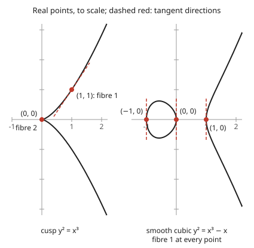

# Kahler differentials: derivatives built from algebra alone

[Syllabus](../../../SYLLABUS.md) → [Algebraic geometry](../README.md) → [Sheaf Cohomology and Differentials](../README.md#s08) → Kahler differentials

---

## General Overview

A point moves in the plane along the path $`(t^2, t^3)`$. At time t = 1 it sits at (1, 1) with velocity (2, 3), so it heads off with slope 3/2. At t = 0 it sits at the origin with velocity (0, 0): it stops, turns round and leaves on the other branch. Its track is the cusp $`y^2 = x^3`$, a curve with a sharp point ([Nodes and cusps](../03-Plane%20Curves/04-singularities-nodes-and-cusps.md)).

Calculus finds that sharp point with limits. Over a finite field there are no limits to take. So build derivatives from algebra alone: a symbol dx for "a small change in x", a symbol dy for "a small change in y", and two rules: d is additive, and it obeys the product rule. Apply d to $`y^2 = x^3`$:

```math
2y\,dy = 3x^2\,dx
```

That single relation is all the cusp knows about its own small changes. At (1, 1) it reads 2 dy = 3 dx, so dy = 3/2 dx: one free symbol, matching the velocity's slope 3/2. At the origin it reads 0 = 0. Nothing ties dx to dy, so two free symbols remain on a curve of dimension 1. That surplus is the singular point, found with no limits at all.

The curve $`y^2 = x^3 - x`$ behaves differently. Its relation, $`2y\,dy = (3x^2 - 1)\,dx`$, never collapses to 0 = 0 on the curve, so one free symbol remains at every point. Better still, one differential, $`\omega`$ ("omega", written w in the code's output), generates all the others everywhere: dx = 2y ω and dy = (3x² − 1) ω. Such a module, with one generator and no relations near each point, is a **line bundle**.

**The Kahler differentials of a ring are the module generated by symbols dx, one per coordinate, subject to exactly the additive rule, the product rule and the differentials of the defining equations; at each point they leave a vector space whose dimension is the variety's dimension at a smooth point and more at a singular one, and on a smooth curve they form a line bundle.**

**What kind of fact this is:** a definition (the module of differentials, by its universal property) and theorems proved on this card in Why it works: the presentation by generators dx and relations df, the fibre at a point as the cotangent space, and the line bundle on the smooth cubic. The general theorem that a variety is smooth exactly when its differentials are locally free of rank its dimension is stated with its source.

<p align="center"></p>

Drawn to scale, real points only. The dashed red lines are tangent directions. At the cubic's three points on the x-axis the relation forces dx = 0, so the tangent is vertical. At the cusp's origin the tangent space is the whole plane (fibre 2), though the curve hugs one doubled line, y = 0.

---

## The formula

Notation first, in words. The field k is ℚ, the rationals, unless a line names $`\mathbb{F}_p`$, the whole numbers modulo a prime p. A is the coordinate ring $`k[V] = k[x_1, \dots, x_n]/I`$ of a variety V: polynomials, with the ideal I of equations treated as zero ([Affine varieties](../02-Affine%20and%20Projective%20Varieties/01-affine-varieties-and-coordinate-rings.md)). A **module** over A is a set that adds and is multiplied by members of A ([Modules](../06-Schemes%20and%20Modern%20Language/05-modules-and-the-structure-theorem.md)).

Four names are new on this card:

- A **derivation** D from A into a module M is a map that is additive, kills constants and obeys the product rule $`D(ab) = a\,D(b) + b\,D(a)`$. $`\mathrm{Der}_k(A, M)`$ is the set of them.
- The **module of Kahler differentials** $`\Omega_{A/k}`$ is a module with one derivation $`d : A \to \Omega_{A/k}`$, the **universal derivation**, through which every other derivation passes.
- The **fibre** of a module M at a point P is $`M \otimes k(P)`$: M with every function replaced by its value at P. Here $`k(P) = A/\mathfrak{m}_P`$ is the field of values at P, and $`\mathfrak{m}_P`$ is the ideal of functions vanishing at P. The tensor product $`\otimes`$ comes from [Tensor products](../../03-Algebra/11-Duals%2C%20Quotients%20and%20Tensors/03-tensor-products.md).
- The **conormal module** $`I/I^2`$ is the equations modulo products of two equations.

The defining property:

```math
\mathrm{Der}_k(A, M) \;\cong\; \mathrm{Hom}_A(\Omega_{A/k}, M), \qquad D = \varphi \circ d
```

**Read it aloud:** a derivation of A into any module M is the same thing as an A-linear map φ out of the differentials; D is d followed by φ.

The recipe that computes it, from generators and relations:

```math
\Omega_{A/k} = \frac{A\,dx_1 \oplus \dots \oplus A\,dx_n}{\langle df_1, \dots, df_s \rangle}, \qquad df = \frac{\partial f}{\partial x_1}\,dx_1 + \dots + \frac{\partial f}{\partial x_n}\,dx_n
```

**Read it aloud:** the differentials are all A-combinations of dx₁ to dxₙ, with the differential of each equation set to zero; the differential of a polynomial is its formal partial derivatives times the dx's.

The partial derivatives here are formal: bring the power down, lower it by one. No limit is taken. For the cusp, $`\Omega_{A/k} = (A\,dx \oplus A\,dy)/\langle 2y\,dy - 3x^2\,dx \rangle`$.

The **conormal sequence** says the same thing as a chain of maps, the first sending each equation to its differential:

```math
I/I^2 \xrightarrow{\ f \,\mapsto\, df\ } A\,dx_1 \oplus \dots \oplus A\,dx_n \longrightarrow \Omega_{A/k} \longrightarrow 0, \qquad \dim_k \Omega_{A/k} \otimes k(P) = n - \mathrm{rank}\, J(P) = \dim_k \mathfrak{m}_P/\mathfrak{m}_P^2
```

**Read it aloud:** the equations map onto the relations among the dx's, and what is left is the differentials; at a point, the fibre has dimension n minus the rank of the Jacobian matrix, which is the dimension of the cotangent space.

$`J(P)`$ is the Jacobian matrix of [Smooth and singular points](../02-Affine%20and%20Projective%20Varieties/08-smooth-and-singular-points.md): one row of partial derivatives per equation, at P. The **cotangent space** $`\mathfrak{m}_P/\mathfrak{m}_P^2`$ is the functions vanishing at P modulo products of two such; its dual is the tangent space of [Dimension and tangent space](../02-Affine%20and%20Projective%20Varieties/07-dimension-and-tangent-spaces.md).

For the cusp at (1, 1), J = (−3, 2) has rank 1, so the fibre has dimension 2 − 1 = 1. At the origin J = (0, 0) has rank 0, so the fibre has dimension 2.

| Symbol | Plain meaning | In our example | Push it up and the answer… |
| --- | --- | --- | --- |
| $`k`$; $`\mathbb{F}_p`$ | the field; whole numbers mod a prime p | ℚ; $`\mathbb{F}_7`$, $`\mathbb{F}_{13}`$, $`\mathbb{F}_2`$ where named | in characteristic 2 the cubic gains a singular point |
| $`f`$, $`f_1, \dots, f_s`$; $`g`$, $`h`$; $`I`$; $`A`$ | the curve's equation, or s equations; any polynomials; the ideal of the equations; the coordinate ring | $`y^2 - x^3`$; $`y^2 - x^3 + x`$ | squaring f breaks every fibre |
| $`x, y`$, $`x_1, \dots, x_n`$; $`P`$; $`n`$; $`\dim V`$ | the coordinates; a point; number of coordinates; dimension of the variety | x, y; (0, 0), (1, 1); n = 2; 1 | — |
| $`dx, dy`$; $`df`$ | the generators; the relation from f | $`df = -3x^2\,dx + 2y\,dy`$ for the cusp | — |
| $`D`$; $`M`$; $`\varphi`$; $`\partial_x`$, $`f_x`$ | a derivation; the module it lands in; the linear map with $`D = \varphi \circ d`$; the formal partial derivative in x | $`D = 2y\,\partial_x + (3x^2 - 1)\,\partial_y`$ on the cubic | — |
| $`\Omega_{A/k}`$; $`d`$; $`\mathrm{Der}_k`$, $`\mathrm{Hom}_A`$ | the module of differentials; the universal derivation; all derivations; all A-linear maps | $`(A\,dx \oplus A\,dy)/\langle df \rangle`$ | — |
| $`J(P)`$; $`\mathrm{rank}`$ | the row of partials at P; number of independent rows | (−3, 2) at (1, 1); (0, 0) at the origin | rank 0 means fibre 2 |
| $`k(P)`$; $`\mathfrak{m}_P`$; $`\Omega_{A/k} \otimes k(P)`$ | values at P; functions vanishing at P; the fibre | fibre 2 at the cusp's origin, 1 elsewhere | above $`\dim V`$ means singular |
| $`I/I^2`$ | the conormal module: equations modulo products of equations | spanned by f, sent to df | — |
| $`\omega`$; $`u, v`$; $`c`$ | the cubic's generating differential; its coefficients; v divided by y | $`\omega = u\,dy + v\,dx`$, $`u = \tfrac{3}{2}x^2 - 1`$, $`v = -\tfrac{9}{4}xy`$ | — |
| $`\omega_0`$; $`t`$; $`\varepsilon`$, $`v = (a, b)`$ | the cusp's torsion differential; the path's time; a dual-number symbol with $`\varepsilon^2 = 0`$, and a step direction | $`\omega_0 = 2x\,dy - 3y\,dx`$; t = 1 at (1, 1) | — |
| $`d`$ (degree); genus; $`\mathcal{O}(d - 3)`$ | a plane curve's degree; its number of holes; the twisted line bundle | d = 3; genus 1; $`\mathcal{O}(0)`$ | a higher degree, a higher genus |

### When it holds

- **The equations must generate the ideal of the variety.** Write the smooth cubic as $`f^2 = 0`$. Then $`d(f^2) = 2f\,df`$ vanishes at every point of the curve, and over $`\mathbb{F}_7`$ all 7 of 7 points show fibre 2. With f itself, 0 points do.
- **The fibre is read at a point, not as a polynomial.** The cusp's relation $`-3x^2\,dx + 2y\,dy`$ is not zero as a polynomial, which suggests fibre 1 everywhere. Evaluated at the origin it is 0, and the fibre is 2.
- **The field matters.** Over $`\mathbb{F}_2`$, 2y = 0 and $`3x^2 - 1 = x^2 + 1`$, which vanishes at x = 1. So the cubic's point (1, 0) has fibre 2 there: the curve is singular over $`\mathbb{F}_2`$.
- **The point has coordinates in k.** Otherwise k(P) is a larger field and the count needs care.
- **"Smooth" means the Jacobian test, so "smooth exactly when locally free of rank dim V" holds over every field**: the fibre has dimension n − rank J(P), the very number that test reads. A **perfect field** (one where, in characteristic p, every element has a p-th root, such as ℚ, ℂ or any $`\mathbb{F}_p`$) is needed only to equate smooth with **regular**, Hartshorne's "nonsingular": a local ring whose maximal ideal needs only dim V generators. Over $`\mathbb{F}_7(t)`$, fractions of polynomials in t, the equation $`x^7 - t`$ cuts out one point whose local ring is a field, so it is regular. Yet $`d(x^7 - t) = 7x^6\,dx = 0`$ leaves fibre 1 on a variety of dimension 0, so it is not smooth.

---

## Why it works

### Step 0: write down the rules of a derivative, and nothing else

Every derivative adds, kills constants and obeys the product rule. Build a module from formal symbols da, one for each a in A, and impose exactly those rules. Then d is the most general derivative: every other one is d followed by a linear map.

### Step 1: generators dx and relations df

The product rule forces $`d(x^2) = 2x\,dx`$, $`d(x^2 y) = 2xy\,dx + x^2\,dy`$, and so on. So for any polynomial g:

```math
dg = \frac{\partial g}{\partial x}\,dx + \frac{\partial g}{\partial y}\,dy
```

So dx and dy generate. On A the equation f is zero, so df = 0. For any multiple, $`d(hf) = h\,df + f\,dh = h\,df`$ on A, since f = 0 there. So the relations are exactly the multiples of df.

<details>
<summary>Proof that the presentation has the universal property</summary>

Let D be any derivation of A into a module M. Define φ on the generators by φ(dx) = D(x) and φ(dy) = D(y).

It is well defined: φ sends the relation df to $`f_x D(x) + f_y D(y)`$, and the product rule gives this as D(f). Since f = 0 in A, D(f) = 0.

Then φ(dg) = D(g) for every polynomial g, because both sides obey the same product rule and agree on x and y. So $`D = \varphi \circ d`$.

φ is the only choice, because dx and dy generate. That proves

$`\displaystyle \mathrm{Der}_k(A, M) \cong \mathrm{Hom}_A(\Omega_{A/k}, M).`$

</details>

An example of the property. On the cubic, $`D = 2y\,\partial_x + (3x^2 - 1)\,\partial_y`$ is a derivation of A into A, because $`D(f) = 2y(-3x^2 + 1) + (3x^2 - 1)(2y) = 0`$. It is the vector field running along the curve. Its linear map is φ(dx) = 2y and φ(dy) = 3x² − 1.

### Step 2: the fibre at a point is a small linear system

Tensoring with k(P) puts P into every coefficient. The fibre is $`k^2`$, spanned by dx and dy, modulo the row $`J(P) = (f_x(P), f_y(P))`$:

| Curve, point | df at the point | Fibre dimension |
| --- | --- | --- |
| cusp, (0, 0) | 0 dx + 0 dy | 2 |
| cusp, (1, 1) | −3 dx + 2 dy | 1 |
| cubic, (−1, 0) | −2 dx + 0 dy | 1 |
| cubic, (0, 0) | 1 dx + 0 dy | 1 |
| cubic, (1, 0) | −2 dx + 0 dy | 1 |

At the cubic's three points on the x-axis the relation kills dx and leaves dy. The tangent there is vertical, as the figure shows.

### Step 3: the fibre is the cotangent space, and its dual is the tangent space

Send a function g that vanishes at P to its differential at P, dg ⊗ 1 in the fibre. A product gh of two such functions goes to zero: $`d(gh) = g\,dh + h\,dg`$, and both g(P) and h(P) are 0. So the map passes to $`\mathfrak{m}_P/\mathfrak{m}_P^2`$. It is onto, because the shifted coordinates x − a and y − b go to dx and dy. It is one to one by counting: both sides have dimension n − rank J(P), the second by [Smooth and singular points](../02-Affine%20and%20Projective%20Varieties/08-smooth-and-singular-points.md).

Dually, a linear map from the fibre to k is a derivation at P: a tangent vector. The universal property turns it into an algebra fact that needs no derivative at all. A tangent vector is a way to put the point P + εv on the curve, where ε is a **dual number**: a symbol with ε² = 0. Expanding gives

```math
f(P + \varepsilon v) = f(P) + \varepsilon\,\big(f_x(P)\,a + f_y(P)\,b\big), \qquad v = (a, b)
```

because every ε² term drops. So counting the v that put P + εv on the curve counts the tangent space. Over $`\mathbb{F}_7`$ the count is $`7^{\text{fibre}}`$: 49 at the cusp's origin and 7 at each of its other 6 points. The code finds the linear form by dual-number arithmetic alone, and it matches the Jacobian row at every point.

### Step 4: reading smoothness from the conormal sequence

At P the first map of the conormal sequence becomes $`k \to k^2`$, sending f to the row J(P). A plane curve is smooth at P exactly when this map is one to one: the row is not zero, the relation has rank 1, and the fibre has 2 − 1 = 1 dimension.

- At the cusp's origin the map sends f to (0, 0). It is not one to one, so the origin is singular.
- At (1, 1) it sends f to (−3, 2). It is one to one, so (1, 1) is smooth.

With s equations in n coordinates, the image must have rank n − dim V.

For the cubic, a singular point needs 2y = 0 and 3x² − 1 = 0 on the curve. Then y = 0 forces $`x^3 - x = 0`$, so x is −1, 0 or 1. There 3x² − 1 is 2, −1 and 2, never 0. So the cubic has no singular point over ℚ. The certificate in Step 5 extends this to every field where 2 can be divided by: ℂ, and every $`\mathbb{F}_p`$ with p odd.

### Step 5: on the smooth cubic the differentials are a line bundle

On the open set where y ≠ 0, the relation gives dy = (3x² − 1)/(2y) dx, so dx alone generates. Where 3x² − 1 ≠ 0, dy alone generates. The two sets cover the curve. So near every point one differential generates. That is a line bundle, the sheaf form of a module that is locally free of rank 1 ([Quasi-coherent sheaves](../06-Schemes%20and%20Modern%20Language/11-quasi-coherent-and-coherent-sheaves.md)).

Here one generator works everywhere at once. Find polynomials u and v with

```math
u\,(3x^2 - 1) + v\,(2y) = 1 \text{ on the curve}, \qquad u = \tfrac{3}{2}x^2 - 1, \quad v = -\tfrac{9}{4}xy
```

**Read it aloud:** u times 3x² − 1, plus v times 2y, equals 1 once y² is replaced by x³ − x.

Set $`\omega = u\,dy + v\,dx`$. Then:

- $`dx - 2y\,\omega = -u\,df`$ and $`dy - (3x^2 - 1)\,\omega = v\,df`$. Both are zero in Ω, so ω generates.
- The map φ of Step 1 sends ω to $`u(3x^2 - 1) + v(2y) = 1`$. So $`a\,\omega = 0`$ forces a = φ(aω) = 0, and no function kills ω.

So $`\Omega_{A/k} \cong A`$, free on ω. On the set where y ≠ 0, ω is the familiar dx/(2y), the differential the [Isogenies](../04-Elliptic%20Curves/11-isogenies-and-the-dual-isogeny.md) card uses to measure small steps on an elliptic curve.

<details>
<summary>Where u and v come from</summary>

Replace v by c(x)·y. Then v · 2y = 2c(x)(x³ − x) on the curve, so the task is a common-root test in x alone: find u and c with u(3x² − 1) + 2c(x³ − x) = 1.

Divide: $`x^3 - x = \tfrac{x}{3}(3x^2 - 1) - \tfrac{2}{3}x`$, and $`3x^2 - 1 = \big(-\tfrac{9}{2}x\big)\big(-\tfrac{2}{3}x\big) - 1`$. Run the two steps backwards:

$`\displaystyle 1 = \big(\tfrac{3}{2}x^2 - 1\big)(3x^2 - 1) - \tfrac{9}{2}x\,(x^3 - x).`$

So u = (3/2)x² − 1 and 2c = −(9/2)x, giving v = −(9/4)xy. The code multiplies it out and reduces modulo the curve's equation.

</details>

### Step 6: on the cusp the differentials are not a line bundle

Take $`\omega_0 = 2x\,dy - 3y\,dx`$. Multiply by y and use $`y^2 = x^3`$:

```math
y\,\omega_0 = 2xy\,dy - 3x^3\,dx = x\,(2y\,dy - 3x^2\,dx) = x\,df = 0
```

So the nonzero function y kills ω₀. An element killed by a nonzero function is **torsion**. A line bundle has none, because near each point it looks like A itself, and A has no zero divisors (two nonzero functions never multiply to 0). Likewise $`x^2\,\omega_0 = y\,df = 0`$.

Why is ω₀ not already zero? Give x the weight 2 and y the weight 3, so $`y^2 - x^3`$ has one weight, 6. Then dx has weight 2, dy weight 3, and df weight 6. ω₀ has weight 5. A multiple of df has weight 6 or more, so ω₀ is not one. Counting weight by weight finds exactly 2 dimensions of torsion, at weights 5 and 7: ω₀ and xω₀.

The path $`t \mapsto (t^2, t^3)`$ cannot see them. There dx = 2t dt and dy = 3t² dt, so $`\omega_0 = 2t^2 \cdot 3t^2\,dt - 3t^3 \cdot 2t\,dt = 0`$. The parametrised line is smooth; the torsion is the cusp's own record of its singular point.

### Step 7: the projective picture, in outline

For a smooth plane curve of degree d (here d is a whole number, not the derivation d), the differentials extend over the whole projective curve. There they form the line bundle $`\mathcal{O}(d - 3)`$, and the genus is (d − 1)(d − 2)/2. For the cubic, d = 3 gives $`\mathcal{O}(0)`$ and genus 1. So ω has no zeros and no poles, even at the point at infinity. This is stated, not proved, here; [The canonical bundle and adjunction](02-canonical-bundle-and-adjunction.md) takes it up.

The general theorem: a variety is smooth exactly when $`\Omega_{A/k}`$ is locally free of rank $`\dim V`$. Over any field it rests on the fibre count above: the fibre at P has dimension n − rank J(P), and on a variety a module whose fibres all have one dimension is locally free. Hartshorne (section II.8, in Sources) proves it over an algebraically closed field in the form "nonsingular", where smooth and regular agree (When it holds). Steps 5 and 6 are its two sides on our two curves.

---

## Worked numbers, by hand

| Step | Arithmetic | Value |
| --- | --- | --- |
| cusp relation | d(y²) = d(x³) | 2y dy = 3x² dx |
| at (1, 1) | 2 · 1 dy = 3 · 1² dx | dy = 3/2 dx: fibre 1 |
| path check | velocity (2t, 3t²) at t = 1 | (2, 3), slope 3/2 |
| at (0, 0) | 2 · 0 dy = 3 · 0² dx | 0 = 0: **fibre 2, singular** |
| cubic relation | d(y²) = d(x³ − x) | 2y dy = (3x² − 1) dx |
| cubic, both coefficients zero? | y = 0 gives x = −1, 0, 1; 3x² − 1 = 2, −1, 2 | never: fibre 1 everywhere |
| certificate | (3/2 x² − 1)(3x² − 1) − (9/2)x(x³ − x) | 1 |
| same, written with v | (3/2 x² − 1)(3x² − 1) + (−9/4 xy)(2y), with y² = x³ − x | 1 |
| generator | ω = (3/2 x² − 1) dy − (9/4)xy dx | **Ω ≅ A ω, a line bundle** |
| cusp torsion | y ω₀ = x df | y kills ω₀ = 2x dy − 3y dx |

On the cusp the differentials give two independent directions at the origin on a one-dimensional curve: the singular point. On the cubic, one differential ω does the work of dx and dy at every point.

### What breaks if you drop a piece

| Mistake | Comes out at | What went wrong |
| --- | --- | --- |
| Use $`f^2`$ for the cubic over $`\mathbb{F}_7`$ | fibre 2 at 7 of 7 points; with f, 0 | $`f^2`$ does not generate the curve's ideal |
| Read the cubic over $`\mathbb{F}_2`$ | (1, 0) has fibre 2; dual-number counts 2 and 4 | 2y = 0 there, and 3x² − 1 vanishes at x = 1 |
| Leave the cusp's df unevaluated | "fibre" 1 at the origin; true value 2 | the relation is nonzero, but its value at (0, 0) is 0 |
| Compute on the path $`(t^2, t^3)`$ | torsion 0; ω₀ pulls back to 0 | the line is smooth; the cusp's torsion of dimension 2 is lost |

The code prints all four.

---

## Code, from first principles, and it actually runs

Polynomials are tables of exponents and exact fractions; nothing imported knows the answer. The scripts take four independent roads:

1. **The presentation:** formal partial derivatives give df, and the fibre is 2 minus the rank of df at P.
2. **Dual numbers:** put P + εv into f using only ε² = 0, never differentiating. The linear form must equal the Jacobian row, and over $`\mathbb{F}_7`$ and $`\mathbb{F}_{13}`$ the count of solutions v must be p to the fibre dimension. Point counts are checked against Euler's criterion: a nonzero n is a square mod p exactly when $`n^{(p-1)/2}`$ is 1.
3. **Weights:** count the cusp's differentials weight by weight, against their images on the path $`(t^2, t^3)`$; the gap is the torsion.
4. **Certificates:** multiply out u, v and ω and reduce modulo the curve's equation; every identity must come out exactly.

### Python

```python
# Kahler differentials on the cusp y^2 = x^3 and on the smooth cubic y^2 = x^3 - x.
# Standard library only. A polynomial is a dict {(i, j): c} for c x^i y^j, c a Fraction: exact.
# A 1-form P dx + Q dy is the pair (P, Q); the one relation of a plane curve f = 0 is df.
# Road 1: the presentation: fibre dimension at a point = 2 - rank of (f_x, f_y) there.
# Road 2: dual numbers a + b e with e^2 = 0, no derivatives: solutions v of f(P + e v) = 0.
# Road 3: weights x:2, y:3 on the cusp, against the pullback to the line t -> (t^2, t^3).
# Road 4: exact certificates for the smooth cubic, substituted back and reduced mod f.
from fractions import Fraction as Fr

def cl(h): return {m: c for m, c in h.items() if c}
def add(*fs):
    h = {}
    for f in fs:
        for m, c in f.items(): h[m] = h.get(m, 0) + c
    return cl(h)
def mul(f, g):
    h = {}
    for (a, b), c in f.items():
        for (e, k), u in g.items(): h[(a + e, b + k)] = h.get((a + e, b + k), 0) + c * u
    return cl(h)
def sc(c, f): return cl({m: c * u for m, u in f.items()})
def nf(p, g):  # remainder modulo y^2 - g(x): swap each y^2 for g
    while any(j > 1 for (i, j) in p):
        m = max(m for m in p if m[1] > 1); c = p.pop(m)
        p = add(p, sc(c, mul({(m[0], m[1] - 2): 1}, g)))
    return p
def d(f, k): return cl({((i - 1, j) if k == 0 else (i, j - 1)): c * (i, j)[k] for (i, j), c in f.items() if (i, j)[k]})
def ev(f, P, q=0):
    s = sum(c * P[0] ** i * P[1] ** j for (i, j), c in f.items())
    return int(s) % q if q else s
def dual(f, P, v, q=0):  # f(P + e v) with e^2 = 0, by dual-number arithmetic only
    A = B = 0
    for (i, j), c in f.items():
        a, b = int(c), 0
        for p0, v0, n in ((P[0], v[0], i), (P[1], v[1], j)):
            for _ in range(n): a, b = a * p0, a * v0 + b * p0
        A, B = A + a, B + b
    return (A % q, B % q) if q else (A, B)
def show(f):
    out = ""
    for (i, j) in sorted(f, reverse=True):
        c = f[(i, j)]; a = abs(c)
        mono = ("x" + (f"^{i}" if i > 1 else "") if i else "") + ("y" + (f"^{j}" if j > 1 else "") if j else "")
        cs = "" if a == 1 and mono else (str(a) if a.denominator == 1 or not mono else f"({a})")
        out += (("-" if c < 0 else "") if not out else (" - " if c < 0 else " + ")) + cs + mono
    return out or "0"
def fib(f, P, q=0):  # road 1: the relation df at P, and 2 - its rank
    r = (ev(d(f, 0), P, q), ev(d(f, 1), P, q)); return r, 2 - (r != (0, 0))
def nsol(f, P, q):  # road 2: count v in F_q^2 with f(P + e v) = 0
    return sum(dual(f, P, (a, b), q) == (0, 0) for a in range(q) for b in range(q))

cusp = {(0, 2): Fr(1), (3, 0): Fr(-1)}; g0 = {(3, 0): Fr(1)}
cub = {(0, 2): Fr(1), (3, 0): Fr(-1), (1, 0): Fr(1)}; g1 = {(3, 0): Fr(1), (1, 0): Fr(-1)}
print("field: the rationals Q, exact; F_p only where named")
for name, f in (("cusp", cusp), ("smooth cubic", cub)):
    print(f"{name} f = {show(f)}: Omega = (A dx + A dy) / (df), df = ({show(d(f, 0))}) dx + ({show(d(f, 1))}) dy")
for name, f, P in (("cusp", cusp, (0, 0)), ("cusp", cusp, (1, 1)), ("cubic", cub, (-1, 0)), ("cubic", cub, (0, 0)), ("cubic", cub, (1, 0))):
    r, k = fib(f, P); lin = (dual(f, P, (1, 0))[1], dual(f, P, (0, 1))[1])
    print(f"{name} at {P}: f = {ev(f, P)}; df there = {r[0]} dx + {r[1]} dy; dual numbers give {lin[0]}a + {lin[1]}b; fibre dimension {k}")
    assert ev(f, P) == 0 and lin == r
r, _ = fib(cusp, (1, 1)); slope = Fr(-r[0], r[1])
print(f"cusp at (1, 1): dy = {slope} dx; velocity of (t^2, t^3) at t = 1 is (2, 3), slope {Fr(3 * 1 ** 2, 2 * 1)}")
assert slope == Fr(3 * 1 ** 2, 2 * 1) and fib(cusp, (0, 0))[1] == 2
roots = [a for a in range(-3, 4) if a ** 3 - a == 0]
print(f"cubic: 2y = 0 forces y = 0, so x^3 - x = 0: x = {roots}; 3x^2 - 1 there: {[3 * a * a - 1 for a in roots]}; no singular point")
assert all(3 * a * a - 1 != 0 for a in roots) and len(roots) == 3
u, v = {(2, 0): Fr(3, 2), (0, 0): Fr(-1)}, {(1, 1): Fr(-9, 4)}
a3, b2 = sc(-1, d(cub, 0)), d(cub, 1)  # 3x^2 - 1 and 2y: the relation reads 2y dy = (3x^2 - 1) dx
one = nf(add(mul(u, a3), mul(v, b2)), g1)
print(f"certificate: ({show(u)})(3x^2 - 1) + ({show(v)})(2y) = {show(one)} mod f")
X, c1 = {(1, 0): Fr(1)}, {(0, 0): Fr(1)}
s1 = add(mul(sc(Fr(1, 3), X), a3), sc(Fr(-2, 3), X), sc(-1, g1))  # x^3 - x = (x/3)(3x^2 - 1) - (2/3)x
s2 = add(mul(sc(Fr(-9, 2), X), sc(Fr(-2, 3), X)), sc(-1, c1), sc(-1, a3))  # 3x^2 - 1 = (-(9/2)x)(-(2/3)x) - 1
s3 = add(mul(u, a3), mul(sc(Fr(-9, 2), X), g1))  # 1 = u (3x^2 - 1) - (9/2) x (x^3 - x)
print(f"division steps: x^3 - x = (x/3)(3x^2 - 1) - (2/3)x; 3x^2 - 1 = (-(9/2)x)(-(2/3)x) - 1; back-substituted: {show(s3)}")
assert one == c1 and s1 == {} and s2 == {} and s3 == c1
rel = (d(cub, 0), d(cub, 1)); w = (v, u)  # w = u dy + v dx
e1 = [nf(add(t, sc(-1, s)), g1) for t, s in zip(({(0, 0): Fr(1)}, {}), ((mul(b2, w[0])), mul(b2, w[1])))]
e2 = [nf(add(t, sc(-1, s)), g1) for t, s in zip(({}, {(0, 0): Fr(1)}), ((mul(a3, w[0])), mul(a3, w[1])))]
ok1 = all(nf(add(e, mul(u, m)), g1) == {} for e, m in zip(e1, rel))
ok2 = all(nf(add(e, sc(-1, mul(v, m))), g1) == {} for e, m in zip(e2, rel))
print(f"w = ({show(u)}) dy + ({show(v)}) dx: dx - 2y w = -u df: {ok1}; dy - (3x^2 - 1) w = v df: {ok2}")
D = nf(add(mul(b2, rel[0]), mul(a3, rel[1])), g1)
print(f"derivation D = 2y d/dx + (3x^2 - 1) d/dy: D(f) = {show(D)}; phi(dx) = 2y, phi(dy) = 3x^2 - 1, phi(w) = {show(one)}")
assert ok1 and ok2 and D == {}
for q in (7, 13):
    for name, f in (("cusp", cusp), ("cubic", cub)):
        pts = [(a, b) for a in range(q) for b in range(q) if ev(f, (a, b), q) == 0]
        k1 = [fib(f, P, q)[1] for P in pts]; k2 = [nsol(f, P, q) for P in pts]
        sing = [P for P, k in zip(pts, k1) if k == 2]
        print(f"over F_{q}: {name} {len(pts)} points; fibre 2 at {sing}, 1 at {k1.count(1)}; dual-number counts {sorted(set(k2))}")
        gx = sc(-1, add(f, {(0, 2): Fr(-1)}))  # f = y^2 - g(x); count by Euler's criterion
        chi = lambda n: 0 if n == 0 else (1 if pow(n, (q - 1) // 2, q) == 1 else -1)
        euler = sum(1 + chi(ev(gx, (a, 0), q)) for a in range(q))
        assert all(n == q ** k for n, k in zip(k2, k1)) and len(pts) == euler and sing == ([(0, 0)] if f is cusp else [])
wt = lambda m: 2 * m[0] + 3 * m[1]
A = lambda n: sum(1 for i in range(n // 2 + 1) for j in (0, 1) if 2 * i + 3 * j == n)  # basis x^i y^j, j < 2
om = [A(n - 2) + A(n - 3) - A(n - 6) for n in range(13)]
img = [1 if A(n - 2) + A(n - 3) else 0 for n in range(13)]  # x^i y^j dx -> 2t^(2i+3j+1) dt, dy -> 3t^(..+2) dt
tor = [p - q for p, q in zip(om, img)]
print(f"cusp by weight 0..12: dim Omega_n {om}; image in k[t] dt {img}; torsion {tor}")
assert sum(tor) == 2 and [n for n in range(13) if tor[n]] == [5, 7]
sub = lambda p: cl({(2 * i + 3 * j, 0): c for (i, j), c in p.items()})
tw = ({(0, 1): Fr(-3)}, {(1, 0): Fr(2)})  # w0 = 2x dy - 3y dx
pb = add(mul(sub(tw[0]), {(1, 0): Fr(2)}), mul(sub(tw[1]), {(2, 0): Fr(3)}))
cr = (d(cusp, 0), d(cusp, 1))
ky = all(nf(add(mul({(0, 1): 1}, a), sc(-1, mul({(1, 0): 1}, b))), g0) == {} for a, b in zip(tw, cr))
kx = all(nf(add(mul({(2, 0): 1}, a), sc(-1, mul({(0, 1): 1}, b))), g0) == {} for a, b in zip(tw, cr))
print(f"weights x {wt((1, 0))}, y {wt((0, 1))}, df {wt((0, 2))}; w0 = 2x dy - 3y dx, weight {wt((1, 0)) + wt((0, 1))}: pullback {show(pb)}; y w0 = x df: {ky}; x^2 w0 = y df: {kx}")
assert pb == {} and ky and kx
sq = mul(cub, cub)
p7 = [(a, b) for a in range(7) for b in range(7) if ev(cub, (a, b), 7) == 0]
m1 = [sum(fib(g, P, 7)[1] == 2 for P in p7) for g in (sq, cub)]
print(f"mistake 1, f^2 over F_7: fibre 2 at {m1[0]} of {len(p7)} points; with f: {m1[1]}")
p2 = [(a, b) for a in range(2) for b in range(2) if ev(cub, (a, b), 2) == 0]
print(f"mistake 2, cubic over F_2: points {p2}; fibres {[fib(cub, P, 2)[1] for P in p2]}; dual-number counts {[nsol(cub, P, 2) for P in p2]}")
assert [fib(cub, P, 2)[1] for P in p2] == [1, 2] and [nsol(cub, P, 2) for P in p2] == [2, 4] and m1 == [len(p7), 0]
unev, ev0 = 2 - (cr != ({}, {})), fib(cusp, (0, 0))[1]
print(f"mistake 3, df of the cusp left unevaluated: not zero, so 'fibre' {unev}; evaluated at (0, 0): {ev0}")
assert (unev, ev0) == (1, 2)
print(f"mistake 4, pull back to the line: w0 becomes {show(pb)}, torsion invisible; true torsion dimension {sum(tor)}")
print(f"house: plane curve of degree d = 3: genus (d - 1)(d - 2)/2 = {(3 - 1) * (3 - 2) // 2}; Omega = O(d - 3) = O({3 - 3})")
vert = [f"({a},0)" for a in roots if fib(cub, (a, 0))[0][1] == 0 and fib(cub, (a, 0))[1] == 1]  # f_y = 0, f_x != 0
print(f"figure, cusp: (0,0) singular, (1,1) slope {slope}; cubic: {' '.join(vert)} vertical; cusp x -1..2.2, cubic x -1.5..2.2, y -3.2..3.2")
print("ALL CHECKS PASS")
```

**Ran 2026-11-24 on macOS, Python 3.14.10, standard library only. All checks passed. Output, pasted from the run:**

```
field: the rationals Q, exact; F_p only where named
cusp f = -x^3 + y^2: Omega = (A dx + A dy) / (df), df = (-3x^2) dx + (2y) dy
smooth cubic f = -x^3 + x + y^2: Omega = (A dx + A dy) / (df), df = (-3x^2 + 1) dx + (2y) dy
cusp at (0, 0): f = 0; df there = 0 dx + 0 dy; dual numbers give 0a + 0b; fibre dimension 2
cusp at (1, 1): f = 0; df there = -3 dx + 2 dy; dual numbers give -3a + 2b; fibre dimension 1
cubic at (-1, 0): f = 0; df there = -2 dx + 0 dy; dual numbers give -2a + 0b; fibre dimension 1
cubic at (0, 0): f = 0; df there = 1 dx + 0 dy; dual numbers give 1a + 0b; fibre dimension 1
cubic at (1, 0): f = 0; df there = -2 dx + 0 dy; dual numbers give -2a + 0b; fibre dimension 1
cusp at (1, 1): dy = 3/2 dx; velocity of (t^2, t^3) at t = 1 is (2, 3), slope 3/2
cubic: 2y = 0 forces y = 0, so x^3 - x = 0: x = [-1, 0, 1]; 3x^2 - 1 there: [2, -1, 2]; no singular point
certificate: ((3/2)x^2 - 1)(3x^2 - 1) + (-(9/4)xy)(2y) = 1 mod f
division steps: x^3 - x = (x/3)(3x^2 - 1) - (2/3)x; 3x^2 - 1 = (-(9/2)x)(-(2/3)x) - 1; back-substituted: 1
w = ((3/2)x^2 - 1) dy + (-(9/4)xy) dx: dx - 2y w = -u df: True; dy - (3x^2 - 1) w = v df: True
derivation D = 2y d/dx + (3x^2 - 1) d/dy: D(f) = 0; phi(dx) = 2y, phi(dy) = 3x^2 - 1, phi(w) = 1
over F_7: cusp 7 points; fibre 2 at [(0, 0)], 1 at 6; dual-number counts [7, 49]
over F_7: cubic 7 points; fibre 2 at [], 1 at 7; dual-number counts [7]
over F_13: cusp 13 points; fibre 2 at [(0, 0)], 1 at 12; dual-number counts [13, 169]
over F_13: cubic 7 points; fibre 2 at [], 1 at 7; dual-number counts [13]
cusp by weight 0..12: dim Omega_n [0, 0, 1, 1, 1, 2, 1, 2, 1, 1, 1, 1, 1]; image in k[t] dt [0, 0, 1, 1, 1, 1, 1, 1, 1, 1, 1, 1, 1]; torsion [0, 0, 0, 0, 0, 1, 0, 1, 0, 0, 0, 0, 0]
weights x 2, y 3, df 6; w0 = 2x dy - 3y dx, weight 5: pullback 0; y w0 = x df: True; x^2 w0 = y df: True
mistake 1, f^2 over F_7: fibre 2 at 7 of 7 points; with f: 0
mistake 2, cubic over F_2: points [(0, 0), (1, 0)]; fibres [1, 2]; dual-number counts [2, 4]
mistake 3, df of the cusp left unevaluated: not zero, so 'fibre' 1; evaluated at (0, 0): 2
mistake 4, pull back to the line: w0 becomes 0, torsion invisible; true torsion dimension 2
house: plane curve of degree d = 3: genus (d - 1)(d - 2)/2 = 1; Omega = O(d - 3) = O(0)
figure, cusp: (0,0) singular, (1,1) slope 3/2; cubic: (-1,0) (0,0) (1,0) vertical; cusp x -1..2.2, cubic x -1.5..2.2, y -3.2..3.2
ALL CHECKS PASS
```

### Rust

Same numbers, same labels, built with `rustc --edition 2021 -O`.

```rust
// Kahler differentials on the cusp y^2 = x^3 and on the smooth cubic y^2 = x^3 - x.
// std only. A polynomial maps (i, j) to the coefficient of x^i y^j, an exact i128 fraction;
// checked_mul stops the run on overflow. A 1-form P dx + Q dy is the pair (P, Q).
// Road 1: the presentation: fibre dimension at a point = 2 - rank of (f_x, f_y) there.
// Road 2: dual numbers a + b e with e^2 = 0, no derivatives: solutions v of f(P + e v) = 0.
// Road 3: weights x:2, y:3 on the cusp, against the pullback to the line t -> (t^2, t^3).
// Road 4: exact certificates for the smooth cubic, substituted back and reduced mod f.
use std::collections::BTreeMap;
#[derive(Clone, Copy, PartialEq, Debug)]
struct Q { n: i128, d: i128 }
fn gcd(a: i128, b: i128) -> i128 { if b == 0 { a.abs() } else { gcd(b, a % b) } }
fn q(n: i128, d: i128) -> Q { let g = gcd(n, d) * d.signum(); Q { n: n / g, d: d / g } }
fn qm(a: Q, b: Q) -> Q { q(a.n.checked_mul(b.n).unwrap(), a.d.checked_mul(b.d).unwrap()) }
fn qa(a: Q, b: Q) -> Q { q(a.n.checked_mul(b.d).unwrap() + b.n.checked_mul(a.d).unwrap(), a.d.checked_mul(b.d).unwrap()) }
fn qs(a: Q) -> String { if a.d == 1 { format!("{}", a.n) } else { format!("{}/{}", a.n, a.d) } }
type P = BTreeMap<(u32, u32), Q>;
fn pl(t: &[(u32, u32, i128, i128)]) -> P { t.iter().map(|&(i, j, n, d)| ((i, j), q(n, d))).collect() }
fn cl(h: P) -> P { h.into_iter().filter(|(_, c)| c.n != 0).collect() }
fn add(fs: &[&P]) -> P {
    let mut h = P::new();
    for f in fs { for (m, c) in f.iter() { let e = h.entry(*m).or_insert(q(0, 1)); *e = qa(*e, *c); } }
    cl(h)
}
fn mul(f: &P, g: &P) -> P {
    let mut h = P::new();
    for (&(a, b), &c) in f { for (&(e, k), &u) in g { let x = h.entry((a + e, b + k)).or_insert(q(0, 1)); *x = qa(*x, qm(c, u)); } }
    cl(h)
}
fn sc(c: i128, f: &P) -> P { cl(f.iter().map(|(m, u)| (*m, qm(q(c, 1), *u))).collect()) }
fn nf(p: &P, g: &P) -> P { // remainder modulo y^2 - g(x): swap each y^2 for g
    let mut p = p.clone();
    while let Some(&m) = p.keys().filter(|m| m.1 > 1).max() {
        let c = p.remove(&m).unwrap();
        let t: P = [((m.0, m.1 - 2), c)].into_iter().collect();
        p = add(&[&p, &mul(&t, g)]);
    }
    p
}
fn d(f: &P, k: usize) -> P {
    cl(f.iter().filter(|(m, _)| if k == 0 { m.0 > 0 } else { m.1 > 0 })
        .map(|(&(i, j), &c)| if k == 0 { ((i - 1, j), qm(c, q(i as i128, 1))) } else { ((i, j - 1), qm(c, q(j as i128, 1))) }).collect())
}
fn ev(f: &P, p: (i128, i128), m: i128) -> Q {
    let s = f.iter().fold(q(0, 1), |s, (&(i, j), &c)| qa(s, qm(c, q(p.0.pow(i) * p.1.pow(j), 1))));
    if m > 0 { q(s.n.rem_euclid(m), 1) } else { s }
}
fn dual(f: &P, p: (i128, i128), v: (i128, i128), m: i128) -> (i128, i128) { // f(P + e v), e^2 = 0
    let (mut aa, mut bb) = (0i128, 0i128);
    for (&(i, j), c) in f {
        let (mut a, mut b) = (c.n, 0i128);
        for (p0, v0, n) in [(p.0, v.0, i), (p.1, v.1, j)] { for _ in 0..n { let t = a * p0; b = a * v0 + b * p0; a = t; } }
        aa += a; bb += b;
    }
    if m > 0 { (aa.rem_euclid(m), bb.rem_euclid(m)) } else { (aa, bb) }
}
fn show(f: &P) -> String {
    let mut out = String::new();
    for (&(i, j), &c) in f.iter().rev() {
        let a = q(c.n.abs(), c.d);
        let mut mono = String::new();
        if i > 0 { mono += "x"; if i > 1 { mono += &format!("^{}", i); } }
        if j > 0 { mono += "y"; if j > 1 { mono += &format!("^{}", j); } }
        let cs = if a.n == 1 && a.d == 1 && !mono.is_empty() { String::new() } else if a.d == 1 || mono.is_empty() { qs(a) } else { format!("({})", qs(a)) };
        out += if out.is_empty() { if c.n < 0 { "-" } else { "" } } else if c.n < 0 { " - " } else { " + " };
        out += &(cs + &mono);
    }
    if out.is_empty() { "0".into() } else { out }
}
fn fib(f: &P, p: (i128, i128), m: i128) -> ((Q, Q), usize) { // road 1
    let r = (ev(&d(f, 0), p, m), ev(&d(f, 1), p, m));
    (r, if r.0.n == 0 && r.1.n == 0 { 2 } else { 1 })
}
fn nsol(f: &P, p: (i128, i128), m: i128) -> i128 { // road 2
    let mut c = 0;
    for a in 0..m { for b in 0..m { if dual(f, p, (a, b), m) == (0, 0) { c += 1; } } }
    c
}
fn tl<T: std::fmt::Display>(v: &[T]) -> String { format!("[{}]", v.iter().map(|x| x.to_string()).collect::<Vec<_>>().join(", ")) }
fn tp(v: &[(i128, i128)]) -> String { tl(&v.iter().map(|p| format!("({}, {})", p.0, p.1)).collect::<Vec<_>>()) }
fn tf(b: bool) -> &'static str { if b { "True" } else { "False" } }
fn pts(f: &P, m: i128) -> Vec<(i128, i128)> {
    let mut v = vec![];
    for a in 0..m { for b in 0..m { if ev(f, (a, b), m).n == 0 { v.push((a, b)); } } }
    v
}
fn main() {
    let cub = pl(&[(0, 2, 1, 1), (3, 0, -1, 1), (1, 0, 1, 1)]); let g1 = pl(&[(3, 0, 1, 1), (1, 0, -1, 1)]);
    let (cusp, g0, one_p) = (pl(&[(0, 2, 1, 1), (3, 0, -1, 1)]), pl(&[(3, 0, 1, 1)]), pl(&[(0, 0, 1, 1)]));
    println!("field: the rationals Q, exact; F_p only where named");
    for (name, f) in [("cusp", &cusp), ("smooth cubic", &cub)] {
        println!("{} f = {}: Omega = (A dx + A dy) / (df), df = ({}) dx + ({}) dy", name, show(f), show(&d(f, 0)), show(&d(f, 1)));
    }
    for (name, f, p) in [("cusp", &cusp, (0, 0)), ("cusp", &cusp, (1, 1)), ("cubic", &cub, (-1, 0)), ("cubic", &cub, (0, 0)), ("cubic", &cub, (1, 0))] {
        let (r, k) = fib(f, p, 0); let lin = (dual(f, p, (1, 0), 0).1, dual(f, p, (0, 1), 0).1);
        println!("{} at ({}, {}): f = {}; df there = {} dx + {} dy; dual numbers give {}a + {}b; fibre dimension {}", name, p.0, p.1, qs(ev(f, p, 0)), qs(r.0), qs(r.1), lin.0, lin.1, k);
        assert!(ev(f, p, 0).n == 0 && r == (q(lin.0, 1), q(lin.1, 1)));
    }
    let (r, _) = fib(&cusp, (1, 1), 0); let slope = q(-r.0.n, r.1.n);
    println!("cusp at (1, 1): dy = {} dx; velocity of (t^2, t^3) at t = 1 is (2, 3), slope {}", qs(slope), qs(q(3 * 1i128.pow(2), 2 * 1)));
    assert!(slope == q(3 * 1i128.pow(2), 2 * 1) && fib(&cusp, (0, 0), 0).1 == 2);
    let roots: Vec<i128> = (-3..4).filter(|a: &i128| a.pow(3) - a == 0).collect();
    let vals: Vec<i128> = roots.iter().map(|a| 3 * a * a - 1).collect();
    println!("cubic: 2y = 0 forces y = 0, so x^3 - x = 0: x = {}; 3x^2 - 1 there: {}; no singular point", tl(&roots), tl(&vals));
    assert!(vals.iter().all(|&v| v != 0) && roots.len() == 3);
    let (u, v) = (pl(&[(2, 0, 3, 2), (0, 0, -1, 1)]), pl(&[(1, 1, -9, 4)]));
    let (a3, b2) = (sc(-1, &d(&cub, 0)), d(&cub, 1)); // 3x^2 - 1 and 2y: the relation reads 2y dy = (3x^2 - 1) dx
    let one = nf(&add(&[&mul(&u, &a3), &mul(&v, &b2)]), &g1);
    println!("certificate: ({})(3x^2 - 1) + ({})(2y) = {} mod f", show(&u), show(&v), show(&one));
    let xq = |n: i128, dn: i128| pl(&[(1, 0, n, dn)]); // (n/dn) x
    let s1 = add(&[&mul(&xq(1, 3), &a3), &xq(-2, 3), &sc(-1, &g1)]); // x^3 - x = (x/3)(3x^2 - 1) - (2/3)x
    let s2 = add(&[&mul(&xq(-9, 2), &xq(-2, 3)), &sc(-1, &one_p), &sc(-1, &a3)]); // 3x^2 - 1 = (-(9/2)x)(-(2/3)x) - 1
    let s3 = add(&[&mul(&u, &a3), &mul(&xq(-9, 2), &g1)]); // 1 = u (3x^2 - 1) - (9/2) x (x^3 - x)
    println!("division steps: x^3 - x = (x/3)(3x^2 - 1) - (2/3)x; 3x^2 - 1 = (-(9/2)x)(-(2/3)x) - 1; back-substituted: {}", show(&s3));
    assert!(one == one_p && s1.is_empty() && s2.is_empty() && s3 == one_p);
    let rel = [d(&cub, 0), d(&cub, 1)]; let w = [v.clone(), u.clone()]; // w = u dy + v dx
    let e1 = [nf(&add(&[&one_p, &sc(-1, &mul(&b2, &w[0]))]), &g1), nf(&sc(-1, &mul(&b2, &w[1])), &g1)];
    let e2 = [nf(&sc(-1, &mul(&a3, &w[0])), &g1), nf(&add(&[&one_p, &sc(-1, &mul(&a3, &w[1]))]), &g1)];
    let ok1 = (0..2).all(|i| nf(&add(&[&e1[i], &mul(&u, &rel[i])]), &g1).is_empty());
    let ok2 = (0..2).all(|i| nf(&add(&[&e2[i], &sc(-1, &mul(&v, &rel[i]))]), &g1).is_empty());
    println!("w = ({}) dy + ({}) dx: dx - 2y w = -u df: {}; dy - (3x^2 - 1) w = v df: {}", show(&u), show(&v), tf(ok1), tf(ok2));
    let dd = nf(&add(&[&mul(&b2, &rel[0]), &mul(&a3, &rel[1])]), &g1);
    println!("derivation D = 2y d/dx + (3x^2 - 1) d/dy: D(f) = {}; phi(dx) = 2y, phi(dy) = 3x^2 - 1, phi(w) = {}", show(&dd), show(&one));
    assert!(ok1 && ok2 && dd.is_empty());
    for m in [7i128, 13] {
        for (name, f) in [("cusp", &cusp), ("cubic", &cub)] {
            let ps = pts(f, m);
            let k1: Vec<usize> = ps.iter().map(|&p| fib(f, p, m).1).collect();
            let k2: Vec<i128> = ps.iter().map(|&p| nsol(f, p, m)).collect();
            let sing: Vec<(i128, i128)> = ps.iter().zip(&k1).filter(|(_, &k)| k == 2).map(|(p, _)| *p).collect();
            let mut ks = k2.clone(); ks.sort(); ks.dedup();
            println!("over F_{}: {} {} points; fibre 2 at {}, 1 at {}; dual-number counts {}", m, name, ps.len(), tp(&sing), k1.iter().filter(|&&k| k == 1).count(), tl(&ks));
            let gx = sc(-1, &add(&[f, &pl(&[(0, 2, -1, 1)])])); // f = y^2 - g(x); count by Euler's criterion
            let chi = |n: i128| if n == 0 { 0 } else { let mut r = 1; for _ in 0..(m - 1) / 2 { r = r * n % m; } if r == 1 { 1 } else { -1 } };
            let euler: i128 = (0..m).map(|a| 1 + chi(ev(&gx, (a, 0), m).n)).sum();
            assert!(k2.iter().zip(&k1).all(|(&n, &k)| n == m.pow(k as u32)) && ps.len() as i128 == euler);
            assert!(sing == if name == "cusp" { vec![(0, 0)] } else { vec![] });
        }
    }
    let wt = |m: (i32, i32)| 2 * m.0 + 3 * m.1;
    let aw = |n: i32| -> i32 { let mut c = 0; for i in 0..=n.max(0) / 2 { for j in 0..2 { if 2 * i + 3 * j == n { c += 1; } } } c };
    let om: Vec<i32> = (0..13).map(|n| aw(n - 2) + aw(n - 3) - aw(n - 6)).collect();
    let img: Vec<i32> = (0..13).map(|n| if aw(n - 2) + aw(n - 3) > 0 { 1 } else { 0 }).collect();
    let tor: Vec<i32> = om.iter().zip(&img).map(|(a, b)| a - b).collect();
    println!("cusp by weight 0..12: dim Omega_n {}; image in k[t] dt {}; torsion {}", tl(&om), tl(&img), tl(&tor));
    assert!(tor.iter().sum::<i32>() == 2 && (0..13).filter(|&n| tor[n] != 0).collect::<Vec<_>>() == vec![5, 7]);
    let sub = |p: &P| -> P { cl(p.iter().map(|(&(i, j), &c)| ((2 * i + 3 * j, 0), c)).collect()) };
    let tw = [pl(&[(0, 1, -3, 1)]), pl(&[(1, 0, 2, 1)])]; // w0 = 2x dy - 3y dx
    let pb = add(&[&mul(&sub(&tw[0]), &pl(&[(1, 0, 2, 1)])), &mul(&sub(&tw[1]), &pl(&[(2, 0, 3, 1)]))]);
    let cr = [d(&cusp, 0), d(&cusp, 1)];
    let (yy, xx, x2) = (pl(&[(0, 1, 1, 1)]), pl(&[(1, 0, 1, 1)]), pl(&[(2, 0, 1, 1)]));
    let ky = (0..2).all(|i| nf(&add(&[&mul(&yy, &tw[i]), &sc(-1, &mul(&xx, &cr[i]))]), &g0).is_empty());
    let kx = (0..2).all(|i| nf(&add(&[&mul(&x2, &tw[i]), &sc(-1, &mul(&yy, &cr[i]))]), &g0).is_empty());
    println!("weights x {}, y {}, df {}; w0 = 2x dy - 3y dx, weight {}: pullback {}; y w0 = x df: {}; x^2 w0 = y df: {}", wt((1, 0)), wt((0, 1)), wt((0, 2)), wt((1, 0)) + wt((0, 1)), show(&pb), tf(ky), tf(kx));
    assert!(pb.is_empty() && ky && kx);
    let sq = mul(&cub, &cub); let p7 = pts(&cub, 7);
    let n_sq = p7.iter().filter(|&&p| fib(&sq, p, 7).1 == 2).count(); let n_f = p7.iter().filter(|&&p| fib(&cub, p, 7).1 == 2).count();
    println!("mistake 1, f^2 over F_7: fibre 2 at {} of {} points; with f: {}", n_sq, p7.len(), n_f);
    let p2 = pts(&cub, 2);
    let f2: Vec<usize> = p2.iter().map(|&p| fib(&cub, p, 2).1).collect(); let c2: Vec<i128> = p2.iter().map(|&p| nsol(&cub, p, 2)).collect();
    println!("mistake 2, cubic over F_2: points {}; fibres {}; dual-number counts {}", tp(&p2), tl(&f2), tl(&c2));
    assert!(f2 == vec![1, 2] && c2 == vec![2, 4] && n_sq == p7.len() && n_f == 0);
    let (unev, ev0) = (2 - if cr[0].is_empty() && cr[1].is_empty() { 0 } else { 1 }, fib(&cusp, (0, 0), 0).1);
    println!("mistake 3, df of the cusp left unevaluated: not zero, so 'fibre' {}; evaluated at (0, 0): {}", unev, ev0);
    assert!((unev, ev0) == (1, 2));
    println!("mistake 4, pull back to the line: w0 becomes {}, torsion invisible; true torsion dimension {}", show(&pb), tor.iter().sum::<i32>());
    println!("house: plane curve of degree d = 3: genus (d - 1)(d - 2)/2 = {}; Omega = O(d - 3) = O({})", (3 - 1) * (3 - 2) / 2, 3 - 3);
    let vert: Vec<String> = roots.iter().filter(|&&a| { let r = fib(&cub, (a, 0), 0); r.0.1.n == 0 && r.1 == 1 }).map(|a| format!("({},0)", a)).collect(); // f_y = 0, f_x != 0
    println!("figure, cusp: (0,0) singular, (1,1) slope {}; cubic: {} vertical; cusp x -1..2.2, cubic x -1.5..2.2, y -3.2..3.2", qs(slope), vert.join(" "));
    println!("ALL CHECKS PASS");
}
```

**Ran 2026-11-24 on macOS, rustc 1.98.1, no crates. All checks passed. Output, pasted from the run:**

```
field: the rationals Q, exact; F_p only where named
cusp f = -x^3 + y^2: Omega = (A dx + A dy) / (df), df = (-3x^2) dx + (2y) dy
smooth cubic f = -x^3 + x + y^2: Omega = (A dx + A dy) / (df), df = (-3x^2 + 1) dx + (2y) dy
cusp at (0, 0): f = 0; df there = 0 dx + 0 dy; dual numbers give 0a + 0b; fibre dimension 2
cusp at (1, 1): f = 0; df there = -3 dx + 2 dy; dual numbers give -3a + 2b; fibre dimension 1
cubic at (-1, 0): f = 0; df there = -2 dx + 0 dy; dual numbers give -2a + 0b; fibre dimension 1
cubic at (0, 0): f = 0; df there = 1 dx + 0 dy; dual numbers give 1a + 0b; fibre dimension 1
cubic at (1, 0): f = 0; df there = -2 dx + 0 dy; dual numbers give -2a + 0b; fibre dimension 1
cusp at (1, 1): dy = 3/2 dx; velocity of (t^2, t^3) at t = 1 is (2, 3), slope 3/2
cubic: 2y = 0 forces y = 0, so x^3 - x = 0: x = [-1, 0, 1]; 3x^2 - 1 there: [2, -1, 2]; no singular point
certificate: ((3/2)x^2 - 1)(3x^2 - 1) + (-(9/4)xy)(2y) = 1 mod f
division steps: x^3 - x = (x/3)(3x^2 - 1) - (2/3)x; 3x^2 - 1 = (-(9/2)x)(-(2/3)x) - 1; back-substituted: 1
w = ((3/2)x^2 - 1) dy + (-(9/4)xy) dx: dx - 2y w = -u df: True; dy - (3x^2 - 1) w = v df: True
derivation D = 2y d/dx + (3x^2 - 1) d/dy: D(f) = 0; phi(dx) = 2y, phi(dy) = 3x^2 - 1, phi(w) = 1
over F_7: cusp 7 points; fibre 2 at [(0, 0)], 1 at 6; dual-number counts [7, 49]
over F_7: cubic 7 points; fibre 2 at [], 1 at 7; dual-number counts [7]
over F_13: cusp 13 points; fibre 2 at [(0, 0)], 1 at 12; dual-number counts [13, 169]
over F_13: cubic 7 points; fibre 2 at [], 1 at 7; dual-number counts [13]
cusp by weight 0..12: dim Omega_n [0, 0, 1, 1, 1, 2, 1, 2, 1, 1, 1, 1, 1]; image in k[t] dt [0, 0, 1, 1, 1, 1, 1, 1, 1, 1, 1, 1, 1]; torsion [0, 0, 0, 0, 0, 1, 0, 1, 0, 0, 0, 0, 0]
weights x 2, y 3, df 6; w0 = 2x dy - 3y dx, weight 5: pullback 0; y w0 = x df: True; x^2 w0 = y df: True
mistake 1, f^2 over F_7: fibre 2 at 7 of 7 points; with f: 0
mistake 2, cubic over F_2: points [(0, 0), (1, 0)]; fibres [1, 2]; dual-number counts [2, 4]
mistake 3, df of the cusp left unevaluated: not zero, so 'fibre' 1; evaluated at (0, 0): 2
mistake 4, pull back to the line: w0 becomes 0, torsion invisible; true torsion dimension 2
house: plane curve of degree d = 3: genus (d - 1)(d - 2)/2 = 1; Omega = O(d - 3) = O(0)
figure, cusp: (0,0) singular, (1,1) slope 3/2; cubic: (-1,0) (0,0) (1,0) vertical; cusp x -1..2.2, cubic x -1.5..2.2, y -3.2..3.2
ALL CHECKS PASS
```

The two outputs match line for line.

### Lean

Lean proves the card's three theorems, the first two over every field, and checks the worked numbers exactly.

- Take $`A = k[x_1, \dots, x_n]/I`$, with I generated by $`f_1, \dots, f_s`$. Then dg is the sum of g's formal partial derivatives times the dx's, and the dx's generate $`\Omega_{A/k}`$.
- Take a combination $`v_1\,dx_1 + \dots + v_n\,dx_n`$ with each $`v_i`$ in A. Then it is zero exactly when $`(v_1, \dots, v_n)`$ is an A-combination of the rows of the $`df_j`$.
- Take a point P of V with coordinates in k. Then the fibre $`\Omega_{A/k} \otimes k(P)`$ has dimension $`n - \mathrm{rank}\, J(P)`$ over k.
- Take the smooth cubic $`y^2 = x^3 - x`$ over ℚ, with ω = u dy + v dx as in Step 5. Then every differential is aω for exactly one function a in A.
- At the cusp's point (1, 1) the Jacobian row is (−3, 2), and at the origin it is (0, 0).
- Each of x = −1, 0 and 1 solves $`x^3 - x = 0`$, and $`3x^2 - 1`$ is not 0 there.
- The certificate behind u and v multiplies out to exactly 1.
- Over $`\mathbb{F}_7`$ the cubic has 7 points, counted one by one.
- A plane curve of degree d = 3 has genus (d − 1)(d − 2)/2 = 1, and d − 3 = 0.

The dual-number counts, the cusp's weights and torsion, the cotangent space, other fields and the figure are left to the Python and Rust checks.

```lean
-- Kahler differentials: for A = k[x_1, ..., x_n]/(f_1, ..., f_s) the module of differentials is generated by dx_1, ..., dx_n with relations exactly df_1, ..., df_s, its fibre at a k-point has dimension n minus the Jacobian rank there, and on the smooth cubic y^2 = x^3 - x it is free on one generator.
import Mathlib.RingTheory.Kaehler.Polynomial
import Mathlib.LinearAlgebra.Matrix.Rank
import Mathlib.LinearAlgebra.TensorProduct.Basic
import Mathlib.Tactic.LinearCombination
import Mathlib.Tactic.Module

open MvPolynomial KaehlerDifferential TensorProduct

theorem kd_D_mk {k : Type*} [Field k] {n : ℕ} (J : Ideal (MvPolynomial (Fin n) k))
    (g : MvPolynomial (Fin n) k) :
    D k (MvPolynomial (Fin n) k ⧸ J) (Ideal.Quotient.mk J g) =
      ∑ i, Ideal.Quotient.mk J (pderiv i g) •
        D k (MvPolynomial (Fin n) k ⧸ J) (Ideal.Quotient.mk J (X i)) := by
  classical
  induction g using MvPolynomial.induction_on with
  | C a =>
    rw [← MvPolynomial.algebraMap_eq, Ideal.Quotient.mk_algebraMap, Derivation.map_algebraMap]
    simp only [MvPolynomial.algebraMap_eq, pderiv_C, map_zero]
    exact (Finset.sum_eq_zero fun i _ => zero_smul (MvPolynomial (Fin n) k ⧸ J)
      (D k (MvPolynomial (Fin n) k ⧸ J) (Ideal.Quotient.mk J (X i)))).symm
  | add p r hp hr =>
    rw [map_add, map_add, hp, hr, ← Finset.sum_add_distrib]
    refine Finset.sum_congr rfl fun i _ => ?_
    rw [map_add, map_add]
    module
  | mul_X p i hp =>
    rw [map_mul, Derivation.leibniz, hp, Finset.smul_sum]
    have e : ∀ x, Ideal.Quotient.mk J (pderiv x (p * X i)) •
        D k (MvPolynomial (Fin n) k ⧸ J) (Ideal.Quotient.mk J (X x)) =
        Ideal.Quotient.mk J (X i) • Ideal.Quotient.mk J (pderiv x p) •
          D k (MvPolynomial (Fin n) k ⧸ J) (Ideal.Quotient.mk J (X x)) +
        (Ideal.Quotient.mk J p *
          Ideal.Quotient.mk J (Pi.single (M := fun _ => MvPolynomial (Fin n) k) x 1 i)) •
          D k (MvPolynomial (Fin n) k ⧸ J) (Ideal.Quotient.mk J (X x)) := by
      intro x
      rw [pderiv_mul, pderiv_X, map_add, map_mul, map_mul]
      module
    rw [Finset.sum_congr rfl fun x _ => e x, Finset.sum_add_distrib, add_comm]
    congr 1
    rw [Finset.sum_eq_single i]
    · rw [Pi.single_eq_same, map_one, mul_one]
    · intro b _ hb
      rw [Pi.single_eq_of_ne (Ne.symm hb), map_zero, mul_zero]
      exact zero_smul (MvPolynomial (Fin n) k ⧸ J)
        (D k (MvPolynomial (Fin n) k ⧸ J) (Ideal.Quotient.mk J (X b)))
    · simp

#print axioms kd_D_mk

theorem kd_sum_single {R : Type*} [CommRing R] {n : ℕ} (c : Fin n → R) :
    ∑ i, c i • (Pi.single i (1 : R) : Fin n → R) = c := by
  classical
  ext j; simp [Finset.sum_apply, Pi.single_apply]

#print axioms kd_sum_single

theorem kd_exists_lift {k : Type*} [Field k] {n : ℕ} (J : Ideal (MvPolynomial (Fin n) k))
    (S : Set (MvPolynomial (Fin n) k)) (hJ : J = Ideal.span S)
    {M : Type*} [AddCommGroup M] [Module (MvPolynomial (Fin n) k ⧸ J) M] [Module k M]
    [IsScalarTower k (MvPolynomial (Fin n) k ⧸ J) M] (m : Fin n → M)
    (hm : ∀ g ∈ S, ∑ i, Ideal.Quotient.mk J (pderiv i g) • m i = 0) :
    ∃ φ : Ω[(MvPolynomial (Fin n) k ⧸ J)⁄k] →ₗ[MvPolynomial (Fin n) k ⧸ J] M,
      ∀ i, φ (D k _ (Ideal.Quotient.mk J (X i))) = m i := by
  classical
  set q := Ideal.Quotient.mk J with hq
  have hqs : ∀ (c : k) (g : MvPolynomial (Fin n) k), q (c • g) = c • q g := by
    intro c g
    rw [hq, ← Ideal.Quotient.mkₐ_eq_mk k, map_smul]
  let Δ : MvPolynomial (Fin n) k →ₗ[k] M :=
    { toFun := fun g => ∑ i, q (pderiv i g) • m i
      map_add' := by intro a b; simp [add_smul, Finset.sum_add_distrib]
      map_smul' := by
        intro c a
        simp only [RingHom.id_apply, Finset.smul_sum]
        refine Finset.sum_congr rfl fun i _ => ?_
        rw [Derivation.map_smul, hqs, smul_assoc] }
  have hΔ : ∀ g, Δ g = ∑ i, q (pderiv i g) • m i := fun g => rfl
  have hΔmul : ∀ g h, Δ (g * h) = q g • Δ h + q h • Δ g := by
    intro g h
    simp only [hΔ, pderiv_mul, map_add, map_mul, add_smul, mul_smul, Finset.sum_add_distrib,
      Finset.smul_sum]
    rw [add_comm]
    congr 1
    refine Finset.sum_congr rfl fun i _ => ?_
    rw [smul_comm]
  have hΔI : ∀ g ∈ J, Δ g = 0 := by
    intro g hg
    rw [hJ] at hg
    induction hg using Submodule.span_induction with
    | mem x hx => exact hm x hx
    | zero => exact map_zero Δ
    | add x y _ _ hx hy => rw [map_add, hx, hy, add_zero]
    | smul a x hx' hx =>
      rw [smul_eq_mul, hΔmul, hx, smul_zero, zero_add]
      have : q x = 0 := by
        rw [hq, Ideal.Quotient.eq_zero_iff_mem, hJ]; exact hx'
      rw [this]
      exact zero_smul (MvPolynomial (Fin n) k ⧸ J) (Δ a)
  have hwd : ∀ g h, q g = q h → Δ g = Δ h := by
    intro g h e
    rw [hq, Ideal.Quotient.eq] at e
    have := hΔI _ e
    rwa [map_sub, sub_eq_zero] at this
  let out : (MvPolynomial (Fin n) k ⧸ J) → MvPolynomial (Fin n) k :=
    fun a => (Ideal.Quotient.mk_surjective a).choose
  have hout : ∀ a, q (out a) = a := fun a => (Ideal.Quotient.mk_surjective a).choose_spec
  let L : (MvPolynomial (Fin n) k ⧸ J) →ₗ[k] M :=
    { toFun := fun a => Δ (out a)
      map_add' := by
        intro a b
        rw [← map_add]; apply hwd; rw [map_add, hout, hout, hout]
      map_smul' := by
        intro c a
        rw [RingHom.id_apply, ← map_smul]; apply hwd; rw [hqs, hout, hout] }
  let δ : Derivation k (MvPolynomial (Fin n) k ⧸ J) M :=
    Derivation.mk' L (by
      intro a b
      show Δ (out (a * b)) = a • Δ (out b) + b • Δ (out a)
      rw [hwd (out (a * b)) (out a * out b) (by rw [map_mul, hout, hout, hout]), hΔmul,
        hout, hout])
  have hδ : ∀ g, δ (q g) = Δ g := fun g => hwd _ _ (hout _)
  refine ⟨δ.liftKaehlerDifferential, fun i => ?_⟩
  rw [Derivation.liftKaehlerDifferential_comp_D, hδ, hΔ, Finset.sum_eq_single i]
  · rw [pderiv_X, Pi.single_eq_same, map_one, one_smul]
  · intro b _ hb
    rw [pderiv_X, Pi.single_eq_of_ne (Ne.symm hb), map_zero]
    exact zero_smul (MvPolynomial (Fin n) k ⧸ J) (m b)
  · simp

#print axioms kd_exists_lift

theorem kd_span {k : Type*} [Field k] {n : ℕ} (J : Ideal (MvPolynomial (Fin n) k))
    (ω : Ω[(MvPolynomial (Fin n) k ⧸ J)⁄k]) :
    ∃ v : Fin n → MvPolynomial (Fin n) k ⧸ J,
      ω = ∑ i, v i • D k (MvPolynomial (Fin n) k ⧸ J) (Ideal.Quotient.mk J (X i)) := by
  have hle : Submodule.span (MvPolynomial (Fin n) k ⧸ J)
      (Set.range (D k (MvPolynomial (Fin n) k ⧸ J))) ≤
      Submodule.span (MvPolynomial (Fin n) k ⧸ J)
        (Set.range fun i => D k (MvPolynomial (Fin n) k ⧸ J) (Ideal.Quotient.mk J (X i))) := by
    rw [Submodule.span_le]
    rintro _ ⟨a, rfl⟩
    obtain ⟨g, rfl⟩ := Ideal.Quotient.mk_surjective a
    rw [kd_D_mk]
    exact Submodule.sum_mem _ fun i _ => Submodule.smul_mem _ _ (Submodule.subset_span ⟨i, rfl⟩)
  have hω := hle ((KaehlerDifferential.span_range_derivation k (MvPolynomial (Fin n) k ⧸ J)).symm ▸ Submodule.mem_top
    (x := ω))
  obtain ⟨v, hv⟩ := (Submodule.mem_span_range_iff_exists_fun _).mp hω
  exact ⟨v, hv.symm⟩

#print axioms kd_span

/-- The presentation of the Kahler differentials. Let k be a field and A = k[x_1, ..., x_n]/I
the coordinate ring cut out by equations f_1, ..., f_s, with I = ⟨f_1, ..., f_s⟩, and let
d : A → Ω_{A/k} be the universal derivation. Then
(1) every polynomial g has dg = (∂g/∂x_1) dx_1 + ... + (∂g/∂x_n) dx_n, with formal partials;
(2) dx_1, ..., dx_n generate Ω_{A/k} as an A-module;
(3) a combination v_1 dx_1 + ... + v_n dx_n is zero in Ω_{A/k} exactly when the coefficient
vector (v_1, ..., v_n) is an A-combination of the rows df_j = (∂f_j/∂x_1, ..., ∂f_j/∂x_n).
So Ω_{A/k} = (A dx_1 ⊕ ... ⊕ A dx_n)/⟨df_1, ..., df_s⟩. -/
theorem kaehler_differentials_presentation {k : Type*} [Field k] {n s : ℕ}
    (f : Fin s → MvPolynomial (Fin n) k) :
    let A := MvPolynomial (Fin n) k ⧸ Ideal.span (Set.range f)
    let q : MvPolynomial (Fin n) k →+* A := Ideal.Quotient.mk (Ideal.span (Set.range f))
    let dx : Fin n → Ω[A⁄k] := fun i => D k A (q (X i))
    (∀ g : MvPolynomial (Fin n) k, D k A (q g) = ∑ i, q (pderiv i g) • dx i) ∧
    (∀ ω : Ω[A⁄k], ∃ v : Fin n → A, ω = ∑ i, v i • dx i) ∧
    (∀ v : Fin n → A, ∑ i, v i • dx i = 0 ↔
        v ∈ Submodule.span A
          (Set.range fun j : Fin s => fun i : Fin n => q (pderiv i (f j)))) := by
  intro A q dx
  refine ⟨fun g => kd_D_mk _ g, fun ω => kd_span _ ω, fun v => ?_⟩
  set N := Submodule.span A (Set.range fun j : Fin s => fun i : Fin n => q (pderiv i (f j)))
    with hN
  constructor
  · intro hv
    obtain ⟨φ, hφ⟩ := kd_exists_lift (k := k) (Ideal.span (Set.range f)) (Set.range f) rfl
      (M := (Fin n → A) ⧸ N) (fun i => N.mkQ (Pi.single i 1)) (by
        rintro _ ⟨j, rfl⟩
        simp only [← map_smul, ← map_sum]
        rw [kd_sum_single, Submodule.mkQ_apply, Submodule.Quotient.mk_eq_zero]
        exact Submodule.subset_span ⟨j, rfl⟩)
    have h := congrArg φ hv
    simp only [map_sum, map_smul, map_zero, dx, q] at h
    have h' : N.mkQ v = 0 := by
      rw [← kd_sum_single v, map_sum]
      simp only [map_smul]
      refine (Finset.sum_congr rfl fun i _ => ?_).trans h
      exact congrArg (v i • ·) (hφ i).symm
    rwa [Submodule.mkQ_apply, Submodule.Quotient.mk_eq_zero] at h'
  · intro hv
    have hle : N ≤ LinearMap.ker (Fintype.linearCombination A dx) := by
      rw [Submodule.span_le]
      rintro _ ⟨j, rfl⟩
      simp only [SetLike.mem_coe, LinearMap.mem_ker, Fintype.linearCombination_apply]
      rw [← kd_D_mk]
      have : q (f j) = 0 := Ideal.Quotient.eq_zero_iff_mem.mpr (Ideal.subset_span ⟨j, rfl⟩)
      rw [this, map_zero]
    exact hle hv

/-- The fibre at a point is a small linear system. Let P be a point of V(f_1, ..., f_s) with
coordinates in k, given as a k-algebra map A → k (evaluation at P), so k(P) = k. Then the fibre
Ω_{A/k} ⊗ k(P) is a k-vector space of dimension n - rank J(P), where J(P) is the Jacobian matrix
with rows (∂f_j/∂x_1 (P), ..., ∂f_j/∂x_n (P)). -/
theorem finrank_fibre_eq_sub_jacobian_rank {k : Type*} [Field k] {n s : ℕ}
    (f : Fin s → MvPolynomial (Fin n) k)
    (P : (MvPolynomial (Fin n) k ⧸ Ideal.span (Set.range f)) →ₐ[k] k) :
    letI : Algebra (MvPolynomial (Fin n) k ⧸ Ideal.span (Set.range f)) k := P.toRingHom.toAlgebra
    Module.finrank k
        (k ⊗[MvPolynomial (Fin n) k ⧸ Ideal.span (Set.range f)]
          Ω[(MvPolynomial (Fin n) k ⧸ Ideal.span (Set.range f))⁄k]) =
      n - (Matrix.of fun (j : Fin s) (i : Fin n) =>
        P (Ideal.Quotient.mk _ (pderiv i (f j)))).rank := by
  let _ : Algebra (MvPolynomial (Fin n) k ⧸ Ideal.span (Set.range f)) k := P.toRingHom.toAlgebra
  classical
  let J := Ideal.span (Set.range f)
  let A := MvPolynomial (Fin n) k ⧸ J
  let q : MvPolynomial (Fin n) k →+* A := Ideal.Quotient.mk J
  let dx : Fin n → Ω[A⁄k] := fun i => D k A (q (X i))
  let rowP : Fin s → Fin n → k := fun j i => P (q (pderiv i (f j)))
  let W : Submodule k (Fin n → k) := Submodule.span k (Set.range rowP)
  let Ψ : (Fin n → k) →ₗ[k] k ⊗[A] Ω[A⁄k] :=
    Fintype.linearCombination k (fun i => (1 : k) ⊗ₜ[A] dx i)
  have hΨ : ∀ w, Ψ w = ∑ i, w i ⊗ₜ[A] dx i := by
    intro w
    simp only [Ψ, Fintype.linearCombination_apply]
    refine Finset.sum_congr rfl fun i _ => ?_
    rw [TensorProduct.smul_tmul', smul_eq_mul, mul_one]
  have hsm : ∀ (a : A) (t : k), a • t = P a * t := fun a t => rfl
  have hsurj : Function.Surjective Ψ := by
    intro x
    induction x using TensorProduct.inductionOn with
    | tmul t ω =>
      obtain ⟨v, rfl⟩ := kd_span J ω
      refine ⟨fun i => P (v i) * t, ?_⟩
      rw [hΨ, TensorProduct.tmul_sum]
      refine Finset.sum_congr rfl fun i _ => ?_
      exact (congrArg (· ⊗ₜ[A] dx i) (hsm (v i) t).symm).trans
        (TensorProduct.smul_tmul (v i) t (dx i))
    | add x y hx hy =>
      obtain ⟨a, rfl⟩ := hx
      obtain ⟨b, rfl⟩ := hy
      exact ⟨a + b, map_add Ψ a b⟩
  have hker : LinearMap.ker Ψ = W := by
    apply le_antisymm
    · intro w hw
      by_contra hwW
      obtain ⟨l, hlw, hlW⟩ := Submodule.exists_dual_map_eq_bot_of_notMem hwW inferInstance
      have hlrow : ∀ j, l (rowP j) = 0 := by
        intro j
        have h1 := Submodule.mem_map_of_mem (f := l) (Submodule.subset_span ⟨j, rfl⟩ : rowP j ∈ W)
        rw [hlW] at h1
        simpa using h1
      have : IsScalarTower k A k := ⟨fun c a t => by
        show P (c • a) * t = c * (P a * t)
        rw [map_smul, smul_eq_mul, mul_assoc]⟩
      obtain ⟨φ, hφ⟩ := kd_exists_lift J (Set.range f) rfl (M := k)
        (fun i => l (Pi.single i 1)) (by
          rintro _ ⟨j, rfl⟩
          rw [← hlrow j]
          conv_rhs => rw [← kd_sum_single (rowP j)]
          rw [map_sum]
          refine Finset.sum_congr rfl fun i _ => ?_
          rw [map_smul, smul_eq_mul, hsm])
      let Φ : k ⊗[A] Ω[A⁄k] →ₗ[A] k := TensorProduct.lift ((LinearMap.mul A k).compl₂ φ)
      have hΦ : Φ (Ψ w) = l w := by
        rw [hΨ, map_sum]
        conv_rhs => rw [← kd_sum_single w, map_sum]
        refine Finset.sum_congr rfl fun i _ => ?_
        rw [TensorProduct.lift.tmul, LinearMap.compl₂_apply, LinearMap.mul_apply', map_smul,
          smul_eq_mul]
        exact congrArg (w i * ·) (hφ i)
      rw [LinearMap.mem_ker] at hw
      rw [hw, map_zero] at hΦ
      exact hlw hΦ.symm
    · rw [Submodule.span_le]
      rintro _ ⟨j, rfl⟩
      simp only [SetLike.mem_coe, LinearMap.mem_ker]
      have h0 : ∑ i, q (pderiv i (f j)) • dx i = 0 := by
        rw [← kd_D_mk]
        have : q (f j) = 0 := Ideal.Quotient.eq_zero_iff_mem.mpr (Ideal.subset_span ⟨j, rfl⟩)
        rw [this, map_zero]
      rw [hΨ]
      calc ∑ i, rowP j i ⊗ₜ[A] dx i = ∑ i, (1 : k) ⊗ₜ[A] (q (pderiv i (f j)) • dx i) := by
            refine Finset.sum_congr rfl fun i _ => ?_
            exact (congrArg (· ⊗ₜ[A] dx i)
              (by rw [hsm, mul_one] : rowP j i = q (pderiv i (f j)) • (1 : k))).trans
              (TensorProduct.smul_tmul (q (pderiv i (f j))) (1 : k) (dx i))
        _ = (1 : k) ⊗ₜ[A] (∑ i, q (pderiv i (f j)) • dx i) := (TensorProduct.tmul_sum _ _ _).symm
        _ = 0 := by rw [h0, TensorProduct.tmul_zero]
  have hrank : (Matrix.of fun (j : Fin s) (i : Fin n) =>
      P (Ideal.Quotient.mk _ (pderiv i (f j)))).rank = Module.finrank k W :=
    Matrix.rank_eq_finrank_span_row _
  rw [hrank, ← (Ψ.quotKerEquivOfSurjective hsurj).finrank_eq, hker]
  have := Submodule.finrank_quotient_add_finrank W
  rw [Module.finrank_fin_fun] at this
  omega

/-- On the smooth cubic y^2 = x^3 - x over ℚ the differentials form a line bundle, in fact a free
module of rank 1: with A = ℚ[x, y]/(y^2 - x^3 + x), u = (3/2)x^2 - 1 and v = -(9/4)xy, the
differential ω = u dy + v dx generates Ω_{A/ℚ}, and every differential is a ω for exactly one
function a in A. -/
theorem smooth_cubic_differentials_free_on_omega :
    let A := MvPolynomial (Fin 2) ℚ ⧸ Ideal.span {X 1 ^ 2 - X 0 ^ 3 + X 0}
    let q : MvPolynomial (Fin 2) ℚ →+* A := Ideal.Quotient.mk _
    let u : A := q (C (3 / 2) * X 0 ^ 2 - 1)
    let v : A := q (C (-9 / 4) * X 0 * X 1)
    let ω : Ω[A⁄ℚ] := u • D ℚ A (q (X 1)) + v • D ℚ A (q (X 0))
    ∀ η : Ω[A⁄ℚ], ∃! a : A, η = a • ω := by
  intro A q u v ω
  classical
  let g : MvPolynomial (Fin 2) ℚ := X 1 ^ 2 - X 0 ^ 3 + X 0
  let J : Ideal (MvPolynomial (Fin 2) ℚ) := Ideal.span {g}
  let x : A := q (X 0)
  let y : A := q (X 1)
  let t : A := algebraMap ℚ A (1 / 2)
  let dx : Ω[A⁄ℚ] := D ℚ A x
  let dy : Ω[A⁄ℚ] := D ℚ A y
  have hω : ω = u • dy + v • dx := rfl
  have hqC : ∀ c : ℚ, q (C c) = algebraMap ℚ A c := fun c => by
    rw [← MvPolynomial.algebraMap_eq]; exact Ideal.Quotient.mk_algebraMap _ _ _
  have h2 : 2 * t = 1 := by
    show 2 * algebraMap ℚ A (1 / 2) = 1
    rw [← map_ofNat (algebraMap ℚ A) 2, ← map_mul]; norm_num
  have hg0 : q g = 0 := Ideal.Quotient.eq_zero_iff_mem.mpr (Ideal.subset_span rfl)
  have hg : y ^ 2 - x ^ 3 + x = 0 := by
    have := hg0
    simp only [g, map_add, map_sub, map_pow] at this
    exact this
  have hu : u = 3 * t * x ^ 2 - 1 := by
    show q (C (3 / 2) * X 0 ^ 2 - 1) = _
    rw [map_sub, map_mul, map_pow, map_one, hqC,
      show (3 / 2 : ℚ) = 3 * (1 / 2) by norm_num, map_mul, map_ofNat]
  have hv : v = -9 * t ^ 2 * x * y := by
    show q (C (-9 / 4) * X 0 * X 1) = _
    rw [map_mul, map_mul, hqC,
      show (-9 / 4 : ℚ) = -9 * (1 / 2) ^ 2 by norm_num, map_mul, map_pow, map_neg, map_ofNat]
  have hp0 : q (pderiv 0 g) = 1 - 3 * x ^ 2 := by
    simp [g, pderiv_X, x, map_ofNat]
    ring
  have hp1 : q (pderiv 1 g) = 2 * y := by
    simp [g, pderiv_X, y, map_ofNat]
  have hRel : (1 - 3 * x ^ 2) • dx + (2 * y) • dy = 0 := by
    have h := kd_D_mk J g
    rw [Fin.sum_univ_two] at h
    have h' : D ℚ A (q g) = 0 := by rw [hg0]; exact map_zero _
    rw [← hp0, ← hp1]
    exact h.symm.trans h'
  have key : u * (3 * x ^ 2 - 1) + v * (2 * y) = 1 := by
    rw [hu, hv]
    linear_combination (-9 * t * x ^ 4 + 3 * x ^ 2 * (3 * t + 1)) * h2 - 18 * t ^ 2 * x * hg
  clear_value ω
  have hdx : dx = (2 * y) • ω := by
    rw [hω]
    calc dx = (u * (3 * x ^ 2 - 1) + v * (2 * y)) • dx := by
          rw [key]; exact (one_smul A dx).symm
      _ = (2 * y) • (u • dy + v • dx) := by
          linear_combination (norm := module) (-u) • hRel
  have hdy : dy = (3 * x ^ 2 - 1) • ω := by
    rw [hω]
    calc dy = (u * (3 * x ^ 2 - 1) + v * (2 * y)) • dy := by
          rw [key]; exact (one_smul A dy).symm
      _ = (3 * x ^ 2 - 1) • (u • dy + v • dx) := by
          linear_combination (norm := module) v • hRel
  obtain ⟨φ, hφ⟩ := kd_exists_lift J {g} rfl (M := A) ![2 * y, 3 * x ^ 2 - 1] (by
    rintro _ rfl
    rw [Fin.sum_univ_two]
    have e0 : Ideal.Quotient.mk J (pderiv 0 g) = 1 - 3 * x ^ 2 := hp0
    have e1 : Ideal.Quotient.mk J (pderiv 1 g) = 2 * y := hp1
    rw [e0, e1]
    simp only [Matrix.cons_val_zero, Matrix.cons_val_one, smul_eq_mul]
    ring)
  have hφx : φ dx = 2 * y := hφ 0
  have hφy : φ dy = 3 * x ^ 2 - 1 := hφ 1
  have hφω : φ ω = 1 := by
    rw [hω, map_add, map_smul, map_smul, hφx, hφy, smul_eq_mul, smul_eq_mul]
    linear_combination key
  intro η
  obtain ⟨w, hw⟩ := kd_span J η
  rw [Fin.sum_univ_two] at hw
  have hw' : η = w 0 • dx + w 1 • dy := hw
  have hc : η = (w 0 * (2 * y) + w 1 * (3 * x ^ 2 - 1)) • ω := by
    rw [hw', hdx, hdy]
    module
  refine ⟨w 0 * (2 * y) + w 1 * (3 * x ^ 2 - 1), hc, ?_⟩
  intro b hb
  have h0 : (b - (w 0 * (2 * y) + w 1 * (3 * x ^ 2 - 1))) • ω = 0 := by
    have e : (b - (w 0 * (2 * y) + w 1 * (3 * x ^ 2 - 1))) • ω =
        b • ω - (w 0 * (2 * y) + w 1 * (3 * x ^ 2 - 1)) • ω := by module
    rw [e, ← hb, ← hc, sub_self]
  have h1 := congrArg φ h0
  rw [map_smul, hφω, smul_eq_mul, mul_one, map_zero] at h1
  exact sub_eq_zero.mp h1

-- The cusp y^2 = x^3: J = (-3x^2, 2y). At (1, 1) the row is (-3, 2), rank 1, fibre 2 - 1 = 1;
-- at (0, 0) it is (0, 0), rank 0, fibre 2.
example : (-3 * 1 ^ 2 : ℤ) = -3 ∧ (2 * 1 : ℤ) = 2 ∧ (-3 * 0 ^ 2 : ℤ) = 0 ∧ (2 * 0 : ℤ) = 0 := by
  norm_num

-- The cubic y^2 = x^3 - x: y = 0 forces x^3 - x = 0, so x = -1, 0, 1, where 3x^2 - 1 is 2, -1, 2,
-- never 0: no singular point.
example : ∀ a ∈ ({-1, 0, 1} : Finset ℤ), a ^ 3 - a = 0 ∧ 3 * a ^ 2 - 1 ≠ 0 := by decide

-- The certificate: ((3/2)x^2 - 1)(3x^2 - 1) - (9/2)x(x^3 - x) = 1.
example (x : ℚ) : (3 / 2 * x ^ 2 - 1) * (3 * x ^ 2 - 1) - 9 / 2 * x * (x ^ 3 - x) = 1 := by ring

-- Over F_7: the cusp's fibre at the origin is 2, so the dual-number count is 7^2 = 49; the cubic
-- has 7 points over F_7, each with count 7^1 = 7.
example : (7 : ℕ) ^ 2 = 49 ∧
    ((Finset.univ : Finset (ZMod 7 × ZMod 7)).filter
      (fun p => p.2 ^ 2 = p.1 ^ 3 - p.1)).card = 7 := by decide

-- House example: a plane curve of degree d = 3 has genus (d - 1)(d - 2)/2 = 1 and Ω = O(d - 3) = O(0).
example : (3 - 1) * (3 - 2) / 2 = 1 ∧ (3 : ℤ) - 3 = 0 := by decide

#print axioms kaehler_differentials_presentation
#print axioms finrank_fibre_eq_sub_jacobian_rank
#print axioms smooth_cubic_differentials_free_on_omega
```

**Checked 2026-11-24 on macOS, Lean 4.36.0-rc2, Mathlib v4.36.0-rc2. Every proof is complete and uses only Lean's standard axioms. Output, pasted from the run:**

```
'kd_D_mk' depends on axioms: [propext, Classical.choice, Quot.sound]
'kd_sum_single' depends on axioms: [propext, Classical.choice, Quot.sound]
'kd_exists_lift' depends on axioms: [propext, Classical.choice, Quot.sound]
'kd_span' depends on axioms: [propext, Classical.choice, Quot.sound]
'kaehler_differentials_presentation' depends on axioms: [propext, Classical.choice, Quot.sound]
'finrank_fibre_eq_sub_jacobian_rank' depends on axioms: [propext, Classical.choice, Quot.sound]
'smooth_cubic_differentials_free_on_omega' depends on axioms: [propext, Classical.choice, Quot.sound]
```

> [!TIP]
> **Try changing**
> - Guess first: in characteristic 3 the term 3x² dx vanishes; does the cusp gain singular points? Change `for q in (7, 13)` to `(7, 3)` (in the Rust, `[7i128, 13]` to `[7i128, 3]`). The answer: no. Over $`\mathbb{F}_3`$ the cusp has 3 points and fibre 2 only at (0, 0), since 2y ≠ 0 at the other two. The cubic has 3 points, all fibre 1, since 3x² − 1 = −1 never vanishes.
> - Guess first: how many points does the cubic have over $`\mathbb{F}_{11}`$? Change the 13 in the same line to 11. The answer: 11, none singular, every dual-number count 11. The cusp also has 11, with count 121 at the origin.
> - Guess first: does the cusp's torsion reach higher weights? Change `range(13)` to `range(25)` in the three weight lines (in the Rust, `(0..13)` to `(0..25)`). The answer: no. The torsion list gains twelve zeros and is still 1 only at weights 5 and 7, 2 in all; the label still reads 0..12.
> - Guess first: what does the certificate become if u's constant is −2 instead of −1? Change `(0, 0): Fr(-1)` in the line that sets u to `Fr(-2)` (in the Rust, `(0, 0, -1, 1)` to `(0, 0, -2, 1)` there). The answer: $`-3x^2 + 2`$, not 1, and the assert stops the run.

---

## The usual mistake

> [!warning]
> **Reading the relation as a polynomial instead of at the point.** The cusp's relation $`-3x^2\,dx + 2y\,dy`$ is a nonzero polynomial combination, so the module looks like "2 generators minus 1 relation = rank 1" everywhere. The fibre is read after putting the point in. At the origin both coefficients are 0, the relation disappears, and the fibre is 2, not 1. That jump is the singular point.
>
> Smaller traps:
> - **A repeated factor.** $`d(f^2) = 2f\,df`$ is zero on the curve: fibre 2 at all 7 points over $`\mathbb{F}_7`$.
> - **The wrong field.** Over $`\mathbb{F}_2`$ the cubic's point (1, 0) has fibre 2.
> - **Trusting the parametrisation.** On the path $`(t^2, t^3)`$, ω₀ becomes 0, and torsion of dimension 2 vanishes from view.
> - **Fibre for rank.** The cusp's fibre is 2 at the origin, but away from it dy = 3x²/(2y) dx, so the rank is 1.

---

## Where you meet it in real life

- **Computer algebra.** Systems that test a variety for smoothness build $`\Omega_{A/k}`$ from its Jacobian presentation, exactly as in Step 1, and read its fibres.
- **Elliptic curve arithmetic.** The differential ω = dx/(2y) on a curve in Weierstrass form is the one from Step 5. Multiplying every point by a whole number multiplies ω by that number, and this is how the count of points killed by the multiplication is proved.
- **Finite fields and repeated roots.** A polynomial over $`\mathbb{F}_p`$ has a repeated root exactly when it shares a root with its formal derivative. Formal derivatives are what Kahler differentials are made of, and $`d(x^p) = p\,x^{p-1}\,dx = 0`$ is why characteristic p needs care.
- **Motion along a path.** The path $`(t^2, t^3)`$ stops at t = 0 with velocity (0, 0). The fibre test flags the cusp from the curve's equation alone, before any path is chosen.

> **Say it back**
> Kahler differentials are the symbols dx and dy with the product rule and the differentials of the equations, nothing more. Every derivation factors through them, so they are the most general derivative. For $`y^2 = x^3`$ the one relation 2y dy = 3x² dx leaves one free direction at (1, 1) but two at the origin, so the origin is singular. For $`y^2 = x^3 - x`$ the relation never collapses, and one differential ω generates everything: the differentials form a line bundle. On the cusp the element 2x dy − 3y dx is killed by y, which a line bundle never allows.

---

## What this builds on

- [Smooth and singular points](../02-Affine%20and%20Projective%20Varieties/08-smooth-and-singular-points.md): the Jacobian rank test, which the fibre of Ω restates without choosing equations.
- [Dimension and tangent space](../02-Affine%20and%20Projective%20Varieties/07-dimension-and-tangent-spaces.md): the dimension and the tangent space, dual to the fibre of Ω.
- [Localisation](../06-Schemes%20and%20Modern%20Language/03-localisation-and-local-rings.md): inverting y or 3x² − 1 to see Ω free near each point of the cubic.
- [Modules](../06-Schemes%20and%20Modern%20Language/05-modules-and-the-structure-theorem.md): modules by generators and relations, the form in which Ω is computed.
- [Quasi-coherent sheaves](../06-Schemes%20and%20Modern%20Language/11-quasi-coherent-and-coherent-sheaves.md): line bundles and locally free sheaves, the shape Ω takes on a smooth curve.
- [Tensor products](../../03-Algebra/11-Duals%2C%20Quotients%20and%20Tensors/03-tensor-products.md): the fibre $`\Omega \otimes k(P)`$.

## Where this goes next

- [The canonical bundle and adjunction](02-canonical-bundle-and-adjunction.md): the next card. It extends Ω over the projective curve and finds it is $`\mathcal{O}(d - 3)`$ for a smooth plane curve of degree d, by the adjunction formula.
- [Flat, smooth and etale](03-flat-smooth-and-etale-morphisms.md): smoothness of a map, defined by its relative differentials.
- [Serre duality](06-serre-duality-and-riemann-roch.md): the canonical bundle built from Ω as the dualising sheaf, which turns the genus into a count of differentials.
- [Differential form](../../23-Differential%20geometry%20and%20Lie%20groups/04-Differential%20Forms/01-forms-and-the-wedge-product.md): the same dx and dy on a manifold, with the wedge product for higher degrees.

The question this card leaves open: on a projective curve, how many global differentials are there, and why does that number equal the genus?

---

## Sources

Verified 2026-11-24: every link below resolves to the publisher's page.

- Hartshorne, Robin. *Algebraic Geometry*. Springer, 1977. [doi:10.1007/978-1-4757-3849-0](https://doi.org/10.1007/978-1-4757-3849-0). Chapter II, section 8: the sheaf of differentials, the conormal sequence, the cotangent space as a fibre, and smoothness as local freeness.
- Eisenbud, David. *Commutative Algebra with a View Toward Algebraic Geometry*. Springer, 1995. [doi:10.1007/978-1-4612-5350-1](https://doi.org/10.1007/978-1-4612-5350-1). Chapter 16, "Modules of Differentials": the universal property, presentations by the Jacobian, and the conormal sequence.
- Kunz, Ernst. *Kähler Differentials*. Vieweg, 1986. [doi:10.1007/978-3-663-14074-0](https://doi.org/10.1007/978-3-663-14074-0). Derivations, the universal differential module, and differential modules of local rings, worked in full.
- Matsumura, Hideyuki. *Commutative Ring Theory*. Cambridge University Press, 1987. [doi:10.1017/CBO9781139171762](https://doi.org/10.1017/CBO9781139171762). Derivations and the two exact sequences for differentials, with the separability conditions behind the perfect-field hypothesis.
