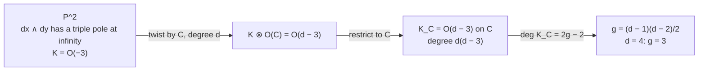

# The canonical bundle and adjunction: top-degree differentials, and the genus of a curve inside a surface

[Syllabus](../../../SYLLABUS.md) → [Algebraic geometry](../README.md) → [Sheaf Cohomology and Differentials](../README.md#s08) → The canonical bundle and adjunction

---

## General Overview

Take the smooth quartic curve $`x^4 - x^2 + y^4 + y^3 + y^2 = 1`$ in the plane, over the complex numbers ℂ. [Genus](../03-Plane%20Curves/06-genus-and-the-degree-genus-formula.md) found its genus, its number of handles, by projecting it onto a line and counting 12 branch points. The answer was 3.

This card gets the same 3 with no branch points at all. The tool is the **canonical bundle**: the line bundle (a family of one-dimensional spaces, one over each point) whose sections are the top-degree differential forms. On a surface those are the forms $`g\, dx \wedge dy`$. On a curve they are the forms $`g\, dx`$.

Start with the plane itself. The form $`dx \wedge dy`$ looks harmless: no zeros, no poles anywhere on the ordinary xy-plane. Move to the chart at infinity, with $`x = 1/t`$ and $`y = s/t`$. There it reads $`-t^{-3}\, dt \wedge ds`$: a pole of order 3 along the line at infinity $`t = 0`$. So the canonical bundle of the plane is "minus three lines", written $`\mathcal{O}(-3)`$.

The **adjunction formula** then hands this to any smooth curve C of degree d in the plane. Its canonical bundle is the plane's, plus the bundle of C itself, read on C: $`\mathcal{O}(-3 + d)`$. A curve of degree $`d - 3`$ meets C in $`d(d - 3)`$ points, and a canonical divisor on a curve of genus g has degree $`2g - 2`$. For the quartic: $`4 \times 1 = 4 = 2g - 2`$, so g = 3.

The same rule works one dimension up. On a smooth quartic surface in 3-space the canonical bundle is trivial, so every line L on it has $`L \cdot L = -2`$: the number that [Algebraic cycles](../05-Cohomology%20and%20the%20Hodge%20Conjecture/07-algebraic-cycles-and-cycle-classes.md) quoted, and this card proves.

**The canonical bundle is the bundle of top-degree differential forms; on projective n-space it is $`\mathcal{O}(-n-1)`$, and on a smooth curve or surface C inside a smooth X it is the canonical bundle of X twisted by C and restricted to C, which turns a curve's degree into its genus.**

**What kind of fact this is:** a definition (the canonical bundle) and two theorems proved on this card in Why it works: $`K_{\mathbb{P}^n} = \mathcal{O}(-n-1)`$, and the adjunction formula for a smooth hypersurface (one equation) in a smooth variety. The exactness of the conormal sequence in Step 2 is quoted from Hartshorne, with the local computation that makes it true. The Hasse–Weil bound used in road 4 of the code is quoted, not proved.

### The picture: from the plane to the genus



Left to right: one chart change, one twist, one restriction, one count. Every arrow is a step of Why it works.

---

## The formula

Notation first, in words. The field is ℂ unless a line says otherwise.

- X is a smooth variety of dimension n: near every point it has n local coordinates $`z_1, \dots, z_n`$.
- $`\Omega_X`$ is its sheaf of differentials: locally, the forms $`f_1\, dz_1 + \dots + f_n\, dz_n`$ ([Kahler differentials](01-kahler-differentials.md)).
- The wedge ∧ multiplies forms with $`dz_i \wedge dz_j = -dz_j \wedge dz_i`$, so $`dz_i \wedge dz_i = 0`$. A top-degree form is $`g\, dz_1 \wedge \dots \wedge dz_n`$: one function's worth of freedom per point.
- The **canonical bundle** $`K_X = \bigwedge^n \Omega_X`$ is the line bundle of top-degree forms. The divisor of any one such form (its zeros minus its poles) is a **canonical divisor**, also written K.
- $`\mathcal{O}(D)`$ is the line bundle of a divisor D, and $`\mathcal{O}(m)`$ the twist by m hyperplanes ([Line bundles and divisors](../05-Cohomology%20and%20the%20Hodge%20Conjecture/06-line-bundles-and-divisor-classes.md)). The tensor product ⊗ of line bundles multiplies their gluing rules, so $`\mathcal{O}(a) \otimes \mathcal{O}(b) = \mathcal{O}(a + b)`$. A vertical bar $`\vert_C`$ means "restricted to C".

```math
K_{\mathbb{P}^n} = \mathcal{O}(-n-1), \qquad K_C = \big(K_X \otimes \mathcal{O}(C)\big)\big\vert_C
```

**Read it aloud:** the canonical bundle of projective n-space is minus n plus one hyperplanes; the canonical bundle of a smooth hypersurface C in X is the canonical bundle of X, twisted by C, then read on C.

Two consequences carry the rest of the card. For a smooth plane curve of degree d, and for a smooth curve C of genus g on a smooth surface X:

```math
\deg K_C = d\,(d - 3) = 2g - 2, \qquad C \cdot C + K_X \cdot C = 2g - 2
```

**Read it aloud:** on a plane curve, the canonical bundle has degree d times d minus three, which is two g minus two; on a surface, a curve's self-intersection plus its meeting with the canonical class is two g minus two.

For the quartic, $`4 \times 1 = 4`$, so g = 3. For a line on a quartic surface, $`K_X = 0`$ and g = 0, so $`L \cdot L = -2`$.

| Symbol | Plain meaning | In our example | Push it up and the answer… |
| --- | --- | --- | --- |
| $`X`$, $`n`$ | a smooth variety and its dimension | the plane $`\mathbb{P}^2`$, n = 2 | the pole of the top form deepens |
| $`\Omega_X`$, $`\wedge`$ | differentials; the wedge product of forms | dx, dy; $`dx \wedge dy`$ | — |
| $`K_X`$, $`K`$; $`H^1(\mathcal{O})`$ | canonical bundle; canonical divisor or class; the first cohomology of functions | $`\mathcal{O}(-3)`$ on the plane; 0 on the quartic surface | — |
| $`\mathbb{P}^n`$, $`a_i`$, $`b_i`$, $`\omega`$ | projective n-space; coordinates on the chart $`x_0 = 1`$ and on the chart $`x_1 = 1`$; the top form $`da_1 \wedge \dots \wedge da_n`$ | x = 1/t, y = s/t; $`dx \wedge dy`$ | — |
| $`J`$ | Jacobian determinant of a chart change: the factor a top form picks up | $`-1/8`$ at (t, s) = (2, 3) | — |
| $`\mathcal{O}(m)`$, $`H`$ | the twist by m; a hyperplane (a line in the plane) | $`\mathcal{O}(1)`$ meets a quartic 4 times | — |
| $`C`$, $`F`$, $`d`$ | a smooth curve, its equation, its degree | the quartic, d = 4 | g grows like $`d^2/2`$ |
| $`\mathcal{O}(C)`$, $`\otimes`$, $`\vert_C`$ | the bundle of C; tensor product; restriction to C | $`\mathcal{O}(4)`$; $`\mathcal{O}(-3) \otimes \mathcal{O}(4) = \mathcal{O}(1)`$ | — |
| $`g`$, $`\deg`$ | genus; degree of a bundle on a curve | 3; $`\deg K_C = 4`$ | each handle adds 2 to deg K |
| $`C \cdot C`$, $`K \cdot C`$, $`e`$ | intersection numbers on a surface; the degree of a surface in $`\mathbb{P}^3`$ | $`L \cdot L = -2`$ on e = 4 | L·L falls by 1 per step in e |
| $`F_y`$, $`h`$ | the y-derivative of F; a polynomial of degree at most d − 3, giving the differential $`h\,dx/F_y`$ | $`dx/F_y`$, $`x\,dx/F_y`$, $`y\,dx/F_y`$ | — |
| $`f`$, $`\eta`$, $`\theta`$ | a local equation of C; a form of degree n − 1; the top form $`\eta \wedge df / f`$, whose residue is $`\eta`$ on C | f = F; $`\eta = h\,dx/F_y`$; $`\theta = h\,dx \wedge dy / F`$ | — |
| $`b`$, $`\mathrm{Disc}(x)`$, $`N`$ | branch points; the discriminant of F in y; a point count over a finite field | 12; degree 12; N = 65 | — |

### When it holds

- **X and C smooth.** Smoothness makes $`\Omega`$ a bundle of rank equal to the dimension, so its top power is a line bundle. On the nodal cubic $`x^3 + y^3 + x^2 - 4y^2 = 0`$ adjunction gives 1, but the true genus is 0 (What breaks, row 4).
- **C cut out by one equation near each point.** The proof uses one local equation f of C. A curve in 3-space needs two, and its formula has two twists: a curve cut by a quadric and a cubic has $`K_C = \mathcal{O}(2 + 3 - 4) = \mathcal{O}(1)`$ on C.
- **The twist is $`+C`$, not $`-C`$.** The sign comes from dividing by f in the residue (Step 2). Drop the twist and a quartic gets genus −5; flip it and −13.
- **Any field, for the algebra.** The chart computation and the conormal sequence work over any field. Over GF(16) the Hermitian quintic still has genus 6. Genus as handles needs ℂ.

---

## Why it works

### Step 0: a top form changes by the Jacobian, so its poles are a divisor

Change coordinates and a 1-form $`dx`$ becomes a sum of $`dt`$ and $`ds`$ terms. A top-degree form is simpler: it is multiplied by one number, the Jacobian determinant J of the chart change. That is the rule for the area of a small square, without the absolute value.

So a top form is one function per chart, glued by J. That is exactly a line bundle, and its zeros and poles form a divisor. Computing $`K_X`$ means taking one top form and finding where it vanishes or blows up.

### Step 1: projective space, by one chart change

On $`\mathbb{P}^n`$ take the chart $`x_0 = 1`$, with coordinates $`a_i = x_i/x_0`$, and the form $`\omega = da_1 \wedge \dots \wedge da_n`$. It has no zeros or poles on that chart. The only place left to look is the hyperplane $`x_0 = 0`$.

The chart $`x_1 = 1`$ sees that hyperplane, as $`b_0 = 0`$. Its coordinates are $`b_0 = x_0/x_1`$ and $`b_j = x_j/x_1`$, so $`a_1 = 1/b_0`$ and $`a_j = b_j/b_0`$. The Jacobian matrix has one column of $`-1/b_0^2`$ type entries and $`1/b_0`$ down the rest of the diagonal. Its determinant is

```math
J = -\,b_0^{-(n+1)}, \qquad \omega = -\,b_0^{-(n+1)}\, db_0 \wedge db_2 \wedge \dots \wedge db_n
```

**Read it aloud:** the Jacobian is minus one over b-zero to the n plus one, so the top form has a pole of order n plus one along the hyperplane at infinity.

So $`\mathrm{div}(\omega) = -(n+1)H`$ and $`K_{\mathbb{P}^n} = \mathcal{O}(-n-1)`$. For the plane, with $`b_0 = t`$ and $`b_2 = s`$: $`dx \wedge dy = -t^{-3}\, dt \wedge ds`$, which is $`-1/8`$ at (t, s) = (2, 3). For the line, $`d(1/t) = -t^{-2}\,dt`$: $`K_{\mathbb{P}^1} = \mathcal{O}(-2)`$, degree −2 = 2g − 2 with g = 0, as a sphere should have.

<details>
<summary>Detailed proof: the determinant of the chart change</summary>

Order the coordinates as $`(a_1, a_2, \dots, a_n)`$ and $`(b_0, b_2, \dots, b_n)`$. Then $`\partial a_1/\partial b_0 = -b_0^{-2}`$ and $`\partial a_1/\partial b_j = 0`$ for $`j \ge 2`$. For $`j \ge 2`$, $`\partial a_j/\partial b_0 = -b_j b_0^{-2}`$, $`\partial a_j/\partial b_j = b_0^{-1}`$, and every other entry of that row is 0.

The first row has one nonzero entry, in the first column. Expanding along it leaves a diagonal block with $`b_0^{-1}`$ repeated $`n - 1`$ times:

$`\displaystyle J = -b_0^{-2} \cdot b_0^{-(n-1)} = -\,b_0^{-(n+1)}.`$

The code does not use this formula: it differentiates the chart change itself with exact dual numbers (pairs $`a + b\varepsilon`$ with $`\varepsilon^2 = 0`$), takes the determinant over fractions, and finds the power of $`b_0`$ by comparing $`b_0 = 2`$ with $`b_0 = 3`$.

</details>

### Step 2: adjunction, by dividing a top form by the curve's equation

Let C be a smooth hypersurface in X: near each point it is $`f = 0`$ for one local function f with $`df \ne 0`$ on C. Take a top form on X with a simple pole along C, written $`\theta = \eta \wedge df / f`$, where $`\eta`$ is a form of degree $`n - 1`$. Its **residue** is $`\eta`$ restricted to C: a top form on C.

The residue is well defined. Another choice $`\eta'`$ with $`\eta' \wedge df = \eta \wedge df`$ differs from $`\eta`$ by a multiple of df, which is 0 on C. Changing f to $`uf`$, with u a nowhere-zero function, changes nothing on C either.

Two more facts make the match exact. Near a point of C, $`df \ne 0`$ lets f serve as the last of n local coordinates $`z_1, \dots, z_n`$, and the form $`g\,dz_1 \wedge \dots \wedge dz_n / f`$ has residue $`g\,dz_1 \wedge \dots \wedge dz_{n-1}`$ restricted to C. So every top form on C is a residue: extend its coefficient off C to a function g. And the residue is 0 exactly when g vanishes on C, that is, when f divides g and the form has no pole at all.

So the residue map identifies top forms on X with a simple pole along C, read on C (that is, modulo the forms with no pole), with top forms on C. The first are sections of $`K_X \otimes \mathcal{O}(C)`$, because a pole along C is what $`\mathcal{O}(C)`$ allows. That is the adjunction formula $`K_C = (K_X \otimes \mathcal{O}(C))\vert_C`$.

<details>
<summary>The same proof in sheaf language: the conormal sequence</summary>

For a smooth C in a smooth X with ideal sheaf $`\mathcal{I}`$ (the functions vanishing on C), restricting differentials to C gives an exact sequence of bundles on C:

$`\displaystyle 0 \to \mathcal{I}/\mathcal{I}^2 \xrightarrow{\;f \,\mapsto\, df\;} \Omega_X\vert_C \to \Omega_C \to 0.`$

The left term is the conormal bundle. It is generated by the one local equation f, and f changes by the gluing rule of $`\mathcal{O}(-C)`$, so $`\mathcal{I}/\mathcal{I}^2 = \mathcal{O}(-C)\vert_C`$. Top exterior powers multiply along an exact sequence of bundles: $`\bigwedge^n \Omega_X\vert_C = \mathcal{O}(-C)\vert_C \otimes \bigwedge^{n-1}\Omega_C`$. Tensor both sides with $`\mathcal{O}(C)\vert_C`$ and the formula appears. Hartshorne proves the sequence exact (Chapter II, Theorem 8.17) and states the result as Proposition 8.20.

</details>

### Step 3: the plane curve, and the genus

On the plane, $`K = \mathcal{O}(-3)`$ and a curve of degree d has $`\mathcal{O}(C) = \mathcal{O}(d)`$. So $`K_C = \mathcal{O}(d - 3)\vert_C`$.

A section of $`\mathcal{O}(d - 3)`$ is a curve of degree $`d - 3`$. By Bezout's theorem it meets C in $`d(d - 3)`$ points, with multiplicity. That picture needs d ≥ 3: for d = 1 and 2 the twist is negative and has no curve to draw. The count holds anyway. The degree of a line bundle on C is the degree of the divisor of any rational section (zeros minus poles), so degrees add under ⊗; and $`\mathcal{O}(1)\vert_C`$ has degree d, because a line meets C in d points. So $`\mathcal{O}(m)\vert_C`$ has degree md for every whole number m, and $`\deg K_C = d(d - 3)`$ for every d.

On a smooth projective curve of genus g, every canonical divisor has degree $`2g - 2`$: Riemann–Roch with D = K gives it ([Divisors and Riemann-Roch](../03-Plane%20Curves/07-divisors-and-riemann-roch.md)). So

```math
2g - 2 = d(d - 3) \quad\Longrightarrow\quad g = \frac{d^2 - 3d + 2}{2} = \frac{(d-1)(d-2)}{2}
```

**Read it aloud:** two g minus two equals d times d minus three, so g is d minus one times d minus two, over two.

That gives 0, 0, 1, 3, 6 for d = 1 to 5. This is a second proof of the degree–genus formula. [Genus](../03-Plane%20Curves/06-genus-and-the-degree-genus-formula.md) proved it by counting branch points; here only the degree of one bundle is used.

### Step 4: the residue, written out on a plane curve

In the chart $`z = 1`$, the residue of $`h\, dx \wedge dy / F`$ along $`F = 0`$ is $`h\, dx / F_y`$. On C, $`F_x\,dx + F_y\,dy = 0`$, so this also equals $`-h\, dy/F_x`$. One of $`F_x`$, $`F_y`$ is nonzero at each point of a smooth curve, so the differential has no poles on the affine part.

At infinity, $`dx \wedge dy`$ has its triple pole, 1/F has a zero of order d, and h a pole of order $`\deg h`$. So $`h\, dx \wedge dy / F`$ has no pole along the line at infinity exactly when $`3 + \deg h \le d`$. So the holomorphic differentials on C are the $`h\,dx/F_y`$ with $`\deg h \le d - 3`$, and there are $`(d - 1)(d - 2)/2`$ monomials of that size.

For the quartic: $`dx/F_y`$, $`x\,dx/F_y`$, $`y\,dx/F_y`$. Three differentials, genus 3. The first one vanishes exactly where h = 1 does in homogeneous form, $`z = 0`$: at the 4 points at infinity of C, a divisor of degree $`4 = 2g - 2`$. These are the adjoint curves that Step 5 of [Genus](../03-Plane%20Curves/06-genus-and-the-degree-genus-formula.md) counted.

### Step 5: surfaces, and the −2 on a quartic

The same argument on $`\mathbb{P}^3`$ gives a surface X of degree e the canonical bundle $`K_X = \mathcal{O}(-4 + e)\vert_X`$. For e = 4 that is $`\mathcal{O}(0)`$: the quartic surface has a nowhere-zero top form. A **K3 surface** is a smooth projective surface with K = 0 and $`H^1(\mathcal{O}) = 0`$: its functions have no first cohomology, the kind of group [Cech cohomology](04-cech-cohomology-of-projective-space.md) computes. The quartic has both (Huybrechts, in Sources), so it is a K3 surface. K = 0 alone is not enough: a complex torus of dimension 2 has it too.

Now apply adjunction to a smooth curve C on the surface X. The bundle $`\mathcal{O}(C)`$ restricted to C has degree $`C \cdot C`$, and $`K_X\vert_C`$ has degree $`K_X \cdot C`$. Taking degrees in $`K_C = (K_X \otimes \mathcal{O}(C))\vert_C`$ gives the genus formula on a surface:

```math
C \cdot C + K_X \cdot C = 2g - 2
```

**Read it aloud:** a curve's self-intersection plus its meeting with the canonical class equals two g minus two.

A line has g = 0, and $`K_X \cdot L = e - 4`$, since a line meets a hyperplane once. So $`L \cdot L = -2 - (e - 4) = 2 - e`$:

| Surface | e | $`K_X`$ | $`L \cdot L`$ | Known another way |
| --- | --- | --- | --- | --- |
| plane | 1 | $`\mathcal{O}(-3)`$ | 1 | two lines in a plane meet once |
| quadric | 2 | $`\mathcal{O}(-2)`$ | 0 | lines of one ruling never meet |
| cubic surface | 3 | $`\mathcal{O}(-1)`$ | −1 | its 27 lines are "−1 curves" |
| quartic (K3) | 4 | $`\mathcal{O}(0)`$ | −2 | the cycles card, by linearity |
| quintic | 5 | $`\mathcal{O}(1)`$ | −3 | — |

A plane section H is a plane curve of degree e, with $`H \cdot H = e`$. The surface formula gives $`e + (e - 4)e = e(e - 3)`$, the plane-curve formula of Step 3 again: on the quartic surface, 4 + 0 = 4 = 2 × 3 − 2.

---

## Worked numbers, by hand

The smooth quartic $`x^4 - x^2 + y^4 + y^3 + y^2 = 1`$, and a line on the quartic surface.

| Step | Arithmetic | Value |
| --- | --- | --- |
| top form of the plane at infinity | $`x = 1/t`$, $`y = s/t`$: J at (2, 3) is $`-1/2^3`$ | −1/8 |
| order of the pole | J × $`t^3`$ is −1 at t = 2 and at t = 3 | 3, so $`K = \mathcal{O}(-3)`$ |
| twist by the quartic | −3 + 4 | $`K_C = \mathcal{O}(1)`$ on C |
| degree on C | a line meets the quartic 4 times | 4 |
| genus | 2g − 2 = 4 | **g = 3** |
| holomorphic differentials | h of degree ≤ 1: 1, x, y | 3 |
| check by branch points | 2 − 2g = 2 × 4 − 12 | −4, g = 3 |
| line on the quartic surface | $`L \cdot L = 2 \times 0 - 2 - 0`$ | **−2** |

The quartic's three handles come from one twist: the plane's −3 plus the curve's 4 leaves one line's worth of degree, 4 points, and 4 = 2g − 2.

### What breaks if you drop a piece

| Mistake | Comes out at | What went wrong |
| --- | --- | --- |
| $`K_{\mathbb{P}^2}`$ taken as $`\mathcal{O}(-2)`$, one per dimension | g = 2.5 for a cubic, 5 for a quartic | the pole has order n + 1 = 3, not n |
| twist by C dropped: $`K_C = K_X\vert_C`$ | deg −12, g = −5 for a quartic | the residue has a pole to absorb |
| twist with the wrong sign | deg −28, g = −13 | dividing by f adds C; it does not subtract it |
| adjunction on the nodal cubic $`x^3 + y^3 + x^2 - 4y^2 = 0`$ | g = 1 | the curve is not smooth: its discriminant has a double root at the node, 4 true branch points, g = 0 |

The code prints all four. For the nodal cubic, adjunction gives the **arithmetic genus** 1; the node pinches one handle, as [Genus](../03-Plane%20Curves/06-genus-and-the-degree-genus-formula.md) explains.

---

## Code, from first principles, and it actually runs

The code reaches the genus by four roads that share no arithmetic. Road 1 differentiates the chart change of $`\mathbb{P}^n`$ for n = 1 to 4 with exact dual numbers and finds the pole order of the top form. Road 2 is the adjunction count, and the count of holomorphic differentials $`h\,dx/F_y`$. Road 3 is Riemann–Hurwitz on explicit curves of degree 2 to 5 and on the quartic: it builds the discriminant $`\mathrm{Disc}(x)`$ of F in y from Sylvester determinants, checks every value against the same resultant found by Euclid's algorithm with $`F_y`$ taken from F afresh, interpolates it, and counts its simple roots with a polynomial gcd, all modulo the prime 1,000,000,007. A discriminant of full degree $`d(d - 1)`$ with no repeated root mod p has none over ℚ either, so the curve is smooth with $`d(d - 1)`$ simple branch points; the top terms $`x^d + y^d`$ meet infinity in d separate points, so nothing branches there. Road 4 counts the points of the Hermitian curve over GF(16), the field with 16 elements, by brute force. The surface lines print every row of the Step 5 table. The last line also puts the nodal cubic's parametrisation back into F: t = 1 on the line y = tx gives the point (3/2, 3/2), and F = 0 there.

### Python

```python
# The canonical bundle and adjunction -- the check behind the card.  Standard library only.
# Road 1: the top form of projective space, moved between charts by an exact Jacobian.
# Road 2: adjunction arithmetic.  Road 3: Riemann-Hurwitz, branch points counted from an
# exact discriminant modulo a prime.  Road 4: points of the Hermitian curve over GF(16).
from fractions import Fraction as Fr
P = 1000000007                                    # the prime for road 3

class Dual:                                       # a + b e with e^2 = 0: exact first derivatives
    def __init__(s, a, b=0): s.a, s.b = Fr(a), Fr(b)
    def __truediv__(s, o): return Dual(s.a / o.a, (s.b * o.a - s.a * o.b) / (o.a * o.a))

def detp(m):                                       # determinant mod P, by Gaussian elimination
    m, n, d = [r[:] for r in m], len(m), 1
    for c in range(n):
        p = next((r for r in range(c, n) if m[r][c] % P != 0), None)
        if p is None: return 0
        if p != c: m[c], m[p], d = m[p], m[c], -d
        d, inv = d * m[c][c] % P, pow(m[c][c], P - 2, P)
        for r in range(c + 1, n):
            f = m[r][c] * inv % P
            m[r] = [(m[r][k] - f * m[c][k]) % P for k in range(n)]
    return d % P

def jacobian(n, b):                               # chart x1 = 1 -> chart x0 = 1, at b = (b0, b2.., bn)
    cols = []
    for j in range(n):
        v = [Dual(b[k], 1 if k == j else 0) for k in range(n)]
        a = [Dual(1) / v[0]] + [v[k] / v[0] for k in range(1, n)]   # a1 = 1/b0, ak = bk/b0
        cols.append([t.b for t in a])
    m = [[cols[j][i] for j in range(n)] for i in range(n)]
    out = Fr(1)                                   # exact determinant over fractions
    for c in range(n):
        p = next(r for r in range(c, n) if m[r][c] != 0)
        if p != c: m[c], m[p], out = m[p], m[c], -out
        out *= m[c][c]
        for r in range(c + 1, n):
            f = m[r][c] / m[c][c]
            m[r] = [m[r][k] - f * m[c][k] for k in range(n)]
    return out

def disc(F, d, x0):                               # Res_y(F, F_y) at x = x0, mod P, by Sylvester
    a = [sum(c * pow(x0, i, P) for (i, j), c in F.items() if j == k) % P for k in range(d, -1, -1)]
    b = [(d - k) * a[k] % P for k in range(d)]
    N = 2 * d - 1
    return detp([[0] * k + a + [0] * (N - d - 1 - k) for k in range(d - 1)] +
               [[0] * k + b + [0] * (N - d - k) for k in range(d)])

def interpolate(ys):                              # Newton form through x = 0, 1, 2, ..., mod P
    c, n = ys[:], len(ys)
    for j in range(1, n):
        for i in range(n - 1, j - 1, -1):
            c[i] = (c[i] - c[i - 1]) * pow(j, P - 2, P) % P
    poly = [0]
    for i in range(n - 1, -1, -1):                # poly = poly * (x - i) + c[i], low terms first
        poly = [((poly[k - 1] if k else 0) - i * (poly[k] if k < len(poly) else 0) + (c[i] if k == 0 else 0)) % P
                for k in range(len(poly) + 1)]
    while len(poly) > 1 and poly[-1] == 0: poly.pop()
    return poly

def euclid(a, b):                                 # Euclid mod P, low terms first: (gcd, resultant)
    out = 1
    while any(b):
        m, n, a, inv = len(a) - 1, len(b) - 1, a[:], pow(b[-1], P - 2, P)
        while len(a) >= len(b):
            f, s = a[-1] * inv % P, len(a) - len(b)
            a = [(a[k] - f * b[k - s]) % P if k >= s else a[k] for k in range(len(a))][:-1]
        while len(a) > 1 and a[-1] == 0: a.pop()
        out = out * (pow(b[0], m, P) if n == 0 else (-1) ** (m * n) * pow(b[-1], m - len(a) + 1, P)) % P
        a, b = b, a
    return a, (out if len(a) == 1 else 0)

def branch(F, d):                                 # returns deg D, repeated-root degree, simple roots
    xs, Fy = range(d * (d - 1) + 2), {(i, j - 1): j * c for (i, j), c in F.items() if j}
    col = lambda G, x, n: [sum(c * pow(x, i, P) for (i, j), c in G.items() if j == k) % P for k in range(n)]
    ys = [disc(F, d, x) for x in xs]
    assert ys == [euclid(col(F, x, d + 1), col(Fy, x, d))[1] for x in xs]   # Sylvester against Euclid
    D = interpolate(ys)
    g = euclid(D, [k * D[k] % P for k in range(1, len(D))])[0]
    return len(D) - 1, len(g) - 1, len(D) - 1 - 2 * (len(g) - 1)

print("road 1, the top form of P^n moved from chart x1 = 1 to chart x0 = 1")
for n in range(1, 5):
    rest = [5, 7, 11][:n - 1]
    j2, j3 = jacobian(n, [2] + rest), jacobian(n, [3] + rest)
    e = next(e for e in range(10) if j2 * 2 ** e == j3 * 3 ** e)
    print(f"P^{n}: Jacobian at b0 = 2, 3: {j2}, {j3}; equals {j2 * 2 ** e}/b0^{e}: pole of order {e}, K = O({-e})")
    assert e == n + 1 and j2 * 2 ** e == -1
print(f"P^2 at (t, s) = (2, 3): dx ^ dy = {jacobian(2, [2, 3])} dt ^ ds")
print("road 2, adjunction on a plane curve of degree d: K_C = O(d - 3) on C")
genus = {}
for d in range(1, 6):
    degK = d * (d - 3)
    genus[d] = degK // 2 + 1
    mono = sum(1 for i in range(d - 2) for j in range(d - 2 - i))   # x^i y^j, i + j <= d - 3
    print(f"d = {d}: deg K_C = {d}({d} - 3) = {degK} = 2g - 2, g = {genus[d]}; differentials h dx/F_y: {mono}")
    assert degK % 2 == 0 and genus[d] == (d - 1) * (d - 2) // 2 == mono
print("road 3, Riemann-Hurwitz: project to x, count simple roots of the discriminant mod 1000000007")
curves = [(d, {(d, 0): 1, (0, d): 1, (1, 1): 1, (1, 0): 1, (0, 0): 1}, f"x^{d} + y^{d} + xy + x + 1") for d in range(2, 6)]
curves.append((4, {(4, 0): 1, (2, 0): -1, (0, 4): 1, (0, 3): 1, (0, 2): 1, (0, 0): -1}, "x^4 - x^2 + y^4 + y^3 + y^2 - 1"))
for d, F, name in curves:
    deg, rep, b = branch(F, d)
    g = 1 - d + b // 2                            # 2 - 2g = 2d - b
    print(f"{name}: discriminant degree {deg}, repeated {rep}, branch points {b}; 2 - 2g = {2 * d} - {b}, g = {g}")
    assert deg == b == d * (d - 1) and g == genus[d]
print("road 4, the Hermitian curve x^5 = y^4 + y over GF(16), a smooth quintic")
def mul(a, b):                                    # GF(16) as bit-polynomials mod t^4 + t + 1
    r = 0
    for _ in range(4):
        if b & 1: r ^= a
        b, a = b >> 1, (a << 1) ^ (0b10011 if a & 8 else 0)
    return r
def pw(a, k):
    r = 1
    for _ in range(k): r = mul(r, a)
    return r
N = 1 + sum(1 for x in range(16) for y in range(16) if pw(x, 5) == pw(y, 4) ^ y)
print(f"points: {N - 1} affine + 1 at infinity = {N}; Hasse-Weil N <= 17 + 8g gives g >= {(N - 17) // 8}; adjunction g = {genus[5]}")
assert N == 65 and (N - 17) // 8 == genus[5]
print("surfaces of degree e in P^3: K = O(e - 4); a line L has L.L = 2g - 2 - K.L = -2 - (e - 4)")
for e in range(1, 6):
    LL, HH = -2 - (e - 4), e                      # H.H = e: a line meets the surface e times
    print(f"e = {e}: K = O({e - 4}), L.L = {LL}; plane section H.H = {HH}, K.H = {(e - 4) * e}, sum {HH + (e - 4) * e} = 2g - 2 for g = {genus[e]}")
    assert HH + (e - 4) * e == 2 * genus[e] - 2
print("quintic threefold in P^4: K = O(5 - 4 - 1) = O(0)")
print("what breaks")
d = 4                                             # the smooth quartic, true genus 3
print(f"mistake 1, K of P^2 taken as O(-2): g = 1 + d(d - 2)/2 = {1 + 3 * 1 / 2:.1f} for d = 3, {1 + d * (d - 2) // 2} for d = 4")
print(f"mistake 2, twist O(C) dropped: deg K_C = -3d = {-3 * d} for d = 4, g = {-3 * d // 2 + 1}")
print(f"mistake 3, twist with the wrong sign: deg K_C = d(-3 - d) = {d * (-3 - d)} for d = 4, g = {d * (-3 - d) // 2 + 1}")
nodal = {(3, 0): 1, (0, 3): 1, (2, 0): 1, (0, 2): -4}
deg, rep, b = branch(nodal, 3)
t = Fr(1); xt = (4 * t * t - 1) / (1 + t ** 3)
print(f"mistake 4, nodal cubic x^3 + y^3 + x^2 - 4y^2: adjunction says 1; discriminant degree {deg}, repeated {rep}, "
      f"branch points {b}, g = {1 - 3 + b // 2}; t = 1 gives ({xt}, {xt * t}), F = {xt ** 3 + (xt * t) ** 3 + xt ** 2 - 4 * (xt * t) ** 2}")
assert (deg, rep, b) == (6, 1, 4) and xt ** 3 + (xt * t) ** 3 + xt ** 2 - 4 * (xt * t) ** 2 == 0
print("ALL CHECKS PASS")
```

**Ran 2026-11-24 on macOS, Python 3.14.10, standard library only. All checks passed. Output, pasted from the run:**

```
road 1, the top form of P^n moved from chart x1 = 1 to chart x0 = 1
P^1: Jacobian at b0 = 2, 3: -1/4, -1/9; equals -1/b0^2: pole of order 2, K = O(-2)
P^2: Jacobian at b0 = 2, 3: -1/8, -1/27; equals -1/b0^3: pole of order 3, K = O(-3)
P^3: Jacobian at b0 = 2, 3: -1/16, -1/81; equals -1/b0^4: pole of order 4, K = O(-4)
P^4: Jacobian at b0 = 2, 3: -1/32, -1/243; equals -1/b0^5: pole of order 5, K = O(-5)
P^2 at (t, s) = (2, 3): dx ^ dy = -1/8 dt ^ ds
road 2, adjunction on a plane curve of degree d: K_C = O(d - 3) on C
d = 1: deg K_C = 1(1 - 3) = -2 = 2g - 2, g = 0; differentials h dx/F_y: 0
d = 2: deg K_C = 2(2 - 3) = -2 = 2g - 2, g = 0; differentials h dx/F_y: 0
d = 3: deg K_C = 3(3 - 3) = 0 = 2g - 2, g = 1; differentials h dx/F_y: 1
d = 4: deg K_C = 4(4 - 3) = 4 = 2g - 2, g = 3; differentials h dx/F_y: 3
d = 5: deg K_C = 5(5 - 3) = 10 = 2g - 2, g = 6; differentials h dx/F_y: 6
road 3, Riemann-Hurwitz: project to x, count simple roots of the discriminant mod 1000000007
x^2 + y^2 + xy + x + 1: discriminant degree 2, repeated 0, branch points 2; 2 - 2g = 4 - 2, g = 0
x^3 + y^3 + xy + x + 1: discriminant degree 6, repeated 0, branch points 6; 2 - 2g = 6 - 6, g = 1
x^4 + y^4 + xy + x + 1: discriminant degree 12, repeated 0, branch points 12; 2 - 2g = 8 - 12, g = 3
x^5 + y^5 + xy + x + 1: discriminant degree 20, repeated 0, branch points 20; 2 - 2g = 10 - 20, g = 6
x^4 - x^2 + y^4 + y^3 + y^2 - 1: discriminant degree 12, repeated 0, branch points 12; 2 - 2g = 8 - 12, g = 3
road 4, the Hermitian curve x^5 = y^4 + y over GF(16), a smooth quintic
points: 64 affine + 1 at infinity = 65; Hasse-Weil N <= 17 + 8g gives g >= 6; adjunction g = 6
surfaces of degree e in P^3: K = O(e - 4); a line L has L.L = 2g - 2 - K.L = -2 - (e - 4)
e = 1: K = O(-3), L.L = 1; plane section H.H = 1, K.H = -3, sum -2 = 2g - 2 for g = 0
e = 2: K = O(-2), L.L = 0; plane section H.H = 2, K.H = -4, sum -2 = 2g - 2 for g = 0
e = 3: K = O(-1), L.L = -1; plane section H.H = 3, K.H = -3, sum 0 = 2g - 2 for g = 1
e = 4: K = O(0), L.L = -2; plane section H.H = 4, K.H = 0, sum 4 = 2g - 2 for g = 3
e = 5: K = O(1), L.L = -3; plane section H.H = 5, K.H = 5, sum 10 = 2g - 2 for g = 6
quintic threefold in P^4: K = O(5 - 4 - 1) = O(0)
what breaks
mistake 1, K of P^2 taken as O(-2): g = 1 + d(d - 2)/2 = 2.5 for d = 3, 5 for d = 4
mistake 2, twist O(C) dropped: deg K_C = -3d = -12 for d = 4, g = -5
mistake 3, twist with the wrong sign: deg K_C = d(-3 - d) = -28 for d = 4, g = -13
mistake 4, nodal cubic x^3 + y^3 + x^2 - 4y^2: adjunction says 1; discriminant degree 6, repeated 1, branch points 4, g = 0; t = 1 gives (3/2, 3/2), F = 0
ALL CHECKS PASS
```

### Rust

Same numbers, same labels, built with `rustc --edition 2021 -O`.

```rust
// The canonical bundle and adjunction -- the same check as the Python, in Rust.  No crates.
// Road 1: the top form of projective space, moved between charts by an exact Jacobian.
// Road 2: adjunction arithmetic.  Road 3: Riemann-Hurwitz, branch points counted from an
// exact discriminant modulo a prime.  Road 4: points of the Hermitian curve over GF(16).
use std::collections::HashMap;
const P: i128 = 1000000007;                       // the prime for road 3

#[derive(Clone, Copy, PartialEq)]
struct Fr { n: i128, d: i128 }                    // exact fraction; checked_mul stops on overflow
fn gcd(a: i128, b: i128) -> i128 { if b == 0 { a.abs() } else { gcd(b, a % b) } }
fn fr(n: i128, d: i128) -> Fr { let g = gcd(n, d) * d.signum(); Fr { n: n / g, d: d / g } }
fn mul(a: Fr, b: Fr) -> Fr { fr(a.n.checked_mul(b.n).unwrap(), a.d.checked_mul(b.d).unwrap()) }
fn div(a: Fr, b: Fr) -> Fr { fr(a.n.checked_mul(b.d).unwrap(), a.d.checked_mul(b.n).unwrap()) }
fn sub(a: Fr, b: Fr) -> Fr { fr(a.n * b.d - b.n * a.d, a.d.checked_mul(b.d).unwrap()) }
fn add(a: Fr, b: Fr) -> Fr { sub(a, fr(-b.n, b.d)) }
fn show(a: Fr) -> String { if a.d == 1 { format!("{}", a.n) } else { format!("{}/{}", a.n, a.d) } }
#[derive(Clone, Copy)]
struct Dual { a: Fr, b: Fr }                      // a + b e with e^2 = 0: exact first derivatives
fn ddiv(s: Dual, o: Dual) -> Dual {
    Dual { a: div(s.a, o.a), b: div(sub(mul(s.b, o.a), mul(s.a, o.b)), mul(o.a, o.a)) }
}
fn pw(mut b: i128, mut e: i128) -> i128 {        // b^e mod P, by repeated squaring
    let mut r = 1; b = b.rem_euclid(P);
    while e > 0 { if e & 1 == 1 { r = r * b % P } b = b * b % P; e >>= 1 } r
}
fn inv(a: i128) -> i128 { pw(a.rem_euclid(P), P - 2) }
fn detp(mut m: Vec<Vec<i128>>) -> i128 {          // determinant mod P, by Gaussian elimination
    let n = m.len(); let mut d: i128 = 1;
    for c in 0..n {
        let p = match (c..n).find(|&r| m[r][c] % P != 0) { Some(p) => p, None => return 0 };
        if p != c { m.swap(c, p); d = -d }
        d = d * m[c][c] % P; let iv = inv(m[c][c]);
        for r in c + 1..n {
            let f = m[r][c] * iv % P;
            for k in 0..n { m[r][k] = (m[r][k] - f * m[c][k]).rem_euclid(P) } } }
    d.rem_euclid(P)
}

fn jacobian(n: usize, b: &[i128]) -> Fr {         // chart x1 = 1 -> chart x0 = 1, at b = (b0, b2.., bn)
    let mut m = vec![vec![fr(0, 1); n]; n];
    for j in 0..n {
        let v: Vec<Dual> = (0..n).map(|k| Dual { a: fr(b[k], 1), b: fr(if k == j { 1 } else { 0 }, 1) }).collect();
        let one = Dual { a: fr(1, 1), b: fr(0, 1) };
        let mut a = vec![ddiv(one, v[0])];         // a1 = 1/b0, ak = bk/b0
        for k in 1..n { a.push(ddiv(v[k], v[0])) }
        for i in 0..n { m[i][j] = a[i].b } }
    let mut out = fr(1, 1);                       // exact determinant over fractions
    for c in 0..n {
        let p = (c..n).find(|&r| m[r][c].n != 0).unwrap();
        if p != c { m.swap(c, p); out = fr(-out.n, out.d) }
        out = mul(out, m[c][c]);
        for r in c + 1..n {
            let f = div(m[r][c], m[c][c]);
            for k in 0..n { m[r][k] = sub(m[r][k], mul(f, m[c][k])) } } }
    out
}

fn disc(f: &HashMap<(i128, i128), i128>, d: usize, x0: i128) -> i128 {   // Res_y(F, F_y) at x0, mod P
    let a: Vec<i128> = (0..=d).rev().map(|k| f.iter().filter(|(&(_, j), _)| j == k as i128)
        .map(|(&(i, _), &c)| c * pw(x0, i)).sum::<i128>().rem_euclid(P)).collect();
    let b: Vec<i128> = (0..d).map(|k| (d - k) as i128 * a[k] % P).collect();
    let nn = 2 * d - 1; let mut rows = Vec::new();
    for k in 0..d - 1 { let mut r = vec![0; k]; r.extend(&a); r.resize(nn, 0); rows.push(r) }
    for k in 0..d { let mut r = vec![0; k]; r.extend(&b); r.resize(nn, 0); rows.push(r) }
    detp(rows)
}
fn trim(p: &mut Vec<i128>) { while p.len() > 1 && *p.last().unwrap() == 0 { p.pop(); } }
fn interpolate(ys: &[i128]) -> Vec<i128> {        // Newton form through x = 0, 1, 2, ..., mod P
    let n = ys.len(); let mut c = ys.to_vec();
    for j in 1..n { for i in (j..n).rev() { c[i] = (c[i] - c[i - 1]).rem_euclid(P) * inv(j as i128) % P } }
    let mut poly = vec![0i128];
    for i in (0..n).rev() {                       // poly = poly * (x - i) + c[i], low terms first
        let mut q = vec![0i128; poly.len() + 1];
        for k in 0..poly.len() { q[k + 1] = (q[k + 1] + poly[k]) % P; q[k] = (q[k] - i as i128 * poly[k]).rem_euclid(P) }
        q[0] = (q[0] + c[i]) % P; poly = q; }
    trim(&mut poly); poly
}

fn euclid(mut a: Vec<i128>, mut b: Vec<i128>) -> (Vec<i128>, i128) {   // Euclid mod P, low terms first: (gcd, resultant)
    let mut out = 1;
    while b.iter().any(|&x| x != 0) {
        let (m, n, iv) = (a.len() as i128 - 1, b.len() as i128 - 1, inv(*b.last().unwrap()));
        while a.len() >= b.len() {
            let (f, s) = (a[a.len() - 1] * iv % P, a.len() - b.len());
            for k in s..a.len() { a[k] = (a[k] - f * b[k - s]).rem_euclid(P) }
            a.pop(); }
        trim(&mut a);
        out = out * if n == 0 { pw(b[0], m) } else { (if m * n % 2 == 1 { P - 1 } else { 1 }) * pw(*b.last().unwrap(), m - a.len() as i128 + 1) % P } % P;
        std::mem::swap(&mut a, &mut b); }
    let r = if a.len() == 1 { out } else { 0 }; (a, r)
}

fn branch(f: &HashMap<(i128, i128), i128>, d: usize) -> (i128, i128, i128) {
    let fy: HashMap<(i128, i128), i128> = f.iter().filter(|(&(_, j), _)| j > 0).map(|(&(i, j), &c)| ((i, j - 1), j * c)).collect();
    let col = |g: &HashMap<(i128, i128), i128>, x: i128, n: i128| -> Vec<i128> { (0..n).map(|k| g.iter().filter(|(&(_, j), _)| j == k).map(|(&(i, _), &c)| c * pw(x, i)).sum::<i128>().rem_euclid(P)).collect() };
    let ys: Vec<i128> = (0..(d * (d - 1) + 2) as i128).map(|x| disc(f, d, x)).collect();
    assert!((0..ys.len()).all(|x| ys[x] == euclid(col(f, x as i128, d as i128 + 1), col(&fy, x as i128, d as i128)).1));   // Sylvester against Euclid
    let dd = interpolate(&ys);
    let der: Vec<i128> = (1..dd.len()).map(|k| k as i128 * dd[k] % P).collect();
    let g = euclid(dd.clone(), der).0;
    let (deg, rep) = (dd.len() as i128 - 1, g.len() as i128 - 1);
    (deg, rep, deg - 2 * rep)
}

fn gmul(mut a: u32, mut b: u32) -> u32 {          // GF(16) as bit-polynomials mod t^4 + t + 1
    let mut r = 0;
    for _ in 0..4 { if b & 1 == 1 { r ^= a } b >>= 1; a = (a << 1) ^ (if a & 8 != 0 { 0b10011 } else { 0 }) } r
}
fn gpw(a: u32, k: u32) -> u32 { let mut r = 1; for _ in 0..k { r = gmul(r, a) } r }
fn main() {
    println!("road 1, the top form of P^n moved from chart x1 = 1 to chart x0 = 1");
    for n in 1..5usize {
        let rest = &[5i128, 7, 11][..n - 1];
        let (mut b2, mut b3) = (vec![2i128], vec![3i128]); b2.extend(rest); b3.extend(rest);
        let (j2, j3) = (jacobian(n, &b2), jacobian(n, &b3));
        let e = (0..10u32).find(|&e| mul(j2, fr(2i128.pow(e), 1)) == mul(j3, fr(3i128.pow(e), 1))).unwrap();
        let c = mul(j2, fr(2i128.pow(e), 1));
        println!("P^{}: Jacobian at b0 = 2, 3: {}, {}; equals {}/b0^{}: pole of order {}, K = O({})", n, show(j2), show(j3), show(c), e, e, -(e as i64));
        assert!(e as usize == n + 1 && c == fr(-1, 1));
    }
    println!("P^2 at (t, s) = (2, 3): dx ^ dy = {} dt ^ ds", show(jacobian(2, &[2, 3])));
    println!("road 2, adjunction on a plane curve of degree d: K_C = O(d - 3) on C");
    let mut genus = [0i128; 6];
    for d in 1..6i128 {
        let degk = d * (d - 3);
        genus[d as usize] = degk.div_euclid(2) + 1;
        let mono: i128 = (0..(d - 2).max(0)).map(|i| d - 2 - i).sum();    // x^i y^j, i + j <= d - 3
        println!("d = {}: deg K_C = {}({} - 3) = {} = 2g - 2, g = {}; differentials h dx/F_y: {}", d, d, d, degk, genus[d as usize], mono);
        assert!(degk % 2 == 0 && genus[d as usize] == (d - 1) * (d - 2) / 2 && genus[d as usize] == mono);
    }
    println!("road 3, Riemann-Hurwitz: project to x, count simple roots of the discriminant mod 1000000007");
    let mut curves: Vec<(usize, HashMap<(i128, i128), i128>, String)> = (2..6usize).map(|d| {
        let di = d as i128;
        (d, HashMap::from([((di, 0), 1), ((0, di), 1), ((1, 1), 1), ((1, 0), 1), ((0, 0), 1)]), format!("x^{} + y^{} + xy + x + 1", d, d))
    }).collect();
    curves.push((4, HashMap::from([((4, 0), 1), ((2, 0), -1), ((0, 4), 1), ((0, 3), 1), ((0, 2), 1), ((0, 0), -1)]), "x^4 - x^2 + y^4 + y^3 + y^2 - 1".to_string()));
    for (d, f, name) in &curves {
        let (deg, rep, b) = branch(f, *d);
        let di = *d as i128;
        let g = 1 - di + b / 2;                   // 2 - 2g = 2d - b
        println!("{}: discriminant degree {}, repeated {}, branch points {}; 2 - 2g = {} - {}, g = {}", name, deg, rep, b, 2 * di, b, g);
        assert!(deg == b && b == di * (di - 1) && g == genus[*d]);
    }
    println!("road 4, the Hermitian curve x^5 = y^4 + y over GF(16), a smooth quintic");
    let nn = 1 + (0..16u32).flat_map(|x| (0..16u32).map(move |y| (x, y))).filter(|&(x, y)| gpw(x, 5) == gpw(y, 4) ^ y).count() as i128;
    println!("points: {} affine + 1 at infinity = {}; Hasse-Weil N <= 17 + 8g gives g >= {}; adjunction g = {}", nn - 1, nn, (nn - 17) / 8, genus[5]);
    assert!(nn == 65 && (nn - 17) / 8 == genus[5]);
    println!("surfaces of degree e in P^3: K = O(e - 4); a line L has L.L = 2g - 2 - K.L = -2 - (e - 4)");
    for e in 1..6i128 {
        let (ll, hh) = (-2 - (e - 4), e);         // H.H = e: a line meets the surface e times
        println!("e = {}: K = O({}), L.L = {}; plane section H.H = {}, K.H = {}, sum {} = 2g - 2 for g = {}", e, e - 4, ll, hh, (e - 4) * e, hh + (e - 4) * e, genus[e as usize]);
        assert!(hh + (e - 4) * e == 2 * genus[e as usize] - 2);
    }
    println!("quintic threefold in P^4: K = O(5 - 4 - 1) = O(0)");
    println!("what breaks");
    let d: i128 = 4;                              // the smooth quartic, true genus 3
    println!("mistake 1, K of P^2 taken as O(-2): g = 1 + d(d - 2)/2 = {:.1} for d = 3, {} for d = 4", 1.0 + 3.0 * 1.0 / 2.0, 1 + d * (d - 2) / 2);
    println!("mistake 2, twist O(C) dropped: deg K_C = -3d = {} for d = 4, g = {}", -3 * d, (-3 * d).div_euclid(2) + 1);
    println!("mistake 3, twist with the wrong sign: deg K_C = d(-3 - d) = {} for d = 4, g = {}", d * (-3 - d), (d * (-3 - d)).div_euclid(2) + 1);
    let nodal = HashMap::from([((3, 0), 1), ((0, 3), 1), ((2, 0), 1), ((0, 2), -4)]);
    let (deg, rep, b) = branch(&nodal, 3);
    let t = fr(1, 1);
    let xt = div(sub(mul(fr(4, 1), mul(t, t)), fr(1, 1)), add(fr(1, 1), mul(t, mul(t, t))));
    let yt = mul(xt, t);
    let fv = sub(add(add(mul(xt, mul(xt, xt)), mul(yt, mul(yt, yt))), mul(xt, xt)), mul(fr(4, 1), mul(yt, yt)));
    println!("mistake 4, nodal cubic x^3 + y^3 + x^2 - 4y^2: adjunction says 1; discriminant degree {}, repeated {}, branch points {}, g = {}; t = 1 gives ({}, {}), F = {}",
             deg, rep, b, 1 - 3 + b / 2, show(xt), show(yt), show(fv));
    assert!((deg, rep, b) == (6, 1, 4) && fv == fr(0, 1));
    println!("ALL CHECKS PASS");
}
```

**Ran 2026-11-24 on macOS, rustc 1.98.1, no crates. All checks passed. Output, pasted from the run:**

```
road 1, the top form of P^n moved from chart x1 = 1 to chart x0 = 1
P^1: Jacobian at b0 = 2, 3: -1/4, -1/9; equals -1/b0^2: pole of order 2, K = O(-2)
P^2: Jacobian at b0 = 2, 3: -1/8, -1/27; equals -1/b0^3: pole of order 3, K = O(-3)
P^3: Jacobian at b0 = 2, 3: -1/16, -1/81; equals -1/b0^4: pole of order 4, K = O(-4)
P^4: Jacobian at b0 = 2, 3: -1/32, -1/243; equals -1/b0^5: pole of order 5, K = O(-5)
P^2 at (t, s) = (2, 3): dx ^ dy = -1/8 dt ^ ds
road 2, adjunction on a plane curve of degree d: K_C = O(d - 3) on C
d = 1: deg K_C = 1(1 - 3) = -2 = 2g - 2, g = 0; differentials h dx/F_y: 0
d = 2: deg K_C = 2(2 - 3) = -2 = 2g - 2, g = 0; differentials h dx/F_y: 0
d = 3: deg K_C = 3(3 - 3) = 0 = 2g - 2, g = 1; differentials h dx/F_y: 1
d = 4: deg K_C = 4(4 - 3) = 4 = 2g - 2, g = 3; differentials h dx/F_y: 3
d = 5: deg K_C = 5(5 - 3) = 10 = 2g - 2, g = 6; differentials h dx/F_y: 6
road 3, Riemann-Hurwitz: project to x, count simple roots of the discriminant mod 1000000007
x^2 + y^2 + xy + x + 1: discriminant degree 2, repeated 0, branch points 2; 2 - 2g = 4 - 2, g = 0
x^3 + y^3 + xy + x + 1: discriminant degree 6, repeated 0, branch points 6; 2 - 2g = 6 - 6, g = 1
x^4 + y^4 + xy + x + 1: discriminant degree 12, repeated 0, branch points 12; 2 - 2g = 8 - 12, g = 3
x^5 + y^5 + xy + x + 1: discriminant degree 20, repeated 0, branch points 20; 2 - 2g = 10 - 20, g = 6
x^4 - x^2 + y^4 + y^3 + y^2 - 1: discriminant degree 12, repeated 0, branch points 12; 2 - 2g = 8 - 12, g = 3
road 4, the Hermitian curve x^5 = y^4 + y over GF(16), a smooth quintic
points: 64 affine + 1 at infinity = 65; Hasse-Weil N <= 17 + 8g gives g >= 6; adjunction g = 6
surfaces of degree e in P^3: K = O(e - 4); a line L has L.L = 2g - 2 - K.L = -2 - (e - 4)
e = 1: K = O(-3), L.L = 1; plane section H.H = 1, K.H = -3, sum -2 = 2g - 2 for g = 0
e = 2: K = O(-2), L.L = 0; plane section H.H = 2, K.H = -4, sum -2 = 2g - 2 for g = 0
e = 3: K = O(-1), L.L = -1; plane section H.H = 3, K.H = -3, sum 0 = 2g - 2 for g = 1
e = 4: K = O(0), L.L = -2; plane section H.H = 4, K.H = 0, sum 4 = 2g - 2 for g = 3
e = 5: K = O(1), L.L = -3; plane section H.H = 5, K.H = 5, sum 10 = 2g - 2 for g = 6
quintic threefold in P^4: K = O(5 - 4 - 1) = O(0)
what breaks
mistake 1, K of P^2 taken as O(-2): g = 1 + d(d - 2)/2 = 2.5 for d = 3, 5 for d = 4
mistake 2, twist O(C) dropped: deg K_C = -3d = -12 for d = 4, g = -5
mistake 3, twist with the wrong sign: deg K_C = d(-3 - d) = -28 for d = 4, g = -13
mistake 4, nodal cubic x^3 + y^3 + x^2 - 4y^2: adjunction says 1; discriminant degree 6, repeated 1, branch points 4, g = 0; t = 1 gives (3/2, 3/2), F = 0
ALL CHECKS PASS
```

The two outputs match line for line.

### Lean

Lean proves the computations inside Steps 1, 3 and 4 for every n and d, and checks the worked numbers exactly.

- Take ℂ or ℝ, $`n \ge 1`$, and a point of the chart $`x_1 = 1`$ with $`b_0 \neq 0`$. Then the chart change to $`x_0 = 1`$ has Jacobian determinant $`J = -b_0^{-(n+1)}`$.
- Take whole numbers d and g with $`2g - 2 = d(d - 3)`$. Then $`g = (d - 1)(d - 2)/2`$.
- Take the monomials $`x^i y^j`$ with $`i + j \le d - 3`$. Then there are exactly $`(d - 1)(d - 2)/2`$ of them.
- At (t, s) = (2, 3) the plane's Jacobian is −1/8, and −1/8 times $`2^3`$ is −1.
- For d = 1 to 5, $`d(d - 3)`$ is −2, −2, 0, 4, 10, and g is 0, 0, 1, 3, 6.
- For the quartic, −3 + 4 = 1 and 4 = 2 × 3 − 2. Riemann–Hurwitz agrees: 2 − 2 × 3 = 2 × 4 − 12.
- For d = 2 to 5, the branch-point count gives g = 0, 1, 3, 6.
- The Hermitian quintic over GF(16) has 64 + 1 = 65 points, and 65 ≤ 17 + 8 × 6.
- On a surface of degree e = 1 to 5, a line has $`L \cdot L`$ = 1, 0, −1, −2, −3.
- Take a plane section of that surface, with $`g = (e - 1)(e - 2)/2`$. Then $`e + (e - 4)e = 2g - 2`$.
- A curve cut by a quadric and a cubic has $`K_C = \mathcal{O}(1)`$, since 2 + 3 − 4 = 1.
- For the quartic, the three mistakes of What breaks give g = 5, −5 and −13.
- On the nodal cubic, t = 1 gives the point (3/2, 3/2), and F = 0 there.

The discriminants, the branch points and the GF(16) point count are left to the Python and Rust checks.

```lean
-- The canonical bundle and adjunction: the top form of projective n-space picks up the Jacobian -1/b0^(n+1) at the hyperplane at infinity, adjunction's degree d(d - 3) = 2g - 2 gives g = (d - 1)(d - 2)/2, and the card's whole-number checks hold exactly.
import Mathlib.Analysis.Calculus.FDeriv.Basic
import Mathlib.Topology.Algebra.Module.Determinant
import Mathlib.LinearAlgebra.Matrix.Determinant.Basic
import Mathlib.Data.Finset.Card
import Mathlib.Tactic
import Mathlib.Analysis.Calculus.Deriv.Inv
import Mathlib.Analysis.Calculus.FDeriv.Prod
import Mathlib.Analysis.Calculus.FDeriv.Mul
import Mathlib.LinearAlgebra.Matrix.Block

open Matrix

/-- Helper for Step 4: twice the sum of j - 1 over j < d is (d - 1)(d - 2). -/
theorem two_mul_sum_range_pred (d : ℕ) :
    2 * ∑ j ∈ Finset.range d, (j - 1) = (d - 1) * (d - 2) := by
  induction d with
  | zero => simp
  | succ k ih =>
    rw [Finset.sum_range_succ, mul_add, ih]
    rcases k with _ | _ | k
    · simp
    · simp
    · simp only [Nat.add_sub_cancel, show k + 1 + 1 - 1 = k + 1 by omega,
        show k + 1 + 1 - 2 = k by omega, show k + 1 + 1 + 1 - 2 = k + 1 by omega]
      ring

#print axioms two_mul_sum_range_pred

/-- The top form of projective n-space has a pole of order n + 1 at infinity (Step 1 of the card):
move from the chart x1 = 1, with coordinates (b0, b2, ..., bn), to the chart x0 = 1, with
a1 = 1/b0 and aj = bj/b0. Wherever b0 is not 0, the Jacobian determinant of this chart change is
-1/b0^(n+1), so da1 ∧ ... ∧ dan = -b0^(-(n+1)) db0 ∧ db2 ∧ ... ∧ dbn and K of P^n is O(-n-1).
Index 0 here is b0 (and a1); index k ≥ 1 is b(k+1) (and a(k+1)). -/
theorem top_form_of_projective_space_has_pole_of_order_n_add_one
    {𝕜 : Type*} [NontriviallyNormedField 𝕜] (n : ℕ) [NeZero n] (b : Fin n → 𝕜) (hb : b 0 ≠ 0) :
    (fderiv 𝕜 (fun c : Fin n → 𝕜 => fun k : Fin n => if k = 0 then (c 0)⁻¹ else c k / c 0) b).det
      = -((b 0) ^ (n + 1))⁻¹ := by
  set D : Fin n → (Fin n → 𝕜) →L[𝕜] 𝕜 := fun k =>
    if k = 0 then (ContinuousLinearMap.toSpanSingleton 𝕜 (-(b 0 ^ 2)⁻¹)).comp
        (ContinuousLinearMap.proj 0)
    else b k • (ContinuousLinearMap.toSpanSingleton 𝕜 (-(b 0 ^ 2)⁻¹)).comp
        (ContinuousLinearMap.proj 0) + (b 0)⁻¹ • ContinuousLinearMap.proj k with hD
  have hinv : HasFDerivAt (fun c : Fin n → 𝕜 => (c 0)⁻¹)
      ((ContinuousLinearMap.toSpanSingleton 𝕜 (-(b 0 ^ 2)⁻¹)).comp
        (ContinuousLinearMap.proj 0)) b :=
    (hasFDerivAt_inv hb).comp b (hasFDerivAt_apply 0 b)
  have hder : HasFDerivAt (fun c : Fin n → 𝕜 => fun k : Fin n =>
      if k = 0 then (c 0)⁻¹ else c k / c 0) (ContinuousLinearMap.pi D) b := by
    rw [hasFDerivAt_pi]
    intro k
    by_cases hk : k = 0
    · simp only [hD, hk, ite_true]
      exact hinv
    · simp only [hD, hk, ite_false, div_eq_mul_inv]
      exact (hasFDerivAt_apply k b).mul hinv
  rw [hder.fderiv, ContinuousLinearMap.det, ← LinearMap.det_toMatrix']
  have hentry : ∀ i j : Fin n,
      LinearMap.toMatrix' (ContinuousLinearMap.pi D : (Fin n → 𝕜) →ₗ[𝕜] (Fin n → 𝕜)) i j
      = if i = 0 then (if j = 0 then -(b 0 ^ 2)⁻¹ else 0)
        else (if j = 0 then b i * -(b 0 ^ 2)⁻¹ else 0) + (if j = i then (b 0)⁻¹ else 0) := by
    intro i j
    rw [LinearMap.toMatrix'_apply]
    by_cases hi : i = 0
    · subst hi
      by_cases hj : j = 0
      · subst hj; simp [hD]
      · simp [hD, hj, Ne.symm hj]
    · by_cases hj : j = 0
      · subst hj; simp [hD, hi, Ne.symm hi]
      · by_cases hji : j = i
        · subst hji; simp [hD, hi]
        · simp [hD, hi, hj, hji, Ne.symm hj, Ne.symm hji]
  rw [Matrix.det_of_isLowerTriangular]
  · simp only [hentry]
    obtain ⟨m, rfl⟩ : ∃ m, n = m + 1 := ⟨n - 1, by have := NeZero.ne n; omega⟩
    rw [Fin.prod_univ_succ]
    simp [Fin.succ_ne_zero]
    field_simp
    ring
  · intro i j hij
    simp only [OrderDual.toDual_lt_toDual] at hij
    rw [hentry]
    have hj : j ≠ 0 := by
      rintro rfl
      exact absurd hij (by simp)
    simp [hj, hij.ne']

/-- Adjunction turns degree into genus (Step 3): on a smooth plane curve of degree d the canonical
bundle is O(d - 3) on C, of degree d(d - 3), and a canonical divisor has degree 2g - 2; so
g = (d - 1)(d - 2)/2. -/
theorem genus_of_plane_curve_from_adjunction (d g : ℤ) (h : 2 * g - 2 = d * (d - 3)) :
    g = (d - 1) * (d - 2) / 2 := by
  have h2 : (d - 1) * (d - 2) = 2 * g := by linear_combination -h
  rw [h2]
  omega

/-- The holomorphic differentials h dx/F_y on a smooth plane curve of degree d (Step 4): the
monomials x^i y^j with i + j ≤ d - 3 number exactly (d - 1)(d - 2)/2, the genus. -/
theorem holomorphic_differentials_count (d : ℕ) :
    ((Finset.range d ×ˢ Finset.range d).filter (fun p : ℕ × ℕ => p.1 + p.2 + 3 ≤ d)).card
      = (d - 1) * (d - 2) / 2 := by
  have hsum : ((Finset.range d ×ˢ Finset.range d).filter
      (fun p : ℕ × ℕ => p.1 + p.2 + 3 ≤ d)).card = ∑ j ∈ Finset.range d, (j - 1) := by
    rw [Finset.card_filter, Finset.sum_product]
    have hin : ∀ x ∈ Finset.range d,
        (∑ y ∈ Finset.range d, if x + y + 3 ≤ d then 1 else 0) = d - 1 - x - 1 := by
      intro x _
      rw [← Finset.card_filter]
      have : (Finset.range d).filter (fun y => x + y + 3 ≤ d)
          = Finset.range (d - 1 - x - 1) := by
        ext y
        simp only [Finset.mem_filter, Finset.mem_range]
        omega
      rw [this, Finset.card_range]
    rw [Finset.sum_congr rfl hin]
    exact Finset.sum_range_reflect (fun j => j - 1) d
  have h2 := two_mul_sum_range_pred d
  rw [hsum]
  generalize (d - 1) * (d - 2) = X at h2 ⊢
  omega

-- Step 1 on the plane: x = 1/t, y = s/t has Jacobian matrix [[-1/t^2, 0], [-s/t^2, 1/t]],
-- which at (t, s) = (2, 3) has determinant -1/8; and -1/8 times 2^3 is -1.
example : !![(-1 : ℚ) / 4, 0; -3 / 4, 1 / 2].det = -1 / 8 := by
  norm_num [Matrix.det_fin_two]
example : (-1 : ℚ) / 8 * 2 ^ 3 = -1 ∧ (-1 : ℚ) / 27 * 3 ^ 3 = -1 := by norm_num

-- Adjunction on plane curves: deg K_C = d(d - 3) = 2g - 2 gives g = 0, 0, 1, 3, 6 for d = 1 to 5.
example : [(1 : ℤ), 2, 3, 4, 5].map (fun d => d * (d - 3)) = [-2, -2, 0, 4, 10] := by decide
example : [(1 : ℤ), 2, 3, 4, 5].map (fun d => (d - 1) * (d - 2) / 2) = [0, 0, 1, 3, 6] := by decide
example : [0, 0, 1, 3, 6].map (fun g : ℤ => 2 * g - 2) = [-2, -2, 0, 4, 10] := by decide

-- The quartic: twist -3 + 4 = 1, degree 4 = 2 * 3 - 2; Riemann-Hurwitz 2 - 2 * 3 = 2 * 4 - 12.
example : (-3 : ℤ) + 4 = 1 ∧ (4 : ℤ) * (4 - 3) = 2 * 3 - 2 ∧ (2 : ℤ) - 2 * 3 = 2 * 4 - 12 := by
  norm_num

-- Branch points d(d - 1) and Riemann-Hurwitz 2 - 2g = 2d - d(d - 1) for d = 2 to 5.
example : [(2 : ℤ), 3, 4, 5].map (fun d => 1 - d + d * (d - 1) / 2) = [0, 1, 3, 6] := by decide

-- Hermitian quintic over GF(16): 64 affine points + 1 at infinity = 65, and (65 - 17)/8 = 6.
example : (64 : ℕ) + 1 = 65 ∧ (65 - 17) / 8 = 6 ∧ (65 : ℕ) ≤ 17 + 8 * 6 := by norm_num

-- Surfaces of degree e in P^3: K = O(e - 4), a line has L.L = -2 - (e - 4) = 1, 0, -1, -2, -3,
-- and a plane section has H.H + K.H = e + (e - 4)e = 2g - 2 with g = (e - 1)(e - 2)/2.
example : [(1 : ℤ), 2, 3, 4, 5].map (fun e => -2 - (e - 4)) = [1, 0, -1, -2, -3] := by decide
example : [(1 : ℤ), 2, 3, 4, 5].map (fun e => e + (e - 4) * e - (2 * ((e - 1) * (e - 2) / 2) - 2))
    = [0, 0, 0, 0, 0] := by decide

-- Two twists: a quadric and a cubic in P^3 give K_C = O(2 + 3 - 4) = O(1); the quintic
-- threefold in P^4 has K = O(5 - 4 - 1) = O(0).
example : (2 : ℤ) + 3 - 4 = 1 ∧ (5 : ℤ) - 4 - 1 = 0 := by norm_num

-- What breaks, for the quartic d = 4: K of P^2 taken as O(-2) gives g = 1 + 4 * 2 / 2 = 5;
-- twist dropped gives degree -12 and g = -5; wrong sign gives degree -28 and g = -13.
example : (1 : ℤ) + 4 * (4 - 2) / 2 = 5 := by norm_num
example : (-3 : ℤ) * 4 = -12 ∧ (-12 : ℤ) / 2 + 1 = -5 := by norm_num
example : (4 : ℤ) * (-3 - 4) = -28 ∧ (-28 : ℤ) / 2 + 1 = -13 := by norm_num

-- The nodal cubic x^3 + y^3 + x^2 - 4y^2: t = 1 on y = tx gives the point (3/2, 3/2), on the curve.
example : ((3 : ℚ) / 2) ^ 3 + (3 / 2) ^ 3 + (3 / 2) ^ 2 - 4 * (3 / 2) ^ 2 = 0 := by norm_num
example : (4 * (1 : ℚ) ^ 2 - 1) / (1 + 1 ^ 3) = 3 / 2 := by norm_num

#print axioms top_form_of_projective_space_has_pole_of_order_n_add_one
#print axioms genus_of_plane_curve_from_adjunction
#print axioms holomorphic_differentials_count
```

**Checked 2026-11-24 on macOS, Lean 4.36.0-rc2, Mathlib v4.36.0-rc2. Every proof is complete and uses only Lean's standard axioms. Output, pasted from the run:**

```
'two_mul_sum_range_pred' depends on axioms: [propext, Classical.choice, Quot.sound]
'top_form_of_projective_space_has_pole_of_order_n_add_one' depends on axioms: [propext, Classical.choice, Quot.sound]
'genus_of_plane_curve_from_adjunction' depends on axioms: [propext, Classical.choice, Quot.sound]
'holomorphic_differentials_count' depends on axioms: [propext, Classical.choice, Quot.sound]
```

> [!TIP]
> **Try changing**
> - Guess first: what is the genus of a smooth sextic? In the line `for d in range(1, 6):` change 6 to 7 (in the Rust, `for d in 1..6i128` to `1..7i128` and `[0i128; 6]` to `[0i128; 7]`). The answer: deg K = 6 × 3 = 18, g = 10, and 10 differentials.
> - Guess first: what pole order does the top form of $`\mathbb{P}^5`$ have? Change `range(1, 5)` to `range(1, 6)` and `[5, 7, 11]` to `[5, 7, 11, 13]` (the same in the Rust). The answer: −1/64 at $`b_0 = 2`$, a pole of order 6, $`K = \mathcal{O}(-6)`$.
> - Guess first: does $`x^3 + y^3 + 1`$ still give 6 branch points? Remove `(1, 1): 1, (1, 0): 1, ` from the family (in the Rust, `((1, 1), 1), ((1, 0), 1), `). The answer: no (the printed label still shows the old name). Its discriminant has 3 roots, each repeated, so the simple-root count reads 0 and g = −2, and the assert stops the run. Three sheets meet at each of those 3 points; Riemann–Hurwitz counts the sheets minus one, 3 − 1 = 2, at each, so 2 − 2g = 6 − 6 = 0 and g = 1 after all.
> - Guess first: what does $`x^3 + y^3 + x^2 - y^2`$ give? Change the −4 in `nodal` to −1. The answer: 2 repeated roots, 2 branch points, g = −1, and the assert stops the run. The curve is the line x + y = 0 plus a conic: two pieces, so no single genus exists.

---

## The usual mistake

> [!warning]
> **Forgetting that the canonical bundle of projective space is negative.** $`dx \wedge dy`$ looks like the most harmless form there is, so it is tempting to call $`K_{\mathbb{P}^2}`$ trivial. It is $`\mathcal{O}(-3)`$: the pole sits on the line at infinity, out of sight. Treat it as trivial and only the twist $`\mathcal{O}(d)`$ is left, which overcounts the genus of every plane curve.
>
> - **One per dimension.** $`K_{\mathbb{P}^n}`$ is $`\mathcal{O}(-n-1)`$, not $`\mathcal{O}(-n)`$. With −2 on the plane a cubic gets genus 2.5.
> - **Dropping or flipping the twist.** $`K_C = K_X\vert_C`$ gives a quartic genus −5; $`K_X \otimes \mathcal{O}(-C)`$ gives −13. A negative genus is the sign of this error.
> - **Using adjunction on a singular curve.** It returns the arithmetic genus, 1 for the nodal cubic, whose true genus is 0.
> - **Reading $`L \cdot L`$ in the plane that holds L.** In a plane a line meets itself once. On the quartic surface the same line has $`L \cdot L = -2`$: self-intersection depends on the surface around the curve.

---

## Where you meet it in real life

- **Error-correcting codes.** Goppa's codes evaluate functions on a curve over a finite field, and the genus is the price paid in distance: a code of dimension k and length n has distance at least $`n - k + 1 - g`$. The Hermitian curve $`x^5 = y^4 + y`$ over GF(16) is a smooth quintic, so adjunction gives g = 6. It has 65 points, the most the Hasse–Weil bound $`N \le 17 + 8g`$ allows, which makes it a favourite for codes of length 64.
- **String theory.** A smooth quintic threefold in $`\mathbb{P}^4`$ has $`K = \mathcal{O}(5 - 4 - 1) = \mathcal{O}(0)`$: a nowhere-zero top form, a key property of a Calabi–Yau space. Such spaces are the shapes of the six extra dimensions in many string models.
- **K3 surfaces.** The quartic surface's trivial canonical bundle makes every smooth rational curve on it a −2 curve. These −2 curves control the surface's symmetries and its lattice of classes.
- **Classifying surfaces.** Roughly, how positive $`K_X`$ is sorts surfaces: the plane-like ones where it is negative, K3 surfaces and tori where it is zero, and general type where it is large. The cubic surface's 27 lines are its −1 curves, and contracting six disjoint ones returns the plane.

> **Say it back**
> The canonical bundle of a smooth variety is the bundle of top-degree forms, glued by the Jacobian of each chart change. On projective n-space the form $`da_1 \wedge \dots \wedge da_n`$ has a pole of order n + 1 at infinity, so $`K = \mathcal{O}(-n-1)`$. Dividing a top form by the equation of a smooth hypersurface C and taking the residue gives adjunction: $`K_C = (K_X \otimes \mathcal{O}(C))\vert_C`$. On a plane curve of degree d this makes $`\deg K_C = d(d - 3) = 2g - 2`$, so g = (d − 1)(d − 2)/2: 0, 0, 1, 3, 6 for d = 1 to 5. On a quartic surface K = 0, so every line has self-intersection −2.

---

## What this builds on

- [Kahler differentials](01-kahler-differentials.md): the sheaf $`\Omega_X`$ of 1-forms, whose top exterior power this card calls $`K_X`$.
- [Line bundles and divisors](../05-Cohomology%20and%20the%20Hodge%20Conjecture/06-line-bundles-and-divisor-classes.md): $`\mathcal{O}(D)`$, the twists $`\mathcal{O}(m)`$ and their gluing rules, which turn the pole order of one form into the bundle $`\mathcal{O}(-n-1)`$.
- [Genus](../03-Plane%20Curves/06-genus-and-the-degree-genus-formula.md): the degree–genus formula by branch points and its adjoint curves, both re-derived here from adjunction.
- [Algebraic cycles](../05-Cohomology%20and%20the%20Hodge%20Conjecture/07-algebraic-cycles-and-cycle-classes.md): intersection numbers on the quartic surface, and the −2 it quoted from adjunction, proved in Step 5.
- [Divisors and Riemann-Roch](../03-Plane%20Curves/07-divisors-and-riemann-roch.md): the canonical divisor of a curve and its degree $`2g - 2`$, the bridge from a bundle's degree to the genus.

## Where this goes next

- [Flat, smooth and etale](03-flat-smooth-and-etale-morphisms.md): smoothness for a map, defined as flat with smooth fibres and tested by the Jacobian of the relative differentials; smoothness is the hypothesis that adjunction needs.
- [Cech cohomology](04-cech-cohomology-of-projective-space.md): the cohomology of the twists $`\mathcal{O}(m)`$ on projective space, where $`\mathcal{O}(-n-1)`$ is the highest twist with top cohomology, and that cohomology is one-dimensional.
- [Sheaf cohomology](05-sheaf-cohomology-as-a-derived-functor.md): cohomology for any sheaf, including $`K_X`$.
- [Serre duality](06-serre-duality-and-riemann-roch.md): $`K_X`$ as the dualising bundle, which pairs $`H^i(\mathcal{L})`$ with $`H^{n-i}(K_X \otimes \mathcal{L}^{-1})`$ and explains the correction term of Riemann–Roch.
- [The Weil conjectures](07-weil-conjectures-and-etale-cohomology.md): the Hasse–Weil bound that road 4 used, and the point counts of curves over finite fields.

Adjunction gives $`K_C`$ for a curve with one equation in its surface; the question left open is how many independent sections $`K_X`$ and its powers have on a surface, the numbers that classify surfaces.

---

## Sources

Verified 2026-11-24: every link below resolves to the publisher's page.

- Hartshorne, Robin. *Algebraic Geometry*. Springer, 1977. [DOI 10.1007/978-1-4757-3849-0](https://doi.org/10.1007/978-1-4757-3849-0). Chapter II, Section 8: the conormal sequence, the canonical sheaf of projective space and the adjunction formula; Chapter V, Section 1: the genus formula $`C^2 + C \cdot K = 2g - 2`$ on a surface.
- Shafarevich, Igor R. *Basic Algebraic Geometry 1*, 3rd ed. Springer, 2013. [DOI 10.1007/978-3-642-37956-7](https://doi.org/10.1007/978-3-642-37956-7). Chapter III, "Divisors and Differential Forms": the canonical class by explicit charts, as in Step 1.
- Griffiths, Phillip, and Joseph Harris. *Principles of Algebraic Geometry*. Wiley, 1978; Wiley Classics Library, 1994. [DOI 10.1002/9781118032527](https://doi.org/10.1002/9781118032527). The adjunction formula by Poincaré residues, the route of Steps 2 and 4.
- Huybrechts, Daniel. *Lectures on K3 Surfaces*. Cambridge University Press, 2016. [DOI 10.1017/CBO9781316594193](https://doi.org/10.1017/CBO9781316594193). The definition of a K3 surface (trivial canonical bundle and $`H^1(\mathcal{O}) = 0`$), smooth quartic surfaces as the first example, and their −2 curves.
- Stichtenoth, Henning. *Algebraic Function Fields and Codes*, 2nd ed. Springer, 2009. [DOI 10.1007/978-3-540-76878-4](https://doi.org/10.1007/978-3-540-76878-4). The Hermitian curve, its genus and point count, the Hasse–Weil bound and Goppa's codes.
