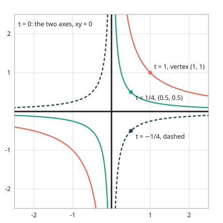

# Flat, smooth and etale: families without jumps, and maps that look locally like isomorphisms

[Syllabus](../../../SYLLABUS.md) → [Algebraic geometry](../README.md) → [Sheaf Cohomology and Differentials](../README.md#s08) → Flat, smooth and etale

---

## General Overview

Take the hyperbolas $`xy = t`$, one for each number t. At t = 1 the curve's upper-right branch passes nearest the origin at (1, 1). At t = 1/4 that point has moved in to (0.5, 0.5). At t = 0 the curve is $`xy = 0`$: the two axes, crossing at the origin.

Stack all these curves into one surface and send each point to its t. That is one map from the surface to the t-line. The curve over one value of t is the **fibre** over that point. The question is whether the family holds together at t = 0, or whether something jumps there.

Here nothing jumps. Close each fibre up in the projective plane and it is a conic. Each conic carries exactly $`2n + 1`$ independent polynomial functions of degree n, for every n. That count, the Hilbert polynomial, is the same for the smooth hyperbolas and for the crossing lines. A map whose fibres vary without such jumps is called **flat**.

Blowing up the plane at the origin is different. Over every other point of the plane, the map has one point above it. Over the origin it has a whole line. That jump makes the blow-up not flat.

Two stronger properties ask about the shape of each fibre:

- A map is **smooth** when it is flat and no fibre has a singular point. The family $`xy = t`$ fails at one point: the crossing at t = 0.
- A map is **etale** when it is smooth and every fibre is a finite set of separate points. Near each point it then looks like an isomorphism: it can be undone by power series, though not by polynomials. Squaring, $`x \mapsto x^2`$, is etale away from 0, as long as 2 is not 0 in the field.

Whole numbers follow the same rule. The integers sit inside $`\mathbb{Z}[i]`$, so Spec ℤ[i] maps to Spec ℤ, and over each prime p the fibre is the roots of $`x^2 + 1`$ mod p. Mod 5 there are two separate roots, 2 and 3. Mod 2 there is one root, 1, counted twice. So the map is etale away from 2. Etale points are where Newton's method lifts roots to higher powers of p (Step 7).

**A map is flat when its fibres vary without jumps: $`\mathrm{Tor}_1`$ vanishes and, for projective fibres, the Hilbert polynomial stays the same; it is smooth when it is flat and the fibres have no singular points, which the Jacobian matrix tests; and it is etale when it is smooth with fibres of finite separate points, so the Jacobian is invertible and the map looks locally like an isomorphism.**

**What kind of fact this is:** three definitions (flat, smooth, etale) and several theorems. Proved on this card in Why it works: the $`\mathrm{Tor}_1`$ test over a line, the flatness of $`xy = t`$, the failure for the blow-up, and every affine etale locus shown. Stated with a named source: the Hilbert polynomial criterion, the Jacobian criterion in general, and the Riemann–Hurwitz formula.

### The picture: one family, four fibres

<p align="center"></p>

To scale, real points only, x and y from −2.5 to 2.5. As t shrinks to 0 from either side, the branches close in on the two axes. The limit fibre is singular, but it is still a conic: degree 2, Hilbert polynomial $`2n + 1`$.

---

## The formula

- **Field.** The field k is $`\mathbb{Q}`$ for the algebra. Point counts use $`\mathbb{F}_p`$, the integers mod a prime p, and $`\mathbb{F}_{49}`$, the field with 49 elements. Shapes are over $`\mathbb{C}`$.
- **Morphisms.** A map of schemes $`f: X \to S`$ is a ring map $`A \to B`$ read backwards, and the fibre $`X_s`$ over a point s is the fibre product $`X \times_S \{s\}`$ ([Morphisms of schemes](../06-Schemes%20and%20Modern%20Language/04-morphisms-and-fibre-products-in-outline.md)).
- **Tor.** $`\mathrm{Tor}_1^A(M, N)`$ measures what tensoring with M loses: it is zero for every N exactly when tensoring with M keeps one-to-one maps one-to-one ([Tor](../07-Exact%20Sequences%2C%20Ext%20and%20Tor/04-free-resolutions-and-tor.md)).
- **Hilbert polynomial.** $`\mathrm{HP}_V(n)`$ counts the independent degree-n polynomials on a projective variety V, for large n; its top term gives the degree ([Degree](../02-Affine%20and%20Projective%20Varieties/09-degree-and-the-hilbert-polynomial.md)). Here n is the degree variable, because t is taken by the family.
- **Differentials.** $`\Omega_{B/A}`$ is the B-module of formal differentials $`dx_j`$, where $`d`$ of a polynomial follows the usual rules and constants from A have $`d = 0`$ ([Kahler differentials](01-kahler-differentials.md)).

### Flat: no function lives over a single point

A map $`f: X \to S`$ is **flat at a point P** when the local ring of X at P, viewed as a module over the local ring of S at $`f(P)`$, has no $`\mathrm{Tor}_1`$:

```math
f \text{ flat at } P \iff \mathrm{Tor}_1^{A}(B, N) = 0 \text{ for every } A\text{-module } N
```

**Read it aloud:** f is flat at P when tensoring with the ring upstairs never loses anything, measured by Tor one.

When the base is a line, $`A = k[t]`$, the test at the point $`t = c`$ shrinks to one multiplication:

```math
\mathrm{Tor}_1^{k[t]}\big(B,\ k[t]/\langle t - c\rangle\big) = \{\, b \in B : (t - c)\, b = 0 \,\}
```

**Read it aloud:** Tor one against the point c is the set of functions upstairs that t minus c kills.

So a family over a line is flat exactly when no nonzero function upstairs is killed by a nonzero polynomial in t: when no piece of X sits entirely over finitely many points. Over $`\mathbb{C}`$ every such polynomial is a product of factors $`t - c`$, so testing each c is enough. Over $`\mathbb{Q}`$, a factor such as $`t^2 + 1`$ is a point too, and must be tested. For $`xy = t`$, the ring upstairs is $`B = k[x, y]`$ with t acting as xy, and $`(xy - c)\, b = 0`$ forces $`b = 0`$.

For projective families there is a second test (Hartshorne, Theorem III.9.9). Let X sit inside $`\mathbb{P}^m_S`$, projective m-space over S, with S integral (its ring has no zero divisors):

```math
X \text{ flat over } S \iff \mathrm{HP}_{X_s}(n) \text{ is the same polynomial for every point } s \text{ of } S
```

**Read it aloud:** a projective family over an integral base is flat exactly when all its fibres share one Hilbert polynomial.

In the example, the fibres are $`xy = t z^2`$ in $`\mathbb{P}^2`$, with z the third homogeneous coordinate. Every one has $`\mathrm{HP}(n) = 2n + 1`$.

### Smooth and etale: the Jacobian in the fibre variables

Let X be cut out of m-space over S by r equations $`f_1, \ldots, f_r`$ in fibre variables $`x_1, \ldots, x_m`$. The **relative Jacobian** J is the r × m matrix of slopes $`\partial f_i / \partial x_j`$, taken in the fibre variables only, never in the base coordinate.

```math
\Omega_{B/A} = \frac{B\,dx_1 \oplus \cdots \oplus B\,dx_m}{\langle df_1, \ldots, df_r \rangle}, \qquad \mathrm{rank}\, J(P) = r \;\Longrightarrow\; f \text{ is smooth at } P \text{ of relative dimension } m - r
```

**Read it aloud:** the differentials upstairs are the dx's modulo the differentials of the equations; if the Jacobian has full rank r at P, the map is smooth at P with fibres of dimension m minus r.

A map is **smooth of relative dimension d** when it is flat and every fibre is smooth of dimension d over the algebraic closure of the field. It is **etale** when it is smooth of relative dimension 0. Then $`m = r`$, and the test is that the square Jacobian has nonzero determinant at P.

With one variable and one monic equation, $`B = A[x]/\langle h(x)\rangle`$, the whole story fits in one line:

```math
\Omega_{B/A} = B / \langle h'(x) \rangle, \qquad f \text{ etale at } P \iff h'(x) \neq 0 \text{ at } P
```

**Read it aloud:** the differentials are B modulo the derivative of h, so the map is etale exactly where the derivative of h is not zero.

Worked once. For $`x \mapsto u = x^2`$, $`h = x^2 - u`$ and $`h' = 2x`$: etale where $`x \neq 0`$. For $`\mathbb{Z}[i] = \mathbb{Z}[x]/\langle x^2 + 1 \rangle`$, $`h' = 2x`$ again, and x is a unit (its inverse is −x), so $`\Omega = \mathbb{Z}[i]/\langle 2i \rangle`$: nonzero only over the prime 2.

| Symbol | Plain meaning | In our example | Push it up and the answer… |
| --- | --- | --- | --- |
| $`f: X \to S`$; $`\pi`$ | the map being tested; the blow-up map | the surface $`xy = t`$ over the t-line; the blow-up over the plane | — |
| $`P`$; $`s`$, $`c`$ | a point upstairs; a point downstairs, and a value of t or u | P = (0, 0) at t = 0; c = 0 to 6 | — |
| $`A`$, $`B`$ | the rings downstairs and upstairs (in the flatness test, their local rings at f(P) and P) | $`k[t]`$ and $`k[x, y]`$, t sent to xy | — |
| $`X_s`$; $`z`$ | the fibre over s; the third homogeneous coordinate | $`xy = t z^2`$ in $`\mathbb{P}^2`$ | — |
| $`\mathrm{Tor}_1^A(M, N)`$ | what tensoring with M loses | 0 for $`xy = t`$; a whole line for the blow-up | a jump in the fibres |
| $`\mathrm{HF}(n)`$, $`\mathrm{HP}_{X_s}(n)`$; $`n`$ | the Hilbert function (the count in degree n) and polynomial of the fibre; the degree counted | $`2n + 1`$; n = 0 to 6 | higher degree or dimension |
| $`m`$, $`r`$ | the number of fibre variables and of equations | 2 and 1 | relative dimension m − r |
| $`J`$, $`J(P)`$ | the relative Jacobian; its value at P | (y, x); (0, 0) at the origin | rank drop means not smooth |
| $`\Omega_{B/A}`$, $`dx_j`$ | the module of differentials; its generators | rank 1, but 2 at the crossing | bigger than m − r at bad points |
| $`h(x)`$, $`h'(x)`$; $`u`$ | one monic equation and its derivative; the coordinate downstairs for squaring | $`x^2 - u`$ or $`x^2 + 1`$; 2x | — |
| $`k`$, $`p`$, $`\mathbb{F}_p`$, $`\mathbb{F}_{49}`$ | the field; a prime; the integers mod p; the field with 49 elements | $`\mathbb{Q}`$; 2, 5, 7 | more points to test |
| $`g`$, $`e_P`$; $`w`$, $`Y`$ | the genus of a curve; the ramification index at P; the chart at infinity, 1/x and y w² | g = 1; $`e_P = 2`$ at four points; w = 0 at infinity | more branch points, bigger genus |

### When it holds

- **The Tor test shrinks to one multiplication only over a line.** Over the plane, having no zero divisors is not enough. The blow-up's ring $`k[x, t]`$ has none, yet $`\mathrm{Tor}_1`$ against the origin is a whole line of classes.
- **The Hilbert polynomial test needs projective fibres and an integral base.** It compares closed pieces of one $`\mathbb{P}^m_S`$. Affine fibres hide points at infinity: the affine hyperbola $`xy = 1`$ misses the two points of the conic on the line at infinity.
- **The Jacobian uses fibre variables only.** Add the base coordinate t and you test the total space instead. For $`xy - t`$ the full row $`(y, x, -1)`$ never vanishes, so the surface is smooth, while the fibre at t = 0 is not.
- **The field's characteristic matters.** Over $`\mathbb{F}_2`$, $`2x = 0`$ everywhere, so $`x \mapsto x^2`$ is etale nowhere, though it hits every value exactly once.
- **Etale is a property at points, including points at infinity.** A projective curve must be tested in every chart. The cubic below has three branch points in the plane and a fourth at infinity.

---

## Why it works

### Step 0: restriction to a fibre is a tensor product, and Tor is what it loses

Restricting a function to the fibre over $`t = c`$ means setting t to c. In ring language that is tensoring B with $`k[t]/\langle t - c \rangle`$. If some function b is killed by $`t - c`$, it lives entirely over the single point c: an extra piece there that no nearby fibre has. Such a piece is exactly a jump.

$`\mathrm{Tor}_1`$ records those pieces. The resolution $`0 \to k[t] \xrightarrow{\,t - c\,} k[t] \to k[t]/\langle t - c\rangle \to 0`$ has one map, multiplication by $`t - c`$. Tensor with B and take the kernel: that is the formula for Tor over a line.

### Step 1: the family xy = t is flat

The ring upstairs is $`k[x, y]`$, with t acting as xy. It has no zero divisors, so $`(xy - c)\, b = 0`$ forces b = 0 for every c.

The code checks this by rank. It takes all 15 monomials of degree at most 4 in x and y, multiplies each by $`xy - c`$, and finds rank 15 for c = 0, 1 and −1. The kernel is 0: $`\mathrm{Tor}_1 = 0`$ at every point tested.

### Step 2: the fibres share one Hilbert polynomial

The fibre $`xy = t z^2`$ has one equation of degree 2. In degree n there are $`\binom{n+2}{2}`$ monomials in x, y and z. The multiples of the equation number $`\binom{n}{2}`$, and they are independent, since multiplying by a nonzero polynomial loses nothing. So:

```math
\mathrm{HF}(n) = \binom{n+2}{2} - \binom{n}{2} = 2n + 1
```

**Read it aloud:** the count of independent degree-n functions on the fibre is all the monomials minus the multiples of the equation, which comes to 2n + 1.

The code reaches this three ways. Exact rank gives 1, 3, 5, …, 13 for t = 1, −1, 5 and 0. Standard monomials give the same: in grevlex with x > y > z the leading term is xy for every t, and the monomials of degree n not divisible by xy are $`z^n`$, $`x^a z^{n-a}`$ and $`y^b z^{n-b}`$, which is $`1 + n + n`$. The formula is the third road.

The degree is 2, the top coefficient. The constant 1 says the arithmetic genus is $`1 - 1 = 0`$ ([Degree](../02-Affine%20and%20Projective%20Varieties/09-degree-and-the-hilbert-polynomial.md)). The crossing lines keep both numbers.

<details>
<summary>Why flat forces one Hilbert polynomial: the idea of the proof</summary>

Push the functions of degree n on X down to S. For large n, flatness makes the result a locally free module: locally, a free module of some rank. Its rank at the point s is the number of degree-n functions on the fibre $`X_s`$, which is $`\mathrm{HP}_{X_s}(n)`$.

A locally free module over a connected base has one rank everywhere. So $`\mathrm{HP}_{X_s}(n)`$ cannot change with s. The converse runs the same road backwards: constant rank on a reduced base forces local freeness, and local freeness forces flatness.

The full proof, with the cohomology it needs, is Hartshorne, Theorem III.9.9. [Sheaf cohomology](05-sheaf-cohomology-as-a-derived-functor.md) builds that cohomology.

</details>

### Step 3: the blow-up jumps, and Tor finds the jump

The blow-up sends a pair (point, direction through the origin) to the point ([Blowing up](../03-Plane%20Curves/05-blowing-up-a-point.md)). Over the point (a, b), the directions $`(u : v)`$ in $`\mathbb{P}^1`$ must satisfy $`a v - b u = 0`$.

- Over (2, 3), that is one linear equation: one point, $`\mathrm{HF} = 1, 1, 1, \ldots`$
- Over (0, 0), there is no equation: the whole line, $`\mathrm{HF} = 1, 2, 3, 4, 5`$, that is $`n + 1`$.

Over $`\mathbb{F}_7`$, 48 fibres have one point and one fibre has 8. The Hilbert polynomial jumps from 1 to $`n + 1`$, so the map is not flat.

Tor sees the same jump. Work in the chart $`y = xt`$, so $`B = k[x, t]`$ over $`A = k[x, y]`$. The origin's ring $`A/\langle x, y\rangle`$ has the Koszul resolution, a standard resolution built from the two coordinates:

```math
0 \to A \xrightarrow{\ b \,\mapsto\, (-y b,\ x b)\ } A^2 \xrightarrow{\ (b_1, b_2) \,\mapsto\, x b_1 + y b_2\ } A \to A/\langle x, y \rangle \to 0
```

**Read it aloud:** one copy of A maps into two copies by minus y and x, which map onto A by x and y, which maps onto the ring of the origin.

Tensor with B, so y becomes xt. The pair $`(-t, 1)`$ is killed by the second map: $`x(-t) + xt \cdot 1 = 0`$. It is not an image of the first map, because every image has second entry $`x b`$, a multiple of x, and 1 is not. So $`(-t, 1)`$ is a nonzero class in $`\mathrm{Tor}_1^A(B, A/\langle x, y\rangle)`$.

The code counts these classes in degree at most 4 by rank: a kernel of 10, images of 6, so 4 classes: the witness times 1, t, $`t^2`$ and $`t^3`$. Tor is a whole polynomial ring in t: a copy of the exceptional line.

The blow-up is proper ([Separated and proper](../06-Schemes%20and%20Modern%20Language/12-separated-and-proper-morphisms.md)): nothing escapes to infinity. So proper does not imply flat.

### Step 4: smooth means flat plus smooth fibres, and the Jacobian tests the fibres

For $`f = xy - t`$ in the fibre variables x and y, the relative Jacobian is $`J = (y,\ x)`$. Its rank is 1 except where $`x = y = 0`$, which forces $`t = 0`$. At that one point the rank is 0, and $`\Omega_{B/A}`$ has rank $`2 - 0 = 2`$ there instead of 1. Over $`\mathbb{F}_7`$, 1 of the 49 points of the surface fails: the crossing at t = 0.

So the family is flat everywhere and smooth everywhere except at the crossing. A flat family may contain a singular fibre.

Why the Jacobian is the right test: when $`J(P)`$ has rank r, the implicit function theorem solves the equations for r of the variables as power series in the others. The fibre then looks like (m − r)-dimensional affine space near P. When the rank drops, as at the crossing, one equation gives no new information at first order and the fibre gains a direction.

### Step 5: etale means the fibre is a finite set of separate points

Take $`x \mapsto u = x^2`$. Then $`B = k[u][x]/\langle x^2 - u \rangle`$ is free over $`k[u]`$ with basis 1 and x, so it is flat, and every fibre has length 2: two points counted with multiplicity.

Over $`\mathbb{F}_7`$ the roots of $`x^2 = c`$ for c = 0, …, 6 number 1, 2, 2, 0, 2, 0, 0. In $`\mathbb{F}_{49}`$ they number 1, 2, 2, 2, 2, 2, 2. With multiplicity they are always 2. The single exception is c = 0, where 0 is a double root.

$`\Omega_{B/A} = B/\langle 2x \rangle`$ vanishes exactly where $`2x \neq 0`$. On the 7 points of the line over $`\mathbb{F}_7`$, 6 are etale and only x = 0 fails.

### Step 6: Z[i] over Z is etale away from 2

Here $`h = x^2 + 1`$ and $`h' = 2x`$. The fibre over the prime p is the roots of $`x^2 + 1`$ mod p.

| p | roots of $`x^2 + 1`$ mod p | is 2x zero at a root? | etale over p? |
| --- | --- | --- | --- |
| 2 | 1, double | yes | no |
| 3 | none: one point of a bigger field, no double | no | yes |
| 5 | 2 and 3 | no | yes |
| 13 | 5 and 8 | no | yes |
| 29 | 12 and 17 | no | yes |

Of the 168 primes below 1000, only 2 fails. The discriminant of $`x^2 + 1`$ is −4, and the only prime dividing it is 2. This is the ramification of [Splitting and ramification](../../21-Algebraic%20and%20analytic%20number%20theory/06-Algebraic%20Numbers/08-splitting-and-ramification.md), seen as geometry: a ramified prime is a point where $`\mathrm{Spec}\, \mathbb{Z}[i] \to \mathrm{Spec}\, \mathbb{Z}`$ is not etale.

The module $`\Omega = \mathbb{Z}[i]/\langle 2i \rangle`$ is finite. Multiplication by 2i sends 1 to 2i and i to −2, a matrix with determinant 4. So $`\Omega`$ has 4 elements, all sitting over the prime 2.

### Step 7: etale points are where Newton's method lifts solutions

Newton's step $`x \mapsto x - h(x)/h'(x)`$ needs $`h'(x)`$ to be invertible. At an etale point it is. Start from $`2^2 + 1 = 5`$, a root mod 5, where $`2x = 4`$ is a unit. Each step gives a root mod the next power of 5: 2, 7, 57, 182, 2057, 14557. For example, $`7^2 + 1 = 50`$ is a multiple of 25. A search finds exactly 2 roots mod $`5^k`$ for k = 1 to 4, so each lift is one of two.

At 2 the derivative $`2x`$ is never a unit. The root 1 mod 2 does not lift: mod 4, 8 and 16 there are no roots at all. This is Hensel's lemma, the algebraic inverse function theorem: an etale map has a unique local inverse, here as a 5-adic number.

### Step 8: finding the etale locus of a curve over a line

Take the cubic $`y^2 = x^3 - x`$ and project it to the x-line. That is one monic equation in y, $`h = y^2 - (x^3 - x)`$, with $`h' = 2y`$. The map fails to be etale where $`y = 0`$: at x = −1, 0 and 1. Over $`\mathbb{F}_7`$, $`\mathbb{F}_{11}`$ and $`\mathbb{F}_{13}`$ the code finds exactly 3 such points each time. It also fails at infinity: in the chart w = 1/x, Y = y w², the curve is Y² = w − w³, whose one point over w = 0 has 2Y = 0.

The **Riemann–Hurwitz formula** (Hartshorne, Corollary IV.2.4) links branch points to genus. For a map of degree 2 to the line, which has genus 0:

```math
2g - 2 = 2\,(2 \cdot 0 - 2) + \sum_P (e_P - 1) = -4 + 4 = 0, \qquad g = 1
```

**Read it aloud:** twice the genus minus 2 equals twice minus 2, plus one for each of the four branch points, so the genus is 1.

That matches the plane formula $`(d - 1)(d - 2)/2 = 1`$ for d = 3, the house example's genus. [The canonical bundle and adjunction](02-canonical-bundle-and-adjunction.md) gives the differential forms behind the formula.

---

## Worked numbers, by hand

| Step | Arithmetic | Value |
| --- | --- | --- |
| fibre $`xy = t z^2`$, degree 3 | $`\binom{5}{2} - \binom{3}{2} = 10 - 3`$ | 7 = 2 × 3 + 1, for every t |
| $`\mathrm{Tor}_1`$ at t = c, degree ≤ 4 | 15 monomials, rank 15 | kernel 0 |
| blow-up fibre over (2, 3) | one equation $`2v - 3u`$ on $`\mathbb{P}^1`$ | HF = 1 |
| blow-up fibre over (0, 0) | no equation | HF(n) = n + 1 |
| Tor classes for the blow-up, degree ≤ 4 | kernel 10 minus images 6 | 4 |
| Jacobian of $`xy - t`$ at the origin | $`(y, x) = (0, 0)`$, rank 0 | $`\Omega`$ rank 2 |
| $`x \mapsto x^2`$ over $`\mathbb{F}_7`$ | $`2x \neq 0`$ except at x = 0 | 6 of 7 etale |
| $`\Omega`$ of $`\mathbb{Z}[i]`$ | determinant of 2i: $`0 \cdot 0 - 2 \cdot (-2)`$ | 4 elements |
| Newton mod 25 | $`7^2 + 1 = 50 = 2 \times 25`$ | 7 |
| cubic's branch points | 3 in the plane + 1 at infinity, $`-4 + 4`$ | **g = 1** |

**So $`xy = t`$ is flat with $`\mathrm{HP} = 2n + 1`$ and smooth except at 1 point; the blow-up is not flat; $`x \mapsto x^2`$ is etale at 6 of 7 points over $`\mathbb{F}_7`$; $`\mathbb{Z}[i]`$ is etale over every prime except 2.** In each case the bad set is exactly where the derivative or the Hilbert polynomial says it is.

### What breaks if you drop a piece

| Mistake | Comes out at | What went wrong |
| --- | --- | --- |
| Call the blow-up flat because $`k[x, t]`$ has no zero divisors | 4 Tor classes in degree ≤ 4; one fibre of 8 points among 48 of 1 | Over a plane, no zero divisors is not enough for flatness |
| Put the base coordinate t into the Jacobian | 0 singular points, the crossing missed | That tests the surface, not the fibres |
| Call squaring over $`\mathbb{F}_2`$ etale, as it hits each value once | 0 etale points of 2 | 2x = 0: every fibre is a double point |
| Lift $`x^2 = -1`$ from mod 2 by Newton | 0 roots mod 4 | 2x is never a unit mod 2 |

The code prints all four.

---

## Code, from first principles, and it actually runs

The code decides every claim exactly; ranks come from integer row reduction written out. It takes three roads to the Hilbert polynomial (rank, standard monomials, formula) and two to the blow-up's jump (Tor by rank, fibre sizes over $`\mathbb{F}_7`$). Etale loci come from the derivative and are checked against brute-force root counts, with multiplicity in $`\mathbb{F}_{49}`$, and against the discriminant for 168 primes. Newton lifts are checked against a search.

### Python

```python
# Flat, smooth and etale -- the check behind the card.  Standard library only.
# A polynomial is a dict {exponent tuple: integer}.  Ranks are exact: integer
# row reduction, each new row divided by its gcd.  Roads: the Hilbert function by
# rank, by standard monomials and by formula; Tor_1 by rank; etale points by the
# Jacobian against brute-force root counts; Hensel lifting against enumeration.
from math import gcd

def rank(rows):
    m, rk = [list(r) for r in rows], 0
    for col in range(len(m[0]) if m else 0):
        piv = next((i for i in range(rk, len(m)) if m[i][col]), None)
        if piv is None: continue
        m[rk], m[piv] = m[piv], m[rk]
        for i in range(rk + 1, len(m)):
            row = [m[rk][col] * m[i][j] - m[i][col] * m[rk][j] for j in range(len(m[i]))]
            g = 0
            for v in row: g = gcd(g, v)
            m[i] = [v // g for v in row] if g else row
        rk += 1
    return rk

def monos(k, n, upto=False):                  # exponent tuples in k variables
    if k == 1: return [(d,) for d in range(n + 1)] if upto else [(n,)]
    return [(a,) + r for a in range(n + 1) for r in monos(k - 1, n - a, upto)]

def times(g, m):                              # the polynomial g times the monomial m
    return {tuple(a + b for a, b in zip(e, m)): c for e, c in g.items()}

def mult_rows(gs, src, dst):                  # one row per source monomial: its images
    pos = {e: i for i, e in enumerate(dst)}
    out = []
    for m in src:
        row = [0] * (len(dst) * len(gs))
        for block, g in enumerate(gs):
            for e, c in times(g, m).items(): row[block * len(dst) + pos[e]] += c
        out.append(row)
    return out

def hf(g, k, n, deg):                         # Hilbert function of k[vars]/(g) in degree n
    if n < deg: return len(monos(k, n))
    return len(monos(k, n)) - rank(mult_rows([g], monos(k, n - deg), monos(k, n)))

print("1. the family xy = t z^2 in P^2 over the t-line; field Q; HF for n = 0..6")
fam = {}
for t in (1, -1, 5, 0):
    fam[t] = [hf({(1, 1, 0): 1, (0, 0, 2): -t}, 3, n, 2) for n in range(7)]
    print(f"   t = {t:2d}: by rank {fam[t]}")
std = [sum(1 for e in monos(3, n) if not (e[0] and e[1])) for n in range(7)]
print(f"   standard monomials, not divisible by xy: {std}; formula 2n + 1: {[2 * n + 1 for n in range(7)]}")
N = 4
V, V2 = monos(2, N, True), monos(2, N + 2, True)
for c in (0, 1, -1):
    r = rank(mult_rows([{(1, 1): 1, (0, 0): -c}], V, V2))
    print(f"   Tor_1 over Q[t] at t = {c:2d}: times (xy - c) on {len(V)} monomials, rank {r}, kernel {len(V) - r}")
    assert r == len(V)                        # no function killed by xy - c
print("2. blowing up the plane at the origin, chart y = x t: B = Q[x, t], y -> x t")
d2 = rank(mult_rows([{(1, 0): 1}], V, monos(2, N + 3, True)) + mult_rows([{(1, 1): 1}], V, monos(2, N + 3, True)))
d1 = rank(mult_rows([{(1, 1): -1}, {(1, 0): 1}], monos(2, N - 2, True), V))
ker = 2 * len(V) - d2
print(f"   Koszul on (x, x t), degree <= {N}: kernel {ker}, boundaries {d1}, Tor_1 piece {ker - d1}")
wit = {e: -c for e, c in times({(1, 0): 1}, (0, 1)).items()}           # x times b1 = -t
for e, c in times({(1, 1): 1}, (0, 0)).items(): wit[e] = wit.get(e, 0) + c  # plus (x t) times b2 = 1
print(f"   witness (-t, 1): x(-t) + (x t)(1) = {'0' if not any(wit.values()) else 'not 0'}; second entry 1 is not a multiple of x")
fib = {(a, b): [hf({(1, 0): -b, (0, 1): a}, 2, n, 1) for n in range(5)] for a, b in ((1, 0), (2, 3), (0, 0))}
for ab, h in fib.items(): print(f"   fibre over {ab}: HF {h}")
p = 7
P1 = [(1, v) for v in range(p)] + [(0, 1)]
sizes = [sum(1 for u, v in P1 if (a * v - b * u) % p == 0) for a in range(p) for b in range(p)]
print(f"   over F_7: fibres of size 1: {sizes.count(1)}, of size 8: {sizes.count(8)}, total {sum(sizes)}")
print("3. relative Jacobian of xy - t over the t-line, over F_7")
bad = [(x, y) for x in range(p) for y in range(p) if rank([[y % p, x % p]]) == 0]
om = sorted({2 - rank([[y % p, x % p]]) for x in range(p) for y in range(p)})
print(f"   points with (y, x) = (0, 0): {len(bad)} of {p * p}, at {bad[0]} in the fibre t = 0; Omega ranks met {om}")
tot = sum(1 for x in range(p) for y in range(p) if rank([[y, x, -1 % p]]) == 0)
print(f"   total space, Jacobian (y, x, -1): singular points {tot}")
print("4. x -> u = x^2: B = A[x]/(x^2 - u), basis 1, x; Omega = B/(2x)")
roots7 = [sum(1 for x in range(p) if (x * x - c) % p == 0) for c in range(p)]
f49 = [(a, b) for a in range(p) for b in range(p)]                     # a + b i with i^2 = -1
sq = lambda z: ((z[0] * z[0] - z[1] * z[1]) % p, 2 * z[0] * z[1] % p)
roots49 = [sum(1 for z in f49 if sq(z) == (c, 0)) for c in range(p)]
mult49 = [sum(1 + (2 * z[0] % p == 2 * z[1] % p == 0) for z in f49 if sq(z) == (c, 0)) for c in range(p)]  # 2x = 0: double
print(f"   roots of x^2 = c, c = 0..6: in F_7 {roots7}; in F_49 {roots49}; with multiplicity {mult49}")
et7 = sum(1 for x in range(p) if 2 * x % p)
print(f"   etale points of X(F_7), where 2x != 0: {et7} of {p}; only x = 0 fails")
r2 = [[x for x in range(2) if (x * x - c) % 2 == 0] for c in range(2)]
et2 = sum(1 for x in range(2) if 2 * x % 2)
print(f"   over F_2: roots per c {r2}, one each, but 2x = 0: etale points {et2} of 2")
print("5. Spec Z[i] -> Spec Z: Z[i] = Z[x]/(x^2 + 1), Jacobian 2x, discriminant -4")
for q in (2, 3, 5, 13, 29):
    rs = [x for x in range(q) if (x * x + 1) % q == 0]
    print(f"   p = {q:2d}: roots of x^2 + 1 {rs}; 2x = 0 at a root: {'yes' if any(2 * x % q == 0 for x in rs) else 'no'}")
primes = [q for q in range(2, 1000) if all(q % d for d in range(2, int(q ** 0.5) + 1))]
ram = [q for q in primes if any((x * x + 1) % q == 0 and 2 * x % q == 0 for x in range(q))]
print(f"   of {len(primes)} primes below 1000, not etale above: {ram}; dividing -4: {[q for q in primes if 4 % q == 0]}")
m2i = [((a * 0 - b * 2), (a * 2 + b * 0)) for a, b in ((1, 0), (0, 1))]   # 2i times 1 and times i
print(f"   Omega = Z[i]/(2i): 2i sends 1, i to {m2i}; Omega has {m2i[0][0] * m2i[1][1] - m2i[0][1] * m2i[1][0]} elements, the determinant")
x, lifts = 2, [2]
for k in range(2, 7):
    m = 5 ** k
    x = (x - (x * x + 1) * pow(2 * x, -1, m)) % m
    lifts.append(x)
brute5 = [sum(1 for y in range(5 ** k) if (y * y + 1) % 5 ** k == 0) for k in range(1, 5)]
brute2 = [sum(1 for y in range(2 ** k) if (y * y + 1) % 2 ** k == 0) for k in range(1, 5)]
print(f"   Hensel, x^2 = -1 mod 5^k, k = 1..6: {lifts}; solutions k = 1..4 by search {brute5}")
print(f"   mod 2^k, k = 1..4: solutions {brute2}; 2x is never a unit mod 2")
print("6. y^2 = x^3 - x -> x-line: not etale where 2y = 0")
hinf = lambda w, Y: Y * Y - (w - w ** 3)          # chart w = 1/x, Y = y w^2: Y^2 = w - w^3
nes = []
for q in (7, 11, 13):
    pts = [(a, b) for a in range(q) for b in range(q) if (b * b - a ** 3 + a) % q == 0]
    inf = [Y for Y in range(q) if hinf(0, Y) % q == 0]     # the fibre over w = 0: x at infinity
    ne, ni = sum(1 for a, b in pts if 2 * b % q == 0), sum(1 for Y in inf if 2 * Y % q == 0)
    print(f"   over F_{q}: {len(pts)} affine points, {ne} not etale; chart w = 1/x, over w = 0: {len(inf)} point, {ni} not etale")
    nes.append((ne, ni))
br = sum(nes[0])                              # x = -1, 0, 1 and the point at infinity
g = (2 * (0 - 1) * 2 + br + 2) // 2
print(f"   Riemann-Hurwitz: 2g - 2 = 2(-2) + {br}, g = {g}; plane formula (3 - 1)(3 - 2)/2 = {(3 - 1) * (3 - 2) // 2}")
print(f"   forgetting infinity: 2g - 2 = 2(-2) + {br - 1} = {2 * -2 + br - 1}, odd, so no whole g")
v1, v4 = 1 ** 0.5, 0.25 ** 0.5                  # vertex of xy = t at (sqrt t, sqrt t)
print(f"figure, xy = t for t = 1, 1/4, 0, -1/4: vertices ({v1:.1f}, {v1:.1f}), ({v4:.1f}, {v4:.1f}), the axes, ({v4:.1f}, {-v4:.1f}); box -2.5..2.5")
assert all(fam[t] == std == [2 * n + 1 for n in range(7)] for t in fam)      # rank vs count vs formula
assert ker - d1 == N and fib[(0, 0)] == [n + 1 for n in range(5)] and fib[(1, 0)] == [1] * 5
assert sizes.count(8) == 1 and sum(sizes) == p * p - 1 + p + 1             # one fibre is a line
assert mult49 == [2] * p and roots7 == [1, 2, 2, 0, 2, 0, 0] and et2 == 0   # constant length 2
assert ram == [2] and brute5 == [2] * 4 and all((y * y + 1) % 5 ** (k + 1) == 0 for k, y in enumerate(lifts))
assert brute2 == [1, 0, 0, 0] and bad == [(0, 0)] and om == [1, 2] and tot == 0
assert nes == [(3, 1)] * 3 and g == (3 - 1) * (3 - 2) // 2       # 3 + 1 branch points; genus 1 both ways
print("ALL CHECKS PASS")
```

**Ran 2026-11-24 on macOS, Python 3.14.10, standard library only. All checks passed. Output, pasted from the run:**

```
1. the family xy = t z^2 in P^2 over the t-line; field Q; HF for n = 0..6
   t =  1: by rank [1, 3, 5, 7, 9, 11, 13]
   t = -1: by rank [1, 3, 5, 7, 9, 11, 13]
   t =  5: by rank [1, 3, 5, 7, 9, 11, 13]
   t =  0: by rank [1, 3, 5, 7, 9, 11, 13]
   standard monomials, not divisible by xy: [1, 3, 5, 7, 9, 11, 13]; formula 2n + 1: [1, 3, 5, 7, 9, 11, 13]
   Tor_1 over Q[t] at t =  0: times (xy - c) on 15 monomials, rank 15, kernel 0
   Tor_1 over Q[t] at t =  1: times (xy - c) on 15 monomials, rank 15, kernel 0
   Tor_1 over Q[t] at t = -1: times (xy - c) on 15 monomials, rank 15, kernel 0
2. blowing up the plane at the origin, chart y = x t: B = Q[x, t], y -> x t
   Koszul on (x, x t), degree <= 4: kernel 10, boundaries 6, Tor_1 piece 4
   witness (-t, 1): x(-t) + (x t)(1) = 0; second entry 1 is not a multiple of x
   fibre over (1, 0): HF [1, 1, 1, 1, 1]
   fibre over (2, 3): HF [1, 1, 1, 1, 1]
   fibre over (0, 0): HF [1, 2, 3, 4, 5]
   over F_7: fibres of size 1: 48, of size 8: 1, total 56
3. relative Jacobian of xy - t over the t-line, over F_7
   points with (y, x) = (0, 0): 1 of 49, at (0, 0) in the fibre t = 0; Omega ranks met [1, 2]
   total space, Jacobian (y, x, -1): singular points 0
4. x -> u = x^2: B = A[x]/(x^2 - u), basis 1, x; Omega = B/(2x)
   roots of x^2 = c, c = 0..6: in F_7 [1, 2, 2, 0, 2, 0, 0]; in F_49 [1, 2, 2, 2, 2, 2, 2]; with multiplicity [2, 2, 2, 2, 2, 2, 2]
   etale points of X(F_7), where 2x != 0: 6 of 7; only x = 0 fails
   over F_2: roots per c [[0], [1]], one each, but 2x = 0: etale points 0 of 2
5. Spec Z[i] -> Spec Z: Z[i] = Z[x]/(x^2 + 1), Jacobian 2x, discriminant -4
   p =  2: roots of x^2 + 1 [1]; 2x = 0 at a root: yes
   p =  3: roots of x^2 + 1 []; 2x = 0 at a root: no
   p =  5: roots of x^2 + 1 [2, 3]; 2x = 0 at a root: no
   p = 13: roots of x^2 + 1 [5, 8]; 2x = 0 at a root: no
   p = 29: roots of x^2 + 1 [12, 17]; 2x = 0 at a root: no
   of 168 primes below 1000, not etale above: [2]; dividing -4: [2]
   Omega = Z[i]/(2i): 2i sends 1, i to [(0, 2), (-2, 0)]; Omega has 4 elements, the determinant
   Hensel, x^2 = -1 mod 5^k, k = 1..6: [2, 7, 57, 182, 2057, 14557]; solutions k = 1..4 by search [2, 2, 2, 2]
   mod 2^k, k = 1..4: solutions [1, 0, 0, 0]; 2x is never a unit mod 2
6. y^2 = x^3 - x -> x-line: not etale where 2y = 0
   over F_7: 7 affine points, 3 not etale; chart w = 1/x, over w = 0: 1 point, 1 not etale
   over F_11: 11 affine points, 3 not etale; chart w = 1/x, over w = 0: 1 point, 1 not etale
   over F_13: 7 affine points, 3 not etale; chart w = 1/x, over w = 0: 1 point, 1 not etale
   Riemann-Hurwitz: 2g - 2 = 2(-2) + 4, g = 1; plane formula (3 - 1)(3 - 2)/2 = 1
   forgetting infinity: 2g - 2 = 2(-2) + 3 = -1, odd, so no whole g
figure, xy = t for t = 1, 1/4, 0, -1/4: vertices (1.0, 1.0), (0.5, 0.5), the axes, (0.5, -0.5); box -2.5..2.5
ALL CHECKS PASS
```

### Rust

```rust
// Flat, smooth and etale -- the same check as the Python, in Rust.  No crates.
// A polynomial is a list of (exponent vector, integer).  Ranks are exact:
// integer row reduction in i128 with checked arithmetic, each new row divided by
// its gcd.  Roads: the Hilbert function by rank, by standard monomials and by
// formula; Tor_1 by rank; etale points by the Jacobian against brute-force root
// counts; Hensel lifting against enumeration.
use std::collections::HashMap;
type Poly = Vec<(Vec<usize>, i128)>;
fn gcd(a: i128, b: i128) -> i128 { if b == 0 { a.abs() } else { gcd(b, a % b) } }
fn rank(rows: &[Vec<i128>]) -> usize {
    let mut m: Vec<Vec<i128>> = rows.to_vec();
    let mut rk = 0;
    let ncol = if m.is_empty() { 0 } else { m[0].len() };
    for col in 0..ncol {
        let piv = match (rk..m.len()).find(|&i| m[i][col] != 0) { Some(i) => i, None => continue };
        m.swap(rk, piv);
        for i in rk + 1..m.len() {
            let row: Vec<i128> = (0..m[i].len()).map(|j| {
                m[rk][col].checked_mul(m[i][j]).unwrap().checked_sub(m[i][col].checked_mul(m[rk][j]).unwrap()).unwrap()
            }).collect();
            let g = row.iter().fold(0, |g, &v| gcd(g, v));
            m[i] = if g != 0 { row.iter().map(|v| v / g).collect() } else { row };
        }
        rk += 1;
    }
    rk
}
fn monos(k: usize, n: usize, upto: bool) -> Vec<Vec<usize>> {  // exponent vectors in k variables
    if k == 1 { return if upto { (0..=n).map(|d| vec![d]).collect() } else { vec![vec![n]] }; }
    let mut out = vec![];
    for a in 0..=n { for r in monos(k - 1, n - a, upto) { let mut e = vec![a]; e.extend(r); out.push(e) } }
    out
}
fn times(g: &Poly, m: &[usize]) -> Poly {                     // g times the monomial m
    g.iter().map(|(e, c)| (e.iter().zip(m).map(|(a, b)| a + b).collect(), *c)).collect()
}
fn mult_rows(gs: &[Poly], src: &[Vec<usize>], dst: &[Vec<usize>]) -> Vec<Vec<i128>> {
    let pos: HashMap<&Vec<usize>, usize> = dst.iter().enumerate().map(|(i, e)| (e, i)).collect();
    src.iter().map(|m| {
        let mut row = vec![0i128; dst.len() * gs.len()];
        for (block, g) in gs.iter().enumerate() {
            for (e, c) in times(g, m) { row[block * dst.len() + pos[&e]] += c }
        }
        row
    }).collect()
}

fn hf(g: &Poly, k: usize, n: usize, deg: usize) -> usize {   // Hilbert function of k[vars]/(g)
    if n < deg { return monos(k, n, false).len(); }
    monos(k, n, false).len() - rank(&mult_rows(&[g.clone()], &monos(k, n - deg, false), &monos(k, n, false)))
}

fn inv(a: i64, m: i64) -> i64 {                               // inverse mod m by Euclid
    let (mut r0, mut r1, mut s0, mut s1) = (a.rem_euclid(m), m, 1i64, 0i64);
    while r1 != 0 { let q = r0 / r1; (r0, r1) = (r1, r0 - q * r1); (s0, s1) = (s1, s0 - q * s1); }
    assert!(r0 == 1);
    s0.rem_euclid(m)
}

fn main() {
    println!("1. the family xy = t z^2 in P^2 over the t-line; field Q; HF for n = 0..6");
    let mut fam: Vec<Vec<usize>> = vec![];
    for t in [1i128, -1, 5, 0] {
        let g: Poly = vec![(vec![1, 1, 0], 1), (vec![0, 0, 2], -t)];
        let h: Vec<usize> = (0..7).map(|n| hf(&g, 3, n, 2)).collect();
        println!("   t = {:2}: by rank {:?}", t, h);
        fam.push(h);
    }
    let std: Vec<usize> = (0..7).map(|n| monos(3, n, false).iter().filter(|e| !(e[0] > 0 && e[1] > 0)).count()).collect();
    let formula: Vec<usize> = (0..7).map(|n| 2 * n + 1).collect();
    println!("   standard monomials, not divisible by xy: {:?}; formula 2n + 1: {:?}", std, formula);
    let n_ = 4;
    let (v, v2) = (monos(2, n_, true), monos(2, n_ + 2, true));
    for c in [0i128, 1, -1] {
        let r = rank(&mult_rows(&[vec![(vec![1, 1], 1), (vec![0, 0], -c)]], &v, &v2));
        println!("   Tor_1 over Q[t] at t = {:2}: times (xy - c) on {} monomials, rank {}, kernel {}", c, v.len(), r, v.len() - r); assert!(r == v.len());
    }
    println!("2. blowing up the plane at the origin, chart y = x t: B = Q[x, t], y -> x t");
    let v3 = monos(2, n_ + 3, true);
    let mut rows = mult_rows(&[vec![(vec![1, 0], 1)]], &v, &v3);
    rows.extend(mult_rows(&[vec![(vec![1, 1], 1)]], &v, &v3));
    let d2 = rank(&rows);
    let d1 = rank(&mult_rows(&[vec![(vec![1, 1], -1)], vec![(vec![1, 0], 1)]], &monos(2, n_ - 2, true), &v));
    let ker = 2 * v.len() - d2;
    println!("   Koszul on (x, x t), degree <= {}: kernel {}, boundaries {}, Tor_1 piece {}", n_, ker, d1, ker - d1);
    let mut wit: HashMap<Vec<usize>, i128> = HashMap::new();
    for (e, c) in times(&vec![(vec![1, 0], 1)], &[0, 1]) { *wit.entry(e).or_insert(0) -= c }   // x times -t
    for (e, c) in times(&vec![(vec![1, 1], 1)], &[0, 0]) { *wit.entry(e).or_insert(0) += c }   // (x t) times 1
    println!("   witness (-t, 1): x(-t) + (x t)(1) = {}; second entry 1 is not a multiple of x",
             if wit.values().all(|&c| c == 0) { "0" } else { "not 0" });
    let mut fib: Vec<Vec<usize>> = vec![];
    for (a, b) in [(1i128, 0i128), (2, 3), (0, 0)] {
        let h: Vec<usize> = (0..5).map(|n| hf(&vec![(vec![1, 0], -b), (vec![0, 1], a)], 2, n, 1)).collect();
        println!("   fibre over {:?}: HF {:?}", (a, b), h);
        fib.push(h);
    }
    let p: i64 = 7;
    let mut p1: Vec<(i64, i64)> = (0..p).map(|v| (1, v)).collect();
    p1.push((0, 1));
    let sizes: Vec<usize> = (0..p).flat_map(|a| (0..p).map(move |b| (a, b)))
        .map(|(a, b)| p1.iter().filter(|&&(u, v)| (a * v - b * u).rem_euclid(p) == 0).count()).collect();
    let (s1, s8) = (sizes.iter().filter(|&&s| s == 1).count(), sizes.iter().filter(|&&s| s == 8).count());
    println!("   over F_7: fibres of size 1: {}, of size 8: {}, total {}", s1, s8, sizes.iter().sum::<usize>());
    println!("3. relative Jacobian of xy - t over the t-line, over F_7");
    let bad: Vec<(i64, i64)> = (0..p).flat_map(|x| (0..p).map(move |y| (x, y))).filter(|&(x, y)| rank(&[vec![(y % p) as i128, (x % p) as i128]]) == 0).collect();
    let mut om: Vec<usize> = (0..p).flat_map(|x| (0..p).map(move |y| (x, y)))
        .map(|(x, y)| 2 - rank(&[vec![(y % p) as i128, (x % p) as i128]])).collect();
    om.sort(); om.dedup();
    println!("   points with (y, x) = (0, 0): {} of {}, at {:?} in the fibre t = 0; Omega ranks met {:?}", bad.len(), p * p, bad[0], om);
    let tot = (0..p).flat_map(|x| (0..p).map(move |y| (x, y))).filter(|&(x, y)| rank(&[vec![y as i128, x as i128, (-1i64).rem_euclid(p) as i128]]) == 0).count();
    println!("   total space, Jacobian (y, x, -1): singular points {}", tot);
    println!("4. x -> u = x^2: B = A[x]/(x^2 - u), basis 1, x; Omega = B/(2x)");
    let roots7: Vec<usize> = (0..p).map(|c| (0..p).filter(|x| (x * x - c).rem_euclid(p) == 0).count()).collect();
    let f49: Vec<(i64, i64)> = (0..p).flat_map(|a| (0..p).map(move |b| (a, b))).collect();   // a + b i, i^2 = -1
    let sq = |z: (i64, i64)| ((z.0 * z.0 - z.1 * z.1).rem_euclid(p), 2 * z.0 * z.1 % p);
    let roots49: Vec<usize> = (0..p).map(|c| f49.iter().filter(|&&z| sq(z) == (c, 0)).count()).collect();
    let mult49: Vec<usize> = (0..p).map(|c| f49.iter().filter(|&&z| sq(z) == (c, 0))
        .map(|&z| 1 + (2 * z.0 % p == 0 && 2 * z.1 % p == 0) as usize).sum()).collect();   // 2x = 0: double
    println!("   roots of x^2 = c, c = 0..6: in F_7 {:?}; in F_49 {:?}; with multiplicity {:?}", roots7, roots49, mult49);
    let et7 = (0..p).filter(|x| 2 * x % p != 0).count();
    println!("   etale points of X(F_7), where 2x != 0: {} of {}; only x = 0 fails", et7, p);
    let r2: Vec<Vec<i64>> = (0..2).map(|c| (0..2).filter(|x| (x * x - c) % 2 == 0).collect()).collect();
    let et2 = (0..2i64).filter(|x| 2 * x % 2 != 0).count();
    println!("   over F_2: roots per c {:?}, one each, but 2x = 0: etale points {} of 2", r2, et2);
    println!("5. Spec Z[i] -> Spec Z: Z[i] = Z[x]/(x^2 + 1), Jacobian 2x, discriminant -4");
    for q in [2i64, 3, 5, 13, 29] {
        let rs: Vec<i64> = (0..q).filter(|x| (x * x + 1) % q == 0).collect();
        println!("   p = {:2}: roots of x^2 + 1 {:?}; 2x = 0 at a root: {}", q, rs, if rs.iter().any(|x| 2 * x % q == 0) { "yes" } else { "no" });
    }
    let primes: Vec<i64> = (2..1000).filter(|&q| (2..).take_while(|d| d * d <= q).all(|d| q % d != 0)).collect();
    let ram: Vec<i64> = primes.iter().cloned().filter(|&q| (0..q).any(|x| (x * x + 1) % q == 0 && 2 * x % q == 0)).collect();
    let div4: Vec<i64> = primes.iter().cloned().filter(|q| 4 % q == 0).collect();
    println!("   of {} primes below 1000, not etale above: {:?}; dividing -4: {:?}", primes.len(), ram, div4);
    let m2i: Vec<(i64, i64)> = [(1i64, 0i64), (0, 1)].iter().map(|&(a, b)| (a * 0 - b * 2, a * 2 + b * 0)).collect();
    println!("   Omega = Z[i]/(2i): 2i sends 1, i to {:?}; Omega has {} elements, the determinant", m2i, m2i[0].0 * m2i[1].1 - m2i[0].1 * m2i[1].0);
    let (mut x, mut lifts) = (2i64, vec![2i64]);
    for k in 2..7u32 {
        let m = 5i64.pow(k);
        x = (x - (x * x + 1) * inv(2 * x, m)).rem_euclid(m);
        lifts.push(x);
    }
    let brute5: Vec<usize> = (1..5u32).map(|k| (0..5i64.pow(k)).filter(|y| (y * y + 1) % 5i64.pow(k) == 0).count()).collect();
    let brute2: Vec<usize> = (1..5u32).map(|k| (0..2i64.pow(k)).filter(|y| (y * y + 1) % 2i64.pow(k) == 0).count()).collect();
    println!("   Hensel, x^2 = -1 mod 5^k, k = 1..6: {:?}; solutions k = 1..4 by search {:?}", lifts, brute5);
    println!("   mod 2^k, k = 1..4: solutions {:?}; 2x is never a unit mod 2", brute2);
    println!("6. y^2 = x^3 - x -> x-line: not etale where 2y = 0");
    let hinf = |w: i64, yw: i64| yw * yw - (w - w * w * w);      // chart w = 1/x, Y = y w^2: Y^2 = w - w^3
    let mut nes: Vec<(usize, usize)> = vec![];
    for q in [7i64, 11, 13] {
        let pts: Vec<(i64, i64)> = (0..q).flat_map(|a| (0..q).map(move |b| (a, b)))
            .filter(|&(a, b)| (b * b - a * a * a + a).rem_euclid(q) == 0).collect();
        let inf: Vec<i64> = (0..q).filter(|&yw| hinf(0, yw).rem_euclid(q) == 0).collect();   // the fibre over w = 0: x at infinity
        let (ne, ni) = (pts.iter().filter(|&&(_, b)| 2 * b % q == 0).count(), inf.iter().filter(|&&yw| 2 * yw % q == 0).count());
        println!("   over F_{}: {} affine points, {} not etale; chart w = 1/x, over w = 0: {} point, {} not etale", q, pts.len(), ne, inf.len(), ni);
        nes.push((ne, ni));
    }
    let br = (nes[0].0 + nes[0].1) as i64;                   // x = -1, 0, 1 and the point at infinity
    let g = (2 * (0 - 1) * 2 + br + 2) / 2;
    println!("   Riemann-Hurwitz: 2g - 2 = 2(-2) + {}, g = {}; plane formula (3 - 1)(3 - 2)/2 = {}", br, g, (3 - 1) * (3 - 2) / 2);
    println!("   forgetting infinity: 2g - 2 = 2(-2) + {} = {}, odd, so no whole g", br - 1, 2 * -2 + br - 1);
    let (v1, v4) = (1f64.sqrt(), 0.25f64.sqrt());             // vertex of xy = t at (sqrt t, sqrt t)
    println!("figure, xy = t for t = 1, 1/4, 0, -1/4: vertices ({:.1}, {:.1}), ({:.1}, {:.1}), the axes, ({:.1}, {:.1}); box -2.5..2.5", v1, v1, v4, v4, v4, -v4);
    assert!(fam.iter().all(|h| *h == std && std == formula));                 // rank vs count vs formula
    assert!(ker - d1 == n_ && fib[2] == (1..6).collect::<Vec<usize>>() && fib[0] == vec![1; 5]);
    assert!(s8 == 1 && sizes.iter().sum::<usize>() == (p * p - 1 + p + 1) as usize);   // one fibre is a line
    assert!(mult49 == vec![2; 7] && roots7 == vec![1, 2, 2, 0, 2, 0, 0] && et2 == 0);   // constant length 2
    assert!(ram == vec![2] && brute5 == vec![2; 4] && lifts.iter().enumerate().all(|(k, y)| (y * y + 1) % 5i64.pow(k as u32 + 1) == 0));
    assert!(brute2 == vec![1, 0, 0, 0] && bad == vec![(0, 0)] && om == vec![1, 2] && tot == 0 && nes == vec![(3, 1); 3] && g == (3 - 1) * (3 - 2) / 2);
    println!("ALL CHECKS PASS");
}
```

**Ran 2026-11-24 on macOS, rustc 1.98.1, no crates. All checks passed. Output, pasted from the run:**

```
1. the family xy = t z^2 in P^2 over the t-line; field Q; HF for n = 0..6
   t =  1: by rank [1, 3, 5, 7, 9, 11, 13]
   t = -1: by rank [1, 3, 5, 7, 9, 11, 13]
   t =  5: by rank [1, 3, 5, 7, 9, 11, 13]
   t =  0: by rank [1, 3, 5, 7, 9, 11, 13]
   standard monomials, not divisible by xy: [1, 3, 5, 7, 9, 11, 13]; formula 2n + 1: [1, 3, 5, 7, 9, 11, 13]
   Tor_1 over Q[t] at t =  0: times (xy - c) on 15 monomials, rank 15, kernel 0
   Tor_1 over Q[t] at t =  1: times (xy - c) on 15 monomials, rank 15, kernel 0
   Tor_1 over Q[t] at t = -1: times (xy - c) on 15 monomials, rank 15, kernel 0
2. blowing up the plane at the origin, chart y = x t: B = Q[x, t], y -> x t
   Koszul on (x, x t), degree <= 4: kernel 10, boundaries 6, Tor_1 piece 4
   witness (-t, 1): x(-t) + (x t)(1) = 0; second entry 1 is not a multiple of x
   fibre over (1, 0): HF [1, 1, 1, 1, 1]
   fibre over (2, 3): HF [1, 1, 1, 1, 1]
   fibre over (0, 0): HF [1, 2, 3, 4, 5]
   over F_7: fibres of size 1: 48, of size 8: 1, total 56
3. relative Jacobian of xy - t over the t-line, over F_7
   points with (y, x) = (0, 0): 1 of 49, at (0, 0) in the fibre t = 0; Omega ranks met [1, 2]
   total space, Jacobian (y, x, -1): singular points 0
4. x -> u = x^2: B = A[x]/(x^2 - u), basis 1, x; Omega = B/(2x)
   roots of x^2 = c, c = 0..6: in F_7 [1, 2, 2, 0, 2, 0, 0]; in F_49 [1, 2, 2, 2, 2, 2, 2]; with multiplicity [2, 2, 2, 2, 2, 2, 2]
   etale points of X(F_7), where 2x != 0: 6 of 7; only x = 0 fails
   over F_2: roots per c [[0], [1]], one each, but 2x = 0: etale points 0 of 2
5. Spec Z[i] -> Spec Z: Z[i] = Z[x]/(x^2 + 1), Jacobian 2x, discriminant -4
   p =  2: roots of x^2 + 1 [1]; 2x = 0 at a root: yes
   p =  3: roots of x^2 + 1 []; 2x = 0 at a root: no
   p =  5: roots of x^2 + 1 [2, 3]; 2x = 0 at a root: no
   p = 13: roots of x^2 + 1 [5, 8]; 2x = 0 at a root: no
   p = 29: roots of x^2 + 1 [12, 17]; 2x = 0 at a root: no
   of 168 primes below 1000, not etale above: [2]; dividing -4: [2]
   Omega = Z[i]/(2i): 2i sends 1, i to [(0, 2), (-2, 0)]; Omega has 4 elements, the determinant
   Hensel, x^2 = -1 mod 5^k, k = 1..6: [2, 7, 57, 182, 2057, 14557]; solutions k = 1..4 by search [2, 2, 2, 2]
   mod 2^k, k = 1..4: solutions [1, 0, 0, 0]; 2x is never a unit mod 2
6. y^2 = x^3 - x -> x-line: not etale where 2y = 0
   over F_7: 7 affine points, 3 not etale; chart w = 1/x, over w = 0: 1 point, 1 not etale
   over F_11: 11 affine points, 3 not etale; chart w = 1/x, over w = 0: 1 point, 1 not etale
   over F_13: 7 affine points, 3 not etale; chart w = 1/x, over w = 0: 1 point, 1 not etale
   Riemann-Hurwitz: 2g - 2 = 2(-2) + 4, g = 1; plane formula (3 - 1)(3 - 2)/2 = 1
   forgetting infinity: 2g - 2 = 2(-2) + 3 = -1, odd, so no whole g
figure, xy = t for t = 1, 1/4, 0, -1/4: vertices (1.0, 1.0), (0.5, 0.5), the axes, (0.5, -0.5); box -2.5..2.5
ALL CHECKS PASS
```

### Lean

Lean proves the card's three general facts about flat, smooth and etale maps, for any rings, and checks the worked numbers.

- Take $`B = A[x]/\langle h(x)\rangle`$ with h monic, and a point P upstairs. Then the map is etale at P exactly when $`h'(x) \neq 0`$ at P.
- Take a family over a line, with $`A = k[t]`$ and k a field. Then it is flat exactly when no nonzero function upstairs is killed by a nonzero polynomial in t.
- Every smooth map is flat.
- A map is etale exactly when it is smooth and $`\Omega_{B/A}`$ is zero.
- Take the fibre $`xy = t z^2`$ and n = 0 to 6. Then $`\binom{n+2}{2} - \binom{n}{2} = 2n + 1`$, and so does the count of standard monomials.
- Over $`\mathbb{F}_7`$, the roots of $`x^2 = c`$ for c = 0 to 6 number 1, 2, 2, 0, 2, 0, 0.
- Squaring is etale at 6 of 7 points over $`\mathbb{F}_7`$, and at 0 of 2 over $`\mathbb{F}_2`$.
- Mod 5, 13 and 29, the roots of $`x^2 + 1`$ are 2 and 3, 5 and 8, and 12 and 17.
- The determinant of multiplication by 2i is 4, so $`\Omega`$ of $`\mathbb{Z}[i]`$ has 4 elements.
- The Newton lifts 7, 57, 182, 2057 and 14557 are roots of $`x^2 + 1`$ mod $`5^2`$ to $`5^6`$.
- Mod 5, 25 and 125, $`x^2 + 1`$ has exactly 2 roots. Mod 4, 8 and 16 it has none.
- The Riemann–Hurwitz sum $`-4 + 4 = 0`$ gives g = 1, matching $`(d - 1)(d - 2)/2 = 1`$ for d = 3.

Tor and Hilbert function ranks, the blow-up, the cubic's point counts and the 168 primes are left to the Python and Rust checks.

```lean
-- Flat, smooth and etale: a ring A[x]/(h) with h monic is etale exactly at the primes where h' is nonzero, a family over a line is flat exactly when no function upstairs is killed by a nonzero polynomial, and smooth implies flat while etale means smooth with zero differentials.
import Mathlib.RingTheory.AdjoinRoot
import Mathlib.RingTheory.Etale.Locus
import Mathlib.RingTheory.Flat.TorsionFree
import Mathlib.RingTheory.Smooth.Flat
import Mathlib.Algebra.Polynomial.Derivative
import Mathlib.Data.ZMod.Basic
import Mathlib.RingTheory.Etale.StandardEtale
import Mathlib.Algebra.DualNumber

open Polynomial

/-- One variable, one monic equation: for `B = A[x]/⟨h(x)⟩` with `h` monic, the map
`Spec B → Spec A` is etale at a point `P` of `Spec B` exactly when `h'(x)` is not zero at `P`,
that is, when `h'(x)` does not lie in the prime ideal `P`. -/
theorem etale_at_iff_derivative_ne_zero {A : Type*} [CommRing A] (h : A[X]) (hm : h.Monic)
    (P : Ideal (AdjoinRoot h)) [P.IsPrime] :
    Algebra.IsEtaleAt A P ↔ aeval (AdjoinRoot.root h) (derivative h) ∉ P := by
  constructor
  · intro hE hP
    let K := P.ResidueField
    let x : K := algebraMap (AdjoinRoot h) K (AdjoinRoot.root h)
    have key : aeval (TrivSqZeroExt.inl x + DualNumber.eps : DualNumber K) h = 0 := by
      have h0 : aeval x h = 0 := by
        simp only [x, aeval_algebraMap_apply, AdjoinRoot.aeval_eq, AdjoinRoot.mk_self, map_zero]
      have h1 : aeval x (derivative h) = 0 := by
        simp only [x, aeval_algebraMap_apply]
        exact Ideal.algebraMap_residueField_eq_zero.2 hP
      have hinl : ∀ p : A[X], aeval (TrivSqZeroExt.inl x : DualNumber K) p = TrivSqZeroExt.inl (aeval x p) :=
        fun p => (aeval_algHom_apply (TrivSqZeroExt.inlAlgHom A K K) x p)
      rw [aeval_def, ← eval_map, eval_add_of_sq_eq_zero _ _ _
        (by rw [sq]; exact DualNumber.eps_mul_eps), derivative_map, eval_map, eval_map,
        ← aeval_def, ← aeval_def, hinl, hinl, h0, h1]
      simp
    let φ : AdjoinRoot h →ₐ[A] DualNumber K := AdjoinRoot.liftAlgHom h (Algebra.ofId A (DualNumber K)) _ key
    have hfst' : (TrivSqZeroExt.fstHom A K K).comp φ = IsScalarTower.toAlgHom A (AdjoinRoot h) K := by
      apply AdjoinRoot.algHom_ext
      have hroot : φ (AdjoinRoot.root h) = TrivSqZeroExt.inl x + DualNumber.eps :=
        AdjoinRoot.liftAlgHom_root _ _ _ _
      simp only [AlgHom.comp_apply, hroot, TrivSqZeroExt.fstHom_apply, TrivSqZeroExt.fst_add,
        TrivSqZeroExt.fst_inl, DualNumber.fst_eps, add_zero, x, IsScalarTower.coe_toAlgHom']
    have hfst : ∀ b, (φ b).fst = algebraMap (AdjoinRoot h) K b := fun b =>
      AlgHom.congr_fun hfst' b
    have hunit : ∀ s : P.primeCompl, IsUnit (φ s) := by
      intro s
      rw [TrivSqZeroExt.isUnit_iff_isUnit_fst, hfst, isUnit_iff_ne_zero, Ne,
        Ideal.algebraMap_residueField_eq_zero]
      exact s.2
    let g2 : Localization.AtPrime P →ₐ[A] DualNumber K := IsLocalization.liftAlgHom hunit
    let g1 : Localization.AtPrime P →ₐ[A] DualNumber K :=
      (TrivSqZeroExt.inlAlgHom A K K).comp (IsScalarTower.toAlgHom A _ K)
    have hnil : IsNilpotent (RingHom.ker (TrivSqZeroExt.fstHom K K K : DualNumber K →+* K)) := by
      refine ⟨2, le_bot_iff.mp ?_⟩
      rw [Submodule.pow_succ, Submodule.pow_one]
      refine Ideal.mul_le.2 fun a ha b hb => ?_
      rw [RingHom.mem_ker] at ha hb
      rw [Ideal.mem_bot]
      change a.fst = 0 at ha
      change b.fst = 0 at hb
      ext <;> simp [ha, hb]
    have hfg : ((TrivSqZeroExt.fstHom K K K : DualNumber K →+* K).comp g1.toRingHom) =
        (TrivSqZeroExt.fstHom K K K : DualNumber K →+* K).comp g2.toRingHom := by
      apply IsLocalization.ringHom_ext P.primeCompl
      refine RingHom.ext fun b => ?_
      change (g1 (algebraMap _ _ b)).fst = (g2 (algebraMap _ _ b)).fst
      rw [show g2 (algebraMap _ _ b) = φ b from IsLocalization.lift_eq _ _, hfst]
      simp [g1, ← IsScalarTower.algebraMap_apply]
    have heq := Algebra.FormallyUnramified.ext' _ hnil g1 g2 (fun y => RingHom.congr_fun hfg y)
    have := congrArg TrivSqZeroExt.snd
      (AlgHom.congr_fun heq (algebraMap _ _ (AdjoinRoot.root h)))
    have hroot : φ (AdjoinRoot.root h) = TrivSqZeroExt.inl x + DualNumber.eps :=
      AdjoinRoot.liftAlgHom_root _ _ _ _
    simp only [g1, g2, AlgHom.comp_apply, TrivSqZeroExt.inlAlgHom_apply, TrivSqZeroExt.snd_inl,
      IsLocalization.coe_liftAlgHom, IsLocalization.lift_eq] at this
    rw [show φ.toRingHom (AdjoinRoot.root h) = _ from hroot, TrivSqZeroExt.snd_add,
      TrivSqZeroExt.snd_inl, DualNumber.snd_eps, zero_add] at this
    exact zero_ne_one this
  · intro hP
    let SP : StandardEtalePair A := ⟨h, hm, derivative h, 1, 0, 1, by simp⟩
    have e := SP.equivAwayAdjoinRoot
    have hE : Algebra.Etale A (Localization.Away (AdjoinRoot.mk h (derivative h))) :=
      Algebra.Etale.of_equiv e
    have hsub := (Algebra.basicOpen_subset_etaleLocus_iff (R := A)
      (f := AdjoinRoot.mk h (derivative h))).2 inferInstance
    have hmem : (⟨P, inferInstance⟩ : PrimeSpectrum (AdjoinRoot h)) ∈
        PrimeSpectrum.basicOpen (AdjoinRoot.mk h (derivative h)) := by
      simpa [AdjoinRoot.aeval_eq] using hP
    exact hsub hmem

/-- The Tor test over a line: a family over the line `Spec k[t]` (an algebra `B` over `k[t]`,
with `k` a field) is flat exactly when no nonzero function upstairs is killed by a nonzero
polynomial in `t`. -/
theorem flat_over_line_iff_no_function_killed {k B : Type*} [Field k] [CommRing B]
    [Algebra k[X] B] :
    Module.Flat k[X] B ↔ ∀ (c : k[X]) (b : B), c ≠ 0 → c • b = 0 → b = 0 := by
  rw [Module.Flat.flat_iff_torsion_eq_bot_of_isBezout]
  constructor
  · intro h c b hc hcb
    have : b ∈ Submodule.torsion k[X] B :=
      (Submodule.mem_torsion_iff b).2 ⟨⟨c, mem_nonZeroDivisors_of_ne_zero hc⟩, hcb⟩
    rw [h] at this
    exact (Submodule.mem_bot _).1 this
  · intro h
    rw [eq_bot_iff]
    intro b hb
    obtain ⟨⟨c, hc⟩, hcb⟩ := (Submodule.mem_torsion_iff b).1 hb
    exact (Submodule.mem_bot _).2 (h c b (nonZeroDivisors.ne_zero hc) hcb)

/-- Smooth maps are flat, and a map is etale exactly when it is smooth of relative dimension 0:
smooth with zero module of differentials `Ω_{B/A}`. -/
theorem smooth_flat_and_etale_iff_smooth_no_differentials {A B : Type*} [CommRing A] [CommRing B]
    [Algebra A B] :
    (Algebra.Smooth A B → Module.Flat A B) ∧
      (Algebra.Etale A B ↔ Algebra.Smooth A B ∧ Subsingleton Ω[B⁄A]) := by
  refine ⟨fun _ => inferInstance, ?_, ?_⟩
  · intro h
    exact ⟨inferInstance, inferInstance⟩
  · rintro ⟨h1, h2⟩
    have : Algebra.FormallyUnramified A B := ⟨h2⟩
    have : Algebra.FormallyEtale A B :=
      Algebra.FormallyEtale.iff_formallyUnramified_and_formallySmooth.2 ⟨inferInstance, inferInstance⟩
    exact ⟨inferInstance, inferInstance⟩

-- The fibre xy = t z^2 in P^2: HF(n) = C(n + 2, 2) - C(n, 2) = 2n + 1 for n = 0 to 6.
example : ∀ n ∈ Finset.range 7, (n + 2).choose 2 - n.choose 2 = 2 * n + 1 := by decide
-- Degree 3 by hand: 10 - 3 = 7.
example : Nat.choose 5 2 - Nat.choose 3 2 = 7 := by decide
-- Standard monomials of degree n not divisible by xy: z^n, x^a z^(n-a), y^b z^(n-b): 1 + n + n.
example : ∀ n ∈ Finset.range 7,
    ((Finset.range (n + 1) ×ˢ Finset.range (n + 1)).filter
      (fun ab : ℕ × ℕ => ab.1 + ab.2 ≤ n ∧ (ab.1 = 0 ∨ ab.2 = 0))).card = 2 * n + 1 := by decide
-- x ↦ x^2 over F_7: roots of x^2 = c for c = 0..6 number 1, 2, 2, 0, 2, 0, 0.
example : (List.range 7).map (fun c =>
    ((Finset.univ : Finset (ZMod 7)).filter (fun x => x ^ 2 = (c : ZMod 7))).card)
    = [1, 2, 2, 0, 2, 0, 0] := by decide
-- Etale points of x ↦ x^2 over F_7, where 2x ≠ 0: 6 of 7.
example : ((Finset.univ : Finset (ZMod 7)).filter (fun x => 2 * x ≠ 0)).card = 6 := by decide
-- Over F_2, 2x = 0 everywhere: 0 etale points of 2.
example : ((Finset.univ : Finset (ZMod 2)).filter (fun x => 2 * x ≠ 0)).card = 0 := by decide
-- Spec Z[i] → Spec Z: roots of x^2 + 1 mod 5, 13, 29 are 2 and 3, 5 and 8, 12 and 17.
example : ((Finset.range 5).filter (fun x => (x * x + 1) % 5 = 0)) = {2, 3} := by decide
example : ((Finset.range 13).filter (fun x => (x * x + 1) % 13 = 0)) = {5, 8} := by decide
example : ((Finset.range 29).filter (fun x => (x * x + 1) % 29 = 0)) = {12, 17} := by decide
-- Omega = Z[i]/(2i): multiplication by 2i has matrix with columns (0, 2), (-2, 0), determinant 4.
example : (0 : ℤ) * 0 - (-2) * 2 = 4 := by norm_num
-- Newton lifts of x^2 = -1 from 2 mod 5: 7, 57, 182, 2057, 14557 mod 5^2, ..., 5^6.
example : (7 ^ 2 + 1) % 5 ^ 2 = 0 ∧ (57 ^ 2 + 1) % 5 ^ 3 = 0 ∧ (182 ^ 2 + 1) % 5 ^ 4 = 0 ∧
    (2057 ^ 2 + 1) % 5 ^ 5 = 0 ∧ (14557 ^ 2 + 1) % 5 ^ 6 = 0 := by norm_num
-- Exactly 2 roots of x^2 + 1 mod 5^k for k = 1 to 3.
example : (List.range 3).map (fun k =>
    ((Finset.range (5 ^ (k + 1))).filter (fun y => (y * y + 1) % 5 ^ (k + 1) = 0)).card)
    = [2, 2, 2] := by decide
-- At 2 the root 1 does not lift: no roots of x^2 + 1 mod 4, 8 or 16.
example : (List.range 3).map (fun k =>
    ((Finset.range (2 ^ (k + 2))).filter (fun y => (y * y + 1) % 2 ^ (k + 2) = 0)).card)
    = [0, 0, 0] := by decide
-- Riemann–Hurwitz for y^2 = x^3 - x over the x-line: 2g - 2 = 2(2·0 - 2) + 4 gives g = 1,
-- matching (d - 1)(d - 2)/2 = 1 for d = 3.
example : (2 * 1 - 2 : ℤ) = 2 * (2 * 0 - 2) + 4 ∧ (3 - 1) * (3 - 2) / 2 = 1 := by norm_num

#print axioms etale_at_iff_derivative_ne_zero
#print axioms flat_over_line_iff_no_function_killed
#print axioms smooth_flat_and_etale_iff_smooth_no_differentials
```

**Checked 2026-11-24 on macOS, Lean 4.36.0-rc2, Mathlib v4.36.0-rc2. Every proof is complete and uses only Lean's standard axioms. Output, pasted from the run:**

```
'etale_at_iff_derivative_ne_zero' depends on axioms: [propext, Classical.choice, Quot.sound]
'flat_over_line_iff_no_function_killed' depends on axioms: [propext, Classical.choice, Quot.sound]
'smooth_flat_and_etale_iff_smooth_no_differentials' depends on axioms: [propext, Classical.choice, Quot.sound]
```

> [!TIP]
> **Try changing**
> - Guess first: is $`\mathbb{Z}[\sqrt{-5}]`$ etale over more primes or fewer? In the line that builds `ram`, change `x * x + 1` to `x * x + 5`. The list becomes `[2, 5]`, the primes dividing the discriminant −20, and the assert stops the run.
> - Guess first: is Tor of the blow-up finite? Change `N = 4` to `N = 6`. The Tor piece becomes 6: one more class for each degree, the whole line of t.
> - Guess first: is the cubic's projection etale anywhere in characteristic 2? Change `(7, 11, 13)` to `(2, 7, 11, 13)`. Over $`\mathbb{F}_2`$: 2 affine points, 2 not etale, because 2y is always 0.
> - Guess first: what does the 4 in the Riemann–Hurwitz line control? Change `br = 3 + 1` to `br = 3`. The genus comes out 0 by integer division, the wrong answer, and the assert stops the run.

---

## The usual mistake

> [!warning]
> **Reading flat as "all the fibres look alike".** They need not. The family $`xy = t`$ is flat, yet its fibre at 0 is two crossing lines while every other fibre is a smooth hyperbola. Flat promises only that the numbers do not jump: the Hilbert polynomial stays $`2n + 1`$, so degree 2 and arithmetic genus 0 survive into the limit. Looking alike is smoothness, a separate test.
>
> Smaller traps:
> - **No zero divisors means flat.** True over a line, false over a plane: the blow-up has 4 Tor classes in degree ≤ 4.
> - **Hitting every value once means etale.** Squaring over $`\mathbb{F}_2`$ does that and has 0 etale points.
> - **Testing smoothness of the map with the full Jacobian.** The row $`(y, x, -1)`$ finds 0 singular points; the fibre variables find the 1 crossing.
> - **Forgetting the points at infinity.** With only the 3 affine branch points, $`2g - 2 = -1`$, which is odd: no whole-number genus fits.

---

## Where you meet it in real life

- **Number fields.** A prime ramifies in a ring of integers exactly where the map to $`\mathrm{Spec}\, \mathbb{Z}`$ fails to be etale. Over $`\mathbb{Z}[i]`$ that is the prime 2. Discriminants are the bookkeeping for this.
- **Factoring polynomials by computer.** Algorithms factor a polynomial mod a prime, then lift the factors by Newton's method. They pick a prime where the map is etale, one not dividing the discriminant, so the lift cannot stall.
- **Robot arms.** The map from joint angles to hand position is etale where its Jacobian is invertible. Where the determinant vanishes, at full stretch or fully folded, two elbow solutions merge into one, a double point, and control near there breaks down.
- **Families of curves.** A smooth curve can break into simpler pieces, as a hyperbola breaks into two lines. Flatness keeps the degree and arithmetic genus fixed in the limit.
- **Etale cohomology.** Etale maps stand in for covering spaces in algebra. They are the building blocks of the cohomology behind the Weil conjectures.

> **Say it back**
> A family is flat when its fibres vary without jumps: no function lives over a single point, and projective fibres share one Hilbert polynomial. The family $`xy = t`$ is flat, with $`2n + 1`$ for every fibre, even the crossing lines. The blow-up of the plane is not, because one fibre is a whole line. Smooth adds that the fibres have no singular points, tested by the Jacobian in the fibre variables. Etale is smooth with finite fibres of separate points, tested by an invertible derivative: squaring is etale away from 0, and $`\mathbb{Z}[i]`$ is etale away from 2.

---

## What this builds on

- [Tor](../07-Exact%20Sequences%2C%20Ext%20and%20Tor/04-free-resolutions-and-tor.md): free resolutions and $`\mathrm{Tor}_1`$, the measure of what tensoring loses; flatness is its vanishing.
- [Kahler differentials](01-kahler-differentials.md): the module $`\Omega_{B/A}`$, whose rank tests smoothness and whose vanishing is half of etale.
- [Separated and proper](../06-Schemes%20and%20Modern%20Language/12-separated-and-proper-morphisms.md): the other properties of maps; the blow-up is proper and still not flat.
- [Morphisms of schemes](../06-Schemes%20and%20Modern%20Language/04-morphisms-and-fibre-products-in-outline.md): maps as ring maps read backwards, and fibres as fibre products; it ends by asking which families hold together.
- [Degree](../02-Affine%20and%20Projective%20Varieties/09-degree-and-the-hilbert-polynomial.md): the Hilbert function and polynomial that the flatness criterion compares.
- [Blowing up](../03-Plane%20Curves/05-blowing-up-a-point.md): the blow-up and its exceptional line, the non-flat example here.
- [Splitting and ramification](../../21-Algebraic%20and%20analytic%20number%20theory/06-Algebraic%20Numbers/08-splitting-and-ramification.md): ramified primes and the discriminant, the arithmetic picture of non-etale points.

## Where this goes next

- [Cech cohomology](04-cech-cohomology-of-projective-space.md): cohomology of sheaves from open covers, the tool that computes Hilbert polynomials of sheaves on projective space.
- [Sheaf cohomology](05-sheaf-cohomology-as-a-derived-functor.md): the derived-functor version, the cohomology that the standard proof of the Hilbert polynomial criterion uses.
- [Serre duality](06-serre-duality-and-riemann-roch.md): duality on smooth projective curves and Riemann–Roch, which tie the genus to differential forms, as Riemann–Hurwitz does here.
- [The Weil conjectures](07-weil-conjectures-and-etale-cohomology.md): etale maps turned into a cohomology theory that counts points over finite fields.

The question this card leaves open: smooth maps behave like submersions point by point, but what global invariants, such as cohomology, stay constant across a flat family?

---

## Sources

Verified 2026-11-24: every link below resolves to the publisher's page.

- Hartshorne, Robin. *Algebraic Geometry*. Springer, 1977. [doi:10.1007/978-1-4757-3849-0](https://doi.org/10.1007/978-1-4757-3849-0). Sections III.9 and III.10: flat morphisms, the Hilbert polynomial criterion (Theorem III.9.9) and smooth morphisms; section IV.2 for the Riemann–Hurwitz formula.
- Vakil, Ravi. *The Rising Sea: Foundations of Algebraic Geometry*. Princeton University Press, 2025. [Publisher's page](https://press.princeton.edu/books/hardcover/9780691268668/the-rising-sea). The chapters on flatness and on smooth and étale morphisms, with the Jacobian criterion worked through examples.
- Milne, James S. *Étale Cohomology*. Princeton University Press, 1980; reissued 2025. [Publisher's page](https://press.princeton.edu/books/hardcover/9780691273792/etale-cohomology). Chapter I: the basic properties of flat and étale morphisms, and their role in étale cohomology.
- Eisenbud, David. *Commutative Algebra with a View Toward Algebraic Geometry*. Springer, 1995. [doi:10.1007/978-1-4612-5350-1](https://doi.org/10.1007/978-1-4612-5350-1). Tor and flatness, the Koszul complex used in Step 3, and modules of differentials.
