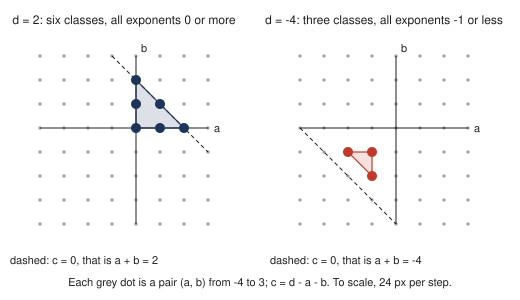

# Cech cohomology: gluing failures counted on a cover, and the cohomology of O(d) on projective space

[Syllabus](../../../SYLLABUS.md) → [Algebraic geometry](../README.md) → [Sheaf Cohomology and Differentials](../README.md#s08) → Cech cohomology

---

## General Overview

Cover the projective line by its two usual charts. On the chart where x ≠ 0 the coordinate is t = y/x. On the chart where y ≠ 0 it is 1/t. Where the charts overlap, a function may carry any power of t, positive or negative.

[Sheaves](../05-Cohomology%20and%20the%20Hodge%20Conjecture/01-sheaves-in-outline.md) asked which pairs of chart data glue into one global section. This card asks the reverse question. Take some data on the overlap. Can it be split as "a piece from chart one" minus "a piece from chart two"? Take the twisted sheaf $`\mathcal{O}(-2)`$: its sections are fractions in x and y of total degree −2, each written as $`x^{-2}`$ times powers of t. The answer is yes for every power of t except one: $`x^{-2} t^{-1}`$, which is $`1/(xy)`$ in the line's coordinates (x : y). That single unsplittable term is a cohomology class.

Čech cohomology (written Cech in titles here) turns this into exact linear algebra on any open cover. On projective space it gives clean counts. On the line, $`\mathcal{O}(d)`$ has d + 1 global sections when d ≥ 0, and −d − 1 unsplittable classes when d ≤ −2: one for $`\mathcal{O}(-2)`$, two for $`\mathcal{O}(-3)`$. On the plane, $`\mathcal{O}(-3)`$ has exactly one class in degree 2, the monomial $`1/(xyz)`$.

That one class is not a curiosity. It is the reason a smooth plane cubic, such as the elliptic curves of this wing, has genus 1. A plane quartic has genus 3, and the three classes of $`\mathcal{O}(-4)`$ are where the 3 comes from.

**Čech cohomology measures how far local data on an open cover fails to glue, by linear algebra on the overlaps; on projective space every section is a sum of Laurent monomials (monomials whose exponents may be negative), each monomial can be judged on its own, and the only survivors are the monomials with all exponents at least 0 (global sections) or all at most −1 (one class each in the top degree).**

**What kind of fact this is:** a definition (the Čech complex of a sheaf on a cover) and a theorem proved on this card in Why it works: the dimensions of $`H^p(\mathbb{P}^n, \mathcal{O}(d))`$ for every n, p and d. That the Čech answer on this cover is the true sheaf cohomology is stated here and proved in [Sheaf cohomology](05-sheaf-cohomology-as-a-derived-functor.md).

<p align="center"></p>

To scale. Each grey dot is an exponent pair (a, b) for a monomial $`x^a y^b z^c`$ of degree d on the plane, with c = d − a − b. The dashed line is c = 0. Left: the six global sections of $`\mathcal{O}(2)`$. Right: the three classes of $`H^2(\mathbb{P}^2, \mathcal{O}(-4))`$. Every other dot cancels out.

---

## The formula

Carried over, each in one line:

- **Field.** k is any field; the code works over the fractions ℚ.
- **Projective space.** $`\mathbb{P}^n`$ is the set of ratios $`(x_0 : \dots : x_n)`$, not all zero ([Projective space](../02-Affine%20and%20Projective%20Varieties/03-projective-space-and-homogeneous-coordinates.md)). On the line the coordinates are $`(x : y)`$; on the plane, $`(x : y : z)`$.
- **Sheaf.** A sheaf $`\mathcal{F}`$ gives sections $`\mathcal{F}(U)`$ on each open set U, with restriction and gluing ([Sheaves](../05-Cohomology%20and%20the%20Hodge%20Conjecture/01-sheaves-in-outline.md)). $`\Gamma`$ means global sections.
- **The twist.** $`\mathcal{O}(d)`$ is the sheaf whose sections are fractions of degree d: the numerator's degree minus the denominator's is d ([Quasi-coherent sheaves](../06-Schemes%20and%20Modern%20Language/11-quasi-coherent-and-coherent-sheaves.md)).
- **Cohomology.** Cochains, a coboundary $`\delta`$ with $`\delta\delta = 0`$, and classes as kernel over image ([Cohomology and the cup product in outline](../../17-Topology/05-Homology/08-cohomology-and-cup-product-in-outline.md)).

New on this card, in words first. An **open cover** $`\mathcal{U}`$ is a list of open sets $`U_0, \dots, U_n`$ whose union is the whole space. An **overlap** $`U_{i_0 \cdots i_p}`$ is the intersection of p + 1 of them. A **Čech p-cochain** is one section on every overlap of p + 1 sets. The **Čech coboundary** $`\delta`$ compares cochains on the next overlap up, with alternating signs:

```math
\check{C}^p(\mathcal{U}, \mathcal{F}) = \prod_{i_0 < \cdots < i_p} \mathcal{F}(U_{i_0 \cdots i_p}), \qquad (\delta c)_{i_0 \cdots i_{p+1}} = \sum_{k=0}^{p+1} (-1)^k \, c_{i_0 \cdots \widehat{i_k} \cdots i_{p+1}} \Big\vert_{U_{i_0 \cdots i_{p+1}}}, \qquad \check{H}^p = \ker \delta^p / \mathrm{im}\, \delta^{p-1}
```

**Read it aloud:** a p-cochain is a section on each overlap of p + 1 sets; its coboundary on a bigger overlap is the alternating sum of the sections on the overlaps that leave one set out, each restricted; and the p-th Čech cohomology is the cochains with zero coboundary, two counted the same when they differ by a coboundary.

A hat $`\widehat{i_k}`$ means "leave $`i_k`$ out". A cochain with $`\delta c = 0`$ is a **cocycle**; one of the form $`\delta f`$ is a **coboundary**. Write $`h^p`$ for the dimension of $`H^p`$ over k.

On two sets this is the overview's question. $`\delta(f_0, f_1) = f_1 - f_0`$ on the overlap. Its kernel is the pairs that agree, which are the global sections. Its cokernel, the overlap data not of the form $`f_1 - f_0`$, is $`H^1`$.

For projective space, cover by the **standard charts** $`U_i = \{x_i \neq 0\}`$. The theorem:

```math
h^0\big(\mathbb{P}^n, \mathcal{O}(d)\big) = \binom{d + n}{n} \ (d \ge 0), \qquad h^n\big(\mathbb{P}^n, \mathcal{O}(d)\big) = \binom{-d - 1}{n} \ (d \le -n - 1), \qquad \text{every other } h^p = 0
```

**Read it aloud:** the global sections of the twist d are counted by the binomial coefficient "d + n choose n", the top cohomology of a negative twist by "−d − 1 choose n", and every other cohomology group is zero.

On the line, n = 1: $`h^0 = d + 1`$ for d ≥ 0, and $`h^1 = -d - 1`$ for d ≤ −2. For $`\mathcal{O}(-2)`$ that is 1; for $`\mathcal{O}(-3)`$, 2. On the plane, n = 2: $`h^2(\mathcal{O}(-3)) = \binom{2}{2} = 1`$, spanned by $`1/(xyz)`$.

| Symbol | Plain meaning | In our example | Push it up and the answer… |
| --- | --- | --- | --- |
| $`k`$, ℚ | the field the coefficients come from; the fractions | ℚ in the code; any field works | unchanged: the counts hold in every field |
| $`\mathbb{P}^n`$, $`n`$; $`x_0, \dots, x_n`$; $`x, y, z`$ | projective n-space; its dimension; homogeneous coordinates | the line $`(x : y)`$, n = 1; the plane $`(x : y : z)`$, n = 2 | the classes move up to $`H^n`$ |
| $`\mathcal{U}`$, $`U_i`$, $`I`$, $`U_I = U_{i_0 \cdots i_p}`$ | the cover; one chart; a set of chart indices; the overlap of those charts | $`U_x = \{x \neq 0\}`$; $`U_{xy}`$ | — |
| $`\mathcal{F}`$, $`\mathcal{O}(d)`$, $`d`$, $`\Gamma`$ | a sheaf; the twist; the twist number; global sections | d = −2 on the line | $`h^0`$ grows, $`h^n`$ shrinks |
| $`\check{C}^p`$, $`c`$, $`f`$, $`\delta`$, $`\widehat{\ }`$ | the p-cochains; one cochain; a 0-cochain $`(f_0, f_1, \dots)`$; the coboundary; "leave this index out" | $`\delta(f_x, f_y) = f_y - f_x`$ | — |
| $`H^p`$, $`\check{H}^p`$, $`h^p`$ | the p-th cohomology; its Čech version; its dimension | $`h^1(\mathbb{P}^1, \mathcal{O}(-2)) = 1`$ | — |
| $`t`$ | the line's chart coordinate y/x | $`1/(xy) = x^{-2} t^{-1}`$ | — |
| $`a = (a_0, \dots, a_n)`$, $`x^a`$, $`N`$, $`r`$ | exponents, whole numbers adding to d; the Laurent monomial $`x_0^{a_0} \cdots x_n^{a_n}`$; its negative set; an index outside N | $`(-1, -1)`$ is $`1/(xy)`$, with N = both indices | — |
| $`B`$, $`\kappa`$ | the code's box: exponents from −B to B; the fold's contracting map | B = 6 on the line, 5 on the plane, 4 on $`\mathbb{P}^3`$ | a bigger box holds more cocycles, the same classes |
| $`\chi`$, $`\binom{m}{n}`$ | the Euler characteristic $`h^0 - h^1 + h^2 - \cdots`$; "m choose n" | $`\chi(\mathbb{P}^2, \mathcal{O}(-3)) = 1`$ | — |
| $`C`$, $`\mathcal{O}_C`$, $`e`$, $`g`$ | a plane curve; its functions; its degree; its genus | the quartic: e = 4, g = 3 | g = (e − 1)(e − 2)/2 |
| $`\beta_k`$, $`H^{p,q}`$ | Betti numbers; the Hodge pieces of cohomology | the plane: 1, 0, 1, 0, 1 | — |

### When it holds

- **The sets must cover.** Leave out the chart $`U_z`$ on the plane and the cover misses the point $`(0 : 0 : 1)`$. Then the complex computes the plane minus a point, and $`H^1`$ of $`\mathcal{O}`$ is infinite: the code finds 3 classes in a box of exponents up to 3, and 10 in a box up to 5.
- **The overlaps must be affine.** Affine means a piece of the form Spec of a ring, like one chart. Use the whole line as a one-piece cover and there are no overlaps, so the complex stops at $`\check{C}^0`$ and finds no $`H^1`$ at all. Leray's theorem, stated in [Sheaf cohomology](05-sheaf-cohomology-as-a-derived-functor.md), says an affine cover gives the true answer for quasi-coherent sheaves on a separated scheme ([Separated and proper](../06-Schemes%20and%20Modern%20Language/12-separated-and-proper-morphisms.md)).
- **The signs must alternate.** Without them $`\delta\delta \neq 0`$ and the constants stop gluing: over ℚ the code finds $`h^0(\mathbb{P}^2, \mathcal{O}) = 0`$, not 1.
- **Any field.** Each monomial is judged on its own with coefficients 0 and ±1, so the counts are the same over ℚ, ℂ or $`\mathbb{F}_p`$.

---

## Why it works

### Step 0: a failure to glue is a linear-algebra question

On two charts the map $`(f_0, f_1) \mapsto f_1 - f_0`$ is linear. Its kernel is the data that glues; its cokernel is the overlap data no local pieces explain. More charts need more overlaps, and alternating signs keep that bookkeeping consistent.

### Step 1: the coboundary squares to zero, and H⁰ is the global sections

Apply $`\delta`$ twice. Each section $`c_I`$ reaches an overlap $`I \cup \{i, j\}`$ by two routes: add i then j, or j then i. The two routes carry opposite signs, so they cancel and $`\delta\delta = 0`$. That makes $`\ker \delta / \mathrm{im}\, \delta`$ meaningful.

In degree 0, $`\delta f = 0`$ says $`f_j = f_i`$ on every overlap. By the sheaf's gluing rule that is exactly one global section. So $`\check{H}^0 = \Gamma`$, for every sheaf and every cover.

### Step 2: on projective space, sections are Laurent monomials

On the overlap $`U_I`$, the coordinates $`x_i`$ for i in I are nonzero, so they may be divided by. A section of $`\mathcal{O}(d)`$ there is a sum of monomials $`x^a`$ of degree d, where $`a_j`$ may be negative only for j in I.

| Open set on the line | Allowed monomials $`x^a y^b`$, a + b = d | For d = −2 |
| --- | --- | --- |
| $`U_x`$ | b ≥ 0 | $`x^{-2}`$, $`x^{-3}y`$, $`x^{-4}y^2`$, … |
| $`U_y`$ | a ≥ 0 | $`y^{-2}`$, $`x y^{-3}`$, … |
| $`U_{xy}`$ | any | all of these, and also $`x^{-1}y^{-1}`$ |

### Step 3: the complex splits, one monomial at a time

Restriction and $`\delta`$ never change a monomial; they only move it between overlaps, with a sign. So the whole complex is a direct sum of small complexes, one per monomial.

Fix a monomial $`x^a`$. Let N be its **negative set**: the indices j with $`a_j < 0`$. The monomial lives on the overlap $`U_I`$ exactly when I contains N. Its small complex has one copy of k for each such I, in degree $`\lvert I \rvert - 1`$.

### Step 4: count the subsets, three cases

| Negative set N | Overlaps that carry the monomial | Its cohomology |
| --- | --- | --- |
| empty | every non-empty I | one class, in $`H^0`$ |
| some, not all | I = N plus any subset of the rest | none |
| all n + 1 indices | only the full overlap, in degree n | one class, in $`H^n`$ |

- **N empty.** The exponents are all at least 0: an ordinary polynomial, a global section. Its overlaps are the faces of one filled-in triangle (or tetrahedron, and so on), a shape with no holes, so its complex has only $`H^0`$.
- **N in between.** Pick an index r outside N. Adding r to a subset, or taking it away, pairs the subsets off. The pairing is a contracting homotopy (a map that shows every cocycle is a coboundary), so this monomial contributes nothing.
- **N everything.** The monomial needs every coordinate in its denominator. It lives only on the full overlap, in top degree n, where no coboundary can reach it. It is one class in $`H^n`$.

<details>
<summary>Detailed proof: the middle case is exact</summary>

Fix N, not empty, and r outside N. The cochains are one number $`c_I`$ for each subset I that contains N. Define a map $`\kappa`$ one degree down:

$`\displaystyle (\kappa c)_I = \begin{cases} \pm\, c_{I \cup \{r\}} & r \notin I \\ 0 & r \in I \end{cases}`$

with the sign $`(-1)^k`$, k the position of r in $`I \cup \{r\}`$. Both $`I`$ and $`I \cup \{r\}`$ contain N, and $`I \cup \{r\}`$ is never empty.

A direct check, term by term as in Step 1, gives

$`\displaystyle \delta \kappa + \kappa \delta = \mathrm{identity}`$

on every degree. So a cocycle c satisfies $`c = \delta(\kappa c)`$: it is a coboundary. All cohomology vanishes.

When N is empty the same map works except on the singletons, where $`I = \emptyset`$ is not an overlap. The failure there is one dimension in degree 0, the global section. When N is everything there is no r to pick, and the single overlap stands alone.

</details>

### Step 5: count the survivors

Global sections are monomials with all n + 1 exponents at least 0, adding to d. Stars and bars (the count of ways to split a whole number into n + 1 ordered parts, each 0 or more) gives $`\binom{d + n}{n}`$.

Top classes have all exponents at most −1. Put $`b_j = -1 - a_j`$, which is at least 0. The $`b_j`$ add to $`-d - n - 1`$, so stars and bars gives $`\binom{-d - 1}{n}`$, nonzero once d ≤ −n − 1.

### Step 6: why the code may cut to a box

The complex splits by monomial, so any finite set of monomials spans a direct summand: a separate block of the complex that no map enters or leaves. The code keeps exponents between −B and B. Every class has each exponent between 0 and d, or between d + n and −1. So a box holds them all once B ≥ d for d ≥ 0, or B ≥ −(d + n) for d ≤ −n − 1. That is why box 4 is enough for $`\mathcal{O}(-5)`$ on $`\mathbb{P}^3`$.

### Step 7: how this relates to the topological count

[Cohomology of projective space](../05-Cohomology%20and%20the%20Hodge%20Conjecture/03-cohomology-of-projective-space.md) counts holes: the plane's Betti numbers are 1, 0, 1, 0, 1. This card counts sections of a sheaf, and for $`\mathcal{O}`$ on the plane gets 1, 0, 0. Over ℂ the two meet through Hodge theory ([Hodge decomposition](../05-Cohomology%20and%20the%20Hodge%20Conjecture/05-hodge-decomposition.md)). For a smooth projective variety such as the plane, $`H^q(\mathcal{O})`$ is the piece $`H^{0,q}`$ of the topological $`H^q`$, and the Betti numbers add all the pieces $`H^{p,q}`$.

The top class matches too. On the plane, $`\mathcal{O}(-3)`$ is the canonical bundle ([The canonical bundle and adjunction](02-canonical-bundle-and-adjunction.md)), so $`1/(xyz)`$ spans $`H^{2,2}`$: the class of one point, written there as the square of the hyperplane class.

---

## Worked numbers, by hand

Take $`\mathcal{O}(-2)`$ on the line. Write every section as $`x^{-2}`$ times a function of t = y/x.

| Step | Arithmetic | Value |
| --- | --- | --- |
| sections on $`U_x`$ | $`x^{-2}`$ times a polynomial in t | powers $`t^0, t^1, t^2, \dots`$ |
| sections on $`U_y`$ | $`y^{-2} = x^{-2} t^{-2}`$, times a polynomial in 1/t | powers $`t^{-2}, t^{-3}, \dots`$ |
| sections on $`U_{xy}`$ | $`x^{-2}`$ times any Laurent polynomial | every power of t |
| image of $`\delta(f_x, f_y) = f_y - f_x`$ | powers reached by either chart | every power except $`t^{-1}`$ |
| the left-over term | $`x^{-2} t^{-1} = x^{-1} y^{-1}`$ | $`1/(xy)`$ |
| a term that is reached | $`y/x^3 = x^{-2} t = \delta(-y/x^3,\ 0)`$ | a coboundary |
| in the code's box | rank of coboundaries 10; with $`1/(xy)`$ added, 11 | $`h^1 = 1`$ |
| $`\mathcal{O}(-3)`$: powers missed | $`x^{-3}t^{-1}`$, $`x^{-3}t^{-2}`$ | $`1/(x^2y)`$, $`1/(xy^2)`$: $`h^1 = 2`$ |
| $`\mathcal{O}(3)`$: monomials with both exponents ≥ 0 | $`x^3, x^2y, xy^2, y^3`$ | $`h^0 = 4`$ |
| plane, $`\mathcal{O}(-3)`$ | a, b, c ≤ −1 with a + b + c = −3 | only $`1/(xyz)`$: $`h^2 = 1`$ |
| Euler check, plane, d = −3 | (d + 1)(d + 2)/2 = (−2)(−1)/2 | 1 = 0 − 0 + 1 |
| **answer** | | **$`h^1(\mathbb{P}^1, \mathcal{O}(-2)) = 1`$, $`h^1(\mathbb{P}^1, \mathcal{O}(-3)) = 2`$, $`h^2(\mathbb{P}^2, \mathcal{O}(-3)) = 1`$** |

On the line, exactly one overlap term of $`\mathcal{O}(-2)`$ cannot be blamed on either chart, and it is the term $`t^{-1}`$ that [Sheaves](../05-Cohomology%20and%20the%20Hodge%20Conjecture/01-sheaves-in-outline.md) left open.

### What breaks if you drop a piece

| Mistake | Comes out at | What went wrong |
| --- | --- | --- |
| Drop the signs in $`\delta`$ | $`h^0(\mathbb{P}^2, \mathcal{O}) = 0`$ and $`h^0(\mathbb{P}^2, \mathcal{O}(2)) = 0`$, not 1 and 6 | $`\delta\delta \neq 0`$; three charts' constants can no longer agree in pairs |
| Use only $`U_x`$ and $`U_y`$ on the plane | $`h^1(\mathcal{O})`$: 3 in box 3, 10 in box 5, growing without limit | the cover misses $`(0 : 0 : 1)`$ |
| Count cocycles, not classes | 11 in box 6, 17 in box 9, against 1 class for $`\mathcal{O}(-2)`$ | every overlap section is a cocycle on two charts; the coboundaries must be divided out |
| Read $`h^q(\mathcal{O})`$ as Betti numbers | expect 1, 0, 1, 0, 1 on the plane; true $`h^q(\mathcal{O})`$ is 1, 0, 0 | sheaf cohomology of $`\mathcal{O}`$ is one Hodge piece, not the whole topology |

The code prints all four.

---

## Code, from first principles, and it actually runs

The code builds the Čech complex of $`\mathcal{O}(d)`$ on the standard cover as sparse matrices over ℚ, with exponents cut to a box, and computes every $`h^p`$ from exact ranks. It takes four independent roads to the dimensions:

1. **Rank.** $`h^p = \dim \check{C}^p - \mathrm{rank}\, \delta^p - \mathrm{rank}\, \delta^{p-1}`$, by exact elimination.
2. **Signs.** Count monomials of degree d with all exponents at least 0, or all at most −1, by enumeration.
3. **Formula.** The binomial coefficients of the theorem.
4. **Euler characteristic.** The alternating sum of the cochain dimensions, which needs no ranks, against the Hilbert polynomial $`\binom{d + n}{n}`$ read as a polynomial in d ([Degree](../02-Affine%20and%20Projective%20Varieties/09-degree-and-the-hilbert-polynomial.md)).

It also tests $`1/(xy)`$ and $`y/x^3`$ against the coboundaries, checks Serre duality and the plane-curve genus, and prints the four mistakes and the figure's dots.

### Python

```python
# Cech cohomology of O(d) on projective space -- the check behind the card.
# Standard library only.  P^n has coordinates x_0..x_n and the cover U_i = {x_i != 0}.
# A section of O(d) over the overlap U_I is a sum of Laurent monomials x^a of degree d
# (exponents add to d) with a_j >= 0 for every j outside I.  The code keeps the
# exponents in the box [-B, B]: the complex splits monomial by monomial, so the box
# loses nothing that lies inside it.
from fractions import Fraction
from itertools import combinations, product
from math import comb

def rank(columns):                         # exact rank over Q, sparse elimination
    pivots = {}
    for col in columns:
        v = {k: Fraction(x) for k, x in col.items()}
        while v:
            r = min(v)
            if r not in pivots:
                pivots[r] = v
                break
            p, f = pivots[r], v[r] / pivots[r][r]
            for k, x in p.items():
                y = v.get(k, 0) - f * x
                if y: v[k] = y
                else: v.pop(k, None)
    return len(pivots)

def cech(m, d, B, opens=None, signed=True):    # m = n + 1 coordinates
    opens = opens or list(range(m))
    mons = [a for a in product(range(-B, B + 1), repeat=m) if sum(a) == d]
    faces = [list(combinations(opens, p + 1)) for p in range(len(opens))]
    basis = [[(I, a) for I in F for a in mons if all(a[j] >= 0 for j in range(m) if j not in I)]
             for F in faces]
    index = [{e: k for k, e in enumerate(b)} for b in basis]
    deltas = []                            # delta^p as a list of sparse columns
    for p in range(len(faces) - 1):
        cols = []
        for I, a in basis[p]:
            col = {}
            for J in faces[p + 1]:
                if set(I) < set(J):        # J = I plus one index, at position pos
                    pos = [j for j in J if j not in I][0]
                    col[index[p + 1][(J, a)]] = (-1) ** J.index(pos) if signed else 1
            cols.append(col)
        deltas.append(cols)
    dims = [len(b) for b in basis]
    rk = [rank(c) for c in deltas] + [0]
    h = [dims[p] - rk[p] - (rk[p - 1] if p else 0) for p in range(len(dims))]
    return dims, h, deltas, index

def sign_count(m, d):                      # road two: count monomials by their signs
    top = sum(1 for a in product(range(0, max(d, -1) + 1), repeat=m) if sum(a) == d)
    low = sum(1 for a in product(range(d, 0), repeat=m) if sum(a) == d)
    return top, low

def formula(n, d):                         # road three: the binomial counts
    return (comb(d + n, n) if d >= 0 else 0), (comb(-d - 1, n) if d <= -n - 1 else 0)

def hilbert(n, d):                         # road four: Euler characteristic, a polynomial in d
    v = Fraction(1)
    for i in range(1, n + 1):
        v = v * (d + i) / i
    return v

table = {}
for n, B, ds in ((1, 6, range(-4, 4)), (2, 5, range(-5, 3)), (3, 4, (-5, -4, 0, 1))):
    for d in ds:
        dims, h, _, _ = cech(n + 1, d, B)
        table[n, d] = h
        chi = sum((-1) ** p * c for p, c in enumerate(dims))
        print(f"P^{n} O({d:2}): box {B}, cochain dims {dims}; h = {h}; "
              f"signs (h^0, h^{n}) = {sign_count(n + 1, d)}; formula {formula(n, d)}; "
              f"Euler {chi} = Hilbert {hilbert(n, d)}")
        assert (h[0], h[n]) == sign_count(n + 1, d) == formula(n, d)   # rank vs count vs formula
        assert all(x == 0 for x in h[1:n]) and chi == hilbert(n, d)    # middle zero; Euler road
dims, h, deltas, index = cech(2, -2, 6)
reached = {}
for k in range(-4, 3):                     # x^-2 t^k = x^(-2-k) y^k on the overlap, t = y/x
    a = (-2 - k, k)
    reached[k] = "U_x" if a[1] >= 0 else "U_y" if a[0] >= 0 else "neither"
print("O(-2) on P^1, overlap term x^-2 t^k, t = y/x: " +
      ", ".join(f"t^{k} {w}" for k, w in reached.items()))
im = rank(deltas[0])
for a, name in (((-1, -1), "1/(xy)"), ((-3, 1), "y/x^3")):
    v = {index[1][((0, 1), a)]: 1}
    inside = rank(deltas[0] + [v]) == im
    print(f"cocycle {name}: rank of coboundaries {im}, with it added {rank(deltas[0] + [v])}; "
          f"a coboundary: {'yes' if inside else 'no'}")
    assert inside == (a != (-1, -1))       # only 1/(xy) is a real class
for n in (1, 2):                           # Serre duality: h^n(O(d)) = h^0(O(-n-1-d))
    pairs = [(d, table[n, d][n], table[n, -n - 1 - d][0]) for d in range(-n - 3, 1)
             if (n, -n - 1 - d) in table]
    print(f"duality on P^{n}, (d, h^{n}(O(d)), h^0(O({-n - 1}-d))): {pairs}")
    assert all(x == y for _, x, y in pairs)
genus = [(e, table[2, -e][2], (e - 1) * (e - 2) // 2) for e in range(1, 6)]
print(f"plane curve of degree e: (e, h^2(P^2, O(-e)), (e-1)(e-2)/2) = {genus}")
assert all(x == y for _, x, y in genus)
betti = [1 if k % 2 == 0 else 0 for k in range(5)]    # one cell in each even real dimension
print(f"P^2: Betti numbers {betti}; h^q(O) for q = 0, 1, 2: {table[2, 0]}")
_, hu, _, _ = cech(3, 0, 5, signed=False)
_, h2u, _, _ = cech(3, 2, 5, signed=False)
print(f"mistake 1, no signs in delta: h^0(P^2, O) = {hu[0]}, h^0(P^2, O(2)) = {h2u[0]}")
miss = [cech(3, 0, B, opens=[0, 1])[1][1] for B in (3, 5)]
print(f"mistake 2, only U_x and U_y on P^2: h^1(O) = {miss[0]} in box 3, {miss[1]} in box 5")
print(f"mistake 3, cocycles not divided by coboundaries, O(-2) on P^1: {dims[1]} in box 6, "
      f"{cech(2, -2, 9)[0][1]} in box 9; classes {h[1]}")
print(f"mistake 4, O(2) for O(-2) on P^1: h = {table[1, 2]} against {table[1, -2]}")
assert hu[0] == 0 and h2u[0] == 0 and miss[0] < miss[1] and dims[1] > h[1] == 1
for d in (2, -4):
    rng = range(0, d + 1) if d >= 0 else range(d, 0)
    dots = sorted(a[:2] for a in product(rng, repeat=3) if sum(a) == d)
    print(f"figure, d = {d}: (a, b) of the classes x^a y^b z^c, c = d - a - b: {dots}")
print("ALL CHECKS PASS")
```

**Ran 2026-11-24 on macOS, Python 3.14.10, standard library only. All checks passed. Output, pasted from the run:**

```
P^1 O(-4): box 6, cochain dims [6, 9]; h = [0, 3]; signs (h^0, h^1) = (0, 3); formula (0, 3); Euler -3 = Hilbert -3
P^1 O(-3): box 6, cochain dims [8, 10]; h = [0, 2]; signs (h^0, h^1) = (0, 2); formula (0, 2); Euler -2 = Hilbert -2
P^1 O(-2): box 6, cochain dims [10, 11]; h = [0, 1]; signs (h^0, h^1) = (0, 1); formula (0, 1); Euler -1 = Hilbert -1
P^1 O(-1): box 6, cochain dims [12, 12]; h = [0, 0]; signs (h^0, h^1) = (0, 0); formula (0, 0); Euler 0 = Hilbert 0
P^1 O( 0): box 6, cochain dims [14, 13]; h = [1, 0]; signs (h^0, h^1) = (1, 0); formula (1, 0); Euler 1 = Hilbert 1
P^1 O( 1): box 6, cochain dims [14, 12]; h = [2, 0]; signs (h^0, h^1) = (2, 0); formula (2, 0); Euler 2 = Hilbert 2
P^1 O( 2): box 6, cochain dims [14, 11]; h = [3, 0]; signs (h^0, h^1) = (3, 0); formula (3, 0); Euler 3 = Hilbert 3
P^1 O( 3): box 6, cochain dims [14, 10]; h = [4, 0]; signs (h^0, h^1) = (4, 0); formula (4, 0); Euler 4 = Hilbert 4
P^2 O(-5): box 5, cochain dims [3, 63, 66]; h = [0, 0, 6]; signs (h^0, h^2) = (0, 6); formula (0, 6); Euler 6 = Hilbert 6
P^2 O(-4): box 5, cochain dims [9, 81, 75]; h = [0, 0, 3]; signs (h^0, h^2) = (0, 3); formula (0, 3); Euler 3 = Hilbert 3
P^2 O(-3): box 5, cochain dims [18, 99, 82]; h = [0, 0, 1]; signs (h^0, h^2) = (0, 1); formula (0, 1); Euler 1 = Hilbert 1
P^2 O(-2): box 5, cochain dims [30, 117, 87]; h = [0, 0, 0]; signs (h^0, h^2) = (0, 0); formula (0, 0); Euler 0 = Hilbert 0
P^2 O(-1): box 5, cochain dims [45, 135, 90]; h = [0, 0, 0]; signs (h^0, h^2) = (0, 0); formula (0, 0); Euler 0 = Hilbert 0
P^2 O( 0): box 5, cochain dims [63, 153, 91]; h = [1, 0, 0]; signs (h^0, h^2) = (1, 0); formula (1, 0); Euler 1 = Hilbert 1
P^2 O( 1): box 5, cochain dims [78, 165, 90]; h = [3, 0, 0]; signs (h^0, h^2) = (3, 0); formula (3, 0); Euler 3 = Hilbert 3
P^2 O( 2): box 5, cochain dims [90, 171, 87]; h = [6, 0, 0]; signs (h^0, h^2) = (6, 0); formula (6, 0); Euler 6 = Hilbert 6
P^3 O(-5): box 4, cochain dims [0, 120, 440, 324]; h = [0, 0, 0, 4]; signs (h^0, h^3) = (0, 4); formula (0, 4); Euler -4 = Hilbert -4
P^3 O(-4): box 4, cochain dims [4, 210, 580, 375]; h = [0, 0, 0, 1]; signs (h^0, h^3) = (0, 1); formula (0, 1); Euler -1 = Hilbert -1
P^3 O( 0): box 4, cochain dims [140, 750, 1100, 489]; h = [1, 0, 0, 0]; signs (h^0, h^3) = (1, 0); formula (1, 0); Euler 1 = Hilbert 1
P^3 O( 1): box 4, cochain dims [212, 888, 1160, 480]; h = [4, 0, 0, 0]; signs (h^0, h^3) = (4, 0); formula (4, 0); Euler 4 = Hilbert 4
O(-2) on P^1, overlap term x^-2 t^k, t = y/x: t^-4 U_y, t^-3 U_y, t^-2 U_y, t^-1 neither, t^0 U_x, t^1 U_x, t^2 U_x
cocycle 1/(xy): rank of coboundaries 10, with it added 11; a coboundary: no
cocycle y/x^3: rank of coboundaries 10, with it added 10; a coboundary: yes
duality on P^1, (d, h^1(O(d)), h^0(O(-2-d))): [(-4, 3, 3), (-3, 2, 2), (-2, 1, 1), (-1, 0, 0), (0, 0, 0)]
duality on P^2, (d, h^2(O(d)), h^0(O(-3-d))): [(-5, 6, 6), (-4, 3, 3), (-3, 1, 1), (-2, 0, 0), (-1, 0, 0), (0, 0, 0)]
plane curve of degree e: (e, h^2(P^2, O(-e)), (e-1)(e-2)/2) = [(1, 0, 0), (2, 0, 0), (3, 1, 1), (4, 3, 3), (5, 6, 6)]
P^2: Betti numbers [1, 0, 1, 0, 1]; h^q(O) for q = 0, 1, 2: [1, 0, 0]
mistake 1, no signs in delta: h^0(P^2, O) = 0, h^0(P^2, O(2)) = 0
mistake 2, only U_x and U_y on P^2: h^1(O) = 3 in box 3, 10 in box 5
mistake 3, cocycles not divided by coboundaries, O(-2) on P^1: 11 in box 6, 17 in box 9; classes 1
mistake 4, O(2) for O(-2) on P^1: h = [3, 0] against [0, 1]
figure, d = 2: (a, b) of the classes x^a y^b z^c, c = d - a - b: [(0, 0), (0, 1), (0, 2), (1, 0), (1, 1), (2, 0)]
figure, d = -4: (a, b) of the classes x^a y^b z^c, c = d - a - b: [(-2, -1), (-1, -2), (-1, -1)]
ALL CHECKS PASS
```

### Rust

Same numbers, same labels, built with `rustc --edition 2021 -O`.

```rust
// Cech cohomology of O(d) on projective space -- the same check as the Python, in Rust.
// No crates.  P^n has coordinates x_0..x_n and the cover U_i = {x_i != 0}.
// A section of O(d) over the overlap U_I is a sum of Laurent monomials x^a of degree d
// (exponents add to d) with a_j >= 0 for every j outside I.  The code keeps the
// exponents in the box [-B, B]: the complex splits monomial by monomial, so the box
// loses nothing that lies inside it.
use std::collections::{BTreeMap, HashMap};

#[derive(Clone, Copy, PartialEq, Debug)]
struct Q { n: i128, d: i128 }              // a fraction in lowest terms, d > 0
fn gcd(a: i128, b: i128) -> i128 { if b == 0 { a.abs() } else { gcd(b, a % b) } }
impl Q {
    fn new(n: i128, d: i128) -> Q {
        let g = gcd(n, d).max(1);
        let s = if d < 0 { -1 } else { 1 };
        Q { n: s * n / g, d: s * d / g }
    }
    fn int(n: i128) -> Q { Q { n, d: 1 } }
    fn mul(self, o: Q) -> Q { Q::new(self.n.checked_mul(o.n).unwrap(), self.d.checked_mul(o.d).unwrap()) }
    fn div(self, o: Q) -> Q { self.mul(Q::new(o.d, o.n)) }
    fn sub(self, o: Q) -> Q {
        Q::new(self.n.checked_mul(o.d).unwrap() - o.n.checked_mul(self.d).unwrap(), self.d.checked_mul(o.d).unwrap())
    }
}
impl std::fmt::Display for Q {
    fn fmt(&self, f: &mut std::fmt::Formatter) -> std::fmt::Result {
        if self.d == 1 { write!(f, "{}", self.n) } else { write!(f, "{}/{}", self.n, self.d) }
    }
}

type Col = BTreeMap<usize, Q>;
fn rank(columns: &[Col]) -> usize {        // exact rank over Q, sparse elimination
    let mut pivots: HashMap<usize, Col> = HashMap::new();
    for col in columns {
        let mut v = col.clone();
        while let Some((&r, _)) = v.iter().next() {
            let p = match pivots.get(&r) { None => { pivots.insert(r, v); break } Some(p) => p };
            let f = v[&r].div(p[&r]);
            for (&k, &x) in p.iter() {
                let y = v.get(&k).copied().unwrap_or(Q::int(0)).sub(f.mul(x));
                if y.n != 0 { v.insert(k, y); } else { v.remove(&k); }
            }
        }
    }
    pivots.len()
}

fn product(lo: i64, hi: i64, m: usize) -> Vec<Vec<i64>> {   // every vector in [lo, hi)^m
    let mut out = vec![vec![]];
    for _ in 0..m { out = out.iter().flat_map(|v| (lo..hi).map(move |x| { let mut w = v.clone(); w.push(x); w })).collect() }
    out
}
fn combinations(opens: &[usize], k: usize) -> Vec<Vec<usize>> {
    if k == 0 { return vec![vec![]] }
    if opens.len() < k { return vec![] }
    let mut out: Vec<Vec<usize>> = combinations(&opens[1..], k - 1).into_iter().map(|mut c| { c.insert(0, opens[0]); c }).collect();
    out.extend(combinations(&opens[1..], k));
    out
}

struct Cech { dims: Vec<usize>, h: Vec<i64>, deltas: Vec<Vec<Col>>, index: Vec<HashMap<(Vec<usize>, Vec<i64>), usize>> }

fn cech(m: usize, d: i64, b: i64, opens: Option<Vec<usize>>, signed: bool) -> Cech {
    let opens = opens.unwrap_or((0..m).collect());
    let mons: Vec<Vec<i64>> = product(-b, b + 1, m).into_iter().filter(|a| a.iter().sum::<i64>() == d).collect();
    let faces: Vec<Vec<Vec<usize>>> = (0..opens.len()).map(|p| combinations(&opens, p + 1)).collect();
    let basis: Vec<Vec<(Vec<usize>, Vec<i64>)>> = faces.iter().map(|f| {
        let mut out = vec![];
        for i in f { for a in &mons { if (0..m).all(|j| i.contains(&j) || a[j] >= 0) { out.push((i.clone(), a.clone())) } } }
        out
    }).collect();
    let index: Vec<HashMap<(Vec<usize>, Vec<i64>), usize>> =
        basis.iter().map(|bs| bs.iter().enumerate().map(|(k, e)| (e.clone(), k)).collect()).collect();
    let mut deltas = vec![];                   // delta^p as a list of sparse columns
    for p in 0..faces.len() - 1 {
        let mut cols = vec![];
        for (i, a) in &basis[p] {
            let mut col = Col::new();
            for j in &faces[p + 1] {
                if i.iter().all(|x| j.contains(x)) {   // J = I plus one index, at position pos
                    let pos = j.iter().position(|x| !i.contains(x)).unwrap();
                    let s = if !signed || pos % 2 == 0 { 1 } else { -1 };
                    col.insert(index[p + 1][&(j.clone(), a.clone())], Q::int(s));
                }
            }
            cols.push(col);
        }
        deltas.push(cols);
    }
    let dims: Vec<usize> = basis.iter().map(|x| x.len()).collect();
    let mut rk: Vec<i64> = deltas.iter().map(|c| rank(c) as i64).collect();
    rk.push(0);
    let h = (0..dims.len()).map(|p| dims[p] as i64 - rk[p] - if p > 0 { rk[p - 1] } else { 0 }).collect();
    Cech { dims, h, deltas, index }
}

fn sign_count(m: usize, d: i64) -> (i64, i64) {   // road two: count monomials by their signs
    let top = product(0, d.max(-1) + 1, m).iter().filter(|a| a.iter().sum::<i64>() == d).count() as i64;
    let low = product(d, 0, m).iter().filter(|a| a.iter().sum::<i64>() == d).count() as i64;
    (top, low)
}
fn comb(n: i64, k: i64) -> i64 { if k < 0 || n < k { 0 } else { (0..k).fold(1, |acc, i| acc * (n - i) / (i + 1)) } }
fn formula(n: i64, d: i64) -> (i64, i64) {        // road three: the binomial counts
    (if d >= 0 { comb(d + n, n) } else { 0 }, if d <= -n - 1 { comb(-d - 1, n) } else { 0 })
}
fn hilbert(n: i64, d: i64) -> Q {                 // road four: Euler characteristic, a polynomial in d
    (1..=n).fold(Q::int(1), |v, i| v.mul(Q::new((d + i) as i128, i as i128)))
}

fn main() {
    let mut table: HashMap<(i64, i64), Vec<i64>> = HashMap::new();
    let runs: [(i64, i64, Vec<i64>); 3] = [(1, 6, (-4..4).collect()), (2, 5, (-5..3).collect()), (3, 4, vec![-5, -4, 0, 1])];
    for (n, b, ds) in runs.iter() {
        for &d in ds {
            let c = cech(*n as usize + 1, d, *b, None, true);
            let chi: i64 = c.dims.iter().enumerate().map(|(p, &x)| if p % 2 == 0 { x as i64 } else { -(x as i64) }).sum();
            println!("P^{} O({:2}): box {}, cochain dims {:?}; h = {:?}; signs (h^0, h^{}) = {:?}; formula {:?}; Euler {} = Hilbert {}",
                     n, d, b, c.dims, c.h, n, sign_count(*n as usize + 1, d), formula(*n, d), chi, hilbert(*n, d));
            assert!((c.h[0], c.h[*n as usize]) == sign_count(*n as usize + 1, d) && sign_count(*n as usize + 1, d) == formula(*n, d));
            assert!(c.h[1..*n as usize].iter().all(|&x| x == 0) && Q::int(chi as i128) == hilbert(*n, d));
            table.insert((*n, d), c.h);
        }
    }
    let c = cech(2, -2, 6, None, true);
    let words: Vec<String> = (-4..3i64).map(|k| {
        let a = (-2 - k, k);                       // x^-2 t^k = x^(-2-k) y^k on the overlap, t = y/x
        format!("t^{} {}", k, if a.1 >= 0 { "U_x" } else if a.0 >= 0 { "U_y" } else { "neither" })
    }).collect();
    println!("O(-2) on P^1, overlap term x^-2 t^k, t = y/x: {}", words.join(", "));
    let im = rank(&c.deltas[0]);
    for (a, name) in [(vec![-1i64, -1], "1/(xy)"), (vec![-3, 1], "y/x^3")] {
        let mut v = Col::new();
        v.insert(c.index[1][&(vec![0, 1], a.clone())], Q::int(1));
        let mut cols = c.deltas[0].clone();
        cols.push(v);
        let with = rank(&cols);
        println!("cocycle {}: rank of coboundaries {}, with it added {}; a coboundary: {}", name, im, with, if with == im { "yes" } else { "no" });
        assert!((with == im) == (a != vec![-1, -1]));   // only 1/(xy) is a real class
    }
    for n in [1i64, 2] {                            // Serre duality: h^n(O(d)) = h^0(O(-n-1-d))
        let pairs: Vec<(i64, i64, i64)> = (-n - 3..1).filter(|d| table.contains_key(&(n, -n - 1 - d)))
            .map(|d| (d, table[&(n, d)][n as usize], table[&(n, -n - 1 - d)][0])).collect();
        println!("duality on P^{}, (d, h^{}(O(d)), h^0(O({}-d))): {:?}", n, n, -n - 1, pairs);
        assert!(pairs.iter().all(|&(_, x, y)| x == y));
    }
    let genus: Vec<(i64, i64, i64)> = (1..6).map(|e| (e, table[&(2, -e)][2], (e - 1) * (e - 2) / 2)).collect();
    println!("plane curve of degree e: (e, h^2(P^2, O(-e)), (e-1)(e-2)/2) = {:?}", genus);
    assert!(genus.iter().all(|&(_, x, y)| x == y));
    let betti: Vec<i64> = (0..5).map(|k| if k % 2 == 0 { 1 } else { 0 }).collect();   // one cell in each even real dimension
    println!("P^2: Betti numbers {:?}; h^q(O) for q = 0, 1, 2: {:?}", betti, table[&(2, 0)]);
    let hu = cech(3, 0, 5, None, false).h;
    let h2u = cech(3, 2, 5, None, false).h;
    println!("mistake 1, no signs in delta: h^0(P^2, O) = {}, h^0(P^2, O(2)) = {}", hu[0], h2u[0]);
    let miss: Vec<i64> = [3, 5].iter().map(|&b| cech(3, 0, b, Some(vec![0, 1]), true).h[1]).collect();
    println!("mistake 2, only U_x and U_y on P^2: h^1(O) = {} in box 3, {} in box 5", miss[0], miss[1]);
    println!("mistake 3, cocycles not divided by coboundaries, O(-2) on P^1: {} in box 6, {} in box 9; classes {}",
             c.dims[1], cech(2, -2, 9, None, true).dims[1], c.h[1]);
    println!("mistake 4, O(2) for O(-2) on P^1: h = {:?} against {:?}", table[&(1, 2)], table[&(1, -2)]);
    assert!(hu[0] == 0 && h2u[0] == 0 && miss[0] < miss[1] && c.dims[1] as i64 > c.h[1] && c.h[1] == 1);
    for d in [2i64, -4] {
        let (lo, hi) = if d >= 0 { (0, d + 1) } else { (d, 0) };
        let mut dots: Vec<(i64, i64)> = product(lo, hi, 3).iter().filter(|a| a.iter().sum::<i64>() == d).map(|a| (a[0], a[1])).collect();
        dots.sort();
        println!("figure, d = {}: (a, b) of the classes x^a y^b z^c, c = d - a - b: {:?}", d, dots);
    }
    println!("ALL CHECKS PASS");
}
```

**Ran 2026-11-24 on macOS, rustc 1.98.1, no crates. All checks passed. Output, pasted from the run:**

```
P^1 O(-4): box 6, cochain dims [6, 9]; h = [0, 3]; signs (h^0, h^1) = (0, 3); formula (0, 3); Euler -3 = Hilbert -3
P^1 O(-3): box 6, cochain dims [8, 10]; h = [0, 2]; signs (h^0, h^1) = (0, 2); formula (0, 2); Euler -2 = Hilbert -2
P^1 O(-2): box 6, cochain dims [10, 11]; h = [0, 1]; signs (h^0, h^1) = (0, 1); formula (0, 1); Euler -1 = Hilbert -1
P^1 O(-1): box 6, cochain dims [12, 12]; h = [0, 0]; signs (h^0, h^1) = (0, 0); formula (0, 0); Euler 0 = Hilbert 0
P^1 O( 0): box 6, cochain dims [14, 13]; h = [1, 0]; signs (h^0, h^1) = (1, 0); formula (1, 0); Euler 1 = Hilbert 1
P^1 O( 1): box 6, cochain dims [14, 12]; h = [2, 0]; signs (h^0, h^1) = (2, 0); formula (2, 0); Euler 2 = Hilbert 2
P^1 O( 2): box 6, cochain dims [14, 11]; h = [3, 0]; signs (h^0, h^1) = (3, 0); formula (3, 0); Euler 3 = Hilbert 3
P^1 O( 3): box 6, cochain dims [14, 10]; h = [4, 0]; signs (h^0, h^1) = (4, 0); formula (4, 0); Euler 4 = Hilbert 4
P^2 O(-5): box 5, cochain dims [3, 63, 66]; h = [0, 0, 6]; signs (h^0, h^2) = (0, 6); formula (0, 6); Euler 6 = Hilbert 6
P^2 O(-4): box 5, cochain dims [9, 81, 75]; h = [0, 0, 3]; signs (h^0, h^2) = (0, 3); formula (0, 3); Euler 3 = Hilbert 3
P^2 O(-3): box 5, cochain dims [18, 99, 82]; h = [0, 0, 1]; signs (h^0, h^2) = (0, 1); formula (0, 1); Euler 1 = Hilbert 1
P^2 O(-2): box 5, cochain dims [30, 117, 87]; h = [0, 0, 0]; signs (h^0, h^2) = (0, 0); formula (0, 0); Euler 0 = Hilbert 0
P^2 O(-1): box 5, cochain dims [45, 135, 90]; h = [0, 0, 0]; signs (h^0, h^2) = (0, 0); formula (0, 0); Euler 0 = Hilbert 0
P^2 O( 0): box 5, cochain dims [63, 153, 91]; h = [1, 0, 0]; signs (h^0, h^2) = (1, 0); formula (1, 0); Euler 1 = Hilbert 1
P^2 O( 1): box 5, cochain dims [78, 165, 90]; h = [3, 0, 0]; signs (h^0, h^2) = (3, 0); formula (3, 0); Euler 3 = Hilbert 3
P^2 O( 2): box 5, cochain dims [90, 171, 87]; h = [6, 0, 0]; signs (h^0, h^2) = (6, 0); formula (6, 0); Euler 6 = Hilbert 6
P^3 O(-5): box 4, cochain dims [0, 120, 440, 324]; h = [0, 0, 0, 4]; signs (h^0, h^3) = (0, 4); formula (0, 4); Euler -4 = Hilbert -4
P^3 O(-4): box 4, cochain dims [4, 210, 580, 375]; h = [0, 0, 0, 1]; signs (h^0, h^3) = (0, 1); formula (0, 1); Euler -1 = Hilbert -1
P^3 O( 0): box 4, cochain dims [140, 750, 1100, 489]; h = [1, 0, 0, 0]; signs (h^0, h^3) = (1, 0); formula (1, 0); Euler 1 = Hilbert 1
P^3 O( 1): box 4, cochain dims [212, 888, 1160, 480]; h = [4, 0, 0, 0]; signs (h^0, h^3) = (4, 0); formula (4, 0); Euler 4 = Hilbert 4
O(-2) on P^1, overlap term x^-2 t^k, t = y/x: t^-4 U_y, t^-3 U_y, t^-2 U_y, t^-1 neither, t^0 U_x, t^1 U_x, t^2 U_x
cocycle 1/(xy): rank of coboundaries 10, with it added 11; a coboundary: no
cocycle y/x^3: rank of coboundaries 10, with it added 10; a coboundary: yes
duality on P^1, (d, h^1(O(d)), h^0(O(-2-d))): [(-4, 3, 3), (-3, 2, 2), (-2, 1, 1), (-1, 0, 0), (0, 0, 0)]
duality on P^2, (d, h^2(O(d)), h^0(O(-3-d))): [(-5, 6, 6), (-4, 3, 3), (-3, 1, 1), (-2, 0, 0), (-1, 0, 0), (0, 0, 0)]
plane curve of degree e: (e, h^2(P^2, O(-e)), (e-1)(e-2)/2) = [(1, 0, 0), (2, 0, 0), (3, 1, 1), (4, 3, 3), (5, 6, 6)]
P^2: Betti numbers [1, 0, 1, 0, 1]; h^q(O) for q = 0, 1, 2: [1, 0, 0]
mistake 1, no signs in delta: h^0(P^2, O) = 0, h^0(P^2, O(2)) = 0
mistake 2, only U_x and U_y on P^2: h^1(O) = 3 in box 3, 10 in box 5
mistake 3, cocycles not divided by coboundaries, O(-2) on P^1: 11 in box 6, 17 in box 9; classes 1
mistake 4, O(2) for O(-2) on P^1: h = [3, 0] against [0, 1]
figure, d = 2: (a, b) of the classes x^a y^b z^c, c = d - a - b: [(0, 0), (0, 1), (0, 2), (1, 0), (1, 1), (2, 0)]
figure, d = -4: (a, b) of the classes x^a y^b z^c, c = d - a - b: [(-2, -1), (-1, -2), (-1, -1)]
ALL CHECKS PASS
```

The two outputs match line for line.

### Lean

Lean proves the monomial counts of Step 5 for every n and d, and checks the card's worked counts.

- Take d ≥ 0. Then the monomials of degree d with all n + 1 exponents at least 0 number $`\binom{d + n}{n}`$.
- Take d ≤ −n − 1. Then the Laurent monomials of degree d with all n + 1 exponents at most −1 number $`\binom{-d - 1}{n}`$.
- Take e ≥ 1 and exponents a, b, c ≤ −1 with a + b + c = −e. Then there are (e − 1)(e − 2)/2 of them, the genus of a plane curve of degree e.
- Take the line. Then the monomials of degree −2, −3 and −4 with both exponents at most −1 number 1, 2 and 3.
- Take the line again. Then the monomials of degree 2 and 3 with both exponents at least 0 number 3 and 4.
- Take the plane. Then the monomials of degree −3, −4 and −5 with all exponents at most −1 number 1, 3 and 6.
- Take the plane and degree 2. Then 6 monomials have all exponents at least 0.

That these monomials are exactly the Čech classes is left to the Python and Rust checks, which compute ranks.

```lean
-- Cech cohomology: the monomials that survive in the Cech complex of O(d) on projective space are counted by binomial coefficients, and they give a plane curve of degree e its genus (e - 1)(e - 2)/2.
import Mathlib.Data.Set.Card
import Mathlib.Data.Nat.Choose.Basic
import Mathlib.Data.Fintype.Pi
import Mathlib.Data.Int.Interval
import Mathlib.Algebra.BigOperators.Group.Finset.Basic
import Mathlib.Algebra.Order.BigOperators.Group.Finset
import Mathlib.Data.Sym.Card
import Mathlib.Data.Finsupp.Multiset

open Finset

/-- Stars and bars over the integers: the nonnegative integer vectors of length `k` with
sum `m` are as many as the multisets of size `m` drawn from `k` letters. -/
theorem nonneg_vector_count (k m : ℕ) :
    Set.ncard {a : Fin k → ℤ | (∀ j, 0 ≤ a j) ∧ ∑ j, a j = (m : ℤ)} =
      Fintype.card (Sym (Fin k) m) := by
  rw [← Nat.card_coe_set_eq, ← Nat.card_eq_fintype_card]
  refine Nat.card_congr ((?_ : _ ≃ {P : Fin k → ℕ // ∑ i, P i = m}).trans
    (Sym.equivNatSumOfFintype (Fin k) m).symm)
  refine
    { toFun := fun a => ⟨fun j => (a.1 j).toNat, ?_⟩
      invFun := fun P => ⟨fun j => (P.1 j : ℤ), ?_⟩
      left_inv := ?_
      right_inv := ?_ }
  · obtain ⟨a, ha0, hsum⟩ := a
    have : ((∑ j, (a j).toNat : ℕ) : ℤ) = (m : ℤ) := by
      rw [Nat.cast_sum, ← hsum]
      exact Finset.sum_congr rfl fun j _ => Int.toNat_of_nonneg (ha0 j)
    exact_mod_cast this
  · refine ⟨fun j => Int.natCast_nonneg _, ?_⟩
    rw [← Nat.cast_sum, P.2]
  · rintro ⟨a, ha0, hsum⟩
    ext j
    simp [Int.toNat_of_nonneg (ha0 j)]
  · rintro ⟨P, hP⟩
    ext j
    simp

/-- The same count as a binomial coefficient, in length `n + 1`. -/
theorem nonneg_vector_count_choose (n d : ℕ) :
    Set.ncard {a : Fin (n + 1) → ℤ | (∀ j, 0 ≤ a j) ∧ ∑ j, a j = (d : ℤ)} =
      Nat.choose (d + n) n := by
  rw [nonneg_vector_count, Sym.card_sym_eq_choose, Fintype.card_fin,
    show n + 1 + d - 1 = d + n by omega, Nat.choose_symm_add]

/-- The top-class count for every degree `d`: the integer vectors of length `n + 1` with all
entries at most `-1` and sum `d` number `(-d - 1).toNat choose n`; both sides are zero when
`d > -n - 1` and `n ≥ 1`. -/
theorem negative_vector_count (n : ℕ) (d : ℤ) (hn : 1 ≤ n ∨ d ≤ -(n : ℤ) - 1) :
    Set.ncard {a : Fin (n + 1) → ℤ | (∀ j, a j ≤ -1) ∧ ∑ j, a j = d} =
      Nat.choose (-d - 1).toNat n := by
  by_cases hd : d ≤ -(n : ℤ) - 1
  · set m : ℕ := (-d - n - 1).toNat with hm
    have hm' : (m : ℤ) = -d - n - 1 := Int.toNat_of_nonneg (by omega)
    have key : Set.ncard {a : Fin (n + 1) → ℤ | (∀ j, a j ≤ -1) ∧ ∑ j, a j = d} =
        Set.ncard {a : Fin (n + 1) → ℤ | (∀ j, 0 ≤ a j) ∧ ∑ j, a j = (m : ℤ)} := by
      refine Set.ncard_congr (fun a _ => fun j => -1 - a j) ?_ ?_ ?_
      · rintro a ⟨ha, hsum⟩
        refine ⟨fun j => show 0 ≤ -1 - a j by have := ha j; omega, ?_⟩
        rw [Finset.sum_sub_distrib, hsum, hm']
        simp
        omega
      · intro a b _ _ hab
        funext j
        have : -1 - a j = -1 - b j := congrFun hab j
        omega
      · rintro b ⟨hb, hsum⟩
        refine ⟨fun j => -1 - b j, ⟨fun j => show -1 - b j ≤ -1 by have := hb j; omega, ?_⟩, ?_⟩
        · rw [Finset.sum_sub_distrib, hsum, hm']
          simp
          omega
        · funext j
          show -1 - (-1 - b j) = b j
          omega
    rw [key, nonneg_vector_count_choose]
    congr 1
    omega
  · push Not at hd
    have hempty : {a : Fin (n + 1) → ℤ | (∀ j, a j ≤ -1) ∧ ∑ j, a j = d} = ∅ := by
      ext a
      simp only [Set.mem_ofPred_eq, Set.mem_empty_iff_false, iff_false, not_and]
      intro ha hsum
      have : ∑ j, a j ≤ ∑ _j : Fin (n + 1), (-1 : ℤ) := Finset.sum_le_sum fun j _ => ha j
      simp at this
      omega
    rw [hempty, Set.ncard_empty, Nat.choose_eq_zero_of_lt]
    omega

#print axioms nonneg_vector_count
#print axioms nonneg_vector_count_choose
#print axioms negative_vector_count

/-- The top classes of `O(d)` on projective n-space: the Laurent monomials
`x_0^{a_0} ⋯ x_n^{a_n}` of degree `d` with every exponent at most `-1` (one class each in
`H^n(P^n, O(d))`) number exactly `(-d - 1) choose n`, whenever `d ≤ -n - 1`. -/
theorem top_class_count_eq_choose (n : ℕ) (d : ℤ) (hd : d ≤ -(n : ℤ) - 1) :
    Set.ncard {a : Fin (n + 1) → ℤ | (∀ j, a j ≤ -1) ∧ ∑ j, a j = d} =
      Nat.choose (-d - 1).toNat n := by
  exact negative_vector_count n d (Or.inr hd)

/-- The global sections of `O(d)` on projective n-space: the monomials
`x_0^{a_0} ⋯ x_n^{a_n}` of degree `d ≥ 0` with every exponent at least `0`
(one each in `H^0(P^n, O(d))`) number exactly `(d + n) choose n`. -/
theorem global_section_count_eq_choose (n d : ℕ) :
    Set.ncard {a : Fin (n + 1) → ℤ | (∀ j, 0 ≤ a j) ∧ ∑ j, a j = (d : ℤ)} =
      Nat.choose (d + n) n := by
  exact nonneg_vector_count_choose n d

/-- The genus of a plane curve of degree `e ≥ 1`: the top classes of `O(-e)` on the plane,
the monomials `x^a y^b z^c` with `a, b, c ≤ -1` and `a + b + c = -e`, number exactly
`(e - 1)(e - 2)/2`. -/
theorem plane_curve_genus_from_top_classes (e : ℕ) (he : 1 ≤ e) :
    Set.ncard {a : Fin 3 → ℤ | (∀ j, a j ≤ -1) ∧ ∑ j, a j = -(e : ℤ)} =
      (e - 1) * (e - 2) / 2 := by
  rw [negative_vector_count 2 (-(e : ℤ)) (Or.inl (by omega)), Nat.choose_two_right,
    show (-(-(e : ℤ)) - 1).toNat = e - 1 by omega, Nat.sub_sub]

-- The card's worked numbers, by enumerating the exponents (every surviving exponent of a
-- top class lies between d and -1, and of a global section between 0 and d).

-- O(-2) on the line: one class, 1/(xy).
example : ((Fintype.piFinset fun _ : Fin 2 => Finset.Icc (-2 : ℤ) (-1)).filter
    (fun a => ∑ j, a j = -2)).card = 1 := by decide
-- O(-3) on the line: two classes, 1/(x^2 y) and 1/(x y^2).
example : ((Fintype.piFinset fun _ : Fin 2 => Finset.Icc (-3 : ℤ) (-1)).filter
    (fun a => ∑ j, a j = -3)).card = 2 := by decide
-- O(-4) on the line: three classes, matching h^0(O(2)) = 3 on the line (Serre duality).
example : ((Fintype.piFinset fun _ : Fin 2 => Finset.Icc (-4 : ℤ) (-1)).filter
    (fun a => ∑ j, a j = -4)).card = 3 := by decide
example : ((Fintype.piFinset fun _ : Fin 2 => Finset.Icc (0 : ℤ) 2).filter
    (fun a => ∑ j, a j = 2)).card = 3 := by decide
-- O(3) on the line: four global sections, x^3, x^2 y, x y^2, y^3.
example : ((Fintype.piFinset fun _ : Fin 2 => Finset.Icc (0 : ℤ) 3).filter
    (fun a => ∑ j, a j = 3)).card = 4 := by decide
-- O(-3) on the plane: one top class, 1/(xyz).
example : ((Fintype.piFinset fun _ : Fin 3 => Finset.Icc (-3 : ℤ) (-1)).filter
    (fun a => ∑ j, a j = -3)).card = 1 := by decide
-- The figure: six global sections of O(2) on the plane, three classes of O(-4).
example : ((Fintype.piFinset fun _ : Fin 3 => Finset.Icc (0 : ℤ) 2).filter
    (fun a => ∑ j, a j = 2)).card = 6 := by decide
example : ((Fintype.piFinset fun _ : Fin 3 => Finset.Icc (-4 : ℤ) (-1)).filter
    (fun a => ∑ j, a j = -4)).card = 3 := by decide
-- Serre duality on the plane at d = -5: six top classes, six global sections of O(2).
example : ((Fintype.piFinset fun _ : Fin 3 => Finset.Icc (-5 : ℤ) (-1)).filter
    (fun a => ∑ j, a j = -5)).card = 6 := by decide
-- Plane curves of degree e = 1 to 5: genus 0, 0, 1, 3, 6.
example : ((Fintype.piFinset fun _ : Fin 3 => Finset.Icc (-1 : ℤ) (-1)).filter
    (fun a => ∑ j, a j = -1)).card = 0 := by decide
example : ((Fintype.piFinset fun _ : Fin 3 => Finset.Icc (-2 : ℤ) (-1)).filter
    (fun a => ∑ j, a j = -2)).card = 0 := by decide
example : (List.map (fun e : ℕ => (e - 1) * (e - 2) / 2) [1, 2, 3, 4, 5]) = [0, 0, 1, 3, 6] := by
  decide
-- The binomial counts behind the examples.
example : Nat.choose 1 1 = 1 ∧ Nat.choose 2 1 = 2 ∧ Nat.choose (3 + 1) 1 = 4 ∧
    Nat.choose 2 2 = 1 ∧ Nat.choose (2 + 2) 2 = 6 ∧ Nat.choose 4 2 = 6 := by decide

#print axioms top_class_count_eq_choose
#print axioms global_section_count_eq_choose
#print axioms plane_curve_genus_from_top_classes
```

**Checked 2026-11-24 on macOS, Lean 4.36.0-rc2, Mathlib v4.36.0-rc2. Every proof is complete and uses only Lean's standard axioms. Output, pasted from the run:**

```
'nonneg_vector_count' depends on axioms: [propext, Classical.choice, Quot.sound]
'nonneg_vector_count_choose' depends on axioms: [propext, Classical.choice, Quot.sound]
'negative_vector_count' depends on axioms: [propext, Classical.choice, Quot.sound]
'top_class_count_eq_choose' depends on axioms: [propext, Classical.choice, Quot.sound]
'global_section_count_eq_choose' depends on axioms: [propext, Classical.choice, Quot.sound]
'plane_curve_genus_from_top_classes' depends on axioms: [propext, Classical.choice, Quot.sound]
```

> [!TIP]
> **Try changing**
> - **A deeper twist.** In the P^2 run, change `range(-5, 3)` to `range(-6, 3)`. Guess first: $`h^2(\mathbb{P}^2, \mathcal{O}(-6))`$? It is 10, "5 choose 2", and every road agrees.
> - **One more dimension.** Add −6 to the P^3 list. Guess first: $`h^3(\mathbb{P}^3, \mathcal{O}(-6))`$? It is 10 again, "5 choose 3", with Euler characteristic −10.
> - **A box too small.** Change the P^2 box from 5 to 2. Guess first: what does $`\mathcal{O}(-5)`$ give? The rank road finds 3 classes, not 6, because the box cuts off monomials like $`x^{-3} y^{-1} z^{-1}`$, and the first assert stops the run.
> - **The line, further down.** Change `range(-4, 4)` to `range(-7, 4)`. Guess first: $`h^1(\mathbb{P}^1, \mathcal{O}(-7))`$? It is 6, the monomials $`x^{-1}y^{-6}`$ to $`x^{-6}y^{-1}`$.

---

## The usual mistake

> [!warning]
> **Reading sheaf cohomology as the topology of the space.** $`H^2(\mathbb{P}^2, \mathcal{O})`$ is 0, yet the plane has a hole in degree 2: its Betti numbers are 1, 0, 1, 0, 1. The cohomology of $`\mathcal{O}`$ is only the $`H^{0,q}`$ piece of the Hodge decomposition, so it reads 1, 0, 0. The topological classes reappear in other sheaves, such as $`\mathcal{O}(-3)`$, the canonical bundle, whose one top class is the point class.
>
> - **Calling every cocycle a class.** On two charts every overlap section is a cocycle: 11 of them in box 6 for $`\mathcal{O}(-2)`$, but only 1 class.
> - **A cover with a hole.** Drop one chart of the plane and $`h^1(\mathcal{O})`$ reads 3, then 10, as the box grows: the answer for the plane minus a point.
> - **Dropping the signs.** The constants on three charts no longer glue: $`h^0(\mathbb{P}^2, \mathcal{O})`$ comes out 0.
> - **Swapping the twist's sign.** $`\mathcal{O}(2)`$ on the line has $`h = (3, 0)`$; $`\mathcal{O}(-2)`$ has $`h = (0, 1)`$. Positive twists have sections; negative ones, from −2 down, have top classes.

---

## Where you meet it in real life

- **The genus of a plane curve.** A plane curve of degree e sits in the exact sequence $`0 \to \mathcal{O}(-e) \to \mathcal{O} \to \mathcal{O}_C \to 0`$ ([Exact sequences of modules](../07-Exact%20Sequences%2C%20Ext%20and%20Tor/01-exact-sequences-and-the-snake-lemma.md)). Since $`H^1`$ and $`H^2`$ of $`\mathcal{O}`$ on the plane vanish, $`h^1(C, \mathcal{O}_C) = h^2(\mathbb{P}^2, \mathcal{O}(-e))`$. The code prints 0, 0, 1, 3, 6 for e = 1 to 5, the genus (e − 1)(e − 2)/2 of [Genus](../03-Plane%20Curves/06-genus-and-the-degree-genus-formula.md). A cubic has genus 1 because of the single class $`1/(xyz)`$.
- **Serre duality.** The code checks $`h^n(\mathcal{O}(d)) = h^0(\mathcal{O}(-n - 1 - d))`$ on the line and the plane: 3 and 3 at d = −4 on the line, 6 and 6 at d = −5 on the plane. [Serre duality](06-serre-duality-and-riemann-roch.md) explains why the top classes pair with global sections.
- **Computer algebra.** Systems that compute sheaf cohomology of curves and surfaces reduce it, as here, to graded pieces of modules and exact ranks over a field.

> **Say it back**
> Čech cohomology takes an open cover and asks which data on the overlaps can be written as differences of data on the pieces. The cochains with zero coboundary, divided by the coboundaries, are the gluing failures; in degree 0 they are the global sections. On projective space the complex splits into one small complex per Laurent monomial, and only two kinds survive. Monomials with all exponents at least 0 are global sections, and monomials with all exponents at most −1 are one class each in the top degree. So $`\mathcal{O}(-2)`$ on the line has the one class $`1/(xy)`$, and $`\mathcal{O}(-3)`$ on the plane has the one class $`1/(xyz)`$, which gives a plane cubic its genus 1.

---

## What this builds on

- [Sheaves](../05-Cohomology%20and%20the%20Hodge%20Conjecture/01-sheaves-in-outline.md): sections, restriction and gluing on the line's two charts, and the term $`t^{-1}`$ of $`\mathcal{O}(-2)`$ that no chart reaches.
- [Quasi-coherent sheaves](../06-Schemes%20and%20Modern%20Language/11-quasi-coherent-and-coherent-sheaves.md): $`\mathcal{O}(d)`$ as the shifted graded module, with sections $`x^d\, k[t]`$ on a chart.
- [Exact sequences of modules](../07-Exact%20Sequences%2C%20Ext%20and%20Tor/01-exact-sequences-and-the-snake-lemma.md): kernels, images and the long exact sequence used for the genus.
- [Cohomology of projective space](../05-Cohomology%20and%20the%20Hodge%20Conjecture/03-cohomology-of-projective-space.md): the topological count 1, 0, 1, 0, 1 that this card's sheaf count is one piece of.
- [Cohomology and the cup product in outline](../../17-Topology/05-Homology/08-cohomology-and-cup-product-in-outline.md): cochains, the coboundary and kernel over image.

## Where this goes next

- [Sheaf cohomology](05-sheaf-cohomology-as-a-derived-functor.md): the next card; cohomology defined without a cover, and the theorem that an affine cover's Čech answer is the true one.
- [Serre duality](06-serre-duality-and-riemann-roch.md): why $`h^n(\mathcal{O}(d))`$ equals $`h^0(\mathcal{O}(-n - 1 - d))`$, and Riemann-Roch from the Euler characteristic.
- [The Weil conjectures](07-weil-conjectures-and-etale-cohomology.md): a cohomology that counts points over finite fields, built on the same cover-and-overlap idea.

The question this card leaves open: the Čech answer depended on choosing a good cover; is there a definition of cohomology that needs no cover at all, and does it agree?

---

## Sources

Verified 2026-11-24: every link below resolves to the publisher's page.

- Serre, Jean-Pierre. "Faisceaux algébriques cohérents." *Annals of Mathematics* 61, no. 2 (1955): 197–278. [doi:10.2307/1969915](https://doi.org/10.2307/1969915). Čech cohomology of coherent sheaves, and the first computation of the cohomology of $`\mathcal{O}(d)`$ on projective space.
- Hartshorne, Robin. *Algebraic Geometry*. Springer, 1977. [doi:10.1007/978-1-4757-3849-0](https://doi.org/10.1007/978-1-4757-3849-0). Chapter III, sections 4 and 5: the Čech complex, its agreement with derived-functor cohomology on affine covers, and the Laurent-monomial proof for projective space.
- Vakil, Ravi. *The Rising Sea: Foundations of Algebraic Geometry*. Princeton University Press, 2025. [doi:10.1515/9780691268682](https://doi.org/10.1515/9780691268682). The Čech computation for projective space, worked with exercises, and the genus of plane curves from it.
- Griffiths, Phillip, and Joseph Harris. *Principles of Algebraic Geometry*. Wiley, 1994. [doi:10.1002/9781118032527](https://doi.org/10.1002/9781118032527). Čech cohomology on complex manifolds and its link to the Hodge pieces $`H^{p,q}`$.
