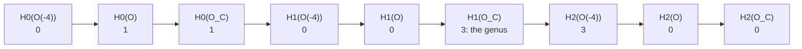

# Sheaf cohomology: global sections made exact, by injective resolutions

[Syllabus](../../../SYLLABUS.md) → [Algebraic geometry](../README.md) → [Sheaf Cohomology and Differentials](../README.md#s08) → Sheaf cohomology

---

## General Overview

Take the Klein quartic, the plane curve $`x^3y + y^3z + z^3x = 0`$ of degree 4, over the complex numbers ℂ. [Genus](../03-Plane%20Curves/06-genus-and-the-degree-genus-formula.md) counts its handles by projecting it onto a line and counting branch points: 3 handles. This card reaches the same 3 by pure algebra, with no picture of the surface at all.

The tool is one short sequence of sheaves. Functions on the curve C are functions on the plane, cut down to C. Two plane functions give the same function on C exactly when they differ by a multiple of the quartic's equation F. So "all plane functions" splits into "multiples of F" and "functions on C".

Taking global sections (the sections defined on the whole space) should split the same way, but in general it does not: the last map can fail to be onto. Sheaf cohomology is a list of groups $`H^0, H^1, H^2, \ldots`$ that records this failure and carries the sequence on past it. For the quartic's functions, $`H^1`$ has dimension 3, and that 3 is the genus.

**Sheaf cohomology $`H^i(X, \mathcal{F})`$ is what global sections become after every sheaf is replaced by a chain of injective sheaves; it turns each short exact sequence of sheaves into a long exact sequence, and for a plane curve of degree d that sequence gives $`h^1(\mathcal{O}_C) = h^2(\mathcal{O}(-d)) = (d-1)(d-2)/2`$: 1 for a cubic, 3 for a quartic.**

**What kind of fact this is:** a definition ($`H^i`$ as the derived functors of global sections), theorems proved in outline in Why it works (the definition does not depend on choices, and the long exact sequence exists), three theorems stated with sources (Grothendieck vanishing, Serre's affine vanishing, agreement with Čech cohomology), and a theorem proved on this card from them: the genus of a smooth plane curve is $`(d-1)(d-2)/2`$.

### The picture: the long exact sequence for the quartic



Each box is a vector space over ℂ with its dimension. At each box, what arrives is exactly what the next arrow sends to 0. When exactly two boxes sit between two zeros, as $`H^1(\mathcal{O}_C) \to H^2(\mathcal{O}(-4))`$ does between $`H^1(\mathcal{O}) = 0`$ and $`H^2(\mathcal{O}) = 0`$, the arrow joining them is one-to-one and onto, so both have dimension 3.

---

## The formula

Notation first, in words. A **sheaf** 𝓕 on a space X records data on every open set, glued on overlaps ([Sheaves](../05-Cohomology%20and%20the%20Hodge%20Conjecture/01-sheaves-in-outline.md)). Its **global sections** $`\Gamma(X, \mathcal{F})`$ are the data on all of X. Curly 𝓕 is a sheaf; plain F is the curve's polynomial.

A sequence of sheaves $`0 \to \mathcal{A} \to \mathcal{B} \to \mathcal{C} \to 0`$ is **short exact** when, near every point, the first map is one-to-one, the second is onto, and the image of the first is the part the second sends to 0.

An **injective** sheaf 𝓘 is one into which every map extends: given $`\mathcal{A} \to \mathcal{I}`$ and $`\mathcal{A}`$ sitting inside $`\mathcal{B}`$, the map extends to $`\mathcal{B} \to \mathcal{I}`$. This is the sheaf version of the injective modules of [Projective, injective and flat](../07-Exact%20Sequences%2C%20Ext%20and%20Tor/02-projective-injective-and-flat-modules.md). An **injective resolution** of 𝓕 is an exact chain $`0 \to \mathcal{F} \to \mathcal{I}^0 \to \mathcal{I}^1 \to \cdots`$ of injective sheaves.

The definition:

```math
H^i(X, \mathcal{F}) \;=\; \frac{\ker\big(\Gamma(X, \mathcal{I}^i) \to \Gamma(X, \mathcal{I}^{i+1})\big)}{\mathrm{im}\big(\Gamma(X, \mathcal{I}^{i-1}) \to \Gamma(X, \mathcal{I}^{i})\big)}
```

**Read it aloud:** resolve the sheaf by injectives, take global sections of the whole chain, and $`H^i`$ is what dies at step i modulo what arrives from step i − 1.

The dimension over the field is written with a small h: $`h^i(X, \mathcal{F}) = \dim H^i(X, \mathcal{F})`$.

The main consequence, for a short exact sequence $`0 \to \mathcal{A} \to \mathcal{B} \to \mathcal{C} \to 0`$:

```math
0 \to H^0(\mathcal{A}) \to H^0(\mathcal{B}) \to H^0(\mathcal{C}) \xrightarrow{\ \delta\ } H^1(\mathcal{A}) \to H^1(\mathcal{B}) \to H^1(\mathcal{C}) \xrightarrow{\ \delta\ } H^2(\mathcal{A}) \to \cdots
```

**Read it aloud:** the three sheaves' cohomology groups line up in one long chain, linked by connecting maps δ, and the chain is exact at every place.

For a plane curve C of degree d, with equation F, multiplication by F gives the short exact sequence

```math
0 \to \mathcal{O}_{\mathbb{P}^2}(-d) \xrightarrow{\ \cdot F\ } \mathcal{O}_{\mathbb{P}^2} \to \mathcal{O}_C \to 0, \qquad h^1(C, \mathcal{O}_C) = h^2\big(\mathbb{P}^2, \mathcal{O}(-d)\big) = \frac{(d-1)(d-2)}{2}
```

**Read it aloud:** plane functions of twist minus d, times F, are the plane functions that vanish on C; so the first cohomology of the curve's functions equals the second cohomology of the twist minus d, which is one half of d minus one times d minus two.

Here 𝒪(k) is the twisted sheaf of [Quasi-coherent sheaves](../06-Schemes%20and%20Modern%20Language/11-quasi-coherent-and-coherent-sheaves.md): its sections on a chart are fractions of degree k. For the quartic, $`d = 4`$ and the answer is $`3 \cdot 2 / 2 = 3`$.

| Symbol | Plain meaning | In our example | Push it up and the answer… |
| --- | --- | --- | --- |
| $`X`$, 𝓕 | a space; a sheaf on it | $`\mathbb{P}^2`$; 𝒪(−4) | — |
| $`\Gamma(X, \mathcal{F})`$ | global sections: data on all of X | the constants, for 𝒪 on $`\mathbb{P}^2`$ | — |
| $`\mathcal{I}^0, \mathcal{I}^1, \ldots`$ | an injective resolution of 𝓕 | not written out: any one gives the same answer | — |
| $`H^i(X, \mathcal{F})`$, $`h^i`$ | the i-th cohomology group; its dimension | $`h^2(\mathcal{O}(-4)) = 3`$ | — |
| $`\mathcal{A}, \mathcal{B}, \mathcal{C}`$, δ | a short exact sequence; the connecting map | 𝒪(−4), 𝒪, $`\mathcal{O}_C`$ | — |
| $`\mathbb{P}^n`$, x, y, z, $`U_i`$ | projective space; coordinates; the chart where the i-th coordinate is not 0 | $`\mathbb{P}^2`$ with three charts | — |
| 𝒪(k), k | the twisted sheaf; the twist | k = −4 | $`h^0`$ grows (from k = 0 on); $`h^n`$ shrinks (up to k = −n − 1) |
| C, F, d | the curve; its equation; its degree | the Klein quartic, d = 4 | genus grows like $`d^2/2`$ |
| $`\mathcal{O}_C`$, $`\mathcal{O}_C(n)`$ | functions on C; twisted by n | $`h^1(\mathcal{O}_C) = 3`$ | $`h^1(\mathcal{O}_C(n))`$ falls to 0 by n = d − 2 |
| g, $`p_a`$ | genus; arithmetic genus | 3 | — |
| χ | Euler characteristic, $`h^0 - h^1 + h^2`$ | $`\chi(\mathcal{O}_C) = -2`$ | — |
| S, HF(n), HP(n), Z | polynomials in the coordinates; the Hilbert function and polynomial of S/(F); two points on $`\mathbb{P}^1`$ | HP(n) = 4n − 2; Z = {xy = 0} | — |

### When it holds

- **Enough injectives.** Every sheaf of modules must sit inside an injective sheaf, or the definition has nothing to resolve by. On any ringed space this holds (Hartshorne, Proposition III.2.2). In a category without enough injectives, the definition fails at step one.
- **A short exact sequence of sheaves, not of global sections.** The long exact sequence needs exactness near every point. On $`\mathbb{P}^1`$, global sections of $`0 \to \mathcal{O}(-2) \to \mathcal{O} \to \mathcal{O}_Z \to 0`$ give $`0 \to 0 \to 1 \to 2`$: not onto at the end. The missing 1 is $`h^1(\mathcal{O}(-2))`$.
- **Čech agrees only for an open affine cover of a separated Noetherian scheme, with 𝓕 quasi-coherent.** Separated is a mild gluing condition; the property used here is that the overlap of two affine pieces is again affine. Use only the charts $`U_x`$ and $`U_y`$ of $`\mathbb{P}^2`$: they miss the point (0 : 0 : 1), so they are not a cover at all, and the Čech $`H^1`$ of 𝒪(−3) is 48 in the box of exponents up to 8 and 71 up to 10, growing without limit instead of 0.
- **A smooth curve, for "handles".** For a singular plane curve the same sequence gives the arithmetic genus $`p_a`$, not the handle count g. The nodal cubic has $`h^1(\mathcal{O}_C) = 1`$ but genus 0, as in [Genus](../03-Plane%20Curves/06-genus-and-the-degree-genus-formula.md).
- **Any field, for the algebra.** The values of $`h^i(\mathcal{O}(k))`$ are the same over every field; "handles" needs ℂ. The code takes ranks modulo the prime 1000003; its match with the closed forms confirms these ranks equal those over ℚ.

---

## Why it works

### Step 0: global sections keep the start of a sequence and lose the end

Two points on the projective line make the problem visible. Let Z be the points (1 : 0) and (0 : 1), where $`xy = 0`$. A function on Z is just a value at each point, so Z carries 2 independent functions.

The sequence $`0 \to \mathcal{O}(-2) \xrightarrow{\cdot xy} \mathcal{O} \to \mathcal{O}_Z \to 0`$ is exact near every point. But the global functions on $`\mathbb{P}^1`$ are only the constants, 1 dimension ([Sheaves](../05-Cohomology%20and%20the%20Hodge%20Conjecture/01-sheaves-in-outline.md)). A constant cannot take the value 1 at (1 : 0) and 0 at (0 : 1). So the restriction from 𝒪 to $`\mathcal{O}_Z`$ is onto near each point and not onto globally.

This is general. Global sections are **left exact**: $`0 \to \Gamma(\mathcal{A}) \to \Gamma(\mathcal{B}) \to \Gamma(\mathcal{C})`$ is always exact, and the last map can fail to be onto. Derived functors measure that failure in a way that does not depend on accidents.

### Step 1: injective sheaves have nothing to lose

If 𝓐 is injective, the identity map of 𝓐 extends along $`\mathcal{A} \to \mathcal{B}`$, so the sequence splits: $`\mathcal{B} = \mathcal{A} \oplus \mathcal{C}`$. Global sections of a split sequence stay exact. So sequences that start with an injective lose nothing.

Injective sheaves exist in plenty. Over a field, every vector space is injective. So a sheaf of vector spaces sits inside the sheaf whose sections over U are all choices of one stalk element per point of U, and that sheaf is injective. Repeating on the cokernel builds the resolution, one injective at a time (Hartshorne, Section III.2).

### Step 2: the answer does not depend on the resolution

Any two injective resolutions of 𝓕 are linked by chain maps both ways, and the two composites differ from the identity by a homotopy: a map back one step that accounts for the difference. Homotopic chain maps give the same map on cohomology, so the two resolutions give the same $`H^i`$ (Weibel, Section 2.3).

Two facts follow at once:

1. $`H^0(X, \mathcal{F}) = \Gamma(X, \mathcal{F})`$, because global sections are left exact.
2. An injective sheaf has $`H^i = 0`$ for $`i > 0`$: it resolves itself.

This is the same construction as [Ext](../07-Exact%20Sequences%2C%20Ext%20and%20Tor/05-ext-and-extensions.md), with global sections in place of Hom. In fact $`H^i(X, \mathcal{F}) = \mathrm{Ext}^i(\mathcal{O}_X, \mathcal{F})`$, since a global section of 𝓕 is a map from 𝒪 to 𝓕.

### Step 3: the long exact sequence

Resolve 𝓐 and 𝓒 by injectives, and build a resolution of 𝓑 from the two, column by column (the horseshoe lemma). Each row is a short exact sequence that starts with an injective, so by Step 1 it stays exact after taking global sections. A short exact sequence of chains gives a long exact sequence of cohomology (the snake lemma of [Exact sequences of modules](../07-Exact%20Sequences%2C%20Ext%20and%20Tor/01-exact-sequences-and-the-snake-lemma.md), run once per degree). That is the formula above.

The connecting map δ has a hands-on meaning. Take a global section c of 𝓒. Near each point it lifts to 𝓑, because the map is onto near points. Two local lifts differ, on their overlap, by a section of 𝓐. Those differences are a Čech 1-cocycle of 𝓐, and its class is δ(c).

For the two points: lift the function (1 at (1 : 0), 0 at (0 : 1)) by 1 on the chart $`U_x`$ and 0 on $`U_y`$. On the overlap the difference is $`1 = xy \cdot x^{-1}y^{-1}`$. So δ(c) is the class of $`x^{-1}y^{-1}`$ in $`H^1(\mathbb{P}^1, \mathcal{O}(-2))`$. That monomial is negative in both coordinates, so no single chart reaches it, and it spans the 1-dimensional $`H^1`$.

<details>
<summary>The snake lemma step, written out</summary>

Write the global sections of the three resolutions as chains $`A^\bullet \to B^\bullet \to C^\bullet`$, exact in every degree. Let c in $`C^i`$ have $`dc = 0`$.

Lift c to b in $`B^i`$. Then db maps to $`d c = 0`$, so db comes from a unique a in $`A^{i+1}`$. Since $`d(db) = 0`$ and A injects into B, $`da = 0`$.

Changing b by the image of some a′ changes a by $`da'`$. Changing c by $`dc'`$ changes b by $`db'`$ plus an image, and a by a boundary. So $`\delta[c] = [a]`$ is well defined.

Exactness at each of the three kinds of place is the same diagram chase, one element at a time (Weibel, Theorem 1.3.1).

</details>

### Step 4: three theorems that make it computable

Three theorems turn the definition into arithmetic.

- **Grothendieck vanishing.** On a Noetherian space of dimension n, $`H^i(X, \mathcal{F}) = 0`$ for every sheaf of abelian groups and every $`i > n`$ (Hartshorne, Theorem III.2.7). A curve has no $`H^2`$; the plane has no $`H^3`$.
- **Serre's affine vanishing.** On an affine scheme Spec A, A Noetherian, a quasi-coherent sheaf has $`H^i = 0`$ for $`i > 0`$ (Hartshorne, Theorem III.3.5). Its sections are just a module, and nothing is lost.
- **Agreement with Čech.** For a separated Noetherian scheme, an open affine cover and a quasi-coherent sheaf, Čech cohomology equals the derived functors (Hartshorne, Theorem III.4.5). The reason: every overlap of the cover is affine, so by Serre's theorem the Čech chain resolves 𝓕 by sheaves with no higher cohomology, and such a resolution gives the same answer as an injective one. This is Leray's theorem: any cover whose overlaps have no higher cohomology computes $`H^i`$.

### Step 5: the twisted sheaves on the plane

By Step 4, the three charts $`U_x, U_y, U_z`$ of $`\mathbb{P}^2`$ compute $`H^i(\mathcal{O}(k))`$. [Cech cohomology](04-cech-cohomology-of-projective-space.md) does that computation. The Čech chain splits into one small chain per Laurent monomial $`x^ay^bz^c`$, with $`a + b + c = k`$. The result (Hartshorne, Theorem III.5.1):

- $`H^0`$: monomials with $`a, b, c \ge 0`$, so $`h^0(\mathcal{O}(k)) = \binom{k+2}{2}`$.
- $`H^1 = 0`$ for every k.
- $`H^2`$: monomials with $`a, b, c \le -1`$, so $`h^2(\mathcal{O}(k)) = \binom{-k-1}{2}`$.

For $`k = -4`$ the $`H^2`$ monomials are $`x^{-2}y^{-1}z^{-1}`$, $`x^{-1}y^{-2}z^{-1}`$ and $`x^{-1}y^{-1}z^{-2}`$: three.

### Step 6: the genus of a plane curve

Write the long exact sequence of $`0 \to \mathcal{O}(-d) \to \mathcal{O} \to \mathcal{O}_C \to 0`$ and put in Step 5's numbers. $`H^1(\mathcal{O}) = 0`$ and $`H^2(\mathcal{O}) = 0`$ trap $`H^1(\mathcal{O}_C)`$ between two zeros:

```math
0 = H^1(\mathbb{P}^2, \mathcal{O}) \to H^1(C, \mathcal{O}_C) \xrightarrow{\ \delta\ } H^2(\mathbb{P}^2, \mathcal{O}(-d)) \to H^2(\mathbb{P}^2, \mathcal{O}) = 0
```

**Read it aloud:** the connecting map is one-to-one because zero comes before it, and onto because zero comes after it.

So $`h^1(\mathcal{O}_C) = h^2(\mathcal{O}(-d)) = \binom{d-1}{2} = (d-1)(d-2)/2`$. Earlier in the chain, $`H^1(\mathcal{O}(-d)) = 0`$ makes $`H^0(\mathcal{O}) \to H^0(\mathcal{O}_C)`$ onto, so $`h^0(\mathcal{O}_C) = 1`$: the curve is connected. Grothendieck vanishing gives $`H^2(\mathcal{O}_C) = 0`$.

Why this number is the handle count g: over ℂ, Serre's GAGA theorem makes algebraic and analytic sheaf cohomology agree on a projective curve (Hartshorne, Appendix B). Dolbeault's theorem then identifies the analytic $`H^1(C, \mathcal{O}_C)`$ with $`H^{0,1}`$ of [Hodge decomposition](../05-Cohomology%20and%20the%20Hodge%20Conjecture/05-hodge-decomposition.md), and the first Betti number 2g splits as $`h^{1,0} + h^{0,1}`$ with the two halves equal. Hartshorne takes $`h^1(\mathcal{O}_C)`$ as the definition of the genus (Section IV.1).

The same sequence twisted by n, $`0 \to \mathcal{O}(n-d) \to \mathcal{O}(n) \to \mathcal{O}_C(n) \to 0`$, gives $`h^0(\mathcal{O}_C(n))`$ and $`h^1(\mathcal{O}_C(n))`$ for every n. Their difference is $`dn + 1 - g`$, Riemann–Roch for the line bundle $`\mathcal{O}_C(n)`$ of degree dn ([Divisors and Riemann-Roch](../03-Plane%20Curves/07-divisors-and-riemann-roch.md)).

---

## Worked numbers, by hand

The Klein quartic, d = 4, over ℂ.

| Step | Arithmetic | Value |
| --- | --- | --- |
| $`h^0(\mathcal{O})`$ on $`\mathbb{P}^2`$ | monomials of degree 0 with no negative exponent: 1 | 1 |
| $`h^0(\mathcal{O}(-4))`$ | no monomial of degree −4 has all exponents ≥ 0 | 0 |
| $`h^1(\mathcal{O}(k))`$ for every k | Step 5 | 0 |
| $`h^2(\mathcal{O}(-4))`$ | exponents all ≤ −1, adding to −4: $`\binom{3}{2}`$ | 3 |
| $`h^2(\mathcal{O})`$ | exponents all ≤ −1 cannot add to 0 | 0 |
| $`h^0(\mathcal{O}_C)`$ | $`1 - 0`$, since $`H^1(\mathcal{O}(-4)) = 0`$ | 1 |
| $`h^1(\mathcal{O}_C)`$ | trapped between $`H^1(\mathcal{O}) = 0`$ and $`H^2(\mathcal{O}) = 0`$ | **3** |
| check: $`\chi(\mathcal{O}_C)`$ | $`1 - 3`$, against HP(0) of S/(F) | −2 |

The Klein quartic has three handles, found without drawing it. Through the connecting map δ, the three monomials of $`H^2(\mathcal{O}(-4))`$ match a basis of $`H^1(\mathcal{O}_C)`$.

For the Fermat cubic $`x^3 + y^3 + z^3`$ the same table ends at $`\binom{2}{2} = 1`$: one handle, a torus, as for every smooth cubic.

The genus by degree, as the code prints it. The first column comes from the long exact sequence, the second from $`(d-1)(d-2)/2`$, and each # is half a handle:

```
  degree 1:  0  0
  degree 2:  0  0
  degree 3:  1  1  ##
  degree 4:  3  3  ######
  degree 5:  6  6  ############
  degree 6: 10 10  ####################
```

### What breaks if you drop a piece

| Mistake | Comes out at | What went wrong |
| --- | --- | --- |
| Taking functions on Z from the quotient ring, $`(S/xy)_0`$ | 1 function on two points, not 2 | global sections of a quotient sheaf are more than the quotient of global sections; the gap is $`h^1(\mathcal{O}(-2)) = 1`$ |
| Reading the genus as $`h^1(\mathcal{O}(-4))`$ | 0, not 3 | the connecting map raises the degree by one: $`H^1(\mathcal{O}_C)`$ lands in $`H^2`$ |
| Twisting the wrong way, $`h^2(\mathcal{O}(4))`$ | 0, not 3 | the multiples of F are 𝒪(−d) inside 𝒪, not 𝒪(+d) |
| Čech with the charts $`U_x`$, $`U_y`$ only, for $`h^1(\mathcal{O}(-3))`$ | 48 in box 8, 71 in box 10, not 0 | two charts miss (0 : 0 : 1), so they do not cover $`\mathbb{P}^2`$; they compute the punctured plane, which is not affine |

The code prints all four.

---

## Code, from first principles, and it actually runs

Nothing is imported, and every number is an exact integer. Three roads reach each number. Road one computes $`h^i(\mathcal{O}(k))`$ on $`\mathbb{P}^1`$ and $`\mathbb{P}^2`$ by the Čech chain of the standard charts, one Laurent monomial at a time, with ranks by elimination mod the prime 1000003; it repeats the count in a bigger box of exponents to show nothing was cut off. Road two is the closed forms $`\binom{k+2}{2}`$ and $`\binom{-k-1}{2}`$. Road three never mentions cohomology: it computes the Hilbert function of S/(F), the dimension of the degree-n forms modulo multiples of F, by the rank of multiplication by F, and reads $`1 - g`$ off the Hilbert polynomial at 0. Multiplying by any nonzero F loses nothing, so road three depends only on the degree d: it checks the sequence's numbers, not which curve. What the curve itself must supply is smoothness, which the handle count needs. A singular point is a common zero of F and its three partial derivatives (the rates of change of F in x, y and z). The code finds that the partials, times all forms, reach every form of degree 3d − 5; a full rank mod the prime is full over ℚ too. A common zero of the partials would be a zero of all those forms, $`x^{3d-5}`$, $`y^{3d-5}`$ and $`z^{3d-5}`$ included, which is impossible. So the Fermat cubic and the Klein quartic are smooth. The long exact sequence must make all three roads agree.

### Python

```python
# Sheaf cohomology as a derived functor -- the check behind the card.  Nothing
# is imported; every number is an exact integer, and ranks are taken mod the
# prime P = 1000003.  Road 1: H^i(P^n, O(k)) by the Cech complex of the charts
# x_i != 0, one Laurent monomial at a time, in the exponent box [-B, B].
# Road 2: the closed forms h^0 = C(k + n, n) and h^n = C(-k - 1, n).
# Road 3: the Hilbert function of S/(F), by the rank of multiplication by F,
# and points counted by brute force.  The long exact sequence joins them.
P, B = 1000003, 8

def rank(rows):                                  # Gaussian elimination mod P
    rows, r = [[v % P for v in row] for row in rows], 0
    for c in range(len(rows[0]) if rows else 0):
        piv = next((i for i in range(r, len(rows)) if rows[i][c]), None)
        if piv is None:
            continue
        rows[r], rows[piv] = rows[piv], rows[r]
        inv = pow(rows[r][c], P - 2, P)
        rows[r] = [v * inv % P for v in rows[r]]
        for i in range(len(rows)):
            if i != r and rows[i][c]:
                f = rows[i][c]
                rows[i] = [(a - f * b) % P for a, b in zip(rows[i], rows[r])]
        r += 1
    return r

def binom(m, r):
    if m < r or m < 0:
        return 0
    out = 1
    for i in range(r):
        out = out * (m - i) // (i + 1)
    return out

def monomials(n, k, box):                        # exponents of x_0..x_n adding to k
    if n == 0:
        return [(k,)] if -box <= k <= box else []
    return [(a,) + t for a in range(-box, box + 1) for t in monomials(n - 1, k - a, box)]

def cech(n, k, charts, box):                     # dims of Cech H^0..H^n of O(k) on P^n
    h = [0] * (n + 1)
    for e in monomials(n, k, box):
        neg = {i for i in range(n + 1) if e[i] < 0}  # a section on U_I needs neg inside I
        cells = [[] for _ in charts]
        for mask in range(1, 1 << len(charts)):
            I = tuple(c for t, c in enumerate(charts) if mask >> t & 1)
            if neg <= set(I):
                cells[len(I) - 1].append(I)
        R = [0]
        for p in range(len(charts) - 1):         # (dc)_J = sum_j (-1)^j c_(J minus j-th)
            rows = [[0] * len(cells[p]) for _ in cells[p + 1]]
            for a, J in enumerate(cells[p + 1]):
                for j in range(len(J)):
                    if J[:j] + J[j + 1:] in cells[p]:
                        rows[a][cells[p].index(J[:j] + J[j + 1:])] = (-1) ** j
            R.append(rank(rows))
        R.append(0)
        for p in range(len(charts)):
            h[p] += len(cells[p]) - R[p] - R[p + 1]
    return h

def forms(nv, n):                                # exponents of the degree-n forms
    if n < 0:
        return []
    if nv == 1:
        return [(n,)]
    return [(a,) + t for a in range(n, -1, -1) for t in forms(nv - 1, n - a)]

def hilbert(Fs, nv, d, n):                       # dim (S/(Fs))_n = dim S_n - rank of Fs times
    rows_m, cols_m = forms(nv, n), forms(nv, n - d)
    M = [[F.get(tuple(r[i] - c[i] for i in range(nv)), 0) for F in Fs for c in cols_m] for r in rows_m]
    return len(rows_m) - rank(M)

# ---- P^1 and two points: global sections lose one function, H^1 finds it ----
h1 = {k: cech(1, k, [0, 1], B) for k in range(-3, 4)}
print("P^1, (h0, h1) of O(k) for k = -3..1:", " ".join(f"({h1[k][0]}, {h1[k][1]})" for k in range(-3, 2)))
XY = {(1, 1): 1}                                 # Z = {xy = 0}: the points (1:0) and (0:1)
pts = sum(1 for p in [(1, t) for t in range(7)] + [(0, 1)] if p[0] * p[1] % 7 == 0)
les_Z = [h1[n][0] - h1[n - 2][0] + h1[n - 2][1] - h1[n][1] for n in range(4)]
hf_Z = [hilbert([XY], 2, 2, n) for n in range(4)]
print(f"two points Z = {{xy = 0}}: points over F_7 {pts}; h0(O_Z(n)), n = 0..3, by the sequence {les_Z}")
print(f"  the same from the quotient ring (S/xy)_n: {hf_Z}; the gap at n = 0 is h1(O(-2)) = {h1[-2][1]}")

# ---- P^2: Cech against the closed forms, and the curve's genus ----
h2 = {k: cech(2, k, [0, 1, 2], B) for k in range(-8, 6)}
big = all(cech(2, k, [0, 1, 2], B + 2) == h2[k] for k in (-6, 0, 2))
print(f"P^2, h0 h1 h2 of O(k) by Cech in box {B} (box {B + 2} agrees: {'yes' if big else 'no'}):")
for k in range(-6, 3):
    closed = [binom(k + 2, 2), 0, binom(-k - 1, 2)]
    print(f"  k = {k:2}: {h2[k][0]:2} {h2[k][1]} {h2[k][2]:2}   closed forms {closed[0]:2} 0 {closed[2]:2}"
          f"   chi {h2[k][0] - h2[k][1] + h2[k][2]:2}")
    assert h2[k] == closed and h2[k][0] - h2[k][1] + h2[k][2] == (k + 1) * (k + 2) // 2
print("plane curve C of degree d: h1(O_C) = h2(O(-d)), against (d - 1)(d - 2)/2")
for d in range(1, 7):
    g = h2[-d][2] - h2[0][2]                     # 0 -> H1(O_C) -> H2(O(-d)) -> H2(O) = 0
    print(f"  degree {d}: {g:2} {(d - 1) * (d - 2) // 2:2}  {'#' * (2 * g)}".rstrip())
    assert g == (d - 1) * (d - 2) // 2

# ---- two named curves: the long exact sequence against the quotient ring ----
for name, F, d in [("Fermat cubic x^3 + y^3 + z^3", {(3, 0, 0): 1, (0, 3, 0): 1, (0, 0, 3): 1}, 3),
                   ("Klein quartic x^3y + y^3z + z^3x", {(3, 1, 0): 1, (0, 3, 1): 1, (1, 0, 3): 1}, 4)]:
    print(f"{name}: n, HF(n) by rank, h0(O_C(n)) and h1(O_C(n)) by the sequence, dn + 1 - g")
    g = (d - 1) * (d - 2) // 2
    for n in range(-1, 6):
        hf = hilbert([F], 3, d, n)
        h0 = h2[n][0] - h2[n - d][0]             # H1(O(n - d)) = 0 makes this exact
        hh1 = h2[n - d][2] - h2[n][2]            # H2(O_C(n)) = 0: C has dimension 1
        print(f"  n = {n:2}: {hf:2} {h0:2} {hh1} {d * n + 1 - g:3}")
        assert hf == h0 and h0 - hh1 == d * n + 1 - g
    slope = hilbert([F], 3, d, d + 1) - hilbert([F], 3, d, d)
    hp0 = hilbert([F], 3, d, d) - d * slope        # the Hilbert polynomial at n = 0
    print(f"  Hilbert polynomial {slope}n + ({hp0}), so 1 - HP(0) = {1 - hp0}, genus by the sequence {g}")
    grads = [{e[:i] + (e[i] - 1,) + e[i + 1:]: c * e[i] for e, c in F.items() if e[i]} for i in range(3)]
    sing = hilbert(grads, 3, d - 1, 3 * d - 5)   # 0: the partials share no zero, so C is smooth
    print(f"  smooth: forms of degree {3 * d - 5} modulo the three partials of F leave {sing}")
    assert slope == d and 1 - hp0 == g == h2[-d][2] and sing == 0

# ---- what breaks ----
print(f"mistake 1, sections of the quotient ring as functions on Z: {hf_Z[0]}, not {pts}")
print(f"mistake 2, h1(O(-4)) for the quartic's genus: {h2[-4][1]}, not {h2[-4][2]}")
print(f"mistake 3, the twist taken as O(+4): h2(O(4)) = {h2[4][2]}, not {h2[-4][2]}")
two = [cech(2, -3, [0, 1], b)[1] for b in (B, B + 2)]
print(f"mistake 4, charts x != 0 and y != 0 only, h1(O(-3)) in box {B} and {B + 2}: {two[0]} and {two[1]}, not 0")
assert les_Z == [pts] * 4 and hf_Z[0] == 1 and h1[-2] == [0, 1]
assert all(h1[k] == [binom(k + 1, 1), binom(-k - 1, 1)] for k in range(-3, 4))
assert two[1] > two[0] > 0 and h2[-4][1] == 0 and h2[4][2] == 0 and big
print("ALL CHECKS PASS")
```

**Ran 2026-11-24 on macOS, Python 3.14.10, standard library only. All checks passed. Output, pasted from the run:**

```
P^1, (h0, h1) of O(k) for k = -3..1: (0, 2) (0, 1) (0, 0) (1, 0) (2, 0)
two points Z = {xy = 0}: points over F_7 2; h0(O_Z(n)), n = 0..3, by the sequence [2, 2, 2, 2]
  the same from the quotient ring (S/xy)_n: [1, 2, 2, 2]; the gap at n = 0 is h1(O(-2)) = 1
P^2, h0 h1 h2 of O(k) by Cech in box 8 (box 10 agrees: yes):
  k = -6:  0 0 10   closed forms  0 0 10   chi 10
  k = -5:  0 0  6   closed forms  0 0  6   chi  6
  k = -4:  0 0  3   closed forms  0 0  3   chi  3
  k = -3:  0 0  1   closed forms  0 0  1   chi  1
  k = -2:  0 0  0   closed forms  0 0  0   chi  0
  k = -1:  0 0  0   closed forms  0 0  0   chi  0
  k =  0:  1 0  0   closed forms  1 0  0   chi  1
  k =  1:  3 0  0   closed forms  3 0  0   chi  3
  k =  2:  6 0  0   closed forms  6 0  0   chi  6
plane curve C of degree d: h1(O_C) = h2(O(-d)), against (d - 1)(d - 2)/2
  degree 1:  0  0
  degree 2:  0  0
  degree 3:  1  1  ##
  degree 4:  3  3  ######
  degree 5:  6  6  ############
  degree 6: 10 10  ####################
Fermat cubic x^3 + y^3 + z^3: n, HF(n) by rank, h0(O_C(n)) and h1(O_C(n)) by the sequence, dn + 1 - g
  n = -1:  0  0 3  -3
  n =  0:  1  1 1   0
  n =  1:  3  3 0   3
  n =  2:  6  6 0   6
  n =  3:  9  9 0   9
  n =  4: 12 12 0  12
  n =  5: 15 15 0  15
  Hilbert polynomial 3n + (0), so 1 - HP(0) = 1, genus by the sequence 1
  smooth: forms of degree 4 modulo the three partials of F leave 0
Klein quartic x^3y + y^3z + z^3x: n, HF(n) by rank, h0(O_C(n)) and h1(O_C(n)) by the sequence, dn + 1 - g
  n = -1:  0  0 6  -6
  n =  0:  1  1 3  -2
  n =  1:  3  3 1   2
  n =  2:  6  6 0   6
  n =  3: 10 10 0  10
  n =  4: 14 14 0  14
  n =  5: 18 18 0  18
  Hilbert polynomial 4n + (-2), so 1 - HP(0) = 3, genus by the sequence 3
  smooth: forms of degree 7 modulo the three partials of F leave 0
mistake 1, sections of the quotient ring as functions on Z: 1, not 2
mistake 2, h1(O(-4)) for the quartic's genus: 0, not 3
mistake 3, the twist taken as O(+4): h2(O(4)) = 0, not 3
mistake 4, charts x != 0 and y != 0 only, h1(O(-3)) in box 8 and 10: 48 and 71, not 0
ALL CHECKS PASS
```

### Rust

Same numbers, same labels, built with `rustc --edition 2021 -O`.

```rust
// Sheaf cohomology as a derived functor -- the same check as the Python, in
// Rust.  No crates; every number is an exact integer, and ranks are taken mod
// the prime P = 1000003.  Road 1: H^i(P^n, O(k)) by the Cech complex of the
// charts x_i != 0, one Laurent monomial at a time, in the exponent box [-B, B].
// Road 2: the closed forms h^0 = C(k + n, n) and h^n = C(-k - 1, n).
// Road 3: the Hilbert function of S/(F), by the rank of multiplication by F,
// and points counted by brute force.  The long exact sequence joins them.
use std::collections::HashMap;
const P: i64 = 1000003;
const B: i64 = 8;

fn pw(mut a: i64, mut e: i64) -> i64 {
    let mut out = 1;
    a = a.rem_euclid(P);
    while e > 0 { if e & 1 == 1 { out = out * a % P } a = a * a % P; e >>= 1 }
    out
}

fn rank(rows: &[Vec<i64>]) -> usize {                  // Gaussian elimination mod P
    let mut m: Vec<Vec<i64>> = rows.iter().map(|r| r.iter().map(|v| v.rem_euclid(P)).collect()).collect();
    let ncols = if m.is_empty() { 0 } else { m[0].len() };
    let mut r = 0;
    for c in 0..ncols {
        let piv = match (r..m.len()).find(|&i| m[i][c] != 0) { Some(i) => i, None => continue };
        m.swap(r, piv);
        let inv = pw(m[r][c], P - 2);
        m[r] = m[r].iter().map(|v| v * inv % P).collect();
        for i in 0..m.len() {
            if i != r && m[i][c] != 0 {
                let f = m[i][c];
                let pr = m[r].clone();
                m[i] = m[i].iter().zip(pr.iter()).map(|(a, b)| (a - f * b).rem_euclid(P)).collect();
            }
        }
        r += 1;
    }
    r
}

fn binom(m: i64, r: i64) -> i64 {
    if m < r || m < 0 { return 0 }
    let mut out = 1;
    for i in 0..r { out = out * (m - i) / (i + 1) }
    out
}

fn monomials(n: usize, k: i64, bx: i64) -> Vec<Vec<i64>> {   // exponents adding to k
    if n == 0 { return if -bx <= k && k <= bx { vec![vec![k]] } else { vec![] } }
    let mut out = Vec::new();
    for a in -bx..=bx {
        for t in monomials(n - 1, k - a, bx) { let mut v = vec![a]; v.extend(t); out.push(v) }
    }
    out
}

fn cech(n: usize, k: i64, charts: &[usize], bx: i64) -> Vec<i64> {  // Cech H^0..H^n of O(k) on P^n
    let mut h = vec![0i64; n + 1];
    for e in monomials(n, k, bx) {
        let neg: Vec<usize> = (0..=n).filter(|&i| e[i] < 0).collect();
        let mut cells: Vec<Vec<Vec<usize>>> = vec![Vec::new(); charts.len()];
        for mask in 1..(1usize << charts.len()) {
            let set: Vec<usize> = (0..charts.len()).filter(|t| mask >> t & 1 == 1).map(|t| charts[t]).collect();
            if neg.iter().all(|i| set.contains(i)) { cells[set.len() - 1].push(set) }
        }
        let mut rr = vec![0usize];
        for p in 0..charts.len() - 1 {                 // (dc)_J = sum_j (-1)^j c_(J minus j-th)
            let mut rows = vec![vec![0i64; cells[p].len()]; cells[p + 1].len()];
            for (a, jset) in cells[p + 1].iter().enumerate() {
                for j in 0..jset.len() {
                    let mut face = jset.clone();
                    face.remove(j);
                    if let Some(col) = cells[p].iter().position(|c| *c == face) {
                        rows[a][col] = if j % 2 == 0 { 1 } else { -1 };
                    }
                }
            }
            rr.push(rank(&rows));
        }
        rr.push(0);
        for p in 0..charts.len() { h[p] += (cells[p].len() - rr[p] - rr[p + 1]) as i64 }
    }
    h
}

fn forms(nv: usize, n: i64) -> Vec<Vec<i64>> {         // exponents of the degree-n forms
    if n < 0 { return vec![] }
    if nv == 1 { return vec![vec![n]] }
    let mut out = Vec::new();
    for a in (0..=n).rev() {
        for t in forms(nv - 1, n - a) { let mut v = vec![a]; v.extend(t); out.push(v) }
    }
    out
}

fn hilbert(fs: &[HashMap<Vec<i64>, i64>], nv: usize, d: i64, n: i64) -> i64 {  // dim (S/(fs))_n
    let (rows_m, cols_m) = (forms(nv, n), forms(nv, n - d));
    let m: Vec<Vec<i64>> = rows_m.iter().map(|r| fs.iter().flat_map(|f| cols_m.iter().map(move |c| {
        let diff: Vec<i64> = (0..nv).map(|i| r[i] - c[i]).collect();
        *f.get(&diff).unwrap_or(&0)
    })).collect()).collect();
    rows_m.len() as i64 - rank(&m) as i64
}

fn poly(terms: &[[i64; 3]]) -> Vec<HashMap<Vec<i64>, i64>> { vec![terms.iter().map(|t| (t.to_vec(), 1)).collect()] }

fn main() {
    // ---- P^1 and two points: global sections lose one function, H^1 finds it ----
    let h1: HashMap<i64, Vec<i64>> = (-3..4).map(|k| (k, cech(1, k, &[0, 1], B))).collect();
    let pairs: Vec<String> = (-3..2).map(|k| format!("({}, {})", h1[&k][0], h1[&k][1])).collect();
    println!("P^1, (h0, h1) of O(k) for k = -3..1: {}", pairs.join(" "));
    let xy: Vec<HashMap<Vec<i64>, i64>> = vec![[(vec![1, 1], 1)].into_iter().collect()];
    let pl: Vec<(i64, i64)> = (0..7).map(|t| (1, t)).chain([(0, 1)]).collect();
    let pts = pl.iter().filter(|p| p.0 * p.1 % 7 == 0).count() as i64;
    let les_z: Vec<i64> = (0..4).map(|n| h1[&n][0] - h1[&(n - 2)][0] + h1[&(n - 2)][1] - h1[&n][1]).collect();
    let hf_z: Vec<i64> = (0..4).map(|n| hilbert(&xy, 2, 2, n)).collect();
    println!("two points Z = {{xy = 0}}: points over F_7 {}; h0(O_Z(n)), n = 0..3, by the sequence {:?}", pts, les_z);
    println!("  the same from the quotient ring (S/xy)_n: {:?}; the gap at n = 0 is h1(O(-2)) = {}", hf_z, h1[&-2][1]);

    // ---- P^2: Cech against the closed forms, and the curve's genus ----
    let h2: HashMap<i64, Vec<i64>> = (-8..6).map(|k| (k, cech(2, k, &[0, 1, 2], B))).collect();
    let big = [-6i64, 0, 2].iter().all(|&k| cech(2, k, &[0, 1, 2], B + 2) == h2[&k]);
    println!("P^2, h0 h1 h2 of O(k) by Cech in box {} (box {} agrees: {}):", B, B + 2, if big { "yes" } else { "no" });
    for k in -6..3i64 {
        let h = &h2[&k];
        let closed = [binom(k + 2, 2), 0, binom(-k - 1, 2)];
        println!("  k = {:2}: {:2} {} {:2}   closed forms {:2} 0 {:2}   chi {:2}",
                 k, h[0], h[1], h[2], closed[0], closed[2], h[0] - h[1] + h[2]);
        assert!(h[..] == closed[..] && h[0] - h[1] + h[2] == (k + 1) * (k + 2) / 2);
    }
    println!("plane curve C of degree d: h1(O_C) = h2(O(-d)), against (d - 1)(d - 2)/2");
    for d in 1..7i64 {
        let g = h2[&-d][2] - h2[&0][2];                // 0 -> H1(O_C) -> H2(O(-d)) -> H2(O) = 0
        println!("{}", format!("  degree {}: {:2} {:2}  {}", d, g, (d - 1) * (d - 2) / 2, "#".repeat(2 * g as usize)).trim_end());
        assert!(g == (d - 1) * (d - 2) / 2);
    }

    // ---- two named curves: the long exact sequence against the quotient ring ----
    let curves = [("Fermat cubic x^3 + y^3 + z^3", poly(&[[3, 0, 0], [0, 3, 0], [0, 0, 3]]), 3i64),
                  ("Klein quartic x^3y + y^3z + z^3x", poly(&[[3, 1, 0], [0, 3, 1], [1, 0, 3]]), 4)];
    for &(name, ref f, d) in curves.iter() {
        println!("{}: n, HF(n) by rank, h0(O_C(n)) and h1(O_C(n)) by the sequence, dn + 1 - g", name);
        let g = (d - 1) * (d - 2) / 2;
        for n in -1..6i64 {
            let hf = hilbert(f, 3, d, n);
            let h0 = h2[&n][0] - h2[&(n - d)][0];      // H1(O(n - d)) = 0 makes this exact
            let hh1 = h2[&(n - d)][2] - h2[&n][2];     // H2(O_C(n)) = 0: C has dimension 1
            println!("  n = {:2}: {:2} {:2} {} {:3}", n, hf, h0, hh1, d * n + 1 - g);
            assert!(hf == h0 && h0 - hh1 == d * n + 1 - g);
        }
        let slope = hilbert(f, 3, d, d + 1) - hilbert(f, 3, d, d);
        let hp0 = hilbert(f, 3, d, d) - d * slope;     // the Hilbert polynomial at n = 0
        println!("  Hilbert polynomial {}n + ({}), so 1 - HP(0) = {}, genus by the sequence {}", slope, hp0, 1 - hp0, g);
        let grads: Vec<HashMap<Vec<i64>, i64>> = (0..3).map(|i| f[0].iter().filter(|(e, _)| e[i] > 0)
            .map(|(e, c)| { let mut v = e.clone(); v[i] -= 1; (v, c * e[i]) }).collect()).collect();
        let sing = hilbert(&grads, 3, d - 1, 3 * d - 5);   // 0: the partials share no zero, so C is smooth
        println!("  smooth: forms of degree {} modulo the three partials of F leave {}", 3 * d - 5, sing);
        assert!(slope == d && 1 - hp0 == g && g == h2[&-d][2] && sing == 0);
    }

    // ---- what breaks ----
    println!("mistake 1, sections of the quotient ring as functions on Z: {}, not {}", hf_z[0], pts);
    println!("mistake 2, h1(O(-4)) for the quartic's genus: {}, not {}", h2[&-4][1], h2[&-4][2]);
    println!("mistake 3, the twist taken as O(+4): h2(O(4)) = {}, not {}", h2[&4][2], h2[&-4][2]);
    let two: Vec<i64> = [B, B + 2].iter().map(|&b| cech(2, -3, &[0, 1], b)[1]).collect();
    println!("mistake 4, charts x != 0 and y != 0 only, h1(O(-3)) in box {} and {}: {} and {}, not 0", B, B + 2, two[0], two[1]);
    assert!(les_z == vec![pts; 4] && hf_z[0] == 1 && h1[&-2] == vec![0, 1]);
    assert!((-3..4).all(|k| h1[&k] == vec![binom(k + 1, 1), binom(-k - 1, 1)]));
    assert!(two[1] > two[0] && two[0] > 0 && h2[&-4][1] == 0 && h2[&4][2] == 0 && big);
    println!("ALL CHECKS PASS");
}
```

**Ran 2026-11-24 on macOS, rustc 1.98.1, no crates. All checks passed. Output, pasted from the run:**

```
P^1, (h0, h1) of O(k) for k = -3..1: (0, 2) (0, 1) (0, 0) (1, 0) (2, 0)
two points Z = {xy = 0}: points over F_7 2; h0(O_Z(n)), n = 0..3, by the sequence [2, 2, 2, 2]
  the same from the quotient ring (S/xy)_n: [1, 2, 2, 2]; the gap at n = 0 is h1(O(-2)) = 1
P^2, h0 h1 h2 of O(k) by Cech in box 8 (box 10 agrees: yes):
  k = -6:  0 0 10   closed forms  0 0 10   chi 10
  k = -5:  0 0  6   closed forms  0 0  6   chi  6
  k = -4:  0 0  3   closed forms  0 0  3   chi  3
  k = -3:  0 0  1   closed forms  0 0  1   chi  1
  k = -2:  0 0  0   closed forms  0 0  0   chi  0
  k = -1:  0 0  0   closed forms  0 0  0   chi  0
  k =  0:  1 0  0   closed forms  1 0  0   chi  1
  k =  1:  3 0  0   closed forms  3 0  0   chi  3
  k =  2:  6 0  0   closed forms  6 0  0   chi  6
plane curve C of degree d: h1(O_C) = h2(O(-d)), against (d - 1)(d - 2)/2
  degree 1:  0  0
  degree 2:  0  0
  degree 3:  1  1  ##
  degree 4:  3  3  ######
  degree 5:  6  6  ############
  degree 6: 10 10  ####################
Fermat cubic x^3 + y^3 + z^3: n, HF(n) by rank, h0(O_C(n)) and h1(O_C(n)) by the sequence, dn + 1 - g
  n = -1:  0  0 3  -3
  n =  0:  1  1 1   0
  n =  1:  3  3 0   3
  n =  2:  6  6 0   6
  n =  3:  9  9 0   9
  n =  4: 12 12 0  12
  n =  5: 15 15 0  15
  Hilbert polynomial 3n + (0), so 1 - HP(0) = 1, genus by the sequence 1
  smooth: forms of degree 4 modulo the three partials of F leave 0
Klein quartic x^3y + y^3z + z^3x: n, HF(n) by rank, h0(O_C(n)) and h1(O_C(n)) by the sequence, dn + 1 - g
  n = -1:  0  0 6  -6
  n =  0:  1  1 3  -2
  n =  1:  3  3 1   2
  n =  2:  6  6 0   6
  n =  3: 10 10 0  10
  n =  4: 14 14 0  14
  n =  5: 18 18 0  18
  Hilbert polynomial 4n + (-2), so 1 - HP(0) = 3, genus by the sequence 3
  smooth: forms of degree 7 modulo the three partials of F leave 0
mistake 1, sections of the quotient ring as functions on Z: 1, not 2
mistake 2, h1(O(-4)) for the quartic's genus: 0, not 3
mistake 3, the twist taken as O(+4): h2(O(4)) = 0, not 3
mistake 4, charts x != 0 and y != 0 only, h1(O(-3)) in box 8 and 10: 48 and 71, not 0
ALL CHECKS PASS
```

The two outputs match line for line.

### Lean

Lean proves the long exact sequence and the genus step for every short exact sequence of sheaves, and the monomial count for every d.

- Take a short exact sequence of sheaves $`0 \to \mathcal{A} \to \mathcal{B} \to \mathcal{C} \to 0`$. Then the long exact sequence, linked by δ, is exact at every place. Lean's $`H^i`$ is $`\mathrm{Ext}^i`$ as in Step 2, for sheaves of abelian groups.
- Suppose $`H^n(\mathcal{B}) = 0`$ and $`H^{n+1}(\mathcal{B}) = 0`$. Then $`\delta : H^n(\mathcal{C}) \to H^{n+1}(\mathcal{A})`$ is one-to-one and onto. Step 6 is the case n = 1.
- Take a degree d ≥ 1, and exponents a, b, c ≤ −1 with a + b + c = −d. Then there are exactly $`(d-1)(d-2)/2`$ such monomials $`x^ay^bz^c`$.
- For d = 4 a direct count finds 3 such monomials, and for d = 3 it finds 1.
- The formula $`(d-1)(d-2)/2`$ gives 0, 0, 1, 3, 6, 10 for d = 1 to 6.
- Step 5's $`\binom{-k-1}{2}`$ gives 10, 6, 3, 1 for k = −6 to −3. Its $`\binom{k+2}{2}`$ gives 1, 3, 6 for k = 0 to 2.
- For the quartic, $`\chi(\mathcal{O}_C) = 1 - 3 = -2`$, which is HP(0) for HP(n) = 4n − 2.

The vanishing theorems, Čech agreement and the match of this count with $`h^2(\mathcal{O}(-d))`$ are left to the Python and Rust checks.

```lean
-- Sheaf cohomology: every short exact sequence of sheaves gives a long exact sequence of sheaf cohomology groups, a cohomology group trapped between two zeros is carried one-to-one and onto by the connecting map, and the plane's twist minus d has (d - 1)(d - 2)/2 top-degree monomials.
import Mathlib.CategoryTheory.Sites.SheafCohomology.ExactSequences
import Mathlib.Data.Set.Card
import Mathlib.Data.Int.Interval
import Mathlib.Tactic.NormNum

open CategoryTheory

universe w' w v u

section Cohomology

variable {C : Type u} [Category.{v} C] {J : GrothendieckTopology C}
  [HasSheafify J AddCommGrpCat.{w}] [HasExt.{w'} (Sheaf J AddCommGrpCat.{w})]

/-- The long exact sequence: for a short exact sequence of sheaves 0 → A → B → C → 0
(exact near every point, not just on global sections), the cohomology groups
Hⁿ(A) → Hⁿ(B) → Hⁿ(C) → Hⁿ⁺¹(A) → Hⁿ⁺¹(B) → Hⁿ⁺¹(C), linked by the connecting map δ,
form an exact chain in every degree n. Here Hⁿ is Mathlib's sheaf cohomology, defined
as the derived functors Extⁿ from the constant sheaf (the card's Hⁱ = Extⁱ(𝒪, 𝓕)); the
hypothesis `HasExt` is Mathlib's form of the card's "enough injectives" condition that
makes these derived functors exist. -/
theorem long_exact_sequence_of_short_exact_sequence_of_sheaves
    {S : ShortComplex (Sheaf J AddCommGrpCat.{w})} (hS : S.ShortExact) (n : ℕ) :
    (Sheaf.H.longSequence hS n (n + 1) rfl).Exact :=
  Sheaf.H.longSequence_exact hS n (n + 1) rfl

/-- Trapped between two zeros: in the long exact sequence of a short exact sequence of
sheaves 0 → A → B → C → 0, if Hⁿ(B) = 0 and Hⁿ⁺¹(B) = 0, then the connecting map
δ : Hⁿ(C) → Hⁿ⁺¹(A) is one-to-one and onto. This is the card's genus step with
A = 𝒪(−d), B = 𝒪, C = 𝒪_C and n = 1: H¹(𝒪_C) ≅ H²(𝒪(−d)). -/
theorem connecting_map_bijective_of_trapped_between_zeros
    {S : ShortComplex (Sheaf J AddCommGrpCat.{w})} (hS : S.ShortExact) (n : ℕ)
    (h₀ : Subsingleton (Sheaf.H S.X₂ n)) (h₁ : Subsingleton (Sheaf.H S.X₂ (n + 1))) :
    Function.Bijective (Sheaf.H.δ hS n (n + 1) rfl) := by
  constructor
  · rw [injective_iff_map_eq_zero]
    intro x hx
    obtain ⟨y, rfl⟩ := Sheaf.H.longSequence_exact₃ hS x rfl hx
    rw [Subsingleton.elim y 0, map_zero]
  · intro x
    exact Sheaf.H.longSequence_exact₁ hS x (Subsingleton.elim _ _) rfl

end Cohomology

theorem monomial_set_finite (d : ℕ) :
    {e : ℤ × ℤ × ℤ | e.1 ≤ -1 ∧ e.2.1 ≤ -1 ∧ e.2.2 ≤ -1 ∧ e.1 + e.2.1 + e.2.2 = -(d : ℤ)}.Finite := by
  refine ((Set.finite_Icc (-(d : ℤ)) (-1)).prod
    ((Set.finite_Icc (-(d : ℤ)) (-1)).prod (Set.finite_Icc (-(d : ℤ)) (-1)))).subset ?_
  rintro ⟨a, b, c⟩ ⟨ha, hb, hc, hs⟩
  simp only [Set.mem_prod, Set.mem_Icc] at *
  omega

theorem monomial_count_succ (d : ℕ) :
    {e : ℤ × ℤ × ℤ | e.1 ≤ -1 ∧ e.2.1 ≤ -1 ∧ e.2.2 ≤ -1 ∧ e.1 + e.2.1 + e.2.2 = -((d + 1 : ℕ) : ℤ)}.ncard
      = {e : ℤ × ℤ × ℤ | e.1 ≤ -1 ∧ e.2.1 ≤ -1 ∧ e.2.2 ≤ -1 ∧ e.1 + e.2.1 + e.2.2 = -(d : ℤ)}.ncard
        + (d - 1) := by
  set S := {e : ℤ × ℤ × ℤ | e.1 ≤ -1 ∧ e.2.1 ≤ -1 ∧ e.2.2 ≤ -1 ∧ e.1 + e.2.1 + e.2.2 = -(d : ℤ)}
  have hsplit : {e : ℤ × ℤ × ℤ | e.1 ≤ -1 ∧ e.2.1 ≤ -1 ∧ e.2.2 ≤ -1 ∧
      e.1 + e.2.1 + e.2.2 = -((d + 1 : ℕ) : ℤ)}
      = (fun e : ℤ × ℤ × ℤ => (e.1 - 1, e.2)) '' S
        ∪ (fun b : ℤ => ((-1 : ℤ), b, -(d : ℤ) - b)) '' Set.Icc (1 - (d : ℤ)) (-1) := by
    ext ⟨a, b, c⟩
    simp only [Set.mem_ofPred_eq, Set.mem_union, Set.mem_image, Set.mem_Icc, Prod.mk.injEq, S,
      Prod.exists]
    push_cast
    constructor
    · rintro ⟨ha, hb, hc, hs⟩
      by_cases h : a = -1
      · right; exact ⟨⟨by omega, hb⟩, h.symm, rfl, by omega⟩
      · left; exact ⟨a + 1, ⟨by omega, hb, hc, by omega⟩, by omega, rfl, rfl⟩
    · rintro (⟨a', ⟨h1, h2, h3, h4⟩, rfl, -, -⟩ | ⟨⟨h1, h2⟩, rfl, -, rfl⟩)
      · omega
      · omega
  have hinj1 : Function.Injective (fun e : ℤ × ℤ × ℤ => (e.1 - 1, e.2)) := by
    rintro ⟨a, b⟩ ⟨a', b'⟩ h
    simp only [Prod.mk.injEq] at h
    obtain ⟨h1, h2⟩ := h
    simp [h2]; omega
  have hinj2 : Function.Injective (fun b : ℤ => ((-1 : ℤ), b, -(d : ℤ) - b)) := by
    intro b b' h
    simp only [Prod.mk.injEq] at h
    exact h.2.1
  rw [hsplit, Set.ncard_union_eq _ ((monomial_set_finite d).image _) ((Set.finite_Icc _ _).image _),
    Set.ncard_image_of_injective _ hinj1,
    Set.ncard_image_of_injective _ hinj2, ← Finset.coe_Icc, Set.ncard_coe_finset, Int.card_Icc]
  · congr 1; omega
  · rw [Set.disjoint_left]
    rintro _ ⟨⟨a, b, c⟩, ⟨ha, -, -, -⟩, rfl⟩ ⟨b', -, h⟩
    simp only [Prod.mk.injEq] at h
    omega

#print axioms monomial_set_finite
#print axioms monomial_count_succ

/-- The count behind h²(ℙ², 𝒪(−d)): the Laurent monomials x^a y^b z^c with every exponent
at most −1 and a + b + c = −d number exactly (d − 1)(d − 2)/2. For the quartic (d = 4)
these are x⁻²y⁻¹z⁻¹, x⁻¹y⁻²z⁻¹ and x⁻¹y⁻¹z⁻², three, the Klein quartic's genus. -/
theorem h2_twist_minus_d_monomial_count (d : ℕ) :
    {e : ℤ × ℤ × ℤ | e.1 ≤ -1 ∧ e.2.1 ≤ -1 ∧ e.2.2 ≤ -1 ∧ e.1 + e.2.1 + e.2.2 = -(d : ℤ)}.ncard
      = (d - 1) * (d - 2) / 2 := by
  induction d with
  | zero =>
    rw [show {e : ℤ × ℤ × ℤ | e.1 ≤ -1 ∧ e.2.1 ≤ -1 ∧ e.2.2 ≤ -1 ∧
        e.1 + e.2.1 + e.2.2 = -((0 : ℕ) : ℤ)} = ∅ from ?_, Set.ncard_empty]
    ext ⟨a, b, c⟩
    simp only [Set.mem_ofPred_eq, Set.mem_empty_iff_false, iff_false]
    omega
  | succ k ih =>
    rw [monomial_count_succ, ih]
    rcases k with _ | k
    · rfl
    · simp only [Nat.add_sub_cancel]
      rcases k with _ | k
      · rfl
      · have : (k + 1 + 1) * (k + 1) = (k + 1) * k + (k + 1) * 2 := by ring
        rw [show k + 1 + 1 + 1 - 2 = k + 1 by omega, this,
          Nat.add_mul_div_right _ _ (by norm_num), show k + 1 + 1 - 2 = k by omega]

-- The card's H² monomials of 𝒪(−d), counted in the box of exponents from −d to −1
-- (no exponent can be below −d + 2): 3 for the quartic, 1 for the cubic.
example : ((Finset.Icc (-4 : ℤ) (-1) ×ˢ Finset.Icc (-4 : ℤ) (-1) ×ˢ Finset.Icc (-4 : ℤ) (-1)).filter
    (fun e : ℤ × ℤ × ℤ => e.1 + e.2.1 + e.2.2 = -4)).card = 3 := by decide
example : ((Finset.Icc (-3 : ℤ) (-1) ×ˢ Finset.Icc (-3 : ℤ) (-1) ×ˢ Finset.Icc (-3 : ℤ) (-1)).filter
    (fun e : ℤ × ℤ × ℤ => e.1 + e.2.1 + e.2.2 = -3)).card = 1 := by decide

-- The genus by degree, d = 1..6: 0, 0, 1, 3, 6, 10.
example : [1, 2, 3, 4, 5, 6].map (fun d : ℕ => (d - 1) * (d - 2) / 2) = [0, 0, 1, 3, 6, 10] := by
  decide

-- h²(𝒪(k)) = C(−k − 1, 2) for k = −6..−3 and h⁰(𝒪(k)) = C(k + 2, 2) for k = 0..2.
example : [Nat.choose 5 2, Nat.choose 4 2, Nat.choose 3 2, Nat.choose 2 2] = [10, 6, 3, 1] := by
  decide
example : [Nat.choose 2 2, Nat.choose 3 2, Nat.choose 4 2] = [1, 3, 6] := by decide

-- The quartic's Euler characteristic: χ(𝒪_C) = h⁰ − h¹ = 1 − 3 = −2 = HP(0) for HP(n) = 4n − 2.
example : (1 : ℤ) - 3 = 4 * 0 - 2 := by norm_num

#print axioms long_exact_sequence_of_short_exact_sequence_of_sheaves
#print axioms connecting_map_bijective_of_trapped_between_zeros
#print axioms h2_twist_minus_d_monomial_count
```

**Checked 2026-11-24 on macOS, Lean 4.36.0-rc2, Mathlib v4.36.0-rc2. Every proof is complete and uses only Lean's standard axioms. Output, pasted from the run:**

```
'monomial_set_finite' depends on axioms: [propext, Classical.choice, Quot.sound]
'monomial_count_succ' depends on axioms: [propext, Classical.choice, Quot.sound]
'long_exact_sequence_of_short_exact_sequence_of_sheaves' depends on axioms: [propext, Classical.choice, Quot.sound]
'connecting_map_bijective_of_trapped_between_zeros' depends on axioms: [propext, Classical.choice, Quot.sound]
'h2_twist_minus_d_monomial_count' depends on axioms: [propext, Classical.choice, Quot.sound]
```

> [!TIP]
> **Try changing**
> Guess first, then run it. The asserts are pinned to the card's numbers, so expect some to stop the program.
> - **A smaller box.** Set `B = 3` in the line `P, B = 1000003, 8`. Guess $`h^2(\mathcal{O}(-6))`$. Answer: 7, not 10, because $`x^{-4}y^{-1}z^{-1}`$ no longer fits; the line reports "box 5 agrees: no" and the first assert in the P^2 loop stops the run.
> - **A singular cubic.** Replace the Fermat cubic by the nodal cubic $`y^2z - x^3 - x^2z`$, entered as `{(0, 2, 1): 1, (3, 0, 0): -1, (2, 0, 1): -1}`. Guess $`1 - HP(0)`$. Answer: still 1, because road three sees only the degree; the sheaf sees the arithmetic genus $`p_a = 1`$, though the curve has no handle. The smoothness line now leaves 1, not 0, and its assert stops the run.
> - **Degree 7.** Change `range(1, 7)` to `range(1, 8)` in the genus loop. Guess. Answer: 15, matching $`6 \cdot 5 / 2`$.
> - **Repair the cover.** In mistake 4, give `cech(2, -3, ...)` all three charts `[0, 1, 2]`. Guess. Answer: 0 in both boxes, so the last assert, which expects the broken cover's count to grow, stops the run.

---

## The usual mistake

> [!warning]
> **Treating global sections as exact.** Restriction from the plane's sheaf 𝒪 onto $`\mathcal{O}_Z`$ is onto near every point, but the global map is not: on $`\mathbb{P}^1`$ the constants give 1 function, while the two points of Z carry 2. Every count of functions on a subvariety by "polynomials modulo the equation" misses exactly this $`H^1`$ term. On the plane curves here it vanishes because $`H^1(\mathbb{P}^2, \mathcal{O}(k)) = 0`$; on $`\mathbb{P}^1`$ it does not.
>
> - **Off by one degree.** The connecting map goes from $`H^1(\mathcal{O}_C)`$ to $`H^2(\mathcal{O}(-d))`$; reading $`h^1(\mathcal{O}(-4))`$ gives 0, not 3.
> - **Sign of the twist.** The equation's multiples are 𝒪(−d); $`h^2(\mathcal{O}(4))`$ is 0.
> - **A cover that misses a point.** Čech on $`U_x`$ and $`U_y`$ alone gives 48, then 71, as the box grows: no finite answer.
> - **Handles on a singular curve.** $`h^1(\mathcal{O}_C)`$ is the arithmetic genus: 1 for the nodal cubic, whose genus is 0.

---

## Where you meet it in real life

- **Error-correcting codes.** Codes built from a curve of genus g (algebraic-geometry codes) lose at most g from the best possible sum of dimension and distance. The genus that bounds them is $`h^1(\mathcal{O}_C)`$, computed as on this card.
- **Computer algebra.** Programs compute the cohomology of coherent sheaves on projective space from graded modules, using the Čech chain or the Hilbert function, the two roads this card's code compares.
- **String theory.** Particle counts in compactified models are dimensions $`h^i`$ of sheaf cohomology on a complex variety, found with these long exact sequences.

> **Say it back**
> Global sections keep the start of a short exact sequence of sheaves and can lose the end. Sheaf cohomology replaces each sheaf by a chain of injective sheaves, which lose nothing, and takes global sections there; the result does not depend on the chain. Every short exact sequence then gives a long exact one, and three theorems make it computable: vanishing above the dimension, vanishing on affine pieces, and agreement with Čech. On the plane, $`H^1(\mathcal{O}(k)) = 0`$, so the sequence of a degree-d curve traps $`H^1(\mathcal{O}_C)`$ against $`H^2(\mathcal{O}(-d))`$. That gives the genus $`(d-1)(d-2)/2`$: 1 for a cubic, 3 for the Klein quartic.

---

## What this builds on

- [Cech cohomology](04-cech-cohomology-of-projective-space.md): the chain of a cover, and the monomial count of $`H^i(\mathbb{P}^n, \mathcal{O}(k))`$ that Step 5 uses.
- [Ext](../07-Exact%20Sequences%2C%20Ext%20and%20Tor/05-ext-and-extensions.md): derived functors of Hom by resolutions; sheaf cohomology is Ext from 𝒪.
- [Projective, injective and flat](../07-Exact%20Sequences%2C%20Ext%20and%20Tor/02-projective-injective-and-flat-modules.md): injective modules, the building blocks of the resolutions.
- [Quasi-coherent sheaves](../06-Schemes%20and%20Modern%20Language/11-quasi-coherent-and-coherent-sheaves.md): the sheaves 𝒪(k) and the class of sheaves for which Serre's and Čech's theorems hold.
- [Genus](../03-Plane%20Curves/06-genus-and-the-degree-genus-formula.md): the degree-genus formula by projection and branch points, which this card reaches by algebra.
- [Hodge decomposition](../05-Cohomology%20and%20the%20Hodge%20Conjecture/05-hodge-decomposition.md): Dolbeault's theorem, which makes $`h^1(\mathcal{O}_C)`$ half the first Betti number.
- [The canonical bundle and adjunction](02-canonical-bundle-and-adjunction.md): the canonical bundle $`\mathcal{O}_C(d - 3)`$ of a plane curve of degree d, which Serre duality pairs with this card's $`H^1`$.

## Where this goes next

- [Serre duality](06-serre-duality-and-riemann-roch.md): pairs $`H^1(\mathcal{O}_C(n))`$ with sections of the canonical bundle $`\mathcal{O}_C(d - 3)`$ twisted by −n, so the quartic's $`h^1(\mathcal{O}_C(1)) = 1`$ becomes one section, explains why $`h^1(\mathcal{O}_C(n))`$ is 0 from n = d − 2 on, and proves Riemann–Roch.
- [The Weil conjectures](07-weil-conjectures-and-etale-cohomology.md): a cohomology theory for curves over finite fields, whose $`H^1`$ has dimension 2g and controls the point count.

This card computes cohomology on projective space and on curves inside it; how cohomology behaves along a map between varieties, and how it changes in a family of curves, is the question it leaves open.

---

## Sources

Verified 2026-11-24: every link below resolves to the publisher's page.

- Hartshorne, Robin. *Algebraic Geometry*. Springer, 1977. [doi:10.1007/978-1-4757-3849-0](https://doi.org/10.1007/978-1-4757-3849-0). Chapter III, Sections 1–5: derived functors, enough injectives, Grothendieck vanishing, Serre's affine theorem, agreement with Čech and the cohomology of $`\mathbb{P}^n`$; Section IV.1 for the genus.
- Weibel, Charles A. *An Introduction to Homological Algebra*. Cambridge University Press, 1994. [doi:10.1017/CBO9781139644136](https://doi.org/10.1017/CBO9781139644136). Chapters 1 and 2: the snake lemma, injective resolutions, the comparison theorem and derived functors.
- Grothendieck, Alexander. "Sur quelques points d'algèbre homologique, I." *Tohoku Mathematical Journal* 9, no. 2 (1957): 119–221. [doi:10.2748/tmj/1178244839](https://doi.org/10.2748/tmj/1178244839). Defines sheaf cohomology as derived functors and proves the vanishing above the dimension.
- Serre, Jean-Pierre. "Faisceaux algébriques cohérents." *Annals of Mathematics* 61, no. 2 (1955): 197–278. [doi:10.2307/1969915](https://doi.org/10.2307/1969915). Coherent sheaves by Čech cohomology, the vanishing on affine pieces, and the cohomology of projective space.
