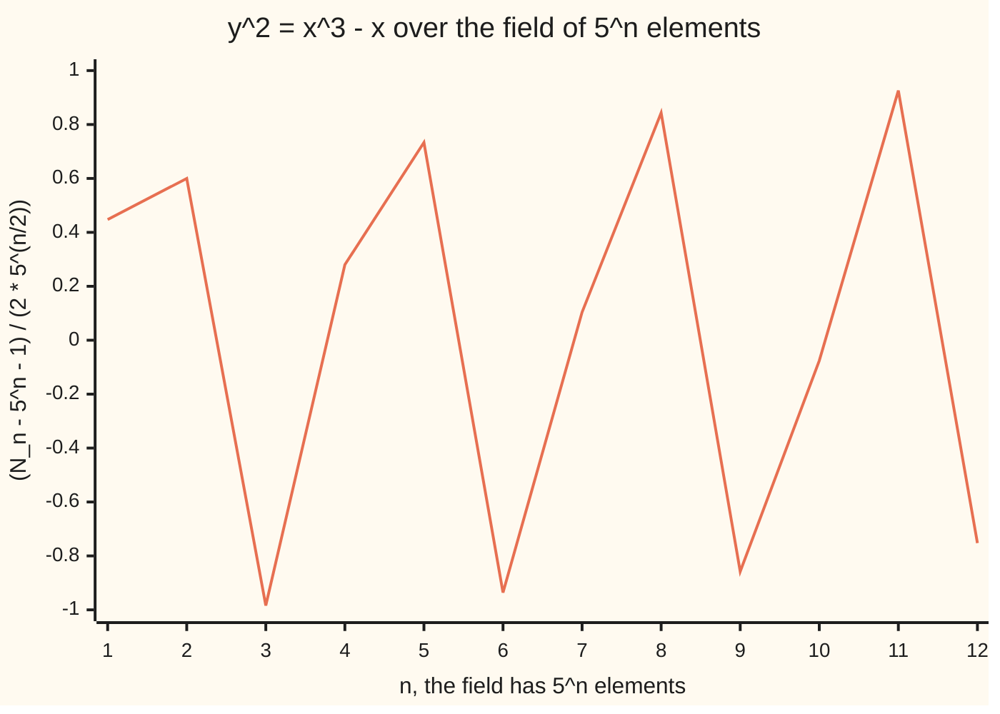

# The Weil conjectures: point counts over every F_(q^n) packed into one rational function, explained by etale cohomology

[Syllabus](../../../SYLLABUS.md) → [Algebraic geometry](../README.md) → [Sheaf Cohomology and Differentials](../README.md#s08) → The Weil conjectures

---

## General Overview

Take the curve $`y^2 = x^3 - x`$ and read every number mod 5. For x = 0 to 4, the right side $`x^3 - x`$ is 0, 0, 1, 4, 0. The squares mod 5 are 0, 1 and 4, so every x gives points.

- x = 0, 1 and 4 give one point each, with y = 0.
- x = 2 gives y = 1 or 4; x = 3 gives y = 2 or 3.

That is 7 points, plus the point at infinity O from [The curve mod p](../04-Elliptic%20Curves/05-reduction-mod-p-and-hasse.md): **8 points** over the field of 5 elements.

Count again over the fields of 25, 125 and 625 elements, and a computer finds 32, 104 and 640. The single count 8 predicts all three, and every count after them. The tool is the **zeta function** of the curve, one function that holds every count at once:

```math
Z(t) = \frac{1 + 2t + 5t^2}{(1 - t)(1 - 5t)}
```

The top line is fixed by the count 8. Its roots all have the same size, $`1/\sqrt 5`$. That single fact keeps every count close to $`5^n + 1`$.

André Weil proved this for every curve in 1948. In 1949 he conjectured the same shape for every smooth variety over a finite field, of any dimension. Proving it took a new kind of cohomology, **étale cohomology**: a way to count a variety's holes that still works over a finite field. Grothendieck and his school built it for this purpose. Deligne finished the proof in 1974.

**The point counts of a smooth projective variety over the fields of q, q², q³, … elements fit into one ratio of polynomials, Z(t), whose factors match the variety's holes and whose roots all sit at fixed sizes, because each count is a trace of one map, Frobenius (raise every coordinate to the power q), acting on étale cohomology.**

**What kind of fact this is:** theorems. For projective space they are proved on this card in Why it works. For curves of genus 1 they follow on this card from two facts that [The curve mod p](../04-Elliptic%20Curves/05-reduction-mod-p-and-hasse.md) quotes, with Silverman's book as source: Hasse's bound, and the formula for the count over every larger field. For curves of any genus they are Weil's theorem (1948), stated with key steps and sources. For all smooth projective varieties they are theorems of Dwork, Grothendieck and Deligne (1960 to 1974), stated in outline. The code checks every number on the card exactly; that is evidence for the general statements, not proof.

### The picture: the error over each field, divided by its allowance



The one line is the gap between the count $`N_n`$ and $`5^n + 1`$, divided by $`2 \cdot 5^{n/2}`$. It never leaves the band from −1 to 1. Over the field of $`5^{12}`$ elements the count is 244,117,120, and the gap is still within its allowance. The values are $`-\cos(n\theta)`$ for one fixed angle θ = 116.5651 degrees: a point turning round a circle, seen from the side.

---

## The formula

Notation first, in words. $`\mathbb{F}_q`$ is the field with q elements, here q = 5. $`\mathbb{F}_{q^n}`$ is the larger field with $`q^n`$ elements; it contains $`\mathbb{F}_q`$ ([Finite fields](../../21-Algebraic%20and%20analytic%20number%20theory/05-Fields%20and%20Galois%20Theory/09-finite-fields-and-frobenius.md)). $`N_n`$ is the number of points of the variety X with coordinates in $`\mathbb{F}_{q^n}`$, points at infinity included. The **zeta function** of X is

```math
Z(t) = \exp\left(\sum_{n \ge 1} N_n \frac{t^n}{n}\right)
```

**Read it aloud:** Z of t is e to the power of the sum, over every n, of the n-th count times t to the n over n.

Here t is a placeholder: Z(t) is a power series whose coefficients carry the counts. The division by n is what makes the answer a ratio of polynomials. For a smooth projective variety of dimension d, the **Weil conjectures**, now theorems, say:

```math
Z(t) = \frac{P_1(t)\,P_3(t) \cdots P_{2d-1}(t)}{P_0(t)\,P_2(t) \cdots P_{2d}(t)}, \qquad P_i(t) = \prod_{j=1}^{b_i} (1 - \alpha_{ij} t), \qquad \lvert \alpha_{ij} \rvert = q^{i/2}
```

**Read it aloud:** Z is a ratio of polynomials, odd-numbered ones on top; the i-th has $`b_i`$ factors, and each of its reciprocal roots has size q to the i over 2.

Four statements live in that line and the next.

1. **Rationality.** Z(t) is a ratio of polynomials with integer coefficients.
2. **Riemann hypothesis.** Every reciprocal root $`\alpha_{ij}`$ of $`P_i`$ (a number whose inverse is a root of $`P_i`$) has size exactly $`q^{i/2}`$.
3. **Betti numbers.** The degree $`b_i`$ of $`P_i`$ is the i-th Betti number of the variety, the number of independent i-dimensional holes of its complex version, when it has one (Step 5) ([Cohomology of projective space](../05-Cohomology%20and%20the%20Hodge%20Conjecture/03-cohomology-of-projective-space.md)).
4. **Functional equation.** Z is symmetric under swapping t and $`1/(q^d t)`$:

```math
Z\left(\frac{1}{q^d t}\right) = \pm\, q^{d\chi/2}\, t^{\chi}\, Z(t), \qquad \chi = \sum_i (-1)^i b_i
```

**Read it aloud:** Z at one over q to the d times t equals plus or minus q to the d chi over 2, times t to the chi, times Z at t, where chi is the alternating sum of the Betti numbers.

For a curve (d = 1) of genus g, the holes are $`b_0 = 1`$, $`b_1 = 2g`$, $`b_2 = 1`$, so everything becomes concrete:

```math
Z(t) = \frac{P_1(t)}{(1 - t)(1 - qt)}, \qquad N_n = q^n + 1 - \sum_{j=1}^{2g} \alpha_j^n, \qquad \lvert N_n - q^n - 1 \rvert \le 2g\, q^{n/2}
```

**Read it aloud:** for a curve, Z is a polynomial of degree 2g over one minus t times one minus q t; each count is q to the n plus one, minus the n-th powers of the 2g reciprocal roots, so it strays at most 2g times q to the n over 2.

For $`y^2 = x^3 - x`$ over $`\mathbb{F}_5`$, g = 1, $`P_1(t) = 1 + 2t + 5t^2`$, and the reciprocal roots are $`-1 \pm 2i`$, each of size $`\sqrt 5`$.

| Symbol | Plain meaning | In our example | Push it up and the answer… |
| --- | --- | --- | --- |
| $`q`$, $`\mathbb{F}_{q^n}`$ | the size of the base field; the larger field of $`q^n`$ elements | 5; $`\mathbb{F}_{25}`$ at n = 2 | counts grow like $`q^{dn}`$ |
| $`X`$, $`d`$ | the variety; its dimension | the curve, d = 1 | more factors $`P_i`$ |
| $`N_n`$ | points over $`\mathbb{F}_{q^n}`$, O included | 8, 32, 104, 640 | — |
| $`t`$, $`Z(t)`$ | a placeholder variable; the zeta function | $`(1 + 2t + 5t^2)/((1 - t)(1 - 5t))`$ | — |
| $`a`$ | the trace: $`q + 1 - N_1`$, as in the mod-p card | −2 | $`N_1`$ falls |
| $`P_i(t)`$ | the i-th factor of Z, a polynomial with constant term 1 | $`P_1 = 1 + 2t + 5t^2`$ | — |
| $`\alpha_{ij}`$ (on a curve $`\alpha`$, $`\beta`$) | the reciprocal roots of $`P_i`$: the numbers whose inverses are its roots | $`-1 \pm 2i`$ | larger swings in $`N_n`$ |
| $`g`$ | the genus: the number of holes of the complex curve | 1; and 2 for $`y^2 = x^5 + x + 1`$ | wider allowance $`2g\,q^{n/2}`$ |
| $`b_i`$, $`\chi`$ | Betti numbers, the degree of $`P_i`$; their alternating sum | 1, 2, 1; χ = 0 | — |
| $`\theta`$, $`e_n`$ | the angle of α; the gap over its allowance | 116.5651 degrees; the chart | — |
| $`F`$, $`\ell`$ | the Frobenius map, raising coordinates to the power q; a prime other than the field's | — | — |
| $`H^i(\bar X, \mathbb{Q}_\ell)`$ | étale cohomology in degree i, a vector space of dimension $`b_i`$ (Step 4); $`\bar X`$ is the same variety over the algebraic closure of $`\mathbb{F}_q`$ (the field holding every $`\mathbb{F}_{q^n}`$ at once), where Frobenius acts; $`\mathbb{Q}_\ell`$ is the ℓ-adic numbers | dimension 2 at i = 1 | — |

### When it holds

- **The variety is smooth.** The nodal cubic $`y^2 = x^3 + x^2`$ has 5 points over $`\mathbb{F}_5`$ and 25 over $`\mathbb{F}_{25}`$. The genus-1 rule predicts 35 for the second count, and the functional equation fails.
- **The variety is projective: its points at infinity are counted.** Leave out O and the count 7 predicts 35 points over $`\mathbb{F}_{25}`$, not 32.
- **The counts are over fields.** The integers mod 25 are not the field $`\mathbb{F}_{25}`$: 5 has no inverse there. Counting $`y^2 = x^3 - x`$ mod 25 gives 36, a number with no place in Z.
- **One base field throughout.** The counts are over $`\mathbb{F}_q, \mathbb{F}_{q^2}, \mathbb{F}_{q^3}, \dots`$, each inside the next. Counts mod 5 and mod 7 do not form one zeta function.

---

## Why it works

### Step 0: a count that is a sum of powers gives a ratio of polynomials

The whole result rests on one identity from calculus:

```math
\exp\left(\sum_{n \ge 1} \alpha^n \frac{t^n}{n}\right) = \frac{1}{1 - \alpha t}
```

**Read it aloud:** e to the sum of alpha to the n, t to the n, over n, is one over one minus alpha t.

The sum inside is $`-\ln(1 - \alpha t)`$, so the exponential undoes the logarithm. Now suppose every count has the shape "plus some powers, minus some others": $`N_n = \sum \beta^n - \sum \alpha^n`$. Then Z(t) is a product of factors $`1/(1 - \beta t)`$ and $`(1 - \alpha t)`$: a ratio of polynomials.

Such sums of powers come from linear algebra. If a matrix M has eigenvalues $`\alpha_1, \dots, \alpha_b`$, the trace of $`M^n`$ is $`\alpha_1^n + \dots + \alpha_b^n`$. So the plan is to make each count a trace of the n-th power of one fixed map. That map is Frobenius, F, which raises every coordinate to the power q. Its fixed points after n steps are exactly the points with coordinates in $`\mathbb{F}_{q^n}`$, since $`x^{q^n} = x`$ picks out that field.

### Step 1: projective space, proved

A point of $`\mathbb{P}^2`$ is a nonzero triple (x : y : z) up to scaling. Over $`\mathbb{F}_5`$ the nonzero triples fall into classes of 4, one triple for each nonzero scale, and the code finds 31 classes. In general, normalise the first nonzero coordinate to 1:

- $`(1 : y : z)`$ gives $`q^2`$ points; $`(0 : 1 : z)`$ gives $`q`$; $`(0 : 0 : 1)`$ gives 1.

So $`N_n = 1 + q^n + q^{2n}`$: 31, 651, 15,751 and 391,251 for n = 1 to 4. That is a sum of powers of 1, q and $`q^2`$, so by Step 0

```math
Z_{\mathbb{P}^2}(t) = \frac{1}{(1 - t)(1 - 5t)(1 - 25t)}
```

**Read it aloud:** one over the product of one minus t, one minus 5 t and one minus 25 t.

All four statements hold. There are no odd factors, and $`b_0 = b_2 = b_4 = 1`$: the Betti numbers 1, 0, 1, 0, 1 of the projective plane. The reciprocal roots 1, 5, 25 have sizes $`5^{0/2}`$, $`5^{2/2}`$, $`5^{4/2}`$. With d = 2 and χ = 3, the functional equation reads $`Z(1/(25t)) = -125\,t^3 Z(t)`$; at t = 2 both sides are 1000/441. The same argument gives $`1/((1 - t)(1 - qt) \cdots (1 - q^d t))`$ for $`\mathbb{P}^d`$.

### Step 2: curves of genus 1, from two quoted facts about Frobenius

[The curve mod p](../04-Elliptic%20Curves/05-reduction-mod-p-and-hasse.md) states, with Silverman as source, that Frobenius on an elliptic curve obeys $`F^2 - aF + q = 0`$, and that over $`\mathbb{F}_{q^n}`$ the count is $`q^n + 1 - \alpha^n - \beta^n`$, where α and β are the roots of $`T^2 - aT + q`$. Take that as given.

1. **Rationality.** The count is $`1^n + q^n - \alpha^n - \beta^n`$, a signed sum of powers. Step 0 gives $`Z(t) = (1 - \alpha t)(1 - \beta t)/((1 - t)(1 - qt))`$, and $`(1 - \alpha t)(1 - \beta t) = 1 - at + qt^2`$.
2. **Riemann hypothesis.** Hasse's theorem says $`a^2 \le 4q`$. Then α and β are complex conjugates, or one repeated real number, so each has size $`\sqrt{\alpha\beta} = \sqrt q`$.
3. **Functional equation.** It follows from $`\alpha\beta = q`$ alone; the fold does the algebra.

With a = −2 and q = 5: $`a^2 = 4 \le 20`$, the roots are $`-1 \pm 2i`$, and $`(-1)^2 + 2^2 = 5`$. At t = 2, Z(t) and $`Z(1/(5t))`$ are both 25/9; at t = 1/3 both are −5. Writing $`\alpha = \sqrt 5\,(\cos\theta + i\sin\theta)`$ gives $`\alpha^n + \beta^n = 2 \cdot 5^{n/2}\cos(n\theta)`$: the chart's $`-\cos(n\theta)`$.

Why the name: substitute $`t = q^{-s}`$, as in Riemann's zeta function. Roots of size $`q^{-1/2}`$ then sit exactly where the real part of s is 1/2, the line of [Zeta's zeros and the primes](../../07-Complex%20analysis/09-Special%20Functions%20and%20the%20Zeta%20Function/09-zeros-of-zeta-and-the-primes.md).

<details>
<summary>The functional equation for a genus-1 curve, line by line</summary>

Put $`s = 1/(qt)`$ into each factor and clear the fractions.

$`\displaystyle 1 - as + qs^2 = \frac{qt^2 - at + 1}{qt^2}, \qquad (1 - s)(1 - qs) = \frac{(qt - 1)(t - 1)}{qt^2}`$

The $`qt^2`$ cancels. The top is $`1 - at + qt^2`$ again, and the bottom is $`(1 - t)(1 - qt)`$ again, so $`Z(1/(qt)) = Z(t)`$. That matches the general rule, since χ = 1 − 2 + 1 = 0.

For a genus-g curve the same cancellation needs the top polynomial to be "self-reciprocal": its coefficients satisfy $`c_{2g-i} = q^{g-i} c_i`$. Then $`Z(1/(qt)) = q^{1-g} t^{2-2g} Z(t)`$.

</details>

### Step 3: curves of every genus (Weil, 1948)

For a curve of genus g, Weil proved all four statements. Key steps:

- **Rationality and the functional equation.** Z(t) also counts effective divisors: the coefficient of $`t^m`$ is the number of unordered lists of m points, repeats allowed, with coordinates in any larger field, that Frobenius maps to themselves as a list. Riemann–Roch counts these lists in each divisor class ([Serre duality](06-serre-duality-and-riemann-roch.md)). For degree above $`2g - 2`$ the count is a geometric series, and that forces $`Z(t) = P_1(t)/((1 - t)(1 - qt))`$ with $`P_1`$ of degree 2g. The duality $`D \to K - D`$ gives the functional equation.
- **The Riemann hypothesis.** Weil works on the surface $`C \times C`$, or on the Jacobian of C, and shows a quadratic form is never negative, as in Hasse's proof. Sources give it in full.

A genus-2 check, from [The Jacobian](../03-Plane%20Curves/11-jacobians-and-abel-jacobi.md): $`y^2 = x^5 + x + 1`$ over $`\mathbb{F}_5`$ has 6 and 46 points over $`\mathbb{F}_5`$ and $`\mathbb{F}_{25}`$. These fix the first half of $`P_1`$, and the symmetry rule fixes the rest: $`P_1(t) = 1 + 10t^2 + 25t^4 = (1 + 5t^2)^2`$. The reciprocal roots are $`\pm i\sqrt 5`$, each twice, all of size $`\sqrt 5`$. The formula predicts 126 and 526 points over $`\mathbb{F}_{125}`$ and $`\mathbb{F}_{625}`$; brute force agrees. The functional equation at t = 1/2 gives the ratio $`Z(1/(5t))/Z(t) = 4/5`$, which is $`1/(5t^2)`$.

### Step 4: why ordinary cohomology cannot do it

Step 0 needs vector spaces on which Frobenius acts, with dimensions equal to the Betti numbers: dimension 2 in the middle for a genus-1 curve. The first candidate is [Sheaf cohomology](05-sheaf-cohomology-as-a-derived-functor.md) with constant coefficients. It fails.

In the Zariski topology on an irreducible variety, any two nonempty open sets meet. So a section of a constant sheaf on an open set, one constant value, extends to the whole space. A sheaf whose sections always extend has no higher cohomology (Hartshorne, Chapter III). So the Zariski $`H^1`$ of a curve is zero, not dimension 2g: the open sets are too large to see the holes.

Grothendieck's fix is to replace open subsets by étale maps $`U \to X`$ ([Flat, smooth and etale](03-flat-smooth-and-etale-morphisms.md)). An étale map is a local isomorphism in the algebraic sense, like a covering space in topology. Covering spaces detect holes: the line covers the circle, wound round infinitely often. Sheaf cohomology computed with étale "open sets" is **étale cohomology**.

The coefficients are $`\mathbb{Q}_\ell`$, the ℓ-adic numbers for a prime ℓ other than the field's characteristic. They are built from remainders mod ℓ, ℓ², ℓ³, … all at once, and form a field of characteristic 0, like the rationals. For an elliptic curve, $`H^1`$ is built from the points of order ℓ, ℓ², ℓ³, …. The $`\ell^2`$ points of order dividing ℓ form a 2-dimensional space, and Frobenius acts on it by a 2 × 2 matrix with trace a and determinant q, mod ℓ. Schoof's method in [Curves for keys](../04-Elliptic%20Curves/09-elliptic-curve-cryptography-and-schoof.md) counts points with exactly this matrix.

### Step 5: Grothendieck's machine and Deligne's proof

With étale cohomology in hand, each statement has a source.

| Statement | Where it comes from | Who, when |
| --- | --- | --- |
| Rationality | the Lefschetz trace formula: $`N_n = \sum_i (-1)^i\, \mathrm{tr}(F^n \mid H^i)`$, then Step 0 | Dwork 1960 by p-adic analysis; Grothendieck 1964 by étale cohomology |
| Functional equation | Poincaré duality pairs $`H^i`$ with $`H^{2d-i}`$, so α pairs with $`q^d/\alpha`$ | Grothendieck, 1964 |
| Betti numbers | a comparison theorem: for a variety lifted from characteristic 0, $`\dim H^i`$ equals the complex Betti number | Artin and Grothendieck, 1960s |
| Riemann hypothesis | every eigenvalue of F on $`H^i`$ has size $`q^{i/2}`$ | Deligne, 1974 |

The Lefschetz formula is the topological rule "fixed points equal the alternating sum of traces", carried over to étale cohomology. Then $`P_i(t) = \det(1 - tF \mid H^i)`$, so $`\deg P_i = \dim H^i = b_i`$. The degrees for this card's three examples, as the code prints them:

```
deg P_i = b_i, the Betti numbers, read off Z(t)

y^2 = x^3 - x      b_0  #          1
                   b_1  ##         2
                   b_2  #          1
y^2 = x^5 + x + 1  b_0  #          1
                   b_1  ####       4
                   b_2  #          1
the plane P^2      b_0  #          1
                   b_1             0
                   b_2  #          1
                   b_3             0
                   b_4  #          1
```

Deligne's proof is far too long for a card. It has three steps (Deligne 1974, Sources).

1. Fit the variety into a family of varieties along a line, a Lefschetz pencil.
2. Study how Frobenius acts on the cohomology of the whole family.
3. Bound the eigenvalues of high powers of that action, with Rankin's trick from the theory of modular forms. A bound that holds for every power k of an eigenvalue squeezes its size to exactly $`q^{i/2}`$.

---

## Worked numbers, by hand

| Step | Arithmetic | Value |
| --- | --- | --- |
| $`x^3 - x`$ mod 5, x = 0 to 4 | 0, 0, 6, 24, 60 reduced | 0, 0, 1, 4, 0 |
| squares mod 5 | $`0^2, 1^2, 2^2, 3^2, 4^2`$ | 0, 1, 4 |
| points per x | 1, 1, 2, 2, 1 | 7 |
| add O | 7 + 1 | $`N_1 = 8`$ |
| trace | 5 + 1 − 8 | a = −2 |
| numerator | $`1 - at + qt^2`$ | $`1 + 2t + 5t^2`$ |
| reciprocal roots | $`(a \pm \sqrt{a^2 - 4q})/2 = (-2 \pm \sqrt{-16})/2`$ | $`-1 \pm 2i`$, size² 5 |
| roots in t | $`(-1 \mp 2i)/5`$ | size 0.447214 |
| $`\alpha^2 + \beta^2`$ | $`a^2 - 2q = 4 - 10`$ | −6 |
| count over $`\mathbb{F}_{25}`$ | 25 + 1 − (−6) | **32** |

The single count 8 over $`\mathbb{F}_5`$ fixes the zeta function, and the zeta function then says 32 over $`\mathbb{F}_{25}`$: brute force over all 25 values of x agrees, and so do 104 and 640 further up.

### What breaks if you drop a piece

| Mistake | Comes out at | What went wrong |
| --- | --- | --- |
| Leave out O | a = −1, predicts 35 over $`\mathbb{F}_{25}`$ | the variety must be projective; the count 7 is not $`N_1`$ |
| Use $`\alpha^2 + \beta^2 = a^2`$ | 22 over $`\mathbb{F}_{25}`$ | $`(\alpha + \beta)^2 = \alpha^2 + 2\alpha\beta + \beta^2`$, and $`\alpha\beta = q`$ |
| Count mod 25 instead of over $`\mathbb{F}_{25}`$ | 36 points | the integers mod 25 are a ring, not a field |
| Apply the curve rule to the nodal cubic $`y^2 = x^3 + x^2`$ | predicts 35, counted 25; Z(2) = −1/9 but Z(1/10) = 2 | not smooth: its zeta is $`1/(1 - 5t)`$, with no symmetry |

The code prints all four.

---

## Code, from first principles, and it actually runs

The program builds the fields $`\mathbb{F}_{5^k}`$, k = 1 to 4, as polynomials modulo an irreducible one found by trial division, and counts points with Euler's square test on every x. Three roads must agree.

1. Brute-force counts over $`\mathbb{F}_{25}`$, $`\mathbb{F}_{125}`$ and $`\mathbb{F}_{625}`$, against the counts read back from the rational function built from the first count alone (two counts for genus 2).
2. For $`\mathbb{P}^2`$, the zeta series expanded from the counts in exact fractions, against the product formula; the first count also comes from grouping triples.
3. The functional equations at exact fractions and the Riemann hypothesis as an exact integer test. For the curves these use P(t) read straight from the brute-force counts, with no symmetry imposed: two counts for genus 1, all four for genus 2. Then the degrees $`\deg P_i = b_i`$, and the chart's values against $`-\cos(n\theta)`$.

### Python

```python
# The Weil conjectures -- the check behind the card.  The curve y^2 = x^3 - x
# over F_5, a genus-2 curve, the projective plane and a singular cubic.  Point
# counts over F_(5^n) are made by brute force in fields built here; the zeta
# function Z(t) = exp(sum N_n t^n / n) is expanded in exact fractions and set
# against the rational function the Weil conjectures predict.
from fractions import Fraction as Fr
from itertools import product
from math import atan2, cos

def pmod(a, m, p):                           # remainder of a by the monic m, mod p
    a = a[:]
    for i in range(len(a) - 1, len(m) - 2, -1):
        c = a[i] % p
        for j in range(len(m)):
            a[i - len(m) + 1 + j] -= c * m[j]
    return [x % p for x in a[:len(m) - 1]]

def monics(p, d):                            # every monic polynomial of degree d
    return [[(n // p ** i) % p for i in range(d)] + [1] for n in range(p ** d)]

def modulus(p, k):                           # a monic of degree k with no factor of degree <= k/2
    return next(m for m in monics(p, k) if all(any(pmod(m, g, p))
                for d in range(1, k // 2 + 1) for g in monics(p, d)))

def mul(a, b, m, p):                         # multiply two elements of F_(p^k)
    c = [0] * (2 * len(a) - 1)
    for i, x in enumerate(a):
        for j, y in enumerate(b):
            c[i + j] += x * y
    return pmod(c, m, p)

def power(a, e, m, p):
    out = [1] + [0] * (len(a) - 1)
    while e:
        if e & 1:
            out = mul(out, a, m, p)
        a, e = mul(a, a, m, p), e >> 1
    return out

def count(f, p, k):                          # points of y^2 = f(x) over F_(p^k), one at infinity
    m, Q = modulus(p, k), p ** k
    one, total = [1] + [0] * (k - 1), 1
    for n in range(Q):
        x, v = [(n // p ** i) % p for i in range(k)], [0] * k
        for c in f:                          # Horner, coefficients leading term first
            v = mul(v, x, m, p)
            v[0] = (v[0] + c) % p
        total += 1 if not any(v) else (2 if power(v, (Q - 1) // 2, m, p) == one else 0)
    return total

def zeta_from_counts(N):                     # n z_n = sum_k N_k z_(n-k), from Z' = Z (log Z)'
    z = [Fr(1)]
    for n in range(1, len(N) + 1):
        z.append(sum(N[k - 1] * z[n - k] for k in range(1, n + 1)) / n)
    return z

def counts_from_zeta(z):                     # the same identity, solved for N_n
    N = []
    for n in range(1, len(z)):
        N.append(n * z[n] - sum(N[k - 1] * z[n - k] for k in range(1, n)))
    return N

def expand(num, roots, n):                   # num(t) / prod (1 - r t), terms t^0 .. t^n
    s = [Fr(c) for c in (num + [0] * (n + 1))[:n + 1]]
    for r in roots:
        for i in range(1, n + 1):
            s[i] += r * s[i - 1]
    return s

def numerator(z, q, g):                      # P(t) = Z(t)(1 - t)(1 - qt): g terms, then symmetry
    w = [z[i] - (1 + q) * (z[i - 1] if i else 0) + q * (z[i - 2] if i > 1 else 0) for i in range(g + 1)]
    return w + [q ** (g - i) * w[i] for i in range(g - 1, -1, -1)]          # exact fractions, no rounding

def Z(num, roots, t):                        # the rational function at a fraction t
    out = sum(c * t ** i for i, c in enumerate(num))
    for r in roots:
        out /= 1 - r * t
    return out

poly = lambda c: " + ".join(f"{x}t^{i}" if i else str(x) for i, x in enumerate(c) if x).replace("t^1 ", "t ")
bet = lambda num, roots, d: [max(i for i, c in enumerate(num) if c) if i % 2 else roots.count(q ** (i // 2)) for i in range(2 * d + 1)]

q, K = 5, 4
NE = [count([1, 0, -1, 0], q, k) for k in range(1, K + 1)]         # y^2 = x^3 - x, by brute force
a = q + 1 - NE[0]
PE = numerator(zeta_from_counts(NE[:1]), q, 1)                    # P(t) from the one count over F_5
FE = numerator(zeta_from_counts(NE[:2]), q, 2)[:3]                # P(t) read from two counts, no symmetry imposed
predE = [int(c) for c in counts_from_zeta(expand(PE, [1, q], K))]
im = next(s for s in range(q) if 4 * s * s == 4 * q - a * a)      # alpha = a/2 +- i s
print(f"y^2 = x^3 - x, counted over F_5, F_25, F_125, F_625: {NE}")
print(f"over F_5, x^3 - x for x = 0..4: {[(x ** 3 - x) % q for x in range(q)]}; squares mod 5: {sorted({y * y % q for y in range(q)})}")
print(f"a = 5 + 1 - {NE[0]} = {a}; P(t) = {poly(PE)}; Z(t) = P(t) / ((1 - t)(1 - 5t))")
print(f"counts predicted from F_5 alone: {predE}")
print(f"F_25 by hand: 25 + 1 - (a^2 - 2q) = 26 - ({a * a} - 10) = {26 - (a * a - 10)}")
print(f"reciprocal roots {a // 2} +- {im}i, size^2 {(a // 2) ** 2 + im * im}; roots of P: t = ({a // 2} -+ {im}i)/{q}, size {q ** -0.5:.6f}")
s = [2, a]                                                        # s_n = alpha^n + beta^n
for n in range(2, 13):
    s.append(a * s[-1] - q * s[-2])
e = [-s[n] / (2 * q ** (n / 2)) for n in range(1, 13)]           # error over its allowance
th = atan2(im, a / 2)
print("chart, (N_n - 5^n - 1)/(2 * 5^(n/2)), n = 1..12: " + ", ".join(f"{x:.4f}" for x in e))
print(f"N_12 = {q ** 12 + 1 - s[12]}; largest |error/allowance| {max(abs(x) for x in e):.4f}; angle of alpha {th * 57.29577951308232:.4f} degrees")
for t in (Fr(2), Fr(1, 3)):
    print(f"functional equation, t = {t}: Z(t) = {Z(FE, [1, q], t)}, Z(1/(5t)) = {Z(FE, [1, q], 1 / (q * t))}")
N2 = [count([1, 0, 0, 0, 1, 1], q, k) for k in range(1, K + 1)]  # y^2 = x^5 + x + 1, genus 2
P2 = numerator(zeta_from_counts(N2[:2]), q, 2)
pred2 = [int(c) for c in counts_from_zeta(expand(P2, [1, q], K))]
sq = [sum([1, 0, 5][j] * [1, 0, 5][i - j] for j in range(3) if 0 <= i - j < 3) for i in range(5)]
print(f"genus 2, y^2 = x^5 + x + 1: counted {N2}; P(t) = {poly(P2)}; (1 + 5t^2)^2 = {poly(sq)}")
print(f"genus 2 counts predicted from F_5 and F_25: {pred2}")
t0, F2 = Fr(1, 2), numerator(zeta_from_counts(N2), q, 4)[:5]   # P(t) from four counts, no symmetry imposed
r2 = Z(F2, [1, q], 1 / (q * t0)) / Z(F2, [1, q], t0)
print(f"genus 2 functional equation at t = 1/2: Z(1/(5t)) / Z(t) = {r2}; 1/(5t^2) = {1 / (q * t0 * t0)}")
NP = [1 + q ** n + q ** (2 * n) for n in range(1, K + 1)]
cls = len({min(tuple(l * c % q for c in v) for l in range(1, q))
           for v in product(range(q), repeat=3) if any(v)})          # lines through 0 in F_5^3
zP, eP = zeta_from_counts(NP), expand([1], [1, q, q * q], K)
print(f"P^2 over F_5: {cls} classes of nonzero triples; 1 + q^n + q^2n = {NP}")
print(f"P^2 zeta from counts {[int(c) for c in zP]}; 1/((1-t)(1-5t)(1-25t)) {[int(c) for c in eP]}")
lP, rP = Z([1], [1, q, q * q], Fr(1, 50)), -125 * 8 * Z([1], [1, q, q * q], Fr(2))
print(f"P^2 functional equation at t = 2: Z(1/(25t)) = {lP}, -125 t^3 Z(t) = {rP}")
print(f"deg P_i = b_i: genus 1 {bet(FE, [1, q], 1)}; genus 2 {bet(F2, [1, q], 1)}; P^2 {bet([1], [1, q, q * q], 2)}")
NS = [count([1, 1, 0, 0], q, k) for k in (1, 2)]                 # y^2 = x^3 + x^2, a node at (0, 0)
wS = int(counts_from_zeta(expand(numerator(zeta_from_counts(NS[:1]), q, 1), [1, q], 2))[1])   # the genus-1 rule
print(f"mistake, singular y^2 = x^3 + x^2: counted {NS}; smooth-curve rule predicts {wS} over F_25")
print(f"  its zeta is 1/(1 - 5t): Z(2) = {Z([1], [q], Fr(2))}, Z(1/10) = {Z([1], [q], Fr(1, 10))}")
NO = NE[0] - 1                                                    # forgetting O
print(f"mistake, O left out: a = 5 + 1 - {NO} = {q + 1 - NO}, F_25 predicted {26 - ((q + 1 - NO) ** 2 - 2 * q)}")
print(f"mistake, alpha^2 + beta^2 read as a^2: F_25 predicted {26 - a * a}")
z25 = 1 + sum(1 for x in range(25) for y in range(25) if (y * y - x ** 3 + x) % 25 == 0)
print(f"mistake, integers mod 25 for F_25: {z25} points")
assert NE == predE == [8, 32, 104, 640]                          # rationality: one count fixes all
assert N2 == pred2 and P2 == sq                                  # genus 2: two counts fix all
assert a * a < 4 * q and FE[2] == q                              # Riemann hypothesis, genus 1: alpha beta = q
assert all(abs(x + cos((n + 1) * th)) < 1e-12 for n, x in enumerate(e)) and max(map(abs, e)) <= 1
assert all(Z(FE, [1, q], t) == Z(FE, [1, q], 1 / (q * t)) for t in (Fr(2), Fr(1, 3)))
assert r2 == 1 / (q * t0 * t0) and lP == rP                      # functional equations
assert cls == NP[0] and zP == eP                                 # P^2: brute count, and the product
assert NS[1] != wS and z25 != NE[1]                              # the singular curve and Z/25 fail
print("ALL CHECKS PASS")
```

**Ran 2026-11-24 on macOS, Python 3.14.10, standard library only. All checks passed. Output, pasted from the run:**

```
y^2 = x^3 - x, counted over F_5, F_25, F_125, F_625: [8, 32, 104, 640]
over F_5, x^3 - x for x = 0..4: [0, 0, 1, 4, 0]; squares mod 5: [0, 1, 4]
a = 5 + 1 - 8 = -2; P(t) = 1 + 2t + 5t^2; Z(t) = P(t) / ((1 - t)(1 - 5t))
counts predicted from F_5 alone: [8, 32, 104, 640]
F_25 by hand: 25 + 1 - (a^2 - 2q) = 26 - (4 - 10) = 32
reciprocal roots -1 +- 2i, size^2 5; roots of P: t = (-1 -+ 2i)/5, size 0.447214
chart, (N_n - 5^n - 1)/(2 * 5^(n/2)), n = 1..12: 0.4472, 0.6000, -0.9839, 0.2800, 0.7334, -0.9360, 0.1038, 0.8432, -0.8579, -0.0758, 0.9258, -0.7522
N_12 = 244117120; largest |error/allowance| 0.9839; angle of alpha 116.5651 degrees
functional equation, t = 2: Z(t) = 25/9, Z(1/(5t)) = 25/9
functional equation, t = 1/3: Z(t) = -5, Z(1/(5t)) = -5
genus 2, y^2 = x^5 + x + 1: counted [6, 46, 126, 526]; P(t) = 1 + 10t^2 + 25t^4; (1 + 5t^2)^2 = 1 + 10t^2 + 25t^4
genus 2 counts predicted from F_5 and F_25: [6, 46, 126, 526]
genus 2 functional equation at t = 1/2: Z(1/(5t)) / Z(t) = 4/5; 1/(5t^2) = 4/5
P^2 over F_5: 31 classes of nonzero triples; 1 + q^n + q^2n = [31, 651, 15751, 391251]
P^2 zeta from counts [1, 31, 806, 20306, 508431]; 1/((1-t)(1-5t)(1-25t)) [1, 31, 806, 20306, 508431]
P^2 functional equation at t = 2: Z(1/(25t)) = 1000/441, -125 t^3 Z(t) = 1000/441
deg P_i = b_i: genus 1 [1, 2, 1]; genus 2 [1, 4, 1]; P^2 [1, 0, 1, 0, 1]
mistake, singular y^2 = x^3 + x^2: counted [5, 25]; smooth-curve rule predicts 35 over F_25
  its zeta is 1/(1 - 5t): Z(2) = -1/9, Z(1/10) = 2
mistake, O left out: a = 5 + 1 - 7 = -1, F_25 predicted 35
mistake, alpha^2 + beta^2 read as a^2: F_25 predicted 22
mistake, integers mod 25 for F_25: 36 points
ALL CHECKS PASS
```

### Rust

```rust
// The Weil conjectures -- the check behind the card, std only.  Same roads as the
// Python: brute-force counts over F_(5^n) for y^2 = x^3 - x, a genus-2 curve, the
// plane and a singular cubic, against the zeta function, in exact fractions.
use std::collections::HashSet;
use std::ops::{Add, Div, Mul, Sub};
#[derive(Clone, Copy, PartialEq, Debug)]
struct Fr(i128, i128);                                  // top / bottom, lowest terms, bottom > 0
fn gcd(a: i128, b: i128) -> i128 { if b == 0 { a.abs() } else { gcd(b, a % b) } }
fn fr(t: i128, d: i128) -> Fr { let g = gcd(t, d) * d.signum(); Fr(t / g, d / g) }
impl Add for Fr { type Output = Fr; fn add(self, o: Fr) -> Fr { fr(self.0.checked_mul(o.1).unwrap() + o.0.checked_mul(self.1).unwrap(), self.1.checked_mul(o.1).unwrap()) } }
impl Sub for Fr { type Output = Fr; fn sub(self, o: Fr) -> Fr { self + Fr(-o.0, o.1) } }
impl Mul for Fr { type Output = Fr; fn mul(self, o: Fr) -> Fr { fr(self.0.checked_mul(o.0).unwrap(), self.1.checked_mul(o.1).unwrap()) } }
impl Div for Fr { type Output = Fr; fn div(self, o: Fr) -> Fr { fr(self.0.checked_mul(o.1).unwrap(), self.1.checked_mul(o.0).unwrap()) } }
impl std::fmt::Display for Fr {
    fn fmt(&self, f: &mut std::fmt::Formatter) -> std::fmt::Result {
        if self.1 == 1 { write!(f, "{}", self.0) } else { write!(f, "{}/{}", self.0, self.1) }
    }
}
fn n(x: i64) -> Fr { Fr(x as i128, 1) }
fn pmod(a: &[i64], m: &[i64], p: i64) -> Vec<i64> {   // remainder of a by the monic m, mod p
    let mut a = a.to_vec();
    let (lm, mut i) = (m.len() as i64, a.len() as i64 - 1);
    while i > lm - 2 {
        let c = a[i as usize].rem_euclid(p);
        for j in 0..lm { a[(i - lm + 1 + j) as usize] -= c * m[j as usize]; }
        i -= 1;
    }
    a[..(lm - 1) as usize].iter().map(|x| x.rem_euclid(p)).collect()
}
fn monics(p: i64, d: u32) -> Vec<Vec<i64>> {            // every monic polynomial of degree d
    (0..p.pow(d)).map(|k| { let mut v: Vec<i64> = (0..d).map(|i| (k / p.pow(i)) % p).collect(); v.push(1); v }).collect()
}
fn modulus(p: i64, k: u32) -> Vec<i64> {                // no factor of degree <= k/2
    monics(p, k).into_iter().find(|m| (1..=k / 2).all(|d| monics(p, d).iter().all(|g| pmod(m, g, p).iter().any(|&x| x != 0)))).unwrap()
}
fn mul(a: &[i64], b: &[i64], m: &[i64], p: i64) -> Vec<i64> {
    let mut c = vec![0; 2 * a.len() - 1];
    for (i, x) in a.iter().enumerate() { for (j, y) in b.iter().enumerate() { c[i + j] += x * y; } }
    pmod(&c, m, p)
}
fn power(a: &[i64], mut e: i64, m: &[i64], p: i64) -> Vec<i64> {
    let (mut out, mut a) = (vec![0; a.len()], a.to_vec()); out[0] = 1;
    while e > 0 {
        if e & 1 == 1 { out = mul(&out, &a, m, p); }
        a = mul(&a, &a, m, p); e >>= 1;
    }
    out
}
fn count(f: &[i64], p: i64, k: u32) -> i64 {            // points of y^2 = f(x) over F_(p^k), one at infinity
    let (m, qq) = (modulus(p, k), p.pow(k));
    let (mut one, mut total) = (vec![0; k as usize], 1); one[0] = 1;
    for nn in 0..qq {
        let x: Vec<i64> = (0..k).map(|i| (nn / p.pow(i)) % p).collect();
        let mut v = vec![0; k as usize];
        for &c in f { v = mul(&v, &x, &m, p); v[0] = (v[0] + c).rem_euclid(p); }
        total += if v.iter().all(|&c| c == 0) { 1 } else if power(&v, (qq - 1) / 2, &m, p) == one { 2 } else { 0 };
    }
    total
}
fn zeta_from_counts(nc: &[i64]) -> Vec<Fr> {            // n z_n = sum_k N_k z_(n-k)
    let mut z = vec![n(1)];
    for k in 1..=nc.len() {
        let mut s = n(0);
        for j in 1..=k { s = s + n(nc[j - 1]) * z[k - j]; }
        z.push(s / n(k as i64));
    }
    z
}
fn counts_from_zeta(z: &[Fr]) -> Vec<i64> {             // the same identity, solved for N_n
    let mut out: Vec<Fr> = vec![];
    for k in 1..z.len() {
        let mut s = n(k as i64) * z[k];
        for j in 1..k { s = s - out[j - 1] * z[k - j]; }
        out.push(s);
    }
    out.iter().map(|c| { assert_eq!(c.1, 1); c.0 as i64 }).collect()
}
fn expand(num: &[i64], roots: &[i64], len: usize) -> Vec<Fr> {   // num(t) / prod (1 - r t)
    let mut s: Vec<Fr> = (0..=len).map(|i| n(*num.get(i).unwrap_or(&0))).collect();
    for &r in roots { for i in 1..=len { s[i] = s[i] + n(r) * s[i - 1]; } }
    s
}
fn numerator(z: &[Fr], q: i64, g: usize) -> Vec<i64> {  // P(t) = Z(t)(1 - t)(1 - qt): g terms, then symmetry
    let w: Vec<i64> = (0..=g).map(|i| {
        let mut c = z[i];
        if i >= 1 { c = c - n(1 + q) * z[i - 1]; }
        if i >= 2 { c = c + n(q) * z[i - 2]; }
        assert_eq!(c.1, 1); c.0 as i64 }).collect();                  // exact: a fraction here is a failure
    let mut out = w.clone(); for i in (0..g).rev() { out.push(q.pow((g - i) as u32) * w[i]); }
    out
}
fn zf(num: &[i64], roots: &[i64], t: Fr) -> Fr {        // the rational function at a fraction t
    let mut out = n(0); let mut tp = n(1);
    for &c in num { out = out + n(c) * tp; tp = tp * t; }
    for &r in roots { out = out / (n(1) - n(r) * t); }
    out
}
fn poly(c: &[i64]) -> String {
    let parts: Vec<String> = c.iter().enumerate().filter(|(_, &x)| x != 0)
        .map(|(i, x)| if i > 0 { format!("{}t^{}", x, i) } else { x.to_string() }).collect();
    parts.join(" + ").replace("t^1 ", "t ")
}
fn main() {
    let (q, kk) = (5i64, 4u32);
    let ne: Vec<i64> = (1..=kk).map(|k| count(&[1, 0, -1, 0], q, k)).collect();
    let a = q + 1 - ne[0];
    let pe = numerator(&zeta_from_counts(&ne[..1]), q, 1);
    let fe = numerator(&zeta_from_counts(&ne[..2]), q, 2)[..3].to_vec(); // P(t) read from two counts, no symmetry imposed
    let prede = counts_from_zeta(&expand(&pe, &[1, q], kk as usize));
    let im = (0..q).find(|s| 4 * s * s == 4 * q - a * a).unwrap();
    println!("y^2 = x^3 - x, counted over F_5, F_25, F_125, F_625: {:?}", ne);
    println!("over F_5, x^3 - x for x = 0..4: {:?}; squares mod 5: {:?}", (0..q).map(|x| (x * x * x - x).rem_euclid(q)).collect::<Vec<_>>(), { let mut v: Vec<i64> = (0..q).map(|y| y * y % q).collect(); v.sort(); v.dedup(); v });
    println!("a = 5 + 1 - {} = {}; P(t) = {}; Z(t) = P(t) / ((1 - t)(1 - 5t))", ne[0], a, poly(&pe));
    println!("counts predicted from F_5 alone: {:?}", prede);
    println!("F_25 by hand: 25 + 1 - (a^2 - 2q) = 26 - ({} - 10) = {}", a * a, 26 - (a * a - 10));
    println!("reciprocal roots {} +- {}i, size^2 {}; roots of P: t = ({} -+ {}i)/{}, size {:.6}", a / 2, im, (a / 2).pow(2) + im * im, a / 2, im, q, (q as f64).powf(-0.5));
    let mut s = vec![2i64, a];
    for _ in 2..=12 { let l = s.len(); s.push(a * s[l - 1] - q * s[l - 2]); }
    let e: Vec<f64> = (1..=12).map(|k| -(s[k] as f64) / (2.0 * (q as f64).powf(k as f64 / 2.0))).collect();
    let th = (im as f64).atan2(a as f64 / 2.0);
    println!("chart, (N_n - 5^n - 1)/(2 * 5^(n/2)), n = 1..12: {}", e.iter().map(|x| format!("{:.4}", x)).collect::<Vec<_>>().join(", "));
    let emax = e.iter().fold(0.0f64, |m, x| m.max(x.abs()));
    println!("N_12 = {}; largest |error/allowance| {:.4}; angle of alpha {:.4} degrees", q.pow(12) + 1 - s[12], emax, th * 57.29577951308232);
    for t in [n(2), fr(1, 3)] {
        println!("functional equation, t = {}: Z(t) = {}, Z(1/(5t)) = {}", t, zf(&fe, &[1, q], t), zf(&fe, &[1, q], n(1) / (n(q) * t)));
    }
    let n2: Vec<i64> = (1..=kk).map(|k| count(&[1, 0, 0, 0, 1, 1], q, k)).collect();
    let p2 = numerator(&zeta_from_counts(&n2[..2]), q, 2);
    let pred2 = counts_from_zeta(&expand(&p2, &[1, q], kk as usize));
    let b = [1i64, 0, 5];
    let sq: Vec<i64> = (0..5).map(|i: i64| (0..3).filter(|j| i - j >= 0 && i - j < 3).map(|j| b[j as usize] * b[(i - j) as usize]).sum()).collect();
    println!("genus 2, y^2 = x^5 + x + 1: counted {:?}; P(t) = {}; (1 + 5t^2)^2 = {}", n2, poly(&p2), poly(&sq));
    println!("genus 2 counts predicted from F_5 and F_25: {:?}", pred2);
    let (t0, f2) = (fr(1, 2), numerator(&zeta_from_counts(&n2), q, 4)[..5].to_vec()); // from four counts, no symmetry
    let r2 = zf(&f2, &[1, q], n(1) / (n(q) * t0)) / zf(&f2, &[1, q], t0);
    println!("genus 2 functional equation at t = 1/2: Z(1/(5t)) / Z(t) = {}; 1/(5t^2) = {}", r2, n(1) / (n(q) * t0 * t0));
    let np: Vec<i64> = (1..=kk).map(|k| 1 + q.pow(k) + q.pow(2 * k)).collect();
    let mut cls: HashSet<Vec<i64>> = HashSet::new();     // lines through 0 in F_5^3
    for v in 1..q.pow(3) {
        let w = [v % q, v / q % q, v / (q * q)];
        cls.insert((1..q).map(|l| w.iter().map(|c| l * c % q).collect::<Vec<i64>>()).min().unwrap());
    }
    let (zp, ep) = (zeta_from_counts(&np), expand(&[1], &[1, q, q * q], kk as usize));
    let ints = |v: &[Fr]| v.iter().map(|c| c.0 as i64).collect::<Vec<i64>>();
    println!("P^2 over F_5: {} classes of nonzero triples; 1 + q^n + q^2n = {:?}", cls.len(), np);
    println!("P^2 zeta from counts {:?}; 1/((1-t)(1-5t)(1-25t)) {:?}", ints(&zp), ints(&ep));
    let (lp, rp) = (zf(&[1], &[1, q, q * q], fr(1, 50)), n(-1000) * zf(&[1], &[1, q, q * q], n(2)));
    println!("P^2 functional equation at t = 2: Z(1/(25t)) = {}, -125 t^3 Z(t) = {}", lp, rp);
    let bet = |num: &[i64], roots: &[i64], d: u32| -> Vec<i64> { (0..=2 * d).map(|i| if i % 2 == 1 { num.iter().rposition(|&c| c != 0).unwrap() as i64 }
        else { roots.iter().filter(|&&r| r == q.pow(i / 2)).count() as i64 }).collect() };
    println!("deg P_i = b_i: genus 1 {:?}; genus 2 {:?}; P^2 {:?}", bet(&fe, &[1, q], 1), bet(&f2, &[1, q], 1), bet(&[1], &[1, q, q * q], 2));
    let ns: Vec<i64> = (1..=2).map(|k| count(&[1, 1, 0, 0], q, k)).collect();
    let ws = counts_from_zeta(&expand(&numerator(&zeta_from_counts(&ns[..1]), q, 1), &[1, q], 2))[1]; // the genus-1 rule
    println!("mistake, singular y^2 = x^3 + x^2: counted {:?}; smooth-curve rule predicts {} over F_25", ns, ws);
    println!("  its zeta is 1/(1 - 5t): Z(2) = {}, Z(1/10) = {}", zf(&[1], &[q], n(2)), zf(&[1], &[q], fr(1, 10)));
    let no = ne[0] - 1;
    println!("mistake, O left out: a = 5 + 1 - {} = {}, F_25 predicted {}", no, q + 1 - no, 26 - ((q + 1 - no).pow(2) - 2 * q));
    println!("mistake, alpha^2 + beta^2 read as a^2: F_25 predicted {}", 26 - a * a);
    let z25 = 1 + (0..25i64).map(|x| (0..25i64).filter(|y| (y * y - x * x * x + x).rem_euclid(25) == 0).count() as i64).sum::<i64>();
    println!("mistake, integers mod 25 for F_25: {} points", z25);
    assert!(ne == prede && ne == vec![8, 32, 104, 640]);             // rationality: one count fixes all
    assert!(n2 == pred2 && p2 == sq);                                // genus 2: two counts fix all
    assert!(a * a < 4 * q && fe[2] == q);                            // Riemann hypothesis, genus 1: alpha beta = q
    assert!(e.iter().enumerate().all(|(k, x)| (x + ((k + 1) as f64 * th).cos()).abs() < 1e-12) && emax <= 1.0);
    assert!([n(2), fr(1, 3)].iter().all(|&t| zf(&fe, &[1, q], t) == zf(&fe, &[1, q], n(1) / (n(q) * t))));
    assert!(r2 == n(1) / (n(q) * t0 * t0) && lp == rp);              // functional equations
    assert!(cls.len() as i64 == np[0] && zp == ep);                  // P^2: brute count, and the product
    assert!(ns[1] != ws && z25 != ne[1]);                            // the singular curve and Z/25 fail
    println!("ALL CHECKS PASS");
}
```

**Ran 2026-11-24 on macOS, rustc 1.98.1, no crates. All checks passed. Output, pasted from the run:**

```
y^2 = x^3 - x, counted over F_5, F_25, F_125, F_625: [8, 32, 104, 640]
over F_5, x^3 - x for x = 0..4: [0, 0, 1, 4, 0]; squares mod 5: [0, 1, 4]
a = 5 + 1 - 8 = -2; P(t) = 1 + 2t + 5t^2; Z(t) = P(t) / ((1 - t)(1 - 5t))
counts predicted from F_5 alone: [8, 32, 104, 640]
F_25 by hand: 25 + 1 - (a^2 - 2q) = 26 - (4 - 10) = 32
reciprocal roots -1 +- 2i, size^2 5; roots of P: t = (-1 -+ 2i)/5, size 0.447214
chart, (N_n - 5^n - 1)/(2 * 5^(n/2)), n = 1..12: 0.4472, 0.6000, -0.9839, 0.2800, 0.7334, -0.9360, 0.1038, 0.8432, -0.8579, -0.0758, 0.9258, -0.7522
N_12 = 244117120; largest |error/allowance| 0.9839; angle of alpha 116.5651 degrees
functional equation, t = 2: Z(t) = 25/9, Z(1/(5t)) = 25/9
functional equation, t = 1/3: Z(t) = -5, Z(1/(5t)) = -5
genus 2, y^2 = x^5 + x + 1: counted [6, 46, 126, 526]; P(t) = 1 + 10t^2 + 25t^4; (1 + 5t^2)^2 = 1 + 10t^2 + 25t^4
genus 2 counts predicted from F_5 and F_25: [6, 46, 126, 526]
genus 2 functional equation at t = 1/2: Z(1/(5t)) / Z(t) = 4/5; 1/(5t^2) = 4/5
P^2 over F_5: 31 classes of nonzero triples; 1 + q^n + q^2n = [31, 651, 15751, 391251]
P^2 zeta from counts [1, 31, 806, 20306, 508431]; 1/((1-t)(1-5t)(1-25t)) [1, 31, 806, 20306, 508431]
P^2 functional equation at t = 2: Z(1/(25t)) = 1000/441, -125 t^3 Z(t) = 1000/441
deg P_i = b_i: genus 1 [1, 2, 1]; genus 2 [1, 4, 1]; P^2 [1, 0, 1, 0, 1]
mistake, singular y^2 = x^3 + x^2: counted [5, 25]; smooth-curve rule predicts 35 over F_25
  its zeta is 1/(1 - 5t): Z(2) = -1/9, Z(1/10) = 2
mistake, O left out: a = 5 + 1 - 7 = -1, F_25 predicted 35
mistake, alpha^2 + beta^2 read as a^2: F_25 predicted 22
mistake, integers mod 25 for F_25: 36 points
ALL CHECKS PASS
```

### Lean

Lean proves the genus-1 Riemann hypothesis and count bound, the count of every projective space, and this card's small counts.

- Take α and β with $`\alpha + \beta = a`$ and $`\alpha\beta = q`$, and Hasse's bound $`a^2 \le 4q`$. Then α and β both have size exactly $`\sqrt q`$.
- Suppose also that the count over $`\mathbb{F}_{q^n}`$ is $`N_n = q^n + 1 - \alpha^n - \beta^n`$, the quoted formula. Then $`\lvert N_n - q^n - 1 \rvert \le 2 q^{n/2}`$ for every n.
- Take any finite field with q elements, and any d. Then $`\mathbb{P}^d`$ over it has $`1 + q + \dots + q^d`$ points.
- Take $`y^2 = x^3 - x`$ over $`\mathbb{F}_5`$. Then it has 8 points, O included, so a = −2 and $`a^2 = 4 \le 20`$.
- The reciprocal roots −1 ± 2i have sum −2 and product $`(-1)^2 + 2^2 = 5`$.
- Take a = −2 and q = 5. Then the formula gives 32, 104 and 640 points over the fields of 25, 125 and 625 elements.
- Take the genus-2 curve $`y^2 = x^5 + x + 1`$ over $`\mathbb{F}_5`$. Then it has 6 points, the one at infinity included.
- Take the 124 nonzero triples over $`\mathbb{F}_5`$. Then they fall into classes of 4, giving the 1 + 5 + 25 = 31 points of $`\mathbb{P}^2`$.
- Take the nodal cubic $`y^2 = x^3 + x^2`$ over $`\mathbb{F}_5`$. Then it has 5 points, O included.
- Leave out O, so a = −1. Then the prediction over $`\mathbb{F}_{25}`$ is 35, not 32.
- Read $`\alpha^2 + \beta^2`$ as $`a^2`$. Then the prediction over $`\mathbb{F}_{25}`$ is 22, not 32.
- Count $`y^2 = x^3 - x`$ over the integers mod 25. Then there are 36 points, O included.

Rationality, the functional equations, the Betti numbers, the brute-force counts over larger fields and the chart are left to the Python and Rust checks.

```lean
-- The Weil conjectures: for a genus-1 curve with trace a and a² ≤ 4q, both reciprocal roots of 1 - a t + q t² have size √q, so every count stays within 2 q^(n/2) of q^n + 1, and projective d-space over a field of q elements has 1 + q + ... + q^d points.
import Mathlib.Analysis.Complex.Basic
import Mathlib.Analysis.SpecialFunctions.Sqrt
import Mathlib.LinearAlgebra.Projectivization.Cardinality
import Mathlib.Data.ZMod.Basic

open scoped LinearAlgebra.Projectivization

/-- The Riemann hypothesis for a genus-1 curve (Step 2 of the card). Let α and β be the
reciprocal roots of 1 - a t + q t², so α + β = a and α β = q, where a is the trace and q the
size of the base field. If Hasse's bound a² ≤ 4q holds, then α and β both have size exactly √q. -/
theorem riemann_hypothesis_genus_one (a : ℤ) (q : ℕ) (α β : ℂ)
    (hsum : α + β = a) (hprod : α * β = q) (hasse : a ^ 2 ≤ 4 * (q : ℤ)) :
    ‖α‖ = Real.sqrt q ∧ ‖β‖ = Real.sqrt q := by
  have key : Complex.normSq α = q ∧ Complex.normSq β = q := by
    have h1 := congrArg Complex.re hsum
    have h2 := congrArg Complex.im hsum
    have h3 := congrArg Complex.re hprod
    have h4 := congrArg Complex.im hprod
    simp only [Complex.add_re, Complex.add_im, Complex.mul_re, Complex.mul_im,
      Complex.intCast_re, Complex.intCast_im, Complex.natCast_re, Complex.natCast_im] at h1 h2 h3 h4
    have hasse' : ((a : ℝ)) ^ 2 ≤ 4 * (q : ℝ) := by exact_mod_cast hasse
    have hv : β.im = -α.im := by linarith
    rw [hv] at h3 h4
    have hx : α.re = β.re := by
      have h5 : α.im * (β.re - α.re) = 0 := by linarith
      rcases mul_eq_zero.mp h5 with h | h
      · rw [h] at h3
        rw [← h1] at hasse'
        nlinarith [sq_nonneg (α.re - β.re)]
      · linarith
    rw [Complex.normSq_apply, Complex.normSq_apply, hv, ← hx]
    rw [← hx] at h3
    constructor <;> linarith
  rw [Complex.norm_def, Complex.norm_def, key.1, key.2]
  exact ⟨rfl, rfl⟩

/-- Every count stays in its allowance (the chart). If the count over the field of q^n elements
is N_n = q^n + 1 - (α^n + β^n), with α + β = a, α β = q and a² ≤ 4q, then
|N_n - q^n - 1| ≤ 2 q^(n/2) for every n. -/
theorem genus_one_count_within_allowance (a : ℤ) (q : ℕ) (α β : ℂ)
    (hsum : α + β = a) (hprod : α * β = q) (hasse : a ^ 2 ≤ 4 * (q : ℤ))
    (N : ℕ → ℤ) (hN : ∀ n, (N n : ℂ) = (q : ℂ) ^ n + 1 - (α ^ n + β ^ n)) (n : ℕ) :
    |(N n : ℝ) - (q : ℝ) ^ n - 1| ≤ 2 * Real.sqrt q ^ n := by
  obtain ⟨ha, hb⟩ := riemann_hypothesis_genus_one a q α β hsum hprod hasse
  have h : (((N n : ℝ) - (q : ℝ) ^ n - 1 : ℝ) : ℂ) = -(α ^ n + β ^ n) := by
    push_cast
    rw [hN n]
    ring
  rw [← Real.norm_eq_abs, ← Complex.norm_real, h, norm_neg]
  calc ‖α ^ n + β ^ n‖ ≤ ‖α ^ n‖ + ‖β ^ n‖ := norm_add_le _ _
    _ = 2 * Real.sqrt q ^ n := by rw [norm_pow, norm_pow, ha, hb]; ring

/-- Projective space, counted (Step 1 of the card). Over a field K with q elements, the
projective space P^d, the lines through 0 in K^(d+1), has 1 + q + q² + ... + q^d points. -/
theorem card_projective_space (K : Type*) [Field K] [Fintype K] (d : ℕ) :
    Nat.card (ℙ K (Fin (d + 1) → K)) = ∑ i ∈ Finset.range (d + 1), Fintype.card K ^ i := by
  rw [Projectivization.card_of_finrank K (Fin (d + 1) → K) (Module.finrank_fin_fun K),
    Nat.card_eq_fintype_card]

-- y² = x³ - x over F_5: 7 affine points, plus O, gives N_1 = 8.
example : ((Finset.univ : Finset (ZMod 5 × ZMod 5)).filter
    (fun p => p.2 ^ 2 = p.1 ^ 3 - p.1)).card + 1 = 8 := by decide
-- The trace a = 5 + 1 - 8 = -2, and Hasse's bound a² ≤ 4q holds: 4 ≤ 20.
example : (5 + 1 - 8 : ℤ) = -2 ∧ (-2 : ℤ) ^ 2 ≤ 4 * 5 := by norm_num
-- The reciprocal roots -1 ± 2i: sum -2, product (-1)² + 2² = 5.
example : (-1 : ℤ) + -1 = -2 ∧ (-1 : ℤ) ^ 2 + 2 ^ 2 = 5 := by norm_num
-- Over F_25: 25 + 1 - (a² - 2q) = 26 - (4 - 10) = 32.
example : (25 + 1 - ((-2) ^ 2 - 2 * 5) : ℤ) = 32 := by norm_num
-- Over F_125 and F_625, with s_n = α^n + β^n from s_n = a s_(n-1) - q s_(n-2):
-- s_3 = 22 gives 104, s_4 = -14 gives 640.
example : ((-2) * ((-2) ^ 2 - 2 * 5) - 5 * (-2) : ℤ) = 22 ∧ (125 + 1 - 22 : ℤ) = 104 := by norm_num
example : ((-2) * 22 - 5 * ((-2) ^ 2 - 2 * 5) : ℤ) = -14 ∧ (625 + 1 - (-14) : ℤ) = 640 := by norm_num
-- Genus 2, y² = x⁵ + x + 1 over F_5: 5 affine points and one at infinity, 6 in all.
example : ((Finset.univ : Finset (ZMod 5 × ZMod 5)).filter
    (fun p => p.2 ^ 2 = p.1 ^ 5 + p.1 + 1)).card + 1 = 6 := by decide
-- P² over F_5: 124 nonzero triples fall into classes of 4, giving 31 = 1 + 5 + 25 points.
set_option maxRecDepth 10000 in
example : ((Finset.univ : Finset (ZMod 5 × ZMod 5 × ZMod 5)).filter (· ≠ 0)).card = 4 * 31 ∧
    1 + 5 + 5 ^ 2 = 31 := by decide
-- The nodal cubic y² = x³ + x² over F_5 has 4 affine points plus O, 5 in all.
example : ((Finset.univ : Finset (ZMod 5 × ZMod 5)).filter
    (fun p => p.2 ^ 2 = p.1 ^ 3 + p.1 ^ 2)).card + 1 = 5 := by decide
-- Leaving out O: a = 5 + 1 - 7 = -1, and the prediction over F_25 becomes 35, not 32.
example : (5 + 1 - 7 : ℤ) = -1 ∧ (26 - ((-1) ^ 2 - 2 * 5) : ℤ) = 35 := by norm_num
-- Reading α² + β² as a²: 26 - 4 = 22, not 32.
example : (26 - (-2) ^ 2 : ℤ) = 22 := by norm_num
-- Counting mod 25 instead of over F_25: 35 affine solutions plus O gives 36.
example : ((Finset.univ : Finset (ZMod 25 × ZMod 25)).filter
    (fun p => p.2 ^ 2 = p.1 ^ 3 - p.1)).card + 1 = 36 := by decide

#print axioms riemann_hypothesis_genus_one
#print axioms genus_one_count_within_allowance
#print axioms card_projective_space
```

**Checked 2026-11-24 on macOS, Lean 4.36.0-rc2, Mathlib v4.36.0-rc2. Every proof is complete and uses only Lean's standard axioms. Output, pasted from the run:**

```
'riemann_hypothesis_genus_one' depends on axioms: [propext, Classical.choice, Quot.sound]
'genus_one_count_within_allowance' depends on axioms: [propext, Classical.choice, Quot.sound]
'card_projective_space' depends on axioms: [propext, Classical.choice, Quot.sound]
```

> [!TIP]
> **Try changing**
> Guess first, then run it.
> - **Another elliptic curve.** Change `count([1, 0, -1, 0], q, k)` to `count([1, 0, 1, 0], q, k)`, the curve $`y^2 = x^3 + x`$. Guess: does one count still predict the rest? Yes: the counts are 4, 32, 148, 640, with a = 2 and θ = 63.4349 degrees. The first assert, pinned to this card's counts, then stops the run.
> - **One more field.** Set `K = 5`. Guess the count over $`\mathbb{F}_{3125}`$ from the formula first. Brute force finds 3208, as predicted; the genus-2 curve has 3126 and $`\mathbb{P}^2`$ has 9,768,751. The pinned first assert stops the run.
> - **Break smoothness in genus 2.** Change `count([1, 0, 0, 0, 1, 1], q, k)` to `count([1, 0, 0, 0, 0, 1], q, k)`, the curve $`y^2 = x^5 + 1`$. Mod 5, $`x^5 + 1 = (x + 1)^5`$, so the curve is singular. Guess: does the formula survive? No: it predicts 726 over $`\mathbb{F}_{625}`$ and brute force counts 626. The genus-2 assert stops the run.

---

## The usual mistake

> [!warning]
> **Reading "the Riemann hypothesis" here as the famous open problem.** The Riemann hypothesis for varieties over finite fields is a theorem: Weil for curves (1948), Deligne for everything smooth and projective (1974). The classical Riemann hypothesis, about the zeros of Riemann's zeta function, is unproved as of 2026-11-24. The two share a picture, zeros on one line, not a proof.
>
> - **Roots against reciprocal roots.** The roots of $`1 + 2t + 5t^2`$ have size 0.447214, which is $`1/\sqrt 5`$. The reciprocal roots, the α's, have size $`\sqrt 5`$. Mixing them up flips every bound.
> - **Forgetting the points at infinity.** Count 7, not 8, and the prediction over $`\mathbb{F}_{25}`$ is 35, not 32.
> - **Counting over the integers mod 25.** That ring is not $`\mathbb{F}_{25}`$; the count is 36.
> - **Trusting the formula on a singular curve.** The nodal cubic has 25 points over $`\mathbb{F}_{25}`$; the rule says 35.

---

## Where you meet it in real life

- **Bounds on character sums.** Weil's theorem caps sums of Legendre symbols and roots of unity over a finite field at a multiple of $`\sqrt q`$, as if they were coin tosses. The bound $`\lvert K \rvert \le 2\sqrt p`$ for Kloosterman sums is one consequence.
- **Ramanujan's bound.** Deligne's 1974 proof gave $`\lvert \tau(p) \rvert \le 2p^{11/2}`$ for Ramanujan's tau function, through varieties attached to [Modular forms](../../21-Algebraic%20and%20analytic%20number%20theory/07-Diophantine%20and%20Modular/07-modular-forms-in-outline.md). This card's curve is behind that card's level-32 form, whose fifth coefficient is the trace −2.
- **Group sizes for keys.** An elliptic-curve or genus-2 key lives in a group of size $`P_1(1)`$, fixed by a few counts and bounded by the Riemann hypothesis ([The Jacobian](../03-Plane%20Curves/11-jacobians-and-abel-jacobi.md), [Curves for keys](../04-Elliptic%20Curves/09-elliptic-curve-cryptography-and-schoof.md)). A 5-element field is a toy, never a key.
- **Error-correcting codes.** A code built from a curve's points is at most as long as the curve has points, so $`q + 1 + 2g\sqrt q`$ caps its length.

> **Say it back**
> The zeta function packs the point counts of a variety over every field $`\mathbb{F}_{q^n}`$ into one power series. The Weil conjectures, now theorems, say it is a ratio of polynomials whose degrees are the Betti numbers, symmetric under $`t \to 1/(q^d t)`$, with every reciprocal root of size $`q^{i/2}`$. For $`y^2 = x^3 - x`$ over $`\mathbb{F}_5`$, the count 8 gives $`Z(t) = (1 + 2t + 5t^2)/((1 - t)(1 - 5t))`$, which predicts 32, 104 and 640 points further up, all confirmed by counting. The reason is that each count is a trace of Frobenius on étale cohomology, the sheaf cohomology of étale maps, which sees holes that Zariski open sets miss. Deligne proved the size of the roots in 1974.

---

## What this builds on

- [The curve mod p](../04-Elliptic%20Curves/05-reduction-mod-p-and-hasse.md): counting points mod p, the trace a, and Hasse's bound, which is the genus-1 Riemann hypothesis.
- [Flat, smooth and etale](03-flat-smooth-and-etale-morphisms.md): étale maps, the "open sets" of étale cohomology.
- [Sheaf cohomology](05-sheaf-cohomology-as-a-derived-functor.md): cohomology of a sheaf, the machine that étale cohomology reruns with a finer topology.
- [Serre duality](06-serre-duality-and-riemann-roch.md): Riemann–Roch and the duality $`D \to K - D`$ behind Weil's rationality and functional equation for curves.
- [Cohomology of projective space](../05-Cohomology%20and%20the%20Hodge%20Conjecture/03-cohomology-of-projective-space.md): the Betti numbers 1, 0, 1, 0, 1 that reappear as the factors of $`Z_{\mathbb{P}^2}`$.
- [The Jacobian](../03-Plane%20Curves/11-jacobians-and-abel-jacobi.md): the genus-2 curve $`y^2 = x^5 + x + 1`$, its counts 6 and 46, and its L-polynomial.
- [Finite fields](../../21-Algebraic%20and%20analytic%20number%20theory/05-Fields%20and%20Galois%20Theory/09-finite-fields-and-frobenius.md): the fields $`\mathbb{F}_{q^n}`$, one for each size, and Frobenius as their symmetry.
- [Zeta's zeros and the primes](../../07-Complex%20analysis/09-Special%20Functions%20and%20the%20Zeta%20Function/09-zeros-of-zeta-and-the-primes.md): Riemann's zeta function and the hypothesis whose name this card borrows.

## Where this goes next

- [The Riemann hypothesis](../../25-Frontier/02-The%20Millennium%20Problems/01-riemann-hypothesis.md): the classical statement, still open, and why the finite-field proof does not carry over.
- Etale cohomology in outline (planned): the étale topology, ℓ-adic sheaves and the comparison theorems in more depth.

The question this card leaves open: Riemann's zeta function has no Frobenius and no finite-dimensional cohomology in sight, so what, if anything, plays their part there?

---

## Sources

Verified 2026-11-24: every link below resolves to the publisher's page.

- Weil, André. "Numbers of solutions of equations in finite fields." *Bulletin of the American Mathematical Society* 55 (1949): 497–508. [doi:10.1090/S0002-9904-1949-09219-4](https://doi.org/10.1090/S0002-9904-1949-09219-4). The conjectures, stated after Weil's computations for diagonal equations.
- Deligne, Pierre. "La conjecture de Weil. I." *Publications Mathématiques de l'IHÉS* 43 (1974): 273–307. [doi:10.1007/BF02684373](https://doi.org/10.1007/BF02684373). The proof of the Riemann hypothesis for smooth projective varieties, and Ramanujan's bound.
- Hartshorne, Robin. *Algebraic Geometry*. Springer GTM 52, 1977. [doi:10.1007/978-1-4757-3849-0](https://doi.org/10.1007/978-1-4757-3849-0). Appendix C states the conjectures with examples and outlines how étale cohomology proves them; Chapter III shows flasque sheaves have no higher cohomology.
- Ireland, Kenneth, and Michael Rosen. *A Classical Introduction to Modern Number Theory*, 2nd ed. Springer GTM 84, 1990. [doi:10.1007/978-1-4757-2103-4](https://doi.org/10.1007/978-1-4757-2103-4). Chapter 11, "The Zeta Function": the zeta function of a variety over a finite field, worked by hand.
- Silverman, Joseph H. *The Arithmetic of Elliptic Curves*, 2nd ed. Springer, 2009. [doi:10.1007/978-0-387-09494-6](https://doi.org/10.1007/978-0-387-09494-6). Chapter V proves the Weil conjectures for elliptic curves, including the Frobenius action on points of order ℓ.
