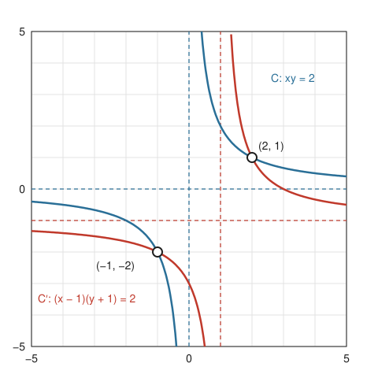

# The Chow ring: subvarieties up to deformation, multiplied by intersecting

[Syllabus](../../../SYLLABUS.md) → [Algebraic geometry](../README.md) → [Intersection Theory and Surfaces](../README.md#s09) → The Chow ring

---

## General Overview

Solve two equations in two unknowns: $`xy = 2`$ and $`(x - 1)(y + 1) = 2`$. Each one is a hyperbola whose asymptotes (the lines it approaches far out) run parallel to the axes. Each equation has degree 2.

[Bezout's theorem](../03-Plane%20Curves/03-bezouts-theorem.md) says two curves of degree 2 meet in 2 × 2 = 4 points. But solve by hand and only two solutions appear: (2, 1) and (−1, −2). Nothing is wrong with Bezout. Its count lives in the projective plane, where both hyperbolas also pass through the same two points at infinity. Those two shared points are not solutions anyone wants.

The count matters in practice. A computer solves such systems by homotopy continuation: it starts from an easy system with a known number of solutions and tracks one path to each answer. Predict 4 and it tracks 4 paths, 2 of them wasted. Place the problem in the right space and the prediction is exactly 2.

The **Chow ring** gives the right count for each space. Its elements are subvarieties (shapes cut out by polynomial equations) added with whole-number weights. Two of them count as equal when one slides into the other through a family of shapes whose parameter t runs over the projective line $`\mathbb{P}^1`$ (the ordinary numbers plus ∞). Multiplying two elements means intersecting the shapes.

The sliding is the heart of it. The hyperbola $`xy = t`$ moves with the number t. At t = 2 it is our first curve. At t = 0 it breaks into the two axes, $`x = 0`$ and $`y = 0`$. The broken shape is easy to count with, and the count does not change along the family.

**The Chow ring of a smooth projective variety is its subvarieties, added with whole-number weights and identified when one deforms into another through a family parametrised by a projective line, with intersection as the product.**

On the projective plane it is $`\mathbb{Z}[H]/(H^3)`$, and Bezout's theorem becomes $`2H \times 3H = 6H^2`$. On $`\mathbb{P}^1 \times \mathbb{P}^1`$ it is $`\mathbb{Z}[a, b]/(a^2, b^2)`$, and it counts the two hyperbolas exactly: $`(a + b)^2 = 2ab`$, two points.

**What kind of fact this is:** a definition (cycles up to rational equivalence, and their product) and two theorems, the Chow rings of $`\mathbb{P}^n`$ and of $`\mathbb{P}^1 \times \mathbb{P}^1`$, proved in outline in Why it works. That the product is well defined on every smooth variety is quoted from Fulton, chapter 8. Every count on the card is checked exactly by the code.

The field is $`\mathbb{C}`$, the complex numbers. Every count is projective (points at infinity included), with multiplicity, over $`\mathbb{C}`$, unless a line says which of the three it drops.

### The picture: two hyperbolas, two meeting points

<p align="center"></p>

Drawn to scale on the window −5 to 5, real points only. The blue curve C is $`xy = 2`$; its dashed asymptotes are the axes. The red curve C′ is $`(x - 1)(y + 1) = 2`$; its asymptotes are $`x = 1`$ and $`y = -1`$. They cross at the two open dots and nowhere else, even counting complex points and points at infinity in the right space.

---

## The formula

Carried over, each in one line:

- **Projective space** $`\mathbb{P}^n`$: ratios $`(x_0 : \dots : x_n)`$, not all zero, so the ordinary space plus points at infinity ([Projective space](../02-Affine%20and%20Projective%20Varieties/03-projective-space-and-homogeneous-coordinates.md)). In the plane, $`(x : y : z)`$, with $`z = 0`$ at infinity.
- **A cycle** $`Z = \sum n_i V_i`$: subvarieties $`V_i`$ with whole-number weights $`n_i`$ ([Algebraic cycles](../05-Cohomology%20and%20the%20Hodge%20Conjecture/07-algebraic-cycles-and-cycle-classes.md)).
- **A divisor of a function** $`\mathrm{div}(f)`$: for a ratio f of two polynomials, its zero shapes minus its pole shapes, with multiplicities ([Line bundles and divisors](../05-Cohomology%20and%20the%20Hodge%20Conjecture/06-line-bundles-and-divisor-classes.md)).

New on this card, in words first.

- **Rational equivalence.** Two cycles of the same dimension k are rationally equivalent, $`Z \sim Z'`$, when their difference is a sum of terms $`\mathrm{div}(f)`$, each f a ratio of polynomials on a subvariety W of dimension k + 1. Picture it as a family: the shapes $`F - tG = 0`$, for t running over the projective line, start at $`F = 0`$ and end at $`G = 0`$.
- **The Chow group** $`A^p(X)`$: cycles of codimension p (p dimensions short of X) modulo rational equivalence. The class of Z is written $`[Z]`$.
- **The Chow ring** $`A(X) = A^0 \oplus A^1 \oplus \dots \oplus A^n`$, with the product $`[V] \cdot [W] = [V \cap W]`$ whenever V and W meet cleanly: in the expected dimension, with tangent spaces that together fill the tangent space of X at every common point (for two curves on a surface: different tangent lines). Otherwise each piece of $`V \cap W`$ carries a multiplicity.
- **The degree** $`\deg`$: a class in $`A^n`$, the top piece, is a sum of points with whole-number weights, and deg adds up the weights. On $`\mathbb{P}^n`$ and $`\mathbb{P}^1 \times \mathbb{P}^1`$ every top class is a whole-number multiple of one point, so deg reads off that number.
- **The product space** $`\mathbb{P}^1 \times \mathbb{P}^1`$: pairs of points $`((x_0 : x_1), (y_0 : y_1))`$, so x and y each get their own point at infinity. A curve there has **bidegree** (d, e) when its equation has degree d in x and degree e in y. The class a is a vertical line, x = constant, of bidegree (1, 0). The class b is a horizontal line, y = constant, of bidegree (0, 1).

The two rings:

```math
A(\mathbb{P}^n) = \mathbb{Z}[H]/(H^{n+1}), \qquad [V] = (\deg V)\,H^{p}, \qquad \deg H^n = 1
```

**Read it aloud:** the Chow ring of projective n-space is the whole-number polynomials in the hyperplane class H, with $`H^{n+1}`$ set to zero; a subvariety of codimension p and degree d is d times $`H^p`$; and $`H^n`$ is one point.

```math
A(\mathbb{P}^1 \times \mathbb{P}^1) = \mathbb{Z}[a, b]/(a^2, b^2), \qquad [V(F)] = d\,a + e\,b, \qquad (d_1 a + e_1 b)(d_2 a + e_2 b) = (d_1 e_2 + e_1 d_2)\, ab
```

**Read it aloud:** the Chow ring of the product of two projective lines is whole-number polynomials in a and b, with $`a^2`$ and $`b^2`$ set to zero; a curve of bidegree (d, e) has class d a plus e b; and two curves meet in $`d_1 e_2 + e_1 d_2`$ points, since ab is one point.

Worked once on the card's curves:

- The conic C, $`xy = 2`$, has class 2H in the plane. The cubic D, $`x^3 + 21xy^2 - 8y^3 - 21x = 0`$, has class 3H. So $`2H \cdot 3H = 6H^2`$: **6 points**.
- In $`\mathbb{P}^1 \times \mathbb{P}^1`$, C and C′ both have bidegree (1, 1), class a + b. So $`(a + b)^2 = a^2 + 2ab + b^2 = 2ab`$: **2 points**.
- The curve Q, $`x^2 + 5xy^2 - 2y^3 + y^2 - 4x - 5 = 0`$, has bidegree (2, 3). So $`(2a + 3b)(a + b) = 2ab + 3ab = 5ab`$: **5 points** on C.

| Symbol | Plain meaning | In our example | Push it up and the answer… |
| --- | --- | --- | --- |
| $`X`$, $`n`$ | a smooth projective variety; its dimension | $`\mathbb{P}^2`$ or $`\mathbb{P}^1 \times \mathbb{P}^1`$, n = 2 | — |
| $`Z = \sum n_i V_i`$ | a cycle: subvarieties with whole-number weights | the axes $`\{x = 0\} + \{y = 0\}`$ | a bigger weight scales its counts |
| $`f`$, $`\mathrm{div}(f)`$, $`W`$, $`F`$, $`G`$ | a ratio of polynomials; its zeros minus poles; the shape it lives on; polynomials of one degree | $`f = (xy - 2z^2)/z^2`$ on the plane | — |
| $`t`$ | the parameter of a family | $`xy = t`$: C at t = 2, the axes at t = 0 | — |
| $`\sim`$, $`[Z]`$ | rational equivalence; the class of a cycle | $`[C] = a + b`$ | — |
| $`A^p(X)`$, $`A(X)`$, $`p`$ | classes of codimension p; the Chow ring; the codimension | $`A^1(\mathbb{P}^2) = \mathbb{Z}H`$ | — |
| $`H`$, $`L`$ | the hyperplane class: one line in the plane; a line on the cone in When it holds | $`[D] = 3H`$ | — |
| $`a`$, $`b`$ | a vertical line; a horizontal line, in $`\mathbb{P}^1 \times \mathbb{P}^1`$ | ab is one point | — |
| $`(d, e)`$, $`\deg`$ | bidegree in x and y; degree, or the total weight of a sum of points | C is (1, 1), Q is (2, 3) | more meeting points: $`d_1 e_2 + e_1 d_2`$ |
| $`C`$, $`C'`$, $`D`$, $`Q`$ | the curves of the example | $`xy = 2`$, $`(x - 1)(y + 1) = 2`$, the cubic, the (2, 3)-curve | — |
| $`(x_0 : x_1)`$, $`(y_0 : y_1)`$ | coordinates on each factor; $`x = x_1/x_0`$, and $`x_0 = 0`$ is x at infinity | (4, 1/2) is $`((1 : 4), (2 : 1))`$ | — |
| $`\mathbb{F}_{101}`$, $`R(x)`$ | the integers mod 101; the resultant, a polynomial in x that is zero where both curves share a y | $`R(x) = x^2 - x - 2`$ up to sign, for C and C′ | — |

Also used: k, a count of hyperplanes (Step 2); q, a second codimension, and $`i(Z; V \cdot W)`$, a local multiplicity (the fold in Step 4).

### When it holds

- **X smooth.** The product needs smooth X. On the cone $`xz = y^2`$ in $`\mathbb{P}^3`$, the plane $`x = 0`$ cuts out the line L twice, so $`H = 2L`$. Since $`H \cdot H = 2`$, the line would need $`L \cdot L = 2/4 = 1/2`$: not a whole number, so no product with whole-number counts exists there.
- **X projective.** On the ordinary plane every point slides off to infinity, so every point class is 0 and the degree is lost. The hyperbolas $`xy = 2`$ and $`xy = -2`$ never meet in the plane, yet $`(a + b)^2 = 2`$: they meet at $`(0, \infty)`$ and $`(\infty, 0)`$.
- **Counts over $`\mathbb{C}`$.** $`xy = 2`$ and $`x + y = 1`$ lead to $`x^2 - x + 2 = 0`$, with discriminant −7: two complex points, no real ones. Over $`\mathbb{F}_{101}`$ there are none either.
- **Multiplicities counted.** $`xy = 1`$ and $`x + y = 2`$ touch at (1, 1). One point, counted twice ([Intersection multiplicity](../03-Plane%20Curves/02-intersection-multiplicity-and-tangency.md)).
- **The ring is finer than cohomology.** Rational equivalence remembers more than topology. On an elliptic curve two different points are never rationally equivalent, yet cohomology cannot tell them apart. Sliding one point to the other along the curve uses a family parametrised by the elliptic curve itself, not by a line, so it does not count. For $`\mathbb{P}^n`$ and $`\mathbb{P}^1 \times \mathbb{P}^1`$ the two agree, which is why [Cohomology of projective space](../05-Cohomology%20and%20the%20Hodge%20Conjecture/03-cohomology-of-projective-space.md) found the same ring $`\mathbb{Z}[h]/(h^{n+1})`$.

---

## Why it works

### Step 0: counts do not change along a family

Slide a shape through a family, such as $`xy = t`$ as t runs from 2 to 0. The number of points where it meets a fixed curve, counted over $`\mathbb{C}`$, with multiplicity and with points at infinity, stays the same. Points may merge or run to infinity, but in projective space they cannot vanish. This is the principle of conservation of number. It holds along flat families, the families without jumps of [Flat, smooth and etale](../08-Sheaf%20Cohomology%20and%20Differentials/03-flat-smooth-and-etale-morphisms.md).

So any curve may be replaced by the simplest member of its family before counting. Rational equivalence is the bookkeeping that records which replacements are allowed.

### Step 1: a hypersurface of degree d is d hyperplanes

Let F be a polynomial of degree d in $`x_0, \dots, x_n`$, every term of degree d, and let L be a linear one. The ratio $`f = F/L^d`$ has the same degree on top and bottom. So it is a genuine function on $`\mathbb{P}^n`$: scaling the coordinates does not change its value. Its zeros are $`V(F)`$ and its poles are the hyperplane $`V(L)`$, d times over:

```math
\mathrm{div}\big(F/L^d\big) = V(F) - d\,V(L), \qquad \text{so} \qquad [V(F)] = d\,H
```

**Read it aloud:** the divisor of F over L to the d is the shape F = 0 minus d copies of the hyperplane, so the class of F = 0 is d times H.

For the conic C, which is $`xy = 2z^2`$, the ratio $`f = (xy - 2z^2)/z^2`$ gives $`[C] = 2H`$. The family $`xy = t z^2`$ shows the same thing as a slide: at t = 0 it is the two lines $`x = 0`$ and $`y = 0`$, which is H + H.

### Step 2: the powers of H

Take k hyperplanes in general position (no special coincidences, such as two of them equal). They meet cleanly in a linear space of codimension k, so $`H^k`$ is the class of that space. At k = n they meet in one point: $`\deg H^n = 1`$. At k = n + 1 they have no common point at all, so $`H^{n+1} = 0`$.

The last ingredient is that the classes $`H^k`$ are everything. Every subvariety of codimension p and degree d is rationally equivalent to d linear spaces of that codimension. The proof cuts $`\mathbb{P}^n`$ into cells: a point, a line minus that point, a plane minus that line, and so on. The closures of the cells, the linear spaces, then generate every Chow group (Eisenbud and Harris, chapters 1 and 2). That gives $`A(\mathbb{P}^n) = \mathbb{Z}[H]/(H^{n+1})`$.

Bezout's theorem is then one line. Curves of degrees d and e have classes dH and eH. Their product is $`de\,H^2`$, and $`\deg H^2 = 1`$ in the plane. For C and D: $`2 \times 3 = 6`$.

### Step 3: the ring of P¹ × P¹

A polynomial F of bidegree (d, e) has degree d in $`(x_0, x_1)`$ and degree e in $`(y_0, y_1)`$. The ratio $`f = F/(x_0^d\,y_0^e)`$ is unchanged when either pair is scaled, so it is a function on $`\mathbb{P}^1 \times \mathbb{P}^1`$. Its poles are the vertical line $`x_0 = 0`$ (x at infinity), d times, and the horizontal line $`y_0 = 0`$, e times:

```math
\mathrm{div}\big(F/(x_0^d\,y_0^e)\big) = V(F) - d\,\{x = \infty\} - e\,\{y = \infty\}, \qquad \text{so} \qquad [V(F)] = d\,a + e\,b
```

**Read it aloud:** the curve F = 0 is equivalent to d vertical lines plus e horizontal lines.

The three products come from three pictures:

| Product | Two representatives | They meet in | So |
| --- | --- | --- | --- |
| $`a \cdot a`$ | $`x = 0`$ and $`x = 1`$ | nothing: two different x-values | $`a^2 = 0`$ |
| $`b \cdot b`$ | $`y = 0`$ and $`y = 1`$ | nothing | $`b^2 = 0`$ |
| $`a \cdot b`$ | $`x = 0`$ and $`y = 0`$ | the one point (0, 0), cleanly | ab is a point |

Every curve is equivalent to vertical and horizontal lines, by the display above, and every point is equivalent to every other (slide it along a vertical line, then a horizontal one). So $`A^1 = \mathbb{Z}a \oplus \mathbb{Z}b`$ and $`A^2 = \mathbb{Z}\,ab`$, and the ring is $`\mathbb{Z}[a, b]/(a^2, b^2)`$.

### Step 4: the hyperbolas, slid apart

C is $`xy = 2`$, in the family $`xy = t`$. At t = 0 it becomes the axes $`\{x = 0\} + \{y = 0\}`$: class a + b. Move a second copy to $`(x - 1)(y - 1) = 0`$, the lines $`x = 1`$ and $`y = 1`$. The two crosses meet at (0, 1) and (1, 0). The two vertical lines never meet, and nor do the two horizontal ones. That is $`(a + b)^2 = 2ab`$ in a picture: **2 points**.

The projective plane sees more. In $`\mathbb{P}^2`$ the curves C and C′ are $`xy = 2z^2`$ and $`xy + xz - yz = 3z^2`$. At $`z = 0`$ both reduce to $`xy = 0`$, so both pass through (1 : 0 : 0) and (0 : 1 : 0). Those are the far ends of the x-axis and the y-axis, where every hyperbola with axis-parallel asymptotes goes. Bezout counts them: 2 + 2 = 4.

$`\mathbb{P}^1 \times \mathbb{P}^1`$ separates them. Far out along the x-axis, C sits at $`(\infty, 0)`$ and C′ at $`(\infty, -1)`$, because their horizontal asymptotes differ. The two spaces agree on the ordinary plane and differ only at infinity. Blowing up $`\mathbb{P}^2`$ at (1 : 0 : 0) and (0 : 1 : 0), then shrinking the line at infinity through them, gives $`\mathbb{P}^1 \times \mathbb{P}^1`$. The fold in Step 3 of [The 27 lines on a cubic surface](04-twenty-seven-lines-on-a-cubic-surface.md) uses the same fact, with its source.

<details>
<summary>The product in general: why it is well defined, quoted from Fulton</summary>

On a smooth variety X, two subvarieties V and W of codimensions p and q need not meet cleanly. They may share a whole curve, or touch. The product still exists, in three moves.

1. **Moving.** Any class has a representative that meets W properly: every piece of the intersection has codimension exactly p + q. On a projective X this is Chow's moving lemma. Fulton replaces it by deformation to the normal cone, which needs no moving at all.

2. **Multiplicity.** Each piece Z of a proper intersection gets a whole number $`i(Z; V \cdot W) \ge 1`$, equal to 1 when the meeting is clean. For two curves on a surface it is the local intersection multiplicity of the plane-curves shelf.

3. **Independence.** The class

$`\displaystyle [V] \cdot [W] = \sum_{Z} i(Z; V \cdot W)\,[Z]`$

does not depend on the representatives chosen. This is the content of Fulton, chapter 8, and it makes $`A(X)`$ a commutative ring with $`[X]`$ as its 1.

Smoothness is used in move 1 and move 3. On the cone in When it holds both fail, and the would-be self-intersection of a line is 1/2.

</details>

### Step 5: the (2, 3)-curve, and a second road

Q has bidegree (2, 3), so its class is 2a + 3b. Against C, class a + b:

```math
(2a + 3b)(a + b) = 2a^2 + 2ab + 3ab + 3b^2 = 5ab
```

**Read it aloud:** 2a plus 3b times a plus b is 5ab, five points, because the squares vanish.

The code reaches every count a second way. It eliminates y with a resultant $`R(x)`$: a determinant built from the two equations' coefficients that is zero exactly at the x-values where both curves share a y. It then finds the roots of R, and any root at x = ∞ shows up as a drop in R's degree. A third road tries every one of the $`102^2 = 10404`$ points of $`\mathbb{P}^1 \times \mathbb{P}^1`$ over $`\mathbb{F}_{101}`$, the integers mod 101.

---

## Worked numbers, by hand

| Step | Arithmetic | Value |
| --- | --- | --- |
| class of the conic C | degree 2 | 2H |
| class of the cubic D | degree 3 | 3H |
| the ring's count | $`2H \cdot 3H`$ | $`6H^2`$, 6 points |
| solve: put $`y = 2/x`$ in D, times $`x^3`$ | $`x^6 - 21x^4 + 84x^2 - 64 = (x^2 - 1)(x^2 - 4)(x^2 - 16)`$ | x = ±1, ±2, ±4: **6 points** |
| C and D at infinity | C has (1 : 0 : 0), (0 : 1 : 0); D has $`x^3`$ and $`-8y^3`$ terms | D misses both |
| classes of C and C′ in $`\mathbb{P}^1 \times \mathbb{P}^1`$ | bidegree (1, 1) each | a + b |
| the ring's count | $`a^2 + 2ab + b^2`$ with $`a^2 = b^2 = 0`$ | 2ab |
| solve: put $`y = 2/x`$ in C′ | $`(x - 1)(2 + x) = 2x`$, so $`x^2 - x - 2 = 0`$ | (2, 1), (−1, −2): **2 points** |
| class of Q | bidegree (2, 3) | 2a + 3b |
| the ring's count | $`(2a + 3b)(a + b)`$ | 5ab |
| solve: put $`y = 2/x`$ in Q, times $`x^3`$ | $`x^5 - 4x^4 - 5x^3 + 20x^2 + 4x - 16 = (x^2 - 1)(x^2 - 4)(x - 4)`$ | x = ±1, ±2, 4: **5 points** |

**The ring predicts 6, 2 and 5, and solving finds exactly 6, 2 and 5 points.** The meeting points are (±1, ±2), (±2, ±1) and (±4, ±1/2) for C and D, with matching signs; (2, 1) and (−1, −2) for C and C′; and (±1, ±2), (±2, ±1) and (4, 1/2) for Q and C.

### What breaks if you drop a piece

| Mistake | Comes out at | What went wrong |
| --- | --- | --- |
| Count C and C′ in $`\mathbb{P}^2`$ | 4 points: (2 : 1 : 1), (−1 : −2 : 1), (0 : 1 : 0), (1 : 0 : 0) | the wrong space: two of the four sit at infinity, shared by every such hyperbola |
| Count $`xy = 2`$ and $`xy = -2`$ in the ordinary plane | 0 points | the two meetings are at $`(0, \infty)`$ and $`(\infty, 0)`$ |
| Count $`xy = 2`$ and $`x + y = 1`$ over $`\mathbb{R}`$ | 0 points, discriminant −7 | both meetings have complex coordinates |
| Count $`xy = 1`$ and $`x + y = 2`$ as a set | 1 point | the tangency at (1, 1) has multiplicity 2 |
| Multiply on the cone $`xz = y^2`$ | $`L \cdot L = 1/2`$ | the cone is singular at its tip, so there is no whole-number product |

---

## Code, from first principles, and it actually runs

The code takes three independent roads to every count. Road 1 multiplies classes in $`\mathbb{Z}[H]/(H^3)`$ and $`\mathbb{Z}[a, b]/(a^2, b^2)`$, as polynomials with the relations cutting off high powers. Road 2 eliminates y by a Sylvester determinant, finds the whole-number roots by synthetic division, reads the roots at infinity from the drop in degree, and puts every claimed point back into both equations exactly. Road 3 tries every point over $`\mathbb{F}_{101}`$. Nothing imported knows a resultant, a root or a count.

### Python

```python
# The Chow ring: the check behind the card.  Standard library only.  Field: C for counts, F_101 for road 3.
# Road 1 multiplies classes in Z[H]/(H^3) and Z[a, b]/(a^2, b^2).  Road 2 eliminates y by a resultant
# and finds the roots, the ones at infinity included.  Road 3 tries every point over F_101.
from fractions import Fraction
from functools import reduce
from math import gcd
P = 101

def ring_mul(u, v, caps):                     # classes as {exponents: coefficient}; caps kill H^3, a^2, b^2
    r = {}
    for e, c in u.items():
        for f, d in v.items():
            k = tuple(i + j for i, j in zip(e, f))
            if all(k[i] < caps[i] for i in range(len(k))): r[k] = r.get(k, 0) + c * d
    return {k: c for k, c in r.items() if c}
def show(u, names):
    if not u: return "0"
    out = []
    for e in sorted(u, reverse=True):
        m = "".join(n + (f"^{p}" if p > 1 else "") for n, p in zip(names, e) if p)
        out.append(m if m and u[e] == 1 else f"{u[e]}{m}")
    return " + ".join(out)

def padd(p, q): return [(p[i] if i < len(p) else 0) + (q[i] if i < len(q) else 0) for i in range(max(len(p), len(q)))]
def pmul(p, q):                               # polynomials in x as coefficient lists, lowest power first
    r = [0] * (len(p) + len(q) - 1)
    for i, a in enumerate(p):
        for j, b in enumerate(q): r[i + j] += a * b
    return r
def det(M):                                   # Laplace expansion along the first row
    if len(M) == 1: return M[0][0]
    tot = [0]
    for j in range(len(M)):
        t = pmul(M[0][j], det([row[:j] + row[j + 1:] for row in M[1:]]))
        tot = padd(tot, t if j % 2 == 0 else [-c for c in t])
    return tot
def ycoeffs(f, ey):                           # f as a polynomial in y of formal degree ey, top coefficient first
    out = []
    for j in range(ey, -1, -1):
        c = [0] * 5
        for (i, k), v in f.items():
            if k == j: c[i] += v
        out.append(c)
    return out
def resultant(f, ef, g, eg):                  # Sylvester determinant: zero exactly where f and g share a root y
    F, G, n = ycoeffs(f, ef), ycoeffs(g, eg), ef + eg
    rows = [[[0]] * i + F + [[0]] * (n - ef - 1 - i) for i in range(eg)]
    rows += [[[0]] * i + G + [[0]] * (n - eg - 1 - i) for i in range(ef)]
    r = det(rows)
    while len(r) > 1 and r[-1] == 0: r.pop()
    return r
def int_roots(r):                             # whole-number roots with multiplicity, by synthetic division
    found = []
    for x0 in range(-60, 61):
        while len(r) > 1:
            q, acc = [], 0
            for c in reversed(r): acc = acc * x0 + c; q.append(acc)
            if acc != 0: break
            r = list(reversed(q[:-1])); found.append(x0)
    return found, r

def fmt(r):                                   # made primitive, leading coefficient positive, leading term first
    g = reduce(gcd, r); r, out = [c // g * (1 if r[-1] > 0 else -1) for c in r], ""
    for k in range(len(r) - 1, -1, -1):
        if r[k] == 0: continue
        m = abs(r[k]); body = ("" if m == 1 and k else str(m)) + ("x" if k else "") + (f"^{k}" if k > 1 else "")
        out += (("-" if r[k] < 0 else "") if not out else (" - " if r[k] < 0 else " + ")) + body
    return out
def ev(f, home, X, Y, Z=1):                   # homogeneous value; X, Y are pairs (x0, x1) on P^1 x P^1
    if home == "P2": return sum(c * X**i * Y**j * Z**(f["d"] - i - j) for (i, j), c in f["t"].items())
    return sum(c * X[1]**i * X[0]**(f["dx"] - i) * Y[1]**j * Y[0]**(f["dy"] - j) for (i, j), c in f["t"].items())
def count_fp(f, g, home):                     # road 3: every point over F_101
    if home == "P2": pts = [(x, y, 1) for x in range(P) for y in range(P)] + [(x, 1, 0) for x in range(P)] + [(1, 0, 0)]
    else:
        line = [(1, x) for x in range(P)] + [(0, 1)]
        pts = [(X, Y) for X in line for Y in line]
    return [p for p in pts if ev(f, home, *p) % P == 0 and ev(g, home, *p) % P == 0]
def curve(t, **deg): return {"t": t, **deg}
C = curve({(1, 1): 1, (0, 0): -2}, dx=1, dy=1, d=2)                       # xy = 2
C2 = curve({(1, 1): 1, (1, 0): 1, (0, 1): -1, (0, 0): -3}, dx=1, dy=1, d=2)  # (x - 1)(y + 1) = 2
D = curve({(3, 0): 1, (1, 2): 21, (0, 3): -8, (1, 0): -21}, d=3)         # x^3 + 21xy^2 - 8y^3 - 21x = 0
Q = curve({(2, 0): 1, (1, 0): -4, (0, 0): -5, (1, 2): 5, (0, 2): 1, (0, 3): -2}, dx=2, dy=3)  # bidegree (2, 3)
AX = curve({(1, 1): 1}, dx=1, dy=1)                                       # the axes xy = 0
AX2 = curve({(1, 1): 1, (1, 0): -1, (0, 1): -1, (0, 0): 1}, dx=1, dy=1)  # (x - 1)(y - 1) = 0
CM = curve({(1, 1): 1, (0, 0): 2}, dx=1, dy=1)                            # xy = -2
L1 = curve({(1, 0): 1, (0, 1): 1, (0, 0): -2}, dx=1, dy=1)                # x + y = 2
L2 = curve({(1, 0): 1, (0, 1): 1, (0, 0): -1}, dx=1, dy=1)                # x + y = 1

H, a, b = {(1,): 1}, {(1, 0): 1}, {(0, 1): 1}
sc = lambda k, u: {e: k * c for e, c in u.items()}
add = lambda u, v: {e: u.get(e, 0) + v.get(e, 0) for e in set(u) | set(v) if u.get(e, 0) + v.get(e, 0)}
print("road 1, products in the Chow ring")
cc = ring_mul(sc(2, H), sc(3, H), (3,))
print(f"A(P^2) = Z[H]/(H^3): 2H x 3H = {show(cc, 'H')}; H x H x H = {show(ring_mul(ring_mul(H, H, (3,)), H, (3,)), 'H')}")
r11 = ring_mul(add(a, b), add(a, b), (2, 2)); r23 = ring_mul(add(sc(2, a), sc(3, b)), add(a, b), (2, 2))
print(f"A(P^1 x P^1) = Z[a, b]/(a^2, b^2): a x a = {show(ring_mul(a, a, (2, 2)), 'ab')}; (a + b)^2 = {show(r11, 'ab')}; "
      f"(2a + 3b)(a + b) = {show(r23, 'ab')}")
print(f"the same products in Z[a, b], no relations: (a + b)^2 = {show(ring_mul(add(a, b), add(a, b), (9, 9)), 'ab')}")

print(f"roads 2 and 3, the meeting points of real curves; road 3 tries all {(P + 1) ** 2} points of P^1 x P^1 over F_{P}")
cases = [("conic C and cubic D in P^2", C, 2, D, 3, "P2", cc[(2,)], [(1, 2, 1), (-1, -2, 1), (2, 1, 1), (-2, -1, 1), (8, 1, 2), (-8, -1, 2)]),
         ("C and C' in P^1 x P^1", C, 1, C2, 1, "P11", r11[(1, 1)], [((1, 2), (1, 1)), ((1, -1), (1, -2))]),
         ("axes xy = 0 and (x - 1)(y - 1) = 0", AX, 1, AX2, 1, "P11", r11[(1, 1)], [((1, 0), (1, 1)), ((1, 1), (1, 0))]),
         ("(2, 3)-curve Q and C", Q, 3, C, 1, "P11", r23[(1, 1)],
          [((1, 1), (1, 2)), ((1, -1), (1, -2)), ((1, 2), (1, 1)), ((1, -2), (1, -1)), ((1, 4), (2, 1))]),
         ("xy = 2 and xy = -2", C, 1, CM, 1, "P11", r11[(1, 1)], [((1, 0), (0, 1)), ((0, 1), (1, 0))]),
         ("xy = 2 and x + y = 1", C, 1, L2, 1, "P11", r11[(1, 1)], []),
         ("xy = 1 and x + y = 2", curve({(1, 1): 1, (0, 0): -1}, dx=1, dy=1), 1, L1, 1, "P11", r11[(1, 1)], [((1, 1), (1, 1))])]
res = {}
for name, f, ef, g, eg, home, want, pts in cases:
    R = resultant(f["t"], ef, g["t"], eg); N = f["d"] * g["d"] if home == "P2" else f["dx"] * eg + g["dx"] * ef
    roots, rest = int_roots(R); inf = N - (len(R) - 1); fp = count_fp(f, g, home)
    tail = f", rest has discriminant {rest[1]**2 - 4 * rest[0] * rest[2]}" if len(rest) == 3 else ""
    print(f"{name}: ring {want}; R(x) = {fmt(R)}, degree {N}: whole roots {roots}{tail}, at infinity {inf}; over F_{P} {len(fp)}")
    assert all(ev(f, home, *p) == 0 and ev(g, home, *p) == 0 for p in pts)   # each claimed point, put back exactly
    res[name] = (want, roots, inf, rest, fp)
sg = lambda v: str(v - P if v > P // 2 else v); P2fake = sorted(count_fp(C, C2, "P2"), key=lambda p: (-p[2], p))
print(f"mistake 1, C and C' counted in P^2: 2 x 2 = {len(P2fake)} points: " + ", ".join("(" + " : ".join(map(sg, p)) + ")" for p in P2fake))
aff = lambda X: "inf" if X[0] == 0 else sg(X[1])
far = res["xy = 2 and xy = -2"][4]; fin = [p for p in far if p[0][0] and p[1][0]]
print(f"mistake 2, xy = 2 and xy = -2 in the plane only: {len(fin)} points; in P^1 x P^1: " + ", ".join(f"({aff(X)}, {aff(Y)})" for X, Y in far))
rest = res["xy = 2 and x + y = 1"][3]
print(f"mistake 3, xy = 2 and x + y = 1 over R: x^2 - x + 2 has discriminant {rest[1]**2 - 4 * rest[0] * rest[2]}, so 0 points; over C 2")
print(f"mistake 4, xy = 1 and x + y = 2 without multiplicity: {len(set(res['xy = 1 and x + y = 2'][1]))} point, the double root x = 1")
cone, line = {(1, 0, 1): 1, (0, 2, 0): -1}, ([-1, 1], [0], [-2, 1])   # xz - y^2 by powers of (x, y, z); the line (s - 1 : 0 : s - 2 : s)
cs = reduce(padd, [reduce(pmul, [line[k] for k in range(3) for _ in range(e[k])], [c]) for e, c in cone.items()])  # the cone on the line
(m,), croots = [e[1] for e in cone if e[0] == 0], int_roots(cs)[0]; HH = len(croots); LL = Fraction(HH, m * m)  # x = 0 leaves -y^m: H = mL
print(f"cone xz = y^2 in P^3: plane x = 0 leaves y^{m} = 0, so H = {m}L; the line (s - 1 : 0 : s - 2 : s) meets it where "
      f"{fmt(cs).replace('x', 's')} = 0, at s = {croots}, so H.H = {HH} and L.L = {HH}/{m * m} = {LL}")
print("figure, C: xy = 2 and C': (x - 1)(y + 1) = 2 meet at (2, 1) and (-1, -2); asymptotes x = 0, y = 0, x = 1, y = -1; window -5..5")
assert cc == {(2,): 6} and ring_mul(ring_mul(H, H, (3,)), H, (3,)) == {}                     # ring arithmetic
assert r11 == {(1, 1): 2} and r23 == {(1, 1): 5}
for name, (want, roots, inf, rest, fp) in res.items():
    if name.startswith("xy = 2 and x + y"): assert len(rest) == 3 and len(roots) == 0 and len(fp) == 0
    else: assert len(roots) + inf == want                                    # resultant roots against the ring
    if name.startswith(("conic", "C and", "axes", "(2, 3)", "xy = 2 and xy")): assert len(fp) == want  # F_101 against the ring
assert sorted(res["conic C and cubic D in P^2"][1]) == [-4, -2, -1, 1, 2, 4] and res["conic C and cubic D in P^2"][2] == 0
assert len(P2fake) == 4 and ((1, 0, 0) in P2fake) and ((0, 1, 0) in P2fake)
assert LL == Fraction(1, 2) and res["xy = 2 and xy = -2"][2] == 1 and res["xy = 1 and x + y = 2"][1] == [1, 1]
print("ALL CHECKS PASS")
```

**Ran 2026-11-24 on macOS, Python 3.14.10, standard library only. All checks passed. Output, pasted from the run:**

```
road 1, products in the Chow ring
A(P^2) = Z[H]/(H^3): 2H x 3H = 6H^2; H x H x H = 0
A(P^1 x P^1) = Z[a, b]/(a^2, b^2): a x a = 0; (a + b)^2 = 2ab; (2a + 3b)(a + b) = 5ab
the same products in Z[a, b], no relations: (a + b)^2 = a^2 + 2ab + b^2
roads 2 and 3, the meeting points of real curves; road 3 tries all 10404 points of P^1 x P^1 over F_101
conic C and cubic D in P^2: ring 6; R(x) = x^6 - 21x^4 + 84x^2 - 64, degree 6: whole roots [-4, -2, -1, 1, 2, 4], at infinity 0; over F_101 6
C and C' in P^1 x P^1: ring 2; R(x) = x^2 - x - 2, degree 2: whole roots [-1, 2], at infinity 0; over F_101 2
axes xy = 0 and (x - 1)(y - 1) = 0: ring 2; R(x) = x^2 - x, degree 2: whole roots [0, 1], at infinity 0; over F_101 2
(2, 3)-curve Q and C: ring 5; R(x) = x^5 - 4x^4 - 5x^3 + 20x^2 + 4x - 16, degree 5: whole roots [-2, -1, 1, 2, 4], at infinity 0; over F_101 5
xy = 2 and xy = -2: ring 2; R(x) = x, degree 2: whole roots [0], at infinity 1; over F_101 2
xy = 2 and x + y = 1: ring 2; R(x) = x^2 - x + 2, degree 2: whole roots [], rest has discriminant -7, at infinity 0; over F_101 0
xy = 1 and x + y = 2: ring 2; R(x) = x^2 - 2x + 1, degree 2: whole roots [1, 1], at infinity 0; over F_101 1
mistake 1, C and C' counted in P^2: 2 x 2 = 4 points: (2 : 1 : 1), (-1 : -2 : 1), (0 : 1 : 0), (1 : 0 : 0)
mistake 2, xy = 2 and xy = -2 in the plane only: 0 points; in P^1 x P^1: (0, inf), (inf, 0)
mistake 3, xy = 2 and x + y = 1 over R: x^2 - x + 2 has discriminant -7, so 0 points; over C 2
mistake 4, xy = 1 and x + y = 2 without multiplicity: 1 point, the double root x = 1
cone xz = y^2 in P^3: plane x = 0 leaves y^2 = 0, so H = 2L; the line (s - 1 : 0 : s - 2 : s) meets it where s^2 - 3s + 2 = 0, at s = [1, 2], so H.H = 2 and L.L = 2/4 = 1/2
figure, C: xy = 2 and C': (x - 1)(y + 1) = 2 meet at (2, 1) and (-1, -2); asymptotes x = 0, y = 0, x = 1, y = -1; window -5..5
ALL CHECKS PASS
```

### Rust

```rust
// The Chow ring: the check behind the card.  std only.  Field: C for counts, F_101 for road 3.
// Road 1 multiplies classes in Z[H]/(H^3) and Z[a, b]/(a^2, b^2).  Road 2 eliminates y by a resultant
// and finds the roots, the ones at infinity included.  Road 3 tries every point over F_101.
use std::collections::BTreeMap;
const P: i128 = 101;
type Cls = BTreeMap<Vec<u32>, i128>;
type Pt = ((i128, i128), (i128, i128));
fn ring_mul(u: &Cls, v: &Cls, caps: &[u32]) -> Cls {  // caps kill H^3, a^2, b^2
    let mut r = Cls::new();
    for (e, c) in u { for (f, d) in v {
        let k: Vec<u32> = e.iter().zip(f).map(|(i, j)| i + j).collect();
        if k.iter().zip(caps).all(|(x, c)| x < c) { *r.entry(k).or_insert(0) += c * d; }
    } }
    r.retain(|_, c| *c != 0); r
}
fn cls(v: &[(Vec<u32>, i128)]) -> Cls { v.iter().cloned().collect() }
fn add(u: &Cls, v: &Cls) -> Cls { let mut r = u.clone(); for (e, c) in v { *r.entry(e.clone()).or_insert(0) += c; } r.retain(|_, c| *c != 0); r }
fn sc(k: i128, u: &Cls) -> Cls { u.iter().map(|(e, c)| (e.clone(), k * c)).collect() }
fn show(u: &Cls, names: &str) -> String {
    if u.is_empty() { return "0".into(); }
    let mut out = vec![];
    for (e, c) in u.iter().rev() {
        let m: String = names.chars().zip(e).filter(|(_, p)| **p > 0)
            .map(|(n, p)| if *p > 1 { format!("{}^{}", n, p) } else { n.to_string() }).collect();
        out.push(if !m.is_empty() && *c == 1 { m } else { format!("{}{}", c, m) });
    }
    out.join(" + ")
}
fn padd(p: &[i128], q: &[i128]) -> Vec<i128> { (0..p.len().max(q.len())).map(|i| p.get(i).unwrap_or(&0) + q.get(i).unwrap_or(&0)).collect() }
fn pmul(p: &[i128], q: &[i128]) -> Vec<i128> {
    let mut r = vec![0; p.len() + q.len() - 1];
    for (i, a) in p.iter().enumerate() { for (j, b) in q.iter().enumerate() { r[i + j] += a.checked_mul(*b).unwrap(); } }
    r
}
fn det(m: &[Vec<Vec<i128>>]) -> Vec<i128> {          // Laplace expansion along the first row
    if m.len() == 1 { return m[0][0].clone(); }
    let mut tot = vec![0];
    for j in 0..m.len() {
        let minor: Vec<Vec<Vec<i128>>> = m[1..].iter().map(|row| { let mut r = row.clone(); r.remove(j); r }).collect();
        let t = pmul(&m[0][j], &det(&minor));
        tot = padd(&tot, &if j % 2 == 0 { t } else { t.iter().map(|c| -c).collect() });
    }
    tot
}
struct Curve { t: Vec<(u32, u32, i128)>, dx: u32, dy: u32, d: u32 }
fn ycoeffs(f: &Curve, ey: u32) -> Vec<Vec<i128>> {
    (0..=ey).rev().map(|j| { let mut c = vec![0; 5]; for &(i, k, v) in &f.t { if k == j { c[i as usize] += v; } } c }).collect()
}
fn resultant(f: &Curve, ef: u32, g: &Curve, eg: u32) -> Vec<i128> {
    let (fc, gc, n) = (ycoeffs(f, ef), ycoeffs(g, eg), (ef + eg) as usize);
    let mut rows = vec![];
    for (cs, e, other) in [(&fc, ef as usize, eg as usize), (&gc, eg as usize, ef as usize)] {
        for i in 0..other {
            let mut row = vec![vec![0]; i]; row.extend(cs.iter().cloned()); row.extend(vec![vec![0]; n - e - 1 - i]); rows.push(row);
        }
    }
    let mut r = det(&rows);
    while r.len() > 1 && *r.last().unwrap() == 0 { r.pop(); }
    r
}
fn int_roots(mut r: Vec<i128>) -> (Vec<i128>, Vec<i128>) {  // whole-number roots with multiplicity
    let mut found = vec![];
    for x0 in -60..=60i128 {
        while r.len() > 1 {
            let (mut q, mut acc) = (vec![], 0i128);
            for c in r.iter().rev() { acc = acc * x0 + c; q.push(acc); }
            if acc != 0 { break; }
            q.pop(); q.reverse(); r = q; found.push(x0);
        }
    }
    (found, r)
}
fn fmt(r: &[i128]) -> String {                     // made primitive, leading coefficient positive, leading term first
    let g = r.iter().fold(0i128, |a, &b| { let (mut a, mut b) = (a.abs(), b.abs()); while b != 0 { (a, b) = (b, a % b); } a });
    let (s, mut out) = (if *r.last().unwrap() > 0 { 1 } else { -1 }, String::new());
    for k in (0..r.len()).rev() {
        let c = r[k] / g * s; if c == 0 { continue; }
        let body = format!("{}{}{}", if c.abs() == 1 && k > 0 { String::new() } else { c.abs().to_string() },
                           if k > 0 { "x" } else { "" }, if k > 1 { format!("^{}", k) } else { String::new() });
        out += &format!("{}{}", if out.is_empty() { if c < 0 { "-" } else { "" } } else if c < 0 { " - " } else { " + " }, body);
    }
    out
}
fn ev2(f: &Curve, p: (i128, i128, i128)) -> i128 { f.t.iter().map(|&(i, j, c)| c * p.0.pow(i) * p.1.pow(j) * p.2.pow(f.d - i - j)).sum() }
fn ev11(f: &Curve, p: Pt) -> i128 {
    let ((x0, x1), (y0, y1)) = p;
    f.t.iter().map(|&(i, j, c)| c * x1.pow(i) * x0.pow(f.dx - i) * y1.pow(j) * y0.pow(f.dy - j)).sum()
}
fn count2(f: &Curve, g: &Curve) -> Vec<(i128, i128, i128)> {
    let mut pts = vec![(1, 0, 0)];
    for x in 0..P { pts.push((x, 1, 0)); for y in 0..P { pts.push((x, y, 1)); } }
    pts.into_iter().filter(|&p| ev2(f, p) % P == 0 && ev2(g, p) % P == 0).collect()
}
fn count11(f: &Curve, g: &Curve) -> Vec<Pt> {
    let mut line: Vec<(i128, i128)> = (0..P).map(|x| (1, x)).collect(); line.push((0, 1));
    let mut out = vec![];
    for &x in &line { for &y in &line { if ev11(f, (x, y)) % P == 0 && ev11(g, (x, y)) % P == 0 { out.push((x, y)); } } }
    out
}
fn cv(t: &[(u32, u32, i128)], dx: u32, dy: u32, d: u32) -> Curve { Curve { t: t.to_vec(), dx, dy, d } }
fn sg(v: i128) -> String { (if v > P / 2 { v - P } else { v }).to_string() }
fn main() {
    let c = cv(&[(1, 1, 1), (0, 0, -2)], 1, 1, 2);                         // xy = 2
    let c2 = cv(&[(1, 1, 1), (1, 0, 1), (0, 1, -1), (0, 0, -3)], 1, 1, 2);  // (x - 1)(y + 1) = 2
    let d = cv(&[(3, 0, 1), (1, 2, 21), (0, 3, -8), (1, 0, -21)], 0, 0, 3); // x^3 + 21xy^2 - 8y^3 - 21x = 0
    let q = cv(&[(2, 0, 1), (1, 0, -4), (0, 0, -5), (1, 2, 5), (0, 2, 1), (0, 3, -2)], 2, 3, 0);  // bidegree (2, 3)
    let (ax, ax2) = (cv(&[(1, 1, 1)], 1, 1, 0), cv(&[(1, 1, 1), (1, 0, -1), (0, 1, -1), (0, 0, 1)], 1, 1, 0));
    let (cm, one) = (cv(&[(1, 1, 1), (0, 0, 2)], 1, 1, 0), cv(&[(1, 1, 1), (0, 0, -1)], 1, 1, 0));
    let (l1, l2) = (cv(&[(1, 0, 1), (0, 1, 1), (0, 0, -2)], 1, 1, 0), cv(&[(1, 0, 1), (0, 1, 1), (0, 0, -1)], 1, 1, 0));
    let (h, a, b) = (cls(&[(vec![1], 1)]), cls(&[(vec![1, 0], 1)]), cls(&[(vec![0, 1], 1)]));
    println!("road 1, products in the Chow ring");
    let cc = ring_mul(&sc(2, &h), &sc(3, &h), &[3]);
    let hhh = ring_mul(&ring_mul(&h, &h, &[3]), &h, &[3]);
    println!("A(P^2) = Z[H]/(H^3): 2H x 3H = {}; H x H x H = {}", show(&cc, "H"), show(&hhh, "H"));
    let ab = add(&a, &b);
    let r11 = ring_mul(&ab, &ab, &[2, 2]); let r23 = ring_mul(&add(&sc(2, &a), &sc(3, &b)), &ab, &[2, 2]);
    println!("A(P^1 x P^1) = Z[a, b]/(a^2, b^2): a x a = {}; (a + b)^2 = {}; (2a + 3b)(a + b) = {}",
             show(&ring_mul(&a, &a, &[2, 2]), "ab"), show(&r11, "ab"), show(&r23, "ab"));
    println!("the same products in Z[a, b], no relations: (a + b)^2 = {}", show(&ring_mul(&ab, &ab, &[9, 9]), "ab"));
    println!("roads 2 and 3, the meeting points of real curves; road 3 tries all {} points of P^1 x P^1 over F_{}", (P + 1) * (P + 1), P);
    let (w6, w2, w5) = (cc[&vec![2]], r11[&vec![1, 1]], r23[&vec![1, 1]]);
    let p11 = |v: &[(i128, i128, i128, i128)]| -> Vec<Pt> { v.iter().map(|&(a, b, c, d)| ((a, b), (c, d))).collect() };
    let cases: Vec<(&str, &Curve, u32, &Curve, u32, i128, Vec<Pt>)> = vec![
        ("C and C' in P^1 x P^1", &c, 1, &c2, 1, w2, p11(&[(1, 2, 1, 1), (1, -1, 1, -2)])),
        ("axes xy = 0 and (x - 1)(y - 1) = 0", &ax, 1, &ax2, 1, w2, p11(&[(1, 0, 1, 1), (1, 1, 1, 0)])),
        ("(2, 3)-curve Q and C", &q, 3, &c, 1, w5, p11(&[(1, 1, 1, 2), (1, -1, 1, -2), (1, 2, 1, 1), (1, -2, 1, -1), (1, 4, 2, 1)])),
        ("xy = 2 and xy = -2", &c, 1, &cm, 1, w2, p11(&[(1, 0, 0, 1), (0, 1, 1, 0)])),
        ("xy = 2 and x + y = 1", &c, 1, &l2, 1, w2, vec![]),
        ("xy = 1 and x + y = 2", &one, 1, &l1, 1, w2, p11(&[(1, 1, 1, 1)]))];
    let tail = |rest: &Vec<i128>| if rest.len() == 3 { format!(", rest has discriminant {}", rest[1] * rest[1] - 4 * rest[0] * rest[2]) } else { String::new() };
    let r = resultant(&c, 2, &d, 3); let (roots6, rest6) = int_roots(r.clone()); let (inf6, fp6) = (6 - (r.len() as i128 - 1), count2(&c, &d));
    println!("conic C and cubic D in P^2: ring {}; R(x) = {}, degree {}: whole roots {:?}{}, at infinity {}; over F_{} {}",
             w6, fmt(&r), c.d * d.d, roots6, tail(&rest6), inf6, P, fp6.len());
    assert!([(1, 2, 1), (-1, -2, 1), (2, 1, 1), (-2, -1, 1), (8, 1, 2), (-8, -1, 2)].iter().all(|&p| ev2(&c, p) == 0 && ev2(&d, p) == 0));
    let mut res = vec![];
    for (name, f, ef, g, eg, want, pts) in &cases {
        let r = resultant(f, *ef, g, *eg); let n = (f.dx * eg + g.dx * ef) as i128;
        let (roots, rest) = int_roots(r.clone()); let inf = n - (r.len() as i128 - 1); let fp = count11(f, g);
        println!("{}: ring {}; R(x) = {}, degree {}: whole roots {:?}{}, at infinity {}; over F_{} {}", name, want, fmt(&r), n, roots, tail(&rest), inf, P, fp.len());
        assert!(pts.iter().all(|&p| ev11(f, p) == 0 && ev11(g, p) == 0));       // each claimed point, put back exactly
        res.push((*name, *want, roots, inf, rest, fp));
    }
    let mut fake = count2(&c, &c2); fake.sort_by_key(|p| (-p.2, p.0, p.1, p.2));
    let txt: Vec<String> = fake.iter().map(|p| format!("({} : {} : {})", sg(p.0), sg(p.1), sg(p.2))).collect();
    println!("mistake 1, C and C' counted in P^2: 2 x 2 = {} points: {}", fake.len(), txt.join(", "));
    let aff = |x: (i128, i128)| if x.0 == 0 { "inf".to_string() } else { sg(x.1) };
    let far = &res[3].5; let fin = far.iter().filter(|p| p.0 .0 != 0 && p.1 .0 != 0).count();
    let ftxt: Vec<String> = far.iter().map(|&(x, y)| format!("({}, {})", aff(x), aff(y))).collect();
    println!("mistake 2, xy = 2 and xy = -2 in the plane only: {} points; in P^1 x P^1: {}", fin, ftxt.join(", "));
    let rest = &res[4].4;
    println!("mistake 3, xy = 2 and x + y = 1 over R: x^2 - x + 2 has discriminant {}, so 0 points; over C 2", rest[1] * rest[1] - 4 * rest[0] * rest[2]);
    let mut uniq = res[5].2.clone(); uniq.dedup();
    println!("mistake 4, xy = 1 and x + y = 2 without multiplicity: {} point, the double root x = 1", uniq.len());
    let (cone, line) = ([([1usize, 0, 1], 1i128), ([0, 2, 0], -1)], [vec![-1i128, 1], vec![0], vec![-2, 1]]);  // xz - y^2 by powers of (x, y, z); the line (s - 1 : 0 : s - 2 : s)
    let cs = cone.iter().fold(vec![0], |t, (e, c)| padd(&t, &(0..3).fold(vec![*c], |u, k| (0..e[k]).fold(u, |u, _| pmul(&u, &line[k])))));  // the cone on the line
    let m = cone.iter().find(|(e, _)| e[0] == 0).unwrap().0[1] as i128; let croots = int_roots(cs.clone()).0; let hh = croots.len() as i128;  // x = 0 leaves -y^m: H = mL
    let (mut num, mut den) = (hh, m * m); let mut g = (num, den); while g.1 != 0 { g = (g.1, g.0 % g.1); } num /= g.0; den /= g.0;  // H.H = points on a line; (mL)^2 = m^2 L.L
    println!("cone xz = y^2 in P^3: plane x = 0 leaves y^{} = 0, so H = {}L; the line (s - 1 : 0 : s - 2 : s) meets it where {} = 0, at s = {:?}, so H.H = {} and L.L = {}/{} = {}/{}", m, m, fmt(&cs).replace('x', "s"), croots, hh, hh, m * m, num, den);
    println!("figure, C: xy = 2 and C': (x - 1)(y + 1) = 2 meet at (2, 1) and (-1, -2); asymptotes x = 0, y = 0, x = 1, y = -1; window -5..5");
    assert!(cc == cls(&[(vec![2], 6)]) && hhh.is_empty());                                     // ring arithmetic
    assert!(r11 == cls(&[(vec![1, 1], 2)]) && r23 == cls(&[(vec![1, 1], 5)]));
    assert!(roots6.len() as i128 + inf6 == w6 && fp6.len() as i128 == w6 && roots6 == vec![-4, -2, -1, 1, 2, 4] && inf6 == 0);
    for (i, (_, want, roots, inf, rest, fp)) in res.iter().enumerate() {
        if i == 4 { assert!(rest.len() == 3 && roots.is_empty() && fp.is_empty()); } else { assert!(roots.len() as i128 + inf == *want); }
        if i < 4 { assert!(fp.len() as i128 == *want); }                     // F_101 against the ring
    }
    assert!(fake.len() == 4 && fake.contains(&(1, 0, 0)) && fake.contains(&(0, 1, 0)));
    assert!((num, den) == (1, 2) && res[3].3 == 1 && res[5].2 == vec![1, 1]);
    println!("ALL CHECKS PASS");
}
```

**Ran 2026-11-24 on macOS, rustc 1.98.1, no crates. All checks passed. Output, pasted from the run:**

```
road 1, products in the Chow ring
A(P^2) = Z[H]/(H^3): 2H x 3H = 6H^2; H x H x H = 0
A(P^1 x P^1) = Z[a, b]/(a^2, b^2): a x a = 0; (a + b)^2 = 2ab; (2a + 3b)(a + b) = 5ab
the same products in Z[a, b], no relations: (a + b)^2 = a^2 + 2ab + b^2
roads 2 and 3, the meeting points of real curves; road 3 tries all 10404 points of P^1 x P^1 over F_101
conic C and cubic D in P^2: ring 6; R(x) = x^6 - 21x^4 + 84x^2 - 64, degree 6: whole roots [-4, -2, -1, 1, 2, 4], at infinity 0; over F_101 6
C and C' in P^1 x P^1: ring 2; R(x) = x^2 - x - 2, degree 2: whole roots [-1, 2], at infinity 0; over F_101 2
axes xy = 0 and (x - 1)(y - 1) = 0: ring 2; R(x) = x^2 - x, degree 2: whole roots [0, 1], at infinity 0; over F_101 2
(2, 3)-curve Q and C: ring 5; R(x) = x^5 - 4x^4 - 5x^3 + 20x^2 + 4x - 16, degree 5: whole roots [-2, -1, 1, 2, 4], at infinity 0; over F_101 5
xy = 2 and xy = -2: ring 2; R(x) = x, degree 2: whole roots [0], at infinity 1; over F_101 2
xy = 2 and x + y = 1: ring 2; R(x) = x^2 - x + 2, degree 2: whole roots [], rest has discriminant -7, at infinity 0; over F_101 0
xy = 1 and x + y = 2: ring 2; R(x) = x^2 - 2x + 1, degree 2: whole roots [1, 1], at infinity 0; over F_101 1
mistake 1, C and C' counted in P^2: 2 x 2 = 4 points: (2 : 1 : 1), (-1 : -2 : 1), (0 : 1 : 0), (1 : 0 : 0)
mistake 2, xy = 2 and xy = -2 in the plane only: 0 points; in P^1 x P^1: (0, inf), (inf, 0)
mistake 3, xy = 2 and x + y = 1 over R: x^2 - x + 2 has discriminant -7, so 0 points; over C 2
mistake 4, xy = 1 and x + y = 2 without multiplicity: 1 point, the double root x = 1
cone xz = y^2 in P^3: plane x = 0 leaves y^2 = 0, so H = 2L; the line (s - 1 : 0 : s - 2 : s) meets it where s^2 - 3s + 2 = 0, at s = [1, 2], so H.H = 2 and L.L = 2/4 = 1/2
figure, C: xy = 2 and C': (x - 1)(y + 1) = 2 meet at (2, 1) and (-1, -2); asymptotes x = 0, y = 0, x = 1, y = -1; window -5..5
ALL CHECKS PASS
```

### Lean

Lean proves the ring rules for every n and every bidegree, taking the two rings as the card presents them, and checks the worked numbers.

- Take curves of classes $`d_1 a + e_1 b`$ and $`d_2 a + e_2 b`$. Then their product is N ab exactly when $`N = d_1 e_2 + e_1 d_2`$.
- Take the ring of $`\mathbb{P}^1 \times \mathbb{P}^1`$. Then every class is $`c_0 + c_1 a + c_2 b + c_3 ab`$, for exactly one choice of whole numbers.
- Take codimensions p and q with $`p + q = n`$ in $`\mathbb{Z}[H]/(H^{n+1})`$. Then $`H^{n+1} = 0`$, and $`dH^p \cdot eH^q`$ is N times $`H^n`$ exactly when $`N = de`$.
- In the plane's ring, $`2H \cdot 3H = 6H^2`$ and $`H^3 = 0`$.
- On $`\mathbb{P}^1 \times \mathbb{P}^1`$, $`a^2 = 0`$, $`(a + b)^2 = 2ab`$ and $`(2a + 3b)(a + b) = 5ab`$.
- The three factorings in Worked numbers, by hand, for D, C′ and Q, hold as polynomial identities.
- The discriminant of $`x^2 - x + 2`$ is −7.
- On the cone, no whole number times 4 equals 2, so $`L \cdot L`$ is not a whole number.

The resultant roots, the $`\mathbb{F}_{101}`$ counts, the cone's meeting points and the figure are left to the Python and Rust checks.

```lean
-- The Chow ring: in Z[a, b]/(a^2, b^2) two curve classes multiply to exactly (d1 e2 + e1 d2) points, in Z[H]/(H^(n+1)) classes of degrees d and e multiply to exactly d e points, and the card's counts 6, 2 and 5 come out of the ring.
import Mathlib.RingTheory.Ideal.Quotient.Basic
import Mathlib.Algebra.MvPolynomial.CommRing
import Mathlib.Algebra.Polynomial.Basic
import Mathlib.Algebra.Polynomial.Coeff
import Mathlib.Tactic.LinearCombination

open MvPolynomial

/-- The Chow ring of `P^1 x P^1`, as the card presents it: `Z[a, b]/(a^2, b^2)`. -/
abbrev ChowP1P1 : Type := MvPolynomial (Fin 2) ℤ ⧸ Ideal.span {(X 0 : MvPolynomial (Fin 2) ℤ) ^ 2, X 1 ^ 2}

/-- The class `a` of a vertical line `x = constant`. -/
noncomputable abbrev vA : ChowP1P1 := Ideal.Quotient.mk _ (X 0)

/-- The class `b` of a horizontal line `y = constant`. -/
noncomputable abbrev hB : ChowP1P1 := Ideal.Quotient.mk _ (X 1)

/-- The Chow ring of `P^n`, as the card presents it: `Z[H]/(H^(n+1))`. -/
abbrev ChowPn (n : ℕ) : Type := Polynomial ℤ ⧸ Ideal.span {(Polynomial.X : Polynomial ℤ) ^ (n + 1)}

/-- The hyperplane class `H` in the Chow ring of `P^n`. -/
noncomputable abbrev hyp (n : ℕ) : ChowPn n := Ideal.Quotient.mk _ Polynomial.X

theorem chowP1P1_vA_sq : vA * vA = 0 := by
  rw [← map_mul, Ideal.Quotient.eq_zero_iff_mem, ← sq]
  exact Ideal.subset_span (by simp)

#print axioms chowP1P1_vA_sq

theorem chowP1P1_hB_sq : hB * hB = 0 := by
  rw [← map_mul, Ideal.Quotient.eq_zero_iff_mem, ← sq]
  exact Ideal.subset_span (by simp)

#print axioms chowP1P1_hB_sq

theorem chowP1P1_coeff_eq_zero (p : MvPolynomial (Fin 2) ℤ)
    (hp : p ∈ Ideal.span {(X 0 : MvPolynomial (Fin 2) ℤ) ^ 2, X 1 ^ 2})
    (m : Fin 2 →₀ ℕ) (h0 : m 0 ≤ 1) (h1 : m 1 ≤ 1) : p.coeff m = 0 := by
  obtain ⟨f, g, rfl⟩ := Ideal.mem_span_pair.mp hp
  simp only [AddMonoidAlgebra.coeff_add, Finsupp.coe_add, Pi.add_apply] ; rw [ X_pow_eq_monomial, X_pow_eq_monomial, coeff_mul_monomial', coeff_mul_monomial']
  have a0 : ¬ Finsupp.single (0 : Fin 2) 2 ≤ m := fun h => by
    have := h 0; simp at this; omega
  have a1 : ¬ Finsupp.single (1 : Fin 2) 2 ≤ m := fun h => by
    have := h 1; simp at this; omega
  simp [a0, a1]

#print axioms chowP1P1_coeff_eq_zero

theorem chowP1P1_unique (c c' : ℤ × ℤ × ℤ × ℤ)
    (h : (c.1 : ChowP1P1) + c.2.1 • vA + c.2.2.1 • hB + c.2.2.2 • (vA * hB)
      = (c'.1 : ChowP1P1) + c'.2.1 • vA + c'.2.2.1 • hB + c'.2.2.2 • (vA * hB)) : c = c' := by
  obtain ⟨c0, c1, c2, c3⟩ := c
  obtain ⟨c0', c1', c2', c3'⟩ := c'
  simp only [zsmul_eq_mul] at h
  rw [← sub_eq_zero] at h
  have hP : (C (c0 - c0') + C (c1 - c1') * X 0 + C (c2 - c2') * X 1
      + C (c3 - c3') * (X 0 * X 1) : MvPolynomial (Fin 2) ℤ) = monomial 0 (c0 - c0') + monomial (Finsupp.single 0 1) (c1 - c1')
      + monomial (Finsupp.single 1 1) (c2 - c2')
      + monomial (Finsupp.single 0 1 + Finsupp.single 1 1) (c3 - c3') := by
    simp only [X, monomial_mul_monomial, mul_one, C_apply, zero_add]
  have key : Ideal.Quotient.mk _ (monomial 0 (c0 - c0') + monomial (Finsupp.single 0 1) (c1 - c1')
      + monomial (Finsupp.single 1 1) (c2 - c2')
      + monomial (Finsupp.single 0 1 + Finsupp.single 1 1) (c3 - c3')) = (0 : ChowP1P1) := by
    rw [← hP, ← h]; simp; ring
  rw [Ideal.Quotient.eq_zero_iff_mem] at key
  have n1 : (0 : Fin 2 →₀ ℕ) ≠ Finsupp.single 0 1 := fun h => by
    have := congrArg (· 0) h; simp at this
  have n2 : (0 : Fin 2 →₀ ℕ) ≠ Finsupp.single 1 1 := fun h => by
    have := congrArg (· 1) h; simp at this
  have n3 : (0 : Fin 2 →₀ ℕ) ≠ Finsupp.single 0 1 + Finsupp.single 1 1 := fun h => by
    have := congrArg (· 0) h; simp at this
  have n4 : Finsupp.single (0 : Fin 2) 1 ≠ Finsupp.single 1 1 := fun h => by
    have := congrArg (· 0) h; simp at this
  have n5 : Finsupp.single (0 : Fin 2) 1 ≠ Finsupp.single 0 1 + Finsupp.single 1 1 := fun h => by
    have := congrArg (· 1) h; simp at this
  have n6 : Finsupp.single (1 : Fin 2) 1 ≠ Finsupp.single 0 1 + Finsupp.single 1 1 := fun h => by
    have := congrArg (· 0) h; simp at this
  have e0 := chowP1P1_coeff_eq_zero _ key 0 (by simp) (by simp)
  have e1 := chowP1P1_coeff_eq_zero _ key (Finsupp.single 0 1) (by simp) (by simp)
  have e2 := chowP1P1_coeff_eq_zero _ key (Finsupp.single 1 1) (by simp) (by simp)
  have e3 := chowP1P1_coeff_eq_zero _ key (Finsupp.single 0 1 + Finsupp.single 1 1) (by simp) (by simp)
  simp only [AddMonoidAlgebra.coeff_add, Finsupp.coe_add, Pi.add_apply, coeff_monomial,
    n1, n2, n3, n4, n5, n6, n1.symm, n2.symm, n3.symm, n4.symm, n5.symm, n6.symm,
    ite_true, ite_false] at e0 e1 e2 e3
  simp only [Prod.mk.injEq]
  omega

#print axioms chowP1P1_unique

theorem chowPn_hyp_pow_succ (n : ℕ) : hyp n ^ (n + 1) = 0 := by
  rw [← map_pow, Ideal.Quotient.eq_zero_iff_mem]
  exact Ideal.subset_span (by simp)

#print axioms chowPn_hyp_pow_succ

theorem chowPn_smul_hyp_pow_eq_zero (n : ℕ) (k : ℤ) (h : k • hyp n ^ n = 0) : k = 0 := by
  have h' : Ideal.Quotient.mk (Ideal.span {(Polynomial.X : Polynomial ℤ) ^ (n + 1)})
      (Polynomial.C k * Polynomial.X ^ n) = 0 := by
    rw [← h]; simp [zsmul_eq_mul]
  rw [Ideal.Quotient.eq_zero_iff_mem, Ideal.mem_span_singleton] at h'
  obtain ⟨f, hf⟩ := h'
  have := congrArg (fun g => Polynomial.coeff g n) hf
  simp only [Polynomial.coeff_C_mul_X_pow, Polynomial.coeff_X_pow_mul'] at this
  simpa using this

#print axioms chowPn_smul_hyp_pow_eq_zero

/-- The card's product rule on `P^1 x P^1`: in `Z[a, b]/(a^2, b^2)`, curves of classes
`d1 a + e1 b` and `d2 a + e2 b` multiply to `N` times the point class `ab` exactly when
`N = d1 e2 + e1 d2`. So the meeting count is that whole number and no other (the point
class `ab` is not killed by any nonzero whole number). -/
theorem bidegree_product_counts_d1e2_plus_e1d2 (d₁ e₁ d₂ e₂ N : ℤ) :
    (d₁ • vA + e₁ • hB) * (d₂ • vA + e₂ • hB) = N • (vA * hB) ↔ N = d₁ * e₂ + e₁ * d₂ := by
  have key : (d₁ • vA + e₁ • hB) * (d₂ • vA + e₂ • hB) = (d₁ * e₂ + e₁ * d₂) • (vA * hB) := by
    simp only [zsmul_eq_mul]; push_cast
    linear_combination ((d₁ : ChowP1P1) * d₂) * chowP1P1_vA_sq + ((e₁ : ChowP1P1) * e₂) * chowP1P1_hB_sq
  rw [key]
  constructor
  · intro h
    have := chowP1P1_unique (0, 0, 0, N) (0, 0, 0, d₁ * e₂ + e₁ * d₂) (by simp only [Int.cast_zero, zero_smul, zero_add]; exact h.symm)
    simp only [Prod.mk.injEq] at this
    exact this.2.2.2
  · rintro rfl; rfl

/-- Bezout's theorem as a product in `Z[H]/(H^(n+1))`: `H^(n+1) = 0`, and when the
codimensions `p` and `q` add up to `n`, the classes `d H^p` and `e H^q` multiply to `N` times the
point class `H^n` exactly when `N = d e`. So `H^n` is one point and the count is `d e`. -/
theorem bezout_in_chow_ring_of_projective_space (n p q : ℕ) (hpq : p + q = n) (d e N : ℤ) :
    hyp n ^ (n + 1) = 0 ∧
      ((d • hyp n ^ p) * (e • hyp n ^ q) = N • hyp n ^ n ↔ N = d * e) := by
  refine ⟨chowPn_hyp_pow_succ n, ?_⟩
  have key : (d • hyp n ^ p) * (e • hyp n ^ q) = (d * e) • hyp n ^ n := by
    rw [smul_mul_smul_comm, ← pow_add, hpq]
  rw [key]
  constructor
  · intro h
    have := chowPn_smul_hyp_pow_eq_zero n (d * e - N) (by rw [sub_smul, h, sub_self])
    omega
  · rintro rfl; rfl

/-- The ring `Z[a, b]/(a^2, b^2)` has whole-number basis `1, a, b, ab`: every class is
`c0 + c1 a + c2 b + c3 ab` for exactly one choice of whole numbers. So `A^1 = Z a + Z b` and
`A^2 = Z ab`, and every top class is a whole-number multiple of one point. -/
theorem chow_p1p1_basis (x : ChowP1P1) :
    ∃! c : ℤ × ℤ × ℤ × ℤ,
      x = (c.1 : ChowP1P1) + c.2.1 • vA + c.2.2.1 • hB + c.2.2.2 • (vA * hB) := by
  suffices hex : ∃ c : ℤ × ℤ × ℤ × ℤ,
      x = (c.1 : ChowP1P1) + c.2.1 • vA + c.2.2.1 • hB + c.2.2.2 • (vA * hB) by
    obtain ⟨c, hc⟩ := hex
    exact ⟨c, hc, fun c' hc' => chowP1P1_unique _ _ (hc'.symm.trans hc)⟩
  obtain ⟨p, rfl⟩ := Ideal.Quotient.mk_surjective x
  induction p using MvPolynomial.induction_on with
  | C a => exact ⟨(a, 0, 0, 0), by simp⟩
  | add p q hp hq =>
    obtain ⟨c, hc⟩ := hp
    obtain ⟨c', hc'⟩ := hq
    refine ⟨(c.1 + c'.1, c.2.1 + c'.2.1, c.2.2.1 + c'.2.2.1, c.2.2.2 + c'.2.2.2), ?_⟩
    rw [map_add, hc, hc']
    simp only [zsmul_eq_mul]; push_cast; ring
  | mul_X p i hp =>
    obtain ⟨c, hc⟩ := hp
    rw [map_mul, hc]
    obtain rfl | rfl : i = 0 ∨ i = 1 := by omega
    · refine ⟨(0, c.1, 0, c.2.2.1), ?_⟩
      simp only [zsmul_eq_mul]; push_cast
      linear_combination ((c.2.1 : ChowP1P1) + c.2.2.2 * hB) * chowP1P1_vA_sq
    · refine ⟨(0, 0, c.1, c.2.1), ?_⟩
      simp only [zsmul_eq_mul]; push_cast
      linear_combination ((c.2.2.1 : ChowP1P1) + c.2.2.2 * vA) * chowP1P1_hB_sq

-- A(P^2): a conic times a cubic, 2H x 3H = 6H^2, six points; and H^3 = 0.
example : ((2 : ℤ) • hyp 2) * ((3 : ℤ) • hyp 2) = (6 : ℤ) • hyp 2 ^ 2 := by
  rw [smul_mul_smul_comm, ← sq]; norm_num
example : hyp 2 ^ 3 = 0 := by exact chowPn_hyp_pow_succ 2
-- A(P^1 x P^1): a^2 = 0, (a + b)^2 = 2ab, (2a + 3b)(a + b) = 5ab.
example : vA * vA = 0 := by exact chowP1P1_vA_sq
example : (vA + hB) ^ 2 = (2 : ℤ) • (vA * hB) := by
  simp only [zsmul_eq_mul]; push_cast
  linear_combination chowP1P1_vA_sq + chowP1P1_hB_sq
example : ((2 : ℤ) • vA + (3 : ℤ) • hB) * (vA + hB) = (5 : ℤ) • (vA * hB) := by
  simp only [zsmul_eq_mul]; push_cast
  linear_combination 2 * chowP1P1_vA_sq + 3 * chowP1P1_hB_sq
-- The counts as whole numbers: 2 x 3 = 6; 1*1 + 1*1 = 2; 2*1 + 3*1 = 5; Bezout in P^2 gives 2 x 2 = 4.
example : (2 : ℤ) * 3 = 6 ∧ 1 * 1 + 1 * 1 = 2 ∧ 2 * 1 + 3 * 1 = 5 ∧ 2 * 2 = 4 := by norm_num
-- Solving by hand: y = 2/x in the cubic D, in C', and in Q.
example (x : ℤ) : x ^ 6 - 21 * x ^ 4 + 84 * x ^ 2 - 64 = (x ^ 2 - 1) * (x ^ 2 - 4) * (x ^ 2 - 16) := by ring
example (x : ℤ) : x ^ 2 - x - 2 = (x - 2) * (x + 1) := by ring
example (x : ℤ) : x ^ 5 - 4 * x ^ 4 - 5 * x ^ 3 + 20 * x ^ 2 + 4 * x - 16
    = (x ^ 2 - 1) * (x ^ 2 - 4) * (x - 4) := by ring
-- xy = 2 and x + y = 1: x^2 - x + 2 has discriminant -7, so no real meeting point.
example : (-1 : ℤ) ^ 2 - 4 * 1 * 2 = -7 := by norm_num
-- The cone: H = 2L and H.H = 2 would need 4 (L.L) = 2, which no whole number solves.
example : ¬ ∃ k : ℤ, 2 * 2 * k = 2 := by omega

#print axioms bidegree_product_counts_d1e2_plus_e1d2
#print axioms bezout_in_chow_ring_of_projective_space
#print axioms chow_p1p1_basis
```

**Checked 2026-11-24 on macOS, Lean 4.36.0-rc2, Mathlib v4.36.0-rc2. Every proof is complete and uses only Lean's standard axioms. Output, pasted from the run:**

```
'chowP1P1_vA_sq' depends on axioms: [propext, Classical.choice, Quot.sound]
'chowP1P1_hB_sq' depends on axioms: [propext, Classical.choice, Quot.sound]
'chowP1P1_coeff_eq_zero' depends on axioms: [propext, Classical.choice, Quot.sound]
'chowP1P1_unique' depends on axioms: [propext, Classical.choice, Quot.sound]
'chowPn_hyp_pow_succ' depends on axioms: [propext, Classical.choice, Quot.sound]
'chowPn_smul_hyp_pow_eq_zero' depends on axioms: [propext, Classical.choice, Quot.sound]
'bidegree_product_counts_d1e2_plus_e1d2' depends on axioms: [propext, Classical.choice, Quot.sound]
'bezout_in_chow_ring_of_projective_space' depends on axioms: [propext, Classical.choice, Quot.sound]
'chow_p1p1_basis' depends on axioms: [propext, Classical.choice, Quot.sound]
```

> [!TIP]
> **Try changing**
> - Guess first: if the curve Q had bidegree (2, 1), how many points would the ring predict? Change `sc(3, b)` to `sc(1, b)` in the line that sets `r23`. The ring prints 3ab, while the resultant still finds 5 roots for the real Q, and the assert stops the run.
> - Guess first: does the cubic still meet the conic in 6 points if its last coefficient changes? Change `(1, 0): -21` to `(1, 0): -20` in D. The whole roots disappear, since the meeting points are no longer rational, and $`\mathbb{F}_{101}`$ sees only 2 of them; the assert stops the run. Over $`\mathbb{C}`$ there are still 6.
> - Guess first: what happens to $`xy = 2`$ and $`x + y = 1`$ over $`\mathbb{F}_7`$? Change `P = 101` to `P = 7`. The discriminant −7 is 0 mod 7, so the two complex points merge into 1 point over $`\mathbb{F}_7`$, and the assert stops the run.

---

## The usual mistake

> [!warning]
> **Using Bezout's d × e in a space where the problem does not live.** Bezout's count belongs to the projective plane. For C and C′ it gives 4, but two of those points are the far ends of the axes, which every hyperbola with axis-parallel asymptotes passes through. The right space is $`\mathbb{P}^1 \times \mathbb{P}^1`$, whose ring gives $`(a + b)^2 = 2ab`$: 2 points, both genuine.
>
> - **Forgetting the relations.** In $`\mathbb{Z}[a, b]`$ without $`a^2 = b^2 = 0`$, $`(a + b)^2 = a^2 + 2ab + b^2`$; reading each term as a point gives 4, not 2.
> - **Dropping points at infinity.** $`xy = 2`$ and $`xy = -2`$ meet 0 times in the ordinary plane, but 2 times in $`\mathbb{P}^1 \times \mathbb{P}^1`$.
> - **Counting over the reals.** $`xy = 2`$ and $`x + y = 1`$ meet in 0 real points; the 2 points are complex.
> - **Counting a set, not a class.** $`xy = 1`$ and $`x + y = 2`$ share 1 point, which counts twice.

---

## Where you meet it in real life

- **Polynomial system solvers.** Homotopy continuation software tracks one path per predicted solution. Grouping variables, as x and y here, and counting in a product of projective spaces gives the multihomogeneous Bezout number: a product in a Chow ring. For C and C′ it tracks 2 paths, not 4. Kinematics problems for robot arms are solved this way (Sommese and Wampler).
- **Enumerative geometry.** Questions such as "how many conics are tangent to five given conics?" are answered by multiplying classes in a Chow ring, then reading the degree. The number in the title of Eisenbud and Harris's book is the answer to that question.
- **Lines on surfaces.** [The 27 lines on a cubic surface](04-twenty-seven-lines-on-a-cubic-surface.md) counts its lines with products of this kind, on the plane blown up at six points.

> **Say it back**
> A cycle is a list of subvarieties with whole-number weights. Two cycles are rationally equivalent when one slides into the other through a family whose parameter t runs over a projective line, as $`xy = t`$ slides from a hyperbola to the two axes. The Chow ring is cycles up to that equivalence, with intersection as the product. For the projective plane it is $`\mathbb{Z}[H]/(H^3)`$, and a conic times a cubic is 6 points. For $`\mathbb{P}^1 \times \mathbb{P}^1`$ it is $`\mathbb{Z}[a, b]/(a^2, b^2)`$, and two (1, 1)-curves meet in 2 points, not Bezout's 4.

---

## What this builds on

- [Algebraic cycles](../05-Cohomology%20and%20the%20Hodge%20Conjecture/07-algebraic-cycles-and-cycle-classes.md): cycles and their classes in cohomology; this card keeps the cycles and divides by rational equivalence instead.
- [Bezout's theorem](../03-Plane%20Curves/03-bezouts-theorem.md): the count d × e in the plane, here a product $`dH \cdot eH`$.
- [Line bundles and divisors](../05-Cohomology%20and%20the%20Hodge%20Conjecture/06-line-bundles-and-divisor-classes.md): $`\mathrm{div}(f)`$ and the trade of a curve for d lines, which is $`A^1`$ on this card.
- [Cohomology of projective space](../05-Cohomology%20and%20the%20Hodge%20Conjecture/03-cohomology-of-projective-space.md): the ring $`\mathbb{Z}[h]/(h^{n+1})`$ built from topology; the Chow ring reaches it by algebra.
- [Flat, smooth and etale](../08-Sheaf%20Cohomology%20and%20Differentials/03-flat-smooth-and-etale-morphisms.md): flat families, the ones along which counts stay constant.

## Where this goes next

- [Chern classes and Hirzebruch-Riemann-Roch](02-chern-classes-and-hirzebruch-riemann-roch.md): classes in the Chow ring attached to vector bundles, and the formula that turns them into dimensions of spaces of functions.
- [Intersection numbers on a surface](03-intersection-numbers-on-surfaces-and-blow-ups.md): the product on curves of any surface, and what blowing up a point does to it.
- [The 27 lines on a cubic surface](04-twenty-seven-lines-on-a-cubic-surface.md): the shelf's house example, counted in the Chow ring of the plane blown up at six points.
- Schubert calculus on Grassmannians (planned): Chow rings of spaces of lines and planes, for counting problems about lines.

The rings here are computed for spaces built from lines and planes; for most varieties the Chow group is enormous, and which classes survive in cohomology is a question this card leaves open.

---

## Sources

Verified 2026-11-24: every link below resolves to the publisher's page.

- Fulton, William. *Intersection Theory*, 2nd ed. Springer, 1998. [DOI 10.1007/978-1-4612-1700-8](https://doi.org/10.1007/978-1-4612-1700-8). Rational equivalence (chapter 1) and the intersection product on smooth varieties (chapter 8).
- Eisenbud, David, and Joe Harris. *3264 and All That: A Second Course in Algebraic Geometry*. Cambridge University Press, 2016. [DOI 10.1017/CBO9781139062046](https://doi.org/10.1017/CBO9781139062046). The Chow ring defined and computed for projective space and its products (chapters 1 and 2).
- Hartshorne, Robin. *Algebraic Geometry*. Springer, 1977. [DOI 10.1007/978-1-4757-3849-0](https://doi.org/10.1007/978-1-4757-3849-0). Appendix A states the axioms of intersection theory and the Chow ring in brief.
- Sommese, Andrew J., and Charles W. Wampler. *The Numerical Solution of Systems of Polynomials Arising in Engineering and Science*. World Scientific, 2005. [DOI 10.1142/5763](https://doi.org/10.1142/5763). Homotopy continuation, multihomogeneous root counts, and kinematics applications.
