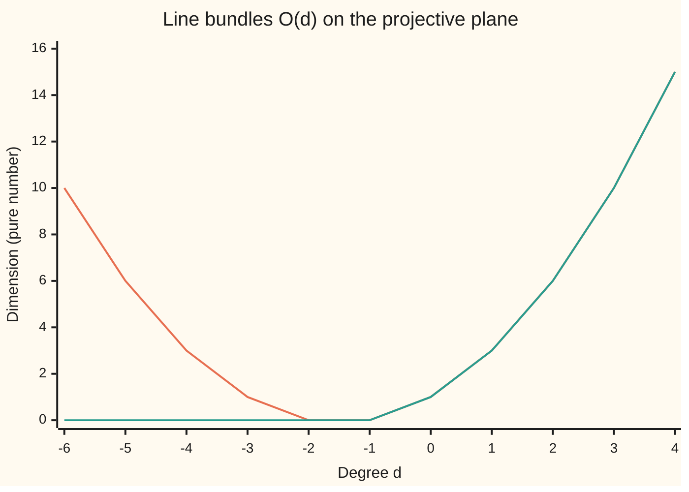

# Chern classes and Hirzebruch-Riemann-Roch: the Euler characteristic of a bundle from its classes

[Syllabus](../../../SYLLABUS.md) → [Algebraic geometry](../README.md) → [Intersection Theory and Surfaces](../README.md#s09) → Chern classes and Hirzebruch-Riemann-Roch

---

## General Overview

A cubic curve in the plane has an equation with 10 coefficients, one for each of the monomials $`x^3, x^2y, \dots, z^3`$. So the cubic equations form a 10-dimensional space. An equation and any nonzero multiple of it give the same curve, so the curves themselves form a family one dimension smaller. Listing monomials settles this count on the projective plane $`\mathbb{P}^2`$. Most other varieties have no such list.

The shelf's house example is the smooth cubic surface: the plane blown up at 6 points, with its 27 lines. There, no list of monomials counts its functions. They are sections of a line bundle (a family of one-dimensional spaces, one over each point, [Line bundles and divisors](../05-Cohomology%20and%20the%20Hodge%20Conjecture/06-line-bundles-and-divisor-classes.md)).

The Hirzebruch-Riemann-Roch theorem answers such questions with a few numbers. Each bundle gets **Chern classes**: classes in the Chow ring (curves and points up to deformation, [The Chow ring](01-chow-rings-and-intersection-products.md)) that record how it twists. Each variety gets a **Todd class**, built from its tangent bundle's Chern classes. Multiply the two, keep the point part, and the result is the bundle's Euler characteristic.

On $`\mathbb{P}^2`$ the recipe returns 10 for the cubics. On the cubic surface it returns 4 for the bundle of "minus the canonical class". Those 4 sections are the coordinates of $`\mathbb{P}^3`$, so the surface sits in 3-space, and its equation there is a cubic.

**The Euler characteristic of a vector bundle on a smooth projective variety, the alternating sum of its cohomology dimensions, equals the point part of its Chern character times the Todd class of the variety; so it depends only on Chern classes, which multiply and add like ordinary numbers.**

**What kind of fact this is:** a theorem. This card proves it for line bundles on $`\mathbb{P}^2`$ (Why it works, Step 4), extends it to every bundle on the plane (Step 5), and states the general case with its source. The splitting principle is stated with a source, not proved.

### The picture: Euler characteristic against sections



The first line (orange) is the Euler characteristic $`\chi(\mathcal{O}(d)) = (d + 1)(d + 2)/2`$ from Hirzebruch-Riemann-Roch: a parabola, unchanged when d is replaced by $`-3 - d`$ (Serre duality). The second line (green) is $`h^0`$, the number of independent forms of degree d. The two agree from $`d = -2`$ up. For $`d \le -3`$ the Euler characteristic is all top cohomology, $`h^2`$, and there are no sections.

---

## The formula

Notation first, in words. The field is $`\mathbb{C}`$ throughout. X is a smooth projective variety of dimension n, and S is a smooth projective surface.

- A **vector bundle** E of **rank** r is a family of r-dimensional spaces, one over each point of X, glued between charts by invertible r × r matrices. A line bundle is rank 1. The **tangent bundle** $`T_X`$ has rank n: the tangent space at each point.
- $`h^i(X, E)`$ is the dimension of the i-th sheaf cohomology group of E ([Serre duality](../08-Sheaf%20Cohomology%20and%20Differentials/06-serre-duality-and-riemann-roch.md)). $`h^0`$ counts the global sections. The **Euler characteristic** is the alternating sum $`\chi(X, E) = h^0 - h^1 + h^2 - \dots`$.
- The **Chern classes** $`c_i(E)`$ lie in $`A^i(X)`$, the codimension-i part of the Chow ring. The **total Chern class** is $`c(E) = 1 + c_1(E) + c_2(E) + \dots`$. For a line bundle, $`c(L) = 1 + c_1(L)`$, with $`c_1`$ the divisor class.
- **Chern roots** $`\alpha_1, \dots, \alpha_r`$ are formal classes with $`c(E) = (1 + \alpha_1)\cdots(1 + \alpha_r)`$. They exist after a change of space that keeps the Chow ring (the splitting principle, Step 1).
- The **Chern character** is $`\mathrm{ch}(E) = e^{\alpha_1} + \dots + e^{\alpha_r}`$, and the **Todd class** is $`\mathrm{td}(E) = \prod \alpha_i/(1 - e^{-\alpha_i})`$. Both are power series in the roots, cut off above dimension n. Write $`\mathrm{td}(X)`$ for $`\mathrm{td}(T_X)`$.
- $`\int_X`$ takes the point part of a class, the number in front of the class of a point.

The theorem:

```math
\chi(X, E) = \int_X \mathrm{ch}(E)\,\mathrm{td}(X)
```

**Read it aloud:** the Euler characteristic of E is the point part of the Chern character of E times the Todd class of X.

On $`\mathbb{P}^2`$, with H the class of a line and $`H^2 = 1`$ (one point), and $`\mathcal{O}(d)`$ the line bundle whose sections are the forms of degree d:

```math
\mathrm{ch}(\mathcal{O}(d)) = 1 + dH + \tfrac{d^2}{2}H^2, \qquad \mathrm{td}(\mathbb{P}^2) = 1 + \tfrac{3}{2}H + H^2, \qquad \chi(\mathcal{O}(d)) = \tfrac{d^2}{2} + \tfrac{3d}{2} + 1 = \tfrac{(d + 1)(d + 2)}{2}
```

**Read it aloud:** multiply the two series, keep the $`H^2`$ part, and get d squared over 2, plus 3d over 2, plus 1: that is 10 at d = 3.

On a surface S with canonical class K (the class of the canonical bundle, [The canonical bundle and adjunction](../08-Sheaf%20Cohomology%20and%20Differentials/02-canonical-bundle-and-adjunction.md)) and Euler number e, the same theorem reads:

```math
\chi(\mathcal{O}(D)) = \chi(\mathcal{O}_S) + \tfrac{1}{2}D\cdot(D - K), \qquad \chi(\mathcal{O}_S) = \tfrac{1}{12}(K^2 + e)
```

**Read it aloud:** the Euler characteristic of the bundle of a divisor D is the Euler characteristic of the functions, plus half of D times D minus K; and the first term is K squared plus e, over 12 (Noether's formula).

| Symbol | Plain meaning | In our example | Push it up and the answer… |
| --- | --- | --- | --- |
| $`X`$, $`S`$, $`n`$ | a smooth projective variety; a smooth projective surface; the dimension | $`\mathbb{P}^2`$ and the cubic surface, n = 2 | more terms in each series |
| $`\mathbb{P}^1, \mathbb{P}^2, \mathbb{P}^3`$, $`\mathbb{A}^2`$ | projective line, plane, 3-space; the open (affine) plane | the plane, and the 3-space holding S | — |
| $`H`$, $`h`$ | the class of a line in $`\mathbb{P}^2`$; the class of a plane section of S | $`H^2 = 1`$; $`h^2 = 3`$ points on S | — |
| $`E`$, $`r`$, $`T_X`$ | a vector bundle; its rank; the tangent bundle | $`T_{\mathbb{P}^2}`$, rank 2 | more roots |
| $`\mathcal{O}(d)`$, $`\mathcal{O}(D)`$, $`\mathcal{O}_S`$ | the line bundle of degree-d forms; of a divisor D; the functions on S | $`\mathcal{O}(3)`$: the cubics | $`\chi`$ grows like $`d^2/2`$ |
| $`c_i(E)`$, $`c(E)`$ | the i-th Chern class; the total Chern class | $`c(T) = 1 + 3H + 3H^2`$ | — |
| $`\alpha_i`$ | Chern roots: formal line-bundle classes whose product rebuilds $`c(E)`$ | H, H, H for $`T \oplus \mathcal{O}`$ | — |
| $`\mathrm{ch}(E)`$ | the Chern character, a sum of exponentials of the roots | $`\mathrm{ch}(\mathcal{O}(3)) = 1 + 3H + \tfrac{9}{2}H^2`$ | — |
| $`\mathrm{td}(X)`$ | the Todd class, the correction from the tangent bundle | $`1 + \tfrac{3}{2}H + H^2`$ | — |
| $`h^i`$, $`\chi`$, $`\int_X`$ | cohomology dimensions; their alternating sum; the point part | $`\chi(\mathcal{O}(3)) = 10`$ | — |
| $`K`$, $`D`$, $`D \cdot D'`$ | the canonical class; a divisor; an intersection number | $`K = -3H`$ on the plane; $`K^2 = 3`$ on S | — |
| $`e`$ | the Euler number, equal to $`c_2(T_S)`$ on a surface | 3 for the plane, 9 for S | each blow-up adds 1 |

### When it holds

- **X smooth.** The tangent bundle is a vector bundle only at smooth points, so $`\mathrm{td}(X)`$ needs smoothness. Singular varieties need a different Todd class (Fulton, chapter 18).
- **X projective, so compact.** On the open plane $`\mathbb{A}^2`$ the polynomials of degree at most 3, 6, 9 number 10, 28, 55, with no limit: $`h^0`$ is infinite and $`\chi`$ means nothing.
- **It computes $`\chi`$, not $`h^0`$.** The count of sections comes out only when the higher cohomology vanishes. On $`\mathbb{P}^2`$ that is $`d \ge -2`$; at $`d = -4`$ the formula gives 3 and there are no sections.
- **Rational numbers in the middle.** ch and td carry fractions such as 9/2 and 1/12. The theorem says the total is a whole number, and that is a real constraint (Step 6).
- **The field.** The algebraic statement holds over any algebraically closed field (Grothendieck's form). Reading $`c_2`$ as the topological Euler number uses $`\mathbb{C}`$.

---

## Why it works

### Step 0: the Euler characteristic is additive, so it depends on very little

A short exact sequence $`0 \to E' \to E \to E'' \to 0`$ (E' sits inside E, and E'' is what is left; [Exact sequences of modules](../07-Exact%20Sequences%2C%20Ext%20and%20Tor/01-exact-sequences-and-the-snake-lemma.md)) gives a long exact sequence in cohomology. Alternating sums along an exact sequence cancel, so $`\chi(E) = \chi(E') + \chi(E'')`$.

So $`\chi`$ behaves like a linear function of the bundle. A linear function is fixed by its values on a few building blocks. On $`\mathbb{P}^2`$ the building blocks are the $`\mathcal{O}(d)`$, and on them $`\chi`$ is a polynomial of degree 2 in d (the Hilbert polynomial, [Degree](../02-Affine%20and%20Projective%20Varieties/09-degree-and-the-hilbert-polynomial.md)). The theorem names that polynomial, and its version for every variety, in terms of Chern classes.

### Step 1: Chern classes by the splitting principle

Three rules define the Chern classes.

1. A line bundle L has $`c(L) = 1 + c_1(L)`$, where $`c_1(L)`$ is its divisor class.
2. **Whitney's rule:** for $`0 \to E' \to E \to E'' \to 0`$, $`c(E) = c(E')\,c(E'')`$.
3. **Pull-back:** pulling a bundle back along a map pulls its Chern classes back with it.

If E is built from line bundles $`L_1, \dots, L_r`$ by such sequences, the rules force $`c(E) = \prod (1 + c_1(L_i))`$. The **splitting principle** says every bundle is built this way after pulling back to a larger space, the space of complete flags (nested chains of subspaces, one of each dimension) in its fibres. That pull-back loses no classes: the Chow ring of X sits inside the Chow ring of the flag space. So any identity proved for split bundles holds for all bundles.

This is why Chern roots work. Write $`c(E) = \prod(1 + \alpha_i)`$. Any formula symmetric in the $`\alpha_i`$ is a formula in the $`c_i`$. Fulton (chapter 3) and Eisenbud and Harris (chapter 5) prove the splitting principle.

### Step 2: the tangent bundle of the plane, by the Euler sequence

A tangent vector at a point $`(x : y : z)`$ is a velocity $`(\dot x, \dot y, \dot z)`$, up to adding a multiple of $`(x, y, z)`$. Moving along that direction rescales the coordinates and does not move the point. Each velocity coordinate has degree 1, so the velocities form $`\mathcal{O}(1)^{\oplus 3}`$, and the multiples form one copy of $`\mathcal{O}`$:

```math
0 \to \mathcal{O} \to \mathcal{O}(1)^{\oplus 3} \to T_{\mathbb{P}^2} \to 0, \qquad c(T) = (1 + H)^3 = 1 + 3H + 3H^2
```

**Read it aloud:** the trivial bundle sits inside three copies of O(1), with the tangent bundle as quotient, so the total Chern class of T is 1 plus H, cubed.

So $`c_1(T) = 3H`$, which is $`-K`$: the canonical bundle of the plane is $`\mathcal{O}(-3)`$. And $`c_2(T) = 3H^2 = 3`$ points.

The top Chern class of the tangent bundle counts the zeros of a vector field, each with its sign. The flow $`(x : y : z) \mapsto (x : e^t y : e^{2t} z)`$ moves every point except $`(1 : 0 : 0)`$, $`(0 : 1 : 0)`$ and $`(0 : 0 : 1)`$. Its vector field has 3 zeros, each counted +1 because the field is holomorphic. That is the Euler number of $`\mathbb{P}^2`$: 3.

### Step 3: the Chern character turns sums into sums and products into products

The exponential is the one series that turns sums into products. Applied root by root:

- $`\mathrm{ch}(E \oplus F) = \mathrm{ch}(E) + \mathrm{ch}(F)`$, since the roots of a sum are the two lists together.
- $`\mathrm{ch}(E \otimes F) = \mathrm{ch}(E)\,\mathrm{ch}(F)`$, since the roots of a tensor product ([Tensor products](../../03-Algebra/11-Duals%2C%20Quotients%20and%20Tensors/03-tensor-products.md)) are the sums $`\alpha_i + \beta_j`$.

So ch is additive along exact sequences, like $`\chi`$. Examples: $`\mathcal{O}(d) = \mathcal{O}(1)^{\otimes d}`$, so $`\mathrm{ch}(\mathcal{O}(d)) = e^{dH} = 1 + dH + \tfrac{d^2}{2}H^2`$. And $`\mathrm{ch}(T) = 3e^H - 1 = 2 + 3H + \tfrac{3}{2}H^2`$.

In Chern classes, $`\mathrm{ch} = r + c_1 + \tfrac{1}{2}(c_1^2 - 2c_2) + \dots`$. Solve for $`c_2`$ from $`\mathrm{ch}(T)`$: $`c_2 = (9 - 3)/2 = 3`$, a second road to the Euler number.

### Step 4: the Todd class is the correction that makes the count whole

The point part of ch alone is not $`\chi`$. On $`\mathbb{P}^2`$, $`\int \mathrm{ch}(\mathcal{O}(3)) = 9/2`$, not even a whole number. On the projective line, $`\int \mathrm{ch}(\mathcal{O}(d)) = d`$, while there are $`d + 1`$ forms of degree d. Something attached to the variety must supply the rest.

Hirzebruch's answer: one factor $`\alpha/(1 - e^{-\alpha})`$ per root of the tangent bundle. Its series is

```math
\frac{\alpha}{1 - e^{-\alpha}} = 1 + \tfrac{1}{2}\alpha + \tfrac{1}{12}\alpha^2 + \dots, \qquad \mathrm{td} = 1 + \tfrac{1}{2}c_1 + \tfrac{1}{12}(c_1^2 + c_2) + \dots
```

**Read it aloud:** each root contributes 1 plus half the root plus a twelfth of its square; multiplied out, the Todd class is 1 plus half the first Chern class plus a twelfth of the first squared plus the second.

On the projective line, $`c_1(T) = 2H`$, so $`\mathrm{td} = 1 + H`$ and the missing 1 appears. On $`\mathbb{P}^2`$ the tangent bundle plus $`\mathcal{O}`$ has roots H, H, H (Step 2), and $`\mathcal{O}`$ adds a factor 1. Cubing the series gives $`1 + \tfrac{3}{2}H + H^2`$. The Chern-class form gives the same: $`1 + \tfrac{3}{2}H + \tfrac{9 + 3}{12}H^2`$.

Now multiply, keeping only the $`H^2`$ terms, for d = 3:

```math
\int_{\mathbb{P}^2} \Big(1 + 3H + \tfrac{9}{2}H^2\Big)\Big(1 + \tfrac{3}{2}H + H^2\Big) = \tfrac{9}{2} + 3 \cdot \tfrac{3}{2} + 1 = 10
```

**Read it aloud:** nine halves, plus three times three halves, plus one, is ten: the number of cubic monomials.

<details>
<summary>Detailed proof: on projective n-space the formula gives the number of degree-d forms, for every d</summary>

On $`\mathbb{P}^n`$ the Euler sequence gives n + 1 roots equal to H, so the claim is that the coefficient of $`H^n`$ in $`e^{dH}\,(H/(1 - e^{-H}))^{n+1}`$ is $`\binom{d + n}{n}`$.

A coefficient of $`H^n`$ is a residue: the coefficient of $`1/H`$ in the series divided by $`H^{n+1}`$. So the number wanted is the residue at 0 of

$`\displaystyle \frac{e^{dH}}{(1 - e^{-H})^{n+1}}\,dH.`$

Substitute $`u = 1 - e^{-H}`$. Then $`e^{-H} = 1 - u`$, so $`e^{dH} = (1 - u)^{-d}`$ and $`dH = du/(1 - u)`$. The substitution sends 0 to 0 with derivative 1, so residues are kept, and the residue becomes

$`\displaystyle \mathrm{Res}_{u = 0}\, \frac{(1 - u)^{-(d+1)}}{u^{n+1}}\,du,`$

the coefficient of $`u^n`$ in $`(1 - u)^{-(d+1)}`$. By the binomial series that coefficient is $`\binom{d + n}{n}`$, for every integer d, negative ones included. For n = 2 it is $`(d + 1)(d + 2)/2`$.

The other side: the Čech complex of the standard charts gives $`h^0(\mathcal{O}(d))`$ = the monomials of degree d with all powers at least 0, $`h^n(\mathcal{O}(d))`$ = the Laurent monomials of degree d with all powers at most −1, and nothing in between ([Serre duality](../08-Sheaf%20Cohomology%20and%20Differentials/06-serre-duality-and-riemann-roch.md)). For n = 2 both counts are $`(d + 1)(d + 2)/2`$ in their range, so $`\chi(\mathcal{O}(d)) = (d + 1)(d + 2)/2`$ for every d. The two sides agree.

</details>

### Step 5: from line bundles to every bundle on the plane

Both sides of the theorem are additive along short exact sequences: $`\chi`$ by Step 0, and $`\mathrm{ch}`$ by Step 3, while $`\mathrm{td}(X)`$ does not depend on E.

Every vector bundle on $`\mathbb{P}^2`$ has a finite resolution by sums of line bundles $`\mathcal{O}(d)`$: an exact sequence that ends in the bundle, with a sum of line bundles $`\mathcal{O}(d)`$ in every other place ([Hilbert's syzygy theorem](../07-Exact%20Sequences%2C%20Ext%20and%20Tor/06-hilbert-syzygy-theorem.md), applied to its graded module of sections). Additivity carries the formula from the $`\mathcal{O}(d)`$, proved in Step 4, to every bundle. The tangent bundle is a test: Hirzebruch-Riemann-Roch gives

```math
\chi(T) = \int \Big(2 + 3H + \tfrac{3}{2}H^2\Big)\Big(1 + \tfrac{3}{2}H + H^2\Big) = 2 + \tfrac{9}{2} + \tfrac{3}{2} = 8
```

**Read it aloud:** two plus nine halves plus three halves is eight.

The Euler sequence gives $`3\chi(\mathcal{O}(1)) - \chi(\mathcal{O}) = 9 - 1 = 8`$. And 8 is the dimension of the 3 × 3 matrices modulo scalars, the plane's infinitesimal symmetries: its vector fields.

For a general smooth projective X there is no such resolution by line bundles. Hirzebruch proved the theorem in 1954 by cobordism (a topological way of comparing manifolds), and Grothendieck reproved it in 1957 as a statement about maps between varieties (Grothendieck-Riemann-Roch, only named here). Hirzebruch's book and Fulton (chapter 15) give the proofs.

### Step 6: Riemann-Roch on a surface, and the cubic surface

Expand the theorem on a surface with $`c_1(T_S) = -K`$ and $`c_2(T_S) = e`$. For a line bundle $`\mathcal{O}(D)`$, $`\mathrm{ch} = 1 + D + \tfrac{1}{2}D^2`$ and $`\mathrm{td} = 1 - \tfrac{1}{2}K + \tfrac{1}{12}(K^2 + e)`$. The point part is

```math
\chi(\mathcal{O}(D)) = \tfrac{1}{2}D^2 - \tfrac{1}{2}D\cdot K + \tfrac{1}{12}(K^2 + e)
```

**Read it aloud:** half of D squared, minus half of D times K, plus a twelfth of K squared plus e.

At D = 0 this is Noether's formula, $`\chi(\mathcal{O}_S) = (K^2 + e)/12`$. It forces $`K^2 + e`$ to be a multiple of 12: on the plane, 9 + 3 = 12. On the plane, $`D = dH`$ and $`K = -3H`$ give $`1 + d(d + 3)/2`$, the same parabola again. On a curve of genus g the same expansion gives $`\deg D + 1 - g`$, the Riemann-Roch theorem of [Divisors and Riemann-Roch](../03-Plane%20Curves/07-divisors-and-riemann-roch.md).

The cubic surface S needs $`K^2`$ and e. Two roads:

1. **As a blow-up.** Blowing up a point adds a line, so it raises e by 1, and lowers $`K^2`$ by 1 ([Blowing up](../03-Plane%20Curves/05-blowing-up-a-point.md); the intersection side is on [Intersection numbers on a surface](03-intersection-numbers-on-surfaces-and-blow-ups.md)). Six points: $`K^2 = 9 - 6 = 3`$ and $`e = 3 + 6 = 9`$.
2. **As a cubic in $`\mathbb{P}^3`$.** The tangent bundle of $`\mathbb{P}^3`$, restricted to S, contains $`T_S`$, with the normal bundle $`\mathcal{O}(3)`$ as quotient. Whitney's rule gives $`c(T_S) = (1 + h)^4/(1 + 3h) = 1 + h + 3h^2`$. A plane meets S in a cubic curve, which meets another plane in 3 points, so $`h^2 = 3`$. Then $`K^2 = c_1^2 = 3`$ and $`e = c_2 = 9`$.

Noether gives $`\chi(\mathcal{O}_S) = (3 + 9)/12 = 1`$. For $`D = -K`$, $`\chi(\mathcal{O}(-K)) = 1 + \tfrac{1}{2}(-K)\cdot(-2K) = 1 + K^2 = 4`$. The higher cohomology of $`-K`$ vanishes here (Kodaira vanishing, since $`-2K`$ is ample, meaning some multiple of it embeds S in projective space; Hartshorne, chapter III, section 7), so S has exactly 4 independent sections of $`-K`$.

On the blow-up model those sections are the plane cubics through the 6 points. Each point imposes one linear condition on the 10 coefficients. With points in general position (no 3 on a line, not all 6 on a conic) the conditions are independent: 10 − 6 = 4. The two answers agree, and the 4 cubics are the map from the plane to $`\mathbb{P}^3`$ whose image is S.

---

## Worked numbers, by hand

| Step | Arithmetic | Value |
| --- | --- | --- |
| Todd series of one root | $`1/(1 - \tfrac{1}{2}H + \tfrac{1}{6}H^2)`$ | $`1 + \tfrac{1}{2}H + \tfrac{1}{12}H^2`$ |
| Todd class of $`\mathbb{P}^2`$ | cube it; or $`1 + \tfrac{3}{2}H + \tfrac{9 + 3}{12}H^2`$ | $`1 + \tfrac{3}{2}H + H^2`$ |
| ch of $`\mathcal{O}(3)`$ | $`e^{3H}`$ | $`1 + 3H + \tfrac{9}{2}H^2`$ |
| $`\chi(\mathcal{O}(3))`$ | $`\tfrac{9}{2} + \tfrac{9}{2} + 1`$ | **10** |
| $`c(T)`$ and Euler number | $`(1 + H)^3`$; zeros of the flow | 1 + 3H + 3H², **3** |
| $`\chi(T)`$ | $`2 + \tfrac{9}{2} + \tfrac{3}{2}`$; or 3 × 3 − 1 | 8 |
| cubic surface | $`K^2 = 9 - 6`$, $`e = 3 + 6`$ | 3 and 9 |
| $`\chi(\mathcal{O}_S)`$ and $`\chi(-K)`$ | (3 + 9)/12; 1 + 3 | 1 and **4** |
| cubics through 6 points | 10 − 6 | **4** |

The plane carries 10 independent cubics and Euler number 3; the cubic surface carries 4 sections of $`-K`$, the 4 coordinates of the 3-space it lives in.

### What breaks if you drop a piece

| Mistake | Comes out at | What went wrong |
| --- | --- | --- |
| No Todd class: $`\chi = \int \mathrm{ch}`$ | 9/2 for $`\mathcal{O}(3)`$ | the variety's own correction is missing; not even a whole number |
| Todd class cut to $`1 + \tfrac{1}{2}c_1`$ | 9 for $`\mathcal{O}(3)`$ | short by $`\chi(\mathcal{O}) = 1`$, the $`H^2`$ term of td |
| The open plane $`\mathbb{A}^2`$, not compact | polynomials of degree ≤ 3, 6, 9: 10, 28, 55, no limit | compactness fails, $`h^0`$ is infinite |
| $`\chi`$ read as $`h^0`$ at d = −4 | $`h^0 = 0`$, yet $`\chi = 3`$ | all of it is $`h^2`$; the higher cohomology did not vanish |
| $`c_2`$ taken as $`c_1^2`$ | Euler number 9, not 3 | $`c_2`$ is its own class; ch mixes them as $`c_1^2 - 2c_2`$ |

The code prints all five.

---

## Code, from first principles, and it actually runs

The code works with exact fractions in $`\mathbb{Q}[H]/(H^3)`$, where $`H^2`$ is one point. It takes three independent roads to $`\chi(\mathcal{O}(d))`$ for d from −6 to 4:

1. Hirzebruch-Riemann-Roch: the Todd series by power-series inversion, cubed, checked against the Chern-class form, times $`e^{dH}`$.
2. A Čech count with no Chern classes: monomials of degree d with all powers at least 0, plus Laurent monomials with all powers at most −1.
3. The surface formula $`1 + D\cdot(D - K)/2`$.

It reaches $`c_2(T) = 3`$ three ways and $`\chi(T) = 8`$ two ways: by Hirzebruch-Riemann-Roch, and by the Euler sequence with the Čech counts. For the cubic surface it reaches $`K^2`$ and e two ways, then checks $`\chi(-K) = 4`$ against the exact rank of the cubics through 6 points. It prints every row of What breaks.

### Python

```python
# Chern classes and Hirzebruch-Riemann-Roch -- the check behind the card.  Standard library only.
# Classes on P^2 live in Q[H]/(H^3): a list [a0, a1, a2] means a0 + a1 H + a2 H^2, and H^2 = one point.
# Road 1: Hirzebruch-Riemann-Roch, chi = the H^2 coefficient of ch times td.
# Road 2: Cech count: monomials of degree d with all powers >= 0 (h^0) or all <= -1 (h^2).
# Road 3: Riemann-Roch for surfaces, and on the cubic surface an exact rank count of plane cubics.
from fractions import Fraction as Fr
from itertools import combinations

def mul(a, b):                                         # product in Q[H]/(H^3)
    return [sum(a[i] * b[k - i] for i in range(k + 1)) for k in range(3)]

def inv(a):                                            # 1/a as a power series, a[0] = 1
    b = [Fr(1), Fr(0), Fr(0)]
    for k in (1, 2): b[k] = -sum(a[i] * b[k - i] for i in range(1, k + 1))
    return b

def fact(n): return 1 if n < 2 else n * fact(n - 1)
def expH(t): return [Fr(t) ** k / fact(k) for k in range(3)]   # e^(tH), the Chern character of O(t)
def s(x): return str(x)
def pol(a, v):                                         # a0 + a1 v + a2 v^2, fractions in brackets
    out = s(a[0])
    for k, x in ((1, a[1]), (2, a[2])):
        x = Fr(x); co = "" if x == 1 else s(x) if x.denominator == 1 else f"({s(x)})"
        out += f" + {co}{v}" + ("^2" if k == 2 else "")
    return out

# The Todd class of P^2, two ways.  Euler sequence: T + O = O(1) + O(1) + O(1), so the Chern roots are H, H, H.
q = inv([Fr((-1) ** k, fact(k + 1)) for k in range(3)])  # H / (1 - e^(-H)) = 1/((1 - e^(-H))/H)
td = mul(mul(q, q), q)                                 # one factor per Chern root
c = mul(mul([1, 1, 0], [1, 1, 0]), [1, 1, 0])          # c(T) = (1 + H)^3, Whitney's product rule
c1, c2 = c[1], c[2]
td2 = [Fr(1), Fr(c1, 2), Fr(c1 * c1 + c2, 12)]         # 1 + c1/2 + (c1^2 + c2)/12
print("road 1, the Todd class of P^2")
print(f"H/(1 - e^(-H)) = {pol(q, 'H')}; cubed: td = {pol(td, 'H')}")
print(f"c(T) = (1 + H)^3 = {pol(c, 'H')}; 1 + c1/2 + (c1^2 + c2)/12 = {pol(td2, 'H')}")
assert td == td2 == [1, Fr(3, 2), 1]                   # series against the Chern-class formula

def chi_hrr(d): return mul(expH(d), td)[2]
def h0(d): return sum(1 for a in range(d + 1) for b in range(d + 1 - a))          # powers a, b, d - a - b >= 0
def h2(d): return sum(1 for a in range(d, 0) for b in range(d, 0) if d - a - b <= -1)  # all powers <= -1
ds = list(range(-6, 5))
print("road 1 against road 2 against road 3: line bundles O(d) on P^2")
print(f"{'d':<24}" + "".join(f"{d:>5}" for d in ds))
rows = [("chi, Hirzebruch-RR", chi_hrr), ("h^0, monomials", h0), ("h^2, negative monomials", h2),
        ("(d + 1)(d + 2)/2", lambda d: Fr((d + 1) * (d + 2), 2)),
        ("1 + D.(D - K)/2, K = -3H", lambda d: 1 + Fr(d * (d + 3), 2))]
for name, f in rows: print(f"{name:<24}" + "".join(f"{s(f(d)):>5}" for d in ds))
for d in ds: assert chi_hrr(d) == h0(d) + h2(d) == Fr((d + 1) * (d + 2), 2) == 1 + Fr(d * (d + 3), 2)
ch3 = expH(3)
print(f"d = 3: ch = {pol(ch3, 'H')}; H^2 terms {s(ch3[2])} + {s(ch3[1] * td[1])} + {s(td[2])} = {s(chi_hrr(3))} plane cubics")
sym = all(chi_hrr(d) == chi_hrr(-3 - d) for d in ds)
print(f"Serre symmetry chi(O(d)) = chi(O(-3 - d)) for d = -6 to 4: {'yes' if sym else 'no'}")

print("the tangent bundle T of P^2")
chT = [3 * x for x in expH(1)]; chT[0] -= 1             # ch(T) = 3e^H - 1, from the Euler sequence
c2n = Fr(chT[1] ** 2 - 2 * chT[2], 2)                  # ch2 = (c1^2 - 2 c2)/2, solved for c2
w = (0, 1, 2)                                          # the flow (x : y : z) -> (x : e^t y : e^2t z)
supports = [S for r in (1, 2, 3) for S in combinations(range(3), r)]   # which coordinates are nonzero
zeros = [S for S in supports                           # (x, y, z) parallel to (0x, 1y, 2z): all 2 x 2 minors 0
         if all(not (i in S and j in S) or w[i] == w[j] for i, j in combinations(range(3), 2))]
chiT, euler_seq = mul(chT, td)[2], 3 * (h0(1) + h2(1)) - (h0(0) + h2(0))   # Euler sequence, with the Cech counts
pt = lambda S: "(" + " : ".join(("*" if len(S) > 1 else "1") if i in S else "0" for i in range(3)) + ")"   # * = any nonzero value
print(f"ch(T) = {pol(chT, 'H')}; c2 from ch2 = {s(c2n)}; c2 from (1 + H)^3 = {c2}")
print(f"zeros of the vector field ({w[0]}x, {w[1]}y, {w[2]}z): {len(zeros)}, at " + ", ".join(pt(S) for S in zeros))
print(f"chi(T) by HRR = {s(chiT)}; by the Euler sequence and Cech counts 3 x {h0(1) + h2(1)} - {h0(0) + h2(0)} = {s(euler_seq)}; 3 x 3 matrices mod scalars: {9 - 1}")
assert c2n == c2 == len(zeros) == 3 and chiT == euler_seq == 8

print("the cubic surface S: P^2 blown up at 6 points")
cS = mul([Fr(1), 4, 6], inv([Fr(1), 3, 0]))            # c(T_S) = (1 + h)^4 / (1 + 3h), h^2 = 3 points on S
K2_hyp, e_hyp = cS[1] ** 2 * 3, cS[2] * 3
K2_blow, e_blow = 9 - 6, 3 + 6                         # each blow-up: K^2 down 1, Euler number up 1
chiO = Fr(K2_hyp + e_hyp, 12)                          # Noether's formula
chi_antiK = chiO + Fr(2 * K2_hyp, 2)                   # D = -K: D.(D - K)/2 = (-K).(-2K)/2 = K^2
pts = [(1, 0, 0), (0, 1, 0), (0, 0, 1), (1, 1, 1), (1, 2, 3), (1, 3, 2)]

def rank(M):                                           # exact rank by Gaussian elimination
    M, r = [[Fr(x) for x in row] for row in M], 0
    for col in range(len(M[0])):
        piv = next((i for i in range(r, len(M)) if M[i][col] != 0), None)
        if piv is None: continue
        M[r], M[piv] = M[piv], M[r]
        for i in range(r + 1, len(M)):
            f = M[i][col] / M[r][col]; M[i] = [a - f * b for a, b in zip(M[i], M[r])]
        r += 1
    return r

def monos(n): return [(a, b, n - a - b) for a in range(n + 1) for b in range(n + 1 - a)]
def ev(p, m): return p[0] ** m[0] * p[1] ** m[1] * p[2] ** m[2]
lines_ok = all(rank([list(p) for p in t]) == 3 for t in combinations(pts, 3))
conic_rank = rank([[ev(p, m) for m in monos(2)] for p in pts])
cubic_rank = rank([[ev(p, m) for m in monos(3)] for p in pts])
print(f"c(T_S) = {pol(cS, 'h')}, h^2 = 3 points: K^2 = {s(K2_hyp)}, Euler number = {s(e_hyp)}; by blow-ups {K2_blow} and {e_blow}")
print(f"Noether chi(O_S) = (K^2 + e)/12 = ({s(K2_hyp)} + {s(e_hyp)})/12 = {s(chiO)}; Riemann-Roch chi(-K) = 1 + K^2 = {s(chi_antiK)}")
print("points " + ", ".join("(%d : %d : %d)" % p for p in pts) + f": no 3 on a line {'yes' if lines_ok else 'no'}; conic rank {conic_rank} of 6")
print(f"plane cubics through them: 10 - rank {cubic_rank} = {10 - cubic_rank} = sections of -K, so S sits in P^3")
assert K2_hyp == K2_blow == 3 and e_hyp == e_blow == 9 and chiO == 1
assert sym and lines_ok and conic_rank == 6 and chi_antiK == 10 - cubic_rank == 4

print("what breaks")
print(f"mistake 1, no Todd class: chi(O(3)) = H^2 term of ch = {s(ch3[2])}, not a whole number")
print(f"mistake 2, td cut to 1 + c1/2: chi(O(3)) = {s(ch3[2] + ch3[1] * td[1])}, short by chi(O) = {s(chi_hrr(0))}")
aff = [sum(1 for a in range(n + 1) for b in range(n + 1 - a)) for n in (3, 6, 9)]   # x^a y^b, a + b <= n
print(f"mistake 3, the open plane A^2, not compact: polynomials of degree <= 3, 6, 9: {aff[0]}, {aff[1]}, {aff[2]}, no limit")
print(f"mistake 4, chi read as h^0 at d = -4: h^0 = {h0(-4)}, but chi = {s(chi_hrr(-4))}, all in h^2")
print(f"mistake 5, c2 taken as c1^2: Euler number {c1 * c1}, not {c2}")
assert ch3[2] == Fr(9, 2) and h0(-4) == 0 and h2(-4) == 3 and aff == [10, 28, 55]
print("ALL CHECKS PASS")
```

**Ran 2026-11-24 on macOS, Python 3.14.10, standard library only. All checks passed. Output, pasted from the run:**

```
road 1, the Todd class of P^2
H/(1 - e^(-H)) = 1 + (1/2)H + (1/12)H^2; cubed: td = 1 + (3/2)H + H^2
c(T) = (1 + H)^3 = 1 + 3H + 3H^2; 1 + c1/2 + (c1^2 + c2)/12 = 1 + (3/2)H + H^2
road 1 against road 2 against road 3: line bundles O(d) on P^2
d                          -6   -5   -4   -3   -2   -1    0    1    2    3    4
chi, Hirzebruch-RR         10    6    3    1    0    0    1    3    6   10   15
h^0, monomials              0    0    0    0    0    0    1    3    6   10   15
h^2, negative monomials    10    6    3    1    0    0    0    0    0    0    0
(d + 1)(d + 2)/2           10    6    3    1    0    0    1    3    6   10   15
1 + D.(D - K)/2, K = -3H   10    6    3    1    0    0    1    3    6   10   15
d = 3: ch = 1 + 3H + (9/2)H^2; H^2 terms 9/2 + 9/2 + 1 = 10 plane cubics
Serre symmetry chi(O(d)) = chi(O(-3 - d)) for d = -6 to 4: yes
the tangent bundle T of P^2
ch(T) = 2 + 3H + (3/2)H^2; c2 from ch2 = 3; c2 from (1 + H)^3 = 3
zeros of the vector field (0x, 1y, 2z): 3, at (1 : 0 : 0), (0 : 1 : 0), (0 : 0 : 1)
chi(T) by HRR = 8; by the Euler sequence and Cech counts 3 x 3 - 1 = 8; 3 x 3 matrices mod scalars: 8
the cubic surface S: P^2 blown up at 6 points
c(T_S) = 1 + h + 3h^2, h^2 = 3 points: K^2 = 3, Euler number = 9; by blow-ups 3 and 9
Noether chi(O_S) = (K^2 + e)/12 = (3 + 9)/12 = 1; Riemann-Roch chi(-K) = 1 + K^2 = 4
points (1 : 0 : 0), (0 : 1 : 0), (0 : 0 : 1), (1 : 1 : 1), (1 : 2 : 3), (1 : 3 : 2): no 3 on a line yes; conic rank 6 of 6
plane cubics through them: 10 - rank 6 = 4 = sections of -K, so S sits in P^3
what breaks
mistake 1, no Todd class: chi(O(3)) = H^2 term of ch = 9/2, not a whole number
mistake 2, td cut to 1 + c1/2: chi(O(3)) = 9, short by chi(O) = 1
mistake 3, the open plane A^2, not compact: polynomials of degree <= 3, 6, 9: 10, 28, 55, no limit
mistake 4, chi read as h^0 at d = -4: h^0 = 0, but chi = 3, all in h^2
mistake 5, c2 taken as c1^2: Euler number 9, not 3
ALL CHECKS PASS
```

### Rust

Same numbers, same labels, built with `rustc --edition 2021 -O`.

```rust
// Chern classes and Hirzebruch-Riemann-Roch -- the same check as the Python, in Rust.  No crates.
// Classes on P^2 live in Q[H]/(H^3): an array [a0, a1, a2] means a0 + a1 H + a2 H^2, and H^2 = one point.
// Road 1: Hirzebruch-Riemann-Roch, chi = the H^2 coefficient of ch times td.
// Road 2: Cech count: monomials of degree d with all powers >= 0 (h^0) or all <= -1 (h^2).
// Road 3: Riemann-Roch for surfaces, and on the cubic surface an exact rank count of plane cubics.
#[derive(Clone, Copy, PartialEq, Debug)]
struct Fr { n: i128, d: i128 }                         // a fraction in lowest terms, d > 0
fn gcd(a: i128, b: i128) -> i128 { if b == 0 { a.abs() } else { gcd(b, a % b) } }
fn fr(n: i128, d: i128) -> Fr {
    let g = gcd(n, d).max(1); let s = if d < 0 { -1 } else { 1 };
    Fr { n: s * n / g, d: s * d / g }
}
fn int(n: i128) -> Fr { fr(n, 1) }
fn add(a: Fr, b: Fr) -> Fr { fr(a.n.checked_mul(b.d).unwrap() + b.n.checked_mul(a.d).unwrap(), a.d.checked_mul(b.d).unwrap()) }
fn sub(a: Fr, b: Fr) -> Fr { add(a, fr(-b.n, b.d)) }
fn mulf(a: Fr, b: Fr) -> Fr { fr(a.n.checked_mul(b.n).unwrap(), a.d.checked_mul(b.d).unwrap()) }
fn divf(a: Fr, b: Fr) -> Fr { fr(a.n.checked_mul(b.d).unwrap(), a.d.checked_mul(b.n).unwrap()) }
fn s(x: Fr) -> String { if x.d == 1 { format!("{}", x.n) } else { format!("{}/{}", x.n, x.d) } }
type P = [Fr; 3];
fn mul(a: P, b: P) -> P {                              // product in Q[H]/(H^3)
    let mut c = [int(0); 3];
    for k in 0..3 { for i in 0..=k { c[k] = add(c[k], mulf(a[i], b[k - i])); } }
    c
}
fn inv(a: P) -> P {                                    // 1/a as a power series, a[0] = 1
    let mut b = [int(1), int(0), int(0)];
    for k in 1..3 { let mut t = int(0); for i in 1..=k { t = add(t, mulf(a[i], b[k - i])); } b[k] = fr(-t.n, t.d); }
    b
}
fn fact(n: i128) -> i128 { if n < 2 { 1 } else { n * fact(n - 1) } }
fn exp_h(t: i128) -> P { [int(1), int(t), fr(t * t, 2)] }   // e^(tH), the Chern character of O(t)
fn pol(a: P, v: &str) -> String {                      // a0 + a1 v + a2 v^2, fractions in brackets
    let mut out = s(a[0]);
    for k in 1..3 {
        let x = a[k];
        let co = if x == int(1) { String::new() } else if x.d == 1 { s(x) } else { format!("({})", s(x)) };
        out += &format!(" + {}{}{}", co, v, if k == 2 { "^2" } else { "" });
    }
    out
}
fn h0(d: i128) -> i128 { let mut n = 0; for a in 0..=d { for _b in 0..=(d - a) { n += 1; } } n }
fn h2(d: i128) -> i128 { let mut n = 0; for a in d..0 { for b in d..0 { if d - a - b <= -1 { n += 1; } } } n }
fn rank(m: &Vec<Vec<i128>>) -> usize {                 // exact rank by Gaussian elimination
    let mut m: Vec<Vec<Fr>> = m.iter().map(|r| r.iter().map(|&x| int(x)).collect()).collect();
    let mut r = 0;
    for col in 0..m[0].len() {
        let piv = (r..m.len()).find(|&i| m[i][col].n != 0);
        if piv.is_none() { continue; }
        m.swap(r, piv.unwrap());
        for i in r + 1..m.len() {
            let f = divf(m[i][col], m[r][col]);
            for j in 0..m[i].len() { m[i][j] = sub(m[i][j], mulf(f, m[r][j])); }
        }
        r += 1;
    }
    r
}
fn monos(n: u32) -> Vec<(u32, u32, u32)> { let mut v = vec![]; for a in 0..=n { for b in 0..=(n - a) { v.push((a, b, n - a - b)); } } v }
fn ev(p: (i128, i128, i128), m: (u32, u32, u32)) -> i128 { p.0.pow(m.0) * p.1.pow(m.1) * p.2.pow(m.2) }
fn triples(n: usize) -> Vec<(usize, usize, usize)> {
    let mut v = vec![];
    for i in 0..n { for j in i + 1..n { for k in j + 1..n { v.push((i, j, k)); } } }
    v
}
fn yn(b: bool) -> &'static str { if b { "yes" } else { "no" } }
fn main() {
    // The Todd class of P^2, two ways.  Euler sequence: T + O = O(1) + O(1) + O(1), Chern roots H, H, H.
    let q = inv([int(1), fr(-1, fact(2)), fr(1, fact(3))]);  // H / (1 - e^(-H)) = 1/((1 - e^(-H))/H)
    let td = mul(mul(q, q), q);                              // one factor per Chern root
    let one = [int(1), int(1), int(0)];
    let c = mul(mul(one, one), one);                         // c(T) = (1 + H)^3, Whitney's product rule
    let (c1, c2) = (c[1], c[2]);
    let td2 = [int(1), divf(c1, int(2)), divf(add(mulf(c1, c1), c2), int(12))];
    println!("road 1, the Todd class of P^2");
    println!("H/(1 - e^(-H)) = {}; cubed: td = {}", pol(q, "H"), pol(td, "H"));
    println!("c(T) = (1 + H)^3 = {}; 1 + c1/2 + (c1^2 + c2)/12 = {}", pol(c, "H"), pol(td2, "H"));
    assert!(td == td2 && td == [int(1), fr(3, 2), int(1)]);
    let chi = |d: i128| mul(exp_h(d), td)[2];
    let ds: Vec<i128> = (-6..5).collect();
    println!("road 1 against road 2 against road 3: line bundles O(d) on P^2");
    let row = |name: &str, f: &dyn Fn(i128) -> Fr| {
        let mut l = format!("{:<24}", name);
        for &d in &ds { l += &format!("{:>5}", s(f(d))); }
        println!("{}", l);
    };
    row("d", &|d| int(d));
    row("chi, Hirzebruch-RR", &|d| chi(d));
    row("h^0, monomials", &|d| int(h0(d)));
    row("h^2, negative monomials", &|d| int(h2(d)));
    row("(d + 1)(d + 2)/2", &|d| fr((d + 1) * (d + 2), 2));
    row("1 + D.(D - K)/2, K = -3H", &|d| add(int(1), fr(d * (d + 3), 2)));
    for &d in &ds { assert!(chi(d) == int(h0(d) + h2(d)) && chi(d) == fr((d + 1) * (d + 2), 2) && chi(d) == add(int(1), fr(d * (d + 3), 2))); }
    let ch3 = exp_h(3);
    println!("d = 3: ch = {}; H^2 terms {} + {} + {} = {} plane cubics", pol(ch3, "H"), s(ch3[2]), s(mulf(ch3[1], td[1])), s(td[2]), s(chi(3)));
    let sym = ds.iter().all(|&d| chi(d) == chi(-3 - d));
    println!("Serre symmetry chi(O(d)) = chi(O(-3 - d)) for d = -6 to 4: {}", yn(sym));

    println!("the tangent bundle T of P^2");
    let e1 = exp_h(1);
    let cht = [sub(mulf(int(3), e1[0]), int(1)), mulf(int(3), e1[1]), mulf(int(3), e1[2])];  // 3e^H - 1
    let c2n = divf(sub(mulf(cht[1], cht[1]), mulf(int(2), cht[2])), int(2));  // ch2 = (c1^2 - 2 c2)/2
    let w = [0, 1, 2];                                       // the flow (x : y : z) -> (x : e^t y : e^2t z)
    let mut zeros: Vec<String> = vec![];
    for mask in [1u32, 2, 4, 3, 5, 6, 7] {                   // which coordinates are nonzero, in the Python's order
        let on = |i: usize| mask >> i & 1 == 1;
        let mut ok = true;                                   // (x, y, z) parallel to (0x, 1y, 2z)
        for i in 0..3 { for j in i + 1..3 { if on(i) && on(j) && w[i] != w[j] { ok = false; } } }
        let c: Vec<&str> = (0..3).map(|i| if !on(i) { "0" } else if mask.count_ones() > 1 { "*" } else { "1" }).collect();
        if ok { zeros.push(format!("({})", c.join(" : "))); }   // * = any nonzero value
    }
    let chit = mul(cht, td)[2];
    let euler_seq = int(3 * (h0(1) + h2(1)) - (h0(0) + h2(0)));  // Euler sequence, with the Cech counts
    println!("ch(T) = {}; c2 from ch2 = {}; c2 from (1 + H)^3 = {}", pol(cht, "H"), s(c2n), s(c2));
    println!("zeros of the vector field ({}x, {}y, {}z): {}, at {}", w[0], w[1], w[2], zeros.len(), zeros.join(", "));
    println!("chi(T) by HRR = {}; by the Euler sequence and Cech counts 3 x {} - {} = {}; 3 x 3 matrices mod scalars: {}", s(chit), h0(1) + h2(1), h0(0) + h2(0), s(euler_seq), 9 - 1);
    assert!(c2n == c2 && c2 == int(zeros.len() as i128) && zeros.len() == 3 && chit == euler_seq && chit == int(8));

    println!("the cubic surface S: P^2 blown up at 6 points");
    let cs = mul([int(1), int(4), int(6)], inv([int(1), int(3), int(0)]));  // (1 + h)^4 / (1 + 3h), h^2 = 3
    let (k2_hyp, e_hyp) = (mulf(mulf(cs[1], cs[1]), int(3)), mulf(cs[2], int(3)));
    let (k2_blow, e_blow) = (9 - 6, 3 + 6);                  // each blow-up: K^2 down 1, Euler number up 1
    let chi_o = divf(add(k2_hyp, e_hyp), int(12));           // Noether's formula
    let chi_anti_k = add(chi_o, divf(mulf(int(2), k2_hyp), int(2)));  // D = -K: (-K).(-2K)/2 = K^2
    let pts: Vec<(i128, i128, i128)> = vec![(1, 0, 0), (0, 1, 0), (0, 0, 1), (1, 1, 1), (1, 2, 3), (1, 3, 2)];
    let lines_ok = triples(6).iter().all(|&(i, j, k)| rank(&vec![
        vec![pts[i].0, pts[i].1, pts[i].2], vec![pts[j].0, pts[j].1, pts[j].2], vec![pts[k].0, pts[k].1, pts[k].2]]) == 3);
    let mat = |n: u32| -> Vec<Vec<i128>> { pts.iter().map(|&p| monos(n).iter().map(|&m| ev(p, m)).collect()).collect() };
    let (conic_rank, cubic_rank) = (rank(&mat(2)), rank(&mat(3)));
    println!("c(T_S) = {}, h^2 = 3 points: K^2 = {}, Euler number = {}; by blow-ups {} and {}", pol(cs, "h"), s(k2_hyp), s(e_hyp), k2_blow, e_blow);
    println!("Noether chi(O_S) = (K^2 + e)/12 = ({} + {})/12 = {}; Riemann-Roch chi(-K) = 1 + K^2 = {}", s(k2_hyp), s(e_hyp), s(chi_o), s(chi_anti_k));
    let ps: Vec<String> = pts.iter().map(|p| format!("({} : {} : {})", p.0, p.1, p.2)).collect();
    println!("points {}: no 3 on a line {}; conic rank {} of 6", ps.join(", "), yn(lines_ok), conic_rank);
    println!("plane cubics through them: 10 - rank {} = {} = sections of -K, so S sits in P^3", cubic_rank, 10 - cubic_rank);
    assert!(k2_hyp == int(k2_blow) && k2_blow == 3 && e_hyp == int(e_blow) && e_blow == 9 && chi_o == int(1));
    assert!(sym && lines_ok && conic_rank == 6 && chi_anti_k == int(10 - cubic_rank as i128) && cubic_rank == 6);

    println!("what breaks");
    println!("mistake 1, no Todd class: chi(O(3)) = H^2 term of ch = {}, not a whole number", s(ch3[2]));
    println!("mistake 2, td cut to 1 + c1/2: chi(O(3)) = {}, short by chi(O) = {}", s(add(ch3[2], mulf(ch3[1], td[1]))), s(chi(0)));
    let aff: Vec<i128> = [3, 6, 9].iter().map(|&n| { let mut k = 0; for a in 0..=n { for _b in 0..=(n - a) { k += 1; } } k }).collect();
    println!("mistake 3, the open plane A^2, not compact: polynomials of degree <= 3, 6, 9: {}, {}, {}, no limit", aff[0], aff[1], aff[2]);
    println!("mistake 4, chi read as h^0 at d = -4: h^0 = {}, but chi = {}, all in h^2", h0(-4), s(chi(-4)));
    println!("mistake 5, c2 taken as c1^2: Euler number {}, not {}", s(mulf(c1, c1)), s(c2));
    assert!(ch3[2] == fr(9, 2) && h0(-4) == 0 && h2(-4) == 3 && aff == vec![10, 28, 55]);
    println!("ALL CHECKS PASS");
}
```

**Ran 2026-11-24 on macOS, rustc 1.98.1, no crates. All checks passed. Output, pasted from the run:**

```
road 1, the Todd class of P^2
H/(1 - e^(-H)) = 1 + (1/2)H + (1/12)H^2; cubed: td = 1 + (3/2)H + H^2
c(T) = (1 + H)^3 = 1 + 3H + 3H^2; 1 + c1/2 + (c1^2 + c2)/12 = 1 + (3/2)H + H^2
road 1 against road 2 against road 3: line bundles O(d) on P^2
d                          -6   -5   -4   -3   -2   -1    0    1    2    3    4
chi, Hirzebruch-RR         10    6    3    1    0    0    1    3    6   10   15
h^0, monomials              0    0    0    0    0    0    1    3    6   10   15
h^2, negative monomials    10    6    3    1    0    0    0    0    0    0    0
(d + 1)(d + 2)/2           10    6    3    1    0    0    1    3    6   10   15
1 + D.(D - K)/2, K = -3H   10    6    3    1    0    0    1    3    6   10   15
d = 3: ch = 1 + 3H + (9/2)H^2; H^2 terms 9/2 + 9/2 + 1 = 10 plane cubics
Serre symmetry chi(O(d)) = chi(O(-3 - d)) for d = -6 to 4: yes
the tangent bundle T of P^2
ch(T) = 2 + 3H + (3/2)H^2; c2 from ch2 = 3; c2 from (1 + H)^3 = 3
zeros of the vector field (0x, 1y, 2z): 3, at (1 : 0 : 0), (0 : 1 : 0), (0 : 0 : 1)
chi(T) by HRR = 8; by the Euler sequence and Cech counts 3 x 3 - 1 = 8; 3 x 3 matrices mod scalars: 8
the cubic surface S: P^2 blown up at 6 points
c(T_S) = 1 + h + 3h^2, h^2 = 3 points: K^2 = 3, Euler number = 9; by blow-ups 3 and 9
Noether chi(O_S) = (K^2 + e)/12 = (3 + 9)/12 = 1; Riemann-Roch chi(-K) = 1 + K^2 = 4
points (1 : 0 : 0), (0 : 1 : 0), (0 : 0 : 1), (1 : 1 : 1), (1 : 2 : 3), (1 : 3 : 2): no 3 on a line yes; conic rank 6 of 6
plane cubics through them: 10 - rank 6 = 4 = sections of -K, so S sits in P^3
what breaks
mistake 1, no Todd class: chi(O(3)) = H^2 term of ch = 9/2, not a whole number
mistake 2, td cut to 1 + c1/2: chi(O(3)) = 9, short by chi(O) = 1
mistake 3, the open plane A^2, not compact: polynomials of degree <= 3, 6, 9: 10, 28, 55, no limit
mistake 4, chi read as h^0 at d = -4: h^0 = 0, but chi = 3, all in h^2
mistake 5, c2 taken as c1^2: Euler number 9, not 3
ALL CHECKS PASS
```

The two outputs match line for line.

### Lean

Lean proves the series arithmetic of the theorem on $`\mathbb{P}^n`$ for every integer d, and the Čech count on the plane.

- Take $`\mathbb{P}^n`$ with n + 1 Chern roots equal to H, and any integer d. Then the $`H^n`$ part of $`e^{dH}(H/(1 - e^{-H}))^{n+1}`$ is $`\binom{d + n}{n}`$. This holds for negative d too.
- Take one root's series $`H/(1 - e^{-H})`$ and cube it. Then the Todd class of the plane is $`1 + \tfrac{3}{2}H + H^2`$.
- Take any integer d, and count the degree-d monomials with all powers at least 0, or all at most −1. Then the total equals the $`H^2`$ part of $`e^{dH}\,\mathrm{td}(\mathbb{P}^2)`$.
- The worked arithmetic holds: 10 cubics, $`c_2 = 3`$, $`\chi(T) = 8`$, and the cubic surface's 1 and 4.

The vector-field zeros and the exact rank of the cubics through 6 points are left to the Python and Rust checks.

```lean
-- Chern classes and Hirzebruch-Riemann-Roch: on projective n-space the Hirzebruch-Riemann-Roch number of O(d) is the binomial coefficient (d + n choose n), and on the plane it equals the Cech count of monomials.
import Mathlib.RingTheory.PowerSeries.Exp
import Mathlib.RingTheory.PowerSeries.Inverse
import Mathlib.RingTheory.PowerSeries.Derivative
import Mathlib.RingTheory.Binomial
import Mathlib.Data.Set.Card
import Mathlib.Tactic.NormNum

open PowerSeries

/-- The Todd series of one Chern root, `H / (1 - e^(-H))`: the inverse of `(1 - e^(-H)) / H`,
whose coefficient of `H^k` is `(-1)^k / (k + 1)!`. -/
noncomputable def toddSeries : PowerSeries ℚ :=
  (PowerSeries.mk fun k : ℕ => ((-1 : ℚ) ^ k / ((k + 1).factorial : ℚ)))⁻¹

lemma todd_denom_mul_toddSeries : (PowerSeries.mk fun k : ℕ => ((-1 : ℚ) ^ k / ((k + 1).factorial : ℚ))) * toddSeries = 1 := by
  apply PowerSeries.mul_inv_cancel
  simp

#print axioms todd_denom_mul_toddSeries

lemma one_sub_exp_neg : 1 - rescale (-1 : ℚ) (exp ℚ) = X * (PowerSeries.mk fun k : ℕ => ((-1 : ℚ) ^ k / ((k + 1).factorial : ℚ))) := by
  ext k
  cases k with
  | zero => rw [map_sub, coeff_zero_X_mul, coeff_rescale, coeff_exp]; simp
  | succ k =>
    rw [coeff_succ_X_mul]
    simp [coeff_exp, pow_succ]
    ring

#print axioms one_sub_exp_neg

lemma exp_neg_eq : rescale (-1 : ℚ) (exp ℚ) = (PowerSeries.mk fun k : ℕ => ((-1 : ℚ) ^ k / ((k + 1).factorial : ℚ))) + X * d⁄dX (PowerSeries.mk fun k : ℕ => ((-1 : ℚ) ^ k / ((k + 1).factorial : ℚ))) := by
  ext k
  cases k with
  | zero => simp
  | succ k =>
    rw [map_add, coeff_succ_X_mul, coeff_derivative]
    simp only [coeff_mk, coeff_rescale, coeff_exp, Algebra.algebraMap_self, RingHom.id_apply]
    rw [Nat.factorial_succ (k + 1)]
    push_cast
    field_simp
    ring

#print axioms exp_neg_eq

lemma deriv_toddSeries :
    d⁄dX (PowerSeries.mk fun k : ℕ => ((-1 : ℚ) ^ k / ((k + 1).factorial : ℚ))) * toddSeries ^ 2 + d⁄dX toddSeries = 0 := by
  have h1 : d⁄dX ((PowerSeries.mk fun k : ℕ => ((-1 : ℚ) ^ k / ((k + 1).factorial : ℚ))) * toddSeries) = 0 := by
    rw [todd_denom_mul_toddSeries]; exact derivative_one
  rw [Derivation.leibniz, smul_eq_mul, smul_eq_mul] at h1
  linear_combination toddSeries * h1 - d⁄dX toddSeries * todd_denom_mul_toddSeries

#print axioms deriv_toddSeries

lemma hrr_base (n : ℕ) :
    coeff (n + 1) (rescale (-1 : ℚ) (exp ℚ) * toddSeries ^ (n + 2)) = 0 := by
  have key : rescale (-1 : ℚ) (exp ℚ) * toddSeries ^ (n + 2) =
      toddSeries ^ (n + 1) - X * (d⁄dX toddSeries * toddSeries ^ n) := by
    rw [exp_neg_eq]
    linear_combination toddSeries ^ (n + 1) * todd_denom_mul_toddSeries +
      X * toddSeries ^ n * deriv_toddSeries
  have hd := coeff_derivative (toddSeries ^ (n + 1)) n
  rw [derivative_pow, Nat.add_sub_cancel, ← map_natCast (C (R := ℚ)), mul_assoc,
    coeff_C_mul] at hd
  rw [key, map_sub, coeff_succ_X_mul, mul_comm (d⁄dX toddSeries)]
  have hn : ((n + 1 : ℕ) : ℚ) ≠ 0 := by positivity
  push_cast at hd hn
  have := mul_left_cancel₀ hn (hd.trans (mul_comm _ _))
  rw [this, sub_self]

#print axioms hrr_base

lemma hrr_step (n : ℕ) (d : ℤ) :
    coeff (n + 1) (rescale (d : ℚ) (exp ℚ) * toddSeries ^ (n + 1 + 1)) =
      coeff (n + 1) (rescale ((d - 1 : ℤ) : ℚ) (exp ℚ) * toddSeries ^ (n + 1 + 1)) +
      coeff n (rescale (d : ℚ) (exp ℚ) * toddSeries ^ (n + 1)) := by
  have hE : rescale ((d - 1 : ℤ) : ℚ) (exp ℚ) =
      rescale (d : ℚ) (exp ℚ) * rescale (-1 : ℚ) (exp ℚ) := by
    rw [exp_mul_exp_eq_exp_add]; push_cast; ring_nf
  have key : rescale (d : ℚ) (exp ℚ) * toddSeries ^ (n + 1 + 1) =
      rescale ((d - 1 : ℤ) : ℚ) (exp ℚ) * toddSeries ^ (n + 1 + 1) +
      X * (rescale (d : ℚ) (exp ℚ) * toddSeries ^ (n + 1)) := by
    rw [hE]
    linear_combination (rescale (d : ℚ) (exp ℚ) * toddSeries ^ (n + 2)) * one_sub_exp_neg +
      X * rescale (d : ℚ) (exp ℚ) * toddSeries ^ (n + 1) * todd_denom_mul_toddSeries
  rw [key, map_add, coeff_succ_X_mul]

#print axioms hrr_step

/-- Hirzebruch-Riemann-Roch on projective n-space: the Euler sequence gives the tangent bundle
plus a trivial bundle n + 1 Chern roots all equal to H, so `ch(O(d)) td(P^n) = e^(dH) (H / (1 - e^(-H)))^(n + 1)`.
Its point part, the coefficient of `H^n`, is the binomial coefficient `(d + n choose n)` for every
integer d, negative ones included: the number of degree-d forms when d is at least 0. -/
theorem hrr_projective_space_line_bundle (n : ℕ) (d : ℤ) :
    coeff n (rescale (d : ℚ) (exp ℚ) * toddSeries ^ (n + 1)) = ((Ring.choose (d + n) n : ℤ) : ℚ) := by
  induction n generalizing d with
  | zero =>
    have h0 : constantCoeff toddSeries = 1 := by
      rw [toddSeries, constantCoeff_inv]; simp
    rw [zero_add, pow_one, coeff_zero_eq_constantCoeff_apply, map_mul, h0,
      ← coeff_zero_eq_constantCoeff_apply, coeff_rescale, coeff_exp]
    simp
  | succ n ih =>
    induction d using Int.inductionOn' (b := -1) with
    | zero =>
      have := hrr_base n
      rw [show ((n + 1 : ℕ) : ℤ) = (n : ℤ) + 1 by push_cast; ring,
        show (-1 : ℤ) + ((n : ℤ) + 1) = ((n : ℕ) : ℤ) by ring, Ring.choose_natCast,
        Nat.choose_eq_zero_of_lt (Nat.lt_succ_self n)]
      simpa using this
    | succ k _ hk =>
      rw [hrr_step, ih, show ((k + 1 - 1 : ℤ)) = k by ring, hk]
      rw [show (k + 1 : ℤ) + ((n + 1 : ℕ) : ℤ) = (k + n + 1) + 1 by push_cast; ring,
        show (k : ℤ) + ((n + 1 : ℕ) : ℤ) = (k + n) + 1 by push_cast; ring,
        show (k + 1 : ℤ) + (n : ℤ) = (k + n) + 1 by ring, Ring.choose_succ_succ (k + n + 1)]
      push_cast; ring
    | pred k _ hk =>
      have h := hrr_step n k
      rw [hk, ih] at h
      rw [show (k : ℤ) + ((n + 1 : ℕ) : ℤ) = (k + n) + 1 by push_cast; ring,
        Ring.choose_succ_succ (k + n)] at h
      rw [show (k - 1 : ℤ) + ((n + 1 : ℕ) : ℤ) = k + n by push_cast; ring]
      push_cast at h ⊢
      linarith

lemma toddSeries_coeff_low :
    coeff 0 toddSeries = 1 ∧ coeff 1 toddSeries = 1 / 2 ∧ coeff 2 toddSeries = 1 / 12 := by
  have h0 := congrArg (coeff 0) todd_denom_mul_toddSeries
  have h1 := congrArg (coeff 1) todd_denom_mul_toddSeries
  have h2 := congrArg (coeff 2) todd_denom_mul_toddSeries
  simp only [coeff_mul, Finset.Nat.sum_antidiagonal_succ, Finset.Nat.antidiagonal_zero, Finset.sum_singleton,
    coeff_mk, coeff_one] at h0 h1 h2
  norm_num [Nat.factorial] at h0 h1 h2
  rw [h0] at h1 h2
  rw [← coeff_zero_eq_constantCoeff_apply] at h0
  refine ⟨h0, ?_, ?_⟩
  · linarith
  · linarith

#print axioms toddSeries_coeff_low

/-- The Todd class of the plane: cubing the one-root series and cutting off above `H^2` gives
`td(P^2) = 1 + (3/2) H + H^2`, the same as `1 + c_1/2 + (c_1^2 + c_2)/12` with `c_1 = 3`, `c_2 = 3`. -/
theorem todd_class_projective_plane :
    coeff 0 (toddSeries ^ 3) = 1 ∧ coeff 1 (toddSeries ^ 3) = 3 / 2 ∧ coeff 2 (toddSeries ^ 3) = 1 := by
  obtain ⟨h0, h1, h2⟩ := toddSeries_coeff_low
  simp only [pow_succ, pow_zero, one_mul, coeff_mul, Finset.Nat.sum_antidiagonal_succ,
    Finset.Nat.antidiagonal_zero, Finset.sum_singleton, h0, h1, h2]
  rw [coeff_zero_eq_constantCoeff_apply] at h0
  norm_num

lemma sum_range_sub_eq_choose (m : ℕ) :
    ∑ a ∈ Finset.range (m + 1), (m + 1 - a) = Nat.choose (m + 2) 2 := by
  induction m with
  | zero => simp
  | succ m ih =>
    rw [Finset.sum_range_succ']
    simp only [Nat.add_sub_add_right] at ih ⊢
    have h : Nat.choose (m + 1 + 2) 2 = Nat.choose (m + 2) 1 + Nat.choose (m + 2) 2 :=
      Nat.choose_succ_succ (m + 2) 1
    rw [Nat.choose_one_right] at h
    rw [ih, h]
    omega

#print axioms sum_range_sub_eq_choose

lemma ncard_nonneg_triples (m : ℕ) :
    {p : ℤ × ℤ × ℤ | p.1 + p.2.1 + p.2.2 = m ∧ 0 ≤ p.1 ∧ 0 ≤ p.2.1 ∧ 0 ≤ p.2.2}.ncard =
      Nat.choose (m + 2) 2 := by
  let f : (Σ _ : ℕ, ℕ) → ℤ × ℤ × ℤ := fun x => ((x.1 : ℤ), (x.2 : ℤ), (m : ℤ) - x.1 - x.2)
  have hS : {p : ℤ × ℤ × ℤ | p.1 + p.2.1 + p.2.2 = m ∧ 0 ≤ p.1 ∧ 0 ≤ p.2.1 ∧ 0 ≤ p.2.2} =
      ↑(((Finset.range (m + 1)).sigma fun a => Finset.range (m + 1 - a)).image f) := by
    ext ⟨x, y, z⟩
    simp only [Set.mem_ofPred_eq, Finset.coe_image, Set.mem_image, Finset.mem_coe,
      Finset.mem_sigma, Finset.mem_range, f, Sigma.exists, Prod.mk.injEq]
    constructor
    · rintro ⟨h, hx, hy, hz⟩
      exact ⟨x.toNat, y.toNat, ⟨by omega, by omega⟩, by omega, by omega, by omega⟩
    · rintro ⟨a, b, ⟨ha, hb⟩, rfl, rfl, rfl⟩
      omega
  rw [hS, Set.ncard_coe_finset, Finset.card_image_of_injective, Finset.card_sigma]
  · simp only [Finset.card_range]
    exact sum_range_sub_eq_choose m
  · rintro ⟨a, b⟩ ⟨a', b'⟩ h
    simp only [f, Prod.mk.injEq, Nat.cast_inj] at h
    obtain ⟨rfl, rfl, -⟩ := h
    rfl

#print axioms ncard_nonneg_triples

lemma ncard_neg_triples (m : ℕ) :
    {p : ℤ × ℤ × ℤ | p.1 + p.2.1 + p.2.2 = -3 - m ∧ p.1 ≤ -1 ∧ p.2.1 ≤ -1 ∧ p.2.2 ≤ -1}.ncard =
      Nat.choose (m + 2) 2 := by
  let g : ℤ × ℤ × ℤ → ℤ × ℤ × ℤ := fun p => (-1 - p.1, -1 - p.2.1, -1 - p.2.2)
  have hg : g.Injective := by
    rintro ⟨a, b, c⟩ ⟨a', b', c'⟩ h
    simp only [g, Prod.mk.injEq] at h
    obtain ⟨h1, h2, h3⟩ := h
    simp only [Prod.mk.injEq]
    omega
  have hS : {p : ℤ × ℤ × ℤ | p.1 + p.2.1 + p.2.2 = -3 - m ∧ p.1 ≤ -1 ∧ p.2.1 ≤ -1 ∧ p.2.2 ≤ -1} =
      g '' {p : ℤ × ℤ × ℤ | p.1 + p.2.1 + p.2.2 = m ∧ 0 ≤ p.1 ∧ 0 ≤ p.2.1 ∧ 0 ≤ p.2.2} := by
    ext ⟨x, y, z⟩
    simp only [Set.mem_ofPred_eq, Set.mem_image, Prod.exists, g, Prod.mk.injEq]
    constructor
    · rintro ⟨h, hx, hy, hz⟩
      exact ⟨-1 - x, -1 - y, -1 - z, by omega, by omega, by omega, by omega⟩
    · rintro ⟨a, b, c, ⟨h, ha, hb, hc⟩, rfl, rfl, rfl⟩
      omega
  rw [hS, Set.ncard_image_of_injective _ hg, ncard_nonneg_triples]

#print axioms ncard_neg_triples

/-- On the plane the Hirzebruch-Riemann-Roch number of O(d) equals the Cech count, for every integer d:
the monomials `x^a y^b z^c` of degree d with all powers at least 0 (h^0) plus the Laurent monomials
of degree d with all powers at most -1 (h^2). -/
theorem hrr_matches_cech_count_on_plane (d : ℤ) :
    (({p : ℤ × ℤ × ℤ | p.1 + p.2.1 + p.2.2 = d ∧ 0 ≤ p.1 ∧ 0 ≤ p.2.1 ∧ 0 ≤ p.2.2}.ncard +
      {p : ℤ × ℤ × ℤ | p.1 + p.2.1 + p.2.2 = d ∧ p.1 ≤ -1 ∧ p.2.1 ≤ -1 ∧ p.2.2 ≤ -1}.ncard : ℕ) : ℚ) =
      coeff 2 (rescale (d : ℚ) (exp ℚ) * toddSeries ^ 3) := by
  rw [show toddSeries ^ 3 = toddSeries ^ (2 + 1) from rfl, hrr_projective_space_line_bundle]
  rcases le_or_gt 0 d with hd | hd
  · obtain ⟨m, rfl⟩ : ∃ m : ℕ, d = m := ⟨d.toNat, by omega⟩
    have hE : {p : ℤ × ℤ × ℤ | p.1 + p.2.1 + p.2.2 = (m : ℤ) ∧ p.1 ≤ -1 ∧ p.2.1 ≤ -1 ∧ p.2.2 ≤ -1}
        = ∅ := by
      ext p; simp only [Set.mem_ofPred_eq, Set.mem_empty_iff_false, iff_false]; omega
    rw [hE, Set.ncard_empty, ncard_nonneg_triples, add_zero,
      show (m : ℤ) + ((2 : ℕ) : ℤ) = ((m + 2 : ℕ) : ℤ) by push_cast; ring, Ring.choose_natCast]
    push_cast; rfl
  · have hE : {p : ℤ × ℤ × ℤ | p.1 + p.2.1 + p.2.2 = d ∧ 0 ≤ p.1 ∧ 0 ≤ p.2.1 ∧ 0 ≤ p.2.2}
        = ∅ := by
      ext p; simp only [Set.mem_ofPred_eq, Set.mem_empty_iff_false, iff_false]; omega
    rw [hE, Set.ncard_empty, zero_add]
    rcases le_or_gt d (-3) with hd3 | hd3
    · obtain ⟨m, rfl⟩ : ∃ m : ℕ, d = -3 - m := ⟨(-3 - d).toNat, by omega⟩
      rw [ncard_neg_triples, show (-3 - (m : ℤ)) + ((2 : ℕ) : ℤ) = -((m + 1 : ℕ) : ℤ) by
        push_cast; ring, Ring.choose_neg,
        show ((m + 1 : ℕ) : ℤ) + ((2 : ℕ) : ℤ) - 1 = ((m + 2 : ℕ) : ℤ) by push_cast; ring,
        Ring.choose_natCast]
      simp [Int.negOnePow_even 2 even_two]
    · have hE2 : {p : ℤ × ℤ × ℤ | p.1 + p.2.1 + p.2.2 = d ∧ p.1 ≤ -1 ∧ p.2.1 ≤ -1 ∧ p.2.2 ≤ -1}
          = ∅ := by
        ext p; simp only [Set.mem_ofPred_eq, Set.mem_empty_iff_false, iff_false]; omega
      rw [hE2, Set.ncard_empty]
      obtain ⟨k, hk, rfl⟩ : ∃ k : ℕ, k < 2 ∧ d = (k : ℤ) - 2 := ⟨(d + 2).toNat, by omega, by omega⟩
      rw [show (k : ℤ) - 2 + ((2 : ℕ) : ℤ) = (k : ℤ) by push_cast; ring, Ring.choose_natCast,
        Nat.choose_eq_zero_of_lt hk]
      simp

-- chi(O(3)) on the plane: 9/2 + 3 * 3/2 + 1 = 10 plane cubics, and (d + 1)(d + 2)/2 at d = 3
example : (9 : ℚ) / 2 + 3 * (3 / 2) + 1 = 10 := by norm_num
example : ((3 : ℤ) + 1) * (3 + 2) / 2 = 10 := by norm_num
example : Nat.choose (3 + 2) 2 = 10 := by decide
-- at d = -4 the formula gives 3, all of it h^2
example : ((-4 : ℤ) + 1) * (-4 + 2) / 2 = 3 := by norm_num
-- c(T) = (1 + H)^3 = 1 + 3H + 3H^2, so c_1 = 3 and the Euler number c_2 = 3
example : Nat.choose 3 1 = 3 ∧ Nat.choose 3 2 = 3 := by decide
-- the Todd class from Chern classes: c_1/2 = 3/2 and (c_1^2 + c_2)/12 = (9 + 3)/12 = 1
example : (3 : ℚ) / 2 = 3 / 2 ∧ ((3 : ℚ) ^ 2 + 3) / 12 = 1 := by norm_num
-- c_2 from ch(T) = 2 + 3H + (3/2)H^2: c_2 = (9 - 3)/2 = 3
example : ((3 : ℚ) ^ 2 - 2 * (3 / 2)) / 2 = 3 := by norm_num
-- chi(T) = 2 + 9/2 + 3/2 = 8, and by the Euler sequence 3 * 3 - 1 = 8
example : (2 : ℚ) * 1 + 3 * (3 / 2) + 3 / 2 = 8 := by norm_num
example : 3 * 3 - 1 = 8 := by decide
-- Noether on the plane: K^2 + e = 9 + 3 = 12
example : (9 : ℤ) + 3 = 12 := by norm_num
-- the cubic surface: c(T_S) = (1 + h)^4 / (1 + 3h) = 1 + h + 3h^2, with h^2 = 3
example : (4 : ℤ) - 3 = 1 ∧ (6 : ℤ) - 4 * 3 + 9 = 3 := by norm_num
example : (1 : ℤ) ^ 2 * 3 = 3 ∧ (3 : ℤ) * 3 = 9 := by norm_num
-- by blow-ups: K^2 = 9 - 6 = 3 and e = 3 + 6 = 9
example : (9 : ℤ) - 6 = 3 ∧ (3 : ℤ) + 6 = 9 := by norm_num
-- chi(O_S) = (3 + 9)/12 = 1 and chi(-K) = 1 + K^2 = 4 = 10 - 6 cubics through 6 points
example : ((3 : ℚ) + 9) / 12 = 1 ∧ (1 : ℤ) + 3 = 4 ∧ (10 : ℤ) - 6 = 4 := by norm_num
-- what breaks: no Todd class gives 9/2; td cut to 1 + c_1/2 gives 9
example : (9 : ℚ) / 2 + 3 * (3 / 2) = 9 := by norm_num
-- the open plane: polynomials of degree at most 3, 6, 9 number 10, 28, 55
example : Nat.choose (3 + 2) 2 = 10 ∧ Nat.choose (6 + 2) 2 = 28 ∧ Nat.choose (9 + 2) 2 = 55 := by decide

#print axioms hrr_projective_space_line_bundle
#print axioms todd_class_projective_plane
#print axioms hrr_matches_cech_count_on_plane
```

**Checked 2026-11-24 on macOS, Lean 4.36.0-rc2, Mathlib v4.36.0-rc2. Every proof is complete and uses only Lean's standard axioms. Output, pasted from the run:**

```
'todd_denom_mul_toddSeries' depends on axioms: [propext, Classical.choice, Quot.sound]
'one_sub_exp_neg' depends on axioms: [propext, Classical.choice, Quot.sound]
'exp_neg_eq' depends on axioms: [propext, Classical.choice, Quot.sound]
'deriv_toddSeries' depends on axioms: [propext, Classical.choice, Quot.sound]
'hrr_base' depends on axioms: [propext, Classical.choice, Quot.sound]
'hrr_step' depends on axioms: [propext, Classical.choice, Quot.sound]
'toddSeries_coeff_low' depends on axioms: [propext, Classical.choice, Quot.sound]
'sum_range_sub_eq_choose' depends on axioms: [propext, Classical.choice, Quot.sound]
'ncard_nonneg_triples' depends on axioms: [propext, Classical.choice, Quot.sound]
'ncard_neg_triples' depends on axioms: [propext, Classical.choice, Quot.sound]
'hrr_projective_space_line_bundle' depends on axioms: [propext, Classical.choice, Quot.sound]
'todd_class_projective_plane' depends on axioms: [propext, Classical.choice, Quot.sound]
'hrr_matches_cech_count_on_plane' depends on axioms: [propext, Classical.choice, Quot.sound]
```

> [!TIP]
> **Try changing**
> Guess first, then run it. The asserts are pinned to the card's numbers, so some changes stop the program.
> - **One more degree.** Change `ds = list(range(-6, 5))` to `range(-6, 6)` (in the Rust, `(-6..5)` to `(-6..6)`). Guess first: what is $`\chi(\mathcal{O}(5))`$? The answer: 21 on every row, the 21 quintic monomials, and nothing stops.
> - **A seventh point.** Add `(2, 1, 5)` to the list `pts`. Guess first: how many cubics pass through 7 points? The answer: 10 − 7 = 3, the sections of $`-K`$ on the plane blown up at 7 points. The run stops, because $`K^2 = 3`$ is still pinned to six blow-ups.
> - **A flow with equal weights.** Change `w = (0, 1, 2)` to `(0, 1, 1)`. Guess first: the zeros are no longer isolated. The answer: the count reads 4 patterns, ending in `(0 : * : *)`, where each `*` is any nonzero value: a point and a whole line $`x = 0`$ of zeros. The Euler-number assert stops the run. Counting zeros gives $`c_2`$ only when they are isolated.

---

## The usual mistake

> [!warning]
> **Reading $`\chi`$ as the number of sections.** Hirzebruch-Riemann-Roch computes the alternating sum $`h^0 - h^1 + h^2`$. It equals $`h^0`$ only when the higher cohomology vanishes. At d = −4 on the plane the formula gives 3, and $`\mathcal{O}(-4)`$ has no sections at all: the 3 is $`h^2`$. On the cubic surface the step from $`\chi(-K) = 4`$ to 4 sections needs a vanishing theorem, not just the formula.
>
> - **Dropping the Todd class.** $`\int \mathrm{ch}(\mathcal{O}(3)) = 9/2`$, which cannot be a dimension.
> - **Keeping only the first two Todd terms.** That gives 9 cubics, one short: the lost term is $`\chi(\mathcal{O}) = 1`$.
> - **Confusing $`c_2`$ with $`c_1^2`$.** On the plane $`c_1^2 = 9`$ but the Euler number is $`c_2 = 3`$.
> - **Forgetting compactness.** On the open plane the polynomials of degree at most 9 already number 55, and the count never stops.

---

## Where you meet it in real life

- **Vector fields that must vanish.** The Euler number $`c_2(T) = 3`$ means every continuous tangent vector field on $`\mathbb{P}^2`$ has zeros, 3 when counted with signs. The same top-Chern-class count is the "hairy ball" fact for the sphere, used in topology and in mesh design for computer graphics.
- **Counting curves and surfaces of a given type.** The 10 coefficients of a plane cubic, and the 4 sections that put the cubic surface in 3-space, are the dimension counts behind enumerative geometry. The lines on a cubic surface are also a top Chern class, of the bundle whose fibre over a line of $`\mathbb{P}^3`$ is the cubic forms on that line (Eisenbud and Harris, chapter 6); [The 27 lines on a cubic surface](04-twenty-seven-lines-on-a-cubic-surface.md) counts them through the blow-up model instead.
- **Index theorems in physics.** The Atiyah-Singer index theorem extends this theorem to manifolds. Physicists use it to count massless particle states from Chern classes.
- **Coding theory.** Algebraic-geometry codes take their dimension from Riemann-Roch on a curve, the dimension-1 case of this theorem.

> **Say it back**
> A vector bundle has Chern classes, defined by treating it as a sum of line bundles and multiplying their factors $`1 + \alpha_i`$. The Chern character adds exponentials of those roots, so it turns sums into sums and tensor products into products, like the Euler characteristic. The Todd class of the tangent bundle is the correction that makes the point part a whole number. Hirzebruch-Riemann-Roch says the point part of ch times td is the Euler characteristic: on the plane, $`(d + 1)(d + 2)/2`$, which is 10 for cubics. On a surface it becomes $`\chi(\mathcal{O}_S) + D\cdot(D - K)/2`$, which gives the cubic surface 4 sections of $`-K`$ and places it in 3-space.

---

## What this builds on

- [The Chow ring](01-chow-rings-and-intersection-products.md): the ring of classes where Chern classes live, and the product that multiplies them; $`\mathbb{Q}[H]/(H^3)`$ for the plane.
- [Serre duality](../08-Sheaf%20Cohomology%20and%20Differentials/06-serre-duality-and-riemann-roch.md): sheaf cohomology, the Čech count of $`h^i(\mathcal{O}(d))`$ used as road 2, and Riemann-Roch on a curve, which this card extends to every dimension.
- [The canonical bundle and adjunction](../08-Sheaf%20Cohomology%20and%20Differentials/02-canonical-bundle-and-adjunction.md): the canonical class K, with $`K = -3H`$ on the plane, which appears here as $`-c_1`$ of the tangent bundle.
- [Line bundles and divisors](../05-Cohomology%20and%20the%20Hodge%20Conjecture/06-line-bundles-and-divisor-classes.md): the line bundle $`\mathcal{O}(D)`$ and its first Chern class, the rank-1 case of everything here.
- [Tensor products](../../03-Algebra/11-Duals%2C%20Quotients%20and%20Tensors/03-tensor-products.md): the product of bundles that the Chern character turns into a product of classes.

## Where this goes next

- [Intersection numbers on a surface](03-intersection-numbers-on-surfaces-and-blow-ups.md): computes $`D \cdot D'`$ and $`K^2`$ directly, and shows how a blow-up changes them, the numbers this card fed into Riemann-Roch.
- [The 27 lines on a cubic surface](04-twenty-seven-lines-on-a-cubic-surface.md): finds the lines on S through its blow-up model, where Riemann-Roch on a surface shows that each candidate class holds a curve, and checks them on the Fermat cubic.
- [Chern-Weil](../../23-Differential%20geometry%20and%20Lie%20groups/06-Lie%20Groups/13-chern-weil-theory-and-characteristic-classes.md): whole numbers from curvature that no connection can change.

Grothendieck-Riemann-Roch, which follows Euler characteristics along a map between varieties, is planned for a later card on K-theory in geometry. Left open: when do the higher cohomology groups vanish, so that the Euler characteristic is the number of sections?

---

## Sources

Verified 2026-11-24: every link below resolves to the publisher's page.

- Hirzebruch, Friedrich. *Topological Methods in Algebraic Geometry*. Springer, 1966. [DOI 10.1007/978-3-642-62018-8](https://doi.org/10.1007/978-3-642-62018-8). The original statement and proof of the theorem, with the Todd class built from the power series $`x/(1 - e^{-x})`$.
- Fulton, William. *Intersection Theory*, 2nd ed. Springer, 1998. [DOI 10.1007/978-1-4612-1700-8](https://doi.org/10.1007/978-1-4612-1700-8). Chapter 3: Chern classes and the splitting principle. Chapter 15: Riemann-Roch for nonsingular varieties.
- Eisenbud, David, and Joe Harris. *3264 and All That: A Second Course in Algebraic Geometry*. Cambridge University Press, 2016. [DOI 10.1017/CBO9781139062046](https://doi.org/10.1017/CBO9781139062046). Chapter 5: Chern classes with worked examples on projective space; chapter 6: lines on hypersurfaces; chapter 14: Grothendieck-Riemann-Roch.
- Hartshorne, Robin. *Algebraic Geometry*. Springer, 1977. [DOI 10.1007/978-1-4757-3849-0](https://doi.org/10.1007/978-1-4757-3849-0). Appendix A: Chern classes and Hirzebruch-Riemann-Roch in the Chow ring. Chapter V: Riemann-Roch and Noether's formula on a surface, and the cubic surface as the plane blown up at 6 points.
