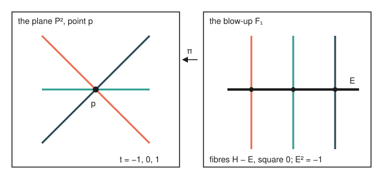

# Intersection numbers on a surface: blowing up a point makes a curve of self-intersection -1

[Syllabus](../../../SYLLABUS.md) → [Algebraic geometry](../README.md) → [Intersection Theory and Surfaces](../README.md#s09) → Intersection numbers on a surface

---

## General Overview

Take the projective plane $`\mathbb{P}^2`$ over the complex numbers and one point $`p`$ in it. Two lines through $`p`$ meet once, at $`p`$. Now **blow up** $`p`$: replace it by the line of all directions through it, as on the [Blowing up](../03-Plane%20Curves/05-blowing-up-a-point.md) card. The two lines now arrive at different directions, so they no longer meet. Their meeting count has dropped from 1 to 0.

The new curve of directions is called $`E`$. It is a copy of the projective line, a sphere. A surface lets a curve be paired with itself, and $`E`$ paired with itself gives **−1**. A count of points can never be negative, so this number is something more: an **intersection number**, a count that stays the same when a curve slides to an equivalent one.

The intersection numbers on a surface do real work:

- They tell which curves can be shrunk to a smooth point: exactly the spheres with square −1.
- They give a curve's genus (its number of holes) from two numbers, by the adjunction formula.
- They obey a sign rule, the Hodge index theorem: one positive direction, all the rest negative.

The six-point version of the same blow-up is the smooth cubic surface. There the curves with square −1 are its 27 lines.

**On a smooth surface, curves pair to whole numbers that count meeting points and depend only on each curve's class; blowing up a point adds a new class $`E`$ with $`E^2 = -1`$.**

**What kind of fact this is:** the pairing is a theorem (it exists and is unique), stated with its proof in outline. $`E^2 = -1`$, $`K^2 = 8`$ and the adjunction formula on a surface are theorems proved on this card in Why it works. Castelnuovo's contraction criterion and the Hodge index theorem are theorems stated with the key steps and a named source. The checks confirm every number on the plane blown up at one point.

### The picture: lines through p, before and after

<p align="center"></p>

Schematic, not to scale. On the left, three lines meet at $`p`$. On the right, each line keeps its own direction, so the three become disjoint vertical **fibres**, and each crosses $`E`$ once. Every line through $`p`$ does this, so the blow-up is a family of lines over the line of directions: the **Hirzebruch surface** $`\mathbb{F}_1`$.

---

## The formula

Notation already in use. The field is $`\mathbb{C}`$ unless a line says otherwise. $`X`$ is a smooth projective surface. A **divisor** on $`X`$ is a sum of curves with whole-number weights; two divisors are **linearly equivalent** when they differ by the zeros minus the poles of one function; $`\mathrm{Pic}(X)`$, the **Picard group**, is the divisors up to linear equivalence ([Line bundles and divisors](../05-Cohomology%20and%20the%20Hodge%20Conjecture/06-line-bundles-and-divisor-classes.md)). $`K`$ is the **canonical class**: the divisor of zeros minus poles of a 2-form $`\omega`$ ([The canonical bundle and adjunction](../08-Sheaf%20Cohomology%20and%20Differentials/02-canonical-bundle-and-adjunction.md)).

New on this card: the **intersection pairing** $`C \cdot D`$. It is the one rule that is symmetric, adds up over sums of curves, depends only on the classes in $`\mathrm{Pic}(X)`$, and counts meeting points when two curves cross cleanly:

```math
C \cdot D = \sum_{P \in C \cap D} (C \cdot D)_P \quad \text{(no common part)}, \qquad D^2 = D \cdot D, \qquad C \cdot D = C \cdot D' \ \text{ when } D \sim D'
```

**Read it aloud:** two curves with no common part meet in a number of points, each counted with its multiplicity; a curve's square is its pairing with itself; and the pairing does not change when a curve is replaced by a linearly equivalent one.

The surface of this card is the plane blown up at $`p`$, written $`X`$, with the map $`\pi : X \to \mathbb{P}^2`$ that forgets directions. Its classes are whole-number combinations of $`H`$ (a line that misses $`p`$) and $`E`$ (the curve of directions at $`p`$):

```math
\mathrm{Pic}(X) = \mathbb{Z}H \oplus \mathbb{Z}E, \qquad H^2 = 1, \quad H \cdot E = 0, \quad E^2 = -1, \qquad K = -3H + E
```

**Read it aloud:** every curve class on the blow-up is a times H plus b times E; a line meets a line once, a line away from p misses E, E squared is minus one, and the canonical class is minus three lines plus E.

A curve of degree $`d`$ with multiplicity $`m`$ at $`p`$ (the lowest degree of its terms at $`p`$) becomes the class $`dH - mE`$. The **adjunction formula** then gives its genus $`g`$:

```math
2g - 2 = C^2 + K \cdot C
```

**Read it aloud:** two times the genus, minus two, equals the curve's square plus its pairing with the canonical class.

For $`E`$: $`-1 + (-1) = -2`$, so $`g = 0`$, a sphere. For a line through $`p`$, $`H - E`$: square $`1 - 0 + (-1) = 0`$, so two such lines are disjoint, as the picture shows.

| Symbol | Plain meaning | In our example | Push it up and the answer… |
| --- | --- | --- | --- |
| $`\mathbb{P}^2`$, $`(x : y : z)`$, $`p`$ | the projective plane; its points; the point blown up | $`p = (0 : 0 : 1)`$ | — |
| $`X`$, $`\pi`$, $`(u : v)`$, $`t`$ | the blow-up; the map down to the plane; a direction at $`p`$; its slope $`v/u`$ | $`X = \mathbb{F}_1`$; three lines at $`t = -1, 0, 1`$ | — |
| $`H`$ | the class of a line, moved away from $`p`$ | $`H^2 = 1`$ | — |
| $`E`$, $`\mathcal{O}(E)`$ | the exceptional curve: all directions at $`p`$; its line bundle, whose restriction to $`E`$ is the normal line bundle | $`E^2 = -1`$ | blow up more points, get more such curves |
| $`C`$, $`D`$, $`C \cdot D`$, $`D^2`$ | curves or divisors; their intersection number; a self-intersection | $`(H - E) \cdot E = 1`$ | more meeting points, bigger number |
| $`d`$, $`m`$, $`dH - mE`$, $`L`$, $`\widetilde{L}`$ | a curve's degree; its multiplicity at $`p`$; the class of its strict transform (its own copy upstairs); a line through $`p`$; its strict transform | nodal cubic: $`3H - 2E`$; $`\widetilde{L} = H - E`$ | each unit of multiplicity at $`p`$ subtracts one $`E`$ |
| $`\mathrm{Pic}(X)`$, $`\rho`$, Gram matrix | the group of classes; its rank (the Picard number); the table of pairings of a basis | $`\mathbb{Z}H \oplus \mathbb{Z}E`$, $`\rho = 2`$, `[[1, 0], [0, -1]]` | each blown-up point adds 1 to $`\rho`$ |
| $`K`$, $`\omega`$ | the canonical class; a 2-form whose zeros minus poles give it | $`K = -3H + E`$, $`K^2 = 8`$ | each blow-up lowers $`K^2`$ by 1 |
| $`g`$ | the genus of a smooth curve: its number of holes | $`E`$: 0; a cubic missing $`p`$: 1 | — |
| $`e(X)`$, $`\chi(\mathcal{O}_X)`$, $`\chi(D)`$ | the Euler number (alternating count of cells); the holomorphic Euler characteristic, 1 for any surface built from the plane by blow-ups; the same count for $`\mathcal{O}(D)`$, the Riemann-Roch side | $`e = 4`$, $`\chi = 1`$ | each blow-up adds 1 to $`e`$ |
| $`A`$ | an **ample** class: one with positive pairing with every curve, and $`A^2 > 0`$ | $`A = 3H - E`$, $`A^2 = 8`$ | — |
| $`\mathbb{F}_q`$, $`q`$ | the field of integers mod a prime $`q`$, used for exact point counts; with subscript 1, $`\mathbb{F}_1`$ is the Hirzebruch surface, not a field | $`q = 7`$ and $`q = 11`$ | $`(q + 1)^2`$ points on $`X`$ |

Classes in the code are pairs: `(a, b)` means $`aH + bE`$, so `(1, -3)` is $`H - 3E`$.

### When it holds

- **A smooth surface.** At a singular point a curve may need two equations, so its class has no local equation and the pairing can take fractional values. Contracting the curve $`E_1 - E_2`$ of square −2 makes such a point, a cone point.
- **Classes, not curves, for the square.** $`E`$ cannot be moved off itself, so $`E^2`$ is not a count of points of $`E \cap E`$. It is read from the class, and it comes out −1.
- **The strict transform, not the total one.** A line through $`p`$ pulls back to its strict transform plus $`E`$. Keeping $`H`$ for it predicts that two such lines meet once; after the blow-up they meet 0 times.
- **Multiplicity counted.** A count of points matches $`C \cdot D`$ only when every meeting is clean (transversal: distinct tangent lines). All the meetings counted by the checks are clean.
- **Projective and over $`\mathbb{C}`$.** Over $`\mathbb{R}`$ a line meets a conic in 2 points, 1 or none, but the pairing still says 2. The checks count over $`\mathbb{F}_7`$ and $`\mathbb{F}_{11}`$ only on curves whose meeting points all have coordinates there.

---

## Why it works

### Step 0: count meetings, then let curves slide

Two different curves on a surface meet in finitely many points. Count them, each with its multiplicity. That count is the pairing.

The trouble is a curve paired with itself. The fix is to slide: replace the curve by a linearly equivalent one that meets it cleanly, and count those meetings. The count must not depend on the choice. So the pairing has to depend only on classes, and once it does, it may come out negative for a curve that cannot slide at all.

### Step 1: the pairing exists, and on the plane it is Bezout

The theorem (Hartshorne, Chapter V, Section 1): on a smooth projective surface there is exactly one pairing on $`\mathrm{Pic}(X)`$ that is symmetric, adds up over sums, and counts points when two smooth curves cross cleanly.

<details>
<summary>Proof in outline: why the count depends only on classes</summary>

For curves $`C`$ and $`D`$ with no common part, the local count at a point $`P`$ is the dimension of the ring of functions near $`P`$ divided by the two local equations $`f`$ and $`g`$:

$`\displaystyle (C \cdot D)_P = \dim_{\mathbb{C}} \mathcal{O}_{X,P} / (f, g).`$

The sum of these local counts over $`C \cap D`$ is the degree of the divisor that $`D`$ cuts on $`C`$. If $`D`$ is replaced by $`D + \mathrm{div}(h)`$, that divisor changes by the zeros minus the poles of $`h`$ restricted to $`C`$. A function on a projective curve has as many zeros as poles, so the degree does not change.

For divisors that share a part, write each as a difference of two very ample divisors (those coming from hyperplanes in some embedding). A general member of a very ample class is smooth and meets any given curve cleanly, so the pairing is defined on these, and bilinearity extends it to all divisors.

</details>

On the plane, $`\mathrm{Pic}(\mathbb{P}^2) = \mathbb{Z}H`$, and two different lines meet once, so $`H^2 = 1`$. A curve of degree $`d`$ has class $`dH`$, so two curves of degrees $`d`$ and $`d'`$ meet $`dd'`$ times. That is Bezout's theorem, recovered in one line. In the Chow ring language of [The Chow ring](01-chow-rings-and-intersection-products.md), a surface's divisor classes multiply into its degree-2 part, and the intersection number is the degree of that product.

### Step 2: the blow-up adds one class, and lines through p lose an E

Blowing up changes nothing away from $`p`$, and adds the curve $`E`$ over it. So the classes on $`X`$ are those of the plane, pulled back by $`\pi`$, plus multiples of $`E`$: $`\mathrm{Pic}(X) = \mathbb{Z}H \oplus \mathbb{Z}E`$ (Hartshorne, Chapter V, Proposition 3.2).

Three of the four pairings come from clean counts:

- $`H^2 = 1`$: two lines that miss $`p`$ meet once, away from $`p`$.
- $`H \cdot E = 0`$: a line that misses $`p`$ never touches $`E`$.
- A line $`L`$ through $`p`$ pulls back to its strict transform $`\widetilde{L}`$ plus $`E`$ once. In the chart $`y = tx`$, the line $`y = 0`$ becomes $`tx = 0`$: the factor $`x`$ is $`E`$, and $`t = 0`$ is the line's own copy, as on the [Blowing up](../03-Plane%20Curves/05-blowing-up-a-point.md) card with $`m = 1`$. All lines are linearly equivalent, so $`\pi^{*}L \sim H`$ and

```math
\widetilde{L} = H - E
```

**Read it aloud:** the copy of a line through p upstairs is the class of a line minus E.

A curve of degree $`d`$ with multiplicity $`m`$ at $`p`$ loses $`m`$ copies of $`E`$ the same way: its strict transform is $`dH - mE`$. The nodal cubic $`y^2 z = x^3 + x^2 z`$, with its node at $`p`$, becomes $`3H - 2E`$.

### Step 3: two roads to E squared equals minus one

The strict transform $`\widetilde{L}`$ meets $`E`$ at exactly one point, the direction of $`L`$, and it crosses cleanly. So

```math
1 = \widetilde{L} \cdot E = (H - E) \cdot E = H \cdot E - E^2 = 0 - E^2 \quad\Longrightarrow\quad E^2 = -1
```

**Read it aloud:** a line through p, lifted, meets E once; expanding the pairing gives zero minus E squared, so E squared is minus one.

The second road uses two different lines through $`p`$. Their directions differ, so their strict transforms are disjoint:

```math
0 = \widetilde{L}_1 \cdot \widetilde{L}_2 = (H - E)^2 = H^2 - 2\,H \cdot E + E^2 = 1 - 0 + E^2 \quad\Longrightarrow\quad E^2 = -1
```

**Read it aloud:** two lifted lines through p do not meet; expanding their pairing gives one plus E squared, so again E squared is minus one.

A third road reads $`E^2`$ off $`E`$ itself. A curve's square is the degree of its **normal line bundle**, $`\mathcal{O}(E)`$ restricted to $`E`$. Its local equations are $`x`$ in the chart $`y = tx`$ and $`y`$ in the chart $`x = sy`$. On $`E`$ they glue by $`x/y = 1/t`$, and $`1/t`$ winds once round 0 the wrong way as $`t`$ goes once round the unit circle. Degree −1, as the [Line bundles and divisors](../05-Cohomology%20and%20the%20Hodge%20Conjecture/06-line-bundles-and-divisor-classes.md) card reads degree off a winding.

### Step 4: the lines through p form a ruling

The class $`H - E`$ has square 0 and meets $`E`$ once. Send each point of $`X`$ to its direction $`(u : v)`$ at $`p`$. The fibre over a direction is the lifted line in that direction, class $`H - E`$. So $`X`$ is a family of projective lines over the projective line, and $`E`$ crosses each fibre once: a **section** with square −1. That is the Hirzebruch surface $`\mathbb{F}_1`$, the member of the family $`\mathbb{F}_n`$ whose special section has square $`-n`$. (A prime subscript, as in $`\mathbb{F}_7`$ below, means a finite field instead.)

The point count agrees. Over $`\mathbb{F}_q`$ the plane has $`q^2 + q + 1`$ points; removing $`p`$ and adding the $`q + 1`$ directions gives $`(q + 1)^2`$, which is $`q + 1`$ fibres of $`q + 1`$ points each: 64 over $`\mathbb{F}_7`$ and 144 over $`\mathbb{F}_{11}`$.

### Step 5: the canonical class picks up one E

On the plane, the 2-form $`dx \wedge dy`$ in the chart $`z = 1`$ has no zeros there and a pole of order 3 along the line at infinity. So $`K_{\mathbb{P}^2} = -3H`$.

Pull the form back to the chart $`y = tx`$: $`dy = t\,dx + x\,dt`$, so

```math
dx \wedge dy = x\, dx \wedge dt, \qquad K_X = \pi^{*}K_{\mathbb{P}^2} + E = -3H + E
```

**Read it aloud:** the lifted 2-form picks up a factor x, which vanishes once along E, so the canonical class gains one E.

Then $`K^2 = 9H^2 - 6\,H \cdot E + E^2 = 9 - 0 - 1 = 8`$. A second road checks it. **Noether's formula** $`K^2 + e(X) = 12\,\chi(\mathcal{O}_X)`$ comes from Hirzebruch-Riemann-Roch on [Chern classes and Hirzebruch-Riemann-Roch](02-chern-classes-and-hirzebruch-riemann-roch.md). The Euler number of $`X`$ is the plane's 3, minus the point, plus the sphere $`E`$: $`3 - 1 + 2 = 4`$. Then $`8 + 4 = 12`$, so $`\chi(\mathcal{O}_X) = 1`$, the same as the plane, as it must be for a blow-up.

### Step 6: adjunction on a surface

The general adjunction formula says the canonical bundle of a smooth curve $`C`$ on $`X`$ is $`K_X + C`$ restricted to $`C`$ ([The canonical bundle and adjunction](../08-Sheaf%20Cohomology%20and%20Differentials/02-canonical-bundle-and-adjunction.md)). Take degrees on $`C`$:

- the canonical bundle of a genus-$`g`$ curve has degree $`2g - 2`$;
- $`K_X`$ restricted to $`C`$ has degree $`K \cdot C`$;
- $`\mathcal{O}(C)`$ restricted to $`C`$ is the normal bundle, of degree $`C^2`$.

So $`2g - 2 = C^2 + K \cdot C`$. On $`X`$:

| Curve | Class | $`C^2`$ | $`K \cdot C`$ | $`2g - 2`$ | $`g`$ |
| --- | --- | ---: | ---: | ---: | ---: |
| $`E`$ | $`E`$ | −1 | −1 | −2 | 0 |
| a line | $`H`$ | 1 | −3 | −2 | 0 |
| a line through $`p`$ | $`H - E`$ | 0 | −2 | −2 | 0 |
| a conic through $`p`$ | $`2H - E`$ | 3 | −5 | −2 | 0 |
| the nodal cubic, node at $`p`$ | $`3H - 2E`$ | 5 | −7 | −2 | 0 |
| a smooth cubic missing $`p`$ | $`3H`$ | 9 | −9 | 0 | 1 |

The nodal cubic comes out with genus 0. On the [Blowing up](../03-Plane%20Curves/05-blowing-up-a-point.md) card the same curve became the smooth parabola $`t^2 = x + 1`$ after one blow-up, a sphere with one parameter. The smooth cubic keeps genus 1, a torus.

### Step 7: which curves can be shrunk to a point

**Castelnuovo's contraction criterion.** Let $`C`$ be a curve on a smooth projective surface $`X`$. There is a smooth surface $`Y`$ and a point $`y_0`$ of $`Y`$ with $`X`$ the blow-up of $`Y`$ at $`y_0`$, and $`C`$ the exceptional curve, exactly when $`C`$ is a smooth sphere (genus 0) with $`C^2 = -1`$.

One direction is Steps 3 and 6: an exceptional curve is a sphere of square −1. By adjunction, a sphere has square −1 exactly when $`K \cdot C = -1`$, so the test can be made on either number.

<details>
<summary>The other direction in outline, and what a (−2)-curve does</summary>

Take $`C`$ a sphere with $`C^2 = -1`$. Choose a very ample divisor $`A`$ on $`X`$ and set $`k = A \cdot C`$. The divisor $`A + kC`$ has

$`\displaystyle (A + kC) \cdot C = k - k = 0.`$

Its sections give a map to projective space that collapses $`C`$ to a point and is an embedding elsewhere. The work is to show the image is smooth at that point; it uses $`C^2 = -1`$ through the cohomology of $`\mathcal{O}(A + iC)`$ restricted to $`C`$. The full proof is Hartshorne, Chapter V, Theorem 5.7.

With square −2 the same construction collapses $`C`$, but the image point is singular: a cone point, like the vertex of the cone $`xz = y^2`$. Blow up $`p`$, then a point of $`E_1`$: the old $`E_1`$ becomes $`E_1 - E_2`$, with square −2 and $`K \cdot C = 0`$.

</details>

On our $`X`$, contracting $`E`$ returns the plane. Each blow-up lowers $`K^2`$ by 1, so contraction raises it from 8 back to 9, which is $`(-3)^2`$, the plane's value. The fibres $`H - E`$ are spheres of square 0, not −1, so no fibre can be contracted.

### Step 8: one positive direction

**The Hodge index theorem.** On a smooth projective surface, the pairing on classes (with real coefficients, after removing classes that pair to zero with everything) has exactly one positive direction. Equivalently: if $`A^2 > 0`$ and $`A \cdot D = 0`$, then $`D^2 < 0`$ unless $`D`$ pairs to zero with every class.

The idea of the proof: if $`D^2 > 0`$, Riemann-Roch on the surface makes $`nD`$ or $`-nD`$ the class of an actual curve for large $`n`$. An ample $`A`$ pairs positively with every curve, so $`A \cdot D \neq 0`$. The case $`D^2 = 0`$ is handled by nudging $`D`$ toward $`A`$ (Hartshorne, Chapter V, Theorem 1.9).

On $`X`$ the Gram matrix in the basis $`H, E`$ is `[[1, 0], [0, -1]]`: signature (1, 1), one positive and one negative direction. Take $`A = 3H - E`$, with $`A^2 = 8`$. The classes $`D = aH + bE`$ with $`A \cdot D = 3a + b = 0`$ are multiples of $`H - 3E`$, and $`(H - 3E)^2 = 1 - 9 = -8`$, negative as the theorem says.

[The Hodge conjecture](../05-Cohomology%20and%20the%20Hodge%20Conjecture/08-hodge-conjecture-statement-and-known-cases.md) uses the same theorem to find the signature of a quartic surface's second cohomology. On the plane blown up at six points, the cubic surface, the Gram matrix is $`H^2 = 1`$ and $`E_i^2 = -1`$ for six points: signature (1, 6), $`K^2 = 9 - 6 = 3`$.

---

## Worked numbers, by hand

The plane blown up at $`p = (0 : 0 : 1)`$. Every meeting below is clean, and the checks count each one over $`\mathbb{F}_7`$ and $`\mathbb{F}_{11}`$.

| Step | Arithmetic | Value |
| --- | --- | --- |
| $`H^2`$ | lines $`z = 0`$ and $`z = x + y`$, both missing $`p`$, meet once | 1 |
| $`H \cdot E`$ | the line $`z = 0`$ never reaches $`p`$ | 0 |
| $`(H - E) \cdot E`$ | the lifted line $`y = 0`$ meets $`E`$ at its direction $`t = 0`$ | 1 |
| $`E^2`$, road 1 | $`H \cdot E - 1 = 0 - 1`$ | −1 |
| $`E^2`$, road 2 | lifted $`y = 0`$ and $`y = x`$ meet 0 times: $`1 - 0 + E^2 = 0`$ | −1 |
| nodal cubic $`3H - 2E`$ | $`\cdot E = -2E^2`$; $`\cdot (H - E) = 3 - 2`$; $`\cdot H = 3`$ | 2, 1, 3 |
| $`K^2`$ | $`(-3H + E)^2 = 9 - 1`$ | 8 |
| Noether | $`K^2 + e = 8 + 4`$ | 12 |
| genus of $`E`$ | $`2g - 2 = E^2 + K \cdot E = -1 + (-1)`$ | **g = 0** |

The cubic's three numbers are real meetings. Its two branches at the node land at directions $`t = -1`$ and $`t = 1`$ on $`E`$. The lifted line $`y = 0`$ meets it once more, at $`(-1 : 0 : 1)`$. The line $`x = 3z`$ meets it at three points.

So $`E`$ is a sphere whose square is −1. By Castelnuovo's criterion it is exactly the kind of curve that can be shrunk back to a smooth point, which returns the plane.

### What breaks if you drop a piece

| Mistake | Comes out at | What went wrong |
| --- | --- | --- |
| Treat $`E`$ like a line, $`E^2 = +1`$ | $`(H - E) \cdot E = -1`$; Noether gives 14, not 12 | a negative count of real meeting points, and the Euler number no longer fits |
| Forget the $`E`$ in $`K`$: $`K = -3H`$ | $`2g - 2 = -1`$ for $`E`$, so $`g = 0.5`$ | the lifted 2-form vanishes once along $`E`$; dropping that breaks adjunction |
| Keep $`H`$ for a line through $`p`$ (the total transform) | two such lines meet 1 time by $`H^2`$; after the blow-up they meet 0 times | the line's class upstairs is $`H - E`$, which has square 0 |
| Contract a (−2)-curve: blow up a point of $`E`$ too, then shrink $`E_1 - E_2`$ | square −2, $`K \cdot C = 0`$, genus 0, but a cone point | Castelnuovo needs square −1; −2 gives a singular surface |

The code prints all four.

---

## Code, from first principles, and it actually runs

Nothing imported does algebra. The blow-up is built as a finite set: all pairs (point of $`\mathbb{P}^2`$, direction) over $`\mathbb{F}_q`$ with $`xv = yu`$. Curves are equations in both sets of coordinates, and the code counts their common points. It takes two independent roads to $`E^2 = -1`$, roads 1 and 3, and illustrates a third:

1. **Point counts.** It counts where lifted lines meet over $`\mathbb{F}_7`$ and $`\mathbb{F}_{11}`$, then solves for $`E^2`$ two ways.
2. **A winding, as an illustration.** It counts the turns of the gluing rule $`1/t`$ once round the unit circle. The rule is typed in from Step 3, so this shows how a degree is read off a winding, not new evidence.
3. **Riemann-Roch on the surface.** The formula $`\chi(D) = 1 + (D^2 - K \cdot D)/2`$ comes from [Chern classes and Hirzebruch-Riemann-Roch](02-chern-classes-and-hirzebruch-riemann-roch.md). For $`D = aH - bE`$ it must equal the number of degree-$`a`$ monomials $`x^i y^j z^k`$ with $`i + j \ge b`$: the plane forms that vanish to order $`b`$ at $`p`$. The two agree only when $`E^2 = -1`$ and $`K = -3H + E`$.

It then checks adjunction, Noether's formula, the Hodge index sign rule on a box of classes, and the six-point count.

### Python

```python
# Intersection numbers on the plane blown up at one point -- the check behind the card.  Standard library only.
# Road 1: count meeting points of real curves on the blow-up X, inside P^2 x P^1 over F_7 and F_11.
# Road 2: the winding of the gluing rule of O(E) along E, the degree of E's normal line bundle.
# Road 3: Riemann-Roch against a count of plane forms that vanish to a given order at p.
import math
from itertools import product

def p2(q):  # one representative per point of P^2 over F_q
    return [(1, y, z) for y in range(q) for z in range(q)] + [(0, 1, z) for z in range(q)] + [(0, 0, 1)]

def p1(q):
    return [(1, v) for v in range(q)] + [(0, 1)]

def blowup(q):  # X = {((x : y : z), (u : v)) : xv = yu}, the plane blown up at p = (0 : 0 : 1)
    return [(P, D) for P in p2(q) for D in p1(q) if (P[0] * D[1] - P[1] * D[0]) % q == 0]

curves = {  # each curve on X as an equation in (x, y, z) and (u, v)
    "E": lambda P, D, q: P[0] % q == 0 and P[1] % q == 0,              # all directions at p
    "H1": lambda P, D, q: P[2] % q == 0,                                 # the line z = 0, missing p
    "H2": lambda P, D, q: (P[0] + P[1] - P[2]) % q == 0,                 # the line z = x + y, missing p
    "H3": lambda P, D, q: (P[0] - 3 * P[2]) % q == 0,                    # the line x = 3z, missing p
    "L1": lambda P, D, q: D[1] % q == 0,                                 # strict transform of y = 0
    "L2": lambda P, D, q: (D[1] - D[0]) % q == 0,                        # strict transform of y = x
    "C": lambda P, D, q: ((D[1] ** 2 - D[0] ** 2) * P[2] - P[0] * D[0] ** 2) % q == 0,  # nodal cubic y^2 z = x^3 + x^2 z
}

def meet(a, b, q, X):
    return sum(1 for P, D in X if curves[a](P, D, q) and curves[b](P, D, q))

def dot(A, B, M):  # intersection pairing of classes written in a basis with Gram matrix M
    return sum(A[i] * M[i][j] * B[j] for i in range(len(A)) for j in range(len(B)))

counts = {}
for q in (7, 11):
    X = blowup(q)
    pairs = [("H1", "H2"), ("H1", "E"), ("L1", "E"), ("L1", "L2"), ("C", "E"), ("C", "L1"), ("C", "H3")]
    counts[q] = {a + "." + b: meet(a, b, q, X) for a, b in pairs}
    print(f"over F_{q}: X has {len(X)} points = ({q} + 1)^2; meeting points " +
          ", ".join(f"{k} {v}" for k, v in counts[q].items()))
    assert len(X) == (q + 1) ** 2 == len(p2(q)) - 1 + len(p1(q))
assert counts[7] == counts[11]
c = counts[7]
HH, HE = c["H1.H2"], c["H1.E"]
E2_from_one_line = HE - c["L1.E"]                  # (H - E).E = 1 gives H.E - E^2 = 1
E2_from_two_lines = c["L1.L2"] - HH + 2 * HE       # (H - E)^2 = 0 gives H^2 - 2 H.E + E^2 = 0
print(f"road 1: H^2 = {HH}, H.E = {HE}; (H - E).E = {c['L1.E']} gives E^2 = {E2_from_one_line}; "
      f"(H - E)^2 = {c['L1.L2']} gives E^2 = {E2_from_two_lines}")
M = [[HH, HE], [HE, E2_from_one_line]]             # Gram matrix in the basis H, E
H, E = (1, 0), (0, 1)
cubic = (3, -2)                                    # the nodal cubic: 3H minus E twice, for its double point at p
pred = [dot(cubic, E, M), dot(cubic, (1, -1), M), dot(cubic, H, M)]
print(f"Gram matrix in the basis H, E: {M}, signature (1, 1)")
print(f"nodal cubic 3H - 2E: predicted .E, .(H - E), .H = {pred}; counted {[c['C.E'], c['C.L1'], c['C.H3']]}")
assert E2_from_one_line == E2_from_two_lines == -1 and pred == [c["C.E"], c["C.L1"], c["C.H3"]]

# road 2: O(E) has local equations x (chart y = t x) and y (chart x = s y); on E they glue by x/y = 1/t
N, wind = 360, 0.0
for k in range(N):
    a0, a1 = 2 * math.pi * k / N, 2 * math.pi * (k + 1) / N
    g0, g1 = 1 / complex(math.cos(a0), math.sin(a0)), 1 / complex(math.cos(a1), math.sin(a1))
    wind += math.atan2((g1 / g0).imag, (g1 / g0).real)
deg = round(wind / (2 * math.pi))
print(f"road 2: gluing rule 1/t once round |t| = 1 winds {wind / (2 * math.pi):.6f} times, so deg O(E)|E = E^2 = {deg}")
assert abs(wind / (2 * math.pi) - deg) < 1e-9 and deg == M[1][1]

K = (-3, 1)                                        # K_X = pullback of K_P2 = -3H, plus E
K2, euler = dot(K, K, M), 3 - 1 + 2                # e(X): the plane's 3, minus the point, plus the sphere E
print(f"K = -3H + E: K^2 = 9 - 1 = {K2}; e(X) = 3 - 1 + 2 = {euler}; Noether K^2 + e = {K2 + euler} = 12 x chi(O_X), chi(O_X) = 1")
assert K2 + euler == 12

def genus(C, M, K):
    two_g_minus_2 = dot(C, C, M) + dot(K, C, M)
    return two_g_minus_2, (two_g_minus_2 + 2) / 2

print("adjunction 2g - 2 = C^2 + K.C:")
for name, C in [("E", (0, 1)), ("line H", (1, 0)), ("line through p, H - E", (1, -1)),
                ("conic through p, 2H - E", (2, -1)), ("nodal cubic, 3H - 2E", (3, -2)), ("cubic missing p, 3H", (3, 0))]:
    t, g = genus(C, M, K)
    print(f"  {name}: C^2 = {dot(C, C, M)}, K.C = {dot(K, C, M)}, 2g - 2 = {t}, g = {g:g}")
    assert g == int(g) and g >= 0
assert genus((0, 1), M, K)[1] == genus((3, -2), M, K)[1] == 0 and genus((3, 0), M, K)[1] == 1

# road 3: sections of aH - bE are degree-a forms vanishing to order b at p: monomials x^i y^j z^k with i + j >= b
tested = 0
for a in range(0, 7):
    for b in range(0, a + 2):
        forms = sum(1 for i in range(a + 1) for j in range(a + 1 - i) if i + j >= b)
        D = (a, -b)
        rr = 1 + (dot(D, D, M) - dot(K, D, M)) // 2
        assert forms == rr and (dot(D, D, M) - dot(K, D, M)) % 2 == 0
        tested += 1
print(f"road 3: forms vanishing to order b at p = 1 + (D^2 - K.D)/2 for all {tested} classes aH - bE, 0 <= a <= 6, b <= a + 1;"
      f" conics through p: {1 + (dot((2, -1), (2, -1), M) - dot(K, (2, -1), M)) // 2}")

A = (3, -1)                                        # an ample class: positive on every curve
box = [(x, y) for x in range(-6, 7) for y in range(-6, 7) if (x, y) != (0, 0)]
perp = [D for D in box if dot(A, D, M) == 0]
print(f"Hodge index: A = {A[0]}H {'-' if A[1] < 0 else '+'} {'' if abs(A[1]) == 1 else abs(A[1])}E, A^2 = {dot(A, A, M)}; classes in the box with A.D = 0: {perp}, squares {[dot(D, D, M) for D in perp]}")
assert dot(A, A, M) > 0 and all(dot(D, D, M) < 0 for D in perp)
assert all(dot(A, D, M) ** 2 >= dot(A, A, M) * dot(D, D, M) for D in box)

M6 = [[1 if i == j == 0 else -1 if i == j else 0 for j in range(7)] for i in range(7)]   # six points blown up
K6 = (-3, 1, 1, 1, 1, 1, 1)
ex = [C for C in product(range(0, 4), *[range(-2, 3)] * 6) if dot(C, C, M6) == -1 and dot(K6, C, M6) == -1]
print(f"six points (the cubic surface): K^2 = {dot(K6, K6, M6)}, classes with C^2 = -1 and K.C = -1: {len(ex)}")
assert dot(K6, K6, M6) == 3 and len(ex) == 27

M2, K2b = [[1, 0, 0], [0, -1, 0], [0, 0, -1]], (-3, 1, 1)   # blow up p, then a point of E
C = (0, 1, -1)                                     # strict transform of the first E: E1 - E2
KP2 = dot((-3,), (-3,), [[1]])                    # K of the plane is -3H, with H^2 = 1
print(f"contract E: K^2 goes from {K2} to {K2 + 1}, and K^2 of P^2 = (-3)^2 = {KP2}")
assert dot(C, C, M2) == -2 and dot(K2b, C, M2) == 0 and K2 + 1 == KP2
Mbad = [[1, 0], [0, 1]]
print(f"mistake 1, E^2 = +1 like a line: (H - E).E = {dot((1, -1), E, Mbad)}, a negative count; Noether {dot(K, K, Mbad) + euler}, not 12")
t2 = dot(E, E, M) + dot((-3, 0), E, M)
print(f"mistake 2, K = -3H (no E): 2g - 2 for E = {t2}, so g = {(t2 + 2) / 2}")
print(f"mistake 3, a line through p kept as H: two of them meet {HH} time by H^2, counted after the blow-up {c['L1.L2']}")
print(f"mistake 4, blow up a point of E too and contract E1 - E2: square {dot(C, C, M2)}, K.C = {dot(K2b, C, M2)}, g = {genus(C, M2, K2b)[1]:g}, "
      "but Castelnuovo needs -1; the result is a cone point")
print("figure, p (160, 150); lines through p at slopes t = -1, 0, 1 end at (70, 60)-(250, 240), (70, 150)-(250, 150), "
      "(70, 240)-(250, 60); E at y = 150; fibres H - E at x = " + ", ".join(str(490 + 70 * t) for t in (-1, 0, 1)))
print("ALL CHECKS PASS")
```

**Ran 2026-11-24 on macOS, Python 3.14.10, standard library only. All checks passed. Output, pasted from the run:**

```
over F_7: X has 64 points = (7 + 1)^2; meeting points H1.H2 1, H1.E 0, L1.E 1, L1.L2 0, C.E 2, C.L1 1, C.H3 3
over F_11: X has 144 points = (11 + 1)^2; meeting points H1.H2 1, H1.E 0, L1.E 1, L1.L2 0, C.E 2, C.L1 1, C.H3 3
road 1: H^2 = 1, H.E = 0; (H - E).E = 1 gives E^2 = -1; (H - E)^2 = 0 gives E^2 = -1
Gram matrix in the basis H, E: [[1, 0], [0, -1]], signature (1, 1)
nodal cubic 3H - 2E: predicted .E, .(H - E), .H = [2, 1, 3]; counted [2, 1, 3]
road 2: gluing rule 1/t once round |t| = 1 winds -1.000000 times, so deg O(E)|E = E^2 = -1
K = -3H + E: K^2 = 9 - 1 = 8; e(X) = 3 - 1 + 2 = 4; Noether K^2 + e = 12 = 12 x chi(O_X), chi(O_X) = 1
adjunction 2g - 2 = C^2 + K.C:
  E: C^2 = -1, K.C = -1, 2g - 2 = -2, g = 0
  line H: C^2 = 1, K.C = -3, 2g - 2 = -2, g = 0
  line through p, H - E: C^2 = 0, K.C = -2, 2g - 2 = -2, g = 0
  conic through p, 2H - E: C^2 = 3, K.C = -5, 2g - 2 = -2, g = 0
  nodal cubic, 3H - 2E: C^2 = 5, K.C = -7, 2g - 2 = -2, g = 0
  cubic missing p, 3H: C^2 = 9, K.C = -9, 2g - 2 = 0, g = 1
road 3: forms vanishing to order b at p = 1 + (D^2 - K.D)/2 for all 35 classes aH - bE, 0 <= a <= 6, b <= a + 1; conics through p: 5
Hodge index: A = 3H - E, A^2 = 8; classes in the box with A.D = 0: [(-2, 6), (-1, 3), (1, -3), (2, -6)], squares [-32, -8, -8, -32]
six points (the cubic surface): K^2 = 3, classes with C^2 = -1 and K.C = -1: 27
contract E: K^2 goes from 8 to 9, and K^2 of P^2 = (-3)^2 = 9
mistake 1, E^2 = +1 like a line: (H - E).E = -1, a negative count; Noether 14, not 12
mistake 2, K = -3H (no E): 2g - 2 for E = -1, so g = 0.5
mistake 3, a line through p kept as H: two of them meet 1 time by H^2, counted after the blow-up 0
mistake 4, blow up a point of E too and contract E1 - E2: square -2, K.C = 0, g = 0, but Castelnuovo needs -1; the result is a cone point
figure, p (160, 150); lines through p at slopes t = -1, 0, 1 end at (70, 60)-(250, 240), (70, 150)-(250, 150), (70, 240)-(250, 60); E at y = 150; fibres H - E at x = 420, 490, 560
ALL CHECKS PASS
```

### Rust

Same numbers, same labels, built with `rustc --edition 2021 -O`.

```rust
// Intersection numbers on the plane blown up at one point -- the same check as the Python, in Rust.  std only.
// Road 1: count meeting points of real curves on the blow-up X, inside P^2 x P^1 over F_7 and F_11.
// Road 2: the winding of the gluing rule of O(E) along E, the degree of E's normal line bundle.
// Road 3: Riemann-Roch against a count of plane forms that vanish to a given order at p.
type Pt = ([i64; 3], [i64; 2]);

fn p2(q: i64) -> Vec<[i64; 3]> {
    let mut v = vec![];
    for y in 0..q { for z in 0..q { v.push([1, y, z]); } }
    for z in 0..q { v.push([0, 1, z]); }
    v.push([0, 0, 1]);
    v
}
fn p1(q: i64) -> Vec<[i64; 2]> {
    let mut v: Vec<[i64; 2]> = (0..q).map(|t| [1, t]).collect();
    v.push([0, 1]);
    v
}
fn blowup(q: i64) -> Vec<Pt> {
    let mut x = vec![];
    for p in p2(q) { for d in p1(q) { if (p[0] * d[1] - p[1] * d[0]).rem_euclid(q) == 0 { x.push((p, d)); } } }
    x
}
fn on(name: &str, (p, d): &Pt, q: i64) -> bool {
    let r = match name {
        "E" => return p[0] % q == 0 && p[1] % q == 0,
        "H1" => p[2],
        "H2" => p[0] + p[1] - p[2],
        "H3" => p[0] - 3 * p[2],
        "L1" => d[1],
        "L2" => d[1] - d[0],
        _ => (d[1] * d[1] - d[0] * d[0]) * p[2] - p[0] * d[0] * d[0],
    };
    r.rem_euclid(q) == 0
}
fn dot(a: &[i64], b: &[i64], m: &[Vec<i64>]) -> i64 {
    let mut s = 0;
    for i in 0..a.len() { for j in 0..b.len() { s += a[i] * m[i][j] * b[j]; } }
    s
}
fn genus(c: &[i64], m: &[Vec<i64>], k: &[i64]) -> (i64, f64) {
    let t = dot(c, c, m) + dot(k, c, m);
    (t, (t + 2) as f64 / 2.0)
}

fn main() {
    let pairs = [("H1", "H2"), ("H1", "E"), ("L1", "E"), ("L1", "L2"), ("C", "E"), ("C", "L1"), ("C", "H3")];
    let mut all: Vec<Vec<usize>> = vec![];
    for q in [7i64, 11] {
        let x = blowup(q);
        let cs: Vec<usize> = pairs.iter().map(|(a, b)| x.iter().filter(|pt| on(a, pt, q) && on(b, pt, q)).count()).collect();
        let txt: Vec<String> = pairs.iter().zip(&cs).map(|((a, b), v)| format!("{}.{} {}", a, b, v)).collect();
        println!("over F_{}: X has {} points = ({} + 1)^2; meeting points {}", q, x.len(), q, txt.join(", "));
        assert!(x.len() as i64 == (q + 1) * (q + 1) && x.len() == p2(q).len() - 1 + p1(q).len());
        all.push(cs);
    }
    assert!(all[0] == all[1]);
    let c: Vec<i64> = all[0].iter().map(|&v| v as i64).collect();
    let (hh, he) = (c[0], c[1]);
    let e2_one = he - c[2];
    let e2_two = c[3] - hh + 2 * he;
    println!("road 1: H^2 = {}, H.E = {}; (H - E).E = {} gives E^2 = {}; (H - E)^2 = {} gives E^2 = {}", hh, he, c[2], e2_one, c[3], e2_two);
    let m = vec![vec![hh, he], vec![he, e2_one]];
    let (h, e) = ([1i64, 0], [0i64, 1]);
    println!("Gram matrix in the basis H, E: {:?}, signature (1, 1)", m);
    let cubic = [3i64, -2];
    let pred = vec![dot(&cubic, &e, &m), dot(&cubic, &[1, -1], &m), dot(&cubic, &h, &m)];
    let counted = vec![c[4], c[5], c[6]];
    println!("nodal cubic 3H - 2E: predicted .E, .(H - E), .H = {:?}; counted {:?}", pred, counted);
    assert!(e2_one == -1 && e2_two == -1 && pred == counted);

    let (n, mut wind) = (360, 0.0f64);
    let pi = std::f64::consts::PI;
    for k in 0..n {
        let (a0, a1) = (2.0 * pi * k as f64 / n as f64, 2.0 * pi * (k + 1) as f64 / n as f64);
        let inv = |a: f64| { let (c, s) = (a.cos(), a.sin()); let n2 = c * c + s * s; (c / n2, -s / n2) }; // 1/t
        let ((x0, y0), (x1, y1)) = (inv(a0), inv(a1));
        let n0 = x0 * x0 + y0 * y0;
        let (re, im) = ((x1 * x0 + y1 * y0) / n0, (y1 * x0 - x1 * y0) / n0); // g1 / g0
        wind += im.atan2(re);
    }
    let w = wind / (2.0 * pi);
    let deg = w.round() as i64;
    println!("road 2: gluing rule 1/t once round |t| = 1 winds {:.6} times, so deg O(E)|E = E^2 = {}", w, deg);
    assert!((w - deg as f64).abs() < 1e-9 && deg == m[1][1]);

    let kk = [-3i64, 1];
    let (k2, euler) = (dot(&kk, &kk, &m), 3 - 1 + 2);
    println!("K = -3H + E: K^2 = 9 - 1 = {}; e(X) = 3 - 1 + 2 = {}; Noether K^2 + e = {} = 12 x chi(O_X), chi(O_X) = 1", k2, euler, k2 + euler);
    assert!(k2 + euler == 12);
    println!("adjunction 2g - 2 = C^2 + K.C:");
    let list: [(&str, [i64; 2]); 6] = [("E", [0, 1]), ("line H", [1, 0]), ("line through p, H - E", [1, -1]),
        ("conic through p, 2H - E", [2, -1]), ("nodal cubic, 3H - 2E", [3, -2]), ("cubic missing p, 3H", [3, 0])];
    for (name, cc) in list.iter() {
        let (t, g) = genus(cc, &m, &kk);
        println!("  {}: C^2 = {}, K.C = {}, 2g - 2 = {}, g = {}", name, dot(cc, cc, &m), dot(&kk, cc, &m), t, g);
        assert!(g == g.trunc() && g >= 0.0);
    }
    assert!(genus(&[0, 1], &m, &kk).1 == 0.0 && genus(&[3, -2], &m, &kk).1 == 0.0 && genus(&[3, 0], &m, &kk).1 == 1.0);

    let mut tested = 0;
    for a in 0..7i64 {
        for b in 0..a + 2 {
            let mut forms = 0;
            for i in 0..=a { for j in 0..=(a - i) { if i + j >= b { forms += 1; } } }
            let dd = [a, -b];
            let top = dot(&dd, &dd, &m) - dot(&kk, &dd, &m);
            assert!(forms == 1 + top / 2 && top % 2 == 0);
            tested += 1;
        }
    }
    let conic = [2i64, -1];
    println!("road 3: forms vanishing to order b at p = 1 + (D^2 - K.D)/2 for all {} classes aH - bE, 0 <= a <= 6, b <= a + 1; conics through p: {}",
        tested, 1 + (dot(&conic, &conic, &m) - dot(&kk, &conic, &m)) / 2);

    let amp = [3i64, -1];
    let mut boxx = vec![];
    for x in -6..7i64 { for y in -6..7i64 { if (x, y) != (0, 0) { boxx.push([x, y]); } } }
    let perp: Vec<[i64; 2]> = boxx.iter().cloned().filter(|d| dot(&amp, d, &m) == 0).collect();
    let ptup: Vec<(i64, i64)> = perp.iter().map(|d| (d[0], d[1])).collect();
    let sq: Vec<i64> = perp.iter().map(|d| dot(d, d, &m)).collect();
    let atxt = format!("{}H {} {}E", amp[0], if amp[1] < 0 { "-" } else { "+" }, if amp[1].abs() == 1 { String::new() } else { amp[1].abs().to_string() });
    println!("Hodge index: A = {}, A^2 = {}; classes in the box with A.D = 0: {:?}, squares {:?}", atxt, dot(&amp, &amp, &m), ptup, sq);
    assert!(dot(&amp, &amp, &m) > 0 && sq.iter().all(|&s| s < 0));
    assert!(boxx.iter().all(|d| dot(&amp, d, &m).pow(2) >= dot(&amp, &amp, &m) * dot(d, d, &m)));

    let m6: Vec<Vec<i64>> = (0..7).map(|i| (0..7).map(|j| if i == j && i == 0 { 1 } else if i == j { -1 } else { 0 }).collect()).collect();
    let k6 = [-3i64, 1, 1, 1, 1, 1, 1];
    let mut ex = 0;
    for idx in 0..4 * 5i64.pow(6) {
        let mut cl = [idx / 5i64.pow(6), 0, 0, 0, 0, 0, 0];
        let mut r = idx % 5i64.pow(6);
        for i in (1..7).rev() { cl[i] = r % 5 - 2; r /= 5; }
        if dot(&cl, &cl, &m6) == -1 && dot(&k6, &cl, &m6) == -1 { ex += 1; }
    }
    println!("six points (the cubic surface): K^2 = {}, classes with C^2 = -1 and K.C = -1: {}", dot(&k6, &k6, &m6), ex);
    assert!(dot(&k6, &k6, &m6) == 3 && ex == 27);

    let (m2, k2b) = (vec![vec![1i64, 0, 0], vec![0, -1, 0], vec![0, 0, -1]], [-3i64, 1, 1]);
    let cm = [0i64, 1, -1];
    let kp2 = dot(&[-3], &[-3], &[vec![1]]);
    println!("contract E: K^2 goes from {} to {}, and K^2 of P^2 = (-3)^2 = {}", k2, k2 + 1, kp2);
    assert!(dot(&cm, &cm, &m2) == -2 && dot(&k2b, &cm, &m2) == 0 && k2 + 1 == kp2);
    let mbad = vec![vec![1i64, 0], vec![0, 1]];
    println!("mistake 1, E^2 = +1 like a line: (H - E).E = {}, a negative count; Noether {}, not 12", dot(&[1, -1], &e, &mbad), dot(&kk, &kk, &mbad) + euler);
    let t2 = dot(&e, &e, &m) + dot(&[-3, 0], &e, &m);
    println!("mistake 2, K = -3H (no E): 2g - 2 for E = {}, so g = {}", t2, (t2 + 2) as f64 / 2.0);
    println!("mistake 3, a line through p kept as H: two of them meet {} time by H^2, counted after the blow-up {}", hh, c[3]);
    println!("mistake 4, blow up a point of E too and contract E1 - E2: square {}, K.C = {}, g = {}, but Castelnuovo needs -1; the result is a cone point",
        dot(&cm, &cm, &m2), dot(&k2b, &cm, &m2), genus(&cm, &m2, &k2b).1);
    let fib: Vec<String> = [-1i64, 0, 1].iter().map(|t| (490 + 70 * t).to_string()).collect();
    println!("figure, p (160, 150); lines through p at slopes t = -1, 0, 1 end at (70, 60)-(250, 240), (70, 150)-(250, 150), (70, 240)-(250, 60); E at y = 150; fibres H - E at x = {}", fib.join(", "));
    println!("ALL CHECKS PASS");
}
```

**Ran 2026-11-24 on macOS, rustc 1.98.1, no crates. All checks passed. Output, pasted from the run:**

```
over F_7: X has 64 points = (7 + 1)^2; meeting points H1.H2 1, H1.E 0, L1.E 1, L1.L2 0, C.E 2, C.L1 1, C.H3 3
over F_11: X has 144 points = (11 + 1)^2; meeting points H1.H2 1, H1.E 0, L1.E 1, L1.L2 0, C.E 2, C.L1 1, C.H3 3
road 1: H^2 = 1, H.E = 0; (H - E).E = 1 gives E^2 = -1; (H - E)^2 = 0 gives E^2 = -1
Gram matrix in the basis H, E: [[1, 0], [0, -1]], signature (1, 1)
nodal cubic 3H - 2E: predicted .E, .(H - E), .H = [2, 1, 3]; counted [2, 1, 3]
road 2: gluing rule 1/t once round |t| = 1 winds -1.000000 times, so deg O(E)|E = E^2 = -1
K = -3H + E: K^2 = 9 - 1 = 8; e(X) = 3 - 1 + 2 = 4; Noether K^2 + e = 12 = 12 x chi(O_X), chi(O_X) = 1
adjunction 2g - 2 = C^2 + K.C:
  E: C^2 = -1, K.C = -1, 2g - 2 = -2, g = 0
  line H: C^2 = 1, K.C = -3, 2g - 2 = -2, g = 0
  line through p, H - E: C^2 = 0, K.C = -2, 2g - 2 = -2, g = 0
  conic through p, 2H - E: C^2 = 3, K.C = -5, 2g - 2 = -2, g = 0
  nodal cubic, 3H - 2E: C^2 = 5, K.C = -7, 2g - 2 = -2, g = 0
  cubic missing p, 3H: C^2 = 9, K.C = -9, 2g - 2 = 0, g = 1
road 3: forms vanishing to order b at p = 1 + (D^2 - K.D)/2 for all 35 classes aH - bE, 0 <= a <= 6, b <= a + 1; conics through p: 5
Hodge index: A = 3H - E, A^2 = 8; classes in the box with A.D = 0: [(-2, 6), (-1, 3), (1, -3), (2, -6)], squares [-32, -8, -8, -32]
six points (the cubic surface): K^2 = 3, classes with C^2 = -1 and K.C = -1: 27
contract E: K^2 goes from 8 to 9, and K^2 of P^2 = (-3)^2 = 9
mistake 1, E^2 = +1 like a line: (H - E).E = -1, a negative count; Noether 14, not 12
mistake 2, K = -3H (no E): 2g - 2 for E = -1, so g = 0.5
mistake 3, a line through p kept as H: two of them meet 1 time by H^2, counted after the blow-up 0
mistake 4, blow up a point of E too and contract E1 - E2: square -2, K.C = 0, g = 0, but Castelnuovo needs -1; the result is a cone point
figure, p (160, 150); lines through p at slopes t = -1, 0, 1 end at (70, 60)-(250, 240), (70, 150)-(250, 150), (70, 240)-(250, 60); E at y = 150; fibres H - E at x = 420, 490, 560
ALL CHECKS PASS
```

The two outputs match line for line.

### Lean

Lean proves $`E^2 = -1`$ from the pairing's rules, and the adjunction and Hodge index arithmetic for every class on X.

- Take any pairing that is symmetric and adds up over sums, with $`H^2 = 1`$, $`H \cdot E = 0`$ and $`(H - E) \cdot E = 1`$. Then $`E^2 = -1`$ and $`(H - E)^2 = 0`$.
- Take a curve of degree d with multiplicity m at p, class $`C = dH - mE`$. Then $`C^2 + K \cdot C = (d - 1)(d - 2) - m(m - 1) - 2`$.
- Take classes A and D on X, with D not zero, $`A^2 > 0`$ and $`A \cdot D = 0`$. Then $`D^2 < 0`$.
- On X, $`H^2 = 1`$, $`H \cdot E = 0`$, $`E^2 = -1`$, $`(H - E) \cdot E = 1`$ and $`(H - E)^2 = 0`$.
- Take $`K = -3H + E`$. Then $`K^2 = 8`$, Noether gives 8 + 4 = 12, and $`E^2 + K \cdot E = -2`$, so g = 0.
- The nodal cubic $`3H - 2E`$ pairs to 2, 1 and 3 with E, $`H - E`$ and H. Its square is 5, and $`K \cdot C = -7`$.
- Take $`A = 3H - E`$. Then $`A^2 = 8`$, $`A \cdot (H - 3E) = 0`$ and $`(H - 3E)^2 = -8`$.
- Take $`D = 2H - E`$, the conics through p. Then $`1 + (D^2 - K \cdot D)/2 = 5`$.
- Take the plane blown up at six points, with $`K = -3H + E_1 + \dots + E_6`$. Then $`K^2 = 3`$.

The meeting counts over $`\mathbb{F}_7`$ and $`\mathbb{F}_{11}`$, the winding of 1/t and the 27 lines are left to the Python and Rust checks.

```lean
-- Intersection numbers on a surface: in any symmetric pairing where a line misses E and a lifted line through p meets E once, E squared is -1, and on the blow-up lattice ZH + ZE adjunction gives the genus formula and the Hodge index sign rule holds.
import Mathlib.LinearAlgebra.Matrix.SesquilinearForm
import Mathlib.LinearAlgebra.BilinearForm.Properties
import Mathlib.LinearAlgebra.Matrix.Notation
import Mathlib.Tactic.NormNum
import Mathlib.Tactic.FinCases
import Mathlib.Tactic.LinearCombination
import Mathlib.Tactic.Linarith

open Matrix

/-- The intersection pairing on the plane blown up at one point, Pic(X) = ZH + ZE,
with Gram matrix [[1, 0], [0, -1]] in the basis H, E: a class `![a, b]` is aH + bE. -/
abbrev blowupPairing : LinearMap.BilinForm ℤ (Fin 2 → ℤ) :=
  Matrix.toLinearMap₂' ℤ !![1, 0; 0, -1]

/-- E squared is minus one. Take any symmetric pairing on divisor classes (bilinear, so it
adds up over sums of curves). If a line H misses E (H · E = 0), two lines meet once
(H² = 1), and the strict transform H - E of a line through p meets E exactly once
((H - E) · E = 1), then E² = -1, and two lifted lines through p are disjoint:
(H - E)² = 0. -/
theorem exceptional_curve_self_intersection_eq_neg_one
    {M : Type*} [AddCommGroup M] (B : LinearMap.BilinForm ℤ M) (hB : B.IsSymm)
    (H E : M) (hHH : B H H = 1) (hHE : B H E = 0) (hLE : B (H - E) E = 1) :
    B E E = -1 ∧ B (H - E) (H - E) = 0 := by
  have hEH : B E H = 0 := by rw [hB.eq]; exact hHE
  have h1 : B (H - E) E = B H E - B E E := by simp
  have hEE : B E E = -1 := by linarith
  refine ⟨hEE, ?_⟩
  simp only [map_sub, LinearMap.sub_apply]
  rw [hHH, hHE, hEH, hEE]; norm_num

/-- Adjunction on the blow-up: with K = -3H + E, a curve of degree d with multiplicity m at p
has class C = dH - mE, and C² + K · C = 2g - 2 with g = (d - 1)(d - 2)/2 - m(m - 1)/2. -/
theorem blowup_adjunction_genus (d m : ℤ) :
    blowupPairing ![d, -m] ![d, -m] + blowupPairing ![-3, 1] ![d, -m] =
      (d - 1) * (d - 2) - m * (m - 1) - 2 := by
  simp [Matrix.toLinearMap₂'_apply', dotProduct, Fin.sum_univ_two, mulVec]
  ring

/-- The Hodge index theorem on the blow-up: the pairing has one positive direction.
If A² > 0 and A · D = 0 for a nonzero class D, then D² < 0. -/
theorem blowup_hodge_index (A D : Fin 2 → ℤ) (hA : 0 < blowupPairing A A)
    (hAD : blowupPairing A D = 0) (hD : D ≠ 0) :
    blowupPairing D D < 0 := by
  simp [Matrix.toLinearMap₂'_apply', dotProduct, Fin.sum_univ_two, mulVec] at hA hAD ⊢
  have hd : D 1 ≠ 0 := by
    intro hd
    apply hD
    have ha : A 0 ≠ 0 := by
      intro ha; rw [ha] at hA; nlinarith [sq_nonneg (A 1)]
    have hc : D 0 = 0 := by
      rw [hd] at hAD
      have : A 0 * D 0 = 0 := by linarith
      rcases mul_eq_zero.mp this with h | h
      · exact absurd h ha
      · exact h
    funext i; fin_cases i <;> simp [hc, hd]
  have hd2 : 0 < D 1 * D 1 := mul_self_pos.mpr hd
  have key : A 0 * A 0 * (D 0 * D 0 - D 1 * D 1) = D 1 * D 1 * (A 1 * A 1 - A 0 * A 0) := by
    have : A 0 * D 0 = A 1 * D 1 := by linarith
    linear_combination (A 0 * D 0 + A 1 * D 1) * this
  have hneg : D 1 * D 1 * (A 1 * A 1 - A 0 * A 0) < 0 :=
    mul_neg_of_pos_of_neg hd2 (by nlinarith)
  have hA0 : 0 < A 0 * A 0 := by nlinarith [sq_nonneg (A 1)]
  by_contra hc
  have hc' : 0 ≤ D 0 * D 0 - D 1 * D 1 := by linarith [not_lt.mp hc]
  nlinarith [mul_nonneg hA0.le hc']

-- H² = 1, H · E = 0, E² = -1 on the blow-up lattice.
example : blowupPairing ![1, 0] ![1, 0] = 1 ∧ blowupPairing ![1, 0] ![0, 1] = 0 ∧
    blowupPairing ![0, 1] ![0, 1] = -1 := by
  simp [Matrix.toLinearMap₂'_apply', dotProduct, Fin.sum_univ_two, mulVec]

-- (H - E) · E = 1 and (H - E)² = 0: the lifted line meets E once, two lifted lines are disjoint.
example : blowupPairing ![1, -1] ![0, 1] = 1 ∧ blowupPairing ![1, -1] ![1, -1] = 0 := by
  simp [Matrix.toLinearMap₂'_apply', dotProduct, Fin.sum_univ_two, mulVec]

-- K = -3H + E: K² = 9 - 1 = 8, and Noether K² + e(X) = 8 + 4 = 12.
example : blowupPairing ![-3, 1] ![-3, 1] = 8 ∧ blowupPairing ![-3, 1] ![-3, 1] + 4 = 12 := by
  simp [Matrix.toLinearMap₂'_apply', dotProduct, Fin.sum_univ_two, mulVec]

-- Adjunction for E: E² + K · E = -1 + (-1) = -2, so g = 0.
example : blowupPairing ![0, 1] ![0, 1] + blowupPairing ![-3, 1] ![0, 1] = -2 := by
  simp [Matrix.toLinearMap₂'_apply', dotProduct, Fin.sum_univ_two, mulVec]

-- The nodal cubic 3H - 2E meets E, H - E and H in 2, 1 and 3 points; C² = 5, K · C = -7.
example : blowupPairing ![3, -2] ![0, 1] = 2 ∧ blowupPairing ![3, -2] ![1, -1] = 1 ∧
    blowupPairing ![3, -2] ![1, 0] = 3 ∧ blowupPairing ![3, -2] ![3, -2] = 5 ∧
    blowupPairing ![-3, 1] ![3, -2] = -7 := by
  simp [Matrix.toLinearMap₂'_apply', dotProduct, Fin.sum_univ_two, mulVec]

-- Hodge index example: A = 3H - E has A² = 8, A · (H - 3E) = 0 and (H - 3E)² = -8.
example : blowupPairing ![3, -1] ![3, -1] = 8 ∧ blowupPairing ![3, -1] ![1, -3] = 0 ∧
    blowupPairing ![1, -3] ![1, -3] = -8 := by
  simp [Matrix.toLinearMap₂'_apply', dotProduct, Fin.sum_univ_two, mulVec]

-- Riemann-Roch count of conics through p: 1 + (D² - K · D)/2 = 1 + (3 + 5)/2 = 5.
example : 1 + (blowupPairing ![2, -1] ![2, -1] - blowupPairing ![-3, 1] ![2, -1]) / 2 = 5 := by
  simp [Matrix.toLinearMap₂'_apply', dotProduct, Fin.sum_univ_two, mulVec]

-- Six points blown up (the cubic surface): K = -3H + E₁ + ... + E₆ has K² = 9 - 6 = 3.
example : Matrix.toLinearMap₂' ℤ (Matrix.diagonal ![1, -1, -1, -1, -1, -1, -1])
    ![-3, 1, 1, 1, 1, 1, 1] ![-3, 1, 1, 1, 1, 1, 1] = 3 := by
  simp [Matrix.toLinearMap₂'_apply', dotProduct, Fin.sum_univ_succ, mulVec_diagonal]

#print axioms exceptional_curve_self_intersection_eq_neg_one
#print axioms blowup_adjunction_genus
#print axioms blowup_hodge_index
```

**Checked 2026-11-24 on macOS, Lean 4.36.0-rc2, Mathlib v4.36.0-rc2. Every proof is complete and uses only Lean's standard axioms. Output, pasted from the run:**

```
'exceptional_curve_self_intersection_eq_neg_one' depends on axioms: [propext, Classical.choice, Quot.sound]
'blowup_adjunction_genus' depends on axioms: [propext, Classical.choice, Quot.sound]
'blowup_hodge_index' depends on axioms: [propext, Classical.choice, Quot.sound]
```

> [!TIP]
> **Try changing**
> - Guess first: if $`E`$ had square +1, what would a lifted line through $`p`$ give against $`E`$? Set `M = Mbad` right after `M` is built (move the `Mbad` line up first): $`(H - E) \cdot E`$ becomes −1, the cubic's predicted meetings with $`E`$ become −2 against 2 counted, and the assert stops the run.
> - Guess first: what genus does a conic through $`p`$ have? It is already in the adjunction list as `(2, -1)`: $`C^2 = 3`$, $`K \cdot C = -5`$, genus 0. Add `(4, -3)`, a quartic with a triple point at $`p`$: $`16 - 9 = 7`$ and $`-12 + 3 = -9`$, so genus 0 again.
> - Guess first: how many classes on the six-point blow-up are spheres of square −1? Widen the search ranges in the `ex` line: still 27, the lines of the cubic surface.
> - Guess first: is $`A = 2H - E`$ also a good test class for Hodge index? Set `A = (2, -1)`: $`A^2 = 3`$, the classes orthogonal to it are multiples of $`H - 2E`$, and $`(H - 2E)^2 = -3`$, negative again.

---

## The usual mistake

> [!warning]
> **Reading a self-intersection as a count of points.** $`E \cap E`$ is all of $`E`$, so counting points there means nothing. $`E^2`$ is read from the class: slide the curve to an equivalent one and count, or, when it cannot slide, expand $`(H - E) \cdot E = 1`$. The answer, −1, is negative, which no count of points can be.
>
> - **Forgetting the new class in $`K`$.** With $`K = -3H`$, adjunction gives $`E`$ genus 0.5.
> - **Using the total transform.** A line through $`p`$ upstairs is $`H - E`$, not $`H`$. With $`H`$, two lines through $`p`$ still meet once; in fact they meet 0 times.
> - **Expecting every sphere to contract.** A fibre $`H - E`$ is a sphere of square 0 and cannot be shrunk; a (−2)-curve shrinks only to a cone point. Castelnuovo needs exactly −1.
> - **Giving $`E`$ square +1.** Then $`(H - E) \cdot E = -1`$ and Noether's formula gives 14 instead of 12.

---

## Where you meet it in real life

- **The classification of surfaces.** Any smooth projective surface can be simplified by shrinking its spheres of square −1 one at a time. Each step lowers the Picard number by 1, so the process stops, at a **minimal model**. Castelnuovo's criterion is the test used at every step.
- **Rational parametrisations in geometric modelling.** A map from the plane given by forms with a common zero, a base point, is undefined there. Blowing up the base points makes it a true map. If it is one-to-one onto its image, that image's degree is the square of the pulled-back plane class: for the cubics through six points, $`(3H - E_1 - \dots - E_6)^2 = 9 - 6 = 3`$, the cubic surface (Hartshorne, Chapter V, Section 4).
- **Cremona maps.** The map $`(x : y : z) \mapsto (yz : xz : xy)`$ blows up three points and shrinks three lines. Intersection numbers on the blow-up track how it moves every curve class.
- **Del Pezzo surfaces in physics.** The plane blown up at up to eight general points carries lattices of classes orthogonal to $`K`$. For six points that lattice is the root lattice of the exceptional Lie group $`E_6`$, and such surfaces appear in string compactifications.

> **Say it back**
> On a smooth surface, curves pair to whole numbers that count meeting points and depend only on each curve's class. Blowing up a point of the plane adds one class $`E`$, with $`H^2 = 1`$, $`H \cdot E = 0`$ and $`E^2 = -1`$, because a lifted line through the point meets $`E`$ once and two lifted lines no longer meet. The canonical class gains one $`E`$, so $`K = -3H + E`$ and $`K^2 = 8`$. Adjunction, $`2g - 2 = C^2 + K \cdot C`$, then gives $`E`$ genus 0. Spheres of square −1 are exactly the curves that shrink to a smooth point, and the pairing always has one positive direction.

---

## What this builds on

- [Blowing up](../03-Plane%20Curves/05-blowing-up-a-point.md): the blow-up of a point, its charts and the strict transform; this card looks at the surface it makes instead of the curve on it.
- [The Chow ring](01-chow-rings-and-intersection-products.md): intersection products of cycles; on a surface the product of two divisor classes has a degree, which is the pairing here.
- [The canonical bundle and adjunction](../08-Sheaf%20Cohomology%20and%20Differentials/02-canonical-bundle-and-adjunction.md): the canonical bundle and the general adjunction formula, whose degree on a curve is the surface form used here.
- [The Hodge conjecture](../05-Cohomology%20and%20the%20Hodge%20Conjecture/08-hodge-conjecture-statement-and-known-cases.md): divisor classes as Hodge classes of type (1, 1), and the first use of the Hodge index theorem.
- [Line bundles and divisors](../05-Cohomology%20and%20the%20Hodge%20Conjecture/06-line-bundles-and-divisor-classes.md): divisors, linear equivalence, the Picard group and degree as a winding number.
- [Chern classes and Hirzebruch-Riemann-Roch](02-chern-classes-and-hirzebruch-riemann-roch.md): Noether's formula and Riemann-Roch on a surface, which the checks use as independent roads.

## Where this goes next

- [The 27 lines on a cubic surface](04-twenty-seven-lines-on-a-cubic-surface.md): the plane blown up at six points; its 27 classes with square −1 and $`K \cdot C = -1`$ are the 27 lines.

Which surfaces have no sphere of square −1 left to shrink, and how many different such minimal models a surface can have, is the question this card leaves open.

---

## Sources

Verified 2026-11-24: every link below resolves to the publisher's page.

- Hartshorne, Robin. *Algebraic Geometry*. Springer, 1977. [doi:10.1007/978-1-4757-3849-0](https://doi.org/10.1007/978-1-4757-3849-0). The intersection pairing and the Hodge index theorem (Chapter V, Section 1), the blow-up of a point with $`E^2 = -1`$ (Section 3), the cubic surface (Section 4), and Castelnuovo's criterion (Theorem 5.7).
- Beauville, Arnaud. *Complex Algebraic Surfaces*, 2nd ed. Cambridge University Press, 1996. [doi:10.1017/CBO9780511623936](https://doi.org/10.1017/CBO9780511623936). Intersection numbers, blow-ups and contraction of (−1)-curves (Chapters I and II), worked at a gentler pace.
- Barth, Wolf P., Klaus Hulek, Chris A. M. Peters and Antonius Van de Ven. *Compact Complex Surfaces*, 2nd ed. Springer, 2004. [doi:10.1007/978-3-642-57739-0](https://doi.org/10.1007/978-3-642-57739-0). Noether's formula, the Hodge index theorem and minimal models, for complex surfaces.
- Eisenbud, David, and Joe Harris. *3264 and All That: A Second Course in Algebraic Geometry*. Cambridge University Press, 2016. [doi:10.1017/CBO9781139062046](https://doi.org/10.1017/CBO9781139062046). Intersection products on blow-ups computed through the Chow ring.
