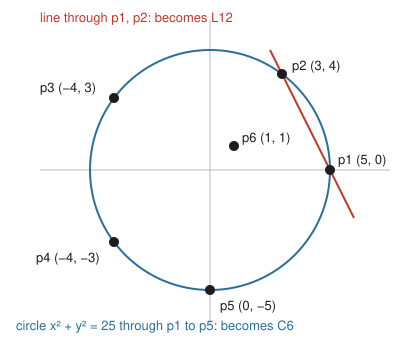

# The 27 lines on a cubic surface: the plane blown up at six points, with every line accounted for

[Syllabus](../../../SYLLABUS.md) → [Algebraic geometry](../README.md) → [Intersection Theory and Surfaces](../README.md#s09) → The 27 lines on a cubic surface

---

## General Overview

Take the surface $`x^3 + y^3 + z^3 + w^3 = 0`$ in projective 3-space $`\mathbb{P}^3`$, over the complex numbers $`\mathbb{C}`$. It is the **Fermat cubic surface**: one equation of degree 3 in four homogeneous coordinates $`(x : y : z : w)`$.

A straight line lies on it. Take every point $`(s : -s : t : -t)`$. Then $`x^3 + y^3 = s^3 - s^3 = 0`$ and $`z^3 + w^3 = t^3 - t^3 = 0`$, so the whole line $`x = -y,\ z = -w`$ sits inside the surface.

Two choices made that line. Instead of $`x = -y`$, any cube root of 1 works: $`x = -\zeta y`$ with $`\zeta^3 = 1`$ still gives $`x^3 + y^3 = 0`$. There are three cube roots of 1, so three choices for the first equation and three for the second: 9 lines. And the coordinates can be split into two pairs in 3 ways: $`\{x, y\}\{z, w\}`$, $`\{x, z\}\{y, w\}`$ and $`\{x, w\}\{y, z\}`$. That makes $`3 \times 9 = 27`$ lines.

Every smooth cubic surface over $`\mathbb{C}`$ holds exactly 27 lines, never more and never fewer. This card proves it. The tool is a second picture of the same surface: the plane with six points **blown up** (each point replaced by the line of directions through it). On that picture every line has an address:

- 6 lines are the six blown-up points themselves.
- 15 lines come from the straight lines through two of the points.
- 6 lines come from the conics (degree-2 curves) through five of the points.

**A smooth cubic surface is the plane blown up at six points, its lines are exactly the curve classes with square −1 and degree 1, and solving those two equations gives 6 + 15 + 6 = 27 classes, each meeting exactly 10 of the others.**

**What kind of fact this is:** a theorem over $`\mathbb{C}`$, proved on this card in Why it works from the blow-up description. That description is itself a theorem, stated with its key steps and a named source. The 27 Fermat lines and their meetings are checked in exact arithmetic.

### The picture: six points, and where two kinds of line come from

<p align="center"></p>

Drawn to scale, real points only, 24 units of the drawing per unit of $`x`$ and $`y`$. No three of the points lie on a line, and $`p_6`$ is off the circle, so not all six lie on one conic. The red line through $`p_1, p_2`$ becomes the line $`L_{12}`$ on the cubic surface built from these six points. The blue circle through $`p_1, \dots, p_5`$ becomes the line $`C_6`$.

---

## The formula

Notation already in use. The field is $`\mathbb{C}`$. $`\mathbb{P}^3`$ is projective 3-space ([Projective varieties](../02-Affine%20and%20Projective%20Varieties/04-projective-varieties-and-closure.md)). On a smooth surface, $`C \cdot D`$ is the **intersection number** of two curve classes, and $`D^2 = D \cdot D`$ ([Intersection numbers on a surface](03-intersection-numbers-on-surfaces-and-blow-ups.md)). $`K`$ is the **canonical class**, the zeros minus poles of a 2-form ([The canonical bundle and adjunction](../08-Sheaf%20Cohomology%20and%20Differentials/02-canonical-bundle-and-adjunction.md)).

New on this card. $`S`$ is a smooth cubic surface. Six points $`p_1, \dots, p_6`$ of the plane are in **general position** when no three lie on a line and not all six lie on a conic. Blowing up all six gives curves $`E_1, \dots, E_6`$ and a class $`H`$, the pull-back of a line in the plane:

```math
S \cong \mathrm{Bl}_{p_1, \dots, p_6}\mathbb{P}^2, \qquad H^2 = 1, \quad E_i^2 = -1, \quad H \cdot E_i = E_i \cdot E_j = 0, \qquad K = -3H + E_1 + \dots + E_6
```

**Read it aloud:** a smooth cubic surface is the plane blown up at six points in general position; a line squared is one, each exceptional curve squared is minus one, different ones never meet, and the canonical class is minus three lines plus all six exceptional curves.

Every curve class is $`D = aH - b_1E_1 - \dots - b_6E_6`$ with whole numbers $`a, b_i`$. The lines are the classes that solve two equations:

```math
\ell^2 = -1, \quad K \cdot \ell = -1 \qquad\Longleftrightarrow\qquad \ell = E_i \ (6), \quad L_{ij} = H - E_i - E_j \ (15), \quad C_i = 2H - (E_1 + \dots + E_6) + E_i \ (6)
```

**Read it aloud:** a class is a line exactly when its square is minus one and it meets the canonical class minus once; the solutions are the six exceptional curves, the fifteen lines through two points, and the six conics through five points: twenty-seven.

| Symbol | Plain meaning | In our example | Push it up and the answer… |
| --- | --- | --- | --- |
| $`(x : y : z : w)`$, $`\mathbb{P}^3`$ | homogeneous coordinates; projective 3-space | the Fermat cubic $`x^3 + y^3 + z^3 + w^3 = 0`$ | — |
| $`S`$ | a smooth cubic surface: one degree-3 equation, no singular point | the Fermat cubic | — |
| $`\zeta`$, $`\omega`$ | a cube root of 1; the root $`\omega = (-1 + \sqrt{-3})/2`$, with $`\omega^2 = -1 - \omega`$ | $`\zeta \in \{1, \omega, \omega^2\}`$ | — |
| $`\mathbb{Z}[\omega]`$ | the numbers $`a + b\omega`$ with whole $`a, b`$, for exact arithmetic | every Fermat line has coordinates there | — |
| $`p_1, \dots, p_6`$ | six points of the plane in general position | the picture's six points | 7 or 8 points: 56 or 240 such classes |
| $`\mathrm{Bl}`$, $`H`$, $`E_i`$ | the blow-up of the plane at the listed points; a line of the plane, pulled back; the exceptional curve over $`p_i`$ | $`H^2 = 1`$, $`E_i^2 = -1`$ | — |
| $`D = aH - \sum b_i E_i`$ | a curve class, written by its whole-number coordinates | $`L_{12} = H - E_1 - E_2`$: $`a = 1`$, $`b_1 = b_2 = 1`$ | — |
| $`K`$, $`h`$ | the canonical class; the class of a plane section, $`h = -K`$ | $`K^2 = 3`$, $`h \cdot \ell = 1`$ | — |
| $`\ell`$, $`L_{ij}`$, $`C_i`$ | a line on $`S`$; the line from $`\overline{p_ip_j}`$; the line from the conic missing $`p_i`$ | $`L_{12}`$ meets $`E_1`$, $`E_2`$ | — |
| $`\mathbb{F}_q`$ | the integers mod a prime $`q`$ | 27 lines over $`\mathbb{F}_7`$, 3 over $`\mathbb{F}_5`$ | 27 when $`q - 1`$ is a multiple of 3 |
| $`g`$, $`\chi`$, $`h^0`$, $`\mathcal{O}(m)`$ | genus (number of holes); the Euler characteristic $`h^0 - h^1 + h^2`$ from Riemann–Roch; the number of independent equations of a class's curves; the twist by $`m`$ plane sections | a line: $`g = 0`$, $`\chi(\ell) = 1`$; $`\mathcal{O}(K) = \mathcal{O}(-1)`$ | — |
| skew, tritangent plane | two lines that do not meet; a plane that cuts $`S`$ in three lines | 45 tritangent planes | — |

In the code, a class is a tuple: `(a, b1, ..., b6)` means $`aH - b_1E_1 - \dots - b_6E_6`$, so $`E_1`$ is `(0, -1, 0, 0, 0, 0, 0)`.

### When it holds

- **Smooth.** The cone $`x^3 + y^3 + z^3 = 0`$ (no $`w`$) is singular at $`(0 : 0 : 0 : 1)`$. Every line from that point to the plane curve lies on it: infinitely many over $`\mathbb{C}`$, 9 over $`\mathbb{F}_7`$ and 36 over $`\mathbb{F}_{31}`$.
- **Over $`\mathbb{C}`$, or a field holding the cube roots of 1.** Over $`\mathbb{R}`$ the Fermat cubic shows 3 lines. Over $`\mathbb{F}_5`$ and $`\mathbb{F}_{11}`$, where 1 is the only cube root of 1, it also shows 3. The other 24 are still there over $`\mathbb{C}`$.
- **Six points in general position.** If $`p_1, p_2, p_3`$ lie on a line, the class $`H - E_1 - E_2 - E_3`$ has square −2. Six of the 27 classes then split into two pieces, 21 lines remain, and the surface contracts to a cubic with a singular point.
- **Projective.** In the affine chart $`w = 1`$ each line loses its point at infinity. The lines $`x = -y,\ z = -w`$ and $`x = -y,\ z = -\omega w`$ meet only at $`(1 : -1 : 0 : 0)`$, where $`w = 0`$, so in the chart they look skew.

---

## Why it works

### Step 0: turn lines into numbers

A line on $`S`$ is a curve of genus 0 (a sphere) that meets every plane once. The adjunction formula turns those two facts into two equations on its class: $`\ell^2 = -1`$ and $`K \cdot \ell = -1`$.

On the blown-up plane, every class has whole-number coordinates. So counting lines becomes counting whole-number solutions of two equations. A short inequality shows there are exactly 27.

### Step 1: the Fermat cubic holds at least 27

Write a pairing as $`\{x_i, x_j\}\{x_k, x_l\}`$ and pick cube roots $`\zeta, \zeta'`$ of 1. The line $`x_i = -\zeta x_j,\ x_k = -\zeta' x_l`$ lies on the surface:

```math
x_i^3 + x_j^3 = (-\zeta x_j)^3 + x_j^3 = -\zeta^3 x_j^3 + x_j^3 = 0, \qquad x_k^3 + x_l^3 = 0 \text{ the same way}
```

**Read it aloud:** cubing minus zeta times a coordinate gives minus that coordinate cubed, because zeta cubed is one; so each pair of cubes cancels.

The 27 lines are different. The check puts each one back into the equation in exact $`\mathbb{Z}[\omega]`$ arithmetic, then reduces all 27 mod 7 (with $`\omega \mapsto 2`$, since $`2^2 + 2 + 1 = 7`$). They stay 27 different lines.

The Fermat cubic is smooth. Its partial derivatives $`3x^2, 3y^2, 3z^2, 3w^2`$ vanish together only at $`(0, 0, 0, 0)`$, which is not a point of $`\mathbb{P}^3`$.

### Step 2: a line has square −1

Adjunction on [The canonical bundle and adjunction](../08-Sheaf%20Cohomology%20and%20Differentials/02-canonical-bundle-and-adjunction.md) gives the canonical bundle of a degree-$`d`$ surface in $`\mathbb{P}^3`$ as $`\mathcal{O}(d - 4)`$ on it. For $`d = 3`$ that is $`\mathcal{O}(-1)`$: minus a plane section. So $`K = -h`$.

A plane meets a line once, so $`h \cdot \ell = 1`$ and $`K \cdot \ell = -1`$. A line is a sphere, $`g = 0`$. The surface adjunction formula $`2g - 2 = \ell^2 + K \cdot \ell`$ from [Intersection numbers on a surface](03-intersection-numbers-on-surfaces-and-blow-ups.md) gives

```math
-2 = \ell^2 - 1 \quad\Longrightarrow\quad \ell^2 = -1
```

**Read it aloud:** minus two equals the line's square minus one, so the line's square is minus one.

### Step 3: the cubic surface is the plane blown up at six points

**Theorem** (Hartshorne, Chapter V, Section 4). Blow up six points of the plane in general position. The cubics through the six points embed the result in $`\mathbb{P}^3`$ as a smooth cubic surface. Every smooth cubic surface over $`\mathbb{C}`$ arises this way.

The forward direction is a count:

1. A plane cubic has 10 coefficients. Passing through a point is one linear condition, so the cubics through six points form a 4-dimensional space.
2. Four cubics give four coordinates, a map to $`\mathbb{P}^3`$. On the blow-up its plane sections have class $`h = 3H - E_1 - \dots - E_6`$, which is $`-K`$.
3. The image has degree $`h^2 = 9 - 6 = 3`$: a cubic surface.
4. General position makes the map one-to-one with nonzero derivative, so the image is smooth. If three points were on a line, that line would be crushed to a point, a singular point.

<details>
<summary>The converse in outline: why every smooth cubic surface is a blown-up plane</summary>

The lines of $`\mathbb{P}^3`$ form a 4-dimensional family, the Grassmannian $`G(2, 4)`$. A cubic restricted to a line is a binary cubic with 4 coefficients, so containing a given line is 4 conditions. The expected number of lines is finite. The pairs (cubic, line), with the line on the cubic, form a family of the same dimension as the cubics. One cubic with only finitely many lines, such as the Fermat cubic, forces the map from pairs to cubics to reach a dense set of cubics. The map is proper (it sends closed sets to closed sets), so it reaches every cubic: every cubic holds a line (Reid, Chapter 7).

Take a line $`\ell`$ on $`S`$. The planes through $`\ell`$ form a $`\mathbb{P}^1`$. Each cuts $`S`$ in $`\ell`$ plus a conic. The conic splits into two lines exactly where a discriminant of degree 5 vanishes. So $`\ell`$ lies in 5 tritangent planes and meets 10 other lines, and two of those lines in different planes are skew.

Take two skew lines $`\ell, \ell'`$. A general point $`P`$ of $`S`$ lies on exactly one line of $`\mathbb{P}^3`$ that meets both. Sending $`P`$ to the two meeting points gives a map from $`S`$ to $`\ell \times \ell'`$, the quadric surface $`\mathbb{P}^1 \times \mathbb{P}^1`$. It contracts the 5 lines that meet both $`\ell`$ and $`\ell'`$, and nothing else.

So $`S`$ is $`\mathbb{P}^1 \times \mathbb{P}^1`$ blown up at 5 points. Blowing up one point of $`\mathbb{P}^1 \times \mathbb{P}^1`$ is the same as blowing up two points of the plane, so $`S`$ is the plane blown up at 6 points. The full proof is Beauville, Chapter IV.

</details>

The blow-up keeps the pairing of [Intersection numbers on a surface](03-intersection-numbers-on-surfaces-and-blow-ups.md), once for each point: $`H^2 = 1`$, $`E_i^2 = -1`$, everything else 0. Its canonical class gains one $`E_i`$ per point, so $`K = -3H + E_1 + \dots + E_6`$ and

```math
K^2 = 9 - 6 = 3
```

**Read it aloud:** the canonical class squared is nine from the plane, minus one for each of the six points: three, the degree of the cubic.

### Step 4: solve the two equations

Write $`\ell = aH - b_1E_1 - \dots - b_6E_6`$. The pairing rules give

```math
\ell^2 = a^2 - \textstyle\sum b_i^2 = -1, \qquad K \cdot \ell = -3a + \textstyle\sum b_i = -1
```

**Read it aloud:** a squared minus the sum of the b's squared is minus one, and minus three a plus the sum of the b's is minus one.

So $`\sum b_i = 3a - 1`$ and $`\sum b_i^2 = a^2 + 1`$. The **Cauchy–Schwarz inequality** says a sum of six numbers, squared, is at most 6 times the sum of their squares:

```math
(3a - 1)^2 \le 6(a^2 + 1) \quad\Longrightarrow\quad 3a^2 - 6a - 5 \le 0 \quad\Longrightarrow\quad a \in \{0, 1, 2\}
```

**Read it aloud:** three a minus one, squared, is at most six times a squared plus one, which leaves only a equal to zero, one or two.

Each value of $`a`$ is now a small puzzle:

| $`a`$ | $`\sum b_i`$ | $`\sum b_i^2`$ | The $`b`$'s | Class | Count |
| ---: | ---: | ---: | --- | --- | ---: |
| 0 | −1 | 1 | one −1, five 0 | $`E_i`$ | 6 |
| 1 | 2 | 2 | two 1, four 0 | $`H - E_i - E_j`$ | 15 |
| 2 | 5 | 5 | five 1, one 0 | $`2H - (E_1 + \dots + E_6) + E_i`$ | 6 |

That is $`6 + 15 + 6 = 27`$ classes. The code finds the same 27 by a search over a far wider range of $`a`$.

### Step 5: each class holds exactly one line

Two directions are needed.

- **Every line gives a class on the list.** That is Step 2.
- **Every class on the list holds exactly one line.** Riemann–Roch on a surface ([Chern classes and Hirzebruch-Riemann-Roch](02-chern-classes-and-hirzebruch-riemann-roch.md)) gives $`\chi(\ell) = \chi(\mathcal{O}_S) + (\ell^2 - K \cdot \ell)/2 = 1 + 0 = 1`$, since $`\chi(\mathcal{O}_S) = 1`$ for a blown-up plane. Here $`\chi(\ell) = h^0(\ell) - h^1(\ell) + h^0(K - \ell)`$, where $`h^0(D)`$ counts the independent equations whose zero curves lie in the class $`D`$. The last term is 0, because $`K - \ell`$ has negative degree $`(K - \ell) \cdot h = -3 - 1 = -4`$. So $`h^0(\ell) \ge 1`$: the class holds a curve. Its degree is $`h \cdot \ell = 1`$, so that curve is a line. If it held two different curves, they would meet $`\ell^2 = -1`$ times, which no count of points can be.

Two different lines cannot share a class, for the same reason. So lines and classes match one to one: **exactly 27 lines**.

The Fermat cubic is a smooth cubic, so it has exactly 27. The 27 of Step 1 are all of them. The check confirms it another way: it tests all 2850 lines of $`\mathbb{P}^3`$ over $`\mathbb{F}_7`$ and finds exactly the 27, reduced mod 7.

### Step 6: how the lines meet

Pair the classes. Two different lines meet once or not at all:

| Pair | Meet when | Pairing |
| --- | --- | --- |
| $`E_i`$, $`E_j`$ | never | 0 |
| $`E_i`$, $`L_{jk}`$ | $`i \in \{j, k\}`$ | 1 |
| $`E_i`$, $`C_j`$ | $`i \ne j`$ | 1 |
| $`L_{ij}`$, $`L_{kl}`$ | $`\{i, j\}`$ and $`\{k, l\}`$ share no point | 1 |
| $`L_{ij}`$, $`C_k`$ | $`k \in \{i, j\}`$ | 1 |
| $`C_i`$, $`C_j`$ | never | 0 |

So $`E_1`$ meets $`L_{12}, \dots, L_{16}`$ and $`C_2, \dots, C_6`$: 10 lines. $`L_{12}`$ meets $`E_1, E_2`$, the 6 lines $`L_{kl}`$ with $`k, l \ge 3`$, and $`C_1, C_2`$: 10 again. Every line meets exactly 10 others.

Three structures follow:

- **Triangles.** Two meeting lines span a plane, and that plane cuts $`S`$ in a third line. These are the 45 tritangent planes. Two meeting lines have exactly 1 common neighbour.
- **Skew pairs.** Two skew lines have exactly 5 common neighbours: the 5 lines Step 3's fold contracted.
- **The double six.** $`E_1, \dots, E_6`$ are pairwise skew, so are $`C_1, \dots, C_6`$, and $`E_i`$ meets $`C_j`$ exactly when $`i \ne j`$.

The graph of skew pairs is called the **Schläfli graph**. Its symmetries form the Weyl group of the exceptional root system $`E_6`$; the classes orthogonal to $`K`$ form that root lattice.

### Step 7: the Fermat lines fit the pattern

The check compares the two pictures line by line. In exact arithmetic, two lines meet exactly when their four spanning points are linearly dependent: a 4×4 determinant over $`\mathbb{Z}[\omega]`$ is 0.

1. Find six pairwise skew Fermat lines and call them $`E_1, \dots, E_6`$.
2. Each other line meets either 2 of them (it is $`L_{ij}`$) or 5 (it is $`C_i`$). That fixes its class.
3. Compare all 351 pairs of lines: the determinant test and the class pairing agree on every one.

So the Fermat cubic really is the plane blown up at six points, with every line given its class.

---

## Worked numbers, by hand

| Step | Arithmetic | Value |
| --- | --- | --- |
| Fermat pairings | $`\{x, y\}\{z, w\}`$, $`\{x, z\}\{y, w\}`$, $`\{x, w\}\{y, z\}`$ | 3 |
| Lines per pairing | 3 cube roots for $`\zeta`$, times 3 for $`\zeta'`$ | 9 |
| Fermat lines | $`3 \times 9`$ | 27 |
| Real Fermat lines | $`\zeta = \zeta' = 1`$ in each pairing | 3 |
| Cubics through six points | 10 coefficients − 6 conditions | 4 |
| Degree of the image | $`h^2 = (3H - \sum E_i)^2 = 9 - 6`$ | 3 |
| Bound on $`a`$ | $`3a^2 - 6a - 5 \le 0`$ | $`a \in \{0, 1, 2\}`$ |
| Degree of $`L_{12}`$ | $`h \cdot (H - E_1 - E_2) = 3 - 1 - 1`$ | 1 |
| Lines met by $`E_1`$ | 5 lines $`L_{1j}`$ + 5 conics $`C_j`$ | 10 |
| Lines met by $`x = -y, z = -w`$ | 4 in its own pairing + 6 in the other two | 10 |
| Lines on any smooth cubic | $`6 + 15 + 6`$ | **27** |

So a smooth cubic surface over $`\mathbb{C}`$ holds 27 lines, each meeting 10 others; they lie by threes in 45 tritangent planes.

### What breaks if you drop a piece

| Mistake | Comes out at | What went wrong |
| --- | --- | --- |
| Count only the $`E_i`$ and the lines through two points | 21 | the conics through five points also have square −1 and degree 1 |
| Use a singular cubic: the cone $`x^3 + y^3 + z^3 = 0`$ | 9 lines over $`\mathbb{F}_7`$, 36 over $`\mathbb{F}_{31}`$ | the vertex is singular, every line through it to the curve lies on it, so the count is unbounded |
| Put $`p_1, p_2, p_3`$ on one line | $`(H - E_1 - E_2 - E_3)^2 = -2`$; $`L_{12}, L_{13}, L_{23}, C_4, C_5, C_6`$ split; 21 left | general position fails and the surface acquires a singular point |
| Count over $`\mathbb{F}_5`$ | 3 | 1 is the only cube root of 1 there; 24 lines need $`\omega`$ |

The code prints all four.

---

## Code, from first principles, and it actually runs

Nothing imported does algebra. In the code, `r` is $`\omega`$, and a number of $`\mathbb{Z}[\omega]`$ is a pair. The code takes four roads to 27, and they agree:

1. The 27 Fermat lines, put back into the equation exactly.
2. Every line of $`\mathbb{P}^3`$ over $`\mathbb{F}_7`$, kept when it lies on the surface: 27, the same lines.
3. A search of the classes on the six-point blow-up with $`D^2 = -1`$ and $`K \cdot D = -1`$: 27, matching the typed list.
4. Six skew Fermat lines named $`E_1, \dots, E_6`$, every other line's class read off, and all 351 meetings compared with the class pairing.

It also counts the meeting graph's triangles and common neighbours, checks the double six, and prints each case of What breaks.

### Python

```python
# The 27 lines on a cubic surface -- the check behind the card.  Nothing is imported.
# Road 1: the Fermat cubic x^3 + y^3 + z^3 + w^3 = 0 and its 27 lines, exact in Z[r] (r^2 = -1 - r).
# Road 2: every line of P^3 over F_p, tested by brute force.
# Road 3: the plane blown up at six points, where lines are the classes D with D.D = -1 and K.D = -1.
# Road 4: name six skew Fermat lines E1..E6, read off every other line's class, compare all meetings.
def mul(a, b):                           # (a0 + a1 r)(b0 + b1 r), using r^2 = -1 - r
    return (a[0] * b[0] - a[1] * b[1], a[0] * b[1] + a[1] * b[0] - a[1] * b[1])
def det(m):                              # determinant in Z[r], expanding along row 0
    if len(m) == 1:
        return m[0][0]
    total = (0, 0)
    for j in range(len(m)):
        t = mul(m[0][j], det([row[:j] + row[j + 1:] for row in m[1:]]))
        sign = 1 - 2 * (j % 2)
        total = (total[0] + sign * t[0], total[1] + sign * t[1])
    return total
ROOTS = [(1, 0), (0, 1), (-1, -1)]                      # 1, r, r^2
fermat = []                                             # each line as two points P, Q on it
for (i, j), (k, l) in [((0, 1), (2, 3)), ((0, 2), (1, 3)), ((0, 3), (1, 2))]:
    for a in ROOTS:
        for b in ROOTS:
            P, Q = [(0, 0)] * 4, [(0, 0)] * 4
            P[i], P[j], Q[k], Q[l] = (-a[0], -a[1]), (1, 0), (-b[0], -b[1]), (1, 0)
            fermat.append((P, Q, a == b == (1, 0)))
def on_surface(P, Q):                    # F(sP + tQ) = 0 at four points: a cubic in s, t that is 0
    for s, t in [(1, 0), (0, 1), (1, 1), (1, -1)]:
        cubes = [mul(mul(c, c), c) for c in [(s * p[0] + t * q[0], s * p[1] + t * q[1]) for p, q in zip(P, Q)]]
        if (sum(c[0] for c in cubes), sum(c[1] for c in cubes)) != (0, 0):
            return False
    return True
def graph_stats(adj):                    # degrees, triangles, common neighbours (meeting, not)
    n = len(adj)
    degs = sorted({sum(adj[u]) for u in range(n)})
    tri = sum(adj[u][v] and adj[v][w] and adj[u][w] for u in range(n) for v in range(u + 1, n) for w in range(v + 1, n))
    lam, mu = set(), set()
    for u in range(n):
        for v in range(u + 1, n):
            (lam if adj[u][v] else mu).add(sum(adj[u][w] and adj[v][w] for w in range(n)))
    return degs, tri, sorted(lam), sorted(mu)
def rref(rows, p):                       # reduced row echelon form of two rows mod p
    rows, out = [[x % p for x in r] for r in rows], []
    for c in range(4):
        k = next((t for t, r in enumerate(rows) if r[c]), None)
        if k is None:
            continue
        piv = rows.pop(k)
        piv = [x * pow(piv[c], p - 2, p) % p for x in piv]
        rows = [[(x - r[c] * y) % p for x, y in zip(r, piv)] for r in rows]
        out = [[(x - o[c] * y) % p for x, y in zip(o, piv)] for o in out] + [piv]
    return tuple(tuple(r) for r in out)
def lines_on(p, coeffs):                 # brute force: every line of P^3 over F_p, in echelon form
    found, total = [], 0
    for i in range(4):
        for j in range(i + 1, 4):
            fr1, fr2 = [c for c in range(i + 1, 4) if c != j], list(range(j + 1, 4))
            for n1 in range(p ** len(fr1)):
                for n2 in range(p ** len(fr2)):
                    r1 = [int(c == i) + (n1 // p ** fr1.index(c) % p if c in fr1 else 0) for c in range(4)]
                    r2 = [int(c == j) + (n2 // p ** fr2.index(c) % p if c in fr2 else 0) for c in range(4)]
                    total += 1
                    if all(sum(k * (s * x + t * y) ** 3 for k, x, y in zip(coeffs, r1, r2)) % p == 0
                           for s, t in [(1, 0), (0, 1), (1, 1), (1, 2)]):
                        found.append((tuple(r1), tuple(r2)))
    return total, found
def classes(n):                          # every aH - b1E1 - ... - bnEn with D.D = -1 and K.D = -1
    out = []
    def go(a, pre, s, q):                # s, q: sum and sum of squares the remaining b's must make
        k = n - len(pre)
        if k == 0 or s * s > k * q:      # Cauchy-Schwarz: s^2 <= k q, or the rest cannot fit
            if k == 0 and s == 0 and q == 0:
                out.append((a,) + tuple(pre))
            return
        m = int(q ** 0.5)
        for b in range(-m, m + 1):
            go(a, pre + [b], s - b, q - b * b)
    for a in range(-12, 13):             # Cauchy-Schwarz bounds a to 0, 1, 2; the range is far wider
        go(a, [], 3 * a - 1, a * a + 1)
    return out
dot = lambda D, F: D[0] * F[0] - sum(x * y for x, y in zip(D[1:], F[1:]))
E = [(0,) + tuple(-(t == i) for t in range(6)) for i in range(6)]
L = [(1,) + tuple(int(t in (i, j)) for t in range(6)) for i in range(6) for j in range(i + 1, 6)]
C = [(2,) + tuple(int(t != i) for t in range(6)) for i in range(6)]
names = [f"E{i+1}" for i in range(6)] + [f"L{i+1}{j+1}" for i in range(6) for j in range(i + 1, 6)] + [f"C{i+1}" for i in range(6)]
typed, K, h, found6 = E + L + C, (-3,) + (-1,) * 6, (3,) + (1,) * 6, classes(6)
yn = lambda claim: "yes" if claim else "no"
print("Road 1: Fermat cubic x^3 + y^3 + z^3 + w^3 = 0, exact, r^2 + r + 1 = 0")
print(f"lines x = -a y, z = -b w and the 2 other pairings, a, b in 1, r, r^2: {len(fermat)}")
print(f"lines put back in the equation that vanish identically: {sum(on_surface(P, Q) for P, Q, _ in fermat)}")
print(f"lines with real coefficients (a = b = 1): {sum(re for _, _, re in fermat)}")
meet = [[u != v and det([*fermat[u][:2], *fermat[v][:2]]) == (0, 0) for v in range(27)] for u in range(27)]
g1 = graph_stats(meet)                   # two lines meet exactly when their four spanning points are dependent
print(f"x = -y, z = -w meets {sum(meet[0][:9])} lines of its own pairing and {sum(meet[0][9:])} of the other two")
print(f"meeting graph, Fermat lines: degree {g1[0]}, triangles {g1[1]}, common neighbours {g1[2]} if meeting, {g1[3]} if not")
total7, on7 = lines_on(7, [1, 1, 1, 1])
red = {rref([[c[0] + 2 * c[1] for c in P], [c[0] + 2 * c[1] for c in Q]], 7) for P, Q, _ in fermat}
print(f"Road 2: all {total7} lines of P^3 over F_7 tested, on the Fermat cubic: {len(on7)}")
print(f"the 27 exact lines reduced mod 7 (r -> 2) are exactly these: {yn(red == set(on7))}")
print("Road 3: plane blown up at six points, classes D = aH - b1E1 - ... - b6E6")
print(f"search for D.D = -1 and K.D = -1, K = -3H + E1 + ... + E6: {len(found6)} classes, a in {sorted({d[0] for d in found6})}")
print(f"typed list: E_i {len(E)}, L_ij = H - Ei - Ej {len(L)}, C_i = 2H - (E1 + ... + E6) + Ei {len(C)}: {len(typed)}")
print(f"search and typed list agree: {yn(sorted(found6) == sorted(typed))}")
print(f"K.K = {dot(K, K)}, h = -K = 3H - E1 - ... - E6, h.h = {dot(h, h)}, h.D for the 27: {sorted({dot(h, d) for d in typed})}; "
      f"plane cubics: {4 * 5 // 2} coefficients, minus 6 points = {10 - 6} = coordinates of P^3")
for name in ["E1", "L12", "C1"]:
    u = typed[names.index(name)]
    print(f"{name} meets: {' '.join(names[t] for t, v in enumerate(typed) if dot(u, v) == 1)}")
def skew(ch):                            # six pairwise skew Fermat lines, by backtracking
    return ch if len(ch) == 6 else next((r for u in range(ch[-1] + 1 if ch else 0, 27)
                                         if not any(meet[u][v] for v in ch) for r in [skew(ch + [u])] if r), None)
sixer = skew([])                         # E_i is sixer[i]; a line meeting E_i, E_j is H - Ei - Ej (a = 1),
lab = [E[sixer.index(u)] if u in sixer else  # a line meeting five of them is a conic (a = 2)
       (sum(meet[u][v] for v in sixer) // 2,) + tuple(int(meet[u][v]) for v in sixer) for u in range(27)]
agree = all(dot(lab[u], lab[v]) == meet[u][v] for u in range(27) for v in range(u + 1, 27))
print(f"Road 4: skew Fermat lines {sixer} named E1..E6; the other 21 meet "
      f"{sorted({sum(meet[u][v] for v in sixer) for u in range(27) if u not in sixer})} of them")
print(f"classes read off = the 27 of road 3: {yn(sorted(lab) == sorted(typed))}; all 351 pairs meet as the classes say: {yn(agree)}")
six = all(dot(E[i], C[j]) == (i != j) and (i == j or dot(E[i], E[j]) == 0 == dot(C[i], C[j]))
          for i in range(6) for j in range(6))
print(f"double six: Ei meets Cj exactly when i != j, E's and C's disjoint among themselves: {yn(six)}")
print(f"other blow-ups, classes with D.D = -1, K.D = -1 for n = 3..8 points: {[len(classes(n)) for n in range(3, 9)]}")
pts = [(5, 0), (3, 4), (-4, 3), (-4, -3), (0, -5), (1, 1)]
col = sum((b[0] - a[0]) * (c[1] - a[1]) == (b[1] - a[1]) * (c[0] - a[0]) for x, a in enumerate(pts)
          for y, b in enumerate(pts[x + 1:], x + 1) for c in pts[y + 1:])
print(f"figure, points {pts}, collinear triples {col}, p6 on the circle x^2 + y^2 = 25: {yn(pts[5][0] ** 2 + pts[5][1] ** 2 == 25)}")
line3 = (1, 1, 1, 1, 0, 0, 0)
split = [names[t] for t, d in enumerate(typed) if dot(d, line3) < 0]
print(f"p1, p2, p3 on a line: H - E1 - E2 - E3 has D.D = {dot(line3, line3)}, K.D = {dot(K, line3)}; "
      f"split off {' '.join(split)}, left {27 - len(split)}")
print(f"mistake 1, only exceptional curves and lines through two points: {len(E) + len(L)}")
print(f"mistake 2, lines over F_5, where 1 is the only cube root of 1: {len(lines_on(5, [1, 1, 1, 1])[1])}")
print(f"mistake 3, singular cone x^3 + y^3 + z^3 = 0: lines over F_7 {len(lines_on(7, [1, 1, 1, 0])[1])}, "
      f"over F_31 {len(lines_on(31, [1, 1, 1, 0])[1])}")
print(f"try: Fermat lines over F_11 {len(lines_on(11, [1, 1, 1, 1])[1])}, over F_13 {len(lines_on(13, [1, 1, 1, 1])[1])}")
assert len(fermat) == 27 and all(on_surface(P, Q) for P, Q, _ in fermat)   # road 1 substitutes
assert len(on7) == 27 and red == set(on7)                                   # road 2 = road 1 mod 7
assert sorted(found6) == sorted(typed)                                      # road 3: search = list
assert sorted(lab) == sorted(typed) and agree                               # road 4: Fermat = blow-up
assert g1 == ([10], 45, [1], [5])                                           # each line meets 10
assert [len(classes(n)) for n in range(3, 9)] == [6, 10, 16, 27, 56, 240]  # known del Pezzo counts
print("ALL CHECKS PASS")
```

**Ran 2026-11-24 on macOS, Python 3.14.10, standard library only. All checks passed. Output, pasted from the run:**

```
Road 1: Fermat cubic x^3 + y^3 + z^3 + w^3 = 0, exact, r^2 + r + 1 = 0
lines x = -a y, z = -b w and the 2 other pairings, a, b in 1, r, r^2: 27
lines put back in the equation that vanish identically: 27
lines with real coefficients (a = b = 1): 3
x = -y, z = -w meets 4 lines of its own pairing and 6 of the other two
meeting graph, Fermat lines: degree [10], triangles 45, common neighbours [1] if meeting, [5] if not
Road 2: all 2850 lines of P^3 over F_7 tested, on the Fermat cubic: 27
the 27 exact lines reduced mod 7 (r -> 2) are exactly these: yes
Road 3: plane blown up at six points, classes D = aH - b1E1 - ... - b6E6
search for D.D = -1 and K.D = -1, K = -3H + E1 + ... + E6: 27 classes, a in [0, 1, 2]
typed list: E_i 6, L_ij = H - Ei - Ej 15, C_i = 2H - (E1 + ... + E6) + Ei 6: 27
search and typed list agree: yes
K.K = 3, h = -K = 3H - E1 - ... - E6, h.h = 3, h.D for the 27: [1]; plane cubics: 10 coefficients, minus 6 points = 4 = coordinates of P^3
E1 meets: L12 L13 L14 L15 L16 C2 C3 C4 C5 C6
L12 meets: E1 E2 L34 L35 L36 L45 L46 L56 C1 C2
C1 meets: E2 E3 E4 E5 E6 L12 L13 L14 L15 L16
Road 4: skew Fermat lines [0, 4, 8, 10, 14, 15] named E1..E6; the other 21 meet [2, 5] of them
classes read off = the 27 of road 3: yes; all 351 pairs meet as the classes say: yes
double six: Ei meets Cj exactly when i != j, E's and C's disjoint among themselves: yes
other blow-ups, classes with D.D = -1, K.D = -1 for n = 3..8 points: [6, 10, 16, 27, 56, 240]
figure, points [(5, 0), (3, 4), (-4, 3), (-4, -3), (0, -5), (1, 1)], collinear triples 0, p6 on the circle x^2 + y^2 = 25: no
p1, p2, p3 on a line: H - E1 - E2 - E3 has D.D = -2, K.D = 0; split off L12 L13 L23 C4 C5 C6, left 21
mistake 1, only exceptional curves and lines through two points: 21
mistake 2, lines over F_5, where 1 is the only cube root of 1: 3
mistake 3, singular cone x^3 + y^3 + z^3 = 0: lines over F_7 9, over F_31 36
try: Fermat lines over F_11 3, over F_13 27
ALL CHECKS PASS
```

### Rust

Same numbers, same labels, built with `rustc --edition 2021 -O`.

```rust
// The 27 lines on a cubic surface -- the same check as the Python, in Rust.  No crates.
// Road 1: the Fermat cubic x^3 + y^3 + z^3 + w^3 = 0 and its 27 lines, exact in Z[r] (r^2 = -1 - r).
// Road 2: every line of P^3 over F_p, tested by brute force.
// Road 3: the plane blown up at six points, where lines are the classes D with D.D = -1 and K.D = -1.
// Road 4: name six skew Fermat lines E1..E6, read off every other line's class, compare all meetings.
type Z = (i64, i64);                     // a0 + a1 r
type Line = (Vec<Z>, Vec<Z>, bool);      // two points on the line, and "real coefficients"
fn mul(a: Z, b: Z) -> Z { (a.0 * b.0 - a.1 * b.1, a.0 * b.1 + a.1 * b.0 - a.1 * b.1) }
fn det(m: &[Vec<Z>]) -> Z {              // determinant in Z[r], expanding along row 0
    if m.len() == 1 { return m[0][0] } let mut total = (0, 0);
    for j in 0..m.len() {
        let minor: Vec<Vec<Z>> = m[1..].iter()
            .map(|row| row.iter().enumerate().filter(|(c, _)| *c != j).map(|(_, &x)| x).collect()).collect();
        let (t, sign) = (mul(m[0][j], det(&minor)), 1 - 2 * (j as i64 % 2));
        total = (total.0 + sign * t.0, total.1 + sign * t.1);
    }
    total
}
fn on_surface(p: &[Z], q: &[Z]) -> bool { // F(sP + tQ) = 0 at four points: a cubic in s, t that is 0
    [(1, 0), (0, 1), (1, 1), (1, -1)].iter().all(|&(s, t)| {
        (0..4).map(|c| { let v = (s * p[c].0 + t * q[c].0, s * p[c].1 + t * q[c].1); mul(mul(v, v), v) })
            .fold((0, 0), |a, b| (a.0 + b.0, a.1 + b.1)) == (0, 0)
    })
}
fn graph_stats(adj: &[Vec<bool>]) -> (Vec<i64>, i64, Vec<i64>, Vec<i64>) {
    let n = adj.len();
    let (mut degs, mut tri, mut lam, mut mu): (Vec<i64>, i64, Vec<i64>, Vec<i64>) =
        ((0..n).map(|u| adj[u].iter().filter(|&&x| x).count() as i64).collect(), 0, Vec::new(), Vec::new());
    for u in 0..n {
        for v in u + 1..n {
            for w in v + 1..n { if adj[u][v] && adj[v][w] && adj[u][w] { tri += 1 } }
            let c = (0..n).filter(|&w| adj[u][w] && adj[v][w]).count() as i64; if adj[u][v] { lam.push(c) } else { mu.push(c) }
        }
    }
    for s in [&mut degs, &mut lam, &mut mu] { s.sort(); s.dedup(); }
    (degs, tri, lam, mu)
}
fn rref(rows: Vec<Vec<i64>>, p: i64) -> Vec<Vec<i64>> { // reduced row echelon form mod p
    let mut rows: Vec<Vec<i64>> = rows.iter().map(|r| r.iter().map(|x| x.rem_euclid(p)).collect()).collect();
    let mut out: Vec<Vec<i64>> = Vec::new();
    for c in 0..4 {
        if let Some(k) = rows.iter().position(|r| r[c] != 0) {
            let piv = rows.remove(k);
            let inv = (1..p).find(|x| piv[c] * x % p == 1).unwrap();
            let piv: Vec<i64> = piv.iter().map(|x| x * inv % p).collect();
            let clear = |r: &Vec<i64>| -> Vec<i64> { r.iter().zip(&piv).map(|(x, y)| (x - r[c] * y).rem_euclid(p)).collect() };
            rows = rows.iter().map(clear).collect(); out = out.iter().map(clear).collect(); out.push(piv);
        }
    }
    out
}
fn lines_on(p: i64, k: [i64; 4]) -> (i64, Vec<Vec<Vec<i64>>>) { // every line of P^3 over F_p
    let (mut found, mut total) = (Vec::new(), 0);
    for i in 0..4 {
        for j in i + 1..4 {
            let fr1: Vec<usize> = (i + 1..4).filter(|&c| c != j).collect();
            let fr2: Vec<usize> = (j + 1..4).collect();
            for n1 in 0..p.pow(fr1.len() as u32) {
                for n2 in 0..p.pow(fr2.len() as u32) {
                    let r1: Vec<i64> = (0..4).map(|c| (c == i) as i64 + fr1.iter().position(|&x| x == c).map_or(0, |t| n1 / p.pow(t as u32) % p)).collect();
                    let r2: Vec<i64> = (0..4).map(|c| (c == j) as i64 + fr2.iter().position(|&x| x == c).map_or(0, |t| n2 / p.pow(t as u32) % p)).collect();
                    total += 1;
                    if [(1, 0), (0, 1), (1, 1), (1, 2)].iter().all(|&(s, t)|
                        (0..4).map(|c| { let v = s * r1[c] + t * r2[c]; k[c] * v * v * v }).sum::<i64>() % p == 0) { found.push(vec![r1, r2]) }
                }
            }
        }
    }
    (total, found)
}
fn go(n: usize, a: i64, pre: &mut Vec<i64>, s: i64, q: i64, out: &mut Vec<Vec<i64>>) {
    let k = (n - pre.len()) as i64;      // s, q: sum and sum of squares the remaining b's must make
    if k == 0 || s * s > k * q {         // Cauchy-Schwarz: s^2 <= k q, or the rest cannot fit
        if k == 0 && s == 0 && q == 0 { let mut d = vec![a]; d.extend(pre.iter()); out.push(d) }
        return;
    }
    let mut m = 0;
    while (m + 1) * (m + 1) <= q { m += 1 }
    for b in -m..=m { pre.push(b); go(n, a, pre, s - b, q - b * b, out); pre.pop(); }
}
fn classes(n: usize) -> Vec<Vec<i64>> {  // every aH - b1E1 - ... - bnEn with D.D = -1 and K.D = -1
    let mut out = Vec::new();            // Cauchy-Schwarz bounds a to 0, 1, 2; the range is far wider
    for a in -12..13 { go(n, a, &mut Vec::new(), 3 * a - 1, a * a + 1, &mut out) } out
}
fn dot(d: &[i64], f: &[i64]) -> i64 { d[0] * f[0] - (1..d.len()).map(|t| d[t] * f[t]).sum::<i64>() }
fn skew(adj: &[Vec<bool>], ch: Vec<usize>) -> Option<Vec<usize>> { // six pairwise skew lines, by backtracking
    if ch.len() == 6 { return Some(ch) }
    (ch.last().map_or(0, |&x| x + 1)..27).filter(|&u| ch.iter().all(|&v| !adj[u][v])).find_map(|u| { let mut c = ch.clone(); c.push(u); skew(adj, c) })
}
fn yn(claim: bool) -> &'static str { if claim { "yes" } else { "no" } }
fn count(p: i64, k: [i64; 4]) -> usize { lines_on(p, k).1.len() }
fn main() {
    let roots: [Z; 3] = [(1, 0), (0, 1), (-1, -1)];
    let mut fermat: Vec<Line> = Vec::new();
    for ((i, j), (k, l)) in [((0, 1), (2, 3)), ((0, 2), (1, 3)), ((0, 3), (1, 2))] {
        for a in roots { for b in roots { let (mut p, mut q) = (vec![(0, 0); 4], vec![(0, 0); 4]);
            p[i] = (-a.0, -a.1); p[j] = (1, 0); q[k] = (-b.0, -b.1); q[l] = (1, 0);
            fermat.push((p, q, a == (1, 0) && b == (1, 0))); } } }
    let (mut e, mut l, mut c, mut names): (Vec<Vec<i64>>, Vec<Vec<i64>>, Vec<Vec<i64>>, Vec<String>) = (vec![], vec![], vec![], vec![]);
    for i in 0..6 { let mut d = vec![0; 7]; d[i + 1] = -1; e.push(d); names.push(format!("E{}", i + 1)) }
    for i in 0..6 { for j in i + 1..6 { let mut d = vec![1, 0, 0, 0, 0, 0, 0]; d[i + 1] = 1; d[j + 1] = 1; l.push(d); names.push(format!("L{}{}", i + 1, j + 1)) } }
    for i in 0..6 { let mut d = vec![2, 1, 1, 1, 1, 1, 1]; d[i + 1] = 0; c.push(d); names.push(format!("C{}", i + 1)) }
    let typed: Vec<Vec<i64>> = e.iter().chain(&l).chain(&c).cloned().collect();
    let (kk, h, found6) = (vec![-3, -1, -1, -1, -1, -1, -1], vec![3, 1, 1, 1, 1, 1, 1], classes(6));
    println!("Road 1: Fermat cubic x^3 + y^3 + z^3 + w^3 = 0, exact, r^2 + r + 1 = 0");
    println!("lines x = -a y, z = -b w and the 2 other pairings, a, b in 1, r, r^2: {}", fermat.len());
    let on1 = fermat.iter().filter(|f| on_surface(&f.0, &f.1)).count();
    println!("lines put back in the equation that vanish identically: {}", on1);
    println!("lines with real coefficients (a = b = 1): {}", fermat.iter().filter(|f| f.2).count());
    let adj1: Vec<Vec<bool>> = (0..27).map(|u| (0..27).map(|v| u != v && // meet: four spanning points dependent
        det(&[fermat[u].0.clone(), fermat[u].1.clone(), fermat[v].0.clone(), fermat[v].1.clone()]) == (0, 0)).collect()).collect();
    let g1 = graph_stats(&adj1);
    println!("x = -y, z = -w meets {} lines of its own pairing and {} of the other two", (0..9).filter(|&v| adj1[0][v]).count(), (9..27).filter(|&v| adj1[0][v]).count());
    println!("meeting graph, Fermat lines: degree {:?}, triangles {}, common neighbours {:?} if meeting, {:?} if not", g1.0, g1.1, g1.2, g1.3);
    let (total7, mut on7) = lines_on(7, [1, 1, 1, 1]);
    let mut red: Vec<Vec<Vec<i64>>> = fermat.iter().map(|f| rref(vec![f.0.iter().map(|z| z.0 + 2 * z.1).collect(),
                                                                f.1.iter().map(|z| z.0 + 2 * z.1).collect()], 7)).collect();
    red.sort(); red.dedup(); on7.sort();
    println!("Road 2: all {} lines of P^3 over F_7 tested, on the Fermat cubic: {}", total7, on7.len());
    println!("the 27 exact lines reduced mod 7 (r -> 2) are exactly these: {}", yn(red == on7));
    println!("Road 3: plane blown up at six points, classes D = aH - b1E1 - ... - b6E6");
    let mut avals: Vec<i64> = found6.iter().map(|d| d[0]).collect(); avals.sort(); avals.dedup();
    println!("search for D.D = -1 and K.D = -1, K = -3H + E1 + ... + E6: {} classes, a in {:?}", found6.len(), avals);
    println!("typed list: E_i {}, L_ij = H - Ei - Ej {}, C_i = 2H - (E1 + ... + E6) + Ei {}: {}", e.len(), l.len(), c.len(), typed.len());
    let (mut s1, mut s2) = (found6.clone(), typed.clone()); s1.sort(); s2.sort();
    println!("search and typed list agree: {}", yn(s1 == s2));
    let mut hd: Vec<i64> = typed.iter().map(|d| dot(&h, d)).collect(); hd.sort(); hd.dedup();
    println!("K.K = {}, h = -K = 3H - E1 - ... - E6, h.h = {}, h.D for the 27: {:?}; plane cubics: {} coefficients, minus 6 points = {} = coordinates of P^3",
             dot(&kk, &kk), dot(&h, &h), hd, 4 * 5 / 2, 10 - 6);
    for name in ["E1", "L12", "C1"] {
        let u = &typed[names.iter().position(|x| x == name).unwrap()];
        let m: Vec<&str> = (0..27).filter(|&t| dot(u, &typed[t]) == 1).map(|t| names[t].as_str()).collect();
        println!("{} meets: {}", name, m.join(" "));
    }
    let sixer = skew(&adj1, vec![]).unwrap(); // E_i is sixer[i]; meeting two of them: a = 1, meeting five: a = 2
    let lab: Vec<Vec<i64>> = (0..27).map(|u| match sixer.iter().position(|&v| v == u) {
        Some(i) => e[i].clone(),
        None => { let m: Vec<i64> = sixer.iter().map(|&v| adj1[u][v] as i64).collect(); [vec![m.iter().sum::<i64>() / 2], m].concat() } }).collect();
    let agree = (0..27).all(|u| (u + 1..27).all(|v| dot(&lab[u], &lab[v]) == adj1[u][v] as i64));
    let mut ms: Vec<usize> = (0..27).filter(|u| !sixer.contains(u)).map(|u| sixer.iter().filter(|&&v| adj1[u][v]).count()).collect();
    ms.sort(); ms.dedup();
    println!("Road 4: skew Fermat lines {:?} named E1..E6; the other 21 meet {:?} of them", sixer, ms);
    let mut sl = lab.clone(); sl.sort();
    println!("classes read off = the 27 of road 3: {}; all 351 pairs meet as the classes say: {}", yn(sl == s2), yn(agree));
    let six = (0..6).all(|i| (0..6).all(|j| (dot(&e[i], &c[j]) == (i != j) as i64)
        && (i == j || (dot(&e[i], &e[j]) == 0 && dot(&c[i], &c[j]) == 0))));
    println!("double six: Ei meets Cj exactly when i != j, E's and C's disjoint among themselves: {}", yn(six));
    let others: Vec<usize> = (3..9).map(|n| classes(n).len()).collect();
    println!("other blow-ups, classes with D.D = -1, K.D = -1 for n = 3..8 points: {:?}", others);
    let pts: Vec<(i64, i64)> = vec![(5, 0), (3, 4), (-4, 3), (-4, -3), (0, -5), (1, 1)];
    let mut col = 0;
    for x in 0..6 { for y in x + 1..6 { for z in y + 1..6 { let (a, b, cc) = (pts[x], pts[y], pts[z]);
        if (b.0 - a.0) * (cc.1 - a.1) == (b.1 - a.1) * (cc.0 - a.0) { col += 1 } } } }
    println!("figure, points {:?}, collinear triples {}, p6 on the circle x^2 + y^2 = 25: {}", pts, col, yn(pts[5].0 * pts[5].0 + pts[5].1 * pts[5].1 == 25));
    let line3 = vec![1, 1, 1, 1, 0, 0, 0];
    let split: Vec<&str> = (0..27).filter(|&t| dot(&typed[t], &line3) < 0).map(|t| names[t].as_str()).collect();
    println!("p1, p2, p3 on a line: H - E1 - E2 - E3 has D.D = {}, K.D = {}; split off {}, left {}",
             dot(&line3, &line3), dot(&kk, &line3), split.join(" "), 27 - split.len());
    println!("mistake 1, only exceptional curves and lines through two points: {}", e.len() + l.len());
    println!("mistake 2, lines over F_5, where 1 is the only cube root of 1: {}", count(5, [1, 1, 1, 1]));
    println!("mistake 3, singular cone x^3 + y^3 + z^3 = 0: lines over F_7 {}, over F_31 {}", count(7, [1, 1, 1, 0]), count(31, [1, 1, 1, 0]));
    println!("try: Fermat lines over F_11 {}, over F_13 {}", count(11, [1, 1, 1, 1]), count(13, [1, 1, 1, 1]));
    assert!(fermat.len() == 27 && on1 == 27);                       // road 1 substitutes
    assert!(on7.len() == 27 && red == on7);                         // road 2 = road 1 mod 7
    assert!(s1 == s2);                                              // road 3: search = list
    assert!(sl == s2 && agree);                                     // road 4: Fermat = blow-up
    assert!(g1 == (vec![10], 45, vec![1], vec![5]));                // each line meets 10
    assert!(others == vec![6, 10, 16, 27, 56, 240]);                // known del Pezzo counts
    println!("ALL CHECKS PASS");
}
```

**Ran 2026-11-24 on macOS, rustc 1.98.1, no crates. All checks passed. Output, pasted from the run:**

```
Road 1: Fermat cubic x^3 + y^3 + z^3 + w^3 = 0, exact, r^2 + r + 1 = 0
lines x = -a y, z = -b w and the 2 other pairings, a, b in 1, r, r^2: 27
lines put back in the equation that vanish identically: 27
lines with real coefficients (a = b = 1): 3
x = -y, z = -w meets 4 lines of its own pairing and 6 of the other two
meeting graph, Fermat lines: degree [10], triangles 45, common neighbours [1] if meeting, [5] if not
Road 2: all 2850 lines of P^3 over F_7 tested, on the Fermat cubic: 27
the 27 exact lines reduced mod 7 (r -> 2) are exactly these: yes
Road 3: plane blown up at six points, classes D = aH - b1E1 - ... - b6E6
search for D.D = -1 and K.D = -1, K = -3H + E1 + ... + E6: 27 classes, a in [0, 1, 2]
typed list: E_i 6, L_ij = H - Ei - Ej 15, C_i = 2H - (E1 + ... + E6) + Ei 6: 27
search and typed list agree: yes
K.K = 3, h = -K = 3H - E1 - ... - E6, h.h = 3, h.D for the 27: [1]; plane cubics: 10 coefficients, minus 6 points = 4 = coordinates of P^3
E1 meets: L12 L13 L14 L15 L16 C2 C3 C4 C5 C6
L12 meets: E1 E2 L34 L35 L36 L45 L46 L56 C1 C2
C1 meets: E2 E3 E4 E5 E6 L12 L13 L14 L15 L16
Road 4: skew Fermat lines [0, 4, 8, 10, 14, 15] named E1..E6; the other 21 meet [2, 5] of them
classes read off = the 27 of road 3: yes; all 351 pairs meet as the classes say: yes
double six: Ei meets Cj exactly when i != j, E's and C's disjoint among themselves: yes
other blow-ups, classes with D.D = -1, K.D = -1 for n = 3..8 points: [6, 10, 16, 27, 56, 240]
figure, points [(5, 0), (3, 4), (-4, 3), (-4, -3), (0, -5), (1, 1)], collinear triples 0, p6 on the circle x^2 + y^2 = 25: no
p1, p2, p3 on a line: H - E1 - E2 - E3 has D.D = -2, K.D = 0; split off L12 L13 L23 C4 C5 C6, left 21
mistake 1, only exceptional curves and lines through two points: 21
mistake 2, lines over F_5, where 1 is the only cube root of 1: 3
mistake 3, singular cone x^3 + y^3 + z^3 = 0: lines over F_7 9, over F_31 36
try: Fermat lines over F_11 3, over F_13 27
ALL CHECKS PASS
```

The two outputs match line for line.

### Lean

Lean proves the arithmetic of Steps 1, 4 and 6, not the blow-up theorem of Step 3.

- Take a class $`D = aH - b_1E_1 - \dots - b_6E_6`$ with whole numbers $`a, b_i`$. Then exactly 27 such classes have $`D^2 = -1`$ and $`K \cdot D = -1`$.
- Take one of those 27 classes. Then its pairing with each other one is 0 or 1, and exactly 10 of the others give 1.
- Take a field, cube roots of 1 $`\zeta, \zeta'`$ in it, and a pairing $`\{x_i, x_j\}\{x_k, x_l\}`$. Then every point with $`x_i = -\zeta x_j`$ and $`x_k = -\zeta' x_l`$ lies on the Fermat cubic.
- Suppose $`(3a - 1)^2 \le 6(a^2 + 1)`$ for a whole number a. Then a is 0, 1 or 2.
- Take $`p_1, p_2, p_3`$ on one line. Then $`H - E_1 - E_2 - E_3`$ has square $`1 - 3 = -2`$.
- Take $`\mathbb{F}_7`$, where $`2^3 = 1`$. Then $`x = -2y`$ makes $`x^3 + y^3 = 0`$.
- By hand: $`6 + 15 + 6 = 27`$ classes, $`3 \times 9 = 27`$ Fermat lines, $`K^2 = 9 - 6 = 3`$, and $`10 - 6 = 4`$ cubics.

Three things are left to the Python and Rust checks: the 27 Fermat lines differ, the search over $`\mathbb{F}_7`$, and Step 7's matching.

```lean
-- The 27 lines on a cubic surface: exactly 27 classes aH - b1E1 - ... - b6E6 on the plane blown up at six points have square -1 and meet the canonical class -1, each meets exactly 10 others, and the Fermat lines lie on x^3 + y^3 + z^3 + w^3 = 0.
import Mathlib.Algebra.BigOperators.Fin
import Mathlib.Data.Set.Card
import Mathlib.Data.ZMod.Basic
import Mathlib.Tactic.Ring
import Mathlib.Tactic.NormNum
import Mathlib.Tactic.Linarith
import Mathlib.Data.Fin.VecNotation
import Mathlib.Tactic.FinCases
import Mathlib.Tactic.IntervalCases
import Mathlib.Tactic.LinearCombination


/-- The 27 line classes, written out. -/
def lineClasses : Finset (ℤ × (Fin 6 → ℤ)) :=
  {((0 : ℤ), (![-1, 0, 0, 0, 0, 0] : Fin 6 → ℤ)),
    ((0 : ℤ), (![0, -1, 0, 0, 0, 0] : Fin 6 → ℤ)),
    ((0 : ℤ), (![0, 0, -1, 0, 0, 0] : Fin 6 → ℤ)),
    ((0 : ℤ), (![0, 0, 0, -1, 0, 0] : Fin 6 → ℤ)),
    ((0 : ℤ), (![0, 0, 0, 0, -1, 0] : Fin 6 → ℤ)),
    ((0 : ℤ), (![0, 0, 0, 0, 0, -1] : Fin 6 → ℤ)),
    ((1 : ℤ), (![1, 1, 0, 0, 0, 0] : Fin 6 → ℤ)),
    ((1 : ℤ), (![1, 0, 1, 0, 0, 0] : Fin 6 → ℤ)),
    ((1 : ℤ), (![1, 0, 0, 1, 0, 0] : Fin 6 → ℤ)),
    ((1 : ℤ), (![1, 0, 0, 0, 1, 0] : Fin 6 → ℤ)),
    ((1 : ℤ), (![1, 0, 0, 0, 0, 1] : Fin 6 → ℤ)),
    ((1 : ℤ), (![0, 1, 1, 0, 0, 0] : Fin 6 → ℤ)),
    ((1 : ℤ), (![0, 1, 0, 1, 0, 0] : Fin 6 → ℤ)),
    ((1 : ℤ), (![0, 1, 0, 0, 1, 0] : Fin 6 → ℤ)),
    ((1 : ℤ), (![0, 1, 0, 0, 0, 1] : Fin 6 → ℤ)),
    ((1 : ℤ), (![0, 0, 1, 1, 0, 0] : Fin 6 → ℤ)),
    ((1 : ℤ), (![0, 0, 1, 0, 1, 0] : Fin 6 → ℤ)),
    ((1 : ℤ), (![0, 0, 1, 0, 0, 1] : Fin 6 → ℤ)),
    ((1 : ℤ), (![0, 0, 0, 1, 1, 0] : Fin 6 → ℤ)),
    ((1 : ℤ), (![0, 0, 0, 1, 0, 1] : Fin 6 → ℤ)),
    ((1 : ℤ), (![0, 0, 0, 0, 1, 1] : Fin 6 → ℤ)),
    ((2 : ℤ), (![0, 1, 1, 1, 1, 1] : Fin 6 → ℤ)),
    ((2 : ℤ), (![1, 0, 1, 1, 1, 1] : Fin 6 → ℤ)),
    ((2 : ℤ), (![1, 1, 0, 1, 1, 1] : Fin 6 → ℤ)),
    ((2 : ℤ), (![1, 1, 1, 0, 1, 1] : Fin 6 → ℤ)),
    ((2 : ℤ), (![1, 1, 1, 1, 0, 1] : Fin 6 → ℤ)),
    ((2 : ℤ), (![1, 1, 1, 1, 1, 0] : Fin 6 → ℤ))}

theorem lineClasses_card : lineClasses.card = 27 := by decide +kernel

#print axioms lineClasses_card

theorem lineClasses_sat : ∀ p ∈ lineClasses,
    p.1 ^ 2 - (p.2 0 ^ 2 + p.2 1 ^ 2 + p.2 2 ^ 2 + p.2 3 ^ 2 + p.2 4 ^ 2 + p.2 5 ^ 2) = -1 ∧ -3 * p.1 + (p.2 0 + p.2 1 + p.2 2 + p.2 3 + p.2 4 + p.2 5) = -1 := by
  decide +kernel

#print axioms lineClasses_sat

theorem lineClasses_pairs : ∀ p ∈ lineClasses, ∀ q ∈ lineClasses, q ≠ p →
    (p.1 * q.1 - (p.2 0 * q.2 0 + p.2 1 * q.2 1 + p.2 2 * q.2 2 + p.2 3 * q.2 3 + p.2 4 * q.2 4 + p.2 5 * q.2 5) = 0 ∨ p.1 * q.1 - (p.2 0 * q.2 0 + p.2 1 * q.2 1 + p.2 2 * q.2 2 + p.2 3 * q.2 3 + p.2 4 * q.2 4 + p.2 5 * q.2 5) = 1) := by
  decide +kernel

#print axioms lineClasses_pairs

theorem lineClasses_ten : ∀ p ∈ lineClasses,
    (lineClasses.filter fun q => p.1 * q.1 - (p.2 0 * q.2 0 + p.2 1 * q.2 1 + p.2 2 * q.2 2 + p.2 3 * q.2 3 + p.2 4 * q.2 4 + p.2 5 * q.2 5) = 1).card = 10 := by
  decide +kernel

#print axioms lineClasses_ten

theorem lineClasses_aux0 : ∀ x0 ∈ ({-1, 0, 1} : Finset ℤ), ∀ x1 ∈ ({-1, 0, 1} : Finset ℤ), ∀ x2 ∈ ({-1, 0, 1} : Finset ℤ), ∀ x3 ∈ ({-1, 0, 1} : Finset ℤ), ∀ x4 ∈ ({-1, 0, 1} : Finset ℤ), ∀ x5 ∈ ({-1, 0, 1} : Finset ℤ),
    (0 : ℤ) ^ 2 - (x0 ^ 2 + x1 ^ 2 + x2 ^ 2 + x3 ^ 2 + x4 ^ 2 + x5 ^ 2) = -1 → -3 * (0 : ℤ) + (x0 + x1 + x2 + x3 + x4 + x5) = -1 →
    ((0 : ℤ), (![x0, x1, x2, x3, x4, x5] : Fin 6 → ℤ)) ∈ lineClasses := by
  decide +kernel

#print axioms lineClasses_aux0

theorem lineClasses_aux1 : ∀ x0 ∈ ({0, 1} : Finset ℤ), ∀ x1 ∈ ({0, 1} : Finset ℤ), ∀ x2 ∈ ({0, 1} : Finset ℤ), ∀ x3 ∈ ({0, 1} : Finset ℤ), ∀ x4 ∈ ({0, 1} : Finset ℤ), ∀ x5 ∈ ({0, 1} : Finset ℤ),
    (1 : ℤ) ^ 2 - (x0 ^ 2 + x1 ^ 2 + x2 ^ 2 + x3 ^ 2 + x4 ^ 2 + x5 ^ 2) = -1 → -3 * (1 : ℤ) + (x0 + x1 + x2 + x3 + x4 + x5) = -1 →
    ((1 : ℤ), (![x0, x1, x2, x3, x4, x5] : Fin 6 → ℤ)) ∈ lineClasses := by
  decide +kernel

#print axioms lineClasses_aux1

theorem lineClasses_aux2 : ∀ x0 ∈ ({0, 1} : Finset ℤ), ∀ x1 ∈ ({0, 1} : Finset ℤ), ∀ x2 ∈ ({0, 1} : Finset ℤ), ∀ x3 ∈ ({0, 1} : Finset ℤ), ∀ x4 ∈ ({0, 1} : Finset ℤ), ∀ x5 ∈ ({0, 1} : Finset ℤ),
    (2 : ℤ) ^ 2 - (x0 ^ 2 + x1 ^ 2 + x2 ^ 2 + x3 ^ 2 + x4 ^ 2 + x5 ^ 2) = -1 → -3 * (2 : ℤ) + (x0 + x1 + x2 + x3 + x4 + x5) = -1 →
    ((2 : ℤ), (![x0, x1, x2, x3, x4, x5] : Fin 6 → ℤ)) ∈ lineClasses := by
  decide +kernel

#print axioms lineClasses_aux2

theorem lineClasses_classify (p : ℤ × (Fin 6 → ℤ))
    (hp : p.1 ^ 2 - ∑ i, (p.2 i) ^ 2 = -1 ∧ -3 * p.1 + ∑ i, p.2 i = -1) :
    p ∈ lineClasses := by
  obtain ⟨a, b⟩ := p
  have hb : b = ![b 0, b 1, b 2, b 3, b 4, b 5] := by
    ext i; fin_cases i <;> rfl
  simp only [Fin.sum_univ_six] at hp
  obtain ⟨h1, h2⟩ := hp
  rw [hb]
  clear hb
  generalize b 0 = x0 at *
  generalize b 1 = x1 at *
  generalize b 2 = x2 at *
  generalize b 3 = x3 at *
  generalize b 4 = x4 at *
  generalize b 5 = x5 at *
  have key : 6 * (x0 ^ 2 + x1 ^ 2 + x2 ^ 2 + x3 ^ 2 + x4 ^ 2 + x5 ^ 2) -
      (x0 + x1 + x2 + x3 + x4 + x5) ^ 2 =
      (x0 - x1) ^ 2 + (x0 - x2) ^ 2 + (x0 - x3) ^ 2 + (x0 - x4) ^ 2 + (x0 - x5) ^ 2 +
      (x1 - x2) ^ 2 + (x1 - x3) ^ 2 + (x1 - x4) ^ 2 + (x1 - x5) ^ 2 + (x2 - x3) ^ 2 +
      (x2 - x4) ^ 2 + (x2 - x5) ^ 2 + (x3 - x4) ^ 2 + (x3 - x5) ^ 2 + (x4 - x5) ^ 2 := by ring
  have e1 : x0 ^ 2 + x1 ^ 2 + x2 ^ 2 + x3 ^ 2 + x4 ^ 2 + x5 ^ 2 = a ^ 2 + 1 := by linarith
  have e2 : x0 + x1 + x2 + x3 + x4 + x5 = 3 * a - 1 := by linarith
  have hcs : (3 * a - 1) ^ 2 ≤ 6 * (a ^ 2 + 1) := by
    rw [← e1, ← e2]
    have := sq_nonneg (x0 - x1); have := sq_nonneg (x0 - x2); have := sq_nonneg (x0 - x3)
    have := sq_nonneg (x0 - x4); have := sq_nonneg (x0 - x5); have := sq_nonneg (x1 - x2)
    have := sq_nonneg (x1 - x3); have := sq_nonneg (x1 - x4); have := sq_nonneg (x1 - x5)
    have := sq_nonneg (x2 - x3); have := sq_nonneg (x2 - x4); have := sq_nonneg (x2 - x5)
    have := sq_nonneg (x3 - x4); have := sq_nonneg (x3 - x5); have := sq_nonneg (x4 - x5)
    linarith
  clear key e1 e2
  have ha0 : 0 ≤ a := by nlinarith
  have ha2 : a ≤ 2 := by nlinarith
  have hq : ∀ x : ℤ, 0 ≤ x ^ 2 - x := fun x => by
    rcases le_or_gt x 0 with h | h <;> nlinarith
  have h01 : ∀ x : ℤ, x ^ 2 - x ≤ 0 → x ∈ ({0, 1} : Finset ℤ) := fun x hx => by
    have : 0 ≤ x := by nlinarith
    have : x ≤ 1 := by nlinarith
    simp only [Finset.mem_insert, Finset.mem_singleton]; omega
  have hm1 : ∀ x : ℤ, x ^ 2 ≤ 1 → x ∈ ({-1, 0, 1} : Finset ℤ) := fun x hx => by
    have : -1 ≤ x := by nlinarith
    have : x ≤ 1 := by nlinarith
    simp only [Finset.mem_insert, Finset.mem_singleton]; omega
  have q0 := hq x0; have q1 := hq x1; have q2 := hq x2
  have q3 := hq x3; have q4 := hq x4; have q5 := hq x5
  have s0 := sq_nonneg x0; have s1 := sq_nonneg x1; have s2 := sq_nonneg x2
  have s3 := sq_nonneg x3; have s4 := sq_nonneg x4; have s5 := sq_nonneg x5
  interval_cases a
  · exact lineClasses_aux0 x0 (hm1 _ (by linarith)) x1 (hm1 _ (by linarith))
      x2 (hm1 _ (by linarith)) x3 (hm1 _ (by linarith)) x4 (hm1 _ (by linarith))
      x5 (hm1 _ (by linarith)) h1 h2
  · exact lineClasses_aux1 x0 (h01 _ (by linarith)) x1 (h01 _ (by linarith))
      x2 (h01 _ (by linarith)) x3 (h01 _ (by linarith)) x4 (h01 _ (by linarith))
      x5 (h01 _ (by linarith)) h1 h2
  · exact lineClasses_aux2 x0 (h01 _ (by linarith)) x1 (h01 _ (by linarith))
      x2 (h01 _ (by linarith)) x3 (h01 _ (by linarith)) x4 (h01 _ (by linarith))
      x5 (h01 _ (by linarith)) h1 h2

#print axioms lineClasses_classify

theorem lineClasses_iff (p : ℤ × (Fin 6 → ℤ)) :
    (p.1 ^ 2 - ∑ i, (p.2 i) ^ 2 = -1 ∧ -3 * p.1 + ∑ i, p.2 i = -1) ↔ p ∈ lineClasses := by
  refine ⟨lineClasses_classify p, fun h => ?_⟩
  simp only [Fin.sum_univ_six]
  exact lineClasses_sat p h

#print axioms lineClasses_iff

/-- On the plane blown up at six points, write a curve class as
`D = aH - b₁E₁ - ... - b₆E₆` with whole numbers `a, bᵢ`, where `H² = 1`, `Eᵢ² = -1`
and all other products are 0, and `K = -3H + E₁ + ... + E₆`. Then `D² = a² - ∑ bᵢ²`
and `K · D = -3a + ∑ bᵢ`. Exactly 27 classes solve `D² = -1` and `K · D = -1`:
the 6 exceptional curves, the 15 lines through two points and the 6 conics through five. -/
theorem twenty_seven_line_classes :
    {p : ℤ × (Fin 6 → ℤ) |
        p.1 ^ 2 - ∑ i, (p.2 i) ^ 2 = -1 ∧ -3 * p.1 + ∑ i, p.2 i = -1}.ncard = 27 := by
  have h : {p : ℤ × (Fin 6 → ℤ) |
      p.1 ^ 2 - ∑ i, (p.2 i) ^ 2 = -1 ∧ -3 * p.1 + ∑ i, p.2 i = -1} = ↑lineClasses := by
    ext p
    exact lineClasses_iff p
  rw [h, Set.ncard_coe_finset, lineClasses_card]

/-- Each of the 27 line classes `D` meets exactly 10 of the others: two different line
classes have intersection number `D · D' = a a' - ∑ bᵢ b'ᵢ` equal to 0 or 1, and exactly
10 of the 27 classes have intersection number 1 with `D`. -/
theorem each_line_class_meets_exactly_ten (p : ℤ × (Fin 6 → ℤ))
    (hp : p.1 ^ 2 - ∑ i, (p.2 i) ^ 2 = -1 ∧ -3 * p.1 + ∑ i, p.2 i = -1) :
    (∀ q : ℤ × (Fin 6 → ℤ),
        (q.1 ^ 2 - ∑ i, (q.2 i) ^ 2 = -1 ∧ -3 * q.1 + ∑ i, q.2 i = -1) → q ≠ p →
        (p.1 * q.1 - ∑ i, p.2 i * q.2 i = 0 ∨ p.1 * q.1 - ∑ i, p.2 i * q.2 i = 1)) ∧
    {q : ℤ × (Fin 6 → ℤ) |
        (q.1 ^ 2 - ∑ i, (q.2 i) ^ 2 = -1 ∧ -3 * q.1 + ∑ i, q.2 i = -1) ∧
        p.1 * q.1 - ∑ i, p.2 i * q.2 i = 1}.ncard = 10 := by
  have hp' : p ∈ lineClasses := (lineClasses_iff p).1 hp
  refine ⟨fun q hq hqp => ?_, ?_⟩
  · have hq' : q ∈ lineClasses := (lineClasses_iff q).1 hq
    simp only [Fin.sum_univ_six]
    exact lineClasses_pairs p hp' q hq' hqp
  · have h : {q : ℤ × (Fin 6 → ℤ) |
        (q.1 ^ 2 - ∑ i, (q.2 i) ^ 2 = -1 ∧ -3 * q.1 + ∑ i, q.2 i = -1) ∧
        p.1 * q.1 - ∑ i, p.2 i * q.2 i = 1} =
        ↑(lineClasses.filter fun q => p.1 * q.1 - (p.2 0 * q.2 0 + p.2 1 * q.2 1 + p.2 2 * q.2 2 +
          p.2 3 * q.2 3 + p.2 4 * q.2 4 + p.2 5 * q.2 5) = 1) := by
      ext q
      simp only [Finset.coe_filter, Set.mem_ofPred_eq]
      rw [lineClasses_iff, Fin.sum_univ_six]
    rw [h, Set.ncard_coe_finset]
    exact lineClasses_ten p hp'

/-- The Fermat lines lie on the Fermat cubic: split the four coordinates into two pairs
`{x_{σ0}, x_{σ1}}`, `{x_{σ2}, x_{σ3}}` (any ordering `σ`), and pick cube roots of 1,
`ζ³ = 1` and `ζ'³ = 1`. Every point with `x_{σ0} = -ζ x_{σ1}` and `x_{σ2} = -ζ' x_{σ3}`
satisfies `x₀³ + x₁³ + x₂³ + x₃³ = 0`. -/
theorem fermat_lines_lie_on_fermat_cubic {R : Type*} [CommRing R]
    (σ : Equiv.Perm (Fin 4)) (ζ ζ' : R) (hζ : ζ ^ 3 = 1) (hζ' : ζ' ^ 3 = 1)
    (x : Fin 4 → R) (h01 : x (σ 0) = -ζ * x (σ 1)) (h23 : x (σ 2) = -ζ' * x (σ 3)) :
    ∑ i, x i ^ 3 = 0 := by
  have hs : ∑ i, x i ^ 3 = ∑ i, x (σ i) ^ 3 := (Equiv.sum_comp σ (fun i => x i ^ 3)).symm
  rw [hs, Fin.sum_univ_four, h01, h23]
  linear_combination (-(x (σ 1)) ^ 3) * hζ + (-(x (σ 3)) ^ 3) * hζ'

-- 6 exceptional curves + 15 lines through two points + 6 conics through five points = 27.
example : 6 + Nat.choose 6 2 + 6 = 27 := by decide

-- 3 pairings of the coordinates, 3 × 3 choices of cube roots each: 27 Fermat lines.
example : 3 * (3 * 3) = 27 := by decide

-- K = -3H + E₁ + ... + E₆ has K² = 9 - 6 = 3, the degree of the cubic.
example : (-3 : ℤ) ^ 2 - 6 * 1 ^ 2 = 3 := by norm_num

-- L₁₂ = H - E₁ - E₂, that is a = 1, b = (1, 1, 0, 0, 0, 0): square -1 and K · L₁₂ = -1.
example : (1 : ℤ) ^ 2 - (1 ^ 2 + 1 ^ 2) = -1 ∧ -3 * (1 : ℤ) + (1 + 1) = -1 := by norm_num

-- C₁ = 2H - (E₂ + ... + E₆), that is a = 2, b = (0, 1, 1, 1, 1, 1): square -1 and K · C₁ = -1.
example : (2 : ℤ) ^ 2 - 5 = -1 ∧ -3 * (2 : ℤ) + 5 = -1 := by norm_num

-- Cauchy-Schwarz step: (3a - 1)² ≤ 6(a² + 1) leaves only a = 0, 1, 2.
example (a : ℤ) (h : (3 * a - 1) ^ 2 ≤ 6 * (a ^ 2 + 1)) : a = 0 ∨ a = 1 ∨ a = 2 := by
  have h1 : a ≥ 0 := by nlinarith
  have h2 : a ≤ 2 := by nlinarith
  omega

-- p₁, p₂, p₃ on a line: H - E₁ - E₂ - E₃ has square 1 - 3 = -2.
example : (1 : ℤ) ^ 2 - 3 = -2 := by norm_num

-- Plane cubics have 10 coefficients; through six points, 10 - 6 = 4 coordinates of P³.
example : Nat.choose (3 + 2) 2 - 6 = 4 := by decide

-- Mod 7, ω ↦ 2 is a cube root of 1 (2² + 2 + 1 = 7), so x = -2y kills x³ + y³ in 𝔽₇.
example : (2 : ZMod 7) ^ 3 = 1 ∧ ∀ y : ZMod 7, (-2 * y) ^ 3 + y ^ 3 = 0 := by decide

#print axioms twenty_seven_line_classes
#print axioms each_line_class_meets_exactly_ten
#print axioms fermat_lines_lie_on_fermat_cubic
```

**Checked 2026-11-24 on macOS, Lean 4.36.0-rc2, Mathlib v4.36.0-rc2. Every proof is complete and uses only Lean's standard axioms. Output, pasted from the run:**

```
'lineClasses_card' depends on axioms: [propext, Classical.choice, Quot.sound]
'lineClasses_sat' depends on axioms: [propext, Classical.choice, Quot.sound]
'lineClasses_pairs' depends on axioms: [propext, Classical.choice, Quot.sound]
'lineClasses_ten' depends on axioms: [propext, Classical.choice, Quot.sound]
'lineClasses_aux0' depends on axioms: [propext, Classical.choice, Quot.sound]
'lineClasses_aux1' depends on axioms: [propext, Classical.choice, Quot.sound]
'lineClasses_aux2' depends on axioms: [propext, Classical.choice, Quot.sound]
'lineClasses_classify' depends on axioms: [propext, Classical.choice, Quot.sound]
'lineClasses_iff' depends on axioms: [propext, Classical.choice, Quot.sound]
'twenty_seven_line_classes' depends on axioms: [propext, Classical.choice, Quot.sound]
'each_line_class_meets_exactly_ten' depends on axioms: [propext, Classical.choice, Quot.sound]
'fermat_lines_lie_on_fermat_cubic' depends on axioms: [propext, Classical.choice, Quot.sound]
```

> [!TIP]
> **Try changing**
> - Guess first: how many lines does the Fermat cubic show over $`\mathbb{F}_{11}`$ and over $`\mathbb{F}_{13}`$? The `try` line already prints them: 3 over $`\mathbb{F}_{11}`$, where $`11 - 1`$ is not a multiple of 3, and 27 over $`\mathbb{F}_{13}`$, where it is.
> - Guess first: how many classes with square −1 and $`K \cdot D = -1`$ does the plane blown up at 7 or 8 points have? The `other blow-ups` line prints 56 and 240. With 5 points it is 16.
> - Guess first: what happens when $`p_3`$ moves onto the red line? Set the third point in `pts` to `(1, 8)`: the collinear count becomes 1, and the line through them is the class $`H - E_1 - E_2 - E_3`$ of square −2 that the `p1, p2, p3 on a line` row prints.
> - Guess first: does the singular cone settle on a fixed count? Change both `31`s in the `mistake 3` line to `19`: 27 lines, against 36 at 31 and 9 at 7. The count follows the points of the plane curve $`x^3 + y^3 + z^3 = 0`$, and over $`\mathbb{C}`$ it is infinite.

---

## The usual mistake

> [!warning]
> **Expecting 27 on every cubic surface, over every field.** The 27 is a count for a smooth cubic, projective, over $`\mathbb{C}`$. The singular cone $`x^3 + y^3 + z^3 = 0`$ has a line through its vertex for every point of a plane curve: infinitely many. Over $`\mathbb{R}`$, $`\mathbb{F}_5`$ or $`\mathbb{F}_{11}`$ the Fermat cubic shows only 3; the rest need $`\omega`$.
>
> - **Forgetting the conics.** The six exceptional curves and the fifteen lines through two points give 21. The six conics through five points are lines too.
> - **Forgetting the exceptional curves.** The $`E_i`$ are not lines of the plane, yet on $`S`$ each is a line of degree $`h \cdot E_i = 1`$.
> - **Ignoring general position.** Three collinear points make a class of square −2, six classes split, and 21 lines remain.
> - **Expecting every pair of lines to meet.** Each line meets only 10 of the other 26; the six $`E_i`$ are pairwise skew.

---

## Where you meet it in real life

- **Mathematical model collections.** Plaster and 3D-printed models of the Clebsch diagonal surface show all 27 lines as real lines. Several university mathematics collections display them.
- **Testing polynomial solvers.** Finding the lines on a random cubic surface is a polynomial system with exactly 27 solutions. Solvers that track solution paths numerically use it as a benchmark, because the right count is known.
- **Arithmetic of cubic surfaces.** Over $`\mathbb{Q}`$ or $`\mathbb{F}_q`$, the field symmetries permute the 27 lines. Which lines are defined over the field controls the rational points. The Fermat cubic over $`\mathbb{F}_5`$, with 3 visible lines, is the simplest case.
- **Lie theory and physics.** The classes orthogonal to $`K`$ on the six-point blow-up form the root lattice of $`E_6`$. These **del Pezzo surfaces** (planes blown up at up to 8 general points) appear in string compactifications, where the 27 lines match a 27-dimensional representation of $`E_6`$.

> **Say it back**
> The Fermat cubic $`x^3 + y^3 + z^3 + w^3 = 0`$ holds 27 lines: 3 ways to pair the coordinates, times 3 cube roots of 1 for each pair. Every smooth cubic surface is the plane blown up at six general points, with $`K = -3H + E_1 + \dots + E_6`$. A line is a sphere of degree 1, so adjunction makes its square −1 and $`K \cdot \ell = -1`$. Those two equations have exactly 27 whole-number solutions: 6 exceptional curves, 15 lines through two points and 6 conics through five. Each line meets exactly 10 others, and the count fails for singular surfaces and smaller fields.

---

## What this builds on

- [Intersection numbers on a surface](03-intersection-numbers-on-surfaces-and-blow-ups.md): the pairing, the blow-up with $`E^2 = -1`$, and the surface adjunction formula; this card does it six times at once.
- [The canonical bundle and adjunction](../08-Sheaf%20Cohomology%20and%20Differentials/02-canonical-bundle-and-adjunction.md): the canonical bundle of a surface in $`\mathbb{P}^3`$, which here is minus a plane section.
- [Projective varieties](../02-Affine%20and%20Projective%20Varieties/04-projective-varieties-and-closure.md): homogeneous equations in projective space, so the lines at infinity count too.
- [Chern classes and Hirzebruch-Riemann-Roch](02-chern-classes-and-hirzebruch-riemann-roch.md): Riemann–Roch on a surface, which shows each class on the list really holds a curve.
- [The Chow ring](01-chow-rings-and-intersection-products.md): intersection products of cycles, of which the pairing on a surface is the degree-2 case.

## Where this goes next

The same two equations on the plane blown up at 7 or 8 points give 56 and 240 classes, which the code prints, and the symmetry grows to the root systems $`E_7`$ and $`E_8`$. Over $`\mathbb{Q}`$, the field symmetries permute the 27 lines, and which lines are defined over $`\mathbb{Q}`$ affects whether the surface has rational points at all. How many real lines a smooth real cubic surface can have, and why only a few values occur, is the question this card leaves open.

---

## Sources

Verified 2026-11-24: every link below resolves to the publisher's page.

- Hartshorne, Robin. *Algebraic Geometry*. Springer, 1977. [doi:10.1007/978-1-4757-3849-0](https://doi.org/10.1007/978-1-4757-3849-0). Chapter V, Section 4: the cubic surface as the plane blown up at six points, its 27 lines and their meeting pattern.
- Reid, Miles. *Undergraduate Algebraic Geometry*. Cambridge University Press, 1988. [doi:10.1017/CBO9781139163699](https://doi.org/10.1017/CBO9781139163699). Chapter 7, "The 27 lines on a cubic surface": an elementary proof through tritangent planes, the route of the fold in Step 3.
- Beauville, Arnaud. *Complex Algebraic Surfaces*, 2nd ed. Cambridge University Press, 1996. [doi:10.1017/CBO9780511623936](https://doi.org/10.1017/CBO9780511623936). Chapter IV, "Rational surfaces": the converse, that every smooth cubic surface is a blown-up plane.
- Dolgachev, Igor V. *Classical Algebraic Geometry: A Modern View*. Cambridge University Press, 2012. [doi:10.1017/CBO9781139084437](https://doi.org/10.1017/CBO9781139084437). Chapters 8 and 9, "Del Pezzo surfaces" and "Cubic surfaces": the classes with square −1 for 6, 7 and 8 points, the $`E_6`$ lattice and the double six.
