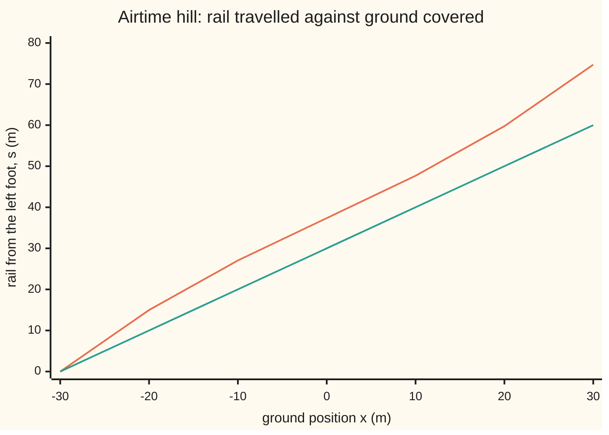

# Regular curve and arc length: relabel a path by distance travelled

[Syllabus](../../../SYLLABUS.md) → [Differential geometry and Lie groups](../README.md) → [Curves](../README.md#s01) → Regular curve and arc length

---

## General Overview

A rollercoaster has an airtime hill: a hump 20 m high that rises and falls over 60 m of ground. The designer draws it by ground position. At each ground position x, in metres, the rail's centre line sits at height 20(1 − (x/30)²) metres.

The workshop that builds the track does not work in ground metres. It works in **metres of rail**. Rail comes in pieces of fixed length, and splices, brake sensors and support brackets go every so many metres along the rail. So the workshop needs the answer to one question: where on the hill is the point 10 m of rail from the start? And 20 m, 30 m, and so on?

Ground metres and rail metres are not the same. The whole hill is 74.72 m of rail over 60 m of ground. The first 10 m of ground, on the steep foot of the hill, holds 14.97 m of rail. The 10 m of ground next to the top holds only 10.32 m.

This card turns any labelling of a path into the rail-metre labelling. The new label is called **arc length**: the distance travelled along the path.

Once the path is labelled this way, a point moving one label unit moves exactly one metre, so the label and the distance are the same number. That trick only works when the original labelling never stalls. A labelling that never stalls is called **regular**.

**A path whose labelling never stops moving can always be relabelled by the distance travelled along it, and in that labelling it moves at exactly one metre per unit, which gives every point a direction of travel of length one.**

**What kind of fact this is:** a theorem, proved on this card in Why it works. "Regular" and "arc length" are definitions; that a regular curve can be relabelled by arc length, uniquely once a start point and a direction of travel are chosen, is the theorem.

### The picture: rail metres against ground metres



Orange: rail metres from the left foot of the hill. Green: ground metres from the same point. The orange line is steep at both feet, where the rail climbs, and almost parallel to green at the top, where the rail is level. It always climbs: every metre of ground adds at least a metre of rail.

---

## The formula

Notation first, in words.

- A **curve** here is a position that depends on one number, the **clock** $`t`$. The clock is any label, not necessarily time. For the hill, the clock is the ground position x.
- $`\mathbf r(t)`$ is the position at clock reading $`t`$, written as a vector (a list of coordinates). For the hill, $`\mathbf r(x) = \big(x,\ 20(1 - (x/30)^2)\big)`$.
- A dot means a rate per unit of the clock: $`\dot{\mathbf r}(t)`$ is the velocity, how far and which way the point moves per unit of $`t`$.
- $`\lvert\dot{\mathbf r}(t)\rvert`$, the length of the velocity, is the **speed**: metres of path per unit of clock.

The [Arc length](../../06-Calculus%20and%20analysis/05-Curves%20and%20Solids/02-arc-length.md) card already shows that the length of a path is the integral of its speed, and that a new clock changes the speed but not the length. This card uses that length as a clock.

A curve is **regular** when its velocity is never zero:

```math
\dot{\mathbf r}(t) \neq \mathbf 0 \quad \text{for every } t
```

**Read it aloud:** at every clock reading the point is moving.

The **arc length** from a starting reading $`t_0`$ is

```math
s(t) = \int_{t_0}^{t} \lvert\dot{\mathbf r}(w)\rvert \, dw
```

**Read it aloud:** the rail travelled by clock reading t is the speed added up from the start to t.

On a regular curve, s(t) can be run backwards: each distance s belongs to exactly one clock reading t(s). Relabel by distance:

```math
\tilde{\mathbf r}(s) = \mathbf r\big(t(s)\big), \qquad \mathbf T(s) = \tilde{\mathbf r}\,'(s), \qquad \lvert \mathbf T(s) \rvert = 1
```

**Read it aloud:** the relabelled track at distance s is the old track at the clock reading that has travelled s; its velocity per metre of rail is the unit tangent, which always has length one.

From here on, in this wing, a **prime** means a rate per metre of arc length, d/ds, and a curve labelled by arc length is called **unit-speed**. The **unit tangent** $`\mathbf T`$ is the direction of travel, as an arrow of length one.

| Symbol | Plain meaning | In our example | Push it up and the answer… |
| --- | --- | --- | --- |
| $`t`$, $`w`$ | the clock: any label along the path; w is the same clock inside the integral | ground position x, −30 to 30 m | — |
| $`\mathbf r(t)`$ | position at clock reading t | (x, 20(1 − (x/30)²)) m | — |
| $`x`$, $`y`$ | ground position and height of the rail | at the foot, (30, 0) m | moving x away from the top, 0, makes the rail steeper: more rail per ground metre |
| $`\dot{\mathbf r}(t)`$ | velocity: change of position per unit of clock | (1, −2x/45) per ground metre | — |
| $`\lvert\dot{\mathbf r}(t)\rvert`$ | speed: metres of rail per unit of clock | 5/3 at the right foot, 1 at the top | faster speed, more rail per clock unit |
| $`s(t)`$, $`t_0`$ | arc length: rail travelled since the start reading t₀ | 37.36 m from the left foot (x = −30) to the top | — |
| $`t(s)`$ | the clock reading at rail distance s | s = 10 m is at x = −23.5719 m | — |
| $`\tilde{\mathbf r}(s)`$ | the same track, labelled by rail metres | s = 10 m is the point (−23.5719, 7.6526) m | — |
| $`'`$ (prime) | rate per metre of arc length, d/ds | — | — |
| $`\mathbf T(s)`$ | unit tangent: the direction of travel, length 1 | (0.6, −0.8) at the right foot | — |
| $`L`$ | total length of the curve | 74.718776 m | a longer or bumpier path, more rail |
| $`u`$ | a second clock, used to check that s does not depend on the clock | x = 15u + 15u³, u from −1 to 1 | — |

The speed is metres per unit of clock, the clock reading is in its own units, so s comes out in metres whatever clock is used.

### When it holds

- **The velocity is never zero (regular).** Where it is zero, the point stalls, and the direction of travel can flip. The curve (t², t³) stalls at t = 0 and comes out of the stall pointing the other way.
- **The velocity changes without jumps.** The position must have a continuous rate (continuously differentiable). At a kink, the arc length still exists but the unit tangent jumps.
- **The clock runs over an interval** (one unbroken stretch of readings). A track in two separate pieces gets two separate arc-length labels.
- **Global, not local.** On an interval, a regular curve has an arc-length labelling along its whole length, not only near one point. A closed loop of track gets one: its label runs from 0 to the loop's length, then starts again.
- **The path may cross itself.** A vertical loop seen from the side crosses itself at the bottom. Arc length counts each pass, so crossing is harmless.

---

## Why it works

### Step 0: a point that never stalls never goes back over its own distance

If the point always moves, the distance it has travelled always grows. A quantity that only grows takes each value once. So "the point 30 m along the rail" names exactly one clock reading. That is all a relabelling needs: a rule that turns each distance into one clock reading and back.

### Step 1: the rate of arc length is the speed

By the [Fundamental theorem of calculus](../../06-Calculus%20and%20analysis/04-Integrals/02-fundamental-theorem-of-calculus.md) (an integral's rate of change at its upper end is the value being integrated there):

```math
\frac{ds}{dt} = \lvert\dot{\mathbf r}(t)\rvert
```

**Read it aloud:** rail is added at the rate of the speed.

On a regular curve the speed is never zero, and it changes without jumps. So ds/dt is positive everywhere, and s(t) strictly increases.

### Step 2: run the arc length backwards

A strictly increasing function with a positive rate has an inverse with a rate of its own ([Implicit and inverse differentiation](../../06-Calculus%20and%20analysis/02-Derivatives/06-implicit-and-inverse-differentiation.md): the rate of the inverse is one over the rate of the original):

```math
\frac{dt}{ds} = \frac{1}{\lvert\dot{\mathbf r}(t)\rvert}
```

**Read it aloud:** clock units per metre of rail is one over metres of rail per clock unit.

This is where regularity is spent. At a stall the speed is 0, and dt/ds would be one over zero. On the hill the speed is at least 1, so dt/ds is at most 1 ground metre per rail metre.

### Step 3: the relabelled curve has speed one

The relabelled track is $`\tilde{\mathbf r}(s) = \mathbf r(t(s))`$. The [Chain rule](../../06-Calculus%20and%20analysis/02-Derivatives/03-chain-rule.md) (rates multiply along a chain) gives

```math
\tilde{\mathbf r}\,'(s) = \dot{\mathbf r}(t)\,\frac{dt}{ds} = \frac{\dot{\mathbf r}(t)}{\lvert\dot{\mathbf r}(t)\rvert}
```

**Read it aloud:** the velocity per metre of rail is the old velocity divided by its own length.

A vector divided by its own length has length one. So $`\lvert \mathbf T(s) \rvert = 1`$ at every s: one metre of label is one metre of rail.

At the right foot of the hill the velocity per ground metre is (1, −4/3), of length 5/3. Divide: T = (3/5, −4/5) = (0.6, −0.8). The rail there drops 0.8 m for every 1 m travelled along it.

### Step 4: arc length belongs to the track, not to the clock

Swap the clock for another one that runs forward without stalling, such as u with x = 15u + 15u³. The speed changes at every point, but the substitution rule for integrals turns one speed integral into the other. So the distance from the start to any point is the same in both clocks, and so is the rail-metre labelling. The code checks this: the u clock gives the same 74.718776 m and the same marks to 0.1 micrometres.

The labelling is unique except for two free choices: where s = 0 is, and which way is forward. Any other unit-speed labelling equals s plus a fixed number, or minus s plus a fixed number.

<details>
<summary>Detailed proof: s is invertible, the result has unit speed, and it is unique up to start and direction</summary>

Let $`\mathbf r`$ be continuously differentiable on an interval I, with $`\dot{\mathbf r}(t) \neq \mathbf 0`$ for every t in I. Fix $`t_0`$ in I.

**s runs one-to-one onto an interval.** The speed $`\lvert\dot{\mathbf r}\rvert`$ is continuous, so by the fundamental theorem of calculus s is differentiable with

$`\displaystyle s'(t) = \lvert\dot{\mathbf r}(t)\rvert > 0.`$

A function with a positive derivative on an interval strictly increases (mean value theorem: the average rate over a stretch equals the rate at some point inside it). So s is one-to-one, and, being continuous, maps I onto an interval J.

**The inverse is differentiable.** By the one-variable inverse function theorem, $`t(s)`$ is differentiable on J with

$`\displaystyle \frac{dt}{ds} = \frac{1}{\lvert\dot{\mathbf r}(t(s))\rvert},`$

which is continuous because it is a composition of continuous functions with a nonzero denominator.

**Unit speed.** By the chain rule, $`\tilde{\mathbf r}\,'(s) = \dot{\mathbf r}(t(s))\,/\,\lvert\dot{\mathbf r}(t(s))\rvert`$, a unit vector.

**Independent of the clock.** Let $`t = \phi(u)`$ with $`\phi`$ continuously differentiable and $`\phi'(u) > 0`$. The new velocity is $`\dot{\mathbf r}(\phi(u))\,\phi'(u)`$, so the new speed is $`\lvert\dot{\mathbf r}(\phi(u))\rvert\,\phi'(u)`$. Substituting $`t = \phi(w)`$:

$`\displaystyle \int_{u_0}^{u} \lvert\dot{\mathbf r}(\phi(w))\rvert\,\phi'(w)\,dw = \int_{\phi(u_0)}^{\phi(u)} \lvert\dot{\mathbf r}(t)\rvert\,dt.`$

So both clocks give the same distance to each point.

**Unique up to start and direction.** Let $`\boldsymbol\gamma(\sigma)`$ be another unit-speed labelling of the same curve, related by $`\sigma = \sigma(s)`$ with a continuous nonzero rate. By the chain rule, $`\boldsymbol\gamma'(\sigma)\,\sigma'(s) = \mathbf T(s)`$. Both arrows have length one, so $`\lvert\sigma'(s)\rvert = 1`$. A continuous rate that is never zero keeps one sign, so $`\sigma' = 1`$ everywhere or $`\sigma' = -1`$ everywhere. Integrating, $`\sigma = s + c`$ or $`\sigma = -s + c`$ for a constant c.

</details>

### Step 5: what goes wrong at a stall

The curve (t², t³) has velocity (2t, 3t²), which is zero at t = 0. Its arc length still exists: from t = 0 to 1 it is $`(13^{3/2} - 8)/27 = 1.439710`$. But dt/ds = 1/speed blows up: at t = 0.001 it is already 500.0.

Worse, the unit tangent flips. Just before the stall it is (−1.0000, 0.0015); just after, (1.0000, 0.0015). The direction of travel turns through 180° in no distance at all. This point is a **cusp**: a sharp tip where the path doubles back. A train cannot run it.

Regularity is a property of the clock, not only of the shape. The straight rail (t, t) has speed 1.414214 at t = 0. The same straight rail labelled (t³, t³) has speed 0.000000 there. Nothing is wrong with that rail, so relabel it by arc length and the stall disappears. A cusp is different: no clock removes it, because the direction really flips.

---

## Worked numbers, by hand

The hill: $`y = 20(1 - (x/30)^2)`$ from x = −30 to 30 m, clock x. The slope is −2x/45. For the half hill from the top to the right foot, the integral of the speed has a closed form using asinh, the inverse of the hyperbolic sine, $`\mathrm{asinh}\, z = \ln\big(z + \sqrt{1 + z^2}\big)`$, as on the [Arc length](../../06-Calculus%20and%20analysis/05-Curves%20and%20Solids/02-arc-length.md) card:

```math
\text{half hill} = \tfrac{45}{4}\left(\tfrac{4}{3}\cdot\tfrac{5}{3} + \mathrm{asinh}\,\tfrac{4}{3}\right)
```

| Step | Arithmetic | Value |
| --- | --- | --- |
| slope at the right foot | −2 × 30/45 | −1.333333 |
| speed there | sqrt(1 + 16/9) = sqrt(25/9) | 1.666667 |
| unit tangent there | (1, −4/3) ÷ 5/3 | (0.6, −0.8) |
| first term | 4/3 × 5/3 = 20/9 | 2.222222 |
| second term | asinh(4/3) = ln(4/3 + 5/3) = ln 3 | 1.098612 |
| sum | 2.222222 + 1.098612 | 3.320835 |
| half hill | 45/4 × 3.320835 = 11.25 × 3.320835 | 37.359388 m |
| whole hill | 2 × 37.359388 | **74.718776 m** |

(The sum's last digit uses unrounded terms.) The hill uses 74.72 m of rail over 60 m of ground: 14.72 m of extra rail for the climb and the drop.

Now the marks every 10 m of rail, from the left foot. Each one solves s(x) = 10, 20, … for x. The code solves it two ways.

| Rail mark s | Ground x | Height | Unit tangent T | Straight-line distance from last mark |
| --- | --- | --- | --- | --- |
| 10 m | −23.5719 m | 7.6526 m | (0.6905, 0.7234) | 9.9942 m |
| 20 m | −16.0800 m | 14.2541 m | (0.8136, 0.5814) | 9.9853 m |
| 30 m | −7.2365 m | 18.8363 m | (0.9520, 0.3062) | 9.9601 m |
| 40 m | 2.6346 m | 19.8458 m | (0.9932, −0.1163) | 9.9226 m |
| 50 m | 12.0827 m | 16.7557 m | (0.8810, −0.4731) | 9.9406 m |
| 60 m | 20.1898 m | 10.9416 m | (0.7443, −0.6679) | 9.9764 m |
| 70 m | 27.0788 m | 3.7053 m | (0.6391, −0.7691) | 9.9912 m |

The 40 m mark is just past the top, which sits at 37.36 m. Each straight line between marks is a little under 10 m, because a chord cuts across the bend; it is shortest, 9.9226 m, across the top, where the rail bends most. In ground position the marks crowd together on the steep feet and spread out near the top.

### What breaks if you drop a piece

| Mistake | Comes out at | What went wrong |
| --- | --- | --- |
| Equal 10 m steps of ground taken as equal rail | 14.973, 12.066, 10.320, 10.320, 12.066, 14.973 m of rail per step | Ground metres are a clock with a varying speed; only arc length has speed 1 |
| Marks spaced in proportion: ground x = −30 + 60 × s / 74.72 | up to 2.641 m of rail out | The right total, spread at the wrong rate |
| Relabel the cusp (t², t³) through t = 0 | T jumps from (−1.0000, 0.0015) to (1.0000, 0.0015); dt/ds = 500.0 at t = 0.001 | The velocity is zero at t = 0, so the curve is not regular there |
| Judge regularity by the shape alone | straight rail (t³, t³): speed 0.000000 at t = 0 | Regularity belongs to the labelling; the clock t stalls, the rail does not |

The code prints each one.

---

## Code, from first principles, and it actually runs

The code measures the hill four independent ways: the closed form, Simpson's rule (a strip sum that fits a parabola over each pair of strips) on the speed in the ground clock, Simpson's rule in a second clock u, and straight chords. Chords are a stepped value, so they run at two counts: 1024 chords fall short by 10.173 micrometres, 4096 by 0.636, 16.00 times less for four times the chords.

It then finds the 10 m rail marks two independent ways: [Newton's method](../../06-Calculus%20and%20analysis/03-What%20Derivatives%20Tell%20You/06-newtons-method.md) on the closed form in the ground clock, and [Bisection](../../16-Numerical%20analysis/02-Root%20Finding%20and%20Fixed%20Points/01-bisection-and-bracketing.md) (halving a bracket that must contain the answer) on Simpson sums in the u clock. Newton's step divides by the speed, which is never below 1 on this hill, so the step never divides by zero. The asserts check that the roads agree, that the relabelled track moves at speed 1 (by a central difference: distance between points 1 mm before and after, over 2 mm), that chords undershoot and close in 16 times per fourfold count, and that the cusp flips its tangent.

### Python

```python
# Regular curve and arc length -- the check behind the card.  Standard library
# only; math gives sqrt, log, cos, sin, pi as primitives, every sum and solver is here.
# A coaster's airtime hill: rail centre line y = 20 (1 - (x/30)^2) metres over
# ground positions x = -30 .. 30 m.  Its length, and its rail-metre marks.
from math import sqrt, log, pi, cos, sin

H, W = 20.0, 30.0                       # hill height and half-width, metres
k = 2 * H / (W * W)                     # slope per metre of x: 2/45
def y(x):  return H * (1 - (x / W) ** 2)
def yp(x): return -k * x                # slope dy/dx
def asinh(z): return log(z + sqrt(1 + z * z))
def F(x):  return (k * x * sqrt(1 + (k * x) ** 2) + asinh(k * x)) / (2 * k)
def s_of_x(x): return F(x) - F(-W)      # rail metres from the left foot
L = s_of_x(W)                           # road one: closed form

def simpson(g, a, b, n):
    h = (b - a) / n
    return (g(a) + g(b) + sum((4 if i % 2 else 2) * g(a + i * h) for i in range(1, n))) * h / 3

def speed_u(u):                         # second clock u: x = 15u + 15u^3, regular
    x = 15 * u + 15 * u ** 3
    return sqrt(1 + yp(x) ** 2) * (15 + 45 * u * u)
L_x = simpson(lambda x: sqrt(1 + yp(x) ** 2), -W, W, 1000)      # road two
L_u = simpson(speed_u, -1.0, 1.0, 1000)                         # road three
def chords(n):                                                  # road four: n straight chords
    xs = [-W + 2 * W * i / n for i in range(n + 1)]
    return sum(sqrt((xs[i] - xs[i - 1]) ** 2 + (y(xs[i]) - y(xs[i - 1])) ** 2) for i in range(1, n + 1))
L_c1, L_c = chords(1024), chords(4096)

def x_newton(s):                        # invert s(x) by Newton: ds/dx >= 1, never 0
    x = -W + 2 * W * s / L
    for _ in range(50):
        x -= (s_of_x(x) - s) / sqrt(1 + yp(x) ** 2)
    return x
def x_bisect(s):                        # invert on the u clock by bisection
    lo, hi = -1.0, 1.0
    for _ in range(60):
        mid = (lo + hi) / 2
        if simpson(speed_u, -1.0, mid, 200) < s: lo = mid
        else: hi = mid
    u = (lo + hi) / 2
    return 15 * u + 15 * u ** 3
def T(x):                               # unit tangent, travelling left to right
    r = sqrt(1 + yp(x) ** 2)
    return 1 / r, yp(x) / r

print(f"hill {H:.0f} m high, {2 * W:.0f} m of ground, y = 20(1 - (x/30)^2), slope -2x/45")
print(f"at the right foot: slope {yp(W):.6f}, stretch sqrt(1 + 16/9) = {sqrt(1 + yp(W) ** 2):.6f}, "
      f"ln 3 = {log(3):.6f}")
print(f"20/9 = {(4 / 3) * (5 / 3):.6f}; 20/9 + ln 3 = {20 / 9 + log(3):.6f}; 45/4 = {1 / (2 * k):.2f}")
print(f"half hill 45/4 x (20/9 + ln 3) = {F(W):.6f} m; whole hill closed form {L:.6f} m, "
      f"{L - 2 * W:.2f} m more than the ground")
print(f"Simpson on the x clock, 1000 strips: {L_x:.6f} m")
print(f"Simpson on the u clock, x = 15u + 15u^3, 1000 strips: {L_u:.6f} m")
print(f"1024 chords: {L_c1:.6f} m, short by {(L - L_c1) * 1e6:.3f} micrometres")
print(f"4096 chords: {L_c:.6f} m, short by {(L - L_c) * 1e6:.3f} micrometres, "
      f"{(L - L_c1) / (L - L_c):.2f} times less")
print("chart, rail metres s at ground x = -30..30 step 10:",
      " ".join(f"{s_of_x(x):.2f}" for x in range(-30, 31, 10)))
marks, prev = [], (-W, 0.0)
for j in range(1, 8):
    s = 10.0 * j
    xa, xb = x_newton(s), x_bisect(s)
    h = 1e-3
    pa, pb = (x_newton(s + h), y(x_newton(s + h))), (x_newton(s - h), y(x_newton(s - h)))
    sp = sqrt((pa[0] - pb[0]) ** 2 + (pa[1] - pb[1]) ** 2) / (2 * h)
    ch = sqrt((xa - prev[0]) ** 2 + (y(xa) - prev[1]) ** 2)
    tx, ty = T(xa)
    print(f"mark {s:4.1f} m: x = {xa:8.4f} (bisection {xb:8.4f}), height {y(xa):7.4f}, "
          f"T = ({tx:.4f}, {ty:.4f}), speed {sp:.6f}, chord from last {ch:.4f}")
    marks.append((xa, xb, sp, ch))
    prev = (xa, y(xa))
gap = max(abs(xa - xb) for xa, xb, _, _ in marks)
print(f"largest gap between the two inversions: {gap * 1e6:.1f} micrometres")
tx, ty = T(W)
print(f"unit tangent at the right foot: ({tx:.6f}, {ty:.6f})")
steps = [s_of_x(-W + 10 * (i + 1)) - s_of_x(-W + 10 * i) for i in range(6)]
print("mistake 1, equal 10 m ground steps, rail in each:", " ".join(f"{d:.3f}" for d in steps))
err = max(abs(s_of_x(-W + 2 * W * 10 * j / L) - 10 * j) for j in range(1, 8))
print(f"mistake 2, marks spaced in proportion to ground: worst error {err:.3f} m of rail")
def cusp_v(t): return 2 * t, 3 * t * t           # velocity of (t^2, t^3)
def cusp_T(t):
    vx, vy = cusp_v(t)
    return vx / sqrt(vx * vx + vy * vy), vy / sqrt(vx * vx + vy * vy)
a, b = cusp_T(-0.001), cusp_T(0.001)
cusp_len = (13 ** 1.5 - 8) / 27
cusp_simp = simpson(lambda t: sqrt(sum(c * c for c in cusp_v(t))), 0.0, 1.0, 1000)
print(f"cusp (t^2, t^3): speed at t = 0 is {sqrt(sum(c * c for c in cusp_v(0.0))):.1f}; "
      f"T at t = -0.001 ({a[0]:.4f}, {a[1]:.4f}), at t = +0.001 ({b[0]:.4f}, {b[1]:.4f})")
print(f"cusp: dt/ds at t = 0.001 is {1 / sqrt(sum(c * c for c in cusp_v(0.001))):.1f}; "
      f"length t = 0..1 closed {cusp_len:.6f}, Simpson {cusp_simp:.6f}")
print(f"one straight rail, two clocks: (t, t) speed at 0 {sqrt(1 + 1):.6f}; "
      f"(t^3, t^3) speed at 0 {sqrt(2 * (3 * 0.0 ** 2) ** 2):.6f}")
turn = sqrt((2 * pi * 3) ** 2 + 12 ** 2)               # corkscrew: closed form
def turn_chords(n):                                    # corkscrew: n chords per turn
    pts = [(3 * cos(2 * pi * i / n), 3 * sin(2 * pi * i / n), 12 * i / n) for i in range(n + 1)]
    return sum(sqrt(sum((p - q) ** 2 for p, q in zip(pts[i], pts[i - 1]))) for i in range(1, n + 1))
turn_c1, turn_c = turn_chords(90), turn_chords(360)
print(f"corkscrew, radius 3 m, 12 m per turn: circle part {2 * pi * 3:.4f} m, {turn:.4f} m of rail per turn")
print(f"corkscrew chords: 90 give {turn_c1:.4f} m, short by {(turn - turn_c1) * 1e3:.2f} mm; "
      f"360 give {turn_c:.4f} m, short by {(turn - turn_c) * 1e3:.2f} mm")
print(f"try: 24 m per turn gives {sqrt((2 * pi * 3) ** 2 + 24 ** 2):.2f} m of rail per turn, "
      f"not twice {turn:.4f} = {2 * turn:.2f} m")
assert abs(L - L_x) < 1e-9                             # closed form against Simpson
assert abs(L - L_u) < 1e-9                             # a second clock, the same length
assert 0 < L - L_c < 1e-4                              # chords close in from below,
assert abs((L - L_c1) / (L - L_c) - 16) < 0.1          # 16 times closer for 4 times the chords
assert gap < 1e-6                                      # two inversions agree
assert all(abs(sp - 1) < 1e-6 for _, _, sp, _ in marks)     # unit speed in rail metres
assert all(9.9 < ch < 10 for _, _, _, ch in marks)          # a chord undershoots its arc
assert abs(cusp_len - cusp_simp) < 1e-9               # cusp length: closed form, Simpson
assert a[0] < -0.99                                    # the cusp flips the tangent:
assert b[0] > 0.99                                     # back, then forward
assert 0 < turn - turn_c < 1e-3                        # corkscrew: chords from below,
assert abs((turn - turn_c1) / (turn - turn_c) - 16) < 0.1   # again 16 times closer
print("ALL CHECKS PASS")
```

**Ran 2026-11-19 on macOS, Python 3.14.10, standard library only. All checks passed. Output, pasted from the run:**

```
hill 20 m high, 60 m of ground, y = 20(1 - (x/30)^2), slope -2x/45
at the right foot: slope -1.333333, stretch sqrt(1 + 16/9) = 1.666667, ln 3 = 1.098612
20/9 = 2.222222; 20/9 + ln 3 = 3.320835; 45/4 = 11.25
half hill 45/4 x (20/9 + ln 3) = 37.359388 m; whole hill closed form 74.718776 m, 14.72 m more than the ground
Simpson on the x clock, 1000 strips: 74.718776 m
Simpson on the u clock, x = 15u + 15u^3, 1000 strips: 74.718776 m
1024 chords: 74.718766 m, short by 10.173 micrometres
4096 chords: 74.718776 m, short by 0.636 micrometres, 16.00 times less
chart, rail metres s at ground x = -30..30 step 10: 0.00 14.97 27.04 37.36 47.68 59.75 74.72
mark 10.0 m: x = -23.5719 (bisection -23.5719), height  7.6526, T = (0.6905, 0.7234), speed 1.000000, chord from last 9.9942
mark 20.0 m: x = -16.0800 (bisection -16.0800), height 14.2541, T = (0.8136, 0.5814), speed 1.000000, chord from last 9.9853
mark 30.0 m: x =  -7.2365 (bisection  -7.2365), height 18.8363, T = (0.9520, 0.3062), speed 1.000000, chord from last 9.9601
mark 40.0 m: x =   2.6346 (bisection   2.6346), height 19.8458, T = (0.9932, -0.1163), speed 1.000000, chord from last 9.9226
mark 50.0 m: x =  12.0827 (bisection  12.0827), height 16.7557, T = (0.8810, -0.4731), speed 1.000000, chord from last 9.9406
mark 60.0 m: x =  20.1898 (bisection  20.1898), height 10.9416, T = (0.7443, -0.6679), speed 1.000000, chord from last 9.9764
mark 70.0 m: x =  27.0788 (bisection  27.0788), height  3.7053, T = (0.6391, -0.7691), speed 1.000000, chord from last 9.9912
largest gap between the two inversions: 0.1 micrometres
unit tangent at the right foot: (0.600000, -0.800000)
mistake 1, equal 10 m ground steps, rail in each: 14.973 12.066 10.320 10.320 12.066 14.973
mistake 2, marks spaced in proportion to ground: worst error 2.641 m of rail
cusp (t^2, t^3): speed at t = 0 is 0.0; T at t = -0.001 (-1.0000, 0.0015), at t = +0.001 (1.0000, 0.0015)
cusp: dt/ds at t = 0.001 is 500.0; length t = 0..1 closed 1.439710, Simpson 1.439710
one straight rail, two clocks: (t, t) speed at 0 1.414214; (t^3, t^3) speed at 0 0.000000
corkscrew, radius 3 m, 12 m per turn: circle part 18.8496 m, 22.3452 m of rail per turn
corkscrew chords: 90 give 22.3419 m, short by 3.23 mm; 360 give 22.3449 m, short by 0.20 mm
try: 24 m per turn gives 30.52 m of rail per turn, not twice 22.3452 = 44.69 m
ALL CHECKS PASS
```

### Rust

Same numbers, same labels, built with `rustc --edition 2021 -O`.

```rust
// Regular curve and arc length -- the same check as the Python, in Rust.  No
// crates; sqrt, ln, cos, sin and pi are primitives, every sum and solver is here.
// A coaster's airtime hill: rail centre line y = 20 (1 - (x/30)^2) metres over
// ground positions x = -30 .. 30 m.  Its length, and its rail-metre marks.
use std::f64::consts::PI;

const H: f64 = 20.0; // hill height, metres
const W: f64 = 30.0; // half-width, metres
const K: f64 = 2.0 * H / (W * W); // slope per metre of x: 2/45

fn y(x: f64) -> f64 { H * (1.0 - (x / W).powi(2)) }
fn yp(x: f64) -> f64 { -K * x } // slope dy/dx
fn asinh(z: f64) -> f64 { (z + (1.0 + z * z).sqrt()).ln() }
fn f(x: f64) -> f64 { (K * x * (1.0 + (K * x).powi(2)).sqrt() + asinh(K * x)) / (2.0 * K) }
fn s_of_x(x: f64) -> f64 { f(x) - f(-W) } // rail metres from the left foot

fn simpson(g: &dyn Fn(f64) -> f64, a: f64, b: f64, n: usize) -> f64 {
    let h = (b - a) / n as f64;
    let mut s = g(a) + g(b);
    for i in 1..n {
        s += if i % 2 == 1 { 4.0 } else { 2.0 } * g(a + i as f64 * h);
    }
    s * h / 3.0
}

fn speed_u(u: f64) -> f64 { // second clock u: x = 15u + 15u^3, regular
    let x = 15.0 * u + 15.0 * u.powi(3);
    (1.0 + yp(x).powi(2)).sqrt() * (15.0 + 45.0 * u * u)
}

fn x_newton(s: f64, l: f64) -> f64 { // invert s(x) by Newton: ds/dx >= 1, never 0
    let mut x = -W + 2.0 * W * s / l;
    for _ in 0..50 {
        x -= (s_of_x(x) - s) / (1.0 + yp(x).powi(2)).sqrt();
    }
    x
}

fn x_bisect(s: f64) -> f64 { // invert on the u clock by bisection
    let (mut lo, mut hi) = (-1.0, 1.0);
    for _ in 0..60 {
        let mid = (lo + hi) / 2.0;
        if simpson(&speed_u, -1.0, mid, 200) < s { lo = mid; } else { hi = mid; }
    }
    let u = (lo + hi) / 2.0;
    15.0 * u + 15.0 * u.powi(3)
}

fn t_unit(x: f64) -> (f64, f64) { // unit tangent, travelling left to right
    let r = (1.0 + yp(x).powi(2)).sqrt();
    (1.0 / r, yp(x) / r)
}

fn chords(n: usize) -> f64 { // road four: n straight chords
    let xs: Vec<f64> = (0..=n).map(|i| -W + 2.0 * W * i as f64 / n as f64).collect();
    (1..=n).map(|i| ((xs[i] - xs[i - 1]).powi(2) + (y(xs[i]) - y(xs[i - 1])).powi(2)).sqrt()).sum()
}

fn turn_chords(n: usize) -> f64 { // corkscrew: n chords per turn
    let pts: Vec<[f64; 3]> = (0..=n).map(|i| {
        let a = 2.0 * PI * i as f64 / n as f64;
        [3.0 * a.cos(), 3.0 * a.sin(), 12.0 * i as f64 / n as f64]
    }).collect();
    (1..=n).map(|i| (0..3).map(|c| (pts[i][c] - pts[i - 1][c]).powi(2)).sum::<f64>().sqrt()).sum()
}

fn cusp_v(t: f64) -> (f64, f64) { (2.0 * t, 3.0 * t * t) } // velocity of (t^2, t^3)
fn cusp_speed(t: f64) -> f64 { let (a, b) = cusp_v(t); (a * a + b * b).sqrt() }
fn cusp_t(t: f64) -> (f64, f64) { let (a, b) = cusp_v(t); (a / cusp_speed(t), b / cusp_speed(t)) }

fn main() {
    let l = s_of_x(W); // road one: closed form
    let l_x = simpson(&|x| (1.0 + yp(x).powi(2)).sqrt(), -W, W, 1000); // road two
    let l_u = simpson(&speed_u, -1.0, 1.0, 1000); // road three
    let (l_c1, l_c) = (chords(1024), chords(4096)); // road four: chords

    println!("hill {:.0} m high, {:.0} m of ground, y = 20(1 - (x/30)^2), slope -2x/45", H, 2.0 * W);
    println!("at the right foot: slope {:.6}, stretch sqrt(1 + 16/9) = {:.6}, ln 3 = {:.6}",
             yp(W), (1.0 + yp(W).powi(2)).sqrt(), 3f64.ln());
    println!("20/9 = {:.6}; 20/9 + ln 3 = {:.6}; 45/4 = {:.2}", (4.0 / 3.0) * (5.0 / 3.0), 20.0 / 9.0 + 3f64.ln(), 1.0 / (2.0 * K));
    println!("half hill 45/4 x (20/9 + ln 3) = {:.6} m; whole hill closed form {:.6} m, {:.2} m more than the ground",
             f(W), l, l - 2.0 * W);
    println!("Simpson on the x clock, 1000 strips: {:.6} m", l_x);
    println!("Simpson on the u clock, x = 15u + 15u^3, 1000 strips: {:.6} m", l_u);
    println!("1024 chords: {:.6} m, short by {:.3} micrometres", l_c1, (l - l_c1) * 1e6);
    println!("4096 chords: {:.6} m, short by {:.3} micrometres, {:.2} times less", l_c, (l - l_c) * 1e6, (l - l_c1) / (l - l_c));
    let chart: Vec<String> = (-3..=3).map(|i| format!("{:.2}", s_of_x(10.0 * i as f64))).collect();
    println!("chart, rail metres s at ground x = -30..30 step 10: {}", chart.join(" "));
    let mut marks: Vec<(f64, f64, f64, f64)> = Vec::new();
    let mut prev = (-W, 0.0);
    for j in 1..8 {
        let s = 10.0 * j as f64;
        let (xa, xb) = (x_newton(s, l), x_bisect(s));
        let h = 1e-3;
        let (p1, p2) = (x_newton(s + h, l), x_newton(s - h, l));
        let sp = ((p1 - p2).powi(2) + (y(p1) - y(p2)).powi(2)).sqrt() / (2.0 * h);
        let ch = ((xa - prev.0).powi(2) + (y(xa) - prev.1).powi(2)).sqrt();
        let (tx, ty) = t_unit(xa);
        println!("mark {:4.1} m: x = {:8.4} (bisection {:8.4}), height {:7.4}, T = ({:.4}, {:.4}), speed {:.6}, chord from last {:.4}",
                 s, xa, xb, y(xa), tx, ty, sp, ch);
        marks.push((xa, xb, sp, ch));
        prev = (xa, y(xa));
    }
    let gap = marks.iter().map(|m| (m.0 - m.1).abs()).fold(0.0, f64::max);
    println!("largest gap between the two inversions: {:.1} micrometres", gap * 1e6);
    let (tx, ty) = t_unit(W);
    println!("unit tangent at the right foot: ({:.6}, {:.6})", tx, ty);
    let steps: Vec<String> = (0..6)
        .map(|i| format!("{:.3}", s_of_x(-W + 10.0 * (i + 1) as f64) - s_of_x(-W + 10.0 * i as f64))).collect();
    println!("mistake 1, equal 10 m ground steps, rail in each: {}", steps.join(" "));
    let err = (1..8).map(|j| (s_of_x(-W + 2.0 * W * 10.0 * j as f64 / l) - 10.0 * j as f64).abs())
        .fold(0.0, f64::max);
    println!("mistake 2, marks spaced in proportion to ground: worst error {:.3} m of rail", err);
    let (a, b) = (cusp_t(-0.001), cusp_t(0.001));
    let cusp_len = (13f64.powf(1.5) - 8.0) / 27.0;
    let cusp_simp = simpson(&cusp_speed, 0.0, 1.0, 1000);
    println!("cusp (t^2, t^3): speed at t = 0 is {:.1}; T at t = -0.001 ({:.4}, {:.4}), at t = +0.001 ({:.4}, {:.4})",
             cusp_speed(0.0), a.0, a.1, b.0, b.1);
    println!("cusp: dt/ds at t = 0.001 is {:.1}; length t = 0..1 closed {:.6}, Simpson {:.6}",
             1.0 / cusp_speed(0.001), cusp_len, cusp_simp);
    println!("one straight rail, two clocks: (t, t) speed at 0 {:.6}; (t^3, t^3) speed at 0 {:.6}",
             (1.0f64 + 1.0).sqrt(), (2.0 * (3.0 * 0.0f64.powi(2)).powi(2)).sqrt());
    let turn = ((2.0 * PI * 3.0).powi(2) + 12.0f64.powi(2)).sqrt(); // corkscrew: closed form
    let (turn_c1, turn_c) = (turn_chords(90), turn_chords(360));
    println!("corkscrew, radius 3 m, 12 m per turn: circle part {:.4} m, {:.4} m of rail per turn", 2.0 * PI * 3.0, turn);
    println!("corkscrew chords: 90 give {:.4} m, short by {:.2} mm; 360 give {:.4} m, short by {:.2} mm",
             turn_c1, (turn - turn_c1) * 1e3, turn_c, (turn - turn_c) * 1e3);
    println!("try: 24 m per turn gives {:.2} m of rail per turn, not twice {:.4} = {:.2} m",
             ((2.0 * PI * 3.0).powi(2) + 24.0f64.powi(2)).sqrt(), turn, 2.0 * turn);
    assert!((l - l_x).abs() < 1e-9); // closed form against Simpson
    assert!((l - l_u).abs() < 1e-9); // a second clock, the same length
    assert!(l - l_c > 0.0 && l - l_c < 1e-4); // chords close in from below,
    assert!(((l - l_c1) / (l - l_c) - 16.0).abs() < 0.1); // 16 times closer for 4 times the chords
    assert!(gap < 1e-6); // two inversions agree
    assert!(marks.iter().all(|m| (m.2 - 1.0).abs() < 1e-6)); // unit speed in rail metres
    assert!(marks.iter().all(|m| m.3 > 9.9 && m.3 < 10.0)); // a chord undershoots its arc
    assert!((cusp_len - cusp_simp).abs() < 1e-9); // cusp length: closed form, Simpson
    assert!(a.0 < -0.99); // the cusp flips the tangent:
    assert!(b.0 > 0.99); // back, then forward
    assert!(turn - turn_c > 0.0 && turn - turn_c < 1e-3); // corkscrew: chords from below,
    assert!(((turn - turn_c1) / (turn - turn_c) - 16.0).abs() < 0.1); // again 16 times closer
    println!("ALL CHECKS PASS");
}
```

**Ran 2026-11-19 on macOS, rustc 1.98.1, no crates. All checks passed. Output, pasted from the run:**

```
hill 20 m high, 60 m of ground, y = 20(1 - (x/30)^2), slope -2x/45
at the right foot: slope -1.333333, stretch sqrt(1 + 16/9) = 1.666667, ln 3 = 1.098612
20/9 = 2.222222; 20/9 + ln 3 = 3.320835; 45/4 = 11.25
half hill 45/4 x (20/9 + ln 3) = 37.359388 m; whole hill closed form 74.718776 m, 14.72 m more than the ground
Simpson on the x clock, 1000 strips: 74.718776 m
Simpson on the u clock, x = 15u + 15u^3, 1000 strips: 74.718776 m
1024 chords: 74.718766 m, short by 10.173 micrometres
4096 chords: 74.718776 m, short by 0.636 micrometres, 16.00 times less
chart, rail metres s at ground x = -30..30 step 10: 0.00 14.97 27.04 37.36 47.68 59.75 74.72
mark 10.0 m: x = -23.5719 (bisection -23.5719), height  7.6526, T = (0.6905, 0.7234), speed 1.000000, chord from last 9.9942
mark 20.0 m: x = -16.0800 (bisection -16.0800), height 14.2541, T = (0.8136, 0.5814), speed 1.000000, chord from last 9.9853
mark 30.0 m: x =  -7.2365 (bisection  -7.2365), height 18.8363, T = (0.9520, 0.3062), speed 1.000000, chord from last 9.9601
mark 40.0 m: x =   2.6346 (bisection   2.6346), height 19.8458, T = (0.9932, -0.1163), speed 1.000000, chord from last 9.9226
mark 50.0 m: x =  12.0827 (bisection  12.0827), height 16.7557, T = (0.8810, -0.4731), speed 1.000000, chord from last 9.9406
mark 60.0 m: x =  20.1898 (bisection  20.1898), height 10.9416, T = (0.7443, -0.6679), speed 1.000000, chord from last 9.9764
mark 70.0 m: x =  27.0788 (bisection  27.0788), height  3.7053, T = (0.6391, -0.7691), speed 1.000000, chord from last 9.9912
largest gap between the two inversions: 0.1 micrometres
unit tangent at the right foot: (0.600000, -0.800000)
mistake 1, equal 10 m ground steps, rail in each: 14.973 12.066 10.320 10.320 12.066 14.973
mistake 2, marks spaced in proportion to ground: worst error 2.641 m of rail
cusp (t^2, t^3): speed at t = 0 is 0.0; T at t = -0.001 (-1.0000, 0.0015), at t = +0.001 (1.0000, 0.0015)
cusp: dt/ds at t = 0.001 is 500.0; length t = 0..1 closed 1.439710, Simpson 1.439710
one straight rail, two clocks: (t, t) speed at 0 1.414214; (t^3, t^3) speed at 0 0.000000
corkscrew, radius 3 m, 12 m per turn: circle part 18.8496 m, 22.3452 m of rail per turn
corkscrew chords: 90 give 22.3419 m, short by 3.23 mm; 360 give 22.3449 m, short by 0.20 mm
try: 24 m per turn gives 30.52 m of rail per turn, not twice 22.3452 = 44.69 m
ALL CHECKS PASS
```

The outputs match line for line.

### Lean

Lean proves the arc-length labelling for every regular curve on an interval, that it is unique, and the airtime hill's exact length.

- Take a regular curve, its clock on an interval, its velocity changing without jumps, and a start reading $`t_0`$. Then $`ds/dt`$ equals the speed, and s strictly increases.
- Take the same curve. Then s runs backwards, and the relabelled track's velocity is $`\dot{\mathbf r}/\lvert\dot{\mathbf r}\rvert`$, of length one.
- Take two unit-speed labellings of one curve, joined by a change of label with a continuous rate that is never zero. Then one label is the other plus a fixed number, or minus the other plus a fixed number.
- Take the airtime hill from its left foot. Then the rail to the top is exactly $`\tfrac{45}{4}(\tfrac{20}{9} + \ln 3)`$ m, and the whole hill is twice that.
- The by-hand steps hold: slope −4/3, speed 5/3 and unit tangent (0.6, −0.8) at the right foot, and asinh(4/3) = ln 3.

The second clock, the Simpson sums, the chords, the 10 m marks and the cusp are left to the Python and Rust checks.

```lean
-- Regular curve and arc length: a curve whose velocity never vanishes and has no jumps can be relabelled by the distance travelled along it, so that it moves at speed one, the labelling is unique once a start and a direction are chosen, and the card's airtime hill uses exactly 45/2 (20/9 + ln 3) metres of rail.
import Mathlib.MeasureTheory.Integral.IntervalIntegral.Basic
import Mathlib.Analysis.Calculus.Deriv.Basic
import Mathlib.Analysis.InnerProductSpace.PiL2
import Mathlib.Analysis.SpecialFunctions.Arsinh
import Mathlib.Order.Interval.Set.OrdConnected
import Mathlib.Tactic.NormNum
import Mathlib.MeasureTheory.Integral.IntervalIntegral.FundThmCalculus
import Mathlib.Analysis.Calculus.Deriv.MeanValue
import Mathlib.Analysis.Calculus.Deriv.Inverse
import Mathlib.Analysis.Calculus.Deriv.Prod
import Mathlib.Analysis.Calculus.MeanValue
import Mathlib.Analysis.Calculus.FDeriv.WithLp
import Mathlib.Analysis.SpecialFunctions.Sqrt
import Mathlib.Topology.Order.MonotoneContinuity
import Mathlib.Tactic

open Set

namespace RegularCurvesAndArcLength

/-- The arc length from the clock reading `t₀` to `t` of a curve whose velocity at each
reading `w` is `r' w`: the speed `‖r' w‖` added up from `t₀` to `t`,
`s(t) = ∫_{t₀}^{t} |ṙ(w)| dw`. -/
noncomputable def arcLength {E : Type*} [NormedAddCommGroup E] (r' : ℝ → E) (t₀ t : ℝ) : ℝ :=
  ∫ w in t₀..t, ‖r' w‖

/-- Helper: the integral of a function continuous on an interval has that function as its
derivative within the interval. -/
theorem hasDerivWithinAt_integral_of_ordConnected {f : ℝ → ℝ} {I : Set ℝ} (hI : I.OrdConnected)
    (hf : ContinuousOn f I) {t₀ t : ℝ} (ht₀ : t₀ ∈ I) (ht : t ∈ I) :
    HasDerivWithinAt (fun u => ∫ w in t₀..u, f w) (f t) I t := by
  have hint : ∀ a ∈ I, ∀ b ∈ I, IntervalIntegrable f MeasureTheory.volume a b :=
    fun a ha b hb => (hf.mono (hI.uIcc_subset ha hb)).intervalIntegrable
  rw [hasDerivWithinAt_iff_isLittleO, Asymptotics.isLittleO_iff]
  intro c hc
  have hcont := hf t ht
  rw [Metric.continuousWithinAt_iff] at hcont
  obtain ⟨δ, hδ, hδ'⟩ := hcont c hc
  rw [eventually_nhdsWithin_iff, Metric.eventually_nhds_iff]
  refine ⟨δ, hδ, fun u hu huI => ?_⟩
  rw [intervalIntegral.integral_interval_sub_left (hint t₀ ht₀ u huI) (hint t₀ ht₀ t ht)]
  have hconst : (u - t) • f t = ∫ _ in t..u, f t := by simp
  rw [hconst, ← intervalIntegral.integral_sub (hint t ht u huI) intervalIntegrable_const,
    Real.norm_eq_abs (u - t)]
  apply intervalIntegral.norm_integral_le_of_norm_le_const
  intro w hw
  have hw' : w ∈ uIcc t u := uIoc_subset_uIcc hw
  have hwI : w ∈ I := hI.uIcc_subset ht huI hw'
  have hdist : dist w t < δ := by
    rw [Real.dist_eq]
    exact lt_of_le_of_lt (abs_sub_left_of_mem_uIcc hw') (by rwa [Real.dist_eq] at hu)
  have := hδ' hwI hdist
  rw [dist_eq_norm] at this
  exact this.le

/-- **A regular curve can be relabelled by arc length, and then it has unit speed.**
A curve `r` has its clock `t` running over an interval `I` (one unbroken stretch of readings,
open, closed or half-open, possibly unbounded). Its velocity `r' t` changes without jumps
(`r` has derivative `r' t` at each reading of `I`, one-sided at an end of `I`, and `r'` is
continuous on `I`), and it is never zero (the curve is regular). Fix a start reading `t₀` in `I`
and let `s(t)` be the arc length from `t₀`. Then:
* the rail is added at the rate of the speed: `ds/dt = |ṙ(t)|`;
* `s` strictly increases on `I`, so it takes each value once, and its values form an interval `J`;
* `s` can be run backwards: there is a clock reading `t(s)` in `I` for each distance `s` in `J`,
  with `t(s(t)) = t`;
* the relabelled curve `r̃(s) = r(t(s))` has velocity per unit of arc length equal to
  `T(s) = ṙ(t) / |ṙ(t)|`, the old velocity divided by its own length, so `|T(s)| = 1`.
This is global: it holds along the whole interval, not only near one point. -/
theorem regular_curve_relabels_by_arc_length_to_unit_speed
    {E : Type*} [NormedAddCommGroup E] [NormedSpace ℝ E]
    {I : Set ℝ} (hI : I.OrdConnected) {r r' : ℝ → E}
    (hr : ∀ t ∈ I, HasDerivWithinAt r (r' t) I t) (hr' : ContinuousOn r' I)
    (hreg : ∀ t ∈ I, r' t ≠ 0) {t₀ : ℝ} (ht₀ : t₀ ∈ I) :
    (∀ t ∈ I, HasDerivWithinAt (arcLength r' t₀) ‖r' t‖ I t) ∧
      StrictMonoOn (arcLength r' t₀) I ∧ (arcLength r' t₀ '' I).OrdConnected ∧
      ∃ tOf : ℝ → ℝ, MapsTo tOf (arcLength r' t₀ '' I) I ∧
        (∀ t ∈ I, tOf (arcLength r' t₀ t) = t) ∧
        ∀ σ ∈ arcLength r' t₀ '' I,
          HasDerivWithinAt (fun σ => r (tOf σ)) (‖r' (tOf σ)‖⁻¹ • r' (tOf σ))
            (arcLength r' t₀ '' I) σ ∧
          ‖‖r' (tOf σ)‖⁻¹ • r' (tOf σ)‖ = 1 := by
  set F := arcLength r' t₀ with hFdef
  have hderiv : ∀ t ∈ I, HasDerivWithinAt F ‖r' t‖ I t := fun t ht =>
    hasDerivWithinAt_integral_of_ordConnected hI hr'.norm ht₀ ht
  have hFcont : ContinuousOn F I := fun t ht => (hderiv t ht).continuousWithinAt
  have hmono : StrictMonoOn F I := by
    refine strictMonoOn_of_hasDerivWithinAt_pos hI.convex hFcont
      (fun x hx => (hderiv x (interior_subset hx)).mono interior_subset)
      (fun x hx => norm_pos_iff.2 (hreg x (interior_subset hx)))
  have hJ : (F '' I).OrdConnected := (hI.isPreconnected.image F hFcont).ordConnected
  refine ⟨hderiv, hmono, hJ, ?_⟩
  classical
  have : I.OrdConnected := hI
  have : (F '' I).OrdConnected := hJ
  let e : I ≃o (F '' I) := StrictMonoOn.orderIso F I hmono
  let tOf : ℝ → ℝ := fun σ => if h : σ ∈ F '' I then (e.symm ⟨σ, h⟩ : ℝ) else t₀
  have hmaps : MapsTo tOf (F '' I) I := by
    intro σ hσ
    rw [show tOf σ = (e.symm ⟨σ, hσ⟩ : ℝ) from dite_eq_left hσ]
    exact (e.symm ⟨σ, hσ⟩).2
  have hleft : ∀ t ∈ I, tOf (F t) = t := by
    intro t ht
    have hmem : F t ∈ F '' I := mem_image_of_mem F ht
    rw [show tOf (F t) = (e.symm ⟨F t, hmem⟩ : ℝ) from dite_eq_left hmem]
    have : e.symm ⟨F t, hmem⟩ = ⟨t, ht⟩ := by
      rw [OrderIso.symm_apply_eq]
      rfl
    rw [this]
  have hright : ∀ σ ∈ F '' I, F (tOf σ) = σ := by
    intro σ hσ
    rw [show tOf σ = (e.symm ⟨σ, hσ⟩ : ℝ) from dite_eq_left hσ]
    exact congrArg Subtype.val (e.apply_symm_apply ⟨σ, hσ⟩)
  have hcont : ContinuousOn tOf (F '' I) := by
    rw [continuousOn_iff_continuous_domRestrict]
    have : (F '' I).domRestrict tOf = fun y => ((e.symm y : I) : ℝ) := by
      funext y
      exact dite_eq_left y.2
    rw [this]
    exact continuous_subtype_val.comp e.symm.continuous
  refine ⟨tOf, hmaps, hleft, fun σ hσ => ⟨?_, ?_⟩⟩
  · have ht : tOf σ ∈ I := hmaps hσ
    have hne : ‖r' (tOf σ)‖ ≠ 0 := norm_ne_zero_iff.2 (hreg _ ht)
    have hinv : HasDerivWithinAt tOf ‖r' (tOf σ)‖⁻¹ (F '' I) σ :=
      HasFDerivWithinAt.of_local_left_inverse
        (f' := ContinuousLinearEquiv.unitsEquivAut ℝ (Units.mk0 _ hne))
        ((hcont σ hσ).tendsto_nhdsWithin hmaps) (hderiv _ ht) hσ
        (eventually_nhdsWithin_of_forall hright)
    exact (hr _ ht).scomp σ hinv hmaps
  · have hv := hreg _ (hmaps hσ)
    rw [norm_smul, norm_inv, norm_norm, inv_mul_cancel₀ (norm_ne_zero_iff.2 hv)]

/-- **The arc-length labelling is unique up to its start and its direction.**
Let `c` be a unit-speed labelling of a curve over an interval `J` (velocity `T s` of length 1)
and `γ` another unit-speed labelling over an interval `K` (velocity `γ' σ` of length 1). Suppose
they are the same curve under a change of label `σ = h(s)` from `J` into `K` whose rate `h' s`
is continuous and never zero, so `c(s) = γ(h(s))`. Then `h(s) = s + b` for every `s` in `J`, or
`h(s) = -s + b` for every `s` in `J`, for one constant `b`: the only freedom is where the label
`0` sits and which way is forward. -/
theorem unit_speed_relabelling_unique_up_to_start_and_direction
    {E : Type*} [NormedAddCommGroup E] [NormedSpace ℝ E]
    {J K : Set ℝ} (hJ : J.OrdConnected) (hK : K.OrdConnected)
    {c γ T γ' : ℝ → E} {h h' : ℝ → ℝ}
    (hc : ∀ s ∈ J, HasDerivWithinAt c (T s) J s) (hT : ∀ s ∈ J, ‖T s‖ = 1)
    (hγ : ∀ σ ∈ K, HasDerivWithinAt γ (γ' σ) K σ) (hγ' : ∀ σ ∈ K, ‖γ' σ‖ = 1)
    (hh : ∀ s ∈ J, HasDerivWithinAt h (h' s) J s) (hh' : ContinuousOn h' J)
    (hh0 : ∀ s ∈ J, h' s ≠ 0) (hmaps : MapsTo h J K) (heq : ∀ s ∈ J, c s = γ (h s)) :
    ∃ b : ℝ, (∀ s ∈ J, h s = s + b) ∨ (∀ s ∈ J, h s = -s + b) := by
  rcases J.eq_empty_or_nonempty with hJe | ⟨s0, hs0⟩
  · exact ⟨0, Or.inl (by simp [hJe])⟩
  by_cases hnt : ∃ a ∈ J, ∃ b ∈ J, a < b
  swap
  · push Not at hnt
    refine ⟨h s0 - s0, Or.inl fun s hs => ?_⟩
    have h1 := hnt s hs s0 hs0
    have h2 := hnt s0 hs0 s hs
    have : s = s0 := le_antisymm h2 h1
    subst this; ring
  obtain ⟨a, ha, b, hb, hab⟩ := hnt
  have huniq : UniqueDiffOn ℝ J := by
    refine uniqueDiffOn_convex hJ.convex ⟨(a + b) / 2, ?_⟩
    have : Ioo a b ⊆ interior J := by
      rw [← interior_Icc]; exact interior_mono (hJ.out ha hb)
    exact this ⟨by linarith, by linarith⟩
  have habs : ∀ s ∈ J, h' s = 1 ∨ h' s = -1 := by
    intro s hs
    have hcomp : HasDerivWithinAt (γ ∘ h) (h' s • γ' (h s)) J s :=
      (hγ (h s) (hmaps hs)).scomp s (hh s hs) hmaps
    have hc' : HasDerivWithinAt (γ ∘ h) (T s) J s :=
      (hc s hs).congr (fun x hx => (heq x hx).symm) (heq s hs).symm
    have hTs : T s = h' s • γ' (h s) := (huniq s hs).eq_deriv _ hc' hcomp
    have hn := hT s hs
    rw [hTs, norm_smul, hγ' _ (hmaps hs), mul_one, Real.norm_eq_abs] at hn
    exact abs_eq (zero_le_one) |>.1 hn
  have hconst : ∀ (g : ℝ → ℝ) (g' : ℝ → ℝ), (∀ s ∈ J, HasDerivWithinAt g (g' s) J s) →
      (∀ s ∈ J, g' s = 0) → ∀ s ∈ J, g s = g s0 := by
    intro g g' hg hg0 s hs
    have := Convex.norm_image_sub_le_of_norm_hasDerivWithin_le (C := 0) hg
      (fun x hx => by rw [hg0 x hx, norm_zero]) hJ.convex hs0 hs
    rw [zero_mul] at this
    exact sub_eq_zero.1 (norm_le_zero_iff.1 this)
  rcases habs s0 hs0 with hpos | hneg
  · have hall : ∀ s ∈ J, h' s = 1 := by
      intro s hs
      rcases habs s hs with h1 | h1
      · exact h1
      exfalso
      obtain ⟨z, hz, hz0⟩ := hJ.isPreconnected.intermediate_value hs hs0 hh'
        (show (0 : ℝ) ∈ Icc (h' s) (h' s0) by rw [h1, hpos]; norm_num)
      exact hh0 z hz hz0
    refine ⟨h s0 - s0, Or.inl fun s hs => ?_⟩
    have : h s - s = h s0 - s0 := hconst (fun s => h s - s) (fun s => h' s - 1)
      (fun s hs => (hh s hs).sub (hasDerivWithinAt_id s J))
      (fun s hs => by rw [hall s hs]; ring) s hs
    linarith
  · have hall : ∀ s ∈ J, h' s = -1 := by
      intro s hs
      rcases habs s hs with h1 | h1
      · exfalso
        obtain ⟨z, hz, hz0⟩ := hJ.isPreconnected.intermediate_value hs0 hs hh'
          (show (0 : ℝ) ∈ Icc (h' s0) (h' s) by rw [h1, hneg]; norm_num)
        exact hh0 z hz hz0
      · exact h1
    refine ⟨h s0 + s0, Or.inr fun s hs => ?_⟩
    have : h s + s = h s0 + s0 := hconst (fun s => h s + s) (fun s => h' s + 1)
      (fun s hs => (hh s hs).add (hasDerivWithinAt_id s J))
      (fun s hs => by rw [hall s hs]; ring) s hs
    linarith

/-- The airtime hill, labelled by ground position `x` in metres: the rail's centre line is at
`r(x) = (x, 20 (1 - (x/30)²))`, a hump 20 m high over 60 m of ground, `x` from `-30` to `30`. -/
noncomputable def hill (x : ℝ) : EuclideanSpace ℝ (Fin 2) :=
  !₂[x, 20 * (1 - (x / 30) ^ 2)]

/-- Helper: the hill's velocity. -/
theorem hill_hasDerivAt (x : ℝ) : HasDerivAt hill (!₂[1, -(2 * x / 45)]) x := by
  have h1 : HasDerivAt (fun y : ℝ => 20 * (1 - (y / 30) ^ 2)) (-(2 * x / 45)) x := by
    have := ((hasDerivAt_const x (1:ℝ)).sub (((hasDerivAt_id' x).div_const 30).pow 2)).const_mul 20
    convert this using 1
    simp; ring
  have hv : HasDerivAt (fun y : ℝ => (![y, 20 * (1 - (y / 30) ^ 2)] : Fin 2 → ℝ))
      (![1, -(2 * x / 45)]) x := by
    rw [hasDerivAt_pi]
    intro i
    fin_cases i
    · simpa using hasDerivAt_id' x
    · simpa using h1
  have := (PiLp.hasFDerivAt_toLp (𝕜 := ℝ) 2 (![x, 20 * (1 - (x / 30) ^ 2)] : Fin 2 → ℝ)).comp_hasDerivAt x hv
  have e : hill = WithLp.toLp 2 ∘ fun y : ℝ => (![y, 20 * (1 - (y / 30) ^ 2)] : Fin 2 → ℝ) := rfl
  rw [e]
  convert this using 1
  rfl

/-- Helper: the hill's speed. -/
theorem norm_deriv_hill (x : ℝ) : ‖deriv hill x‖ = Real.sqrt (1 + (2 * x / 45) ^ 2) := by
  rw [(hill_hasDerivAt x).deriv, EuclideanSpace.norm_eq]
  simp [Fin.sum_univ_two]

/-- Helper: an antiderivative of the hill's speed. -/
theorem antideriv (x : ℝ) :
    HasDerivAt (fun x : ℝ => 45 / 4 * (2 * x / 45 * Real.sqrt (1 + (2 * x / 45) ^ 2)
      + Real.arsinh (2 * x / 45))) (Real.sqrt (1 + (2 * x / 45) ^ 2)) x := by
  have hu : HasDerivAt (fun x : ℝ => 2 * x / 45) (2 / 45) x := by
    simpa using ((hasDerivAt_id x).const_mul 2).div_const 45
  have hpos : 0 < 1 + (2 * x / 45) ^ 2 := by positivity
  have hS : HasDerivAt (fun x : ℝ => Real.sqrt (1 + (2 * x / 45) ^ 2))
      ((2 * (2 * x / 45) * (2/45)) / (2 * Real.sqrt (1 + (2 * x / 45) ^ 2))) x := by
    have := ((hasDerivAt_const x (1:ℝ)).add (hu.pow 2)).sqrt hpos.ne'
    convert this using 1
    simp
  have := ((hu.mul hS).add hu.arsinh).const_mul (45 / 4)
  convert this using 1
  have hs0 : 0 < Real.sqrt (1 + (2 * x / 45) ^ 2) := Real.sqrt_pos.2 hpos
  have hsq := Real.sq_sqrt hpos.le
  rw [smul_eq_mul]
  generalize Real.sqrt (1 + (2 * x / 45) ^ 2) = S at hs0 hsq ⊢
  field_simp
  nlinarith [hsq]

/-- **The airtime hill's rail length.** Measured from the left foot `x = -30`, the rail up to
the top `x = 0` is exactly `45/4 · (20/9 + ln 3)` metres (about 37.359388 m), and the whole hill
to the right foot `x = 30` is exactly `45/2 · (20/9 + ln 3)` metres (about 74.718776 m): the
integral of the speed `|ṙ(x)| = √(1 + (2x/45)²)` in the ground clock. -/
theorem airtime_hill_rail_length :
    arcLength (deriv hill) (-30) 0 = 45 / 4 * (20 / 9 + Real.log 3) ∧
      arcLength (deriv hill) (-30) 30 = 45 / 2 * (20 / 9 + Real.log 3) := by
  have hint : ∀ a b : ℝ, arcLength (deriv hill) a b =
      45 / 4 * (2 * b / 45 * Real.sqrt (1 + (2 * b / 45) ^ 2) + Real.arsinh (2 * b / 45)) -
      45 / 4 * (2 * a / 45 * Real.sqrt (1 + (2 * a / 45) ^ 2) + Real.arsinh (2 * a / 45)) := by
    intro a b
    unfold arcLength
    simp_rw [norm_deriv_hill]
    exact intervalIntegral.integral_eq_sub_of_hasDerivAt (fun x _ => antideriv x)
      (Continuous.intervalIntegrable (by fun_prop) _ _)
  have hs : Real.sqrt (1 + (2 * 30 / 45) ^ 2) = 5 / 3 := by
    rw [show (1 : ℝ) + (2 * 30 / 45) ^ 2 = (5 / 3) ^ 2 by norm_num]
    exact Real.sqrt_sq (by norm_num)
  have hs' : Real.sqrt (1 + (2 * (-30) / 45) ^ 2) = 5 / 3 := by
    rw [show (1 : ℝ) + (2 * (-30) / 45) ^ 2 = (5 / 3) ^ 2 by norm_num]
    exact Real.sqrt_sq (by norm_num)
  have ha : Real.arsinh (2 * 30 / 45) = Real.log 3 := by
    rw [show (2 : ℝ) * 30 / 45 = 4 / 3 by norm_num, Real.arsinh,
      show (1 : ℝ) + (4 / 3) ^ 2 = (5 / 3) ^ 2 by norm_num, Real.sqrt_sq (by norm_num)]
    norm_num
  have ha' : Real.arsinh (2 * (-30) / 45) = -Real.log 3 := by
    rw [show (2 : ℝ) * (-30) / 45 = -(2 * 30 / 45) by norm_num, Real.arsinh_neg, ha]
  rw [hint, hint, hs, hs', ha, ha']
  constructor
  · norm_num; ring
  · ring

-- The slope -2x/45 at the right foot x = 30 is -4/3.
example : -2 * (30 : ℚ) / 45 = -4 / 3 := by norm_num
-- The speed there: 1 + (4/3)^2 = 25/9 = (5/3)^2, so the stretch is 5/3 rail metres per ground metre.
example : 1 + ((4 : ℚ) / 3) ^ 2 = (5 / 3) ^ 2 := by norm_num
-- The unit tangent there: (1, -4/3) divided by 5/3 is (3/5, -4/5), and it has length one.
example : (1 : ℚ) / (5 / 3) = 3 / 5 ∧ (-4 / 3 : ℚ) / (5 / 3) = -4 / 5 ∧
    ((3 : ℚ) / 5) ^ 2 + (-4 / 5) ^ 2 = 1 := by norm_num
-- The first term of the half-hill formula: 4/3 · 5/3 = 20/9.
example : (4 : ℚ) / 3 * (5 / 3) = 20 / 9 := by norm_num
-- The second term: asinh(4/3) = ln(4/3 + √(1 + 16/9)) = ln(4/3 + 5/3) = ln 3.
example : Real.arsinh (4 / 3) = Real.log 3 := by
  rw [Real.arsinh, show (1 : ℝ) + (4 / 3) ^ 2 = (5 / 3) ^ 2 by norm_num,
    Real.sqrt_sq (by norm_num)]
  norm_num
-- The half-hill factor: 45/4 = 11.25, and the whole hill is twice the half hill.
example : (45 : ℚ) / 4 = 1125 / 100 ∧ 2 * ((45 : ℚ) / 4) = 45 / 2 := by norm_num
-- The cusp (t², t³) has velocity (2t, 3t²), which is (0, 0) at t = 0: it stalls.
example : (2 * (0 : ℚ), 3 * (0 : ℚ) ^ 2) = (0, 0) := by norm_num
-- The cusp's length from t = 0 to 1 is (13^(3/2) - 8)/27; here 13³ = 2197 and 8² = 64.
example : (13 : ℕ) ^ 3 = 2197 ∧ (8 : ℕ) = 2 ^ 3 := by norm_num
-- The straight rail (t³, t³) has velocity (3t², 3t²), which is zero at t = 0: the clock stalls.
example : 3 * (0 : ℚ) ^ 2 = 0 := by norm_num
-- Chords: four times as many chords fall short 4² = 16 times less.
example : ((4096 : ℚ) / 1024) ^ 2 = 16 := by norm_num

#print axioms hasDerivWithinAt_integral_of_ordConnected
#print axioms regular_curve_relabels_by_arc_length_to_unit_speed
#print axioms unit_speed_relabelling_unique_up_to_start_and_direction
#print axioms hill_hasDerivAt
#print axioms norm_deriv_hill
#print axioms antideriv
#print axioms airtime_hill_rail_length

end RegularCurvesAndArcLength
```

**Checked 2026-11-19 on macOS, Lean 4.36.0-rc2, Mathlib v4.36.0-rc2. Every proof is complete and uses only Lean's standard axioms. Output, pasted from the run:**

```
'RegularCurvesAndArcLength.hasDerivWithinAt_integral_of_ordConnected' depends on axioms: [propext, Classical.choice, Quot.sound]
'RegularCurvesAndArcLength.regular_curve_relabels_by_arc_length_to_unit_speed' depends on axioms: [propext, Classical.choice, Quot.sound]
'RegularCurvesAndArcLength.unit_speed_relabelling_unique_up_to_start_and_direction' depends on axioms: [propext, Classical.choice, Quot.sound]
'RegularCurvesAndArcLength.hill_hasDerivAt' depends on axioms: [propext, Classical.choice, Quot.sound]
'RegularCurvesAndArcLength.norm_deriv_hill' depends on axioms: [propext, Classical.choice, Quot.sound]
'RegularCurvesAndArcLength.antideriv' depends on axioms: [propext, Classical.choice, Quot.sound]
'RegularCurvesAndArcLength.airtime_hill_rail_length' depends on axioms: [propext, Classical.choice, Quot.sound]
```

> [!TIP]
> **Try changing**
> - Guess first: lower the hill to 15 m (`H = 15.0`). Do all seven marks still land on the track? No. The whole hill is now 68.867614 m, so the 70 m mark is past the right foot. Newton runs off the end to x = 30.7954 m, bisection stops at 30.0000 m, and the assert that the two agree stops the run.
> - Guess first: change the second clock to x = 30u³ (in `speed_u`, x becomes `30 * u ** 3` and the factor `90 * u * u`; `x_bisect` returns `30 * u ** 3`). Is it regular? No: its speed is zero at u = 0, the top of the hill. Does the length change? No: it still prints 74.718776 m, because one stall does not change the distance. Only the strict 1e-9 assert fails, as Simpson's rule is less accurate on this lopsided clock.
> - Guess first: give the corkscrew 24 m per turn instead of 12 m. Does the rail per turn double? No: the `try:` line gives 30.52 m, not 44.69 m, because the circle part, 18.85 m, does not grow.

---

## The usual mistake

> [!warning]
> **Treating the clock as distance.** A clock is any label, and its speed is whatever it is. Ground metres on this hill run at speeds from 1 to 5/3 m of rail per ground metre. Only after relabelling by arc length does one unit of label mean one metre of path. Every curvature on this shelf is defined per metre of arc length, so using the wrong clock gives the wrong curvature, not only the wrong position.
>
> - **Spreading marks in proportion to the ground.** The total is right, 74.72 m, but marks land up to 2.641 m of rail out.
> - **Calling a cusp a regular point because the length is finite.** (t², t³) has a finite length, 1.439710 from t = 0 to 1, yet its unit tangent flips at t = 0.
> - **Calling a curve bad because one clock stalls.** The straight rail labelled (t³, t³) has speed 0 at t = 0; labelled (t, t), it is regular.
> - **Expecting a formula for t(s).** Even for this parabola, s(x) mixes a square root and a logarithm and has no inverse in closed form. Arc-length labelling is usually computed, as the code does.

---

## Where you meet it in real life

- **Rollercoaster and railway design.** Track geometry is laid out along the rail: splices, sensors, brakes and supports are placed by distance along the track, and the forces on riders are computed per metre of rail.
- **Corkscrews and helices.** A corkscrew element of radius 3 m that advances 12 m per turn uses 22.3452 m of rail per turn: the circle part, 2π × 3 = 18.8496 m, and the advance, 12 m, joined by Pythagoras. Its speed is constant in turns, so its arc length is just turns times 22.3452 m. Chords fall short by 3.23 mm at 90 per turn and by 0.20 mm at 360.
- **Machine tools and robots.** A cutting tool or robot arm following a curve must move at a steady speed along the path, not along a design parameter. Controllers relabel the path by arc length, then step through it at the feed rate.
- **Animation and fonts.** Letter outlines and camera paths are drawn as curves with design parameters. Moving along them at an even pace, or placing evenly spaced dots, needs the arc-length labelling.

> **Say it back**
> A curve is a position that depends on a clock, and the clock can be any label. The curve is regular when its velocity is never zero. Then the distance travelled, s, only grows, so it can be run backwards and used as the clock. In that labelling the curve moves at speed exactly 1, and its velocity is the unit tangent T. The airtime hill is 74.718776 m of rail over 60 m of ground, and its 10 m marks sit at ground positions from −23.5719 m to 27.0788 m.

---

## What this builds on

- [Arc length](../../06-Calculus%20and%20analysis/05-Curves%20and%20Solids/02-arc-length.md): length as the integral of speed, and the proof that a new clock does not change it.
- [Parametric motion](../../06-Calculus%20and%20analysis/05-Curves%20and%20Solids/01-parametric-motion.md): position, velocity and speed for a point that depends on a clock.
- [Implicit and inverse differentiation](../../06-Calculus%20and%20analysis/02-Derivatives/06-implicit-and-inverse-differentiation.md): the rate of a function run backwards, used in Step 2.

## Where this goes next

- [Curvature](02-curvature-of-plane-curves.md): the rate at which the unit tangent T turns per metre of arc length, which only makes sense once the clock is arc length.
- [Frenet-Serret frame](04-frenet-serret-frames.md): adds two more arrows to T and follows all three along the arc length in space.
- [Curvature and torsion at any speed](06-curvature-and-torsion-from-any-parametrisation.md): formulas that work in any regular clock, without relabelling first.
- [Fundamental theorem of curves](07-fundamental-theorem-of-curves.md): uses arc length as the common clock on which two curves are compared.

Arc length says how far the hill's rail runs, but not how sharply it bends at the top: how fast does T turn per metre of rail?

---

## Sources

Verified 2026-11-19: every link below resolves to the publisher's page.

- Strang, Gilbert, Edwin Herman et al. *Calculus Volume 3*, OpenStax. [Section 3.3, Arc Length and Curvature](https://openstax.org/books/calculus-volume-3/pages/3-3-arc-length-and-curvature). The arc-length function and arc-length parameterization, with worked examples.
- Pressley, Andrew. *Elementary Differential Geometry*, 2nd ed. Springer, 2010. [doi:10.1007/978-1-84882-891-9](https://doi.org/10.1007/978-1-84882-891-9). Chapter 1: regular curves, unit-speed reparametrisation, and the cusp of (t², t³).
