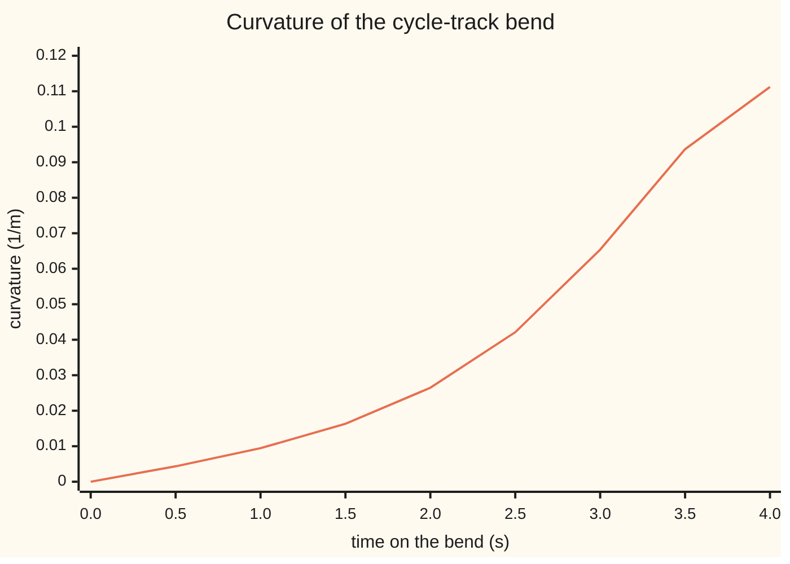

# Curvature: how fast the direction of travel turns

[Syllabus](../../../SYLLABUS.md) → [Differential geometry and Lie groups](../README.md) → [Curves](../README.md#s01) → Curvature

---

## General Overview

A cyclist comes off a straight at 8 m/s and into a bend that keeps tightening. Four seconds later they have covered 27.08 m, turned 53.47° to the left, and eased off to 5.3761 m/s. At that moment the bend is as tight as a circle of radius 8.9920 m.

How tight is "tight", at any one point? Speed is the wrong measure: the same bend ridden slowly is the same bend. The right measure is how fast the direction of travel turns **per metre of track**, not per second. That number is the bend's **curvature**.

It matters to the rider. The tighter the bend and the faster the ride, the more the bike must lean. Here the lean reaches 18.15° from upright at the 4 s mark. A track that tightens smoothly lets the lean build smoothly instead of all at once.

Curvature also has a sign. On this card a left turn is positive and a right turn is negative, so one number says both how sharp the bend is and which way it goes.

**Curvature is the angle the direction of travel turns through per metre of path, positive when turning left; for any curve drawn by a parameter it comes from velocity and acceleration alone, so riding faster or slower never changes it.**

**What kind of fact this is:** a definition (signed curvature, measured in radians per metre, written 1/m), plus a theorem: the formula gives the same number for every way of tracing the same path in the same direction. Both are local facts about one point. The theorem is proved on this card in Why it works.

### The picture: the bend tightens steadily



The line is the curvature at each half second of the ride, from 0 s to 4 s, while the rider covers 27.08 m. It starts at 0 on the straight and climbs to 0.111210 per metre at the end.

---

## The formula

Notation first, in words. The track lies flat, with x metres east and y metres north of where the bend starts. The rider is at $`\mathbf r(t) = (x(t), y(t))`$ after $`t`$ seconds. A dot over a letter means a rate per second on the clock: $`\dot x`$ is the east velocity and $`\ddot x`$ (two dots) the east acceleration, the rates of [Parametric motion](../../06-Calculus%20and%20analysis/05-Curves%20and%20Solids/01-parametric-motion.md). A prime keeps this wing's meaning from [Regular curve and arc length](01-regular-curves-and-arc-length.md): a rate per metre of track.

The bend is drawn as

```math
\mathbf r(t) = \left(8t - 0.1t^3,\ 0.09t^3\right) \text{ m}, \qquad 0 \le t \le 4 \text{ s}
```

The **direction angle** $`\theta`$ (theta) is the angle of the velocity, measured anticlockwise from east in radians. It is not a compass heading. The **arc length** $`s`$ is metres travelled along the track.

The **cross term** of two arrows (p, q) and (w, z) is pz − qw: positive when the second arrow points to the left of the first. **Signed curvature** $`\kappa`$ (kappa) is

```math
\kappa = \frac{d\theta}{ds} = \frac{\dot x\ddot y - \dot y\ddot x}{\left(\dot x^2 + \dot y^2\right)^{3/2}}
```

**Read it aloud:** curvature is the turn of the direction per metre; to get it from any parameter, take the cross term of velocity and acceleration and divide by the speed cubed.

Here the arrows are velocity and acceleration, so $`\dot x\ddot y - \dot y\ddot x`$ is the sideways part of the acceleration, times the speed. Its sign says left or right. The speed cubed in the bottom turns "per second" into "per metre".

| Symbol | Plain meaning | In our example | Push it up and the answer… |
| --- | --- | --- | --- |
| $`t`$ | the parameter: seconds since the bend began | 4 s | the bend tightens, up to 4 s |
| $`\mathbf r(t) = (x, y)`$ | position: metres east and north of the bend's start | (25.60, 5.76) m at 4 s | — |
| $`\mathbf v = (\dot x, \dot y)`$ | velocity: rates of x and y, m/s | (3.20, 4.32) m/s | more speed alone leaves κ unchanged |
| $`\mathbf a = (\ddot x, \ddot y)`$ | acceleration, m/s² | (−2.40, 2.16) m/s² | a bigger sideways part raises κ |
| $`\lvert\mathbf v\rvert`$ | speed, $`\sqrt{\dot x^2 + \dot y^2}`$, m/s | 5.3761 m/s | — |
| $`s`$, $`L`$ | arc length: metres along the track; L for the whole bend | L = 27.0847 m | — |
| $`\theta`$ | direction angle, anticlockwise from east | 0.933248 rad = 53.47° at 4 s | — |
| $`\mathbf T`$ | unit tangent: the velocity scaled to length 1 | (3.20, 4.32) / 5.3761 | — |
| $`\mathbf N`$ | unit normal: $`\mathbf T`$ turned a quarter turn left | points to the inside of the bend | — |
| $`\kappa`$ | signed curvature, 1/m; positive turns left | 0.111210 per m at 4 s | a tighter bend |
| $`1/\lvert\kappa\rvert`$ | radius of the circle that bends the same amount | 8.9920 m at 4 s | a gentler bend |
| $`u`$, $`g`$, $`\lambda`$ | another parameter, the re-timing $`t = g(u)`$, and its rate dg/du | the slow-start ride, $`g(u) = u^2/4`$, with $`\lambda = u/2`$: zero only at the start, $`u = 0`$ | — |

The letter κ also names a matrix's condition number elsewhere in the library. On this shelf it always means curvature.

### When it holds

- **The speed must not be zero.** A curve with nonzero speed everywhere is called **regular**. At a stop the direction is undefined. The curve $`(u^2, u^3)`$, in metres, stops at $`u = 0`$ and forms a sharp point, a **cusp**: its curvature is 74.9747 per m at $`u = 0.01`$ and has no limit.
- **The curve needs two rates.** The formula uses acceleration, so x and y need second derivatives. A straight joined directly to a circle has a jump in curvature at the join. That jump is why tracks use bends like this one, which start at curvature 0.
- **The curve lies in a plane.** In space a path also twists out of its plane, and the sign has no meaning. [Frenet-Serret frame](04-frenet-serret-frames.md) and [Curvature and torsion at any speed](06-curvature-and-torsion-from-any-parametrisation.md) handle that case.
- **The sign needs a direction of travel and a choice of "left".** Ride the bend backwards and the sign flips to −0.111210 at the tight end. Mirror it and the sign flips too. The size never changes.

---

## Why it works

### Step 0: measure direction, then count metres, not seconds

A curve's shape is in its directions. On a straight the direction never changes. On a circle of radius 8.9920 m it turns at a steady 0.111210 radians per metre, 1 divided by the radius. So "how fast the direction turns, per metre" is a measure of bending that does not care how fast anyone rides.

The parameter only labels points. Seconds of riding are one label; metres along the track are another. A number that belongs to the track must come out the same for every label. The proof below shows the formula has that property.

### Step 1: curvature is the turn of the unit tangent

[Regular curve and arc length](01-regular-curves-and-arc-length.md) defines the **unit tangent** $`\mathbf T`$: the velocity divided by the speed, an arrow of length 1 pointing along the track. Write it with the direction angle: $`\mathbf T = (\cos\theta, \sin\theta)`$.

The **unit normal** $`\mathbf N`$ is $`\mathbf T`$ turned a quarter turn to the left: $`\mathbf N = (-\sin\theta, \cos\theta)`$. Differentiate $`\mathbf T`$ with respect to arc length by the [Chain rule](../../06-Calculus%20and%20analysis/02-Derivatives/03-chain-rule.md):

```math
\frac{d\mathbf T}{ds} = \frac{d\theta}{ds}\,(-\sin\theta, \cos\theta) = \kappa\,\mathbf N
```

**Read it aloud:** per metre, the unit tangent changes by curvature times the left-pointing normal. In this wing's notation, $`\mathbf T' = \kappa\mathbf N`$ and $`\kappa = \theta'`$.

So the unit tangent never changes length; it only swings. Curvature is the rate of the swing. Positive κ swings it left, toward $`\mathbf N`$; negative κ swings it right.

### Step 2: from any parameter, by the chain rule

The direction angle is $`\theta = \arctan(\dot y/\dot x)`$ while $`\dot x > 0`$. Differentiating with respect to t (the arctangent of a number q changes at rate $`1/(1+q^2)`$, and the quotient rule handles $`\dot y/\dot x`$) gives

```math
\frac{d\theta}{dt} = \frac{\dot x\ddot y - \dot y\ddot x}{\dot x^2 + \dot y^2}
```

This is the turn **per second**. The track passes at $`ds/dt = \lvert\mathbf v\rvert`$ metres per second. Dividing one rate by the other gives the turn per metre:

```math
\kappa = \frac{d\theta/dt}{ds/dt} = \frac{\dot x\ddot y - \dot y\ddot x}{\left(\dot x^2 + \dot y^2\right)^{3/2}}
```

At 4 s the turn per second is 0.5979 radians. Divided by 5.3761 m/s, that is 0.111210 per metre.

### Step 3: the sideways push, which the rider feels

Split the acceleration into a part along the track and a part across it:

```math
\mathbf a = \frac{d\lvert\mathbf v\rvert}{dt}\,\mathbf T + \kappa\,\lvert\mathbf v\rvert^2\,\mathbf N
```

**Read it aloud:** acceleration is the change of speed along the track, plus curvature times speed squared toward the inside.

The first part is braking or pedalling. The second is the **sideways acceleration**. The cross term keeps only the second part, because $`\mathbf T`$ crossed with itself is 0 and $`\mathbf T`$ crossed with $`\mathbf N`$ is 1. So the cross term equals speed times $`\kappa\lvert\mathbf v\rvert^2`$, which is Step 2's formula again.

At 4 s the sideways acceleration is 17.28 / 5.3761 = 3.2142 m/s². In the simple balance model, a leaning bike balances when the tan of its lean (tan: the tangent ratio) equals sideways acceleration over gravity, 9.80665 m/s². That gives a lean of 18.15°.

### Step 4: the number belongs to the track

Trace the same track with another parameter u, so $`t = g(u)`$. Write $`\lambda = dg/du`$ (lambda) for the re-timing's rate, never zero. The chain rule scales the velocity by λ. The acceleration gains a part along the velocity, which the cross term ignores. So the cross term scales by $`\lambda^3`$ and the speed cubed by $`\lvert\lambda\rvert^3`$.

- If $`\lambda > 0`$ (same direction), the factors cancel: the same κ.
- If $`\lambda < 0`$ (ridden backwards), κ flips sign but keeps its size.

The checks ride the bend a second way, slowly at first then fast, and backwards. They take the derivatives from raw positions alone. Both rides give 0.111210 at the tight end, the second with a minus sign. The slow-start ride, $`t = u^2/4`$, starts from rest: its rate λ = u/2 is 0 at u = 0, where the rule above does not hold, so the checks compare it only at 2 s and 4 s.

<details>
<summary>Detailed proof: the formula without angles, and why it does not depend on the parameter</summary>

**Without the arctangent.** Step 2 needs $`\dot x > 0`$. This route needs only nonzero speed. With $`\mathbf v = (\dot x, \dot y)`$ and $`\mathbf a = (\ddot x, \ddot y)`$, the quotient rule gives

$`\displaystyle \frac{d\mathbf T}{dt} = \frac{\mathbf a}{\lvert\mathbf v\rvert} - \frac{(\mathbf v \cdot \mathbf a)\,\mathbf v}{\lvert\mathbf v\rvert^3}`$

Take the dot product with $`\mathbf N = (-\dot y, \dot x)/\lvert\mathbf v\rvert`$. The second term vanishes, since $`\mathbf v \cdot \mathbf N = 0`$. The first gives $`(\dot x\ddot y - \dot y\ddot x)/\lvert\mathbf v\rvert^2`$. Step 1 says $`d\mathbf T/ds \cdot \mathbf N = \kappa`$, and $`d\mathbf T/ds = (d\mathbf T/dt)/\lvert\mathbf v\rvert`$. So

$`\displaystyle \kappa = \frac{\dot x\ddot y - \dot y\ddot x}{\lvert\mathbf v\rvert^3}`$

**Change of parameter.** Let $`\tilde{\mathbf r}(u) = \mathbf r(g(u))`$. Then

$`\displaystyle \tilde{\mathbf v} = \lambda\,\mathbf v, \qquad \tilde{\mathbf a} = \lambda^2\,\mathbf a + \frac{d\lambda}{du}\,\mathbf v`$

The cross term is bilinear and a vector crossed with itself is 0, so $`\tilde{\mathbf v} \times \tilde{\mathbf a} = \lambda^3\,(\mathbf v \times \mathbf a)`$. Here × is the cross term, and a tilde marks the new ride. The speed is $`\lvert\lambda\rvert\,\lvert\mathbf v\rvert`$. Dividing gives $`\tilde\kappa = (\lambda/\lvert\lambda\rvert)\,\kappa`$: the same κ when $`\lambda > 0`$, and −κ when $`\lambda < 0`$.

**Total turn.** Since $`\kappa = d\theta/ds`$, the fundamental theorem of calculus gives

$`\displaystyle \int_0^L \kappa\,ds = \theta(L) - \theta(0)`$

for a bend of length L. The checks compute both sides: 0.933248 rad each.

</details>

### Step 5: the graph case is a special case

A graph $`y = f(x)`$ is the curve $`(t, f(t))`$, with $`\dot x = 1`$ and $`\ddot x = 0`$. The formula becomes $`f''/(1 + f'^2)^{3/2}`$, where $`f'`$ and $`f''`$ are the graph's slope and the slope's rate of change per metre across. That is the curvature of [Second derivatives](../../06-Calculus%20and%20analysis/02-Derivatives/08-higher-derivatives-and-concavity.md), checked there with circles through three nearby points, now with its sign kept: positive where the graph bends up.

---

## Worked numbers, by hand

At the tight end of the bend, 4 s in:

| Step | Arithmetic | Value |
| --- | --- | --- |
| Velocity | (8 − 0.3 × 4 × 4, 0.27 × 4 × 4) | (3.20, 4.32) m/s |
| Acceleration | (−0.6 × 4, 0.54 × 4) | (−2.40, 2.16) m/s² |
| Cross term | 3.20 × 2.16 − 4.32 × (−2.40) | 17.28 |
| Speed squared | 3.20 × 3.20 + 4.32 × 4.32 | 28.9024 |
| Speed | square root of 28.9024 | 5.3761 m/s |
| Speed cubed | 5.3761 × 28.9024 | 155.38 |
| Curvature | 17.28 / 155.38 | **0.111210 per m** |
| Radius of the matching circle | 1 / 0.111210 | 8.9920 m |

At 4 s the track bends like a circle of radius 8.9920 m, turning left, and still tightening.

The velocity and acceleration come from differentiating each coordinate: $`\dot x = 8 - 0.3t^2`$, $`\dot y = 0.27t^2`$, $`\ddot x = -0.6t`$, $`\ddot y = 0.54t`$.

Earlier in the bend, at 2 s, the same steps give 0.026470 per m: about a quarter of the final value. The chart above shows the climb between.

### What breaks if you drop a piece

| Mistake | Comes out at | What went wrong |
| --- | --- | --- |
| Dividing by speed squared, not cubed | 0.5979 per s | that is the turn per second, which changes with how fast the rider goes |
| Using the graph formula on y(t), as if t were metres across | 0.024774 per m | t is seconds, and x changes too |
| Writing the cross term as $`\dot y\ddot x - \dot x\ddot y`$ | −0.111210 per m | the size is right; the bend now reads as a right turn |
| Applying the formula at the cusp of $`(u^2, u^3)`$ | 7.2538 at u = 0.1, 74.9747 at u = 0.01 | speed 0.020002 heads to 0; no direction, so no curvature |

---

## Code, from first principles, and it actually runs

The code reaches the bend's curvature by four roads. The first is the formula. The second is the direction angle's turn divided by the arc length covered. Arc length comes from Simpson's rule on the speed (a way to add up an integral from evenly spaced samples). The third rides the track again, slowly then fast, and backwards and mirrored, with the derivatives taken from raw positions. The fourth turns survey chords into curvature at two step sizes. It also checks that the total turn equals the integral of curvature over arc length. The arctangent is written out from its series. The polynomials are evaluated slightly past 4 s, where the formula still holds, so that the checks can look on both sides of the end point.

### Python

```python
# Curvature of a plane curve -- the check behind the card.  Nothing is imported.
# A rider on a cycle-track bend that keeps tightening is at r(t) = (8t - 0.1t^3, 0.09t^3)
# metres after t seconds, t = 0 to 4.  Signed curvature (positive = turning left) comes
# by four roads: the formula (vx ay - vy ax) / speed^3; the direction angle's turn per metre;
# the same formula on other rides of the same track, with derivatives taken from raw
# positions; and the turn between survey chords.  The total turn is checked against the
# integral of curvature over arc length.  The formula's polynomials run slightly past 4 s.
PI = 3.141592653589793
def atan(z):                                   # arctangent: halve the angle 3 times, then series
    if z < 0: return -atan(-z)
    if z > 1: return PI / 2 - atan(1 / z)
    for _ in range(3): z = z / (1 + (1 + z * z) ** 0.5)
    return 8 * sum((-1) ** k * z ** (2 * k + 1) / (2 * k + 1) for k in range(12))
def direction(dx, dy):                         # direction of (dx, dy), radians anticlockwise from east
    if dx > 0: return atan(dy / dx)
    return (PI / 2 if dy >= 0 else -PI / 2) - atan(dx / dy)
def r(t): return (8 * t - 0.1 * t ** 3, 0.09 * t ** 3)       # position, metres
def vel(t): return (8 - 0.3 * t * t, 0.27 * t * t)         # velocity, m/s
def acc(t): return (-0.6 * t, 0.54 * t)                     # acceleration, m/s^2
def speed(t): return (vel(t)[0] ** 2 + vel(t)[1] ** 2) ** 0.5
def curv(v, a): return (v[0] * a[1] - v[1] * a[0]) / (v[0] ** 2 + v[1] ** 2) ** 1.5
def kappa(t): return curv(vel(t), acc(t))       # the card's formula, per metre
def simpson(f, b, n=400):                      # integral of f from 0 to b
    h = b / n
    return h / 3 * sum((1 if k in (0, n) else 4 if k % 2 else 2) * f(k * h) for k in range(n + 1))
def arc(t): return simpson(speed, t)           # arc length from the start, metres
def raw(path, u, e=1e-3):                      # curvature from raw positions only
    p, q, w = path(u - e), path(u), path(u + e)
    v = ((w[0] - p[0]) / (2 * e), (w[1] - p[1]) / (2 * e))
    a = ((w[0] - 2 * q[0] + p[0]) / e ** 2, (w[1] - 2 * q[1] + p[1]) / e ** 2)
    return curv(v, a)
def chord(t, h):                               # turn between two survey chords, per metre
    p, q, w = r(t - h), r(t), r(t + h)
    a, b = (q[0] - p[0], q[1] - p[1]), (w[0] - q[0], w[1] - q[1])
    ang = direction(a[0] * b[0] + a[1] * b[1], a[0] * b[1] - a[1] * b[0])
    return ang / ((a[0] ** 2 + a[1] ** 2) ** 0.5 / 2 + (b[0] ** 2 + b[1] ** 2) ** 0.5 / 2)
def z(x): return round(x, 9) + 0.0             # prints -0.00 as 0.00

(xp, yp), (xpp, ypp), v = vel(4), acc(4), speed(4)
cross = xp * ypp - yp * xpp
print(f"at 4 s: position ({r(4)[0]:.2f}, {r(4)[1]:.2f}) m, velocity ({xp:.2f}, {yp:.2f}) m/s, acceleration ({xpp:.2f}, {ypp:.2f}) m/s^2")
print(f"cross term vx ay - vy ax = {xp:.2f} x {ypp:.2f} - {yp:.2f} x ({xpp:.2f}) = {cross:.2f}; speed^2 {v * v:.4f}, speed {v:.4f} m/s, speed^3 {v ** 3:.2f}")
print(f"curvature {kappa(4):.6f} per m, radius {1 / kappa(4):.4f} m; sideways acceleration {cross / v:.4f} m/s^2")
assert abs(cross - 6 * 8 * 0.09 * 4) < 1e-12        # algebra: the cross term is 6 x 8 x 0.09 x t
lat = v * v * kappa(4)
print(f"speed^2 x curvature {lat:.4f} m/s^2; rider's lean from upright: atan({lat:.4f} / 9.80665) = {atan(lat / 9.80665) * 180 / PI:.2f} degrees")
assert abs(lat - cross / v) < 1e-12
print("chart: t s | arc length m | speed m/s | direction deg | curvature per m")
pts = [k / 2 for k in range(9)]
for t in pts:
    print(f"chart {t:.1f} | {arc(t):.2f} | {speed(t):.4f} | {z(direction(*vel(t)) * 180 / PI):.2f} | {z(kappa(t)):.6f}")
assert all(kappa(k / 100) < kappa((k + 1) / 100) for k in range(400))  # it keeps tightening
total = direction(*vel(4)) - direction(*vel(0))
integral = simpson(lambda t: kappa(t) * speed(t), 4)
print(f"bend length {arc(4):.4f} m; total turn {total:.6f} rad = {total * 180 / PI:.4f} deg; integral of curvature ds {integral:.6f} rad")
assert abs(total - integral) < 1e-9 and abs(total - 0.9332475286562039) < 1e-14  # atan 1.35, from tables
slow_start = lambda u: r(u * u / 4)            # same track, ridden slowly then fast (u = 0 to 4)
backwards = lambda u: r(4 - u)                  # same track, ridden from the tight end out
mirror = lambda u: (r(u)[0], -r(u)[1])          # the same bend turning right
for t in (2.0, 4.0):
    e = 1e-4                                   # road 2: direction turn per metre of arc
    dth = (direction(*vel(t + e)) - direction(*vel(t - e))) / (arc(t + e) - arc(t - e))
    k3 = raw(slow_start, 2 * t ** 0.5)
    print(f"t = {t:.0f} s: formula {kappa(t):.6f}; direction turn per metre {dth:.6f}; slow-start ride {k3:.6f};"
          f" backwards {raw(backwards, 4 - t):.6f}; mirror {raw(mirror, t):.6f}")
    assert abs(dth - kappa(t)) < 1e-7 and abs(k3 - kappa(t)) < 1e-5
    assert abs(raw(backwards, 4 - t) + kappa(t)) < 1e-5 and abs(raw(mirror, t) + kappa(t)) < 1e-5
for h in (0.5, 0.05):
    print(f"survey chords every {h} s around 2 s: {chord(2, h):.6f} per m, off by {abs(chord(2, h) - kappa(2)):.6f}")
assert abs(chord(2, 0.05) - kappa(2)) < abs(chord(2, 0.5) - kappa(2)) / 50
print(f"mistakes at 4 s: divide by speed^2 {cross / v ** 2:.4f}; graph formula on y(t) {0.54 * 4 / (1 + yp ** 2) ** 1.5:.6f};"
      f" factors swapped {(yp * xpp - xp * ypp) / v ** 3:.6f}")
cusp = lambda u: (u * u, u ** 3)                # zero speed at u = 0
for u in (0.1, 0.01):
    print(f"cusp (u^2, u^3) at u = {u}: speed {(4 * u * u + 9 * u ** 4) ** 0.5:.6f}, curvature {curv((2 * u, 3 * u * u), (2, 6 * u)):.4f} per m")
print("ALL CHECKS PASS")
```

**Ran 2026-11-19 on macOS, Python 3.14.10, standard library only. All checks passed. Output, pasted from the run:**

```
at 4 s: position (25.60, 5.76) m, velocity (3.20, 4.32) m/s, acceleration (-2.40, 2.16) m/s^2
cross term vx ay - vy ax = 3.20 x 2.16 - 4.32 x (-2.40) = 17.28; speed^2 28.9024, speed 5.3761 m/s, speed^3 155.38
curvature 0.111210 per m, radius 8.9920 m; sideways acceleration 3.2142 m/s^2
speed^2 x curvature 3.2142 m/s^2; rider's lean from upright: atan(3.2142 / 9.80665) = 18.15 degrees
chart: t s | arc length m | speed m/s | direction deg | curvature per m
chart 0.0 | 0.00 | 8.0000 | 0.00 | 0.000000
chart 0.5 | 3.99 | 7.9253 | 0.49 | 0.004339
chart 1.0 | 7.90 | 7.7047 | 2.01 | 0.009445
chart 1.5 | 11.67 | 7.3501 | 4.74 | 0.016319
chart 2.0 | 15.23 | 6.8852 | 9.02 | 0.026470
chart 2.5 | 18.54 | 6.3532 | 15.40 | 0.042116
chart 3.0 | 21.59 | 5.8305 | 24.63 | 0.065386
chart 3.5 | 24.40 | 5.4447 | 37.41 | 0.093674
chart 4.0 | 27.08 | 5.3761 | 53.47 | 0.111210
bend length 27.0847 m; total turn 0.933248 rad = 53.4711 deg; integral of curvature ds 0.933248 rad
t = 2 s: formula 0.026470; direction turn per metre 0.026470; slow-start ride 0.026470; backwards -0.026470; mirror -0.026470
t = 4 s: formula 0.111210; direction turn per metre 0.111210; slow-start ride 0.111210; backwards -0.111210; mirror -0.111210
survey chords every 0.5 s around 2 s: 0.026705 per m, off by 0.000234
survey chords every 0.05 s around 2 s: 0.026473 per m, off by 0.000002
mistakes at 4 s: divide by speed^2 0.5979; graph formula on y(t) 0.024774; factors swapped -0.111210
cusp (u^2, u^3) at u = 0.1: speed 0.202237, curvature 7.2538 per m
cusp (u^2, u^3) at u = 0.01: speed 0.020002, curvature 74.9747 per m
ALL CHECKS PASS
```

### Rust

```rust
// Curvature of a plane curve -- the check behind the card.  std only.
// A rider on a cycle-track bend that keeps tightening is at r(t) = (8t - 0.1t^3, 0.09t^3)
// metres after t seconds, t = 0 to 4.  Signed curvature (positive = turning left) comes
// by four roads: the formula (vx ay - vy ax) / speed^3; the direction angle's turn per metre;
// the same formula on other rides of the same track, with derivatives taken from raw
// positions; and the turn between survey chords.  The total turn is checked against the
// integral of curvature over arc length.  The formula's polynomials run slightly past 4 s.
const PI: f64 = 3.141592653589793;
type P = (f64, f64);
fn atan(z: f64) -> f64 { // arctangent: halve the angle 3 times, then series
    if z < 0.0 { return -atan(-z); }
    if z > 1.0 { return PI / 2.0 - atan(1.0 / z); }
    let mut z = z;
    for _ in 0..3 { z = z / (1.0 + (1.0 + z * z).powf(0.5)); }
    8.0 * (0..12).map(|k| (-1f64).powi(k) * z.powi(2 * k + 1) / (2 * k + 1) as f64).sum::<f64>()
}
fn direction(dx: f64, dy: f64) -> f64 { // direction of (dx, dy), radians anticlockwise from east
    if dx > 0.0 { return atan(dy / dx); }
    (if dy >= 0.0 { PI / 2.0 } else { -PI / 2.0 }) - atan(dx / dy)
}
fn r(t: f64) -> P { (8.0 * t - 0.1 * t.powi(3), 0.09 * t.powi(3)) } // position, metres
fn vel(t: f64) -> P { (8.0 - 0.3 * t * t, 0.27 * t * t) } // velocity, m/s
fn acc(t: f64) -> P { (-0.6 * t, 0.54 * t) } // acceleration, m/s^2
fn speed(t: f64) -> f64 { (vel(t).0.powi(2) + vel(t).1.powi(2)).powf(0.5) }
fn curv(v: P, a: P) -> f64 { (v.0 * a.1 - v.1 * a.0) / (v.0 * v.0 + v.1 * v.1).powf(1.5) }
fn kappa(t: f64) -> f64 { curv(vel(t), acc(t)) } // the card's formula, per metre
fn simpson(f: &dyn Fn(f64) -> f64, b: f64) -> f64 { // integral of f from 0 to b
    let n = 400;
    let h = b / n as f64;
    h / 3.0 * (0..=n).map(|k| (if k == 0 || k == n { 1.0 } else if k % 2 == 1 { 4.0 } else { 2.0 }) * f(k as f64 * h)).sum::<f64>()
}
fn arc(t: f64) -> f64 { simpson(&speed, t) } // arc length from the start, metres
fn raw(path: &dyn Fn(f64) -> P, u: f64) -> f64 { // curvature from raw positions only
    let e = 1e-3;
    let (p, q, w) = (path(u - e), path(u), path(u + e));
    let v = ((w.0 - p.0) / (2.0 * e), (w.1 - p.1) / (2.0 * e));
    let a = ((w.0 - 2.0 * q.0 + p.0) / (e * e), (w.1 - 2.0 * q.1 + p.1) / (e * e));
    curv(v, a)
}
fn chord(t: f64, h: f64) -> f64 { // turn between two survey chords, per metre
    let (p, q, w) = (r(t - h), r(t), r(t + h));
    let (a, b) = ((q.0 - p.0, q.1 - p.1), (w.0 - q.0, w.1 - q.1));
    let ang = direction(a.0 * b.0 + a.1 * b.1, a.0 * b.1 - a.1 * b.0);
    ang / ((a.0 * a.0 + a.1 * a.1).powf(0.5) / 2.0 + (b.0 * b.0 + b.1 * b.1).powf(0.5) / 2.0)
}
fn z(x: f64) -> f64 { (x * 1e9).round() / 1e9 + 0.0 } // prints -0.00 as 0.00

fn main() {
    let ((xp, yp), (xpp, ypp), v) = (vel(4.0), acc(4.0), speed(4.0));
    let cross = xp * ypp - yp * xpp;
    println!("at 4 s: position ({:.2}, {:.2}) m, velocity ({:.2}, {:.2}) m/s, acceleration ({:.2}, {:.2}) m/s^2", r(4.0).0, r(4.0).1, xp, yp, xpp, ypp);
    println!("cross term vx ay - vy ax = {:.2} x {:.2} - {:.2} x ({:.2}) = {:.2}; speed^2 {:.4}, speed {:.4} m/s, speed^3 {:.2}", xp, ypp, yp, xpp, cross, v * v, v, v.powi(3));
    println!("curvature {:.6} per m, radius {:.4} m; sideways acceleration {:.4} m/s^2", kappa(4.0), 1.0 / kappa(4.0), cross / v);
    assert!((cross - 6.0 * 8.0 * 0.09 * 4.0).abs() < 1e-12); // algebra: the cross term is 6 x 8 x 0.09 x t
    let lat = v * v * kappa(4.0);
    println!("speed^2 x curvature {:.4} m/s^2; rider's lean from upright: atan({:.4} / 9.80665) = {:.2} degrees", lat, lat, atan(lat / 9.80665) * 180.0 / PI);
    assert!((lat - cross / v).abs() < 1e-12);
    println!("chart: t s | arc length m | speed m/s | direction deg | curvature per m");
    let pts: Vec<f64> = (0..9).map(|k| k as f64 / 2.0).collect();
    for &t in &pts {
        let (vx, vy) = vel(t);
        println!("chart {:.1} | {:.2} | {:.4} | {:.2} | {:.6}", t, arc(t), speed(t), z(direction(vx, vy) * 180.0 / PI), z(kappa(t)));
    }
    assert!((0..400).all(|k| kappa(k as f64 / 100.0) < kappa((k + 1) as f64 / 100.0))); // it keeps tightening
    let total = direction(vel(4.0).0, vel(4.0).1) - direction(vel(0.0).0, vel(0.0).1);
    let integral = simpson(&|t| kappa(t) * speed(t), 4.0);
    println!("bend length {:.4} m; total turn {:.6} rad = {:.4} deg; integral of curvature ds {:.6} rad", arc(4.0), total, total * 180.0 / PI, integral);
    assert!((total - integral).abs() < 1e-9 && (total - 0.9332475286562039).abs() < 1e-14); // atan 1.35, from tables
    let slow_start = |u: f64| r(u * u / 4.0); // same track, ridden slowly then fast (u = 0 to 4)
    let backwards = |u: f64| r(4.0 - u); // same track, ridden from the tight end out
    let mirror = |u: f64| (r(u).0, -r(u).1); // the same bend turning right
    for t in [2.0, 4.0] {
        let e = 1e-4; // road 2: direction turn per metre of arc
        let dth = (direction(vel(t + e).0, vel(t + e).1) - direction(vel(t - e).0, vel(t - e).1)) / (arc(t + e) - arc(t - e));
        let k3 = raw(&slow_start, 2.0 * t.powf(0.5));
        println!("t = {:.0} s: formula {:.6}; direction turn per metre {:.6}; slow-start ride {:.6}; backwards {:.6}; mirror {:.6}",
                 t, kappa(t), dth, k3, raw(&backwards, 4.0 - t), raw(&mirror, t));
        assert!((dth - kappa(t)).abs() < 1e-7 && (k3 - kappa(t)).abs() < 1e-5);
        assert!((raw(&backwards, 4.0 - t) + kappa(t)).abs() < 1e-5 && (raw(&mirror, t) + kappa(t)).abs() < 1e-5);
    }
    for h in [0.5, 0.05] {
        println!("survey chords every {} s around 2 s: {:.6} per m, off by {:.6}", h, chord(2.0, h), (chord(2.0, h) - kappa(2.0)).abs());
    }
    assert!((chord(2.0, 0.05) - kappa(2.0)).abs() < (chord(2.0, 0.5) - kappa(2.0)).abs() / 50.0);
    println!("mistakes at 4 s: divide by speed^2 {:.4}; graph formula on y(t) {:.6}; factors swapped {:.6}",
             cross / v.powi(2), 0.54 * 4.0 / (1.0 + yp * yp).powf(1.5), (yp * xpp - xp * ypp) / v.powi(3));
    for u in [0.1f64, 0.01] { // cusp (u^2, u^3): zero speed at u = 0
        println!("cusp (u^2, u^3) at u = {}: speed {:.6}, curvature {:.4} per m", u, (4.0 * u * u + 9.0 * u.powi(4)).powf(0.5), curv((2.0 * u, 3.0 * u * u), (2.0, 6.0 * u)));
    }
    println!("ALL CHECKS PASS");
}
```

**Ran 2026-11-19 on macOS, rustc 1.98.1, no crates. All checks passed. Output, pasted from the run:**

```
at 4 s: position (25.60, 5.76) m, velocity (3.20, 4.32) m/s, acceleration (-2.40, 2.16) m/s^2
cross term vx ay - vy ax = 3.20 x 2.16 - 4.32 x (-2.40) = 17.28; speed^2 28.9024, speed 5.3761 m/s, speed^3 155.38
curvature 0.111210 per m, radius 8.9920 m; sideways acceleration 3.2142 m/s^2
speed^2 x curvature 3.2142 m/s^2; rider's lean from upright: atan(3.2142 / 9.80665) = 18.15 degrees
chart: t s | arc length m | speed m/s | direction deg | curvature per m
chart 0.0 | 0.00 | 8.0000 | 0.00 | 0.000000
chart 0.5 | 3.99 | 7.9253 | 0.49 | 0.004339
chart 1.0 | 7.90 | 7.7047 | 2.01 | 0.009445
chart 1.5 | 11.67 | 7.3501 | 4.74 | 0.016319
chart 2.0 | 15.23 | 6.8852 | 9.02 | 0.026470
chart 2.5 | 18.54 | 6.3532 | 15.40 | 0.042116
chart 3.0 | 21.59 | 5.8305 | 24.63 | 0.065386
chart 3.5 | 24.40 | 5.4447 | 37.41 | 0.093674
chart 4.0 | 27.08 | 5.3761 | 53.47 | 0.111210
bend length 27.0847 m; total turn 0.933248 rad = 53.4711 deg; integral of curvature ds 0.933248 rad
t = 2 s: formula 0.026470; direction turn per metre 0.026470; slow-start ride 0.026470; backwards -0.026470; mirror -0.026470
t = 4 s: formula 0.111210; direction turn per metre 0.111210; slow-start ride 0.111210; backwards -0.111210; mirror -0.111210
survey chords every 0.5 s around 2 s: 0.026705 per m, off by 0.000234
survey chords every 0.05 s around 2 s: 0.026473 per m, off by 0.000002
mistakes at 4 s: divide by speed^2 0.5979; graph formula on y(t) 0.024774; factors swapped -0.111210
cusp (u^2, u^3) at u = 0.1: speed 0.202237, curvature 7.2538 per m
cusp (u^2, u^3) at u = 0.01: speed 0.020002, curvature 74.9747 per m
ALL CHECKS PASS
```

The two outputs agree line for line. The survey chords show the stepped value is approximate: its error drops from 0.000234 to 0.000002 when the step shrinks tenfold, about a hundredfold.

### Lean

Lean proves three facts about the curvature formula, for any curve whose x and y have second derivatives, and checks the worked numbers.

- Suppose the curve moves with $`\dot x > 0`$ at time t. Then the direction angle's turn per second, divided by the speed, equals the formula's κ.
- Take a circle of radius $`R`$, traced anticlockwise. Then its curvature is $`1/R`$ at every point, positive because it turns left.
- Take a re-timing $`t = g(u)`$ with second derivatives, at a point where the speed and λ are not zero. Then the re-timed ride has the same κ when $`\lambda > 0`$, and −κ when $`\lambda < 0`$.
- Take the bend at any time t. Then its cross term is $`4.32t`$.
- Take the bend at 4 s. Then its position, velocity, acceleration, cross term 17.28 and speed squared 28.9024 match the worked numbers.
- Take the cusp $`(u^2, u^3)`$ at $`u = 0`$. Then its velocity is (0, 0).
- Take the slow-start ride $`t = u^2/4`$. Then its rate is $`\lambda = u/2`$.

The speed 5.3761, curvature 0.111210, arc length, total turn, mirror, survey chords and cusp curvatures are left to the Python and Rust checks.

```lean
-- Curvature: the signed curvature (x'y'' - y'x'') / speed^3 of a plane curve is the turn of its direction angle per metre of track, is +1/R on a circle of radius R traced anticlockwise, and keeps its value under every change of parameter in the same direction while flipping sign when the curve is traced backwards.
import Mathlib.Analysis.Calculus.Deriv.Basic
import Mathlib.Analysis.Calculus.Deriv.Comp
import Mathlib.Analysis.Calculus.Deriv.Mul
import Mathlib.Analysis.SpecialFunctions.Sqrt
import Mathlib.Analysis.SpecialFunctions.Trigonometric.Deriv
import Mathlib.Analysis.SpecialFunctions.Trigonometric.ArctanDeriv
import Mathlib.Tactic.NormNum
import Mathlib.Tactic.Ring

open Real

/-- The card's signed curvature of the plane curve t ↦ (x(t), y(t)) at the parameter value t:
the cross term of velocity (x', y') and acceleration (x'', y''), x' y'' − y' x'', divided by
the speed √(x'^2 + y'^2) cubed. Positive means turning left (anticlockwise). -/
noncomputable def signedCurvature (x y : ℝ → ℝ) (t : ℝ) : ℝ :=
  (deriv x t * deriv (deriv y) t - deriv y t * deriv (deriv x) t) /
    √(deriv x t ^ 2 + deriv y t ^ 2) ^ 3

/-- **Curvature belongs to the track, not to the timing.** Take a plane curve t ↦ (x(t), y(t))
whose coordinates have first and second derivatives, and a re-timing t = g(u), also with first
and second derivatives. At a point where the curve's speed is not zero (the curve is regular
there) and the re-timing's rate λ = g'(u) is not zero, the re-timed curve u ↦ (x(g(u)), y(g(u)))
has the same signed curvature as the original curve at t = g(u) when λ > 0 (same direction of
travel), and the negative of it when λ < 0 (ridden backwards). -/
theorem signed_curvature_independent_of_parametrisation {x y g : ℝ → ℝ} {u : ℝ}
    (hx : Differentiable ℝ x) (hx2 : Differentiable ℝ (deriv x))
    (hy : Differentiable ℝ y) (hy2 : Differentiable ℝ (deriv y))
    (hg : Differentiable ℝ g) (hg2 : Differentiable ℝ (deriv g))
    (hreg : deriv x (g u) ^ 2 + deriv y (g u) ^ 2 ≠ 0) (hrate : deriv g u ≠ 0) :
    (0 < deriv g u → signedCurvature (x ∘ g) (y ∘ g) u = signedCurvature x y (g u)) ∧
    (deriv g u < 0 → signedCurvature (x ∘ g) (y ∘ g) u = -signedCurvature x y (g u)) := by
  have hS : (0:ℝ) ≤ deriv x (g u) ^ 2 + deriv y (g u) ^ 2 := by positivity
  have dcomp : ∀ f : ℝ → ℝ, Differentiable ℝ f →
      deriv (f ∘ g) = fun v => deriv f (g v) * deriv g v := by
    intro f hf
    funext v
    exact deriv_comp v (hf (g v)) (hg v)
  have d2comp : ∀ f : ℝ → ℝ, Differentiable ℝ f → Differentiable ℝ (deriv f) →
      deriv (deriv (f ∘ g)) u =
        deriv (deriv f) (g u) * deriv g u * deriv g u + deriv f (g u) * deriv (deriv g) u := by
    intro f hf hf2
    rw [dcomp f hf]
    have h1 : HasDerivAt (fun v => deriv f (g v))
        (deriv (deriv f) (g u) * deriv g u) u :=
      (hf2 (g u)).hasDerivAt.comp u (hg u).hasDerivAt
    have h2 : HasDerivAt (deriv g) (deriv (deriv g) u) u := (hg2 u).hasDerivAt
    exact (h1.mul h2).deriv
  have key : signedCurvature (x ∘ g) (y ∘ g) u =
      (deriv g u ^ 3 / |deriv g u| ^ 3) * signedCurvature x y (g u) := by
    unfold signedCurvature
    rw [d2comp x hx hx2, d2comp y hy hy2, dcomp x hx, dcomp y hy]
    have hsq : (deriv x (g u) * deriv g u) ^ 2 + (deriv y (g u) * deriv g u) ^ 2 =
        deriv g u ^ 2 * (deriv x (g u) ^ 2 + deriv y (g u) ^ 2) := by ring
    simp only []
    rw [hsq, Real.sqrt_mul (sq_nonneg _), Real.sqrt_sq_eq_abs]
    have ha : |deriv g u| ≠ 0 := abs_ne_zero.mpr hrate
    have hs : √(deriv x (g u) ^ 2 + deriv y (g u) ^ 2) ≠ 0 := by
      rw [Ne, Real.sqrt_eq_zero hS]; exact hreg
    field_simp
    ring
  refine ⟨fun h => ?_, fun h => ?_⟩
  · rw [key, abs_of_pos h, div_self (by positivity), one_mul]
  · rw [key, abs_of_neg h]
    have : (-deriv g u) ^ 3 ≠ 0 := pow_ne_zero _ (by linarith)
    rw [show deriv g u ^ 3 = -((-deriv g u) ^ 3) by ring, neg_div, div_self this]
    ring

/-- **Curvature is the turn of the direction per metre.** Where the curve moves eastward
(x'(t) > 0), its direction angle is θ(t) = arctan(y'(t)/x'(t)). The rate of θ per second, divided
by the speed √(x'^2 + y'^2) (metres of track per second), equals the signed curvature: κ = dθ/ds. -/
theorem signed_curvature_eq_turn_of_direction_per_metre {x y : ℝ → ℝ} {t : ℝ}
    (hx : Differentiable ℝ x) (hx2 : Differentiable ℝ (deriv x))
    (hy : Differentiable ℝ y) (hy2 : Differentiable ℝ (deriv y))
    (hpos : 0 < deriv x t) :
    deriv (fun s => arctan (deriv y s / deriv x s)) t / √(deriv x t ^ 2 + deriv y t ^ 2) =
      signedCurvature x y t := by
  have hx2t : HasDerivAt (deriv x) (deriv (deriv x) t) t := (hx2 t).hasDerivAt
  have hy2t : HasDerivAt (deriv y) (deriv (deriv y) t) t := (hy2 t).hasDerivAt
  have hne : deriv x t ≠ 0 := hpos.ne'
  have hq := hy2t.div hx2t hne
  have ha := hq.arctan
  rw [show (fun s => arctan (deriv y s / deriv x s)) = fun s => arctan ((deriv y / deriv x) s)
    from rfl, ha.deriv, Pi.div_apply]
  unfold signedCurvature
  have hS : 0 < deriv x t ^ 2 + deriv y t ^ 2 := by positivity
  have hs : 0 < √(deriv x t ^ 2 + deriv y t ^ 2) := Real.sqrt_pos.mpr hS
  have h3 : √(deriv x t ^ 2 + deriv y t ^ 2) ^ 3 =
      (deriv x t ^ 2 + deriv y t ^ 2) * √(deriv x t ^ 2 + deriv y t ^ 2) := by
    rw [pow_succ, Real.sq_sqrt hS.le]
  rw [h3]
  field_simp

/-- **A circle turns at 1 over its radius.** The circle of radius R > 0 traced anticlockwise,
t ↦ (R cos t, R sin t), has signed curvature +1/R at every point: positive, since it turns left. -/
theorem signed_curvature_of_circle {R : ℝ} (hR : 0 < R) (t : ℝ) :
    signedCurvature (fun s => R * cos s) (fun s => R * sin s) t = 1 / R := by
  have dc : deriv (fun s => R * cos s) = fun s => -(R * sin s) := by
    funext s; simp
  have ds : deriv (fun s => R * sin s) = fun s => R * cos s := by
    funext s; simp
  have dc2 : deriv (fun s => -(R * sin s)) = fun s => -(R * cos s) := by
    funext s; simp
  unfold signedCurvature
  simp only [dc, ds, dc2]
  have h : (-(R * sin t)) ^ 2 + (R * cos t) ^ 2 = R ^ 2 := by
    nlinarith [sin_sq_add_cos_sq t]
  rw [h, Real.sqrt_sq hR.le]
  have : (-(R * sin t)) * (-(R * sin t)) - R * cos t * (-(R * cos t)) = R ^ 2 := by
    nlinarith [sin_sq_add_cos_sq t]
  rw [this]
  field_simp

-- The bend r(t) = (8t − 0.1t^3, 0.09t^3) m, with 0.1 = 1/10 and 0.09 = 9/100.
-- Its velocity (8 − 0.3t^2, 0.27t^2) and acceleration (−0.6t, 0.54t) give the cross term
-- x'y'' − y'x'' = 6 · 8 · 0.09 · t = 4.32t = (108/25)t for every t.
example : ∀ t : ℚ, (8 - 3 / 10 * t ^ 2) * (54 / 100 * t) - (27 / 100 * t ^ 2) * (-(6 / 10) * t) =
    6 * 8 * (9 / 100) * t := by
  intro t; ring
-- At 4 s: position (25.60, 5.76) = (128/5, 144/25) m.
example : (8 : ℚ) * 4 - 1 / 10 * 4 ^ 3 = 128 / 5 ∧ (9 : ℚ) / 100 * 4 ^ 3 = 144 / 25 := by norm_num
-- At 4 s: velocity (3.20, 4.32) = (16/5, 108/25) m/s.
example : (8 : ℚ) - 3 / 10 * 4 ^ 2 = 16 / 5 ∧ (27 : ℚ) / 100 * 4 ^ 2 = 108 / 25 := by norm_num
-- At 4 s: acceleration (−2.40, 2.16) = (−12/5, 54/25) m/s^2.
example : -(6 : ℚ) / 10 * 4 = -12 / 5 ∧ (54 : ℚ) / 100 * 4 = 54 / 25 := by norm_num
-- Cross term at 4 s: 3.20 × 2.16 − 4.32 × (−2.40) = 17.28 = 432/25.
example : (16 : ℚ) / 5 * (54 / 25) - 108 / 25 * (-12 / 5) = 432 / 25 := by norm_num
-- Speed squared at 4 s: 3.20^2 + 4.32^2 = 28.9024 = 18064/625.
example : ((16 : ℚ) / 5) ^ 2 + (108 / 25) ^ 2 = 18064 / 625 := by norm_num
-- The direction at 4 s has tan θ = 4.32 / 3.20 = 1.35 = 27/20, the total turn atan 1.35.
example : ((108 : ℚ) / 25) / (16 / 5) = 27 / 20 := by norm_num
-- The cusp (u^2, u^3): velocity (2u, 3u^2) is (0, 0) at u = 0, so the speed is zero there.
example : (2 : ℚ) * 0 = 0 ∧ (3 : ℚ) * 0 ^ 2 = 0 := by norm_num
-- The slow-start ride t = u^2/4 has rate λ = 2u/4 = u/2, zero only at u = 0.
example : ∀ u : ℚ, 2 * u / 4 = u / 2 := by intro u; ring

#print axioms signed_curvature_independent_of_parametrisation
#print axioms signed_curvature_eq_turn_of_direction_per_metre
#print axioms signed_curvature_of_circle
```

**Checked 2026-11-19 on macOS, Lean 4.36.0-rc2, Mathlib v4.36.0-rc2. Every proof is complete and uses only Lean's standard axioms. Output, pasted from the run:**

```
'signed_curvature_independent_of_parametrisation' depends on axioms: [propext, Classical.choice, Quot.sound]
'signed_curvature_eq_turn_of_direction_per_metre' depends on axioms: [propext, Classical.choice, Quot.sound]
'signed_curvature_of_circle' depends on axioms: [propext, Classical.choice, Quot.sound]
```

> [!TIP]
> **Try changing**
> Guess first, then run it.
> - **Swap the cross term.** In `curv`, write `v[1] * a[0] - v[0] * a[1]`. Every curvature changes sign. Speed squared times curvature no longer matches the sideways acceleration from the cross term, so that assert stops the run.
> - **Divide by speed squared.** In `curv`, change `1.5` to `1.0`. The formula now gives turn per second, and the same sideways-acceleration assert stops the run.
> - **Ride past the end.** In the "keeps tightening" assert, change `range(400)` to `range(450)`. The curvature peaks just after 4 s and then eases, so that assert stops the run.
> - **Survey more finely.** Add `0.005` to the chord steps. The error shrinks about a hundredfold again and prints as 0.000000, because the chord method's error falls with the step squared.

---

## The usual mistake

> [!warning]
> **Measuring the turn per second instead of per metre.** At 4 s the direction turns 0.5979 radians per second. That number belongs to the ride, not the track: ride slower and it falls. Divide by the speed, 5.3761 m/s, to get the track's 0.111210 per metre.
>
> - **Reusing the graph formula on a parametrised curve.** Treating t as metres across gives 0.024774 per m, less than a quarter of the true value.
> - **Getting the cross term backwards.** $`\dot y\ddot x - \dot x\ddot y`$ gives −0.111210: the right size, the wrong turn.
> - **Quoting a sign without a direction of travel.** Ridden from the tight end, the same bend has −0.111210. State which way the curve is traced and which side is "left".
> - **Trusting the formula at a stop.** At the cusp of $`(u^2, u^3)`$ it gives 74.9747 per m at u = 0.01 and grows without limit.

---

## Where you meet it in real life

- **Cycle tracks and velodromes.** The lean a rider needs grows with speed squared times curvature. A bend whose curvature rises gradually from 0 lets the lean build gradually.
- **Roads and railways.** Engineers join a straight to a circular curve with a **transition curve** whose curvature grows steadily with distance, often an Euler spiral. Sideways acceleration then builds steadily too.
- **Rollercoasters.** The sideways acceleration riders feel is speed squared times the track's curvature, so designers shape the curvature along the track, not just its position.
- **Machining and robot paths.** A cutting tool must slow where the path's curvature is high, or its sideways acceleration exceeds what the machine can deliver.
- **Car bodies and fonts.** Design software draws a curve's curvature along it, so a designer can see where it jumps and smooth it out.

> **Say it back**
> Curvature is the angle the direction of travel turns per metre of path. On a flat curve it is signed: positive for a left turn, negative for a right. From any parameter it is the cross term of velocity and acceleration divided by the speed cubed. Speed and the choice of parameter cancel out, so the number belongs to the path; reversing the direction flips only the sign. On the cycle-track bend it climbs from 0 to 0.111210 per metre, a circle of radius 8.9920 m.

---

## What this builds on

- [Regular curve and arc length](01-regular-curves-and-arc-length.md): regular curves, arc length s and the unit tangent T, which this card differentiates.
- [Parametric motion](../../06-Calculus%20and%20analysis/05-Curves%20and%20Solids/01-parametric-motion.md): position, velocity and acceleration as pairs of rates, the inputs to the formula.
- [Second derivatives](../../06-Calculus%20and%20analysis/02-Derivatives/08-higher-derivatives-and-concavity.md): the curvature of a graph, which this card extends to any plane curve and gives a sign.

## Where this goes next

- [Osculating circle](03-osculating-circle.md): the circle of radius $`1/\lvert\kappa\rvert`$ that hugs the curve at a point, here 8.9920 m at the tight end.
- [Frenet-Serret frame](04-frenet-serret-frames.md): T and N carried along a curve in space, with the equations that steer them.
- [Curvature and torsion at any speed](06-curvature-and-torsion-from-any-parametrisation.md): the space-curve version of this card's formula.
- [Fundamental theorem of curves](07-fundamental-theorem-of-curves.md): κ as a function of arc length fixes the plane curve's shape, up to where it sits.
- [Turning and winding numbers](08-turning-number-and-winding-number.md): the total turn, the integral of κ over a closed loop, counted in whole turns.
- [Mean curvature flow](../07-Geometric%20Analysis%20and%20Physics/11-mean-curvature-flow.md): surfaces that shrink to cut their own area fastest.

The question this card leaves open: the bend at 4 s matches a circle of radius 8.9920 m, but in what precise sense is that circle the best fit?

---

## Sources

Verified 2026-11-19: every link below resolves to the publisher's page.

- Pressley, Andrew. *Elementary Differential Geometry*, 2nd ed. Springer, 2010. [doi:10.1007/978-1-84882-891-9](https://doi.org/10.1007/978-1-84882-891-9). Signed curvature of plane curves, the turning angle, and curvature from any parametrisation.
- do Carmo, Manfredo P. *Differential Geometry of Curves and Surfaces*, revised and updated 2nd ed. Dover, 2016. [Publisher's page](https://store.doverpublications.com/products/9780486806990). Regular curves, change of parameter and the sign of plane curvature.
- Strang, Gilbert, and Edwin Herman. *Calculus Volume 3*. OpenStax, 2016. [Section 3.3, Arc Length and Curvature](https://openstax.org/books/calculus-volume-3/pages/3-3-arc-length-and-curvature). Curvature as the rate of the unit tangent, with worked parametric examples.
- Levien, Raph. *The Euler spiral: a mathematical history*. Technical Report UCB/EECS-2008-111, University of California, Berkeley, 2008. [Report page](https://www2.eecs.berkeley.edu/Pubs/TechRpts/2008/EECS-2008-111.html). Curves whose curvature grows with distance, and their use as railway transition curves.
