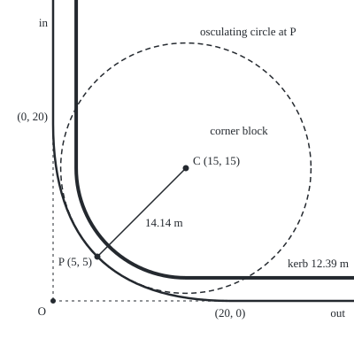

# Osculating circle: the circle that hugs a curve best

[Syllabus](../../../SYLLABUS.md) → [Differential geometry and Lie groups](../README.md) → [Curves](../README.md#s01) → Osculating circle

---

## General Overview

A city bus turns left at a crossroads. It comes south down one road and leaves east along the other. The council wants to rebuild the kerb on the corner (the raised stone edge of the pavement), so the bus never clips it.

The planners draw the bus's centre line through the turn as one smooth curve, traced by the midpoint of its rear axle. On a turn the rear wheels cut inside the path of the front ones (off-tracking), so the rear axle is the part of the bus that comes closest to the kerb; the body ahead of it swings outward. The curve leaves the southbound lane 20 m before the point O where the two lane centre lines cross. It joins the eastbound lane 20 m after O. Two questions decide the kerb:

- **How tight is the turn at its tightest point?** The bus can hold its centre line on a curve no tighter than 12 m radius. That figure is an assumption for this example; a real bus's figure comes from its maker's turning-circle data.
- **Where is the bus turning about?** The kerb arc must be drawn round that point.

Near any one point, a smooth curve looks like a piece of a circle. The **osculating circle** ("kissing circle", from the Latin *osculari*, to kiss) is the circle that matches the curve best there. Its radius measures how tight the turn is: the smaller the radius, the tighter the turn. Its centre is the point the bus is turning about at that moment. At the tightest point of this corner, the circle has radius **14.14 m** and centre 15 m east and 15 m north of O. That clears the bus's 12 m limit. A kerb arc of radius 12.39 m round the same centre keeps the bus's side 0.5 m clear.

**At each point of a smooth curve with nonzero curvature, exactly one circle matches the curve's position, direction and bending: its radius is 1 over the size of the curvature, and its centre lies that far along the unit normal, on the side the curve turns toward.**

**What kind of fact this is:** a definition (the radius and centre of curvature) and a local theorem: this circle, and no other, matches the curve to second order. It is proved on this card in Why it works. "Local" means it speaks about one point and a short stretch round it, not the whole curve.

### The picture: the corner, to scale

<p align="center"></p>

Coordinates are in metres, x east and y north from O. The thin solid curve is the bus's centre line. P (5, 5) is its tightest point, the apex. The dashed circle is the osculating circle at P, centre C (15, 15), radius 14.14 m. The thick line is the kerb: straight, then an arc of radius 12.39 m round C, then straight again. The dotted lines continue the two lane centre lines to O, where they would cross.

---

## The formula

Reminder from [Curvature](02-curvature-of-plane-curves.md): the **signed curvature** $`\kappa`$ (Greek kappa) is how fast the direction of travel turns per metre of path, in radians per metre. It is positive when the curve turns left. The **unit tangent** $`\mathbf T`$ points along the direction of travel. The **unit normal** $`\mathbf N`$ is $`\mathbf T`$ turned a quarter turn left.

```math
\rho = \frac{1}{\lvert\kappa\rvert}, \qquad \mathbf C = \mathbf r + \frac{1}{\kappa}\,\mathbf N
```

**Read it aloud:** the radius of the best circle is one over the size of the curvature; its centre sits that radius away from the point, along the normal, on the side the curve bends toward.

The sign does the side-choosing. A left turn has $`\kappa > 0`$, so $`\mathbf C`$ is on the left, along $`+\mathbf N`$. A right turn has $`\kappa < 0`$, and $`1/\kappa`$ is negative, so $`\mathbf C`$ moves to the right. The quantity $`\rho`$ (Greek rho) is called the **radius of curvature**; $`\mathbf C`$ is the **centre of curvature**.

The bus path is not drawn at unit speed, so $`\kappa`$ comes from the formula for any parametrisation of [Curvature](02-curvature-of-plane-curves.md) (a parametrisation is a rule that gives the point $`\mathbf r(t)`$ for each number $`t`$). As there, a dot means a rate of change per unit of $`t`$:

```math
\kappa = \frac{\dot x\ddot y - \dot y\ddot x}{\left(\dot x^2 + \dot y^2\right)^{3/2}}
```

**Read it aloud:** the sideways part of the acceleration, divided by the speed cubed.

A prime keeps this wing's meaning, a rate per metre of path, as in $`\kappa'`$ below. The bus path is

```math
\mathbf r(t) = \left(a\,t^2,\; a\,(1-t)^2\right), \qquad 0 \le t \le 1
```

with $`a = 20`$ m. At $`t = 0`$ it is at (0, 20), heading south. At $`t = 1`$ it is at (20, 0), heading east. This curve is a parabola (see [Circles and parabolas](../../05-Geometry%20and%20trig/04-Coordinates%20and%20Curves/04-circles-and-parabolas.md)), tangent to both lane centre lines. Drawing programs call it a quadratic Bézier curve with its control point at O.

| Symbol | Plain meaning | In our example | Push it up and the answer… |
| --- | --- | --- | --- |
| $`a`$ | turn-in distance: from O to where the turn starts and ends | 20 m | a gentler corner, bigger $`\rho`$ |
| $`t`$ | the parameter: 0 at the turn's start, 1 at its end; not time, not distance | 0.5 at the apex | moves the point along the turn |
| $`\mathbf r(t) = (x, y)`$ | the point of the bus's centre line, metres east and north of O | P = (5, 5) | — |
| $`\dot{\mathbf r}`$, $`\ddot{\mathbf r}`$ | rates of change of the point per unit of $`t`$ (a dot each): velocity and acceleration along the parameter | (20, −20) and (40, 40) | — |
| $`\mathbf T`$, $`\mathbf N`$ | unit tangent (direction of travel) and unit normal ($`\mathbf T`$ turned left) | $`\mathbf N`$ = (0.7071, 0.7071), toward the corner block | — |
| $`\kappa`$ | signed curvature: turning per metre, positive to the left | 0.070711 per m; its rate of change per metre, $`\kappa'`$, is 0 at the apex | a tighter turn, smaller $`\rho`$ |
| $`\rho`$ | radius of curvature, $`1/\lvert\kappa\rvert`$ | 14.14 m | a gentler turn |
| $`\mathbf C`$ | centre of curvature: the point the bus turns about | (15, 15) | — |
| $`\delta`$ | a small step in $`t`$ away from the point, used to measure fit | 0.04, 0.02, 0.01 | the circle drifts off the curve |
| $`F(\delta)`$, $`R`$ | the fit function of Why it works, for a trial circle of radius $`R`$ | zero on the circle | — |
| $`\lambda`$ | how far along $`\mathbf N`$ a trial centre sits (negative means the other side) | 14.14 m for the best circle | — |
| $`v`$ | the speed $`\lvert\dot{\mathbf r}\rvert`$: metres of path per unit of $`t`$ | 28.28 at the apex | — |

### When it holds

- **The curve is smooth: two derivatives exist and the speed is not zero.** At a cusp the direction jumps. The cusp of $`(t^2, t^3)`$ has radius 0.137859 m at $`t = 0.1`$ and 0.013338 m at $`t = 0.01`$, shrinking to nothing, and at $`t = 0`$ the formula is 0 over 0.
- **The curvature is not zero.** On a straight line or at an inflection point (where the bend changes side), $`1/\kappa`$ has no value. The "circle" there is a straight line, a circle of infinite radius.
- **It is local.** The circle describes one point and a short stretch round it. The curve can leave it a few metres away; at the quarter-way point the bus path crosses its circle, outside it just before the point and inside it just after.
- **It is a property of the shape, not of the drawing.** A second chart (the same corner written as a graph $`y`$ against $`x`$) gives the same $`\rho`$ and $`\mathbf C`$. A number that changed with the chart would not belong to the corner.

---

## Why it works

### Step 0: three conditions, three unknowns

A circle in the plane has three free numbers: two for the centre and one for the radius. A curve at a point offers three facts to match: where it is, which way it heads, and how fast it turns. Three conditions on three unknowns pick one circle. Matching all three is called **second-order contact**, because position, first derivative and second derivative agree.

### Step 1: measure the fit with one function

Take any circle, centre $`\mathbf C`$ and radius $`R`$. Walk along the curve from the point and measure

```math
F(\delta) = \lvert \mathbf r(t+\delta) - \mathbf C \rvert^2 - R^2
```

**Read it aloud:** the squared distance from the centre, minus the squared radius. It is zero exactly when the curve is on the circle. Expand it in powers of the step $`\delta`$ (the [Second derivatives](../../06-Calculus%20and%20analysis/02-Derivatives/08-higher-derivatives-and-concavity.md) card's tangent-gap idea, one order further). Each coefficient that vanishes makes the circle fit one order better. Since $`\delta`$ is a step in $`t`$, the rates of $`F`$ per unit of $`\delta`$ take dots too.

### Step 2: the point and the direction put the centre on the normal

- $`F(0) = 0`$ says the circle passes through the point: $`R = \lvert \mathbf r - \mathbf C\rvert`$.
- $`\dot F(0) = 2\,(\mathbf r - \mathbf C)\cdot\dot{\mathbf r} = 0`$ says the radius line is at right angles to the direction of travel. So $`\mathbf C`$ lies on the normal line: $`\mathbf C = \mathbf r + \lambda \mathbf N`$ for some number $`\lambda`$ (lambda), and $`R = \lvert\lambda\rvert`$.

Every circle tangent to the curve at the point passes these two tests. There is one for each $`\lambda`$: a whole family of tangent circles.

### Step 3: the bending fixes the radius

The third test picks one from the family:

```math
\ddot F(0) = 2\,\lvert\dot{\mathbf r}\rvert^2 + 2\,(\mathbf r - \mathbf C)\cdot\ddot{\mathbf r} = 0
```

Put $`\mathbf r - \mathbf C = -\lambda \mathbf N`$. Only the sideways part of $`\ddot{\mathbf r}`$ survives the dot product with $`\mathbf N`$, and that part is $`\kappa\,\lvert\dot{\mathbf r}\rvert^2`$. So $`\lvert\dot{\mathbf r}\rvert^2 - \lambda\,\kappa\,\lvert\dot{\mathbf r}\rvert^2 = 0`$, which gives $`\lambda = 1/\kappa`$. That is the formula: $`\mathbf C = \mathbf r + \mathbf N/\kappa`$, radius $`1/\lvert\kappa\rvert`$.

### Step 4: what "best" means, in numbers

With the first three terms gone, $`F`$ starts at the $`\delta^3`$ term. The gap between the curve and its osculating circle shrinks like the step cubed: halve the step and the gap falls 8 times. Any other tangent circle keeps a $`\delta^2`$ term, so its gap falls only 4 times. A circle through the point but not tangent to the curve keeps a $`\delta`$ term, so its gap shrinks only in step with the step itself.

A **vertex** is a point where the curvature reaches a peak or a dip, so its rate of change per metre of path is zero ($`\kappa' = 0`$). There the $`\delta^3`$ term vanishes too and the gap falls 16 times per halving. The apex of the bus path is a vertex, by its symmetry. The code measures all three cases.

<details>
<summary>Detailed proof: the sideways part of the acceleration is the curvature times the speed squared</summary>

Write the speed as $`v = \lvert\dot{\mathbf r}\rvert`$ and the tangent as $`\mathbf T = \dot{\mathbf r}/v`$. Then $`\dot{\mathbf r} = v\mathbf T`$.

Differentiate with the product rule:

$`\displaystyle \ddot{\mathbf r} = \dot v\,\mathbf T + v\,\dot{\mathbf T}.`$

Per metre of path the tangent turns by $`\mathbf T' = \kappa \mathbf N`$ ([Curvature](02-curvature-of-plane-curves.md)). Here the point covers $`v`$ metres per unit of $`t`$, so the chain rule gives, per unit of $`t`$, $`\dot{\mathbf T} = v\,\kappa\,\mathbf N`$. Hence

$`\displaystyle \ddot{\mathbf r} = \dot v\,\mathbf T + \kappa\,v^2\,\mathbf N.`$

$`\mathbf T`$ and $`\mathbf N`$ are at right angles and of length 1, so $`\ddot{\mathbf r}\cdot \mathbf N = \kappa\,v^2`$. In the plane, $`\ddot{\mathbf r}\cdot \mathbf N = (\dot x\ddot y - \dot y\ddot x)/v`$, which gives the curvature formula above.

Now the third test. With $`\mathbf r - \mathbf C = -\lambda \mathbf N`$:

$`\displaystyle \tfrac12 \ddot F(0) = v^2 - \lambda\,(\ddot{\mathbf r}\cdot \mathbf N) = v^2\,(1 - \lambda\kappa).`$

This is zero only for $`\lambda = 1/\kappa`$, since $`v \neq 0`$. For any other tangent circle the $`\delta^2`$ coefficient is $`v^2(1 - \lambda\kappa) \neq 0`$, so its gap is of order $`\delta^2`$. Uniqueness and the order of contact are both proved.

</details>

### The same answer from three points

[Second derivatives](../../06-Calculus%20and%20analysis/02-Derivatives/08-higher-derivatives-and-concavity.md) already showed that circles through three nearby points of a graph have radii that head for $`1/\kappa`$. Their centres head for $`\mathbf C`$ as well. The code uses this as an independent road: no derivatives, only three points and a circle through them.

---

## Worked numbers, by hand

At the apex, $`t = 0.5`$, with $`a = 20`$ m.

| Step | Arithmetic | Value |
| --- | --- | --- |
| Point $`\mathbf r`$ | $`(20 \times 0.25,\; 20 \times 0.25)`$ | (5.00, 5.00) |
| Velocity $`\dot{\mathbf r}`$ | $`(2 \times 20 \times 0.5,\; -2 \times 20 \times 0.5)`$ | (20.00, −20.00) |
| Acceleration $`\ddot{\mathbf r}`$ | $`(2 \times 20,\; 2 \times 20)`$ | (40.00, 40.00) |
| Sideways product $`\dot x\ddot y - \dot y\ddot x`$ | $`20 \times 40 - (-20) \times 40`$ | 1600.00 |
| Speed $`\lvert\dot{\mathbf r}\rvert`$ | $`\sqrt{20^2 + 20^2}`$ | 28.28 |
| Speed cubed | $`\big(\sqrt{20^2 + 20^2}\big)^3`$ | 22627.42 |
| Curvature $`\kappa`$ | $`1600 / 22627.42`$ | 0.070711 per m |
| Radius $`\rho`$ | $`1 / 0.070711`$ | 14.14 m |
| Normal $`\mathbf N`$ | $`(20, -20)`$ turned left, divided by 28.28 | (0.7071, 0.7071) |
| Centre $`\mathbf C`$ | $`(5, 5) + 14.14 \times (0.7071, 0.7071)`$ | **(15.00, 15.00)** |
| Kerb arc radius | $`14.14 - 1.75`$ | **12.39 m** |

At its tightest the bus turns about the point (15, 15), on a 14.14 m radius, which clears the bus's 12 m limit. The kerb arc round that point sits 1.75 m inside the path (half the 2.5 m bus width plus 0.5 m), so its radius is 12.39 m. A scan of 2001 points along the path finds its closest approach to that arc is 1.7500 m, at the apex: the path stays outside its apex circle all the way round.

The second chart agrees. Written as a graph, the corner is $`y = (\sqrt{20} - \sqrt{x})^2`$. At $`x = 5`$ its slope $`y'`$ is $`-1`$ and its second derivative $`y''`$ is 0.2; on a graph these primes are rates per metre across, as in [Second derivatives](../../06-Calculus%20and%20analysis/02-Derivatives/08-higher-derivatives-and-concavity.md). The graph formulas give 0.070711 per m and centre (15.00, 15.00) again.

Two more points, for comparison:

| Point | Where | $`\kappa`$ (per m) | $`\rho`$ (m) | Centre $`\mathbf C`$ |
| --- | --- | --- | --- | --- |
| Entry, $`t = 0`$ | (0.00, 20.00) | 0.025000 | 40.00 | (40.00, 20.00) |
| Quarter, $`t = 0.25`$ | (1.25, 11.25) | 0.050596 | 19.76 | (20.00, 17.50) |
| Apex, $`t = 0.5`$ | (5.00, 5.00) | 0.070711 | 14.14 | (15.00, 15.00) |

The centre moves as the bus moves. It slides from (40, 20) toward (15, 15) and back out, so the bus never turns about one fixed point.

### What breaks if you drop a piece

| Mistake | Comes out at | What went wrong |
| --- | --- | --- |
| Radius as speed squared over the whole acceleration, at the quarter point | 17.68 m (right: 19.76 m) | only the sideways part of $`\ddot{\mathbf r}`$ bends the path; the forward part changes the speed |
| Centre on the other side, at the apex | (−5.00, −5.00) | $`\mathbf N`$ was turned right; the centre must be on the side the curve bends toward |
| Centre along the acceleration, at the quarter point | (15.23, 25.23), 9.08 m off | $`\ddot{\mathbf r}`$ is not at right angles to the path unless the speed is steady |
| Radius as $`1/\lvert y''\rvert`$ on the graph, at the apex | 5.00 m (right: 14.14 m) | the steepness divisor $`(1 + y'^2)^{3/2}`$ was dropped |
| A cusp, $`(t^2, t^3)`$ | 0.137859 m at $`t = 0.1`$, 0.013338 m at $`t = 0.01`$, nothing at 0 | zero speed: no direction, so no tangent and no circle |

---

## Code, from first principles, and it actually runs

The code finds the radius and centre at three points of the bus path by **three independent roads**. Road 1 is the formula on the parametrised path. Road 2 is a second chart: the same corner as a graph, with the graph formulas. Road 3 uses no derivatives: the circle through three nearby points, at two step sizes, closing in on the answer. A fourth check is a count: halving the step shrinks the gap 8 times for the osculating circle, 4 times for another tangent circle and 16 times at the vertex. The code then computes the kerb arc, scans 2001 points of the path for the closest approach to it, and prints every wrong answer in the table above.

### Python

```python
# Osculating circle on a bus corner: radius and centre by formula, by a second chart and by three-point circles.
from math import sqrt

A = 20.0      # m from the crossing point O to where the turn starts and ends
BUS = 12.0    # m: the tightest radius the bus's centre line can follow (assumed)
SIDE = 1.75   # m: half the bus's 2.5 m width plus a 0.5 m margin


def pos(t): return (A * t * t, A * (1 - t) ** 2)
def vel(t): return (2 * A * t, -2 * A * (1 - t))
def acc(t): return (2 * A, 2 * A)


def curvature(dx, dy, ax, ay):  # signed: positive turning left
    return (dx * ay - dy * ax) / sqrt(dx * dx + dy * dy) ** 3


def normal(t):  # unit tangent turned a quarter turn left
    dx, dy = vel(t)
    s = sqrt(dx * dx + dy * dy)
    return (-dy / s, dx / s)


def by_formula(t):  # curvature, then the centre 1/k along the unit normal
    k = curvature(*vel(t), *acc(t))
    (x, y), (nx, ny) = pos(t), normal(t)
    return k, (x + nx / k, y + ny / k)


def by_graph(x):  # second chart: the same corner as the graph y = (sqrt(A) - sqrt(x))^2
    y, d1, d2 = (sqrt(A) - sqrt(x)) ** 2, 1 - sqrt(A / x), 0.5 * sqrt(A) * x ** -1.5
    q = 1 + d1 * d1
    return d2 / q ** 1.5, (x - d1 * q / d2, y + q / d2)


def three_point(t, h):  # circle through three nearby points of the path
    (x0, y0), (x1, y1), (x2, y2) = pos(t - h), pos(t), pos(t + h)
    bx, by, cx, cy = x0 - x1, y0 - y1, x2 - x1, y2 - y1
    d = 2 * (bx * cy - by * cx)
    b2, c2 = bx * bx + by * by, cx * cx + cy * cy
    ux, uy = (cy * b2 - by * c2) / d, (bx * c2 - cx * b2) / d
    return sqrt(ux * ux + uy * uy), (x1 + ux, y1 + uy)


def dist(a, b): return sqrt((a[0] - b[0]) ** 2 + (a[1] - b[1]) ** 2)
def p(label, v): print(f"{label:<44}{v}")
def xy(c): return f"({c[0]:.2f}, {c[1]:.2f})"


for t, name in [(0.0, "entry"), (0.25, "quarter"), (0.5, "apex")]:
    k, c = by_formula(t)
    p(f"{name} t={t}: point", xy(pos(t)))
    p("  curvature k (1/m), radius 1/k (m)", f"{k:.6f}  {1 / k:.6f}")
    p("  centre", xy(c))
    if t > 0:
        kg, cg = by_graph(pos(t)[0])
        p("  graph chart: k, centre", f"{kg:.6f}  {xy(cg)}")
        assert abs(kg - k) < 1e-12 and dist(cg, c) < 1e-9
        for h in (0.01, 0.001):
            r3, c3 = three_point(t, h)
            p(f"  three-point circle, step {h}", f"{r3:.6f}  ({c3[0]:.6f}, {c3[1]:.6f})")
            assert abs(r3 - 1 / k) < 100 * h * h and dist(c3, c) < 100 * h * h

(dx, dy), (ax, ay), (nx, ny) = vel(0.5), acc(0.5), normal(0.5)
p("apex by hand: velocity, acceleration", f"{xy((dx, dy))}  {xy((ax, ay))}")
p("  cross, speed, speed^3, N", f"{dx * ay - dy * ax:.2f}  {sqrt(dx * dx + dy * dy):.2f}  {sqrt(dx * dx + dy * dy) ** 3:.2f}  ({nx:.4f}, {ny:.4f})")
p("  graph at x = 5: y', y''", f"{1 - sqrt(A / 5):.6f}  {0.5 * sqrt(A) * 5 ** -1.5:.6f}")
kq, cq = by_formula(0.25)
ka, ca = by_formula(0.5)
assert abs(1 / ka - A / sqrt(2)) < 1e-12 and dist(ca, (15, 15)) < 1e-12 and dist(cq, (20, 17.5)) < 1e-12
assert abs(1 / by_formula(0.0)[0] - 2 * A) < 1e-12

print("gap from path to circle at steps 0.04 0.02 0.01 (micrometres); halving ratios")
p("  step lengths along the road, quarter (m)", " ".join(f"{dist(pos(0.25 + st), pos(0.25)):.2f}" for st in (0.04, 0.02, 0.01)))
nq = normal(0.25)
tangent12 = (pos(0.25)[0] + BUS * nq[0], pos(0.25)[1] + BUS * nq[1])
for label, t, c, r, order in [("osculating circle at quarter", 0.25, cq, 1 / kq, 8),
                              ("12 m tangent circle at quarter", 0.25, tangent12, BUS, 4),
                              ("osculating circle at apex", 0.5, ca, 1 / ka, 16)]:
    g = [dist(pos(t + st), c) - r for st in (0.04, 0.02, 0.01)]
    p("  " + label, " ".join(f"{1e6 * v:.2f}" for v in g) + f"   {g[0] / g[1]:.2f} {g[1] / g[2]:.2f}")
    assert abs(g[1] / g[2] - order) < 0.1 * order

kerb = 1 / ka - SIDE
near = min(abs(dist(pos(i / 2000), ca) - kerb) for i in range(2001))
v = 15 / 3.6
p("bus: kerb arc radius round the apex centre", f"{kerb:.2f} m")
p("bus: closest path to kerb arc, 2001 samples", f"{near:.4f} m")
p("bus: shortest turn-in distance for 12 m", f"{BUS * sqrt(2):.2f} m")
p("bus at 15 km/h: v^2 k at entry, apex", f"{v * v * by_formula(0.0)[0]:.3f}  {v * v * ka:.3f} m/s^2")
assert abs(near - SIDE) < 1e-9 and 1 / ka >= BUS

(dx, dy), (ax, ay) = vel(0.25), acc(0.25)
wrong_r = (dx * dx + dy * dy) / sqrt(ax * ax + ay * ay)
wrong_c = (pos(0.25)[0] + ax / sqrt(ax * ax + ay * ay) / kq, pos(0.25)[1] + ay / sqrt(ax * ax + ay * ay) / kq)
p("wrong: speed^2 / |acceleration|, quarter", f"{wrong_r:.2f} m (right {1 / kq:.2f})")
p("wrong: centre on the other side, apex", xy((2 * pos(0.5)[0] - ca[0], 2 * pos(0.5)[1] - ca[1])))
p("wrong: centre along acceleration, quarter", f"{xy(wrong_c)}, {dist(wrong_c, cq):.2f} m off")
p("wrong: 1/|y''| on the graph, apex", f"{1 / (0.5 * sqrt(A) * 5 ** -1.5):.2f} m (right {1 / ka:.2f})")
for t in (0.1, 0.01):
    p(f"cusp (t^2, t^3): radius at t={t}", f"{1 / curvature(2 * t, 3 * t * t, 2, 6 * t):.6f} m")
assert abs(wrong_r - 1 / kq) > 1 and dist(wrong_c, cq) > 1
p("try: A = 15, apex radius (m)", f"{1 / curvature(15, -15, 30, 30):.2f}")
p("try: centres at t=0.1, t=0.4", f"{xy(by_formula(0.1)[1])}  {xy(by_formula(0.4)[1])}")
g19 = [dist(pos(0.25 + st), (pos(0.25)[0] + 19 * nq[0], pos(0.25)[1] + 19 * nq[1])) - 19 for st in (0.02, 0.01)]
p("try: 19 m tangent circle, halving ratio", f"{g19[0] / g19[1]:.2f}")
p("try: 30 km/h, v^2 k at apex", f"{(30 / 3.6) ** 2 * ka:.3f} m/s^2")
p("figure, path (0,20) via O (0,0) to (20,0)", f"centre {xy(ca)} r {1 / ka:.2f}; kerb r {kerb:.2f}")
print("ALL CHECKS PASS")
```

**Ran 2026-11-19 on macOS, Python 3.14.10, standard library only. All checks passed. Output, pasted from the run:**

```
entry t=0.0: point                          (0.00, 20.00)
  curvature k (1/m), radius 1/k (m)         0.025000  40.000000
  centre                                    (40.00, 20.00)
quarter t=0.25: point                       (1.25, 11.25)
  curvature k (1/m), radius 1/k (m)         0.050596  19.764235
  centre                                    (20.00, 17.50)
  graph chart: k, centre                    0.050596  (20.00, 17.50)
  three-point circle, step 0.01             19.765184  (20.000500, 17.501500)
  three-point circle, step 0.001            19.764245  (20.000005, 17.500015)
apex t=0.5: point                           (5.00, 5.00)
  curvature k (1/m), radius 1/k (m)         0.070711  14.142136
  centre                                    (15.00, 15.00)
  graph chart: k, centre                    0.070711  (15.00, 15.00)
  three-point circle, step 0.01             14.143550  (15.001000, 15.001000)
  three-point circle, step 0.001            14.142150  (15.000010, 15.000010)
apex by hand: velocity, acceleration        (20.00, -20.00)  (40.00, 40.00)
  cross, speed, speed^3, N                  1600.00  28.28  22627.42  (0.7071, 0.7071)
  graph at x = 5: y', y''                   -1.000000  0.200000
gap from path to circle at steps 0.04 0.02 0.01 (micrometres); halving ratios
  step lengths along the road, quarter (m)  1.25 0.63 0.31
  osculating circle at quarter              -1243.50 -158.67 -20.04   7.84 7.92
  12 m tangent circle at quarter            24117.28 6284.40 1603.74   3.84 3.92
  osculating circle at apex                 72.41 4.53 0.28   16.00 16.00
bus: kerb arc radius round the apex centre  12.39 m
bus: closest path to kerb arc, 2001 samples 1.7500 m
bus: shortest turn-in distance for 12 m     16.97 m
bus at 15 km/h: v^2 k at entry, apex        0.434  1.228 m/s^2
wrong: speed^2 / |acceleration|, quarter    17.68 m (right 19.76)
wrong: centre on the other side, apex       (-5.00, -5.00)
wrong: centre along acceleration, quarter   (15.23, 25.23), 9.08 m off
wrong: 1/|y''| on the graph, apex           5.00 m (right 14.14)
cusp (t^2, t^3): radius at t=0.1            0.137859 m
cusp (t^2, t^3): radius at t=0.01           0.013338 m
try: A = 15, apex radius (m)                10.61
try: centres at t=0.1, t=0.4                (29.72, 19.48)  (15.68, 15.52)
try: 19 m tangent circle, halving ratio     2.99
try: 30 km/h, v^2 k at apex                 4.910 m/s^2
figure, path (0,20) via O (0,0) to (20,0)   centre (15.00, 15.00) r 14.14; kerb r 12.39
ALL CHECKS PASS
```

### Rust

The same checks, in the same order, with identical output.

```rust
// Osculating circle on a bus corner: radius and centre by formula, by a second chart and by three-point circles.
type P = (f64, f64);
const A: f64 = 20.0; // m from the crossing point O to where the turn starts and ends
const BUS: f64 = 12.0; // m: the tightest radius the bus's centre line can follow (assumed)
const SIDE: f64 = 1.75; // m: half the bus's 2.5 m width plus a 0.5 m margin

fn pos(t: f64) -> P { (A * t * t, A * (1.0 - t).powi(2)) }
fn vel(t: f64) -> P { (2.0 * A * t, -2.0 * A * (1.0 - t)) }
fn acc(_t: f64) -> P { (2.0 * A, 2.0 * A) }

// signed: positive turning left
fn curvature(dx: f64, dy: f64, ax: f64, ay: f64) -> f64 {
    (dx * ay - dy * ax) / (dx * dx + dy * dy).sqrt().powi(3)
}

// unit tangent turned a quarter turn left
fn normal(t: f64) -> P {
    let (dx, dy) = vel(t);
    let s = (dx * dx + dy * dy).sqrt();
    (-dy / s, dx / s)
}

// curvature, then the centre 1/k along the unit normal
fn by_formula(t: f64) -> (f64, P) {
    let ((dx, dy), (ax, ay)) = (vel(t), acc(t));
    let k = curvature(dx, dy, ax, ay);
    let ((x, y), (nx, ny)) = (pos(t), normal(t));
    (k, (x + nx / k, y + ny / k))
}

// second chart: the same corner as the graph y = (sqrt(A) - sqrt(x))^2
fn by_graph(x: f64) -> (f64, P) {
    let y = (A.sqrt() - x.sqrt()).powi(2);
    let (d1, d2) = (1.0 - (A / x).sqrt(), 0.5 * A.sqrt() * x.powf(-1.5));
    let q = 1.0 + d1 * d1;
    (d2 / q.powf(1.5), (x - d1 * q / d2, y + q / d2))
}

// circle through three nearby points of the path
fn three_point(t: f64, h: f64) -> (f64, P) {
    let ((x0, y0), (x1, y1), (x2, y2)) = (pos(t - h), pos(t), pos(t + h));
    let (bx, by, cx, cy) = (x0 - x1, y0 - y1, x2 - x1, y2 - y1);
    let d = 2.0 * (bx * cy - by * cx);
    let (b2, c2) = (bx * bx + by * by, cx * cx + cy * cy);
    let (ux, uy) = ((cy * b2 - by * c2) / d, (bx * c2 - cx * b2) / d);
    ((ux * ux + uy * uy).sqrt(), (x1 + ux, y1 + uy))
}

fn dist(a: P, b: P) -> f64 { ((a.0 - b.0).powi(2) + (a.1 - b.1).powi(2)).sqrt() }
fn p(label: &str, v: &str) { println!("{:<44}{}", label, v); }
fn xy(c: P) -> String { format!("({:.2}, {:.2})", c.0, c.1) }

fn main() {
    for (t, name) in [(0.0, "entry t=0.0"), (0.25, "quarter t=0.25"), (0.5, "apex t=0.5")] {
        let (k, c) = by_formula(t);
        p(&format!("{}: point", name), &xy(pos(t)));
        p("  curvature k (1/m), radius 1/k (m)", &format!("{:.6}  {:.6}", k, 1.0 / k));
        p("  centre", &xy(c));
        if t > 0.0 {
            let (kg, cg) = by_graph(pos(t).0);
            p("  graph chart: k, centre", &format!("{:.6}  {}", kg, xy(cg)));
            assert!((kg - k).abs() < 1e-12 && dist(cg, c) < 1e-9);
            for (h, hs) in [(0.01, "0.01"), (0.001, "0.001")] {
                let (r3, c3) = three_point(t, h);
                p(&format!("  three-point circle, step {}", hs), &format!("{:.6}  ({:.6}, {:.6})", r3, c3.0, c3.1));
                assert!((r3 - 1.0 / k).abs() < 100.0 * h * h && dist(c3, c) < 100.0 * h * h);
            }
        }
    }

    let ((dx, dy), (ax, ay), (nx, ny)) = (vel(0.5), acc(0.5), normal(0.5));
    p("apex by hand: velocity, acceleration", &format!("{}  {}", xy((dx, dy)), xy((ax, ay))));
    let sp = (dx * dx + dy * dy).sqrt();
    p("  cross, speed, speed^3, N", &format!("{:.2}  {:.2}  {:.2}  ({:.4}, {:.4})", dx * ay - dy * ax, sp, sp.powi(3), nx, ny));
    p("  graph at x = 5: y', y''", &format!("{:.6}  {:.6}", 1.0 - (A / 5.0).sqrt(), 0.5 * A.sqrt() * 5f64.powf(-1.5)));
    let (kq, cq) = by_formula(0.25);
    let (ka, ca) = by_formula(0.5);
    assert!((1.0 / ka - A / 2f64.sqrt()).abs() < 1e-12 && dist(ca, (15.0, 15.0)) < 1e-12 && dist(cq, (20.0, 17.5)) < 1e-12);
    assert!((1.0 / by_formula(0.0).0 - 2.0 * A).abs() < 1e-12);

    let steps = [0.04, 0.02, 0.01];
    println!("gap from path to circle at steps 0.04 0.02 0.01 (micrometres); halving ratios");
    let lens: Vec<String> = steps.iter().map(|&st| format!("{:.2}", dist(pos(0.25 + st), pos(0.25)))).collect();
    p("  step lengths along the road, quarter (m)", &lens.join(" "));
    let nq = normal(0.25);
    let tangent12 = (pos(0.25).0 + BUS * nq.0, pos(0.25).1 + BUS * nq.1);
    let cases = [("osculating circle at quarter", 0.25, cq, 1.0 / kq, 8.0),
                 ("12 m tangent circle at quarter", 0.25, tangent12, BUS, 4.0),
                 ("osculating circle at apex", 0.5, ca, 1.0 / ka, 16.0)];
    for (label, t, c, r, order) in cases {
        let g: Vec<f64> = steps.iter().map(|&st| dist(pos(t + st), c) - r).collect();
        let gs: Vec<String> = g.iter().map(|v| format!("{:.2}", 1e6 * v)).collect();
        p(&format!("  {}", label), &format!("{}   {:.2} {:.2}", gs.join(" "), g[0] / g[1], g[1] / g[2]));
        assert!((g[1] / g[2] - order).abs() < 0.1 * order);
    }

    let kerb = 1.0 / ka - SIDE;
    let near = (0..=2000).map(|i| (dist(pos(i as f64 / 2000.0), ca) - kerb).abs()).fold(f64::INFINITY, f64::min);
    let v = 15.0 / 3.6;
    p("bus: kerb arc radius round the apex centre", &format!("{:.2} m", kerb));
    p("bus: closest path to kerb arc, 2001 samples", &format!("{:.4} m", near));
    p("bus: shortest turn-in distance for 12 m", &format!("{:.2} m", BUS * 2f64.sqrt()));
    p("bus at 15 km/h: v^2 k at entry, apex", &format!("{:.3}  {:.3} m/s^2", v * v * by_formula(0.0).0, v * v * ka));
    assert!((near - SIDE).abs() < 1e-9 && 1.0 / ka >= BUS);

    let ((dx, dy), (ax, ay)) = (vel(0.25), acc(0.25));
    let am = (ax * ax + ay * ay).sqrt();
    let wrong_r = (dx * dx + dy * dy) / am;
    let wrong_c = (pos(0.25).0 + ax / am / kq, pos(0.25).1 + ay / am / kq);
    p("wrong: speed^2 / |acceleration|, quarter", &format!("{:.2} m (right {:.2})", wrong_r, 1.0 / kq));
    p("wrong: centre on the other side, apex", &xy((2.0 * pos(0.5).0 - ca.0, 2.0 * pos(0.5).1 - ca.1)));
    p("wrong: centre along acceleration, quarter", &format!("{}, {:.2} m off", xy(wrong_c), dist(wrong_c, cq)));
    p("wrong: 1/|y''| on the graph, apex", &format!("{:.2} m (right {:.2})", 1.0 / (0.5 * A.sqrt() * 5f64.powf(-1.5)), 1.0 / ka));
    for (t, ts) in [(0.1, "0.1"), (0.01, "0.01")] {
        p(&format!("cusp (t^2, t^3): radius at t={}", ts), &format!("{:.6} m", 1.0 / curvature(2.0 * t, 3.0 * t * t, 2.0, 6.0 * t)));
    }
    assert!((wrong_r - 1.0 / kq).abs() > 1.0 && dist(wrong_c, cq) > 1.0);
    p("try: A = 15, apex radius (m)", &format!("{:.2}", 1.0 / curvature(15.0, -15.0, 30.0, 30.0)));
    p("try: centres at t=0.1, t=0.4", &format!("{}  {}", xy(by_formula(0.1).1), xy(by_formula(0.4).1)));
    let g19: Vec<f64> = [0.02, 0.01].iter().map(|&st| dist(pos(0.25 + st), (pos(0.25).0 + 19.0 * nq.0, pos(0.25).1 + 19.0 * nq.1)) - 19.0).collect();
    p("try: 19 m tangent circle, halving ratio", &format!("{:.2}", g19[0] / g19[1]));
    p("try: 30 km/h, v^2 k at apex", &format!("{:.3} m/s^2", (30.0f64 / 3.6).powi(2) * ka));
    p("figure, path (0,20) via O (0,0) to (20,0)", &format!("centre {} r {:.2}; kerb r {:.2}", xy(ca), 1.0 / ka, kerb));
    println!("ALL CHECKS PASS");
}
```

**Ran 2026-11-19 on macOS, rustc 1.98.1, no crates. All checks passed. Output, pasted from the run:**

```
entry t=0.0: point                          (0.00, 20.00)
  curvature k (1/m), radius 1/k (m)         0.025000  40.000000
  centre                                    (40.00, 20.00)
quarter t=0.25: point                       (1.25, 11.25)
  curvature k (1/m), radius 1/k (m)         0.050596  19.764235
  centre                                    (20.00, 17.50)
  graph chart: k, centre                    0.050596  (20.00, 17.50)
  three-point circle, step 0.01             19.765184  (20.000500, 17.501500)
  three-point circle, step 0.001            19.764245  (20.000005, 17.500015)
apex t=0.5: point                           (5.00, 5.00)
  curvature k (1/m), radius 1/k (m)         0.070711  14.142136
  centre                                    (15.00, 15.00)
  graph chart: k, centre                    0.070711  (15.00, 15.00)
  three-point circle, step 0.01             14.143550  (15.001000, 15.001000)
  three-point circle, step 0.001            14.142150  (15.000010, 15.000010)
apex by hand: velocity, acceleration        (20.00, -20.00)  (40.00, 40.00)
  cross, speed, speed^3, N                  1600.00  28.28  22627.42  (0.7071, 0.7071)
  graph at x = 5: y', y''                   -1.000000  0.200000
gap from path to circle at steps 0.04 0.02 0.01 (micrometres); halving ratios
  step lengths along the road, quarter (m)  1.25 0.63 0.31
  osculating circle at quarter              -1243.50 -158.67 -20.04   7.84 7.92
  12 m tangent circle at quarter            24117.28 6284.40 1603.74   3.84 3.92
  osculating circle at apex                 72.41 4.53 0.28   16.00 16.00
bus: kerb arc radius round the apex centre  12.39 m
bus: closest path to kerb arc, 2001 samples 1.7500 m
bus: shortest turn-in distance for 12 m     16.97 m
bus at 15 km/h: v^2 k at entry, apex        0.434  1.228 m/s^2
wrong: speed^2 / |acceleration|, quarter    17.68 m (right 19.76)
wrong: centre on the other side, apex       (-5.00, -5.00)
wrong: centre along acceleration, quarter   (15.23, 25.23), 9.08 m off
wrong: 1/|y''| on the graph, apex           5.00 m (right 14.14)
cusp (t^2, t^3): radius at t=0.1            0.137859 m
cusp (t^2, t^3): radius at t=0.01           0.013338 m
try: A = 15, apex radius (m)                10.61
try: centres at t=0.1, t=0.4                (29.72, 19.48)  (15.68, 15.52)
try: 19 m tangent circle, halving ratio     2.99
try: 30 km/h, v^2 k at apex                 4.910 m/s^2
figure, path (0,20) via O (0,0) to (20,0)   centre (15.00, 15.00) r 14.14; kerb r 12.39
ALL CHECKS PASS
```

The two charts agree in every printed digit. At the quarter point the three-point radius reads 19.765184 m at step 0.01 and 19.764245 m at step 0.001, closing on 19.764235 m. The gap ratios come out at 7.92, 3.92 and 16.00: third order, second order and fourth order.

### Lean

Lean proves the main claim and Steps 2 and 3, for any plane curve with two derivatives.

- Take a point with nonzero speed and nonzero $`\kappa`$, and a circle with centre $`\mathbf C`$ and radius $`R \ge 0`$. Then all three tests pass exactly when $`\mathbf C = \mathbf r + \mathbf N/\kappa`$ and $`R = 1/\lvert\kappa\rvert`$.
- Take a point with nonzero speed, and a circle with centre $`\mathbf C`$ and radius $`R \ge 0`$. Then the first two tests pass exactly when $`\mathbf C = \mathbf r + \lambda \mathbf N`$ and $`R = \lvert\lambda\rvert`$, for some $`\lambda`$.
- Take a point with nonzero speed $`v`$, and the tangent circle with centre $`\mathbf r + \lambda \mathbf N`$ and radius $`\lvert\lambda\rvert`$. Then $`\ddot F(0) = 2 v^2 (1 - \lambda\kappa)`$.
- Lean also redoes the hand arithmetic for the three centres, and the squared radii 200 and 1600 at the apex and entry.

The three-point circles, the second chart, the gap ratios, the kerb and every printed decimal are left to the Python and Rust checks.

```lean
-- Osculating circle: at a point of a twice-differentiable plane curve with nonzero speed and nonzero curvature, exactly one circle matches the curve to second order, with radius 1/|κ| and centre 1/κ along the unit normal.
import Mathlib.Analysis.Calculus.Deriv.Basic
import Mathlib.Analysis.Calculus.Deriv.Add
import Mathlib.Analysis.Calculus.Deriv.Comp
import Mathlib.Analysis.Calculus.Deriv.Mul
import Mathlib.Analysis.Calculus.Deriv.Pow
import Mathlib.Analysis.Calculus.Deriv.Shift
import Mathlib.Analysis.SpecialFunctions.Sqrt
import Mathlib.Tactic.NormNum
import Mathlib.Tactic.Ring

open Real

/-- The speed of the plane curve t ↦ (x(t), y(t)) at t: the length √(x'^2 + y'^2) of its
velocity, in metres of path per unit of t. -/
noncomputable def speed (x y : ℝ → ℝ) (t : ℝ) : ℝ :=
  √(deriv x t ^ 2 + deriv y t ^ 2)

/-- The card's signed curvature at t: x' y'' − y' x'' divided by the speed cubed.
Positive means the curve turns left. -/
noncomputable def signedCurvature (x y : ℝ → ℝ) (t : ℝ) : ℝ :=
  (deriv x t * deriv (deriv y) t - deriv y t * deriv (deriv x) t) / speed x y t ^ 3

/-- The unit normal N at t: the unit tangent (x', y') / speed turned a quarter turn left,
that is (−y', x') / speed. -/
noncomputable def unitNormal (x y : ℝ → ℝ) (t : ℝ) : ℝ × ℝ :=
  (-deriv y t / speed x y t, deriv x t / speed x y t)

/-- The card's fit function for a trial circle with centre C and radius R, measured from the
point at parameter t: F(δ) = |r(t + δ) − C|^2 − R^2. It is zero exactly when r(t + δ) is on
the circle. -/
noncomputable def fit (x y : ℝ → ℝ) (t : ℝ) (C : ℝ × ℝ) (R : ℝ) : ℝ → ℝ :=
  fun δ => (x (t + δ) - C.1) ^ 2 + (y (t + δ) - C.2) ^ 2 - R ^ 2

/-- The speed squared is x'^2 + y'^2. -/
lemma speed_sq (x y : ℝ → ℝ) (t : ℝ) : speed x y t ^ 2 = deriv x t ^ 2 + deriv y t ^ 2 := by
  unfold speed
  rw [Real.sq_sqrt (by positivity)]

#print axioms speed_sq

/-- The first derivative of the fit function, at every δ:
F'(δ) = 2 (x(t + δ) − C₁) x'(t + δ) + 2 (y(t + δ) − C₂) y'(t + δ). -/
lemma deriv_fit {x y : ℝ → ℝ} (hx : Differentiable ℝ x) (hy : Differentiable ℝ y)
    (t : ℝ) (C : ℝ × ℝ) (R : ℝ) :
    deriv (fit x y t C R) = fun δ => 2 * (x (t + δ) - C.1) * deriv x (t + δ) +
      2 * (y (t + δ) - C.2) * deriv y (t + δ) := by
  funext δ
  have h1 : HasDerivAt (fun s => x (t + s)) (deriv x (t + δ)) δ :=
    (hx (t + δ)).hasDerivAt.comp_const_add t δ
  have h2 : HasDerivAt (fun s => y (t + s)) (deriv y (t + δ)) δ :=
    (hy (t + δ)).hasDerivAt.comp_const_add t δ
  have h : HasDerivAt (fit x y t C R) _ δ :=
    (((h1.sub_const C.1).pow 2).add ((h2.sub_const C.2).pow 2)).sub_const (R ^ 2)
  rw [h.deriv]
  push_cast
  ring

#print axioms deriv_fit

/-- The second derivative of the fit function at δ = 0:
F''(0) = 2 (x'^2 + (x − C₁) x'' + y'^2 + (y − C₂) y''). -/
lemma deriv2_fit {x y : ℝ → ℝ} (hx : Differentiable ℝ x) (hx2 : Differentiable ℝ (deriv x))
    (hy : Differentiable ℝ y) (hy2 : Differentiable ℝ (deriv y))
    (t : ℝ) (C : ℝ × ℝ) (R : ℝ) :
    deriv (deriv (fit x y t C R)) 0 =
      2 * (deriv x t ^ 2 + (x t - C.1) * deriv (deriv x) t +
        deriv y t ^ 2 + (y t - C.2) * deriv (deriv y) t) := by
  rw [deriv_fit hx hy]
  have h1 : HasDerivAt (fun s => x (t + s)) (deriv x (t + 0)) 0 :=
    (hx (t + 0)).hasDerivAt.comp_const_add t 0
  have h2 : HasDerivAt (fun s => y (t + s)) (deriv y (t + 0)) 0 :=
    (hy (t + 0)).hasDerivAt.comp_const_add t 0
  have g1 : HasDerivAt (fun s => deriv x (t + s)) (deriv (deriv x) (t + 0)) 0 :=
    (hx2 (t + 0)).hasDerivAt.comp_const_add t 0
  have g2 : HasDerivAt (fun s => deriv y (t + s)) (deriv (deriv y) (t + 0)) 0 :=
    (hy2 (t + 0)).hasDerivAt.comp_const_add t 0
  have h : HasDerivAt (fun δ => 2 * (x (t + δ) - C.1) * deriv x (t + δ) +
      2 * (y (t + δ) - C.2) * deriv y (t + δ)) _ 0 :=
    ((((h1.sub_const C.1).const_mul 2).mul g1).add (((h2.sub_const C.2).const_mul 2).mul g2))
  rw [h.deriv]
  simp only [add_zero]
  ring

#print axioms deriv2_fit

/-- The fit function at δ = 0. -/
lemma fit_zero (x y : ℝ → ℝ) (t : ℝ) (C : ℝ × ℝ) (R : ℝ) :
    fit x y t C R 0 = (x t - C.1) ^ 2 + (y t - C.2) ^ 2 - R ^ 2 := by
  simp [fit]

#print axioms fit_zero

/-- The fit function's first derivative at δ = 0. -/
lemma deriv_fit_zero {x y : ℝ → ℝ} (hx : Differentiable ℝ x) (hy : Differentiable ℝ y)
    (t : ℝ) (C : ℝ × ℝ) (R : ℝ) :
    deriv (fit x y t C R) 0 = 2 * ((x t - C.1) * deriv x t + (y t - C.2) * deriv y t) := by
  rw [deriv_fit hx hy]
  simp only [add_zero]
  ring

#print axioms deriv_fit_zero

/-- Helper with the same statement as `tangent_circles_centre_on_normal`, proved here so the
main theorem, which comes first, can use it. -/
lemma tangent_circles_aux {x y : ℝ → ℝ} {t : ℝ}
    (hx : Differentiable ℝ x) (hy : Differentiable ℝ y)
    (hv : speed x y t ≠ 0) (C : ℝ × ℝ) {R : ℝ} (hR : 0 ≤ R) :
    (fit x y t C R 0 = 0 ∧ deriv (fit x y t C R) 0 = 0) ↔
      ∃ l : ℝ, C = (x t, y t) + l • unitNormal x y t ∧ R = |l| := by
  have hv2 := speed_sq x y t
  rw [fit_zero, deriv_fit_zero hx hy]
  obtain ⟨C1, C2⟩ := C
  simp only [unitNormal, Prod.smul_mk, smul_eq_mul, Prod.mk_add_mk, Prod.mk.injEq]
  set a := deriv x t
  set b := deriv y t
  set v := speed x y t
  constructor
  · rintro ⟨h0, h1⟩
    refine ⟨((x t - C1) * b - (y t - C2) * a) / v, ⟨?_, ?_⟩, ?_⟩
    · field_simp
      linear_combination -(x t - C1) * hv2 + (-a / 2) * h1
    · field_simp
      linear_combination -(y t - C2) * hv2 + (-b / 2) * h1
    · have hsq : R ^ 2 = (((x t - C1) * b - (y t - C2) * a) / v) ^ 2 := by
        field_simp
        linear_combination R ^ 2 * hv2 - (a ^ 2 + b ^ 2) * h0 +
          (((x t - C1) * a + (y t - C2) * b) / 2) * h1
      have := (sq_eq_sq_iff_abs_eq_abs _ _).1 hsq
      rwa [abs_of_nonneg hR] at this
  · rintro ⟨l, ⟨hC1, hC2⟩, hRl⟩
    subst hC1 hC2 hRl
    constructor
    · rw [sq_abs]
      field_simp
      linear_combination -(l ^ 2) * hv2
    · field_simp
      ring

#print axioms tangent_circles_aux

/-- Helper with the same statement as `fit_second_deriv_tangent_circle`, proved here so the
main theorem, which comes first, can use it. -/
lemma second_deriv_aux {x y : ℝ → ℝ} {t : ℝ}
    (hx : Differentiable ℝ x) (hx2 : Differentiable ℝ (deriv x))
    (hy : Differentiable ℝ y) (hy2 : Differentiable ℝ (deriv y))
    (hv : speed x y t ≠ 0) (l : ℝ) :
    deriv (deriv (fit x y t ((x t, y t) + l • unitNormal x y t) |l|)) 0 =
      2 * speed x y t ^ 2 * (1 - l * signedCurvature x y t) := by
  have hv2 := speed_sq x y t
  rw [deriv2_fit hx hx2 hy hy2]
  simp only [unitNormal, signedCurvature, Prod.smul_mk, smul_eq_mul, Prod.fst_add,
    Prod.snd_add]
  field_simp
  linear_combination -(speed x y t) * hv2

#print axioms second_deriv_aux

/-- **The osculating circle exists and is unique.** Let r(t) = (x(t), y(t)) be a plane curve
whose coordinates have two derivatives, at a point where the speed is not zero and the signed
curvature κ is not zero. A circle with centre C and radius R ≥ 0 matches the curve's position,
direction and bending there (F(0) = 0, F'(0) = 0 and F''(0) = 0 for the fit function F) if
and only if its centre is C = r + (1/κ) N and its radius is R = 1/|κ|. -/
theorem osculating_circle_unique {x y : ℝ → ℝ} {t : ℝ}
    (hx : Differentiable ℝ x) (hx2 : Differentiable ℝ (deriv x))
    (hy : Differentiable ℝ y) (hy2 : Differentiable ℝ (deriv y))
    (hv : speed x y t ≠ 0) (hk : signedCurvature x y t ≠ 0)
    (C : ℝ × ℝ) {R : ℝ} (hR : 0 ≤ R) :
    (fit x y t C R 0 = 0 ∧ deriv (fit x y t C R) 0 = 0 ∧
        deriv (deriv (fit x y t C R)) 0 = 0) ↔
      (C = (x t, y t) + (1 / signedCurvature x y t) • unitNormal x y t ∧
        R = 1 / |signedCurvature x y t|) := by
  have key := tangent_circles_aux hx hy hv C hR
  constructor
  · rintro ⟨h0, h1, h2⟩
    obtain ⟨l, hC, hRl⟩ := key.1 ⟨h0, h1⟩
    subst hC hRl
    rw [second_deriv_aux hx hx2 hy hy2 hv l] at h2
    have hv2 : speed x y t ^ 2 ≠ 0 := pow_ne_zero 2 hv
    have hlk : l * signedCurvature x y t = 1 := by
      have : 2 * speed x y t ^ 2 ≠ 0 := mul_ne_zero two_ne_zero hv2
      have h3 := (mul_eq_zero.1 h2).resolve_left this
      linarith
    have hl : l = 1 / signedCurvature x y t := eq_one_div_of_mul_eq_one_left hlk
    subst hl
    exact ⟨rfl, by rw [abs_div, abs_one]⟩
  · rintro ⟨hC, hRe⟩
    have hR' : R = |1 / signedCurvature x y t| := by rw [hRe, abs_div, abs_one]
    obtain ⟨h0, h1⟩ := key.2 ⟨1 / signedCurvature x y t, hC, hR'⟩
    refine ⟨h0, h1, ?_⟩
    subst hC hR'
    rw [second_deriv_aux hx hx2 hy hy2 hv]
    field_simp
    ring

/-- **Position and direction put the centre on the normal.** At a point where the speed is not
zero, a circle with centre C and radius R ≥ 0 passes through the point and is tangent to the
curve there (F(0) = 0 and F'(0) = 0) if and only if C = r + λ N for some number λ and
R = |λ|: a whole family of tangent circles, one for each λ. -/
theorem tangent_circles_centre_on_normal {x y : ℝ → ℝ} {t : ℝ}
    (hx : Differentiable ℝ x) (hy : Differentiable ℝ y)
    (hv : speed x y t ≠ 0) (C : ℝ × ℝ) {R : ℝ} (hR : 0 ≤ R) :
    (fit x y t C R 0 = 0 ∧ deriv (fit x y t C R) 0 = 0) ↔
      ∃ l : ℝ, C = (x t, y t) + l • unitNormal x y t ∧ R = |l| := by
  exact tangent_circles_aux hx hy hv C hR

/-- **Every other tangent circle misses at second order.** For the tangent circle with centre
r + λ N and radius |λ|, the second derivative of the fit function at 0 is
F''(0) = 2 v^2 (1 − λ κ), where v is the speed. So it is zero only for λ = 1/κ; any other
tangent circle keeps a δ^2 term in its gap. -/
theorem fit_second_deriv_tangent_circle {x y : ℝ → ℝ} {t : ℝ}
    (hx : Differentiable ℝ x) (hx2 : Differentiable ℝ (deriv x))
    (hy : Differentiable ℝ y) (hy2 : Differentiable ℝ (deriv y))
    (hv : speed x y t ≠ 0) (l : ℝ) :
    deriv (deriv (fit x y t ((x t, y t) + l • unitNormal x y t) |l|)) 0 =
      2 * speed x y t ^ 2 * (1 - l * signedCurvature x y t) := by
  exact second_deriv_aux hx hx2 hy hy2 hv l

-- The bus path r(t) = (20 t^2, 20 (1 − t)^2) m: velocity (40 t, −40 (1 − t)), acceleration (40, 40).
-- The centre is r + (v^2 / (x'y'' − y'x'')) (−y', x'), and the radius squared is (v^2)^3 / (x'y'' − y'x'')^2.
-- Apex t = 1/2: point (5, 5), velocity (20, −20); cross term 1600, speed squared 800.
example : (20 : ℚ) * 40 - (-20) * 40 = 1600 ∧ (20 : ℚ) ^ 2 + (-20) ^ 2 = 800 := by norm_num
-- Apex: centre (15, 15), and radius squared 200, so the radius is √200 = 14.14 m.
example : (5 : ℚ) + 800 / 1600 * 20 = 15 ∧ (5 : ℚ) + 800 / 1600 * 20 = 15 := by norm_num
example : (800 : ℚ) ^ 3 / 1600 ^ 2 = 200 := by norm_num
-- Quarter t = 1/4: point (5/4, 45/4) = (1.25, 11.25), velocity (10, −30); cross term 1600,
-- speed squared 1000, centre (20, 35/2) = (20.00, 17.50).
example : (20 : ℚ) * (1 / 4) ^ 2 = 5 / 4 ∧ (20 : ℚ) * (3 / 4) ^ 2 = 45 / 4 := by norm_num
example : (10 : ℚ) * 40 - (-30) * 40 = 1600 ∧ (10 : ℚ) ^ 2 + (-30) ^ 2 = 1000 := by norm_num
example : (5 / 4 : ℚ) + 1000 / 1600 * 30 = 20 ∧ (45 / 4 : ℚ) + 1000 / 1600 * 10 = 35 / 2 := by
  norm_num
-- Entry t = 0: point (0, 20), velocity (0, −40); cross term 1600, speed squared 1600,
-- centre (40, 20) and radius squared 1600, so the radius is 40 m.
example : (0 : ℚ) * 40 - (-40) * 40 = 1600 ∧ (0 : ℚ) ^ 2 + (-40) ^ 2 = 1600 := by norm_num
example : (0 : ℚ) + 1600 / 1600 * 40 = 40 ∧ (20 : ℚ) + 1600 / 1600 * 0 = 20 := by norm_num
example : (1600 : ℚ) ^ 3 / 1600 ^ 2 = 40 ^ 2 := by norm_num

#print axioms osculating_circle_unique
#print axioms tangent_circles_centre_on_normal
#print axioms fit_second_deriv_tangent_circle
```

**Checked 2026-11-19 on macOS, Lean 4.36.0-rc2, Mathlib v4.36.0-rc2. Every proof is complete and uses only Lean's standard axioms. Output, pasted from the run:**

```
'speed_sq' depends on axioms: [propext, Classical.choice, Quot.sound]
'deriv_fit' depends on axioms: [propext, Classical.choice, Quot.sound]
'deriv2_fit' depends on axioms: [propext, Classical.choice, Quot.sound]
'fit_zero' depends on axioms: [propext, Classical.choice, Quot.sound]
'deriv_fit_zero' depends on axioms: [propext, Classical.choice, Quot.sound]
'tangent_circles_aux' depends on axioms: [propext, Classical.choice, Quot.sound]
'second_deriv_aux' depends on axioms: [propext, Classical.choice, Quot.sound]
'osculating_circle_unique' depends on axioms: [propext, Classical.choice, Quot.sound]
'tangent_circles_centre_on_normal' depends on axioms: [propext, Classical.choice, Quot.sound]
'fit_second_deriv_tangent_circle' depends on axioms: [propext, Classical.choice, Quot.sound]
```

> [!TIP]
> **Try changing**
> - **Guess first:** what does a tighter corner do? The `try: A = 15` line gives the apex radius: **10.61 m**, below the bus's 12 m. Setting `A = 15.0` in the script stops the run at the assert that pins the 20 m corner's centre at (15, 15). The printed shortest turn-in distance, 16.97 m, is where the corner stops working.
> - **Guess first:** does the bus turn about one fixed point? Look at the `try: centres` line. At $`t = 0.1`$ the centre is at **(29.72, 19.48)**; at $`t = 0.4`$ it is at **(15.68, 15.52)**. The centre travels along a curve of its own, called the evolute.
> - **Guess first:** does a tangent circle of nearly the right radius fit as well? The `try: 19 m` line gives a halving ratio of **2.99**, not 8. Its small $`\delta^2`$ term and the $`\delta^3`$ term pull against each other at these steps; with smaller steps the ratio heads for 4. Only the exact radius, 19.76 m, reaches 8.
> - **Guess first:** what does double the speed do to the passengers? At 30 km/h the sideways acceleration at the apex is **4.910 m/s²**, four times the 1.228 m/s² at 15 km/h. The radius stays the same; the speed is squared.

---

## The usual mistake

> [!warning]
> **Dividing the speed squared by the whole acceleration.** The formula $`\rho = v^2/\lvert\ddot{\mathbf r}\rvert`$ from circular motion assumes the acceleration points straight at the centre. On a general path the acceleration also has a forward part, which changes the speed and bends nothing. At the quarter point this mistake gives 17.68 m instead of 19.76 m. Use only the sideways part: $`\rho = v^2 / \lvert\ddot{\mathbf r}\cdot \mathbf N\rvert`$. At the apex the forward part is zero, so the mistake hides there.
>
> Smaller traps:
> - **Putting the centre on the wrong side.** Turning $`\mathbf T`$ right instead of left puts the apex centre at (−5.00, −5.00), out in the road beyond O.
> - **Aiming the centre along the acceleration.** At the quarter point that lands at (15.23, 25.23), 9.08 m from the true centre.
> - **Using $`1/\lvert y''\rvert`$ for a graph.** At the apex that gives 5.00 m, not 14.14 m, because the graph is steep there.
> - **Forgetting the jump at the joint.** The straight lane has curvature 0; the turn starts at 0.025000 per m. At 15 km/h the sideways acceleration jumps from 0 to 0.434 m/s² at the joint and rises to 1.228 m/s² at the apex. Smooth roads put a transition curve in between so the radius of curvature changes gradually.

---

## Where you meet it in real life

- **Road and rail design.** A curve's design speed is set by its smallest radius of curvature. Highway and railway engineers ease into each curve with a transition curve (a clothoid, whose curvature grows in step with distance) so the osculating circle shrinks gradually.
- **Bus routes and kerb lines.** The swept path of a turning vehicle (the ground its body covers) is checked against the kerb starting from the same radius-and-centre step: the radius of the path at its tightest point, and the arc round that centre. Full checks also trace every wheel and corner, because the rear wheels cut inside the front ones.
- **Rollercoaster tracks.** At the bottom of a dip, riders feel an extra acceleration of $`v^2/\rho`$ on top of gravity, with $`\rho`$ from the track's osculating circle. Designers shape the track so $`\rho`$ never drops suddenly.
- **Machining.** A milling cutter of radius $`R`$ can cut a concave curve only where the curve's radius of curvature is at least $`R`$. Anywhere tighter, the cutter gouges.
- **Lenses and mirrors.** A lens surface is specified by its radius of curvature at the centre: the osculating circle of its profile there.
- **Computer graphics and fonts.** Design programs draw "curvature combs" along Bézier curves, spikes whose length is proportional to $`\kappa`$, at right angles to the curve, so a designer can see where the osculating circle jumps.

> **Say it back**
> Near any point, a smooth curve looks like a piece of one circle, the osculating circle. Its radius is $`1/\lvert\kappa\rvert`$ and its centre is that far along the normal, on the side the curve turns toward. It is the only circle that matches the curve's position, direction and bending, so the curve leaves it like the cube of the distance, not the square. For the bus corner it gives a 14.14 m turn about the point (15, 15), and a kerb arc of 12.39 m round that point. It needs a smooth curve with nonzero curvature, and it describes only one point at a time.

---

## What this builds on

- [Curvature](02-curvature-of-plane-curves.md): the signed curvature $`\kappa`$, the unit normal $`\mathbf N`$ and the formula for $`\kappa`$ in any parametrisation. This card turns them into a circle.
- [Circles and parabolas](../../05-Geometry%20and%20trig/04-Coordinates%20and%20Curves/04-circles-and-parabolas.md): the circle as a distance rule, which is Step 1's fit function, and the parabola, which is the bus path.
- [Second derivatives](../../06-Calculus%20and%20analysis/02-Derivatives/08-higher-derivatives-and-concavity.md): the gap between a curve and its tangent, the curvature of a graph, and the circles through three nearby points.
- [Regular curve and arc length](01-regular-curves-and-arc-length.md): the smoothness and nonzero speed this card assumes.

## Where this goes next

- [Frenet-Serret frame](04-frenet-serret-frames.md): the next card. In space the osculating circle lies in a plane, the osculating plane, spanned by $`\mathbf T`$ and $`\mathbf N`$.
- [Torsion](05-torsion-and-the-helix.md): how fast that plane twists as the point moves along a space curve.
- [Curvature and torsion at any speed](06-curvature-and-torsion-from-any-parametrisation.md): the space-curve version of the any-parametrisation formula used here, with torsion added.
- [Fundamental theorem of curves](07-fundamental-theorem-of-curves.md): whether the bending at every point fixes the whole curve, the question below.
- [Isoperimetric and four-vertex](09-isoperimetric-and-four-vertex-theorems.md): vertices, where the osculating circle fits to fourth order, and why every closed convex curve has at least four of them.

The question this card leaves open: the circle fixes how the curve bends at each point, but does the bending at every point fix the whole curve?

---

## Sources

Verified 2026-11-19: every link below resolves to the publisher's page.

- Pressley, Andrew. *Elementary Differential Geometry*, 2nd ed. Springer, 2010. [doi:10.1007/978-1-84882-891-9](https://doi.org/10.1007/978-1-84882-891-9). Signed curvature of plane curves and the circle of curvature, at undergraduate level.
- do Carmo, Manfredo P. *Differential Geometry of Curves and Surfaces*, revised and updated 2nd ed. Dover, 2016. [Publisher page](https://store.doverpublications.com/products/9780486806990). The local theory of curves, including contact with circles and the four-vertex theorem.
- Hagen, Hans. "Bezier-curves with curvature and torsion continuity." *Rocky Mountain Journal of Mathematics* 16, no. 3 (1986): 629–638. [doi:10.1216/RMJ-1986-16-3-629](https://doi.org/10.1216/RMJ-1986-16-3-629). Curvature of Bézier curves, the kind of curve used for the bus path, and how to join them without a curvature jump.
