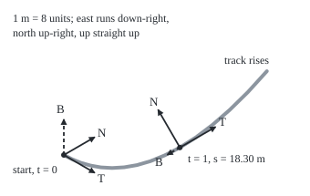
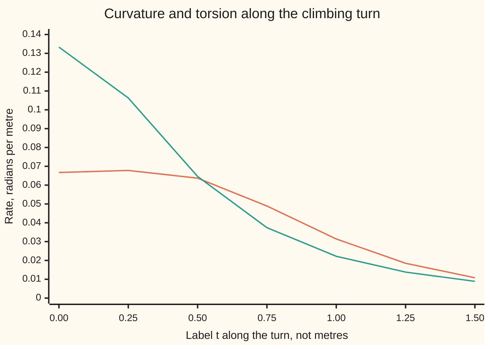

# Frenet-Serret frame: the axes a traveller carries along the curve

[Syllabus](../../../SYLLABUS.md) → [Differential geometry and Lie groups](../README.md) → [Curves](../README.md#s01) → Frenet-Serret frame

---

## General Overview

A camera rig is bolted to the front of a rollercoaster car. At the start of this section the track heads due east, level, then swings left towards the north and starts to climb. In metres east, north and up, its centre line is $`r(t) = 15\,(t,\ t^2/2,\ t^3/3)`$, where $`t`$ is a label running from 0 to 1.5 along the section.

At $`t = 1`$ the car is 15 m east, 7.5 m north and 5 m up. It has covered 18.30 m of rail.

The rig needs three directions at every point of the track:

- **forward**, along the rail;
- **inward**, towards the inside of the turn;
- **the third axis**, square to both.

The rig sits on a motorised mount that keeps it lined up with these three axes. A camera fixed straight to the car would also tilt with the track's banking (the sideways slope built into the rails), which these axes ignore.

As the car runs, these axes swing round with it. A gyroscope on the rig measures how fast, and the camera's stabiliser must cancel exactly that motion.

At $`t = 1`$ the forward axis climbs at 35.26°. The inward axis points west and up, along (−0.7071, 0, 0.7071). At 15 m/s the rig turns at 0.5774 radians a second, which is 33.08° a second. That spin has two parts at right angles: a swing of 27.01°/s about the third axis and a roll of 19.10°/s about the forward axis. About the inward axis the rig does not turn at all.

That zero holds on every curve, at every point. It is why two numbers describe how any path bends and twists.

**At each point of a space curve, the direction of travel, the direction it turns towards and the arrow square to both make a frame, and as the frame rides along it turns at only two rates: the curvature κ and the torsion τ.**

**What kind of fact this is:** the frame is a definition; the Frenet-Serret equations, which say its rates of change involve only κ and τ, are a theorem, proved on this card in Why it works. Both are local: they hold on any stretch where the curve has three continuous derivatives and its curvature is not zero.

### The picture: the rig's axes at two places on the turn

<p align="center"></p>

An orthographic view (parallel lines of sight, no perspective) from above the south-east, looking along (−1, 1, −1). Scale 1 m = 8 units; each axis is 6 m long. At the start the axes are east, north and up. At $`t = 1`$ the dashed third axis B looks short because it points mostly towards the viewer.

---

## The formula

Notation first, in words. These come from earlier cards on this shelf:

- $`s`$ is **arc length**: metres of rail from the start ([Regular curve and arc length](01-regular-curves-and-arc-length.md)).
- A prime means "rate of change per metre of rail": $`T' = dT/ds`$. Rates per unit of the label $`t`$ are always written $`d/dt`$ in full.
- $`T = r'`$ is the **unit tangent**: the forward axis, of length 1 because $`s`$ counts metres of rail.
- $`\kappa = \lvert T'\rvert`$ is the **curvature**: how fast the forward axis turns, in radians per metre ([Curvature](02-curvature-of-plane-curves.md)). On a flat curve κ has a sign, positive turning left. In space there is no "left", so κ is a size, never negative, and N carries the direction.
- $`N = T'/\kappa`$ is the **principal normal**: the inward axis, the unit arrow in the direction the forward axis is turning.

This card adds two things. The **binormal** is the third axis, made with the [Cross product](../../05-Geometry%20and%20trig/05-Vectors%20in%20Space/01-cross-product-and-oriented-area.md):

```math
B = T \times N
```

The three unit arrows T, N, B, each square to the other two, are the **Frenet-Serret frame**. How they change along the rail is the **Frenet-Serret equations**:

```math
T' = \kappa N, \qquad N' = -\kappa T + \tau B, \qquad B' = -\tau N
```

**Read it aloud:** the forward axis turns towards the inward axis at rate κ; the inward axis turns back towards the forward axis at κ and towards the third axis at τ; the third axis turns back towards the inward axis at τ.

The new number $`\tau`$ is the **torsion**: how fast the curve twists out of its plane of turning, in radians per metre. The third equation defines it: $`\tau = -B' \cdot N`$. On a flat curve B never moves, so τ is 0. Positive τ means the curve leaves its plane of turning on the B side as it goes forward, the way a right-handed screw advances. The [Torsion](05-torsion-and-the-helix.md) card studies it in full.

The same three equations fit one rule. Put the **spin vector** $`\omega = \tau T + \kappa B`$; then each axis changes by $`\omega`$ crossed with itself:

```math
T' = \omega \times T, \qquad N' = \omega \times N, \qquad B' = \omega \times B
```

**Read it aloud:** per metre of rail, the frame turns as one rigid body about the axis $`\omega`$, by τ about the forward axis and κ about the third axis, and never about the inward axis.

A car moving at speed $`V`$ covers $`V`$ metres a second, so the rig's spin in radians per second is $`V\omega`$, and its size is $`V\sqrt{\kappa^2 + \tau^2}`$.

| Symbol | Plain meaning | In our example | Push it up and the answer… |
| --- | --- | --- | --- |
| $`r(t)`$, with $`L = 15`$ m | the track's centre line, $`L\,(t,\ t^2/2,\ t^3/3)`$, in metres east, north, up | (15, 7.5, 5) m at $`t = 1`$ | a bigger $`L`$ scales the track up and κ, τ down |
| $`t`$ | the label along the track, not time and not metres | 1 at the worked point | a later point on the turn |
| $`s`$, and a prime $`'`$ | arc length: metres of rail from the start; a prime is a rate per metre, $`d/ds`$ | 18.30 m at $`t = 1`$ | — |
| $`ds/dt`$ | metres of rail per unit of label | 25.9808 m at $`t = 1`$ | each $`d/dt`$ is divided by more to give $`d/ds`$ |
| $`w`$ | an arrow along T or B before it is scaled to length 1 | (1, 1, 1) for T, (1, −2, 1) for B | — |
| $`T`$ | unit tangent: the forward axis | (0.5774, 0.5774, 0.5774) | — |
| $`\kappa`$ | curvature: turning rate of T, 1/m | 0.0314 /m, radius 31.82 m | tighter turn, bigger push towards N |
| $`N`$ | principal normal: the inward axis | (−0.7071, 0, 0.7071) | — |
| $`B`$ | binormal $`T \times N`$: the third axis | (0.4082, −0.8165, 0.4082) | — |
| $`\tau`$ | torsion: twisting rate out of the plane of T and N, 1/m | 0.0222 /m | faster roll about T |
| $`V`$ | the car's speed | 15 m/s | every spin rate grows in step |
| $`\omega`$ | spin vector $`\tau T + \kappa B`$, radians per metre | size 0.5774 rad/s ÷ 15 m/s | the frame turns faster per metre |

### When it holds

- **Curvature not zero.** On a straight stretch $`T' = 0`$ and N has no direction. On a level S-bend that swerves $`x^3/450`$ metres sideways at $`x`$ metres along, N flips by 180.00° between $`x = -1`$ m and $`x = +1`$ m.
- **Three continuous derivatives.** N needs the second derivative and τ the third. Where a straight rail meets a circular arc, κ jumps from 0 to a value, and N appears suddenly.
- **A regular curve.** The speed $`ds/dt`$ must never be 0, or arc length cannot relabel the curve. The cusp of $`(t^2, t^3)`$ is the example on [Regular curve and arc length](01-regular-curves-and-arc-length.md).
- **Rates per metre, not per label.** Every $`d/dt`$ must be divided by $`ds/dt`$, or κ comes out 0.8165 instead of 0.0314 /m.

---

## Why it works

### Step 0: a frame can only rotate, and one of its three rotations is ruled out

Three unit arrows, each square to the others, cannot stretch or shear as they move: they can only rotate together. A rotation in three dimensions has three rates, one for each pair of axes.

The definition of N removes one. T turns towards N and towards nothing else, so T never leans towards B. Two rates are left. One is κ. The other is the new number, τ.

### Step 1: build the three axes

T has length 1 at every point. Differentiate $`T \cdot T = 1`$ and get $`2\,T \cdot T' = 0`$: the turning $`T'`$ is square to T. So $`N = T'/\kappa`$ is a unit arrow square to T.

The cross product of two unit arrows that are square to each other is a unit arrow square to both. So $`B = T \times N`$ completes the frame, and T, N, B is right-handed in the same order as east, north, up.

### Step 2: the rates come in matching pairs

Any two axes keep a fixed dot product: 1 with itself, 0 with each other. Differentiate one such fixed dot product, $`N \cdot B = 0`$:

```math
N' \cdot B + N \cdot B' = 0
```

So the rate at which N leans towards B is minus the rate at which B leans towards N. The same holds for every pair, and each axis has rate 0 towards itself. Of the nine rates "axis i leans towards axis j", only three are free.

### Step 3: fill in the three free rates

Read off each axis's rate towards the other two:

- $`T' \cdot N = \kappa`$ and $`T' \cdot B = 0`$, by the definitions of κ and N.
- $`N' \cdot B`$ has no definition yet. Name it τ.
- Step 2 gives the rest: $`N' \cdot T = -\kappa`$, $`B' \cdot T = 0`$, $`B' \cdot N = -\tau`$.

Each axis's rate of change is the sum of its parts along T, N and B, and those parts are exactly these rates. That gives the three equations in The formula.

<details>
<summary>Detailed proof: the Frenet-Serret equations from the fixed dot products</summary>

Any arrow $`X`$ splits along the frame as

$`\displaystyle X = (X \cdot T)\,T + (X \cdot N)\,N + (X \cdot B)\,B`$

because T, N, B are unit arrows, each square to the others.

Take $`X = T'`$. By definition $`T' = \kappa N`$, so $`T' \cdot T = 0`$, $`T' \cdot N = \kappa`$ and $`T' \cdot B = 0`$.

Take $`X = N'`$. From $`N \cdot N = 1`$, $`N' \cdot N = 0`$. From $`T \cdot N = 0`$, $`N' \cdot T = -T' \cdot N = -\kappa`$. Define $`\tau = N' \cdot B`$. So

$`\displaystyle N' = -\kappa\,T + \tau\,B`$

Take $`X = B'`$. From $`B \cdot B = 1`$, $`B' \cdot B = 0`$. From $`T \cdot B = 0`$, $`B' \cdot T = -T' \cdot B = 0`$. From $`N \cdot B = 0`$, $`B' \cdot N = -N' \cdot B = -\tau`$. So

$`\displaystyle B' = -\tau\,N`$

The spin vector form follows from the cross products of a right-handed frame: $`B \times T = N`$, $`T \times N = B`$, $`N \times B = T`$. With $`\omega = \tau T + \kappa B`$, $`\omega \times T = \kappa\,B \times T = \kappa N`$, and the other two come out the same way.

</details>

### Step 4: work on a track labelled by t, not by metres

The track is labelled by $`t`$, not by arc length. The chain rule converts: a rate per metre is a rate per unit $`t`$ divided by metres per unit $`t`$.

```math
T' = \frac{dT/dt}{ds/dt}
```

**Read it aloud:** to find how fast T turns per metre, find how fast it turns per unit of label, then divide by the metres of rail in one unit of label.

Here $`dr/dt = 15\,(1, t, t^2)`$, so $`ds/dt = 15\sqrt{1 + t^2 + t^4}`$, and T is $`(1, t, t^2)`$ scaled to length 1.

T is a unit arrow made from an arrow $`w`$, here $`(1, t, t^2)`$. Its rate per unit $`t`$ is the part of $`dw/dt`$ square to $`w`$, divided by the length of $`w`$:

```math
\frac{d}{dt}\,\frac{w}{\lvert w\rvert} = \frac{\lvert w\rvert^2\,\dfrac{dw}{dt} - (w \cdot \dfrac{dw}{dt})\,w}{\lvert w\rvert^3}
```

**Read it aloud:** remove from the change of $`w`$ its part along $`w`$, which only alters the length, and divide by the length cubed.

The same rule, applied to B with $`w = (t^2, -2t, 1)`$ from Step 5, gives $`B'`$ and so τ.

### Step 5: where B points, without finding N first

By Step 4, $`dT/dt`$ is built from $`d^2r/dt^2`$ and $`dr/dt`$, so N lies in their plane. B is square to that plane, so it lies along their cross product:

```math
\frac{dr}{dt} \times \frac{d^2 r}{dt^2} = 15^2\,(t^2,\ -2t,\ 1)
```

At $`t = 1`$ that is a multiple of $`(1, -2, 1)`$, the B of the worked numbers. [Curvature and torsion at any speed](06-curvature-and-torsion-from-any-parametrisation.md) turns this into formulas for κ and τ.

### Step 6: the equations rebuild the frame

Start at $`t = 0`$, where the axes are east, north and up. Feed κ and τ into the three equations and step them forward with RK4, the classical fourth-order stepping method of the differential-equations wing. The frame they carry to $`t = 1`$ matches the frame built directly to within 8.6e-11, and integrating T rebuilds the position (15, 7.5, 5) m.

So κ and τ along the rail, plus a starting frame, fix the whole frame and the whole track. [Fundamental theorem of curves](07-fundamental-theorem-of-curves.md) proves that in general.

---

## Worked numbers, by hand

The rig at $`t = 1`$, with the car at 15 m/s.

| Step | Arithmetic | Value |
| --- | --- | --- |
| position | 15 × (1, 1/2, 1/3) | (15, 7.5, 5) m |
| metres per unit $`t`$ | $`15\sqrt{1 + 1 + 1}`$ | 25.9808 m |
| forward axis T | (1, 1, 1) ÷ √3 | (0.5774, 0.5774, 0.5774), climbing 35.26° |
| $`dT/dt`$ | w = (1, 1, 1), dw/dt = (0, 1, 2): [3 × (0, 1, 2) − 3 × (1, 1, 1)] ÷ 3√3 | (−0.5774, 0, 0.5774) |
| $`T'`$ | divide by 25.9808 | (−0.0222, 0, 0.0222) per m |
| curvature κ | length of T′ = √2 ÷ 45 | 0.0314 /m, radius 31.82 m |
| inward axis N | T′ ÷ κ | (−0.7071, 0, 0.7071) |
| third axis B | T × N = (1, −2, 1) ÷ √6 | (0.4082, −0.8165, 0.4082) |
| $`dB/dt`$ | w = (1, −2, 1), dw/dt = (2, −2, 0): [6 × (2, −2, 0) − 6 × (1, −2, 1)] ÷ 6√6 | (0.4082, 0, −0.4082) |
| $`B'`$ | divide by 25.9808 | (0.0157, 0, −0.0157) per m |
| torsion τ | −B′ · N = 1 ÷ 45 | **0.0222 /m** |
| $`N'`$ | −κT + τB | (−0.00907, −0.03629, −0.00907) per m |
| roll about T | τ × 15 | 0.3333 rad/s = 19.10°/s |
| swing about B | κ × 15 | 0.4714 rad/s = 27.01°/s |
| total spin | $`15\sqrt{\kappa^2 + \tau^2}`$ | **0.5774 rad/s = 33.08°/s** |
| push towards N | κ × 15² | 7.0711 m/s² |

At this point the rig turns at 33.08° a second about an axis between its forward and third axes, while the car is pushed towards the inside of the turn at 7.0711 m/s².

### The two rates along the whole turn

The same steps at any $`t`$ give $`\kappa = \sqrt{t^4 + 4t^2 + 1}\,/\,\big(15\,(1 + t^2 + t^4)^{3/2}\big)`$ and $`\tau = 2/\big(15\,(t^4 + 4t^2 + 1)\big)`$, in 1/m.



The orange line is the curvature κ. The green line is the torsion τ. The points are evenly spaced in the label $`t`$, not in metres of rail: they sit at $`s`$ = 0, 3.79, 7.84, 12.52, 18.30, 25.69 and 35.25 m, so the later gaps are longer on the track than they look here. The twist is strongest at the entry, where the level track first starts to rise out of its plane, and both rates fade as the climb straightens.

### What breaks if you drop a piece

| Mistake | Comes out at | What went wrong |
| --- | --- | --- |
| N taken along $`d^2r/dt^2`$ | (0, 0.4472, 0.8944): 50.77° off N, dot with T 0.7746 | that arrow also holds the change of speed along T |
| κ taken as the length of $`dT/dt`$ | 0.8165, a radius of 1.22 m instead of 31.82 m | a rate per unit label, not per metre |
| B taken as N × T | (−0.4082, 0.8165, −0.4082); τ = −0.0222 /m | left-handed frame: the twist reads backwards |
| N′ written as τB alone | after the ride T · N = 0.8548, T off by 11.11° | the frame stops being square; it collapses |
| N on the level S-bend, $`x^3/450`$ m sideways | 180.00° flip between $`x = -1`$ m and $`x = +1`$ m | κ = 0 at $`x = 0`$, so N is undefined there |

The code prints all five.

---

## Code, from first principles, and it actually runs

Only square root, arccosine and degrees are imported. The frame is built three ways:

1. **Exact derivatives in t**, turned into rates per metre by the chain rule, as in the worked numbers.
2. **Arc length first.** Simpson's rule (adding up $`ds/dt`$ at closely spaced labels, weighted 1, 4, 2, 4, …, 4, 1) measures metres of rail. Newton's method (correcting a guess of $`t`$ by its error in metres divided by $`ds/dt`$, until the correction vanishes) finds the point at a given metre. Finite differences (slopes between points a fixed step apart) in metres, with steps of 0.4 m and 0.2 m, then give T, κ, N, B and τ. Halving the step must cut the error by about four.
3. **The equations themselves.** RK4 carries the starting frame along with Road 1's κ and τ, and must land on Road 1's frame and on the track.

The code also prints the spin rates, the chart points, every mistake and the figure's coordinates.

### Python

```python
# Frenet-Serret frame -- the check behind the card.  Standard library only.
# A camera rig rides a climbing left turn r(t) = L(t, t^2/2, t^3/3), L = 15 m,
# in metres east, north, up.  Its axes T, N, B come by three roads that share
# no step: exact t-derivatives turned into s-derivatives by the chain rule;
# finite differences after relabelling the track by arc length; and the
# Frenet-Serret equations stepped by RK4 from the start of the turn.
from math import sqrt, acos, degrees

L, V = 15.0, 15.0                      # track scale (m); train speed (m/s)

def add(a, b, k=1.0): return tuple(a[i] + k * b[i] for i in range(3))
def mul(a, k): return tuple(k * x for x in a)
def dot(a, b): return a[0] * b[0] + a[1] * b[1] + a[2] * b[2]
def cross(a, b): return (a[1]*b[2] - a[2]*b[1], a[2]*b[0] - a[0]*b[2], a[0]*b[1] - a[1]*b[0])
def size(a): return sqrt(dot(a, a))
def unit(a): return mul(a, 1 / size(a))
def f(x, d=4): return f"{(0.0 if abs(x) < 0.5 * 10 ** -d else x):.{d}f}"
def vec(a, d=4): return "(" + ", ".join(f(x, d) for x in a) + ")"
def ang(a, b): return degrees(acos(max(-1.0, min(1.0, dot(unit(a), unit(b))))))
def dunit(w, wp):                      # d/dt of w/|w|, for w(t) with derivative wp
    return mul(add(mul(wp, dot(w, w)), w, -dot(w, wp)), size(w) ** -3)

def r(t): return (L * t, L * t * t / 2, L * t ** 3 / 3)
def speed(t): return L * sqrt(1 + t * t + t ** 4)      # ds/dt: metres of track per unit t

def exact(t):                          # road 1: r' = L(1, t, t^2), r'' = L(0, 1, 2t)
    T, B = unit((1, t, t * t)), unit((t * t, -2 * t, 1))   # B lies along r' x r''
    q = t ** 4 + 4 * t * t + 1
    return T, cross(B, T), B, sqrt(q) / (L * (1 + t * t + t ** 4) ** 1.5), 2 / (L * q)

def arc(t, n=2000):                    # s(t), metres from the start, by Simpson's rule
    h, total = t / n, speed(0) + speed(t)
    for i in range(1, n):
        total += (4 if i % 2 else 2) * speed(i * h)
    return h / 3 * total

def p(s):                              # the track relabelled by arc length: Newton on s(t) = s
    t = s / L
    for _ in range(40):
        step = (arc(t) - s) / speed(t)
        t -= step
        if abs(step) < 1e-14: break
    return r(t)

def fd_frame(s, h):                    # road 2: differences in s alone
    a, b, c = p(s - h), p(s), p(s + h)
    T, Tp = unit(mul(add(c, a, -1), 0.5 / h)), mul(add(add(c, b, -2), a), h ** -2)
    N = unit(Tp)
    return T, N, cross(T, N), size(Tp)

def fd_all(s, h):
    T, N, B, k = fd_frame(s, h)
    m, pl = fd_frame(s - h, h), fd_frame(s + h, h)
    Bp, Np = mul(add(pl[2], m[2], -1), 0.5 / h), mul(add(pl[1], m[1], -1), 0.5 / h)
    return T, N, B, k, -dot(Bp, N), Np

def ride(t1, n=200, keep=1.0):         # road 3: RK4 on the Frenet-Serret equations, in t
    def rhs(t, y):
        _, T, N, B = y
        _, _, _, k, tau = exact(t)
        v = speed(t)                   # d/dt = (ds/dt) d/ds
        return (mul(T, v), mul(N, v * k), mul(add(mul(T, -k * keep), B, tau), v), mul(N, -tau * v))
    def nudge(y, d, c): return tuple(add(y[j], d[j], c) for j in range(4))
    y, h = ((0.0, 0.0, 0.0),) + exact(0)[:3], t1 / n
    for i in range(n):
        t = i * h
        k1 = rhs(t, y); k2 = rhs(t + h / 2, nudge(y, k1, h / 2))
        k3 = rhs(t + h / 2, nudge(y, k2, h / 2)); k4 = rhs(t + h, nudge(y, k3, h))
        y = nudge(nudge(nudge(nudge(y, k1, h / 6), k2, h / 3), k3, h / 3), k4, h / 6)
    return y

t1 = 1.0
T, N, B, k, tau = exact(t1)
s1, v1 = arc(t1), speed(t1)
dTdt, dBdt = dunit((1, t1, t1 * t1), (0, 1, 2 * t1)), dunit((t1 * t1, -2 * t1, 1), (2 * t1, -2, 0))
Tp, Bp = mul(dTdt, 1 / v1), mul(dBdt, 1 / v1)
Np = add(mul(T, -k), B, tau)
print(f"hand point t = 1: position {vec(r(t1))} m, ds/dt = {f(v1)} m, arc length from the start s = {f(s1)} m")
print(f"T = {vec(T)}, climbing at {f(ang(T, (T[0], T[1], 0)), 2)} degrees")
print(f"dT/dt = {vec(dTdt)}; T' = dT/ds = {vec(Tp)} per m")
print(f"kappa = |T'| = {f(size(Tp))} /m, radius 1/kappa = {f(1 / size(Tp), 2)} m; N = {vec(N)}")
print(f"B = T x N = {vec(B)}")
print(f"dB/dt = {vec(dBdt)}; B' = {vec(Bp)} per m; tau = -B'.N = {f(-dot(Bp, N))} /m")
print(f"closed forms: kappa = sqrt(2)/45 = {f(k, 6)} /m, tau = 1/45 = {f(tau, 6)} /m")
print(f"N' = -kappa T + tau B = {vec(Np, 5)} per m")
print(f"frame checks: T.N {f(dot(T, N))}, T.B {f(dot(T, B))}, N.B {f(dot(N, B))}, lengths {f(size(T))} {f(size(N))} {f(size(B))}")
errs = []
for h in (0.4, 0.2):
    T2, N2, B2, k2, tau2, Np2 = fd_all(s1, h)
    errs.append((abs(k2 - k), abs(tau2 - tau), size(add(Np2, Np, -1))))
    print(f"road 2, arc-length differences, step {h} m: kappa {f(k2, 6)}, tau {f(tau2, 6)}, N' {vec(Np2, 5)}")
    print(f"  errors: kappa {errs[-1][0]:.2e}, tau {errs[-1][1]:.2e}, N' {errs[-1][2]:.2e}; T off by {ang(T2, T):.1e} degrees")
print(f"halving the step cuts the errors by {f(errs[0][0] / errs[1][0], 2)}, {f(errs[0][1] / errs[1][1], 2)} and {f(errs[0][2] / errs[1][2], 2)}")
P3, T3, N3, B3 = ride(t1)
gap = max(size(add(T3, T, -1)), size(add(N3, N, -1)), size(add(B3, B, -1)))
print(f"road 3, RK4 from the start frame, 200 steps: T {vec(T3)}, N {vec(N3)}, B {vec(B3)}")
print(f"  frame misses road 1 by {gap:.1e}; position {vec(P3)} m misses r(1) by {size(add(P3, r(t1), -1)):.1e} m")
print(f"rig at {f(V, 1)} m/s: roll about T {f(tau * V)} rad/s = {f(degrees(tau * V), 2)} deg/s; "
      f"about N 0; about B {f(k * V)} rad/s = {f(degrees(k * V), 2)} deg/s")
spin = V * sqrt(k * k + tau * tau)
print(f"rig total spin V sqrt(kappa^2 + tau^2) = {f(spin)} rad/s = {f(degrees(spin), 2)} deg/s"
      f"; push toward N, kappa V^2 = {f(k * V * V)} m/s^2")
for tc in (0.0, 0.25, 0.5, 0.75, 1.0, 1.25, 1.5):
    e = exact(tc)
    print(f"chart, t {f(tc, 2)}: s {f(arc(tc), 2)} m, kappa {f(e[3])} /m, tau {f(e[4])} /m")
bad = unit((0, 1, 2 * t1))
print(f"mistake 1, N along r'': {vec(bad)}; dot with T {f(dot(bad, T))}, {f(ang(bad, N), 2)} degrees off N")
print(f"mistake 2, |dT/dt| as kappa: {f(size(dTdt))}, radius {f(1 / size(dTdt), 2)} m instead of {f(1 / k, 2)} m")
bflip = cross(N, T)
print(f"mistake 3, B = N x T: {vec(bflip)}; tau = -B'.N comes out {f(dot(Bp, N))} /m")
P4, T4, N4, B4 = ride(t1, keep=0.0)
print(f"mistake 4, N' without -kappa T: at t = 1, T.N = {f(dot(T4, N4))}, T off by {f(ang(T4, T), 2)} degrees")
c = 1 / 450                            # S-bend y = c x^3: kappa is 0 at x = 0
def sN(x): return unit(dunit((1, 3 * c * x * x, 0), (0, 6 * c * x, 0)))   # N = unit dT/dx
Nm, Npl = sN(-1.0), sN(1.0)
print(f"S-bend y = x^3/450: N at x = -1 m {vec(Nm)}, at x = +1 m {vec(Npl)}, {f(ang(Nm, Npl), 2)} degrees apart")
o = lambda q: (70 + 8 * (q[0] + q[1]) / sqrt(2), 170 - 8 * (-q[0] + q[1] + 2 * q[2]) / sqrt(6))
print("figure, track:", " ".join(f"{o(r(i / 10))[0]:.1f},{o(r(i / 10))[1]:.1f}" for i in range(16)))
for tf in (0.0, 1.0):
    e, base = exact(tf), o(r(tf))
    tips = [o(add(r(tf), e[j], 6.0)) for j in range(3)]
    print(f"figure, frame at t {f(tf, 1)}: base {base[0]:.1f},{base[1]:.1f}; T N B tips "
          + " ".join(f"{x:.1f},{y:.1f}" for x, y in tips))
assert abs(k - sqrt(2) / 45) < 1e-12 and abs(tau - 1 / 45) < 1e-12         # hand values
assert abs(size(Tp) - k) < 1e-12 and abs(-dot(Bp, N) - tau) < 1e-12        # chain rule = closed form
assert errs[1][0] < 1e-5 and errs[1][1] < 1e-5 and errs[1][2] < 1e-5       # road 2 agrees
assert all(3.5 < errs[0][j] / errs[1][j] < 4.5 for j in range(3))           # error falls as h^2
assert gap < 1e-8 and size(add(P3, r(t1), -1)) < 1e-6                     # road 3 agrees
assert abs(dot(T4, N4)) > 0.01 and ang(Nm, Npl) > 179.9                    # the failures show
print("ALL CHECKS PASS")
```

**Ran 2026-11-19 on macOS, Python 3.14.10, standard library only. All checks passed. Output, pasted from the run:**

```
hand point t = 1: position (15.0000, 7.5000, 5.0000) m, ds/dt = 25.9808 m, arc length from the start s = 18.2962 m
T = (0.5774, 0.5774, 0.5774), climbing at 35.26 degrees
dT/dt = (-0.5774, 0.0000, 0.5774); T' = dT/ds = (-0.0222, 0.0000, 0.0222) per m
kappa = |T'| = 0.0314 /m, radius 1/kappa = 31.82 m; N = (-0.7071, 0.0000, 0.7071)
B = T x N = (0.4082, -0.8165, 0.4082)
dB/dt = (0.4082, 0.0000, -0.4082); B' = (0.0157, 0.0000, -0.0157) per m; tau = -B'.N = 0.0222 /m
closed forms: kappa = sqrt(2)/45 = 0.031427 /m, tau = 1/45 = 0.022222 /m
N' = -kappa T + tau B = (-0.00907, -0.03629, -0.00907) per m
frame checks: T.N 0.0000, T.B 0.0000, N.B 0.0000, lengths 1.0000 1.0000 1.0000
road 2, arc-length differences, step 0.4 m: kappa 0.031429, tau 0.022235, N' (-0.00908, -0.03631, -0.00907)
  errors: kappa 2.28e-06, tau 1.26e-05, N' 2.25e-05; T off by 3.8e-03 degrees
road 2, arc-length differences, step 0.2 m: kappa 0.031428, tau 0.022225, N' (-0.00908, -0.03629, -0.00907)
  errors: kappa 5.69e-07, tau 3.15e-06, N' 5.63e-06; T off by 9.6e-04 degrees
halving the step cuts the errors by 4.00, 4.00 and 4.00
road 3, RK4 from the start frame, 200 steps: T (0.5774, 0.5774, 0.5774), N (-0.7071, 0.0000, 0.7071), B (0.4082, -0.8165, 0.4082)
  frame misses road 1 by 8.6e-11; position (15.0000, 7.5000, 5.0000) m misses r(1) by 9.3e-10 m
rig at 15.0 m/s: roll about T 0.3333 rad/s = 19.10 deg/s; about N 0; about B 0.4714 rad/s = 27.01 deg/s
rig total spin V sqrt(kappa^2 + tau^2) = 0.5774 rad/s = 33.08 deg/s; push toward N, kappa V^2 = 7.0711 m/s^2
chart, t 0.00: s 0.00 m, kappa 0.0667 /m, tau 0.1333 /m
chart, t 0.25: s 3.79 m, kappa 0.0678 /m, tau 0.1063 /m
chart, t 0.50: s 7.84 m, kappa 0.0637 /m, tau 0.0646 /m
chart, t 0.75: s 12.52 m, kappa 0.0489 /m, tau 0.0374 /m
chart, t 1.00: s 18.30 m, kappa 0.0314 /m, tau 0.0222 /m
chart, t 1.25: s 25.69 m, kappa 0.0185 /m, tau 0.0138 /m
chart, t 1.50: s 35.25 m, kappa 0.0108 /m, tau 0.0089 /m
mistake 1, N along r'': (0.0000, 0.4472, 0.8944); dot with T 0.7746, 50.77 degrees off N
mistake 2, |dT/dt| as kappa: 0.8165, radius 1.22 m instead of 31.82 m
mistake 3, B = N x T: (-0.4082, 0.8165, -0.4082); tau = -B'.N comes out -0.0222 /m
mistake 4, N' without -kappa T: at t = 1, T.N = 0.8548, T off by 11.11 degrees
S-bend y = x^3/450: N at x = -1 m (0.0067, -1.0000, 0.0000), at x = +1 m (-0.0067, 1.0000, 0.0000), 180.00 degrees apart
figure, track: 70.0,170.0 78.9,174.6 88.7,178.6 99.3,181.6 110.7,183.6 123.0,184.3 136.2,183.5 150.2,181.1 165.0,176.8 180.7,170.4 197.3,161.8 214.7,150.8 232.9,137.1 252.0,120.5 271.9,101.0 292.7,78.1
figure, frame at t 0.0: base 70.0,170.0; T N B tips 103.9,189.6 103.9,150.4 70.0,130.8
figure, frame at t 1.0: base 197.3,161.8; T N B tips 236.5,139.2 173.3,120.3 183.4,169.8
ALL CHECKS PASS
```

### Rust

Same numbers, same labels, built with `rustc --edition 2021 -O`. Python's two-digit exponent format is written out by hand.

```rust
// Frenet-Serret frame -- the same check as the Python, in Rust.  No crates.
// A camera rig rides a climbing left turn r(t) = L(t, t^2/2, t^3/3), L = 15 m,
// in metres east, north, up.  Its axes T, N, B come by three roads that share
// no step: exact t-derivatives turned into s-derivatives by the chain rule;
// finite differences after relabelling the track by arc length; and the
// Frenet-Serret equations stepped by RK4 from the start of the turn.
type V3 = [f64; 3];
const L: f64 = 15.0; // track scale (m)
const VEL: f64 = 15.0; // train speed (m/s)

fn add(a: V3, b: V3, k: f64) -> V3 { [a[0] + k * b[0], a[1] + k * b[1], a[2] + k * b[2]] }
fn mul(a: V3, k: f64) -> V3 { [k * a[0], k * a[1], k * a[2]] }
fn dot(a: V3, b: V3) -> f64 { a[0] * b[0] + a[1] * b[1] + a[2] * b[2] }
fn cross(a: V3, b: V3) -> V3 {
    [a[1] * b[2] - a[2] * b[1], a[2] * b[0] - a[0] * b[2], a[0] * b[1] - a[1] * b[0]]
}
fn size(a: V3) -> f64 { dot(a, a).sqrt() }
fn unit(a: V3) -> V3 { mul(a, 1.0 / size(a)) }
fn f(x: f64, d: i32) -> String {
    let x = if x.abs() < 0.5 * 10f64.powf(-(d as f64)) { 0.0 } else { x };
    format!("{:.*}", d as usize, x)
}
fn vec(a: V3, d: i32) -> String { format!("({}, {}, {})", f(a[0], d), f(a[1], d), f(a[2], d)) }
fn sci(x: f64, d: usize) -> String { // Python's e-format: two-digit exponent with its sign
    let s = format!("{:.*e}", d, x);
    let (m, e) = s.split_at(s.find('e').unwrap());
    let e: i32 = e[1..].parse().unwrap();
    format!("{}e{}{:02}", m, if e < 0 { "-" } else { "+" }, e.abs())
}
fn ang(a: V3, b: V3) -> f64 { dot(unit(a), unit(b)).min(1.0).max(-1.0).acos().to_degrees() }
fn dunit(w: V3, wp: V3) -> V3 { // d/dt of w/|w|, for w(t) with derivative wp
    mul(add(mul(wp, dot(w, w)), w, -dot(w, wp)), size(w).powf(-3.0))
}
fn r(t: f64) -> V3 { [L * t, L * t * t / 2.0, L * t.powf(3.0) / 3.0] }
fn speed(t: f64) -> f64 { L * (1.0 + t * t + t.powf(4.0)).sqrt() } // ds/dt
fn exact(t: f64) -> (V3, V3, V3, f64, f64) { // road 1: r' = L(1, t, t^2), r'' = L(0, 1, 2t)
    let (tt, b) = (unit([1.0, t, t * t]), unit([t * t, -2.0 * t, 1.0])); // B along r' x r''
    let q = t.powf(4.0) + 4.0 * t * t + 1.0;
    (tt, cross(b, tt), b, q.sqrt() / (L * (1.0 + t * t + t.powf(4.0)).powf(1.5)), 2.0 / (L * q))
}
fn arc(t: f64) -> f64 { // s(t), metres from the start, by Simpson's rule
    let n = 2000;
    let (h, mut total) = (t / n as f64, speed(0.0) + speed(t));
    for i in 1..n {
        total += (if i % 2 == 1 { 4.0 } else { 2.0 }) * speed(i as f64 * h);
    }
    h / 3.0 * total
}
fn p(s: f64) -> V3 { // the track relabelled by arc length: Newton on s(t) = s
    let mut t = s / L;
    for _ in 0..40 {
        let step = (arc(t) - s) / speed(t);
        t -= step;
        if step.abs() < 1e-14 { break; }
    }
    r(t)
}
fn fd_frame(s: f64, h: f64) -> (V3, V3, V3, f64) { // road 2: differences in s alone
    let (a, b, c) = (p(s - h), p(s), p(s + h));
    let (tt, tp) = (unit(mul(add(c, a, -1.0), 0.5 / h)), mul(add(add(c, b, -2.0), a, 1.0), h.powf(-2.0)));
    let n = unit(tp);
    (tt, n, cross(tt, n), size(tp))
}
fn fd_all(s: f64, h: f64) -> (V3, V3, V3, f64, f64, V3) {
    let (tt, n, b, k) = fd_frame(s, h);
    let (m, pl) = (fd_frame(s - h, h), fd_frame(s + h, h));
    let (bp, np) = (mul(add(pl.2, m.2, -1.0), 0.5 / h), mul(add(pl.1, m.1, -1.0), 0.5 / h));
    (tt, n, b, k, -dot(bp, n), np)
}
type Y = [V3; 4];
fn rhs(t: f64, y: &Y, keep: f64) -> Y {
    let (_, _, _, k, tau) = exact(t);
    let v = speed(t); // d/dt = (ds/dt) d/ds
    [mul(y[1], v), mul(y[2], v * k), mul(add(mul(y[1], -k * keep), y[3], tau), v), mul(y[2], -tau * v)]
}
fn nudge(y: &Y, d: &Y, c: f64) -> Y { [add(y[0], d[0], c), add(y[1], d[1], c), add(y[2], d[2], c), add(y[3], d[3], c)] }
fn ride(t1: f64, n: usize, keep: f64) -> Y { // road 3: RK4 on the Frenet-Serret equations, in t
    let e = exact(0.0);
    let (mut y, h): (Y, f64) = ([[0.0, 0.0, 0.0], e.0, e.1, e.2], t1 / n as f64);
    for i in 0..n {
        let t = i as f64 * h;
        let k1 = rhs(t, &y, keep);
        let k2 = rhs(t + h / 2.0, &nudge(&y, &k1, h / 2.0), keep);
        let k3 = rhs(t + h / 2.0, &nudge(&y, &k2, h / 2.0), keep);
        let k4 = rhs(t + h, &nudge(&y, &k3, h), keep);
        y = nudge(&nudge(&nudge(&nudge(&y, &k1, h / 6.0), &k2, h / 3.0), &k3, h / 3.0), &k4, h / 6.0);
    }
    y
}
fn main() {
    let t1 = 1.0;
    let (tt, n, b, k, tau) = exact(t1);
    let (s1, v1) = (arc(t1), speed(t1));
    let (dtdt, dbdt) = (dunit([1.0, t1, t1 * t1], [0.0, 1.0, 2.0 * t1]), dunit([t1 * t1, -2.0 * t1, 1.0], [2.0 * t1, -2.0, 0.0]));
    let (tp, bp) = (mul(dtdt, 1.0 / v1), mul(dbdt, 1.0 / v1));
    let np = add(mul(tt, -k), b, tau);
    println!("hand point t = 1: position {} m, ds/dt = {} m, arc length from the start s = {} m", vec(r(t1), 4), f(v1, 4), f(s1, 4));
    println!("T = {}, climbing at {} degrees", vec(tt, 4), f(ang(tt, [tt[0], tt[1], 0.0]), 2));
    println!("dT/dt = {}; T' = dT/ds = {} per m", vec(dtdt, 4), vec(tp, 4));
    println!("kappa = |T'| = {} /m, radius 1/kappa = {} m; N = {}", f(size(tp), 4), f(1.0 / size(tp), 2), vec(n, 4));
    println!("B = T x N = {}", vec(b, 4));
    println!("dB/dt = {}; B' = {} per m; tau = -B'.N = {} /m", vec(dbdt, 4), vec(bp, 4), f(-dot(bp, n), 4));
    println!("closed forms: kappa = sqrt(2)/45 = {} /m, tau = 1/45 = {} /m", f(k, 6), f(tau, 6));
    println!("N' = -kappa T + tau B = {} per m", vec(np, 5));
    println!("frame checks: T.N {}, T.B {}, N.B {}, lengths {} {} {}", f(dot(tt, n), 4), f(dot(tt, b), 4), f(dot(n, b), 4),
             f(size(tt), 4), f(size(n), 4), f(size(b), 4));
    let mut errs: Vec<[f64; 3]> = Vec::new();
    for h in [0.4, 0.2] {
        let (t2, _n2, _b2, k2, tau2, np2) = fd_all(s1, h);
        errs.push([(k2 - k).abs(), (tau2 - tau).abs(), size(add(np2, np, -1.0))]);
        let e = errs[errs.len() - 1];
        println!("road 2, arc-length differences, step {} m: kappa {}, tau {}, N' {}", h, f(k2, 6), f(tau2, 6), vec(np2, 5));
        println!("  errors: kappa {}, tau {}, N' {}; T off by {} degrees", sci(e[0], 2), sci(e[1], 2), sci(e[2], 2), sci(ang(t2, tt), 1));
    }
    println!("halving the step cuts the errors by {}, {} and {}", f(errs[0][0] / errs[1][0], 2), f(errs[0][1] / errs[1][1], 2), f(errs[0][2] / errs[1][2], 2));
    let y3 = ride(t1, 200, 1.0);
    let gap = size(add(y3[1], tt, -1.0)).max(size(add(y3[2], n, -1.0))).max(size(add(y3[3], b, -1.0)));
    println!("road 3, RK4 from the start frame, 200 steps: T {}, N {}, B {}", vec(y3[1], 4), vec(y3[2], 4), vec(y3[3], 4));
    println!("  frame misses road 1 by {}; position {} m misses r(1) by {} m", sci(gap, 1), vec(y3[0], 4), sci(size(add(y3[0], r(t1), -1.0)), 1));
    println!("rig at {} m/s: roll about T {} rad/s = {} deg/s; about N 0; about B {} rad/s = {} deg/s", f(VEL, 1),
             f(tau * VEL, 4), f((tau * VEL).to_degrees(), 2), f(k * VEL, 4), f((k * VEL).to_degrees(), 2));
    let spin = VEL * (k * k + tau * tau).sqrt();
    println!("rig total spin V sqrt(kappa^2 + tau^2) = {} rad/s = {} deg/s; push toward N, kappa V^2 = {} m/s^2",
             f(spin, 4), f(spin.to_degrees(), 2), f(k * VEL * VEL, 4));
    for tc in [0.0, 0.25, 0.5, 0.75, 1.0, 1.25, 1.5] {
        let e = exact(tc);
        println!("chart, t {}: s {} m, kappa {} /m, tau {} /m", f(tc, 2), f(arc(tc), 2), f(e.3, 4), f(e.4, 4));
    }
    let bad = unit([0.0, 1.0, 2.0 * t1]);
    println!("mistake 1, N along r'': {}; dot with T {}, {} degrees off N", vec(bad, 4), f(dot(bad, tt), 4), f(ang(bad, n), 2));
    println!("mistake 2, |dT/dt| as kappa: {}, radius {} m instead of {} m", f(size(dtdt), 4), f(1.0 / size(dtdt), 2), f(1.0 / k, 2));
    let bflip = cross(n, tt);
    println!("mistake 3, B = N x T: {}; tau = -B'.N comes out {} /m", vec(bflip, 4), f(dot(bp, n), 4));
    let y4 = ride(t1, 200, 0.0);
    println!("mistake 4, N' without -kappa T: at t = 1, T.N = {}, T off by {} degrees", f(dot(y4[1], y4[2]), 4), f(ang(y4[1], tt), 2));
    let c = 1.0 / 450.0; // S-bend y = c x^3: kappa is 0 at x = 0
    let sn = |x: f64| unit(dunit([1.0, 3.0 * c * x * x, 0.0], [0.0, 6.0 * c * x, 0.0])); // N = unit dT/dx
    let (nm, npl) = (sn(-1.0), sn(1.0));
    println!("S-bend y = x^3/450: N at x = -1 m {}, at x = +1 m {}, {} degrees apart", vec(nm, 4), vec(npl, 4), f(ang(nm, npl), 2));
    let o = |q: V3| (70.0 + 8.0 * (q[0] + q[1]) / 2f64.sqrt(), 170.0 - 8.0 * (-q[0] + q[1] + 2.0 * q[2]) / 6f64.sqrt());
    let pts: Vec<String> = (0..16).map(|i| { let z = o(r(i as f64 / 10.0)); format!("{:.1},{:.1}", z.0, z.1) }).collect();
    println!("figure, track: {}", pts.join(" "));
    for tf in [0.0, 1.0] {
        let (e, base) = (exact(tf), o(r(tf)));
        let tips: Vec<String> = [e.0, e.1, e.2].iter().map(|&a| { let z = o(add(r(tf), a, 6.0)); format!("{:.1},{:.1}", z.0, z.1) }).collect();
        println!("figure, frame at t {}: base {:.1},{:.1}; T N B tips {}", f(tf, 1), base.0, base.1, tips.join(" "));
    }
    assert!((k - 2f64.sqrt() / 45.0).abs() < 1e-12 && (tau - 1.0 / 45.0).abs() < 1e-12); // hand values
    assert!((size(tp) - k).abs() < 1e-12 && (-dot(bp, n) - tau).abs() < 1e-12); // chain rule = closed form
    assert!(errs[1][0] < 1e-5 && errs[1][1] < 1e-5 && errs[1][2] < 1e-5); // road 2 agrees
    assert!((0..3).all(|j| 3.5 < errs[0][j] / errs[1][j] && errs[0][j] / errs[1][j] < 4.5)); // error falls as h^2
    assert!(gap < 1e-8 && size(add(y3[0], r(t1), -1.0)) < 1e-6); // road 3 agrees
    assert!(dot(y4[1], y4[2]).abs() > 0.01 && ang(nm, npl) > 179.9); // the failures show
    println!("ALL CHECKS PASS");
}
```

**Ran 2026-11-19 on macOS, rustc 1.98.1, no crates. All checks passed. Output, pasted from the run:**

```
hand point t = 1: position (15.0000, 7.5000, 5.0000) m, ds/dt = 25.9808 m, arc length from the start s = 18.2962 m
T = (0.5774, 0.5774, 0.5774), climbing at 35.26 degrees
dT/dt = (-0.5774, 0.0000, 0.5774); T' = dT/ds = (-0.0222, 0.0000, 0.0222) per m
kappa = |T'| = 0.0314 /m, radius 1/kappa = 31.82 m; N = (-0.7071, 0.0000, 0.7071)
B = T x N = (0.4082, -0.8165, 0.4082)
dB/dt = (0.4082, 0.0000, -0.4082); B' = (0.0157, 0.0000, -0.0157) per m; tau = -B'.N = 0.0222 /m
closed forms: kappa = sqrt(2)/45 = 0.031427 /m, tau = 1/45 = 0.022222 /m
N' = -kappa T + tau B = (-0.00907, -0.03629, -0.00907) per m
frame checks: T.N 0.0000, T.B 0.0000, N.B 0.0000, lengths 1.0000 1.0000 1.0000
road 2, arc-length differences, step 0.4 m: kappa 0.031429, tau 0.022235, N' (-0.00908, -0.03631, -0.00907)
  errors: kappa 2.28e-06, tau 1.26e-05, N' 2.25e-05; T off by 3.8e-03 degrees
road 2, arc-length differences, step 0.2 m: kappa 0.031428, tau 0.022225, N' (-0.00908, -0.03629, -0.00907)
  errors: kappa 5.69e-07, tau 3.15e-06, N' 5.63e-06; T off by 9.6e-04 degrees
halving the step cuts the errors by 4.00, 4.00 and 4.00
road 3, RK4 from the start frame, 200 steps: T (0.5774, 0.5774, 0.5774), N (-0.7071, 0.0000, 0.7071), B (0.4082, -0.8165, 0.4082)
  frame misses road 1 by 8.6e-11; position (15.0000, 7.5000, 5.0000) m misses r(1) by 9.3e-10 m
rig at 15.0 m/s: roll about T 0.3333 rad/s = 19.10 deg/s; about N 0; about B 0.4714 rad/s = 27.01 deg/s
rig total spin V sqrt(kappa^2 + tau^2) = 0.5774 rad/s = 33.08 deg/s; push toward N, kappa V^2 = 7.0711 m/s^2
chart, t 0.00: s 0.00 m, kappa 0.0667 /m, tau 0.1333 /m
chart, t 0.25: s 3.79 m, kappa 0.0678 /m, tau 0.1063 /m
chart, t 0.50: s 7.84 m, kappa 0.0637 /m, tau 0.0646 /m
chart, t 0.75: s 12.52 m, kappa 0.0489 /m, tau 0.0374 /m
chart, t 1.00: s 18.30 m, kappa 0.0314 /m, tau 0.0222 /m
chart, t 1.25: s 25.69 m, kappa 0.0185 /m, tau 0.0138 /m
chart, t 1.50: s 35.25 m, kappa 0.0108 /m, tau 0.0089 /m
mistake 1, N along r'': (0.0000, 0.4472, 0.8944); dot with T 0.7746, 50.77 degrees off N
mistake 2, |dT/dt| as kappa: 0.8165, radius 1.22 m instead of 31.82 m
mistake 3, B = N x T: (-0.4082, 0.8165, -0.4082); tau = -B'.N comes out -0.0222 /m
mistake 4, N' without -kappa T: at t = 1, T.N = 0.8548, T off by 11.11 degrees
S-bend y = x^3/450: N at x = -1 m (0.0067, -1.0000, 0.0000), at x = +1 m (-0.0067, 1.0000, 0.0000), 180.00 degrees apart
figure, track: 70.0,170.0 78.9,174.6 88.7,178.6 99.3,181.6 110.7,183.6 123.0,184.3 136.2,183.5 150.2,181.1 165.0,176.8 180.7,170.4 197.3,161.8 214.7,150.8 232.9,137.1 252.0,120.5 271.9,101.0 292.7,78.1
figure, frame at t 0.0: base 70.0,170.0; T N B tips 103.9,189.6 103.9,150.4 70.0,130.8
figure, frame at t 1.0: base 197.3,161.8; T N B tips 236.5,139.2 173.3,120.3 183.4,169.8
ALL CHECKS PASS
```

The two outputs match line for line.

### Lean

Lean proves the frame and its three equations for every track labelled by metres of rail, and checks the worked sums.

- Take any stretch of track, without its end points, with three continuous derivatives, labelled by metres of rail and with curvature not zero. Then T, N and B are unit arrows, each square to the other two, and κ is positive.
- Take the same stretch. Then the frame is right-handed: $`N \times B = T`$ and $`B \times T = N`$.
- Take the same stretch, with $`\tau = -B' \cdot N`$. Then $`T' = \kappa N`$, $`N' = -\kappa T + \tau B`$ and $`B' = -\tau N`$.
- Take the same stretch, with the spin vector $`\omega = \tau T + \kappa B`$. Then $`T' = \omega \times T`$, $`N' = \omega \times N`$ and $`B' = \omega \times B`$.
- At $`t = 1`$, Lean checks the position (15, 7.5, 5) m and B along (1, −2, 1), square to T and N.
- It also checks $`\kappa^2 = 2/2025`$ and $`\tau = 1/45`$ /m, and the rig's spin and push at 15 m/s.

The numbers along the whole turn, the arc-length differences and the RK4 ride are left to the Python and Rust checks.

```lean
-- Frenet-Serret frame: on any open stretch of a unit-speed space curve with three continuous derivatives and nonzero curvature, the frame T, N, B = T × N is orthonormal and turns only at the rates κ and τ, by T' = κN, N' = −κT + τB, B' = −τN, which is the spin ω = τT + κB crossed with each axis.
import Mathlib.LinearAlgebra.CrossProduct
import Mathlib.Analysis.Calculus.Deriv.Basic
import Mathlib.Analysis.Calculus.ContDiff.Basic
import Mathlib.Analysis.SpecialFunctions.Sqrt
import Mathlib.Data.Fin.VecNotation
import Mathlib.Tactic.NormNum
import Mathlib.Analysis.Calculus.ContDiff.Deriv
import Mathlib.Analysis.Calculus.Deriv.Prod
import Mathlib.Analysis.Calculus.Deriv.Mul
import Mathlib.Analysis.Calculus.Deriv.Add
import Mathlib.Analysis.Calculus.Deriv.Inv
import Mathlib.LinearAlgebra.Matrix.DotProduct

/-! A point or arrow in space is a list of three real numbers, `v : Fin 3 → ℝ`, and
`![a, b, c]` is the arrow `(a, b, c)`. Mathlib's `u ⨯₃ v` (`crossProduct`) is the cross
product and `u ⬝ᵥ v` the dot product. The track is `r : ℝ → (Fin 3 → ℝ)`, labelled by `s`,
the metres of rail, on an open stretch `I`. Labelling by metres means unit speed:
`r' · r' = 1`, which also makes the curve regular. Then `T = r'` is the forward axis,
`κ = |T'|` the curvature, `N = T'/κ` the inward axis, `B = T × N` the third axis and
`τ = −B' · N` the torsion, exactly as the card defines them. Curvature not zero is
`T' = r'' ≠ 0`. -/

open Matrix

/-- A product rule for the dot product of two moving arrows. -/
lemma fs_hasDerivAt_dot {f g : ℝ → Fin 3 → ℝ} {f' g' : Fin 3 → ℝ} {s : ℝ}
    (hf : HasDerivAt f f' s) (hg : HasDerivAt g g' s) :
    HasDerivAt (fun t => f t ⬝ᵥ g t) (f' ⬝ᵥ g s + f s ⬝ᵥ g') s := by
  rw [hasDerivAt_pi] at hf hg
  have h : HasDerivAt (fun t => f t 0 * g t 0 + f t 1 * g t 1 + f t 2 * g t 2)
      ((f' 0 * g s 0 + f s 0 * g' 0) + (f' 1 * g s 1 + f s 1 * g' 1)
        + (f' 2 * g s 2 + f s 2 * g' 2)) s :=
    HasDerivAt.add (HasDerivAt.add (HasDerivAt.fun_mul (hf 0) (hg 0))
      (HasDerivAt.fun_mul (hf 1) (hg 1))) (HasDerivAt.fun_mul (hf 2) (hg 2))
  simp only [dotProduct, Fin.sum_univ_three]
  convert h using 1
  ring

/-- A product rule for the cross product of two moving arrows. -/
lemma fs_hasDerivAt_cross {f g : ℝ → Fin 3 → ℝ} {f' g' : Fin 3 → ℝ} {s : ℝ}
    (hf : HasDerivAt f f' s) (hg : HasDerivAt g g' s) :
    HasDerivAt (fun t => f t ⨯₃ g t) (f' ⨯₃ g s + f s ⨯₃ g') s := by
  rw [hasDerivAt_pi] at hf hg ⊢
  intro i
  fin_cases i
  · have h : HasDerivAt (fun t => f t 1 * g t 2 - f t 2 * g t 1)
        ((f' 1 * g s 2 + f s 1 * g' 2) - (f' 2 * g s 1 + f s 2 * g' 1)) s :=
      HasDerivAt.sub (HasDerivAt.fun_mul (hf 1) (hg 2)) (HasDerivAt.fun_mul (hf 2) (hg 1))
    simp only [cross_apply, Fin.zero_eta, Fin.isValue, Pi.add_apply, cons_val_zero]
    convert h using 1
    ring
  · have h : HasDerivAt (fun t => f t 2 * g t 0 - f t 0 * g t 2)
        ((f' 2 * g s 0 + f s 2 * g' 0) - (f' 0 * g s 2 + f s 0 * g' 2)) s :=
      HasDerivAt.sub (HasDerivAt.fun_mul (hf 2) (hg 0)) (HasDerivAt.fun_mul (hf 0) (hg 2))
    simp only [cross_apply, Fin.mk_one, Fin.isValue, Pi.add_apply, cons_val_one, cons_val_zero]
    convert h using 1
    ring
  · have h : HasDerivAt (fun t => f t 0 * g t 1 - f t 1 * g t 0)
        ((f' 0 * g s 1 + f s 0 * g' 1) - (f' 1 * g s 0 + f s 1 * g' 0)) s :=
      HasDerivAt.sub (HasDerivAt.fun_mul (hf 0) (hg 1)) (HasDerivAt.fun_mul (hf 1) (hg 0))
    simp only [cross_apply, Fin.reduceFinMk, Fin.isValue, Pi.add_apply, cons_val_two,
      tail_cons, head_cons]
    convert h using 1
    ring

/-- A quantity that is constant on an open set has derivative zero there. -/
lemma fs_deriv_eq_zero_of_const {φ : ℝ → ℝ} {φ' : ℝ} {I : Set ℝ} (hI : IsOpen I) {s : ℝ}
    (hs : s ∈ I) (c : ℝ) (hc : ∀ t ∈ I, φ t = c) (h : HasDerivAt φ φ' s) : φ' = 0 :=
  h.unique ((hasDerivAt_const s c).congr_of_eventuallyEq
    (Filter.eventually_of_mem (hI.mem_nhds hs) hc))

lemma fs_dot_self_pos (v : Fin 3 → ℝ) (hv : v ≠ 0) : 0 < v ⬝ᵥ v := by
  have h0 : 0 ≤ v ⬝ᵥ v := by
    simp only [dotProduct, Fin.sum_univ_three]
    nlinarith [mul_self_nonneg (v 0), mul_self_nonneg (v 1), mul_self_nonneg (v 2)]
  exact lt_of_le_of_ne h0 (fun h => hv (dotProduct_self_eq_zero.mp h.symm))

lemma fs_gram (a b c v : Fin 3 → ℝ) :
    (a ⬝ᵥ b ⨯₃ c) • v = (v ⬝ᵥ b ⨯₃ c) • a + (v ⬝ᵥ c ⨯₃ a) • b + (v ⬝ᵥ a ⨯₃ b) • c := by
  ext i
  fin_cases i <;> simp [cross_apply, dotProduct, Fin.sum_univ_three] <;> ring

lemma fs_cross_cross (u v w : Fin 3 → ℝ) : u ⨯₃ (v ⨯₃ w) = (u ⬝ᵥ w) • v - (u ⬝ᵥ v) • w := by
  ext i
  fin_cases i <;> simp [cross_apply, dotProduct, Fin.sum_univ_three] <;> ring

lemma fs_cross_dot_self (u v : Fin 3 → ℝ) :
    (u ⨯₃ v) ⬝ᵥ (u ⨯₃ v) = (u ⬝ᵥ u) * (v ⬝ᵥ v) - (u ⬝ᵥ v) ^ 2 := by
  simp [cross_apply, dotProduct, Fin.sum_univ_three]
  ring

/-- Two unit arrows square to each other, with `B = T × N`, make a right-handed frame,
and every arrow is the sum of its parts along the three axes. -/
lemma fs_frame_alg (T N : Fin 3 → ℝ) (hT : T ⬝ᵥ T = 1) (hN : N ⬝ᵥ N = 1)
    (hTN : T ⬝ᵥ N = 0) :
    (T ⨯₃ N) ⬝ᵥ (T ⨯₃ N) = 1 ∧ T ⬝ᵥ (T ⨯₃ N) = 0 ∧ N ⬝ᵥ (T ⨯₃ N) = 0 ∧
    N ⨯₃ (T ⨯₃ N) = T ∧ (T ⨯₃ N) ⨯₃ T = N ∧
    ∀ v, v = (v ⬝ᵥ T) • T + (v ⬝ᵥ N) • N + (v ⬝ᵥ (T ⨯₃ N)) • (T ⨯₃ N) := by
  have hNB : N ⨯₃ (T ⨯₃ N) = T := by
    rw [fs_cross_cross, hN, dotProduct_comm N T, hTN]
    simp
  have hBT : (T ⨯₃ N) ⨯₃ T = N := by
    rw [← cross_anticomm T (T ⨯₃ N), fs_cross_cross, hTN, hT]
    simp
  refine ⟨?_, dot_self_cross T N, dot_cross_self T N, hNB, hBT, ?_⟩
  · rw [fs_cross_dot_self, hT, hN, hTN]
    norm_num
  · intro v
    have g := fs_gram T N (T ⨯₃ N) v
    rw [hNB, hBT, hT, one_smul] at g
    exact g

/-- The whole Frenet-Serret package for a moving unit arrow `T` whose turn `T'` is never
zero on the open stretch `I`. -/
lemma fs_main (T : ℝ → Fin 3 → ℝ) (I : Set ℝ) (hI : IsOpen I)
    (hT : ∀ s ∈ I, DifferentiableAt ℝ T s)
    (hT2 : ∀ s ∈ I, DifferentiableAt ℝ (deriv T) s)
    (hunit : ∀ s ∈ I, T s ⬝ᵥ T s = 1)
    (hκ : ∀ s ∈ I, deriv T s ≠ 0) (s : ℝ) (hs : s ∈ I) :
    let κ : ℝ → ℝ := fun s => Real.sqrt (deriv T s ⬝ᵥ deriv T s)
    let N : ℝ → Fin 3 → ℝ := fun s => (κ s)⁻¹ • deriv T s
    let B : ℝ → Fin 3 → ℝ := fun s => T s ⨯₃ N s
    let τ : ℝ → ℝ := fun s => -(deriv B s ⬝ᵥ N s)
    (0 < κ s ∧ T s ⬝ᵥ T s = 1 ∧ N s ⬝ᵥ N s = 1 ∧ B s ⬝ᵥ B s = 1 ∧
      T s ⬝ᵥ N s = 0 ∧ T s ⬝ᵥ B s = 0 ∧ N s ⬝ᵥ B s = 0 ∧
      N s ⨯₃ B s = T s ∧ B s ⨯₃ T s = N s) ∧
    (deriv T s = κ s • N s ∧ deriv N s = -κ s • T s + τ s • B s ∧
      deriv B s = -τ s • N s) := by
  intro κ N B τ
  -- `T · T' = 0` everywhere on `I`, from `T · T = 1`.
  have hTT' : ∀ t ∈ I, T t ⬝ᵥ deriv T t = 0 := by
    intro t ht
    have d := (hT t ht).hasDerivAt
    have h0 := fs_deriv_eq_zero_of_const hI ht 1 (hunit) (fs_hasDerivAt_dot d d)
    rw [dotProduct_comm (deriv T t) (T t)] at h0
    linarith
  have hpos : ∀ t ∈ I, 0 < deriv T t ⬝ᵥ deriv T t := fun t ht => fs_dot_self_pos _ (hκ t ht)
  have hκpos : ∀ t ∈ I, 0 < κ t := fun t ht => Real.sqrt_pos.mpr (hpos t ht)
  have hκsq : ∀ t ∈ I, κ t * κ t = deriv T t ⬝ᵥ deriv T t :=
    fun t ht => Real.mul_self_sqrt (hpos t ht).le
  have hNN : ∀ t ∈ I, N t ⬝ᵥ N t = 1 := by
    intro t ht
    show ((κ t)⁻¹ • deriv T t) ⬝ᵥ ((κ t)⁻¹ • deriv T t) = 1
    rw [smul_dotProduct, dotProduct_smul, ← hκsq t ht, smul_eq_mul, smul_eq_mul]
    have := (hκpos t ht).ne'
    field_simp
  have hTN : ∀ t ∈ I, T t ⬝ᵥ N t = 0 := by
    intro t ht
    show T t ⬝ᵥ ((κ t)⁻¹ • deriv T t) = 0
    rw [dotProduct_smul, hTT' t ht, smul_zero]
  have hfr : ∀ t ∈ I, _ := fun t ht => fs_frame_alg (T t) (N t) (hunit t ht) (hNN t ht) (hTN t ht)
  have hT'eq : ∀ t ∈ I, deriv T t = κ t • N t := by
    intro t ht
    show deriv T t = κ t • ((κ t)⁻¹ • deriv T t)
    rw [smul_smul, mul_inv_cancel₀ (hκpos t ht).ne', one_smul]
  -- Differentiability of κ, N and B at `s`.
  have dT := (hT s hs).hasDerivAt
  have dT2 := (hT2 s hs).hasDerivAt
  have dκ : DifferentiableAt ℝ κ s :=
    ((fs_hasDerivAt_dot dT2 dT2).sqrt (hpos s hs).ne').differentiableAt
  have dN : HasDerivAt N (deriv N s) s :=
    ((dκ.inv (hκpos s hs).ne').smul (hT2 s hs)).hasDerivAt
  have dB : HasDerivAt B (deriv B s) s :=
    (fs_hasDerivAt_cross dT dN).differentiableAt.hasDerivAt
  obtain ⟨hBB, hTB, hNB, hNxB, hBxT, hdec⟩ := hfr s hs
  -- Differentiate the five constant dot products.
  have e1 := fs_deriv_eq_zero_of_const hI hs 0 hTN (fs_hasDerivAt_dot dT dN)
  have e2 := fs_deriv_eq_zero_of_const hI hs 1 hNN (fs_hasDerivAt_dot dN dN)
  have e3 := fs_deriv_eq_zero_of_const hI hs 0 (fun t ht => (hfr t ht).2.2.1)
    (fs_hasDerivAt_dot dN dB)
  have e4 := fs_deriv_eq_zero_of_const hI hs 0 (fun t ht => (hfr t ht).2.1)
    (fs_hasDerivAt_dot dT dB)
  have e5 := fs_deriv_eq_zero_of_const hI hs 1 (fun t ht => (hfr t ht).1)
    (fs_hasDerivAt_dot dB dB)
  have hT's := hT'eq s hs
  refine ⟨⟨hκpos s hs, hunit s hs, hNN s hs, hBB, hTN s hs, hTB, hNB, hNxB, hBxT⟩,
    hT's, ?_, ?_⟩
  · have a1 : deriv N s ⬝ᵥ T s = -κ s := by
      rw [hT's, smul_dotProduct, hNN s hs, smul_eq_mul, mul_one] at e1
      rw [dotProduct_comm]
      linarith
    have a2 : deriv N s ⬝ᵥ N s = 0 := by
      rw [dotProduct_comm (N s)] at e2
      linarith
    have a3 : deriv N s ⬝ᵥ B s = τ s := by
      have hτ : τ s = -(deriv B s ⬝ᵥ N s) := rfl
      rw [hτ, dotProduct_comm (deriv B s)]
      linarith
    conv_lhs => rw [hdec (deriv N s)]
    rw [a1, a2, a3, zero_smul, add_zero]
  · have b1 : deriv B s ⬝ᵥ T s = 0 := by
      rw [hT's, smul_dotProduct, hNB, smul_zero] at e4
      rw [dotProduct_comm]
      linarith
    have b2 : deriv B s ⬝ᵥ N s = -τ s := by
      have hτ : τ s = -(deriv B s ⬝ᵥ N s) := rfl
      rw [hτ, neg_neg]
    have b3 : deriv B s ⬝ᵥ B s = 0 := by
      rw [dotProduct_comm (B s)] at e5
      linarith
    conv_lhs => rw [hdec (deriv B s)]
    rw [b1, b2, b3, zero_smul, zero_smul, zero_add, add_zero]

/-- Three continuous derivatives on an open stretch: the first and second derivatives can
both be differentiated at every point of the stretch. -/
lemma fs_diff (r : ℝ → Fin 3 → ℝ) (I : Set ℝ) (hI : IsOpen I) (hr : ContDiffOn ℝ 3 r I) :
    (∀ s ∈ I, DifferentiableAt ℝ (deriv r) s) ∧
      (∀ s ∈ I, DifferentiableAt ℝ (deriv (deriv r)) s) := by
  have h2 : ContDiffOn ℝ 2 (deriv r) I := hr.deriv_of_isOpen hI (by norm_num)
  have h1 : ContDiffOn ℝ 1 (deriv (deriv r)) I := h2.deriv_of_isOpen hI (by norm_num)
  exact ⟨fun s hs => (h2.contDiffAt (hI.mem_nhds hs)).differentiableAt (by norm_num),
    fun s hs => (h1.contDiffAt (hI.mem_nhds hs)).differentiableAt (by norm_num)⟩

lemma fs_add_smul_cross (a b : ℝ) (u v w : Fin 3 → ℝ) :
    (a • u + b • v) ⨯₃ w = a • (u ⨯₃ w) + b • (v ⨯₃ w) := by
  ext i
  fin_cases i <;> simp [cross_apply]

#print axioms fs_hasDerivAt_dot
#print axioms fs_hasDerivAt_cross
#print axioms fs_deriv_eq_zero_of_const
#print axioms fs_dot_self_pos
#print axioms fs_gram
#print axioms fs_cross_cross
#print axioms fs_cross_dot_self
#print axioms fs_frame_alg
#print axioms fs_main
#print axioms fs_diff
#print axioms fs_add_smul_cross

/-- The Frenet-Serret equations. On an open stretch where the track has three continuous
derivatives, is labelled by metres of rail (unit speed, so regular) and has curvature not zero,
the forward axis turns towards the inward axis at rate κ, the inward axis turns back towards
the forward axis at κ and towards the third axis at τ, and the third axis turns back towards
the inward axis at τ: `T' = κN`, `N' = −κT + τB`, `B' = −τN`. -/
theorem frenet_serret_equations (r : ℝ → Fin 3 → ℝ) (I : Set ℝ) (hI : IsOpen I)
    (hr : ContDiffOn ℝ 3 r I)
    (hunit : ∀ s ∈ I, deriv r s ⬝ᵥ deriv r s = 1)
    (hκ : ∀ s ∈ I, deriv (deriv r) s ≠ 0) :
    let T := deriv r
    let κ : ℝ → ℝ := fun s => Real.sqrt (deriv T s ⬝ᵥ deriv T s)
    let N : ℝ → Fin 3 → ℝ := fun s => (κ s)⁻¹ • deriv T s
    let B : ℝ → Fin 3 → ℝ := fun s => T s ⨯₃ N s
    let τ : ℝ → ℝ := fun s => -(deriv B s ⬝ᵥ N s)
    ∀ s ∈ I, deriv T s = κ s • N s ∧
      deriv N s = -κ s • T s + τ s • B s ∧
      deriv B s = -τ s • N s := by
  intro T κ N B τ s hs
  obtain ⟨hd1, hd2⟩ := fs_diff r I hI hr
  exact (fs_main (deriv r) I hI hd1 hd2 hunit hκ s hs).2

/-- The frame is a frame. Under the same conditions, T, N and B are unit arrows, each square
to the other two, and they are right-handed in the order T, N, B (`B = T × N`, so also
`N × B = T` and `B × T = N`), and the curvature κ is positive. -/
theorem frenet_frame_orthonormal (r : ℝ → Fin 3 → ℝ) (I : Set ℝ) (hI : IsOpen I)
    (hr : ContDiffOn ℝ 3 r I)
    (hunit : ∀ s ∈ I, deriv r s ⬝ᵥ deriv r s = 1)
    (hκ : ∀ s ∈ I, deriv (deriv r) s ≠ 0) :
    let T := deriv r
    let κ : ℝ → ℝ := fun s => Real.sqrt (deriv T s ⬝ᵥ deriv T s)
    let N : ℝ → Fin 3 → ℝ := fun s => (κ s)⁻¹ • deriv T s
    let B : ℝ → Fin 3 → ℝ := fun s => T s ⨯₃ N s
    ∀ s ∈ I, 0 < κ s ∧
      T s ⬝ᵥ T s = 1 ∧ N s ⬝ᵥ N s = 1 ∧ B s ⬝ᵥ B s = 1 ∧
      T s ⬝ᵥ N s = 0 ∧ T s ⬝ᵥ B s = 0 ∧ N s ⬝ᵥ B s = 0 ∧
      N s ⨯₃ B s = T s ∧ B s ⨯₃ T s = N s := by
  intro T κ N B s hs
  obtain ⟨hd1, hd2⟩ := fs_diff r I hI hr
  exact (fs_main (deriv r) I hI hd1 hd2 hunit hκ s hs).1

/-- The spin vector form. Under the same conditions, put `ω = τT + κB`. Then each axis
changes by `ω` crossed with itself: `T' = ω × T`, `N' = ω × N`, `B' = ω × B`. Per metre of
rail the frame turns as one rigid body, by τ about the forward axis, κ about the third axis
and never about the inward axis. -/
theorem frenet_frame_turns_by_spin_vector (r : ℝ → Fin 3 → ℝ) (I : Set ℝ)
    (hI : IsOpen I) (hr : ContDiffOn ℝ 3 r I)
    (hunit : ∀ s ∈ I, deriv r s ⬝ᵥ deriv r s = 1)
    (hκ : ∀ s ∈ I, deriv (deriv r) s ≠ 0) :
    let T := deriv r
    let κ : ℝ → ℝ := fun s => Real.sqrt (deriv T s ⬝ᵥ deriv T s)
    let N : ℝ → Fin 3 → ℝ := fun s => (κ s)⁻¹ • deriv T s
    let B : ℝ → Fin 3 → ℝ := fun s => T s ⨯₃ N s
    let τ : ℝ → ℝ := fun s => -(deriv B s ⬝ᵥ N s)
    let ω : ℝ → Fin 3 → ℝ := fun s => τ s • T s + κ s • B s
    ∀ s ∈ I, deriv T s = ω s ⨯₃ T s ∧ deriv N s = ω s ⨯₃ N s ∧
      deriv B s = ω s ⨯₃ B s := by
  intro T κ N B τ ω s hs
  obtain ⟨hd1, hd2⟩ := fs_diff r I hI hr
  have key : (0 < κ s ∧ T s ⬝ᵥ T s = 1 ∧ N s ⬝ᵥ N s = 1 ∧ B s ⬝ᵥ B s = 1 ∧
      T s ⬝ᵥ N s = 0 ∧ T s ⬝ᵥ B s = 0 ∧ N s ⬝ᵥ B s = 0 ∧
      N s ⨯₃ B s = T s ∧ B s ⨯₃ T s = N s) ∧
      (deriv T s = κ s • N s ∧ deriv N s = -κ s • T s + τ s • B s ∧
        deriv B s = -τ s • N s) :=
    fs_main (deriv r) I hI hd1 hd2 hunit hκ s hs
  obtain ⟨⟨-, -, -, -, -, -, -, hNxB, hBxT⟩, h1, h2, h3⟩ := key
  have hω : ω s = τ s • T s + κ s • B s := rfl
  have hTxN : T s ⨯₃ N s = B s := rfl
  refine ⟨?_, ?_, ?_⟩
  · rw [h1, hω, fs_add_smul_cross, cross_self, hBxT, smul_zero, zero_add]
  · rw [h2, hω, fs_add_smul_cross, hTxN, ← cross_anticomm (N s) (B s), hNxB, smul_neg,
      neg_smul]
    abel
  · rw [h3, hω, fs_add_smul_cross, cross_self, ← cross_anticomm (B s) (T s), hBxT, smul_zero,
      add_zero, smul_neg, neg_smul]

-- The worked point t = 1 on r(t) = 15 (t, t²/2, t³/3): position (15, 7.5, 5) m.
example : (15 : ℚ) * 1 = 15 ∧ (15 : ℚ) * (1 ^ 2 / 2) = 15 / 2 ∧ (15 : ℚ) * (1 ^ 3 / 3) = 5 := by
  norm_num
-- Before scaling to length 1: T along (1, 1, 1) and N along (−1, 0, 1), so B = T × N
-- is along (1, −2, 1), square to both.
example : (![1, 1, 1] : Fin 3 → ℤ) ⨯₃ ![-1, 0, 1] = ![1, -2, 1] := by
  simp [cross_apply]
example : (![1, 1, 1] : Fin 3 → ℤ) ⬝ᵥ ![-1, 0, 1] = 0 ∧
    (![1, -2, 1] : Fin 3 → ℤ) ⬝ᵥ ![1, 1, 1] = 0 ∧
    (![1, -2, 1] : Fin 3 → ℤ) ⬝ᵥ ![-1, 0, 1] = 0 := by
  simp [dotProduct, Fin.sum_univ_three]
-- Step 5: dr/dt × d²r/dt² = 15 (1, 1, 1) × 15 (0, 1, 2) = 15² (1, −2, 1) at t = 1.
example : (![15, 15, 15] : Fin 3 → ℤ) ⨯₃ ![0, 15, 30] = ![225, -450, 225] := by
  simp [cross_apply]
-- Closed forms at t = 1: κ² = (t⁴ + 4t² + 1)/(15² (1 + t² + t⁴)³) = 2/2025 (κ = √2/45)
-- and τ = 2/(15 (t⁴ + 4t² + 1)) = 1/45.
example : ((1 : ℚ) ^ 4 + 4 * 1 ^ 2 + 1) / (15 ^ 2 * (1 + 1 ^ 2 + 1 ^ 4) ^ 3) = 2 / 2025 := by
  norm_num
example : (2 : ℚ) / (15 * (1 ^ 4 + 4 * 1 ^ 2 + 1)) = 1 / 45 := by norm_num
-- At 15 m/s: the rig's spin squared V²(κ² + τ²) is 1/3 (spin 1/√3 rad/s), the roll τV is
-- 1/3 rad/s, and the push towards N, κV², squared is 50 (so 5√2 m/s²).
example : (15 : ℚ) ^ 2 * (2 / 2025 + (1 / 45) ^ 2) = 1 / 3 := by norm_num
example : (1 / 45 : ℚ) * 15 = 1 / 3 := by norm_num
example : (2 / 2025 : ℚ) * (15 ^ 2) ^ 2 = 50 := by norm_num

#print axioms frenet_serret_equations
#print axioms frenet_frame_orthonormal
#print axioms frenet_frame_turns_by_spin_vector
```

**Checked 2026-11-19 on macOS, Lean 4.36.0-rc2, Mathlib v4.36.0-rc2. Every proof is complete and uses only Lean's standard axioms. Output, pasted from the run:**

```
'fs_hasDerivAt_dot' depends on axioms: [propext, Classical.choice, Quot.sound]
'fs_hasDerivAt_cross' depends on axioms: [propext, Classical.choice, Quot.sound]
'fs_deriv_eq_zero_of_const' depends on axioms: [propext, Classical.choice, Quot.sound]
'fs_dot_self_pos' depends on axioms: [propext, Classical.choice, Quot.sound]
'fs_gram' depends on axioms: [propext, Classical.choice, Quot.sound]
'fs_cross_cross' depends on axioms: [propext, Classical.choice, Quot.sound]
'fs_cross_dot_self' depends on axioms: [propext, Classical.choice, Quot.sound]
'fs_frame_alg' depends on axioms: [propext, Classical.choice, Quot.sound]
'fs_main' depends on axioms: [propext, Classical.choice, Quot.sound]
'fs_diff' depends on axioms: [propext, Classical.choice, Quot.sound]
'fs_add_smul_cross' depends on axioms: [propext, Classical.choice, Quot.sound]
'frenet_serret_equations' depends on axioms: [propext, Classical.choice, Quot.sound]
'frenet_frame_orthonormal' depends on axioms: [propext, Classical.choice, Quot.sound]
'frenet_frame_turns_by_spin_vector' depends on axioms: [propext, Classical.choice, Quot.sound]
```

> [!TIP]
> **Try changing**
> Guess first, then run it. An assert is a line that stops the program if a number comes out wrong. The first one is pinned to the 15 m track, so some experiments stop it on purpose.
> - **Double the track.** Set `L` to `30.0`. Guess first: what happens to κ and τ? Both halve, to 0.0157 /m and 0.0111 /m, and the rig spins at 16.54°/s. The hand-value assert stops it.
> - **Ride faster.** Set `V` to `25.0`. Guess first: the shape is unchanged, so κ and τ stay put, but every spin rate grows by 25/15. The rig turns at 55.13°/s and the push towards N is 19.6419 m/s². All checks still pass.
> - **Coarser differences.** Change the steps `(0.4, 0.2)` to `(0.8, 0.4)`. Guess first: the τ error at 0.8 m is 5.04e-05, four times the 0.4 m one, and the ratio stays 4.00. The 1e-5 tolerance assert stops it.
> - **Fewer RK4 steps.** Change `n=200` to `n=20` in `ride`. Guess first: ten times the step, so about ten thousand times the error. The frame now misses by 8.5e-07 and the position by 9.4e-06 m, and the road-3 assert stops it.

---

## The usual mistake

> [!warning]
> **Taking N along the acceleration.** On a track labelled by $`t`$, the second derivative $`d^2r/dt^2`$ is not square to T unless the label runs at a steady number of metres per unit. At $`t = 1`$ it points (0, 0.4472, 0.8944), 50.77° away from the true N, with a dot product of 0.7746 with T. Part of it is speeding up along the rail, not turning. N is the direction of $`T'`$, the turning of the unit tangent, and that is always square to T.
>
> - Forgetting to divide by $`ds/dt`$ gives κ = 0.8165: a 1.22 m radius on a 31.82 m turn.
> - $`B = N \times T`$ makes a left-handed frame, and τ reads −0.0222 /m: right size, wrong way round.
> - Dropping $`-\kappa T`$ from $`N'`$ breaks the frame: by $`t = 1`$, T · N is 0.8548 instead of 0.
> - N does not move smoothly through an S-bend: it flips by 180.00° where κ passes through 0.

---

## Where you meet it in real life

- **Rollercoaster and railway design.** The car's acceleration towards N is κV², 7.0711 m/s² at the worked point, and riders feel it. Designers ease κ in gradually through transition curves so that this push never switches on at once, and they watch τ because it sets the roll rate.
- **Cameras, tubes and sweeps in graphics.** Software that sweeps a cross-section along a path, such as a rail, a cable or a tube, needs a frame at every point. The Frenet frame flips wherever κ passes through 0, as on the S-bend, so software often uses a rotation-minimising frame instead: one that turns with no roll about T (see Sources).
- **Gyroscopes and path following.** A rate gyroscope on a vehicle that follows a path reads its spin in the vehicle's axes. If those axes are held on the Frenet frame, as the rig's are, that reading is $`(\tau V,\ 0,\ \kappa V)`$, with the middle entry always 0. A car that tilts away from N, as banked track makes it, adds a roll of its own about T and no longer reads 0 on its middle axis.

> **Say it back**
> At each point of a space curve, the unit tangent T points along the curve, the principal normal N points where T is turning, and the binormal B = T × N completes a right-handed frame. Because the three stay unit and square to each other, the frame can only rotate, and since T never leans towards B, only two rates are left: the curvature κ and the torsion τ. The Frenet-Serret equations say T′ = κN, N′ = −κT + τB and B′ = −τN, with every prime a rate per metre of curve. On the climbing turn at t = 1, κ is 0.0314 /m and τ is 0.0222 /m, so a rig riding at 15 m/s turns at 33.08° a second and never about its inward axis. The frame exists only where the curvature is not zero.

---

## What this builds on

- [Regular curve and arc length](01-regular-curves-and-arc-length.md): relabelling by metres of rail, which makes T a unit arrow and gives every prime its meaning.
- [Curvature](02-curvature-of-plane-curves.md): κ as the turning rate of T and N as the direction of the turn, which this card carries from the plane into space.
- [Cross product](../../05-Geometry%20and%20trig/05-Vectors%20in%20Space/01-cross-product-and-oriented-area.md): the arrow square to two others, with the right-hand rule, which builds B.

[Osculating circle](03-osculating-circle.md), on the same shelf, has its centre a distance 1/κ along N; its plane is the plane of T and N, and B is square to that plane.

## Where this goes next

- [Torsion](05-torsion-and-the-helix.md): the next card, which studies τ in full, with the helix as the curve whose κ and τ never change.
- [Curvature and torsion at any speed](06-curvature-and-torsion-from-any-parametrisation.md): formulas for κ and τ straight from the derivatives in t, skipping the relabelling of Step 4.
- [Fundamental theorem of curves](07-fundamental-theorem-of-curves.md): Step 6 in general; κ and τ along the curve fix its shape, up to where it starts and which way it faces.

Left open: on a stretch where κ falls to 0, the Frenet frame does not exist; what frame can a camera rig carry through an S-bend without a sudden flip?

---

## Sources

Verified 2026-11-19: every link below resolves to the publisher's page.

- Frenet, F. "Sur les courbes à double courbure." *Journal de Mathématiques Pures et Appliquées*, 1re série, 17 (1852): 437–447. [Numdam](https://www.numdam.org/item/JMPA_1852_1_17__437_0/). One of the two original papers giving the equations of the moving frame.
- Serret, J.-A. "Sur quelques formules relatives à la théorie des courbes à double courbure." *Journal de Mathématiques Pures et Appliquées*, 1re série, 16 (1851): 193–207. [Numdam](https://www.numdam.org/item/JMPA_1851_1_16__193_0/). The other original paper, published independently.
- do Carmo, M. P. *Differential Geometry of Curves and Surfaces*, revised and updated second edition. Dover, 2016. [Publisher page](https://store.doverpublications.com/products/9780486806990). The standard textbook treatment of the frame and the equations, with the opposite sign for τ: it writes $`b' = \tau n`$, so its τ is minus this card's.
- Bishop, R. L. "There Is More than One Way to Frame a Curve." *The American Mathematical Monthly* 82, no. 3 (1975): 246–251. [doi:10.1080/00029890.1975.11993807](https://doi.org/10.1080/00029890.1975.11993807). The frame with no roll about T, which still exists where κ is 0.
- Wang, W., B. Jüttler, D. Zheng and Y. Liu. "Computation of Rotation Minimizing Frames." *ACM Transactions on Graphics* 27, no. 1 (2008). [doi:10.1145/1330511.1330513](https://doi.org/10.1145/1330511.1330513). How graphics and sweep software compute such frames in practice.
