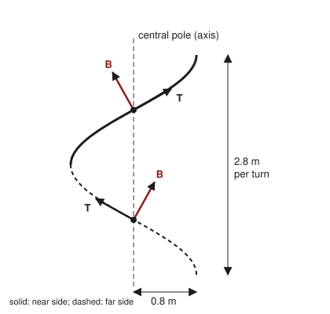

# Torsion: how fast a curve twists out of its own plane

[Syllabus](../../../SYLLABUS.md) → [Differential geometry and Lie groups](../README.md) → [Curves](../README.md#s01) → Torsion

---

## General Overview

A spiral staircase winds round a central pole. Its outer handrail sits 0.8 m from the pole and rises 2.8 m in one full turn: fourteen steps of 0.2 m each. One turn of rail is 5.75 m long.

Hold a short piece of that rail. It almost lies in one flat plane: the plane it is bending in. On a flat ring lying on a floor, that plane never changes. On the handrail it does. Climb a little, and the rail has left the plane it was just in, and bends in a new, tilted one.

**Torsion** measures that tilting: the angle the bending plane turns through per metre of rail. For this rail it is 0.531 radians per metre, which is 30.45° for every metre climbed along the rail. Its **curvature**, how fast the direction of travel turns, is 0.954 radians per metre.

Torsion also answers a design question: what must a bending machine do to make this rail? Every piece of the rail has the same curvature and the same torsion, so the machine bends the bar at a steady 0.954 radians per metre while turning the plane of the bend at a steady 0.531 radians per metre. Nothing else can come out, because the converse holds too: any curve whose curvature and torsion are both constant is a helix, the shape of this rail. The two numbers fix the radius and the rise.

**Torsion is the rate at which a curve's bending plane turns about the direction of travel, and a curve whose bending and twisting are both constant is a helix, with its radius and rise set by those two rates.**

**What kind of fact this is:** torsion is a definition; that constant curvature and torsion force a helix is a theorem, proved on this card in Why it works. The theorem is local: it holds on any stretch of curve where both rates stay constant.

### The picture: one turn of the handrail, seen from the side

<p align="center"></p>

The view is an orthographic projection from the side: every point is moved straight across onto a vertical plane. The black arrow $`\mathbf{T}`$ is the direction of travel. The red arrow $`\mathbf{B}`$ stands at right angles to the bending plane. At the far point, 0.7 m up, $`\mathbf{B}`$ leans right. Half a turn later, at the near point 2.1 m up, it leans left. That swing of $`\mathbf{B}`$ is the twist the card measures.

---

## The formula

Notation from earlier cards, in one line each:

- $`s`$ is arc length, the distance travelled along the rail in metres ([Regular curve and arc length](01-regular-curves-and-arc-length.md)). A prime, as in $`\mathbf{B}'`$, means the rate of change per metre: $`d/ds`$.
- $`\mathbf{T}`$ is the unit tangent, the direction of travel. In space, curvature $`\kappa`$ (kappa) is the length of $`\mathbf{T}'`$, so it is never negative, and the normal $`\mathbf{N}`$ is the direction $`\mathbf{T}'`$ points in ([Curvature](02-curvature-of-plane-curves.md)).
- $`\mathbf{B} = \mathbf{T} \times \mathbf{N}`$ is the binormal, at right angles to both. The plane holding $`\mathbf{T}`$ and $`\mathbf{N}`$ is the osculating plane, the bending plane of the Overview ([Frenet-Serret frame](04-frenet-serret-frames.md)).

That card shows $`\mathbf{B}'`$ always points along $`\mathbf{N}`$. Torsion, written $`\tau`$ (tau), is the size and sign of that rate:

```math
\mathbf{B}'(s) = -\tau(s)\,\mathbf{N}(s), \qquad \text{so} \qquad \tau = -\mathbf{B}'\cdot\mathbf{N}
```

**Read it aloud:** as the traveller moves one metre along the curve, the binormal swings towards minus the normal by tau radians, and tau is read off as that swing.

Elsewhere in the library $`\tau`$ is a stopping time; on this shelf it is always torsion.

The handrail is a helix. Put the pole on the vertical axis and use the angle turned, $`t`$ in radians, as the label along the rail:

```math
\mathbf{r}(t) = (a\cos t,\; a\sin t,\; c\,t), \qquad \kappa = \frac{a}{a^2 + c^2}, \qquad \tau = \frac{c}{a^2 + c^2}
```

**Read it aloud:** a point turns round the pole at radius a while it climbs c metres for every radian; its curvature is a over a squared plus c squared, and its torsion is c over the same thing.

Run the same two lines backwards and the rates give the size:

```math
a = \frac{\kappa}{\kappa^2 + \tau^2}, \qquad c = \frac{\tau}{\kappa^2 + \tau^2}
```

**Read it aloud:** the radius is curvature over the sum of the two squared rates, and the climb per radian is torsion over the same sum.

| Symbol | Plain meaning | In our example | Push it up and the answer… |
| --- | --- | --- | --- |
| $`s`$, $`'`$ | distance travelled along the rail; a prime is the rate per metre, $`d/ds`$ | 0 to 5.753798 m for one turn | — |
| $`t`$ | angle turned round the pole, in radians | 0 to $`2\pi`$ for one turn | — |
| $`\mathbf{r}`$ | position of a point on the rail | $`(0.8\cos t,\; 0.8\sin t,\; 0.445634\,t)`$ | — |
| $`\mathbf{T}`$ | unit tangent: the direction of travel | climbs at 29.1197° | — |
| $`\mathbf{N}`$ | unit normal: where the rail bends to | points straight at the pole | — |
| $`\mathbf{B}`$ | binormal, $`\mathbf{T} \times \mathbf{N}`$: square to the bending plane | leans 29.1197° off vertical | — |
| $`\kappa`$ | curvature: turning of $`\mathbf{T}`$ per metre, in 1/m | 0.953983 1/m | tighter bend |
| $`\tau`$ | torsion: turning of the bending plane per metre, in 1/m | 0.531409 1/m | faster twist out of the plane |
| $`a`$ | radius: distance from the pole | 0.8 m | $`\tau`$ falls; $`\kappa`$ falls once $`a`$ passes $`c`$ |
| $`c`$, $`h`$ | climb per radian, and rise per turn $`h = 2\pi c`$ | 0.445634 m and 2.8 m | $`\tau`$ rises until $`c = a`$, then falls |
| $`w`$, $`m`$ | speed in metres per radian, $`\sqrt{a^2 + c^2}`$; and $`m = \kappa^2 + \tau^2 = 1/w^2`$ | 0.915745 m and 1.192479 1/m² | — |
| $`\mathbf{u}`$, $`\mathbf{p}`$ | unit vector along the axis, and the point on the axis beside $`\mathbf{r}`$, used in Why it works | straight up the pole | — |

### When it holds

- **The curve bends: $`\kappa \neq 0`$.** Torsion is built from $`\mathbf{N}`$, and a straight piece has no $`\mathbf{N}`$. On a straight landing rail three posts lie in a line, the bending plane is undefined, and so is $`\tau`$.
- **The curve is smooth to third order.** $`\mathbf{B}`$ uses two derivatives of position and $`\mathbf{B}'`$ a third. Where a straight rail is welded to a curved one, curvature jumps, and torsion is not defined at the weld.
- **Distance along the curve is the label.** The prime is per metre. Using the turning angle $`t`$ instead gives a rate per radian, smaller here by the factor 0.915745. The fix for any label is [Curvature and torsion at any speed](06-curvature-and-torsion-from-any-parametrisation.md).
- **Both rates are constant on a stretch.** Then that stretch is a piece of helix. The result is local: a rail that changes its torsion halfway is two helix pieces, not one.
- **A fixed handedness of space.** The sign of $`\tau`$ says which way the curve twists. Reversing the direction of travel keeps it. A mirror image flips it. On this shelf a right-handed helix has $`\tau > 0`$; some books write $`\mathbf{B}' = +\tau\,\mathbf{N}`$ and get the opposite sign.

---

## Why it works

### Step 0: watch the binormal, and you watch the plane

The bending plane is hard to follow. The single arrow standing square to it is easy: that arrow is $`\mathbf{B}`$. If the plane does not turn, $`\mathbf{B}`$ does not move. If the plane turns about the direction of travel, $`\mathbf{B}`$ swings. Torsion is the speed of that swing.

### Step 1: the binormal can only swing towards the normal

Two facts pin the direction of $`\mathbf{B}'`$.

1. $`\mathbf{B}`$ has length 1 at every point. A vector of fixed length can only change sideways, so $`\mathbf{B}'`$ is square to $`\mathbf{B}`$.
2. Differentiate $`\mathbf{B} = \mathbf{T} \times \mathbf{N}`$: the result is $`\mathbf{T}' \times \mathbf{N} + \mathbf{T} \times \mathbf{N}'`$. The first part is $`\kappa\,\mathbf{N} \times \mathbf{N}`$, which is zero. The second part is square to $`\mathbf{T}`$.

So $`\mathbf{B}'`$ is square to both $`\mathbf{B}`$ and $`\mathbf{T}`$. Only $`\mathbf{N}`$ is left. One number, $`\tau`$, says how much and which way.

### Step 2: the handrail's torsion, by direct calculation

Differentiate the helix in the angle $`t`$. The velocity is $`(-a\sin t,\; a\cos t,\; c)`$, with speed $`w = \sqrt{a^2 + c^2}`$ metres per radian. One metre of rail is $`1/w`$ radians, so every rate per metre is the rate per radian divided by $`w`$.

| Arrow | Formula | What it says |
| --- | --- | --- |
| $`\mathbf{T}`$ | $`(-a\sin t,\; a\cos t,\; c)/w`$ | climbs at a fixed angle |
| $`\mathbf{T}'`$ | $`(-a\cos t,\; -a\sin t,\; 0)/w^2`$ | length $`a/w^2`$, so $`\kappa = a/w^2`$ |
| $`\mathbf{N}`$ | $`(-\cos t,\; -\sin t,\; 0)`$ | level, pointing at the pole |
| $`\mathbf{B}`$ | $`(c\sin t,\; -c\cos t,\; a)/w`$ | leans off vertical at a fixed angle |
| $`\mathbf{B}'`$ | $`(c\cos t,\; c\sin t,\; 0)/w^2`$ | equals $`-(c/w^2)\,\mathbf{N}`$, so $`\tau = c/w^2`$ |

Neither $`\kappa`$ nor $`\tau`$ contains $`t`$. Every point of the rail bends and twists at the same rates, as the symmetry of a staircase suggests.

The sign is positive here because the rail climbs as it turns anticlockwise seen from above, a right-handed helix. Mirror the staircase and $`c`$ effectively changes sign, and so does $`\tau`$.

### Step 3: constant rates force a helix

Now start from the other end. A curve has constant $`\kappa > 0`$ and constant $`\tau`$. The Frenet-Serret equations ([Frenet-Serret frame](04-frenet-serret-frames.md)) say how its three arrows change:

```math
\mathbf{T}' = \kappa\,\mathbf{N}, \qquad \mathbf{N}' = -\kappa\,\mathbf{T} + \tau\,\mathbf{B}, \qquad \mathbf{B}' = -\tau\,\mathbf{N}
```

**Read it aloud:** the tangent turns towards the normal at the curvature rate; the normal turns back from the tangent at that rate and towards the binormal at the torsion rate; the binormal turns away from the normal at the torsion rate.

The proof finds the pole, then shows the curve circles it at a fixed distance.

1. **A fixed direction.** The mix $`\tau\,\mathbf{T} + \kappa\,\mathbf{B}`$ never changes: its rate is $`\tau\kappa\,\mathbf{N} - \kappa\tau\,\mathbf{N} = 0`$. Scaled to length 1, it is the axis direction $`\mathbf{u}`$.
2. **A steady climb.** The height along $`\mathbf{u}`$ grows at the rate $`\mathbf{T}\cdot\mathbf{u} = \tau/\sqrt{\kappa^2 + \tau^2}`$, a constant.
3. **A straight pole.** The point $`\mathbf{r} + \tfrac{\kappa}{\kappa^2 + \tau^2}\mathbf{N}`$ moves only along $`\mathbf{u}`$, so all such points lie on one straight line.
4. **A fixed distance.** The curve sits $`\kappa/(\kappa^2 + \tau^2)`$ from that line, along $`\mathbf{N}`$, which is square to the line.

A curve at a fixed distance from a line, climbing along it at a steady rate as it goes round, is a helix. Its radius is $`a = \kappa/(\kappa^2 + \tau^2)`$, and its climb per radian is $`c = \tau/(\kappa^2 + \tau^2)`$.

<details>
<summary>Detailed proof: steps 3 and 4, the pole and the distance</summary>

Write $`m = \kappa^2 + \tau^2`$ and $`\mathbf{p} = \mathbf{r} + (\kappa/m)\,\mathbf{N}`$. Differentiate, using $`\mathbf{r}' = \mathbf{T}`$ and the middle Frenet-Serret equation:

$`\displaystyle \mathbf{p}' = \mathbf{T} + \frac{\kappa}{m}\left(-\kappa\,\mathbf{T} + \tau\,\mathbf{B}\right) = \frac{\tau^2}{m}\,\mathbf{T} + \frac{\kappa\tau}{m}\,\mathbf{B} = \frac{\tau}{m}\left(\tau\,\mathbf{T} + \kappa\,\mathbf{B}\right).`$

The bracket is the fixed vector of step 1. So $`\mathbf{p}`$ moves along one fixed direction at a constant rate: its path is a straight line, the pole. If $`\tau = 0`$ that rate is 0: $`\mathbf{p}`$ stays at one point, the pole is the line through that point along the fixed vector, and the curve is a circle of radius $`1/\kappa`$, a helix with zero rise.

The gap from the curve to the pole is $`\mathbf{r} - \mathbf{p} = -(\kappa/m)\,\mathbf{N}`$. Its length is $`\kappa/m`$ at every point. It is square to the pole because $`\mathbf{N}\cdot(\tau\,\mathbf{T} + \kappa\,\mathbf{B}) = 0`$. So the curve keeps the distance $`\kappa/m`$ from the pole.

Finally, the curve's speed is 1. Its climb along the pole is $`\tau/\sqrt{m}`$ per metre, so its speed round the pole is $`\kappa/\sqrt{m}`$ per metre. On a circle of radius $`\kappa/m`$ that is a turning rate of $`\sqrt{m}`$ radians per metre. Climb per radian is then $`(\tau/\sqrt{m})/\sqrt{m} = \tau/m`$. That is the helix with $`a = \kappa/m`$ and $`c = \tau/m`$.

</details>

The general version, any $`\kappa(s) > 0`$ and $`\tau(s)`$ fix the curve up to a move and a turn in space, is the [Fundamental theorem of curves](07-fundamental-theorem-of-curves.md). This card proves only the constant case, directly.

---

## Worked numbers, by hand

The staircase: radius $`a = 0.8`$ m, rise 2.8 m per turn.

| Step | Arithmetic | Value |
| --- | --- | --- |
| climb per radian $`c`$ | $`2.8 / (2\pi)`$ | 0.445634 m |
| $`a^2 + c^2`$ | $`0.64 + 0.198590`$ | 0.838590 m² |
| speed $`w`$, metres per radian | $`\sqrt{0.838590}`$ | 0.915745 m |
| rail length of one turn | $`2\pi \times 0.915745`$ | 5.753798 m |
| pitch of the rail | angle whose tangent is $`0.445634 / 0.8`$ | 29.1197° |
| curvature $`\kappa`$ | $`0.8 / 0.838590`$ | **0.953983 1/m** |
| torsion $`\tau`$ | $`0.445634 / 0.838590`$ | **0.531409 1/m** |
| torsion in degrees | $`0.531409 \times 180/\pi`$ | 30.45° per metre |
| back again: $`\kappa^2 + \tau^2`$ | $`1 / 0.838590`$ | 1.192479 1/m² |
| radius from the rates | $`0.953983 / 1.192479`$ | 0.800000 m |
| climb from the rates | $`0.531409 / 1.192479`$ | 0.445634 m |

Climbing one metre along the rail, the plane it bends in turns 30.45° about the direction of travel. The two rates alone give back the 0.8 m radius and the 2.8 m rise.

### What breaks if you drop a piece

| Mistake | Comes out at | What went wrong |
| --- | --- | --- |
| Measure per radian, not per metre | 0.486635 | Rates per radian of turning, not divided by the speed 0.915745 |
| Take the slope $`c/a`$ as the twist | 0.557042 | Steepness is not twist: the formula divides by $`a^2 + c^2`$ |
| Keep $`\kappa`$, drop $`\tau`$ | a flat ring, radius 1.048237 m, rise 0 m | Curvature alone allows a flat circle: no staircase |
| A straight landing rail | cross product of two post-to-post steps is 0 | $`\kappa = 0`$, so no bending plane and no $`\tau`$ |

The code prints all four.

---

## Code, from first principles, and it actually runs

The code measures the handrail's torsion by three roads that share no formula, and tests the converse theorem by a fourth.

1. **Closed form:** $`c/(a^2 + c^2)`$.
2. **Finite differences:** build $`\mathbf{T}`$, $`\mathbf{N}`$ and $`\mathbf{B}`$ from small steps along the rail at four places, then measure how fast $`\mathbf{B}`$ swings.
3. **Posts:** put posts round the rail, 14 per turn and then 140. Measure the angle between the planes through neighbouring triples of posts, divided by the gap between posts. This is a stepped value, so its error is printed at both counts.
4. **Rebuild:** start from $`\kappa`$ and $`\tau`$ only, and step the Frenet-Serret equations with RK4 (the fourth-order Runge-Kutta stepper of wing 08). The curve that comes out must keep 0.8 m from its axis and rise 2.8 m per turn. This road tests the theorem itself.

The code also reverses and mirrors the posts to test the sign, and computes every wrong answer above.

### Python

```python
# Torsion and the helix -- the check behind the card.  Standard library only.
# A spiral staircase handrail: radius 0.8 m, rising 2.8 m per full turn.
# Torsion comes three ways: the closed form, finite differences of the binormal,
# and a polygon through the rail's posts.  A fourth road rebuilds the rail from
# curvature and torsion alone by RK4, and it must come out a helix of the same size.
from math import sin, cos, pi, sqrt, atan, atan2, degrees

def add(u, v): return [p + q for p, q in zip(u, v)]
def mul(k, u): return [k * p for p in u]
def sub(u, v): return add(u, mul(-1.0, v))
def dot(u, v): return u[0] * v[0] + u[1] * v[1] + u[2] * v[2]
def cross(u, v): return [u[1] * v[2] - u[2] * v[1], u[2] * v[0] - u[0] * v[2], u[0] * v[1] - u[1] * v[0]]
def size(u): return sqrt(dot(u, u))
def unit(u): return mul(1.0 / size(u), u)

A, RISE = 0.8, 2.8                         # radius and rise per turn, metres
C = RISE / (2 * pi)                        # rise per radian of turning
def rail(t, a=A, c=C): return [a * cos(t), a * sin(t), c * t]

def closed_form(a, c):                     # road 1: kappa and tau of the helix
    return a / (a * a + c * c), c / (a * a + c * c)

def frame(t, k=1e-3):                      # T, N, B from finite differences in the angle t
    d1 = mul(0.5 / k, sub(rail(t + k), rail(t - k)))
    d2 = mul(1.0 / (k * k), add(sub(rail(t + k), mul(2.0, rail(t))), rail(t - k)))
    T, B = unit(d1), unit(cross(d1, d2))
    return T, cross(B, T), B, size(d1)

def tau_by_differences(t, k=1e-3):         # road 2: B' = -tau N, and d/ds = (1/speed) d/dt
    T, N, B, speed = frame(t)
    dB = mul(0.5 / k, sub(frame(t + k)[2], frame(t - k)[2]))
    return -dot(dB, N) / speed

def posts(n, a=A, c=C, flip=1.0):          # n posts per turn; flip=-1 is the mirror image
    return [[flip * a * cos(2 * pi * i / n), a * sin(2 * pi * i / n), c * 2 * pi * i / n] for i in range(4)]

def polygon(p):                            # road 3: turning and twisting angles between posts
    e = [sub(p[i + 1], p[i]) for i in range(3)]
    b1, b2 = unit(cross(e[0], e[1])), unit(cross(e[1], e[2]))
    bend = atan2(size(cross(e[0], e[1])), dot(e[0], e[1]))
    twist = atan2(dot(cross(b1, b2), unit(e[1])), dot(b1, b2))
    return bend / size(e[1]), twist / size(e[1]), degrees(twist)

def rebuild(kap, tau, length, steps):      # road 4: T'=kN, N'=-kT+tB, B'=-tN, from kappa, tau only
    def f(y): return [y[1], mul(kap, y[2]), add(mul(-kap, y[1]), mul(tau, y[3])), mul(-tau, y[2])]
    def go(y, k, h): return [add(y[j], mul(h, k[j])) for j in range(4)]
    y = [[0.0, 0.0, 0.0], [1.0, 0.0, 0.0], [0.0, 1.0, 0.0], [0.0, 0.0, 1.0]]
    h, path = length / steps, [y[0]]
    for _ in range(steps):
        k1 = f(y); k2 = f(go(y, k1, h / 2)); k3 = f(go(y, k2, h / 2)); k4 = f(go(y, k3, h))
        y = [add(y[j], mul(h / 6, add(add(k1[j], mul(2.0, k2[j])), add(mul(2.0, k3[j]), k4[j])))) for j in range(4)]
        path.append(y[0])
    m = kap * kap + tau * tau                         # the axis: along tau T + kappa B, through r + (kappa/m) N
    u, p0 = unit([tau, 0.0, kap]), [0.0, kap / m, 0.0]
    radii = [size(sub(sub(r, p0), mul(dot(sub(r, p0), u), u))) for r in path]
    return min(radii), max(radii), dot(path[-1], u)

kap, tau = closed_form(A, C)
m = kap * kap + tau * tau
speed = sqrt(A * A + C * C)
L = 2 * pi * speed                                    # rail length of one full turn
print(f"rise per radian c = 2.8 / (2 pi)       {C:.6f} m")
print(f"a^2 + c^2                              {A * A + C * C:.6f} m^2")
print(f"speed sqrt(a^2 + c^2), per radian      {speed:.6f} m")
print(f"rail length of one turn                {L:.6f} m")
print(f"pitch angle of the rail                {degrees(atan(C / A)):.4f} deg")
print(f"1 closed form: kappa                   {kap:.6f} 1/m")
print(f"1 closed form: tau                     {tau:.6f} 1/m")
print(f"  as degrees per metre: kappa, tau     {degrees(kap):.2f} {degrees(tau):.2f}")
taus = [tau_by_differences(t) for t in (0.0, 1.0, 2.0, 4.0)]
print("2 differences: tau at t = 0, 1, 2, 4   " + " ".join(f"{x:.6f}" for x in taus))
p14, p140 = polygon(posts(14)), polygon(posts(140))
print(f"3 posts, 14 per turn: kappa, tau       {p14[0]:.6f} {p14[1]:.6f}")
print(f"3 posts, 140 per turn: kappa, tau      {p140[0]:.6f} {p140[1]:.6f}")
print(f"  tau error at 14 and 140 posts        {abs(p14[1] - tau):.6f} {abs(p140[1] - tau):.6f}")
print(f"  twist between neighbouring planes    {p14[2]:.4f} deg at 14 posts")
print(f"kappa^2 + tau^2 = 1 / (a^2 + c^2)       {m:.6f} 1/m^2")
print(f"rebuilt helix from kappa, tau: a, c    {kap / m:.6f} {tau / m:.6f}")
r24, r48 = rebuild(kap, tau, L, 24), rebuild(kap, tau, L, 48)
for name, r in (("4 RK4, 24 steps", r24), ("4 RK4, 48 steps", r48)):
    print(f"{name}: radius min, max, rise   {r[0]:.6f} {r[1]:.6f} {r[2]:.6f}")
print(f"  radius error at 24 and 48 steps      {A - r24[0]:.9f} {A - r48[0]:.9f}")
print(f"reverse the direction of travel: tau   {polygon(posts(14)[::-1])[1]:.6f}")
print(f"mirror staircase (x -> -x): tau        {polygon(posts(14, flip=-1.0))[1]:.6f}")
flat = rebuild(kap, 0.0, L, 100)
print(f"wrong: tau per radian, not per metre   {C / speed:.6f}")
print(f"wrong: slope c / a read as the twist   {C / A:.6f}")
print(f"wrong: keep kappa, drop tau: radius    {flat[1]:.6f} m, rise {flat[2]:.6f} m")
line = [[0.0, 0.0, 0.3 * i] for i in range(3)]
print(f"wrong: straight landing |e1 x e2|      {size(cross(sub(line[1], line[0]), sub(line[2], line[1]))):.6f}")
for label, h in (("try: rise 4.0 m", 4.0), ("try: rise 5.026548 m (c = a)", 2 * pi * A), ("try: rise 10.0 m", 10.0)):
    print(f"{label:<38} kappa {closed_form(A, h / (2 * pi))[0]:.6f} tau {closed_form(A, h / (2 * pi))[1]:.6f}")
print(f"try: radius 1.2 m, rise 2.8 m          kappa {closed_form(1.2, C)[0]:.6f} tau {closed_form(1.2, C)[1]:.6f}")
dna = closed_form(1.0, 3.4 / (2 * pi))
print(f"DNA phosphates, 1.0 nm, 3.4 nm a turn  kappa {dna[0]:.6f} tau {dna[1]:.6f} 1/nm")
for name, t in (("far", pi / 2), ("near", 3 * pi / 2)):
    T, N, B, _ = frame(t)
    print(f"figure, {name} point at height {rail(t)[2]:.3f} m: T ({T[0]:.4f}, {T[2]:.4f}) B ({B[0]:.4f}, {B[2]:.4f})")
assert abs(kap - 0.953983) < 1e-6 and abs(tau - 0.531409) < 2e-6   # the hand-worked numbers
assert all(abs(x - tau) < 1e-6 for x in taus)                         # differences against the formula
assert abs(p140[1] - tau) < 1e-3 and abs(p140[1] - tau) < abs(p14[1] - tau)   # posts converge
assert abs(r48[0] - A) < 1e-5 and abs(r48[0] - A) < abs(r24[0] - A)   # kappa, tau alone give radius 0.8
assert abs(r48[1] - A) < 1e-5 and abs(r48[2] - RISE) < 1e-9          # ... and rise 2.8 m per turn
assert abs(polygon(posts(14, flip=-1.0))[1] + p14[1]) < 1e-12 and abs(flat[2]) < 1e-9
print("ALL CHECKS PASS")
```

**Ran 2026-11-19 on macOS, Python 3.14.10, standard library only. All checks passed. Output, pasted from the run:**

```
rise per radian c = 2.8 / (2 pi)       0.445634 m
a^2 + c^2                              0.838590 m^2
speed sqrt(a^2 + c^2), per radian      0.915745 m
rail length of one turn                5.753798 m
pitch angle of the rail                29.1197 deg
1 closed form: kappa                   0.953983 1/m
1 closed form: tau                     0.531409 1/m
  as degrees per metre: kappa, tau     54.66 30.45
2 differences: tau at t = 0, 1, 2, 4   0.531409 0.531409 0.531409 0.531409
3 posts, 14 per turn: kappa, tau       0.956231 0.545215
3 posts, 140 per turn: kappa, tau      0.954006 0.531545
  tau error at 14 and 140 posts        0.013806 0.000136
  twist between neighbouring planes    12.7566 deg at 14 posts
kappa^2 + tau^2 = 1 / (a^2 + c^2)       1.192479 1/m^2
rebuilt helix from kappa, tau: a, c    0.800000 0.445634
4 RK4, 24 steps: radius min, max, rise   0.799957 0.800000 2.800000
4 RK4, 48 steps: radius min, max, rise   0.799999 0.800000 2.800000
  radius error at 24 and 48 steps      0.000042560 0.000001339
reverse the direction of travel: tau   0.545215
mirror staircase (x -> -x): tau        -0.545215
wrong: tau per radian, not per metre   0.486635
wrong: slope c / a read as the twist   0.557042
wrong: keep kappa, drop tau: radius    1.048237 m, rise 0.000000 m
wrong: straight landing |e1 x e2|      0.000000
try: rise 4.0 m                        kappa 0.765342 tau 0.609040
try: rise 5.026548 m (c = a)           kappa 0.625000 tau 0.625000
try: rise 10.0 m                       kappa 0.252125 tau 0.501587
try: radius 1.2 m, rise 2.8 m          kappa 0.732337 tau 0.271962
DNA phosphates, 1.0 nm, 3.4 nm a turn  kappa 0.773504 tau 0.418564 1/nm
figure, far point at height 0.700 m: T (-0.8736, 0.4866) B (0.4866, 0.8736)
figure, near point at height 2.100 m: T (0.8736, 0.4866) B (-0.4866, 0.8736)
ALL CHECKS PASS
```

### Rust

The same four roads and the same labels, built with `rustc --edition 2021 -O`.

```rust
// Torsion and the helix -- the same check as the Python, in Rust.  No crates.
// A spiral staircase handrail: radius 0.8 m, rising 2.8 m per full turn.
// Torsion comes three ways: the closed form, finite differences of the binormal,
// and a polygon through the rail's posts.  A fourth road rebuilds the rail from
// curvature and torsion alone by RK4, and it must come out a helix of the same size.
use std::f64::consts::PI;

type V = [f64; 3];
fn add(u: V, v: V) -> V { [u[0] + v[0], u[1] + v[1], u[2] + v[2]] }
fn mul(k: f64, u: V) -> V { [k * u[0], k * u[1], k * u[2]] }
fn sub(u: V, v: V) -> V { add(u, mul(-1.0, v)) }
fn dot(u: V, v: V) -> f64 { u[0] * v[0] + u[1] * v[1] + u[2] * v[2] }
fn cross(u: V, v: V) -> V { [u[1] * v[2] - u[2] * v[1], u[2] * v[0] - u[0] * v[2], u[0] * v[1] - u[1] * v[0]] }
fn size(u: V) -> f64 { dot(u, u).sqrt() }
fn unit(u: V) -> V { mul(1.0 / size(u), u) }

const A: f64 = 0.8;                            // radius, metres
const RISE: f64 = 2.8;                         // rise per turn, metres
fn c0() -> f64 { RISE / (2.0 * PI) }           // rise per radian of turning
fn rail(t: f64) -> V { [A * t.cos(), A * t.sin(), c0() * t] }

fn closed_form(a: f64, c: f64) -> (f64, f64) { (a / (a * a + c * c), c / (a * a + c * c)) }   // road 1

fn frame(t: f64) -> (V, V, V, f64) {           // T, N, B from finite differences in the angle t
    let k = 1e-3;
    let d1 = mul(0.5 / k, sub(rail(t + k), rail(t - k)));
    let d2 = mul(1.0 / (k * k), add(sub(rail(t + k), mul(2.0, rail(t))), rail(t - k)));
    let (tt, b) = (unit(d1), unit(cross(d1, d2)));
    (tt, cross(b, tt), b, size(d1))
}

fn tau_by_differences(t: f64) -> f64 {         // road 2: B' = -tau N, and d/ds = (1/speed) d/dt
    let k = 1e-3;
    let (_, n, _, speed) = frame(t);
    let db = mul(0.5 / k, sub(frame(t + k).2, frame(t - k).2));
    -dot(db, n) / speed
}

fn posts(n: f64, a: f64, c: f64, flip: f64) -> Vec<V> {   // n posts per turn; flip=-1 is the mirror
    (0..4).map(|i| { let t = 2.0 * PI * i as f64 / n; [flip * a * t.cos(), a * t.sin(), c * t] }).collect()
}

fn polygon(p: &[V]) -> (f64, f64, f64) {       // road 3: turning and twisting angles between posts
    let e: Vec<V> = (0..3).map(|i| sub(p[i + 1], p[i])).collect();
    let (b1, b2) = (unit(cross(e[0], e[1])), unit(cross(e[1], e[2])));
    let bend = size(cross(e[0], e[1])).atan2(dot(e[0], e[1]));
    let twist = dot(cross(b1, b2), unit(e[1])).atan2(dot(b1, b2));
    (bend / size(e[1]), twist / size(e[1]), twist.to_degrees())
}

type Y = [V; 4];
fn rebuild(kap: f64, tau: f64, length: f64, steps: usize) -> (f64, f64, f64) {   // road 4: kappa, tau only
    let f = |y: &Y| -> Y { [y[1], mul(kap, y[2]), add(mul(-kap, y[1]), mul(tau, y[3])), mul(-tau, y[2])] };
    let go = |y: &Y, k: &Y, h: f64| -> Y { [0, 1, 2, 3].map(|j| add(y[j], mul(h, k[j]))) };
    let mut y: Y = [[0.0, 0.0, 0.0], [1.0, 0.0, 0.0], [0.0, 1.0, 0.0], [0.0, 0.0, 1.0]];
    let h = length / steps as f64;
    let mut path = vec![y[0]];
    for _ in 0..steps {
        let k1 = f(&y);
        let k2 = f(&go(&y, &k1, h / 2.0));
        let k3 = f(&go(&y, &k2, h / 2.0));
        let k4 = f(&go(&y, &k3, h));
        y = [0, 1, 2, 3].map(|j| add(y[j], mul(h / 6.0, add(add(k1[j], mul(2.0, k2[j])), add(mul(2.0, k3[j]), k4[j])))));
        path.push(y[0]);
    }
    let m = kap * kap + tau * tau;             // the axis: along tau T + kappa B, through r + (kappa/m) N
    let (u, p0) = (unit([tau, 0.0, kap]), [0.0, kap / m, 0.0]);
    let radii: Vec<f64> = path.iter().map(|&r| size(sub(sub(r, p0), mul(dot(sub(r, p0), u), u)))).collect();
    let lo = radii.iter().cloned().fold(f64::INFINITY, f64::min);
    let hi = radii.iter().cloned().fold(f64::NEG_INFINITY, f64::max);
    (lo, hi, dot(path[path.len() - 1], u))
}

fn main() {
    let c = c0();
    let (kap, tau) = closed_form(A, c);
    let m = kap * kap + tau * tau;
    let speed = (A * A + c * c).sqrt();
    let l = 2.0 * PI * speed;                  // rail length of one full turn
    println!("rise per radian c = 2.8 / (2 pi)       {:.6} m", c);
    println!("a^2 + c^2                              {:.6} m^2", A * A + c * c);
    println!("speed sqrt(a^2 + c^2), per radian      {:.6} m", speed);
    println!("rail length of one turn                {:.6} m", l);
    println!("pitch angle of the rail                {:.4} deg", (c / A).atan().to_degrees());
    println!("1 closed form: kappa                   {:.6} 1/m", kap);
    println!("1 closed form: tau                     {:.6} 1/m", tau);
    println!("  as degrees per metre: kappa, tau     {:.2} {:.2}", kap.to_degrees(), tau.to_degrees());
    let taus: Vec<f64> = [0.0, 1.0, 2.0, 4.0].iter().map(|&t| tau_by_differences(t)).collect();
    let shown: Vec<String> = taus.iter().map(|x| format!("{:.6}", x)).collect();
    println!("2 differences: tau at t = 0, 1, 2, 4   {}", shown.join(" "));
    let (p14, p140) = (polygon(&posts(14.0, A, c, 1.0)), polygon(&posts(140.0, A, c, 1.0)));
    println!("3 posts, 14 per turn: kappa, tau       {:.6} {:.6}", p14.0, p14.1);
    println!("3 posts, 140 per turn: kappa, tau      {:.6} {:.6}", p140.0, p140.1);
    println!("  tau error at 14 and 140 posts        {:.6} {:.6}", (p14.1 - tau).abs(), (p140.1 - tau).abs());
    println!("  twist between neighbouring planes    {:.4} deg at 14 posts", p14.2);
    println!("kappa^2 + tau^2 = 1 / (a^2 + c^2)       {:.6} 1/m^2", m);
    println!("rebuilt helix from kappa, tau: a, c    {:.6} {:.6}", kap / m, tau / m);
    let (r24, r48) = (rebuild(kap, tau, l, 24), rebuild(kap, tau, l, 48));
    for (name, r) in [("4 RK4, 24 steps", r24), ("4 RK4, 48 steps", r48)] {
        println!("{}: radius min, max, rise   {:.6} {:.6} {:.6}", name, r.0, r.1, r.2);
    }
    println!("  radius error at 24 and 48 steps      {:.9} {:.9}", A - r24.0, A - r48.0);
    let mut back = posts(14.0, A, c, 1.0);
    back.reverse();
    println!("reverse the direction of travel: tau   {:.6}", polygon(&back).1);
    let mirror = polygon(&posts(14.0, A, c, -1.0)).1;
    println!("mirror staircase (x -> -x): tau        {:.6}", mirror);
    let flat = rebuild(kap, 0.0, l, 100);
    println!("wrong: tau per radian, not per metre   {:.6}", c / speed);
    println!("wrong: slope c / a read as the twist   {:.6}", c / A);
    println!("wrong: keep kappa, drop tau: radius    {:.6} m, rise {:.6} m", flat.1, flat.2);
    let line: Vec<V> = (0..3).map(|i| [0.0, 0.0, 0.3 * i as f64]).collect();
    println!("wrong: straight landing |e1 x e2|      {:.6}", size(cross(sub(line[1], line[0]), sub(line[2], line[1]))));
    for (label, h) in [("try: rise 4.0 m", 4.0), ("try: rise 5.026548 m (c = a)", 2.0 * PI * A), ("try: rise 10.0 m", 10.0)] {
        let (k, t) = closed_form(A, h / (2.0 * PI));
        println!("{:<38} kappa {:.6} tau {:.6}", label, k, t);
    }
    let (k12, t12) = closed_form(1.2, c);
    println!("try: radius 1.2 m, rise 2.8 m          kappa {:.6} tau {:.6}", k12, t12);
    let dna = closed_form(1.0, 3.4 / (2.0 * PI));
    println!("DNA phosphates, 1.0 nm, 3.4 nm a turn  kappa {:.6} tau {:.6} 1/nm", dna.0, dna.1);
    for (name, t) in [("far", PI / 2.0), ("near", 3.0 * PI / 2.0)] {
        let (tt, _, b, _) = frame(t);
        println!("figure, {} point at height {:.3} m: T ({:.4}, {:.4}) B ({:.4}, {:.4})", name, rail(t)[2], tt[0], tt[2], b[0], b[2]);
    }
    assert!((kap - 0.953983).abs() < 1e-6 && (tau - 0.531409).abs() < 2e-6);   // the hand-worked numbers
    assert!(taus.iter().all(|x| (x - tau).abs() < 1e-6));                       // differences against the formula
    assert!((p140.1 - tau).abs() < 1e-3 && (p140.1 - tau).abs() < (p14.1 - tau).abs());   // posts converge
    assert!((r48.0 - A).abs() < 1e-5 && (r48.0 - A).abs() < (r24.0 - A).abs());  // kappa, tau alone give radius 0.8
    assert!((r48.1 - A).abs() < 1e-5 && (r48.2 - RISE).abs() < 1e-9);           // ... and rise 2.8 m per turn
    assert!((mirror + p14.1).abs() < 1e-12 && flat.2.abs() < 1e-9);
    println!("ALL CHECKS PASS");
}
```

**Ran 2026-11-19 on macOS, rustc 1.98.1, no crates. All checks passed. Output, pasted from the run:**

```
rise per radian c = 2.8 / (2 pi)       0.445634 m
a^2 + c^2                              0.838590 m^2
speed sqrt(a^2 + c^2), per radian      0.915745 m
rail length of one turn                5.753798 m
pitch angle of the rail                29.1197 deg
1 closed form: kappa                   0.953983 1/m
1 closed form: tau                     0.531409 1/m
  as degrees per metre: kappa, tau     54.66 30.45
2 differences: tau at t = 0, 1, 2, 4   0.531409 0.531409 0.531409 0.531409
3 posts, 14 per turn: kappa, tau       0.956231 0.545215
3 posts, 140 per turn: kappa, tau      0.954006 0.531545
  tau error at 14 and 140 posts        0.013806 0.000136
  twist between neighbouring planes    12.7566 deg at 14 posts
kappa^2 + tau^2 = 1 / (a^2 + c^2)       1.192479 1/m^2
rebuilt helix from kappa, tau: a, c    0.800000 0.445634
4 RK4, 24 steps: radius min, max, rise   0.799957 0.800000 2.800000
4 RK4, 48 steps: radius min, max, rise   0.799999 0.800000 2.800000
  radius error at 24 and 48 steps      0.000042560 0.000001339
reverse the direction of travel: tau   0.545215
mirror staircase (x -> -x): tau        -0.545215
wrong: tau per radian, not per metre   0.486635
wrong: slope c / a read as the twist   0.557042
wrong: keep kappa, drop tau: radius    1.048237 m, rise 0.000000 m
wrong: straight landing |e1 x e2|      0.000000
try: rise 4.0 m                        kappa 0.765342 tau 0.609040
try: rise 5.026548 m (c = a)           kappa 0.625000 tau 0.625000
try: rise 10.0 m                       kappa 0.252125 tau 0.501587
try: radius 1.2 m, rise 2.8 m          kappa 0.732337 tau 0.271962
DNA phosphates, 1.0 nm, 3.4 nm a turn  kappa 0.773504 tau 0.418564 1/nm
figure, far point at height 0.700 m: T (-0.8736, 0.4866) B (0.4866, 0.8736)
figure, near point at height 2.100 m: T (0.8736, 0.4866) B (-0.4866, 0.8736)
ALL CHECKS PASS
```

The two outputs match line for line. The closed form and the differences agree on 0.531409 to six decimals. The posts close in on it: 14 posts per turn overshoot by 0.013806, and 140 posts by 0.000136, a hundred times less for ten times the posts. Road 4 starts from κ and τ instead of measuring them, and gives back the shape: the rebuilt rail misses 0.8 m by 0.000042560 m at 24 steps and 0.000001339 m at 48.

### Lean

Lean proves the helix theorem, the helix's two rates and both sign rules for every smooth curve labelled by metres, and checks two sums.

- Take a stretch of curve, without its end points, smooth to third order, labelled by metres, with $`\kappa > 0`$ and $`\tau`$ both constant. Then it is a piece of helix of radius $`a = \kappa/m`$, climbing $`c = \tau/m`$ per radian, where $`m = \kappa^2 + \tau^2`$. It turns round its pole at $`\sqrt{m}`$ radians per metre.
- Take the helix $`(a\cos t,\; a\sin t,\; c\,t)`$ with $`a > 0`$, labelled by metres. Then at every point its speed is 1, $`\kappa = a/(a^2 + c^2)`$ and $`\tau = c/(a^2 + c^2)`$.
- Take a stretch, without its end points, smooth to third order, labelled by metres, with $`\kappa`$ not zero. Then walking it the other way keeps $`\tau`$, and the mirror image $`x \to -x`$ flips its sign.
- Take $`a = c = 0.8`$ m, the try box's rise of 5.026548 m per turn. Then $`\kappa = \tau = 5/8`$ per metre, which is $`1/(2a)`$, and those rates give back 0.8 m.
- Lean also checks the straight landing: the cross product of two post-to-post steps, 0.3 m apart, is 0.

The staircase's own numbers, which involve $`\pi`$, the differences, the posts and the RK4 rebuild are left to the Python and Rust checks.

```lean
-- Torsion: a unit-speed space curve whose curvature and torsion are constant, with curvature above 0, is a helix of radius κ/(κ² + τ²) climbing τ/(κ² + τ²) per radian, a helix has curvature a/(a² + c²) and torsion c/(a² + c²), and torsion keeps its sign when the travel is reversed and flips it in a mirror.
import Mathlib.LinearAlgebra.CrossProduct
import Mathlib.Analysis.Calculus.Deriv.Basic
import Mathlib.Analysis.Calculus.ContDiff.Basic
import Mathlib.Analysis.SpecialFunctions.Sqrt
import Mathlib.Analysis.SpecialFunctions.Trigonometric.Basic
import Mathlib.Data.Fin.VecNotation
import Mathlib.Tactic.NormNum
import Mathlib.Analysis.Calculus.Deriv.Shift
import Mathlib.Analysis.Calculus.Deriv.Prod
import Mathlib.Analysis.Calculus.Deriv.Mul
import Mathlib.Analysis.Calculus.MeanValue
import Mathlib.Analysis.Calculus.ContDiff.Deriv
import Mathlib.Analysis.SpecialFunctions.Trigonometric.Deriv
import Mathlib.Tactic.Module
import Mathlib.Tactic.LinearCombination
import Mathlib.Tactic.FieldSimp

/-! A point or arrow in space is a list of three real numbers, `v : Fin 3 → ℝ`, and
`![a, b, c]` is the arrow `(a, b, c)`. Mathlib's `u ⨯₃ v` (`crossProduct`) is the cross
product and `u ⬝ᵥ v` the dot product. The rail is `r : ℝ → (Fin 3 → ℝ)`, labelled by `s`,
the metres travelled along it. As on the card: `T = r'` is the direction of travel,
`κ = |T'|` the curvature, `N = T'/κ` the normal, `B = T × N` the binormal and
`τ = −B' · N` the torsion. A right-handed helix has `τ > 0`. -/

open Matrix Real

/-- Curvature `κ = |T'|`, with `T = r'`. -/
noncomputable def curvature (r : ℝ → Fin 3 → ℝ) (s : ℝ) : ℝ :=
  Real.sqrt (deriv (deriv r) s ⬝ᵥ deriv (deriv r) s)

/-- The normal `N = T'/κ`. -/
noncomputable def normal (r : ℝ → Fin 3 → ℝ) (s : ℝ) : Fin 3 → ℝ :=
  (curvature r s)⁻¹ • deriv (deriv r) s

/-- The binormal `B = T × N`. -/
noncomputable def binormal (r : ℝ → Fin 3 → ℝ) (s : ℝ) : Fin 3 → ℝ :=
  deriv r s ⨯₃ normal r s

/-- Torsion, `τ = −B' · N`, the card's sign: `B' = −τN`. -/
noncomputable def torsion (r : ℝ → Fin 3 → ℝ) (s : ℝ) : ℝ :=
  -(deriv (binormal r) s ⬝ᵥ normal r s)


lemma hasDerivAt_cross3 {u v : ℝ → Fin 3 → ℝ} {u' v' : Fin 3 → ℝ} {x : ℝ}
    (hu : HasDerivAt u u' x) (hv : HasDerivAt v v' x) :
    HasDerivAt (fun y => u y ⨯₃ v y) (u' ⨯₃ v x + u x ⨯₃ v') x := by
  rw [hasDerivAt_pi] at hu hv ⊢
  intro i
  fin_cases i
  · show HasDerivAt (fun y => u y 1 * v y 2 - u y 2 * v y 1)
      (u' 1 * v x 2 - u' 2 * v x 1 + (u x 1 * v' 2 - u x 2 * v' 1)) x
    convert ((hu 1).fun_mul (hv 2)).fun_sub ((hu 2).fun_mul (hv 1)) using 1
    ring
  · show HasDerivAt (fun y => u y 2 * v y 0 - u y 0 * v y 2)
      (u' 2 * v x 0 - u' 0 * v x 2 + (u x 2 * v' 0 - u x 0 * v' 2)) x
    convert ((hu 2).fun_mul (hv 0)).fun_sub ((hu 0).fun_mul (hv 2)) using 1
    ring
  · show HasDerivAt (fun y => u y 0 * v y 1 - u y 1 * v y 0)
      (u' 0 * v x 1 - u' 1 * v x 0 + (u x 0 * v' 1 - u x 1 * v' 0)) x
    convert ((hu 0).fun_mul (hv 1)).fun_sub ((hu 1).fun_mul (hv 0)) using 1
    ring

lemma hasDerivAt_dot3 {u v : ℝ → Fin 3 → ℝ} {u' v' : Fin 3 → ℝ} {x : ℝ}
    (hu : HasDerivAt u u' x) (hv : HasDerivAt v v' x) :
    HasDerivAt (fun y => u y ⬝ᵥ v y) (u' ⬝ᵥ v x + u x ⬝ᵥ v') x := by
  rw [hasDerivAt_pi] at hu hv
  simp only [vec3_dotProduct]
  convert (((hu 0).fun_mul (hv 0)).fun_add ((hu 1).fun_mul (hv 1))).fun_add ((hu 2).fun_mul (hv 2)) using 1
  ring

lemma hasDerivAt_mirror3 {f : ℝ → Fin 3 → ℝ} {f' : Fin 3 → ℝ} {x : ℝ}
    (hf : HasDerivAt f f' x) :
    HasDerivAt (fun y => ![-(f y 0), f y 1, f y 2]) ![-(f' 0), f' 1, f' 2] x := by
  rw [hasDerivAt_pi] at hf ⊢
  intro i
  fin_cases i
  · simpa using (hf 0).fun_neg
  · simpa using hf 1
  · simpa using hf 2

lemma deriv_mirror3 (f : ℝ → Fin 3 → ℝ) (x : ℝ) :
    deriv (fun y => ![-(f y 0), f y 1, f y 2]) x
      = ![-(deriv f x 0), deriv f x 1, deriv f x 2] := by
  by_cases h : DifferentiableAt ℝ f x
  · exact (hasDerivAt_mirror3 h.hasDerivAt).deriv
  · have h2 : ¬ DifferentiableAt ℝ (fun y => ![-(f y 0), f y 1, f y 2]) x := by
      intro h2
      apply h
      have h3 := (hasDerivAt_mirror3 h2.hasDerivAt).differentiableAt
      convert h3 using 1
      funext y i
      fin_cases i <;> simp
    rw [deriv_zero_of_not_differentiableAt h, deriv_zero_of_not_differentiableAt h2]
    ext i; fin_cases i <;> simp

lemma mirror_cross3 (u v : Fin 3 → ℝ) :
    ![-(u 0), u 1, u 2] ⨯₃ ![-(v 0), v 1, v 2]
      = -![-((u ⨯₃ v) 0), (u ⨯₃ v) 1, (u ⨯₃ v) 2] := by
  ext i; fin_cases i <;> simp [cross_apply] <;> ring

lemma mirror_dot3 (u v : Fin 3 → ℝ) :
    ![-(u 0), u 1, u 2] ⬝ᵥ ![-(v 0), v 1, v 2] = u ⬝ᵥ v := by
  simp [vec3_dotProduct]; ring

lemma hasDerivAt_vec3 {f₀ f₁ f₂ : ℝ → ℝ} {d₀ d₁ d₂ x : ℝ}
    (h₀ : HasDerivAt f₀ d₀ x) (h₁ : HasDerivAt f₁ d₁ x) (h₂ : HasDerivAt f₂ d₂ x) :
    HasDerivAt (fun y => ![f₀ y, f₁ y, f₂ y]) ![d₀, d₁, d₂] x := by
  rw [hasDerivAt_pi]
  intro i
  fin_cases i
  · exact h₀
  · exact h₁
  · exact h₂

lemma frame_expand (t n v : Fin 3 → ℝ) (htt : t ⬝ᵥ t = 1) (hnn : n ⬝ᵥ n = 1)
    (htn : t ⬝ᵥ n = 0) :
    v = (v ⬝ᵥ t) • t + (v ⬝ᵥ n) • n + (v ⬝ᵥ t ⨯₃ n) • (t ⨯₃ n) := by
  rw [vec3_dotProduct] at htt hnn htn
  ext i
  fin_cases i <;> simp [vec3_dotProduct, cross_apply, Matrix.vecHead, Matrix.vecTail]
  · linear_combination (-((n 0 * n 0 + n 1 * n 1 + n 2 * n 2) * v 0 - n 0 * (v 0 * n 0 + v 1 * n 1 + v 2 * n 2))) * htt + (-(v 0 - t 0 * (v 0 * t 0 + v 1 * t 1 + v 2 * t 2))) * hnn + (-(t 0 * (v 0 * n 0 + v 1 * n 1 + v 2 * n 2) + n 0 * (v 0 * t 0 + v 1 * t 1 + v 2 * t 2) - (t 0 * n 0 + t 1 * n 1 + t 2 * n 2) * v 0)) * htn
  · linear_combination (-((n 0 * n 0 + n 1 * n 1 + n 2 * n 2) * v 1 - n 1 * (v 0 * n 0 + v 1 * n 1 + v 2 * n 2))) * htt + (-(v 1 - t 1 * (v 0 * t 0 + v 1 * t 1 + v 2 * t 2))) * hnn + (-(t 1 * (v 0 * n 0 + v 1 * n 1 + v 2 * n 2) + n 1 * (v 0 * t 0 + v 1 * t 1 + v 2 * t 2) - (t 0 * n 0 + t 1 * n 1 + t 2 * n 2) * v 1)) * htn
  · linear_combination (-((n 0 * n 0 + n 1 * n 1 + n 2 * n 2) * v 2 - n 2 * (v 0 * n 0 + v 1 * n 1 + v 2 * n 2))) * htt + (-(v 2 - t 2 * (v 0 * t 0 + v 1 * t 1 + v 2 * t 2))) * hnn + (-(t 2 * (v 0 * n 0 + v 1 * n 1 + v 2 * n 2) + n 2 * (v 0 * t 0 + v 1 * t 1 + v 2 * t 2) - (t 0 * n 0 + t 1 * n 1 + t 2 * n 2) * v 2)) * htn

lemma triple_aux (t n m : Fin 3 → ℝ) : -((t ⨯₃ m) ⬝ᵥ n) = m ⬝ᵥ (t ⨯₃ n) := by
  simp [vec3_dotProduct, cross_apply, Matrix.vecHead, Matrix.vecTail]
  ring

#print axioms hasDerivAt_cross3
#print axioms hasDerivAt_dot3
#print axioms hasDerivAt_mirror3
#print axioms deriv_mirror3
#print axioms mirror_cross3
#print axioms mirror_dot3
#print axioms hasDerivAt_vec3
#print axioms frame_expand
#print axioms triple_aux

/-- Constant curvature and torsion force a helix. On a stretch of curve (an open interval,
or any open connected piece of the line) where the curve has three continuous derivatives,
is labelled by distance travelled (unit speed), and has constant curvature `κ > 0` and
constant torsion `τ`, the curve is a piece of helix: there is a point `p` on its axis and two
unit arrows `e₁`, `e₂` at right angles, with the axis along `e₁ × e₂`, such that the curve
goes round the axis at radius `a = κ/(κ² + τ²)`, turning `√(κ² + τ²)` radians per metre, and
climbs `c = τ/(κ² + τ²)` per radian turned. -/
theorem constant_curvature_and_torsion_is_helix (r : ℝ → Fin 3 → ℝ) (I : Set ℝ)
    (hI : IsOpen I) (hIc : IsPreconnected I) (hr : ContDiffOn ℝ 3 r I)
    (hunit : ∀ s ∈ I, deriv r s ⬝ᵥ deriv r s = 1)
    (κ τ : ℝ) (hκ : 0 < κ)
    (hcurv : ∀ s ∈ I, curvature r s = κ) (htors : ∀ s ∈ I, torsion r s = τ) :
    ∃ p e₁ e₂ : Fin 3 → ℝ, e₁ ⬝ᵥ e₁ = 1 ∧ e₂ ⬝ᵥ e₂ = 1 ∧ e₁ ⬝ᵥ e₂ = 0 ∧
      ∀ s ∈ I, r s = p
        + (κ / (κ ^ 2 + τ ^ 2)) • (cos (√(κ ^ 2 + τ ^ 2) * s) • e₁
            + sin (√(κ ^ 2 + τ ^ 2) * s) • e₂)
        + (τ / (κ ^ 2 + τ ^ 2) * (√(κ ^ 2 + τ ^ 2) * s)) • (e₁ ⨯₃ e₂) := by
  rcases I.eq_empty_or_nonempty with hIe | ⟨s₀, hs₀⟩
  · refine ⟨0, ![1, 0, 0], ![0, 1, 0], by simp [vec3_dotProduct], by simp [vec3_dotProduct],
      by simp [vec3_dotProduct], ?_⟩
    intro s hs
    rw [hIe] at hs
    exact absurd hs (Set.notMem_empty s)
  have hκne : κ ≠ 0 := hκ.ne'
  have hD : 0 < κ ^ 2 + τ ^ 2 := by positivity
  obtain ⟨ω, hω⟩ : ∃ ω, ω = √(κ ^ 2 + τ ^ 2) := ⟨_, rfl⟩
  rw [← hω]
  have hω2 : ω ^ 2 = κ ^ 2 + τ ^ 2 := by rw [hω]; exact Real.sq_sqrt hD.le
  have hωpos : 0 < ω := by rw [hω]; exact Real.sqrt_pos.2 hD
  have hωne : ω ≠ 0 := hωpos.ne'
  -- the moving frame
  obtain ⟨T, hT⟩ : ∃ T : ℝ → Fin 3 → ℝ, T = deriv r := ⟨_, rfl⟩
  obtain ⟨T', hT'⟩ : ∃ T' : ℝ → Fin 3 → ℝ, T' = deriv T := ⟨_, rfl⟩
  obtain ⟨T'', hT''⟩ : ∃ T'' : ℝ → Fin 3 → ℝ, T'' = deriv T' := ⟨_, rfl⟩
  have hc2 : ContDiffOn ℝ 2 T I := by rw [hT]; exact hr.deriv_of_isOpen hI (by norm_num)
  have hc1 : ContDiffOn ℝ 1 T' I := by rw [hT']; exact hc2.deriv_of_isOpen hI (by norm_num)
  have hdr : ∀ s ∈ I, HasDerivAt r (T s) s := fun s hs => by
    rw [hT]
    exact ((hr.differentiableOn (by norm_num)) s hs |>.differentiableAt
      (hI.mem_nhds hs)).hasDerivAt
  have hdT : ∀ s ∈ I, HasDerivAt T (T' s) s := fun s hs => by
    rw [hT']
    exact ((hc2.differentiableOn (by norm_num)) s hs |>.differentiableAt
      (hI.mem_nhds hs)).hasDerivAt
  have hdT' : ∀ s ∈ I, HasDerivAt T' (T'' s) s := fun s hs => by
    rw [hT'']
    exact ((hc1.differentiableOn (by norm_num)) s hs |>.differentiableAt
      (hI.mem_nhds hs)).hasDerivAt
  have hzero : ∀ (f : ℝ → ℝ) (c d s : ℝ), s ∈ I → (∀ y ∈ I, f y = c) →
      HasDerivAt f d s → d = 0 := by
    intro f c d s hs hf hd
    have h0 : HasDerivAt f 0 s := (hasDerivAt_const s c).congr_of_eventuallyEq
      (Filter.eventually_of_mem (hI.mem_nhds hs) fun y hy => hf y hy)
    exact hd.unique h0
  have hTT : ∀ s ∈ I, T s ⬝ᵥ T s = 1 := by rw [hT]; exact hunit
  have hTT' : ∀ s ∈ I, T s ⬝ᵥ T' s = 0 := by
    intro s hs
    have := hzero _ 1 _ s hs hTT (hasDerivAt_dot3 (hdT s hs) (hdT s hs))
    rw [dotProduct_comm] at this
    linarith
  have hT'T' : ∀ s ∈ I, T' s ⬝ᵥ T' s = κ ^ 2 := by
    intro s hs
    have h := hcurv s hs
    rw [curvature, ← hT, ← hT'] at h
    rw [← h, Real.sq_sqrt]
    rw [vec3_dotProduct]
    exact add_nonneg (add_nonneg (mul_self_nonneg _) (mul_self_nonneg _)) (mul_self_nonneg _)
  have hT'T'' : ∀ s ∈ I, T' s ⬝ᵥ T'' s = 0 := by
    intro s hs
    have := hzero _ (κ ^ 2) _ s hs hT'T' (hasDerivAt_dot3 (hdT' s hs) (hdT' s hs))
    rw [dotProduct_comm] at this
    linarith
  have hTT'' : ∀ s ∈ I, T s ⬝ᵥ T'' s = -κ ^ 2 := by
    intro s hs
    have := hzero _ 0 _ s hs hTT' (hasDerivAt_dot3 (hdT s hs) (hdT' s hs))
    rw [hT'T' s hs] at this
    linarith
  obtain ⟨N, hN⟩ : ∃ N : ℝ → Fin 3 → ℝ, N = fun y => κ⁻¹ • T' y := ⟨_, rfl⟩
  obtain ⟨Nd, hNd⟩ : ∃ Nd : ℝ → Fin 3 → ℝ, Nd = fun y => κ⁻¹ • T'' y := ⟨_, rfl⟩
  obtain ⟨B, hB⟩ : ∃ B : ℝ → Fin 3 → ℝ, B = fun y => T y ⨯₃ N y := ⟨_, rfl⟩
  have hnormal : ∀ y ∈ I, normal r y = N y := by
    intro y hy; rw [normal, hcurv y hy, ← hT, ← hT', hN]
  have hbin : ∀ y ∈ I, binormal r y = B y := by
    intro y hy; rw [binormal, hnormal y hy, ← hT, hB]
  have hT'N : ∀ s, T' s = κ • N s := by
    intro s; rw [hN]; simp [smul_smul, hκne]
  have hdN : ∀ s ∈ I, HasDerivAt N (Nd s) s := by
    intro s hs; rw [hN, hNd]; exact (hdT' s hs).fun_const_smul κ⁻¹
  have hdB0 : ∀ s ∈ I, HasDerivAt B (T s ⨯₃ Nd s) s := by
    intro s hs
    have := hasDerivAt_cross3 (hdT s hs) (hdN s hs)
    rw [hB]
    convert this using 1
    rw [hT'N s]
    simp
  -- frame facts
  have hTN : ∀ s ∈ I, T s ⬝ᵥ N s = 0 := by
    intro s hs; rw [hN]; simp [dotProduct_smul, hTT' s hs]
  have hNN : ∀ s ∈ I, N s ⬝ᵥ N s = 1 := by
    intro s hs; rw [hN]; simp [dotProduct_smul, smul_dotProduct, hT'T' s hs]; field_simp
  have hNdN : ∀ s ∈ I, Nd s ⬝ᵥ N s = 0 := by
    intro s hs; rw [hN, hNd]; simp [dotProduct_smul, smul_dotProduct, dotProduct_comm (T'' s),
      hT'T'' s hs]
  have hNdT : ∀ s ∈ I, Nd s ⬝ᵥ T s = -κ := by
    intro s hs; rw [hNd]; simp [smul_dotProduct, dotProduct_comm (T'' s), hTT'' s hs]
    field_simp
  have hNdB : ∀ s ∈ I, Nd s ⬝ᵥ B s = τ := by
    intro s hs
    have h := htors s hs
    rw [torsion, hnormal s hs] at h
    have hev : binormal r =ᶠ[nhds s] B :=
      Filter.eventually_of_mem (hI.mem_nhds hs) fun y hy => hbin y hy
    rw [hev.deriv_eq, (hdB0 s hs).deriv, triple_aux] at h
    rw [hB, ← h]
  have hFN : ∀ s ∈ I, Nd s = (-κ) • T s + τ • B s := by
    intro s hs
    have h := frame_expand (T s) (N s) (Nd s) (hTT s hs) (hNN s hs) (hTN s hs)
    have hB' : T s ⨯₃ N s = B s := by rw [hB]
    rw [hB', hNdT s hs, hNdN s hs, hNdB s hs, zero_smul, add_zero] at h
    exact h
  have hTB : ∀ s ∈ I, T s ⨯₃ B s = -N s := by
    intro s hs
    rw [hB]
    simp only
    rw [cross_cross_eq_smul_sub_smul', hTT s hs, hTN s hs]
    simp
  have hdN' : ∀ s ∈ I, HasDerivAt N ((-κ) • T s + τ • B s) s := by
    intro s hs; rw [← hFN s hs]; exact hdN s hs
  have hdB : ∀ s ∈ I, HasDerivAt B ((-τ) • N s) s := by
    intro s hs
    convert hdB0 s hs using 1
    rw [hFN s hs]
    simp [hTB s hs]
  have hdT2 : ∀ s ∈ I, HasDerivAt T (κ • N s) s := by
    intro s hs; rw [← hT'N s]; exact hdT s hs
  -- more frame facts
  have hTNB : ∀ s, T s ⨯₃ N s = B s := by intro s; rw [hB]
  have hNT : ∀ s, N s ⨯₃ T s = -B s := by intro s; rw [hB]; exact (cross_anticomm _ _).symm
  have hNB : ∀ s ∈ I, N s ⨯₃ B s = T s := by
    intro s hs; rw [hB]; simp only
    rw [cross_cross_eq_smul_sub_smul', hNN s hs, hTN s hs]; simp
  have hBT : ∀ s ∈ I, B s ⨯₃ T s = N s := by
    intro s hs; rw [← cross_anticomm, hTB s hs, neg_neg]
  have hBN : ∀ s ∈ I, B s ⨯₃ N s = -T s := by
    intro s hs; rw [← cross_anticomm, hNB s hs]
  have hBB : ∀ s ∈ I, B s ⬝ᵥ B s = 1 := by
    intro s hs; rw [hB]; simp only
    rw [cross_dot_cross, hTT s hs, hNN s hs, dotProduct_comm (N s), hTN s hs]; ring
  have hTB0 : ∀ s, T s ⬝ᵥ B s = 0 := by intro s; rw [hB]; exact dot_self_cross _ _
  have hNB0 : ∀ s, N s ⬝ᵥ B s = 0 := by intro s; rw [hB]; exact dot_cross_self _ _
  have hBT0 : ∀ s, B s ⬝ᵥ T s = 0 := by intro s; rw [dotProduct_comm]; exact hTB0 s
  have hBN0 : ∀ s, B s ⬝ᵥ N s = 0 := by intro s; rw [dotProduct_comm]; exact hNB0 s
  have hNT0 : ∀ s ∈ I, N s ⬝ᵥ T s = 0 := by intro s hs; rw [dotProduct_comm]; exact hTN s hs
  -- constants of the helix
  obtain ⟨α, hα⟩ : ∃ α : ℝ, α = κ / ω := ⟨_, rfl⟩
  obtain ⟨β, hβ⟩ : ∃ β : ℝ, β = τ / ω := ⟨_, rfl⟩
  have hαω : α * ω = κ := by rw [hα]; field_simp
  have hβω : β * ω = τ := by rw [hβ]; field_simp
  have hακβτ : α * κ + β * τ = ω := by
    rw [hα, hβ]; field_simp; linear_combination -hω2
  have hαβ : α ^ 2 + β ^ 2 = 1 := by
    rw [hα, hβ]; field_simp; linear_combination -hω2
  have hβκ : β * κ = α * τ := by rw [hα, hβ]; ring
  obtain ⟨k, hk⟩ : ∃ k : ℝ, k = κ / (κ ^ 2 + τ ^ 2) := ⟨_, rfl⟩
  obtain ⟨c, hc⟩ : ∃ c : ℝ, c = τ / (κ ^ 2 + τ ^ 2) := ⟨_, rfl⟩
  rw [← hk, ← hc]
  have hkc : k * κ + c * τ = 1 := by rw [hk, hc]; field_simp
  have hkc2 : k * τ = c * κ := by rw [hk, hc]; ring
  obtain ⟨P, hP⟩ : ∃ P : ℝ → Fin 3 → ℝ, P = fun y => α • T y - β • B y := ⟨_, rfl⟩
  obtain ⟨E₁, hE₁⟩ : ∃ E : ℝ → Fin 3 → ℝ,
      E = fun y => -(cos (ω * y) • N y) - sin (ω * y) • P y := ⟨_, rfl⟩
  obtain ⟨E₂, hE₂⟩ : ∃ E : ℝ → Fin 3 → ℝ,
      E = fun y => -(sin (ω * y) • N y) + cos (ω * y) • P y := ⟨_, rfl⟩
  obtain ⟨E₃, hE₃⟩ : ∃ E : ℝ → Fin 3 → ℝ, E = fun y => β • T y + α • B y := ⟨_, rfl⟩
  obtain ⟨Q, hQ⟩ : ∃ Q : ℝ → Fin 3 → ℝ,
      Q = fun y => r y + k • N y - (c * (ω * y)) • E₃ y := ⟨_, rfl⟩
  have hcos : ∀ s, HasDerivAt (fun y => cos (ω * y)) (-sin (ω * s) * ω) s := by
    intro s; convert ((hasDerivAt_id' s).const_mul ω).cos using 1; ring
  have hsin : ∀ s, HasDerivAt (fun y => sin (ω * y)) (cos (ω * s) * ω) s := by
    intro s; convert ((hasDerivAt_id' s).const_mul ω).sin using 1; ring
  have hdP : ∀ s ∈ I, HasDerivAt P (ω • N s) s := by
    intro s hs; rw [hP]
    convert ((hdT2 s hs).fun_const_smul α).fun_sub ((hdB s hs).fun_const_smul β) using 1
    linear_combination (norm := module) (-1 : ℝ) • (hακβτ • N s)
  have hdE₁ : ∀ s ∈ I, HasDerivAt E₁ 0 s := by
    intro s hs; rw [hE₁]
    convert (((hcos s).fun_smul (hdN' s hs)).fun_neg).fun_sub
      ((hsin s).fun_smul (hdP s hs)) using 1
    rw [hP]
    linear_combination (norm := module) hαω • (cos (ω * s) • T s)
      - hβω • (cos (ω * s) • B s)
  have hdE₂ : ∀ s ∈ I, HasDerivAt E₂ 0 s := by
    intro s hs; rw [hE₂]
    convert (((hsin s).fun_smul (hdN' s hs)).fun_neg).fun_add
      ((hcos s).fun_smul (hdP s hs)) using 1
    rw [hP]
    linear_combination (norm := module) hαω • (sin (ω * s) • T s)
      - hβω • (sin (ω * s) • B s)
  have hdE₃ : ∀ s ∈ I, HasDerivAt E₃ 0 s := by
    intro s hs; rw [hE₃]
    convert ((hdT2 s hs).fun_const_smul β).fun_add ((hdB s hs).fun_const_smul α) using 1
    linear_combination (norm := module) hβκ.symm • N s
  have hdQ : ∀ s ∈ I, HasDerivAt Q 0 s := by
    intro s hs; rw [hQ]
    have hl : HasDerivAt (fun y => c * (ω * y)) (c * (ω * 1)) s :=
      ((hasDerivAt_id' s).const_mul ω).const_mul c
    convert ((hdr s hs).fun_add ((hdN' s hs).fun_const_smul k)).fun_sub
      (hl.fun_smul (hdE₃ s hs)) using 1
    rw [hE₃]
    linear_combination (norm := module) hkc • T s + hβω • (c • T s) + hαω • (c • B s)
      - hkc2 • B s
  have hconst : ∀ F : ℝ → Fin 3 → ℝ, (∀ s ∈ I, HasDerivAt F 0 s) → ∀ s ∈ I, F s = F s₀ := by
    intro F hF s hs
    exact hI.is_const_of_deriv_eq_zero hIc
      (fun y hy => (hF y hy).differentiableAt.differentiableWithinAt)
      (fun y hy => (hF y hy).deriv) hs hs₀
  have hcomb : ∀ s, cos (ω * s) • E₁ s + sin (ω * s) • E₂ s = -N s := by
    intro s; rw [hE₁, hE₂]
    linear_combination (norm := module) (sin_sq_add_cos_sq (ω * s)).symm • N s
  have hcross : ∀ s ∈ I, E₁ s ⨯₃ E₂ s = E₃ s := by
    intro s hs
    rw [hE₁, hE₂, hE₃, hP]
    simp only [map_add, map_sub, map_neg, map_smul, LinearMap.add_apply, LinearMap.sub_apply,
      LinearMap.neg_apply, LinearMap.smul_apply, cross_self, hTNB, hNT, hNB s hs, hBT s hs,
      hBN s hs, hTB s hs]
    linear_combination (norm := module) (sin_sq_add_cos_sq (ω * s)) • (β • T s + α • B s)
  have hdots : ∀ s ∈ I, E₁ s ⬝ᵥ E₁ s = 1 ∧ E₂ s ⬝ᵥ E₂ s = 1 ∧ E₁ s ⬝ᵥ E₂ s = 0 := by
    intro s hs
    rw [hE₁, hE₂, hP]
    simp only [dotProduct_add, add_dotProduct, dotProduct_sub, sub_dotProduct, dotProduct_neg,
      neg_dotProduct, dotProduct_smul, smul_dotProduct, smul_eq_mul, hTT s hs, hNN s hs,
      hBB s hs, hTN s hs, hNT0 s hs, hTB0, hBT0, hNB0, hBN0]
    refine ⟨?_, ?_, ?_⟩
    · linear_combination sin (ω * s) ^ 2 * hαβ + sin_sq_add_cos_sq (ω * s)
    · linear_combination cos (ω * s) ^ 2 * hαβ + sin_sq_add_cos_sq (ω * s)
    · linear_combination (-(sin (ω * s) * cos (ω * s))) * hαβ
  obtain ⟨h1, h2, h3⟩ := hdots s₀ hs₀
  refine ⟨Q s₀, E₁ s₀, E₂ s₀, h1, h2, h3, ?_⟩
  intro s hs
  rw [← hconst E₁ hdE₁ s hs, ← hconst E₂ hdE₂ s hs, ← hconst Q hdQ s hs, hcomb s,
    hcross s hs, hQ]
  simp only
  module

/-- The helix's two rates. The helix of radius `a > 0` that climbs `c` metres per radian,
`(a cos t, a sin t, c t)`, labelled by distance travelled (`t = s/w`, with speed
`w = √(a² + c²)` metres per radian), has unit speed, curvature `a/(a² + c²)` and torsion
`c/(a² + c²)` at every point. -/
theorem helix_curvature_and_torsion (a c : ℝ) (ha : 0 < a) :
    let w := √(a ^ 2 + c ^ 2)
    let r : ℝ → Fin 3 → ℝ := fun s => ![a * cos (s / w), a * sin (s / w), c * (s / w)]
    ∀ s, deriv r s ⬝ᵥ deriv r s = 1 ∧ curvature r s = a / (a ^ 2 + c ^ 2) ∧
      torsion r s = c / (a ^ 2 + c ^ 2) := by
  intro w r
  have hw2 : w ^ 2 = a ^ 2 + c ^ 2 := Real.sq_sqrt (by positivity)
  have hwpos : 0 < w := Real.sqrt_pos.2 (by positivity)
  have hwne : w ≠ 0 := hwpos.ne'
  have hT : deriv r = fun s => ![-(a / w) * sin (s / w), (a / w) * cos (s / w), c / w] := by
    funext s
    apply HasDerivAt.deriv
    apply hasDerivAt_vec3
    · convert (((hasDerivAt_id' s).div_const w).cos).const_mul a using 1; ring
    · convert (((hasDerivAt_id' s).div_const w).sin).const_mul a using 1; ring
    · convert ((hasDerivAt_id' s).div_const w).const_mul c using 1; ring
  have hT' : deriv (deriv r) = fun s =>
      ![-(a / w ^ 2) * cos (s / w), -(a / w ^ 2) * sin (s / w), 0] := by
    funext s
    rw [hT]
    apply HasDerivAt.deriv
    apply hasDerivAt_vec3
    · convert (((hasDerivAt_id' s).div_const w).sin).const_mul (-(a / w)) using 1; ring
    · convert (((hasDerivAt_id' s).div_const w).cos).const_mul (a / w) using 1; ring
    · exact hasDerivAt_const s (c / w)
  have hcurv : ∀ s, curvature r s = a / (a ^ 2 + c ^ 2) := by
    intro s
    have h : deriv (deriv r) s ⬝ᵥ deriv (deriv r) s = (a / w ^ 2) ^ 2 := by
      rw [hT']
      simp only [vec3_dotProduct, Matrix.cons_val_zero, Matrix.cons_val_one,
        Matrix.cons_val_two, Matrix.head_cons, Matrix.tail_cons]
      linear_combination (a / w ^ 2) ^ 2 * sin_sq_add_cos_sq (s / w)
    rw [curvature, h, Real.sqrt_sq (by positivity), hw2]
  have hN : normal r = fun s => ![-cos (s / w), -sin (s / w), 0] := by
    funext s
    simp only [normal, hcurv, hT']
    rw [← hw2]
    ext i
    fin_cases i <;> simp <;> field_simp
  have hB : binormal r = fun s => ![(c / w) * sin (s / w), -(c / w) * cos (s / w), a / w] := by
    funext s
    simp only [binormal, hN, hT]
    ext i
    fin_cases i <;> simp [cross_apply]
    linear_combination (a * w⁻¹) * sin_sq_add_cos_sq (s / w)
  have hB' : ∀ s, deriv (binormal r) s =
      ![(c / w ^ 2) * cos (s / w), (c / w ^ 2) * sin (s / w), 0] := by
    intro s
    rw [hB]
    apply HasDerivAt.deriv
    apply hasDerivAt_vec3
    · convert (((hasDerivAt_id' s).div_const w).sin).const_mul (c / w) using 1; ring
    · convert (((hasDerivAt_id' s).div_const w).cos).const_mul (-(c / w)) using 1; ring
    · exact hasDerivAt_const s (a / w)
  intro s
  refine ⟨?_, hcurv s, ?_⟩
  · rw [hT]
    simp only [vec3_dotProduct, Matrix.cons_val_zero, Matrix.cons_val_one,
      Matrix.cons_val_two, Matrix.head_cons, Matrix.tail_cons]
    field_simp
    linear_combination a ^ 2 * sin_sq_add_cos_sq (s / w) - hw2
  · rw [torsion, hB', hN, ← hw2]
    simp only [vec3_dotProduct, Matrix.cons_val_zero, Matrix.cons_val_one,
      Matrix.cons_val_two, Matrix.head_cons, Matrix.tail_cons]
    field_simp
    linear_combination c * sin_sq_add_cos_sq (s / w)

/-- The sign of torsion records handedness. On an open stretch where the curve has three
continuous derivatives, unit speed and curvature not zero: walking it the other way,
`s ↦ r(−s)`, keeps the torsion, and its mirror image `(x, y, z) ↦ (−x, y, z)` has the same
torsion with the sign flipped. -/
theorem torsion_reverse_and_mirror (r : ℝ → Fin 3 → ℝ) (I : Set ℝ) (hI : IsOpen I)
    (hr : ContDiffOn ℝ 3 r I)
    (hunit : ∀ s ∈ I, deriv r s ⬝ᵥ deriv r s = 1)
    (hκ : ∀ s ∈ I, deriv (deriv r) s ≠ 0) :
    ∀ s ∈ I, torsion (fun x => r (-x)) (-s) = torsion r s ∧
      torsion (fun x => ![-(r x 0), r x 1, r x 2]) s = -torsion r s := by
  intro s _
  constructor
  · have h1 : deriv (fun x => r (-x)) = fun x => -deriv r (-x) := by
      funext x; exact deriv_comp_neg r x
    have h2 : deriv (deriv (fun x => r (-x))) = fun x => deriv (deriv r) (-x) := by
      funext x
      rw [h1, deriv.fun_neg, deriv_comp_neg (deriv r) x, neg_neg]
    have hc : curvature (fun x => r (-x)) = fun x => curvature r (-x) := by
      funext x; simp only [curvature, h2]
    have hn : normal (fun x => r (-x)) = fun x => normal r (-x) := by
      funext x; simp only [normal, hc, h2]
    have hb : binormal (fun x => r (-x)) = fun x => -binormal r (-x) := by
      funext x; simp only [binormal, hn, h1, map_neg, LinearMap.neg_apply]
    have hdb : deriv (binormal (fun x => r (-x))) (-s) = deriv (binormal r) s := by
      rw [hb, deriv.fun_neg, deriv_comp_neg (binormal r) (-s), neg_neg, neg_neg]
    simp only [torsion, hdb, hn, neg_neg]
  · set m := fun x => ![-(r x 0), r x 1, r x 2] with hm
    have h1 : deriv m = fun x => ![-(deriv r x 0), deriv r x 1, deriv r x 2] := by
      funext x; exact deriv_mirror3 r x
    have h2 : deriv (deriv m) = fun x =>
        ![-(deriv (deriv r) x 0), deriv (deriv r) x 1, deriv (deriv r) x 2] := by
      funext x; rw [h1]; exact deriv_mirror3 (deriv r) x
    have hc : curvature m = curvature r := by
      funext x; simp only [curvature, h2, mirror_dot3]
    have hn : normal m = fun x => ![-(normal r x 0), normal r x 1, normal r x 2] := by
      funext x; simp only [normal, hc, h2]; ext i; fin_cases i <;> simp
    have hb : binormal m = fun x =>
        -![-(binormal r x 0), binormal r x 1, binormal r x 2] := by
      funext x; simp only [binormal, hn, h1, mirror_cross3]
    have hdb : deriv (binormal m) s =
        -![-(deriv (binormal r) s 0), deriv (binormal r) s 1, deriv (binormal r) s 2] := by
      rw [hb, deriv.fun_neg, deriv_mirror3]
    simp only [torsion, hdb, hn, neg_dotProduct, mirror_dot3]

-- Rise 5.026548 m per turn makes the climb per radian equal the radius, c = a = 0.8 m:
-- then κ = a/(a² + c²) and τ = c/(a² + c²) are both 0.625 = 5/8 per metre, which is 1/(2a).
example : (4 / 5 : ℚ) / ((4 / 5) ^ 2 + (4 / 5) ^ 2) = 5 / 8 := by norm_num
example : (1 : ℚ) / (2 * (4 / 5)) = 5 / 8 := by norm_num
-- Back again: the rates 5/8 and 5/8 give radius κ/(κ² + τ²) = 0.8 m and climb τ/(κ² + τ²) = 0.8 m.
example : (5 / 8 : ℚ) / ((5 / 8) ^ 2 + (5 / 8) ^ 2) = 4 / 5 := by norm_num
-- A straight landing rail, posts 0.3 m apart: the cross product of two post-to-post steps is 0,
-- so there is no bending plane and no torsion.
example : (![0, 0, 3 / 10] : Fin 3 → ℚ) ⨯₃ ![0, 0, 3 / 10] = 0 := by
  simp [cross_apply]

#print axioms constant_curvature_and_torsion_is_helix
#print axioms helix_curvature_and_torsion
#print axioms torsion_reverse_and_mirror
```

**Checked 2026-11-19 on macOS, Lean 4.36.0-rc2, Mathlib v4.36.0-rc2. Every proof is complete and uses only Lean's standard axioms. Output, pasted from the run:**

```
'hasDerivAt_cross3' depends on axioms: [propext, Classical.choice, Quot.sound]
'hasDerivAt_dot3' depends on axioms: [propext, Classical.choice, Quot.sound]
'hasDerivAt_mirror3' depends on axioms: [propext, Classical.choice, Quot.sound]
'deriv_mirror3' depends on axioms: [propext, Classical.choice, Quot.sound]
'mirror_cross3' depends on axioms: [propext, Classical.choice, Quot.sound]
'mirror_dot3' depends on axioms: [propext, Classical.choice, Quot.sound]
'hasDerivAt_vec3' depends on axioms: [propext, Classical.choice, Quot.sound]
'frame_expand' depends on axioms: [propext, Classical.choice, Quot.sound]
'triple_aux' depends on axioms: [propext, Classical.choice, Quot.sound]
'constant_curvature_and_torsion_is_helix' depends on axioms: [propext, Classical.choice, Quot.sound]
'helix_curvature_and_torsion' depends on axioms: [propext, Classical.choice, Quot.sound]
'torsion_reverse_and_mirror' depends on axioms: [propext, Classical.choice, Quot.sound]
```

> [!TIP]
> **Try changing**
> - Guess first: does a steeper staircase twist faster? Set the rise to 4.0 m per turn. Torsion goes up, from 0.531409 to 0.609040 per metre, and curvature drops to 0.765342.
> - Guess first: keep steepening. At a rise of 5.026548 m per turn the climb per radian equals the radius, $`c = a`$, and torsion peaks at 0.625000, which is $`1/(2a)`$. At 10.0 m per turn it falls back to 0.501587: a very steep rail is nearly a straight pole, and twists little.
> - Guess first: widen the stair to a 1.2 m radius with the same 2.8 m rise. Torsion halves, near enough, to 0.271962; curvature drops to 0.732337.
> - Guess first: mirror the staircase, so it turns clockwise as it climbs. The posts road gives −0.545215, the same size with the sign flipped. Walking the original rail downwards instead gives +0.545215: the direction of travel does not change the sign.

---

## The usual mistake

> [!warning]
> **Reading torsion as steepness.** The rail's slope is $`c/a`$, and torsion is $`c/(a^2 + c^2)`$. They are different numbers: 0.557042 against 0.531409 here. They also move differently. Steepen the stair past a rise of 5.03 m per turn and the slope keeps growing while the torsion falls, towards 0 as the rail approaches a straight vertical pole. On the pole itself torsion is not defined: a straight line has no bending plane.
>
> Smaller traps:
> - **Per radian instead of per metre.** Differentiating in the turning angle $`t`$ and forgetting to divide by the speed gives 0.486635 instead of 0.531409.
> - **Taking the size and dropping the sign.** $`\lvert\mathbf{B}'\rvert`$ gives 0.531409 for both the staircase and its mirror image, so it cannot tell a left-hand stair from a right-hand one. $`\tau = -\mathbf{B}'\cdot\mathbf{N}`$ can.
> - **Torsion on a straight piece.** A straight landing has $`\kappa = 0`$. The cross product of two post-to-post steps is 0, so no bending plane exists, and any value of $`\tau`$ quoted there is invented.
> - **Constant curvature alone.** Keep $`\kappa = 0.953983`$ and set $`\tau = 0`$: the curve is a flat ring of radius 1.048237 m that never rises. Both rates are needed to fix the helix.

---

## Where you meet it in real life

- **Spiral staircases.** A helical rail is specified by radius and rise. Curvature and torsion turn those into the two steady settings that make it: bend 0.954 radians per metre, and turn the plane of the bend 30.45° per metre. A flat-bar rail that keeps its broad face towards the pole turns with $`\mathbf{N}`$, so the bar itself must also be twisted by that 30.45° per metre.
- **Rollercoaster track.** A flat turn has zero torsion: the track's bending plane stays level. A corkscrew is a helix piece, and its torsion is the rate at which the plane of the turn rolls round the track.
- **DNA.** In the double helix the phosphate backbone sits 1.0 nm from the axis and repeats every 3.4 nm. As a helix that is $`\kappa = 0.773504`$ and $`\tau = 0.418564`$ per nanometre. The positive sign records that the helix is right-handed.
- **Coil springs and screw threads.** Both are helices. A spring stretched to a longer rise per turn changes its torsion, which is what the try box above traces.

> **Say it back**
> Torsion is the rate at which a curve's bending plane turns about the direction of travel, measured per metre. It is read from the binormal, the arrow square to that plane: $`\mathbf{B}' = -\tau\,\mathbf{N}`$. A helix of radius a, climbing c per radian, has curvature $`a/(a^2 + c^2)`$ and torsion $`c/(a^2 + c^2)`$, the same at every point. Conversely, constant curvature and torsion force a helix, and the two rates give back its radius and rise. The staircase rail, 0.8 m out and 2.8 m per turn, twists at 0.531 per metre.

---

## What this builds on

- [Frenet-Serret frame](04-frenet-serret-frames.md): the three arrows $`\mathbf{T}`$, $`\mathbf{N}`$, $`\mathbf{B}`$ and the equations that name $`\tau`$. This card measures $`\tau`$ and uses the equations to prove the helix theorem.
- [Curvature](02-curvature-of-plane-curves.md): how fast the direction of travel turns, the first of the two rates.
- [Regular curve and arc length](01-regular-curves-and-arc-length.md): distance along the curve, the label that makes "per metre" mean what it says.

## Where this goes next

- [Curvature and torsion at any speed](06-curvature-and-torsion-from-any-parametrisation.md): formulas for $`\kappa`$ and $`\tau`$ that work with any label along the curve, such as the turning angle used here, without first relabelling by distance.
- [Fundamental theorem of curves](07-fundamental-theorem-of-curves.md): any curvature and torsion, not only constant ones, fix a curve up to a move and a turn in space.

The question this card leaves open: the helix gave up its rates by hand because its label, the turning angle, runs at a steady 0.915745 m per radian; is there a formula that reads κ and τ straight from a curve whose label runs unevenly, such as a GPS log stamped by the clock, with no relabelling at all?

---

## Sources

Verified 2026-11-19: every link below resolves to the publisher's page.

- do Carmo, Manfredo P. *Differential Geometry of Curves and Surfaces*, revised and updated 2nd ed. Dover, 2016. [Publisher page](https://store.doverpublications.com/products/9780486806990). The Frenet frame, torsion, and the helix as the curve of constant curvature and torsion. It writes $`\mathbf{b}' = \tau\,\mathbf{n}`$, the opposite sign to this card.
- Pressley, Andrew. *Elementary Differential Geometry*, 2nd ed. Springer, 2010. [doi:10.1007/978-1-84882-891-9](https://doi.org/10.1007/978-1-84882-891-9). Torsion with this card's sign, $`\mathbf{B}' = -\tau\,\mathbf{N}`$, computed for the helix, and the rebuilding of a curve from its two rates.
- Watson, J. D., and F. H. C. Crick. "Molecular Structure of Nucleic Acids: A Structure for Deoxyribose Nucleic Acid." *Nature* 171 (1953): 737–738. [doi:10.1038/171737a0](https://doi.org/10.1038/171737a0). The double helix: phosphates 10 Å from the axis, repeating every 34 Å, the numbers behind the DNA line.
