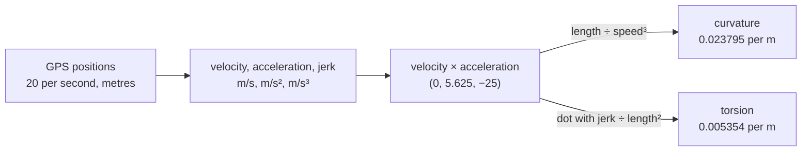
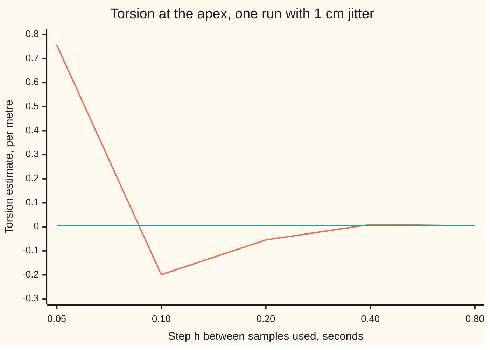

# Curvature and torsion at any speed: formulas that skip relabelling

[Syllabus](../../../SYLLABUS.md) → [Differential geometry and Lie groups](../README.md) → [Curves](../README.md#s01) → Curvature and torsion at any speed

---

## General Overview

A ski run bends right around the shoulder of a hill. In the bend the piste follows a circle of radius 40 m around the hill when seen from above. It also drops 9 m of height for every radian it turns, a steady 22.5% grade. A skier wears a GPS logger that records her position 20 times a second, in metres east, north and up.

At the apex of the bend she passes at 10.25 m/s and is still speeding up, by 0.82 m/s every second. A coach wants two numbers for that spot. How sharply does the track bend? How fast does it twist out of a flat plane? Those are the curvature and the torsion, both in units of 1 per metre. The second tells the coach where the line leaves a plane: on an evenly tilted slope every line stays in one plane and has zero torsion, so torsion shows where a line wraps over curving ground, as this one does round the hill.

The earlier cards on this shelf define both numbers on a curve labelled by distance travelled. The logger labels by the clock instead, and the skier's speed changes every moment. Relabelling by distance means summing speeds into a running distance, then inverting that sum. This card skips that step: three time derivatives of position and two vector products give both numbers directly.

For the skier at the apex they give a curvature of 0.023795 per metre and a torsion of 0.005354 per metre. A second skier on the same bend at a steady 5.125 m/s gets the same two numbers. They belong to the track, not to the skier.

**On any clock, velocity crossed with acceleration is speed cubed times curvature, pointing along the binormal (the arrow at right angles to the plane the track bends in): divide out the speed for curvature, and take the jerk's share (jerk: the rate acceleration changes) along that arrow for torsion.**

**What kind of fact this is:** a theorem, proved on this card in Why it works. It is local: it uses the track only near one point, and it needs the speed there to be non-zero.

### The picture: from positions to two numbers



No step converts the clock into distance travelled.

---

## The formula

Three quick reminders, with links.

- A **regular curve** is a path whose speed is never zero. Its **arc length** $`s`$ is the distance travelled along it, in metres ([Regular curve and arc length](01-regular-curves-and-arc-length.md)).
- On a curve labelled by $`s`$, a prime means "rate per metre travelled". The unit tangent $`\mathbf T`$, the principal normal $`\mathbf N`$ and the binormal $`\mathbf B = \mathbf T \times \mathbf N`$ form the Frenet-Serret frame ([Frenet-Serret frame](04-frenet-serret-frames.md)).
- That frame obeys $`\mathbf T' = \kappa \mathbf N`$, $`\mathbf N' = -\kappa \mathbf T + \tau \mathbf B`$ and $`\mathbf B' = -\tau \mathbf N`$. Here $`\kappa`$ (kappa) is the curvature and $`\tau`$ (tau) the torsion ([Torsion](05-torsion-and-the-helix.md)).

One new notation, in words first. A dot over a letter means "rate per second on the clock". So $`\dot{\mathbf r}`$ is velocity, $`\ddot{\mathbf r}`$ is acceleration, and $`\dddot{\mathbf r}`$ is **jerk**, the rate at which acceleration changes. The prime stays reserved for rates per metre travelled.

```math
\kappa = \frac{\lvert \dot{\mathbf r} \times \ddot{\mathbf r} \rvert}{\lvert \dot{\mathbf r} \rvert^{3}}, \qquad \tau = \frac{(\dot{\mathbf r} \times \ddot{\mathbf r}) \cdot \dddot{\mathbf r}}{\lvert \dot{\mathbf r} \times \ddot{\mathbf r} \rvert^{2}}
```

**Read it aloud:** curvature is the size of velocity crossed with acceleration, divided by speed cubed; torsion is that same cross product dotted with the jerk, divided by the cross product's size squared.

The cross product $`\mathbf a \times \mathbf b`$ of two arrows is a third arrow at right angles to both. Its length is the area of the parallelogram they span ([Cross product](../../05-Geometry%20and%20trig/05-Vectors%20in%20Space/01-cross-product-and-oriented-area.md)). The dot product $`\mathbf a \cdot \mathbf b`$ is a single number: the length of one arrow times the share of the other that points along it.

| Symbol | Plain meaning | In our example | Push it up and the answer… |
| --- | --- | --- | --- |
| $`t`$, $`u = f(t)`$, $`h`$, $`\mathbf P_n`$ | clock time; any other clock made from it; the step between the samples used; the position logged $`n`$ steps of $`h`$ after the apex | $`t = 0`$ s at the apex; $`h = 0.05`$ s at 20 Hz, 0.10 s in the by-hand fixes; $`\mathbf P_0 = (40, 0, 0)`$ m | $`t`$: no effect on a helix; $`h`$: bigger step error, less noise |
| $`\mathbf r(t)`$ | position: metres east, north, up | $`(40, 0, 0)`$ m at the apex | — |
| $`\dot{\mathbf r}`$ | velocity, m/s | $`(0, -10, -2.25)`$ | — |
| $`\ddot{\mathbf r}`$ | acceleration, m/s² | $`(-2.5, -0.8, -0.18)`$ | — |
| $`\dddot{\mathbf r}`$ | jerk: rate of change of acceleration, m/s³ | $`(-0.6, 0.625, 0)`$ | only its binormal part changes $`\tau`$ |
| $`v = \lvert \dot{\mathbf r} \rvert`$, $`s`$, $`\dot v`$, $`\ddot v`$ | speed: the rate of arc length $`s`$ (metres travelled) per second; $`\dot v`$ is its rate of change, and $`\ddot v`$ the rate of that | 10.25 m/s; $`\dot v = 0.82`$ m/s² | $`\kappa`$ and $`\tau`$ do not change |
| $`\times`$, $`\cdot`$ | cross product (an arrow), dot product (a number) | $`\dot{\mathbf r} \times \ddot{\mathbf r} = (0, 5.625, -25)`$ | — |
| $`\mathbf T`$, $`\mathbf N`$, $`\mathbf B`$ | unit tangent, principal normal, binormal | $`\mathbf T`$ points south and down | — |
| $`\kappa`$, $`\kappa'`$ | curvature: turning angle per metre, 1/m; $`\kappa'`$ is its rate of change per metre | 0.023795, the same all round the bend | tighter bend |
| $`\rho = 1/\kappa`$ | radius of the best-fitting circle ([Osculating circle](03-osculating-circle.md)) | 42.025 m | gentler bend |
| $`\tau`$ | torsion: twist out of the bending plane per metre, 1/m, positive for a right-handed twist | 0.005354 | steeper drop, up to a point |
| $`a`$, $`c`$, $`L`$, $`\theta`$ | bend radius seen from above, drop per radian, track length per radian $`\sqrt{a^2 + c^2}`$, angle turned; $`\dot\theta`$ is its rate per second, $`\mathbf r_\theta`$ a rate per radian | 40 m, 9 m, 41 m, 0 rad at the apex | $`a`$: gentler bend; $`c`$: more twist, until $`c = a`$ |

In space, curvature carries no sign: the formula gives $`\kappa \ge 0`$. The signed curvature of [Curvature](02-curvature-of-plane-curves.md) belongs to flat curves, where "left" makes sense.

### When it holds

- **The speed is never zero at the point.** At zero speed the clock stalls and both fractions read 0/0. A skier stopped at the apex gives exactly that, even though the track there is smooth.
- **The curvature is not zero.** The torsion formula divides by $`\lvert \dot{\mathbf r} \times \ddot{\mathbf r} \rvert^2`$. On a straight stretch the normal is undefined, so torsion has no meaning there, and the formula reads 0/0.
- **Position has three derivatives.** Torsion needs the jerk. A track pieced from circle arcs and straights has jumps in curvature, and the jerk is infinite at each join.
- **The derivatives are true derivatives.** Differences of noisy samples are not. In one simulated run with 1 cm of GPS jitter at 20 Hz, the torsion estimate comes out at 0.756317 per metre, against the true 0.005354.
- **Right-handed axes.** East, north, up is right-handed. Swap two axes and every cross product flips, so torsion changes sign while curvature stays.

---

## Why it works

### Step 0: speed only stretches the arrows along the track

The clock and the distance travelled describe the same trip. Changing from one to the other changes only how fast the skier moves along a fixed track. That speed is a stretch along $`\mathbf T`$.

So each clock derivative is a mix of the frame arrows. Velocity is pure $`\mathbf T`$. Acceleration adds $`\mathbf N`$. Jerk adds $`\mathbf B`$. Speed changes only the amounts. The cross product removes every $`\mathbf T`$ part, and the dot product keeps only the $`\mathbf B`$ part, so the speed falls out as known powers of $`v`$.

### Step 1: velocity is speed times the unit tangent

Write the track by distance as $`\mathbf r(s)`$ and let the clock set $`s(t)`$. The one-variable chain rule ([Chain rule in several variables](../../06-Calculus%20and%20analysis/07-Several%20Variables/04-multivariable-chain-rule-and-jacobians.md) gives the general form) says

```math
\dot{\mathbf r} = \mathbf r'(s)\,\dot s = v\,\mathbf T
```

At the apex, $`v = 10.25`$ m/s and $`\mathbf T`$ points south and slightly down.

### Step 2: acceleration is speeding up plus bending

Differentiate again. The product rule gives a $`\dot v`$ term. The chain rule turns $`\dot{\mathbf T}`$ into $`\mathbf T' v = \kappa v \mathbf N`$.

```math
\ddot{\mathbf r} = \dot v\,\mathbf T + v^{2} \kappa\,\mathbf N
```

The first part, 0.82 m/s² for our skier, is speeding up along the track. The second, $`v^2 \kappa`$, is "speed squared over radius", the sideways pull felt in a bend.

### Step 3: the cross product gives curvature

Cross the two. $`\mathbf T \times \mathbf T = 0`$ removes the speeding-up part, and $`\mathbf T \times \mathbf N = \mathbf B`$.

```math
\dot{\mathbf r} \times \ddot{\mathbf r} = v^{3} \kappa\,\mathbf B
```

$`\mathbf B`$ has length 1, so $`\lvert \dot{\mathbf r} \times \ddot{\mathbf r} \rvert = v^3 \kappa`$. Divide by $`v^3`$ and curvature appears. At the apex, $`25.625 = 1076.890625 \times 0.023795`$.

### Step 4: the jerk's binormal part gives torsion

Differentiate once more. Only one term can produce $`\mathbf B`$: the derivative of $`\mathbf N`$, which is $`v(-\kappa \mathbf T + \tau \mathbf B)`$ by the Frenet-Serret equations. That term arrives multiplied by $`v^2 \kappa`$.

```math
\dddot{\mathbf r} = (\ldots)\,\mathbf T + (\ldots)\,\mathbf N + v^{3} \kappa \tau\,\mathbf B
```

Dot it with Step 3's arrow, which points along $`\mathbf B`$. The $`\mathbf T`$ and $`\mathbf N`$ parts vanish, whatever they are, and $`(\dot{\mathbf r} \times \ddot{\mathbf r}) \cdot \dddot{\mathbf r} = v^6 \kappa^2 \tau`$. Step 3 squared is $`v^6 \kappa^2`$. Divide, and torsion is left.

<details>
<summary>Detailed proof: the full jerk, and the triple product as a determinant</summary>

Differentiate $`\ddot{\mathbf r} = \dot v \mathbf T + v^2 \kappa \mathbf N`$ with the product rule. Each frame arrow changes at $`v`$ times its rate per metre: $`\dot{\mathbf T} = v \kappa \mathbf N`$ and $`\dot{\mathbf N} = v(-\kappa \mathbf T + \tau \mathbf B)`$. Write $`\kappa'`$ for the rate of curvature per metre, so $`\dot\kappa = v \kappa'`$.

$`\displaystyle \dddot{\mathbf r} = (\ddot v - v^{3}\kappa^{2})\,\mathbf T + (3 v \dot v \kappa + v^{3} \kappa')\,\mathbf N + v^{3} \kappa \tau\,\mathbf B`$

Only the last coefficient survives the dot with $`v^3 \kappa \mathbf B`$. This is why the factor 3 in the worked table's jerk row never affects torsion: it multiplies a part the formula cannot see.

The number $`(\dot{\mathbf r} \times \ddot{\mathbf r}) \cdot \dddot{\mathbf r}`$ is the determinant of the 3 × 3 matrix whose rows are the three derivatives. It is the signed volume of the box they span. It is positive when the three arrows are right-handed, which is why a right-handed spiral has positive torsion.

Any other clock $`u = f(t)`$ with $`\dot f \neq 0`$ gives the same $`\mathbf T`$, $`\mathbf N`$, $`\mathbf B`$ up to the sign of $`\dot f`$. Running the clock backwards flips $`\mathbf T`$ and $`\mathbf B`$ but not $`\mathbf N`$. Both fractions are unchanged: $`\kappa`$ has an even power of the flip, and $`\tau`$ has the flip twice in its numerator.

</details>

### Step 5: the same numbers from the angle, and from the closed form

For the bend there is a formula by hand. Label the track by the angle turned, $`\theta`$:

```math
\mathbf r(\theta) = \big(a \cos\theta,\ -a \sin\theta,\ -c\,\theta\big)
```

This is a helix, a spring shape, turning clockwise seen from above while it drops: the shape [Torsion](05-torsion-and-the-helix.md) studies. Use the angle itself as the clock. Then $`\lvert \mathbf r_\theta \rvert = L`$, the cross product $`\mathbf r_\theta \times \mathbf r_{\theta\theta}`$ has length $`aL`$, and its dot with $`\mathbf r_{\theta\theta\theta}`$ is $`ca^2`$. The formulas give constants:

```math
\kappa = \frac{aL}{L^{3}} = \frac{a}{a^{2} + c^{2}}, \qquad \tau = \frac{ca^{2}}{a^{2}L^{2}} = \frac{c}{a^{2} + c^{2}}
```

With $`a = 40`$ m and $`c = 9`$ m, $`a^2 + c^2 = 1681`$, so $`\kappa = 40/1681 = 0.023795`$ per metre and $`\tau = 9/1681 = 0.005354`$ per metre. Skier A's clock and skier B's clock land on the same digits.

---

## Worked numbers, by hand

This first table uses the bend's formula, so its derivatives are exact: it is how the test data are made. The second table starts from logged positions alone.

At the apex, $`\theta = 0`$. The skier's angle changes at $`\dot\theta = v/L`$, and that rate changes at $`\ddot\theta = \dot v/L`$, where $`\dot v = 0.82`$ m/s² is her speeding up. The chain rule then builds each clock derivative from the angle derivatives of $`\mathbf r(\theta)`$.

| Step | Arithmetic | Value |
| --- | --- | --- |
| angle rate $`\dot\theta`$ | $`10.25 / 41`$ | 0.25 rad/s |
| its rate $`\ddot\theta`$ | $`0.82 / 41`$ | 0.02 rad/s² |
| $`\mathbf r_\theta, \mathbf r_{\theta\theta}, \mathbf r_{\theta\theta\theta}`$ at $`\theta = 0`$ | differentiate $`\mathbf r(\theta)`$ | $`(0, -40, -9)`$, $`(-40, 0, 0)`$, $`(0, 40, 0)`$ |
| velocity $`\dot{\mathbf r} = \dot\theta\,\mathbf r_\theta`$ | $`0.25 \times (0, -40, -9)`$ | $`(0, -10, -2.25)`$ m/s |
| acceleration $`\ddot\theta\,\mathbf r_\theta + \dot\theta^2 \mathbf r_{\theta\theta}`$ | $`0.02 \times (0, -40, -9) + 0.0625 \times (-40, 0, 0)`$ | $`(-2.5, -0.8, -0.18)`$ m/s² |
| jerk $`3\dot\theta\ddot\theta\,\mathbf r_{\theta\theta} + \dot\theta^3 \mathbf r_{\theta\theta\theta}`$ | $`0.015 \times (-40, 0, 0) + 0.015625 \times (0, 40, 0)`$ | $`(-0.6, 0.625, 0)`$ m/s³ |
| $`\dot{\mathbf r} \times \ddot{\mathbf r}`$ | $`(-10 \cdot -0.18 - (-2.25)(-0.8),\ -2.25 \cdot -2.5 - 0,\ 0 - (-10)(-2.5))`$ | $`(0, 5.625, -25)`$ |
| its length | $`\sqrt{5.625^2 + 25^2} = \sqrt{656.640625}`$ | 25.625 |
| speed cubed | $`10.25^3`$ | 1076.890625 |
| **curvature** $`\kappa`$ | $`25.625 / 1076.890625`$ | **0.023795 per m** |
| radius of the best-fitting circle | $`1 / 0.023795`$ | 42.025 m |
| triple product | $`0 \times (-0.6) + 5.625 \times 0.625 + (-25) \times 0`$ | 3.515625 |
| **torsion** $`\tau`$ | $`3.515625 / 656.640625`$ | **0.005354 per m** |

The track bends like a circle of radius 42.025 m, a little wider than the 40 m seen from above, because the drop stretches the turn. It twists out of its bending plane more slowly than it bends: $`\tau/\kappa = c/a = 0.225`$, the grade of the slope.

### From five logged fixes, with no formula

A logger knows only positions. Write $`\mathbf P_n`$ for the fix logged $`n`$ steps of $`h`$ seconds after the apex. Central differences (slopes between fixes on either side of the point) turn five fixes into the three derivatives:

```math
\dot{\mathbf r} \approx \frac{\mathbf P_{1} - \mathbf P_{-1}}{2h}, \qquad \ddot{\mathbf r} \approx \frac{\mathbf P_{1} - 2\mathbf P_{0} + \mathbf P_{-1}}{h^{2}}, \qquad \dddot{\mathbf r} \approx \frac{\mathbf P_{2} - 2\mathbf P_{1} + 2\mathbf P_{-1} - \mathbf P_{-2}}{2h^{3}}
```

**Read it aloud:** velocity is the step across the apex over the time it took; acceleration is how much the step after the apex differs from the step before, over h squared; jerk is the same pattern one level up, over two h cubed.

Each error shrinks like $`h^2`$. Take every other 20 Hz sample, so $`h = 0.10`$ s, from a perfect logger with no noise yet. The fixes are written to 8 decimals of a metre because the jerk divides by $`2h^3 = 0.002`$ s³: fixes rounded to the millimetre would swamp it.

| Step | Arithmetic | Value |
| --- | --- | --- |
| fixes $`\mathbf P_{-2}`$, $`\mathbf P_{-1}`$ | logged at −0.2 s and −0.1 s | (39.95080689, 1.98318661, 0.44640000), (39.98760044, 0.99589708, 0.22410000) m |
| fix $`\mathbf P_0`$ | the apex, 0 s | (40, 0, 0) m |
| fixes $`\mathbf P_1`$, $`\mathbf P_2`$ | logged at 0.1 s and 0.2 s | (39.98740046, −1.00389458, −0.22590000), (39.94920755, −2.01514661, −0.45360000) m |
| velocity $`\dot{\mathbf r}`$ | $`(\mathbf P_1 - \mathbf P_{-1}) / 0.2`$ | (−0.0010, −9.9990, −2.2500) m/s |
| acceleration $`\ddot{\mathbf r}`$ | $`(\mathbf P_1 - 2\mathbf P_0 + \mathbf P_{-1}) / 0.01`$ | (−2.4999, −0.7998, −0.1800) m/s² |
| jerk $`\dddot{\mathbf r}`$ | $`(\mathbf P_2 - 2\mathbf P_1 + 2\mathbf P_{-1} - \mathbf P_{-2}) / 0.002`$ | (−0.5997, 0.6251, 0) m/s³ |
| $`\dot{\mathbf r} \times \ddot{\mathbf r}`$ | as in the table above | (0.0004, 5.6246, −24.9957) |
| its length, and speed cubed | as above | 25.6207 and 1076.5704 |
| **curvature** $`\kappa`$ | $`25.6207 / 1076.5704`$ | **0.023798 per m** |
| triple product, and length squared | as above | 3.515455 and 656.421037 |
| **torsion** $`\tau`$ | $`3.515455 / 656.421037`$ | **0.005355 per m** |

Five positions and no formula land 0.0000031 per metre above the exact curvature and 0.0000015 above the exact torsion, with the jerk off by 0.000317 m/s³. At $`h = 0.05`$ s each of those errors is 4 times smaller.

### What breaks if you drop a piece

| Mistake | Comes out at | What went wrong |
| --- | --- | --- |
| Curvature as $`\lvert \ddot{\mathbf r} \rvert / \lvert \dot{\mathbf r} \rvert^2`$ | 0.025043 per m, 5.2% high | the 0.82 m/s² of speeding up is counted as bending; the cross product exists to remove it |
| Torsion divided by $`\lvert \dot{\mathbf r} \times \ddot{\mathbf r} \rvert`$, not its square | 0.137195, 25.63 times too big | the speed no longer cancels: the result is in m/s³, not per metre |
| Skier stopped at the apex, speed 0 | 0/0 for both | the clock stalls: $`\dot{\mathbf r} = 0`$, so the cross product is 0; the track is fine, the labelling is not regular |
| One run of positions with 1 cm GPS jitter, steps of 0.05 s | $`\kappa = 0.061181`$, $`\tau = 0.756317`$ per m | dividing by $`h^3`$ blows 1 cm of noise up into the jerk |

### Real GPS: the step decides the torsion

The last row is the trap that matters most in practice. The code adds jitter of up to 1 cm to each coordinate, drawn afresh at every sample by a seeded generator (seed 2026), then estimates the derivatives over wider and wider steps $`h`$. That is an optimistic model of GPS. For the best differential methods tested on ski racers, mean position errors were under 2 cm with spreads under 4 cm (the ski-racing GPS study in Sources). Real GPS errors also change slowly from one fix to the next instead of jumping independently, so the model is a simplification either way.



The orange line is the estimate from one run of jittered positions. The green line is the true torsion, 0.005354 per metre. Short steps amplify the noise: another seed gives other wild values from 0.05 s to 0.2 s, of either sign. Only at 0.8 s does this run settle near the truth, at 0.004615. Curvature, one derivative lower, is already close at 0.4 s: 0.024058. Noisier data need a wider step still, or a smooth fit before differentiating.

---

## Code, from first principles, and it actually runs

Both programs build the bend, then reach the same two numbers by four independent roads. Road 1 is the closed form $`a/(a^2+c^2)`$, $`c/(a^2+c^2)`$. Road 2 is the any-speed formulas on skier A's clock, with derivatives from the chain rule. Road 3 repeats road 2 at other moments and on two other clocks: skier B at a steady 5.125 m/s, and the angle itself, which runs at 41 m of track per radian. Road 4 uses positions only: 20 Hz samples and the central differences of the worked numbers, at two step sizes. Halving the step divides its errors by 4, as a second-order difference should, and its jerk must meet road 2's chain-rule jerk. Then they print every "what breaks" number and the chart points.

### Python

```python
# Curvature and torsion at any speed -- the check behind the card.  Standard library only.
# A ski run bends right round a hill while dropping: a helix of radius a = 40 m that
# drops c = 9 m per radian.  Skier A passes the apex at 10.25 m/s, speeding up.
# Roads: closed form by arc length; the any-speed formulas on three different
# parametrisations; central differences on 20 Hz positions at two step sizes.
import math

def sub(p, q): return tuple(a - b for a, b in zip(p, q))
def scale(k, p): return tuple(k * a for a in p)
def dot(p, q): return sum(a * b for a, b in zip(p, q))
def cross(p, q): return (p[1]*q[2] - p[2]*q[1], p[2]*q[0] - p[0]*q[2], p[0]*q[1] - p[1]*q[0])
def norm(p): return math.sqrt(dot(p, p))
def vec(p, d=4): return "(" + ", ".join(f"{0.0 if abs(a) < 0.5 * 10 ** -d else a:.{d}f}" for a in p) + ")"

def pos(g, th): return (g[0] * math.cos(th), -g[0] * math.sin(th), -g[1] * th)

def derivs(g, th, d1, d2, d3):
    # chain rule: r(t) = r(theta(t)); d1, d2, d3 are theta's first three time derivatives
    R, C = g
    r1 = (-R * math.sin(th), -R * math.cos(th), -C)
    r2 = (-R * math.cos(th), R * math.sin(th), 0.0)
    r3 = (R * math.sin(th), R * math.cos(th), 0.0)
    v = scale(d1, r1)
    acc = tuple(d2 * a + d1 * d1 * b for a, b in zip(r1, r2))
    jerk = tuple(d3 * a + 3 * d1 * d2 * b + d1 ** 3 * e for a, b, e in zip(r1, r2, r3))
    return v, acc, jerk

def kappa_tau(v, acc, jerk):
    w = cross(v, acc)
    return norm(w) / norm(v) ** 3, dot(w, jerk) / dot(w, w)

def skier(g, v0, a, t):                    # angle turned, and its time derivatives
    L = math.hypot(*g)                     # metres of track per radian of turn
    return (v0 * t + a * t * t / 2) / L, (v0 + a * t) / L, a / L, 0.0

def closed(g): return g[0] / (g[0] ** 2 + g[1] ** 2), g[1] / (g[0] ** 2 + g[1] ** 2)

G = (40.0, 9.0)
K0, T0 = closed(G)
print(f"bend: a = 40 m, drop c = 9 m per radian, a^2 + c^2 = {G[0]**2 + G[1]**2:.0f}, L = {math.hypot(*G):.0f} m per radian")
print(f"road 1, closed form: kappa = {K0:.10f} 1/m, tau = {T0:.10f} 1/m, radius {1/K0:.3f} m, tau/kappa = {T0/K0:.3f}")

V0, A0 = 10.25, 0.82
th, d1, d2, d3 = skier(G, V0, A0, 0.0)
print(f"grade {100 * G[1] / G[0]:.1f}%, skier A at the apex: thetadot = {d1:.2f} rad/s, thetaddot = {d2:.2f} rad/s^2, position {vec(pos(G, th))}")
print(f"thetadot^2 = {d1*d1:.4f}, 3 thetadot thetaddot = {3*d1*d2:.3f}, thetadot^3 = {d1**3:.6f}")
print("angle clock at the apex: r_th, r_thth, r_ththth = " + ", ".join(vec(p) for p in derivs(G, 0.0, 1.0, 0.0, 0.0)))
v, acc, jerk = derivs(G, *skier(G, V0, A0, 0.0))
w = cross(v, acc)
print(f"skier A at t = 0 s: rdot = {vec(v)}, rddot = {vec(acc)}, rdddot = {vec(jerk)}")
print(f"rdot x rddot = {vec(w)}, |rdot x rddot| = {norm(w):.4f}, |rdot|^3 = {norm(v)**3:.6f}")
print(f"det = (rdot x rddot).rdddot = {dot(w, jerk):.6f}, |rdot x rddot|^2 = {dot(w, w):.6f}")
k, t = kappa_tau(v, acc, jerk)
print(f"road 2, any-speed formulas: kappa = {k:.10f} 1/m, tau = {t:.10f} 1/m")
assert abs(k - K0) < 1e-12 and abs(t - T0) < 1e-12
k_wrong = norm(acc) / norm(v) ** 2
t_wrong = dot(w, jerk) / norm(w)
swap = [(p[1], p[0], p[2]) for p in (v, acc, jerk)]   # north, east, up

print("road 3, same track, three clocks: label, time s, speed m/s, kappa, tau")
for label, v0, a, ts in [("A", V0, A0, (-4.0, 4.0, 8.0)), ("B steady", 5.125, 0.0, (0.0, 6.0)), ("angle", 41.0, 0.0, (0.5,))]:
    for tt in ts:
        th, d1, d2, d3 = skier(G, v0, a, tt)
        k, t = kappa_tau(*derivs(G, th, d1, d2, d3))
        print(f"  {label}, t = {tt:.1f}, speed {d1 * 41:.3f}, kappa {k:.10f}, tau {t:.10f}")
        assert abs(k - K0) < 1e-12 and abs(t - T0) < 1e-12

# road 4: positions only, 20 Hz samples, central differences at step h = m * 0.05 s
def track(noise, seed=2026):
    s, out = seed, {}
    for n in range(-40, 41):
        p = pos(G, skier(G, V0, A0, n * 0.05)[0])
        jit = []
        for _ in range(3):                 # SplitMix64, uniform in [-noise, noise]
            s = (s + 0x9E3779B97F4A7C15) & 0xFFFFFFFFFFFFFFFF
            z = ((s ^ (s >> 30)) * 0xBF58476D1CE4E5B9) & 0xFFFFFFFFFFFFFFFF
            z = ((z ^ (z >> 27)) * 0x94D049BB133111EB) & 0xFFFFFFFFFFFFFFFF
            jit.append(noise * (2 * ((z ^ (z >> 31)) >> 11) / 2 ** 53 - 1))
        out[n] = tuple(a + b for a, b in zip(p, jit))
    return out

def by_steps(P, m):
    h = 0.05 * m
    v = scale(1 / (2 * h), sub(P[m], P[-m]))
    acc = scale(1 / h ** 2, tuple(a - 2 * b + c for a, b, c in zip(P[m], P[0], P[-m])))
    jerk = scale(1 / (2 * h ** 3), tuple(a - 2 * b + 2 * c - d for a, b, c, d in zip(P[2 * m], P[m], P[-m], P[-2 * m])))
    return v, acc, jerk

P = track(0.0)
for n in (-4, -2, 0, 2, 4):
    print(f"road 4, fix at t = {n * 0.05:.1f} s: {vec(P[n], 8)} m")
errs = []
for m in (2, 1):
    d = by_steps(P, m)
    k, t = kappa_tau(*d)
    errs.append((k - K0, t - T0, norm(sub(d[2], jerk))))   # jerk: skier A's, by the chain rule
    wd = cross(d[0], d[1])
    print(f"road 4, h = {0.05*m:.2f} s: rdot = {vec(d[0])}, rddot = {vec(d[1])}, rdddot = {vec(d[2])}")
    print(f"  rdot x rddot = {vec(wd)}, length {norm(wd):.4f}, |rdot|^3 = {norm(d[0])**3:.4f}, det {dot(wd, d[2]):.6f}, length^2 {dot(wd, wd):.6f}")
    print(f"  kappa {k:.10f} (error {k-K0:.10f}), tau {t:.10f} (error {t-T0:.10f}), jerk off by {errs[-1][2]:.6f}")
rk, rt, rj = (errs[0][j] / errs[1][j] for j in range(3))
print(f"halving h divides the errors by {rk:.3f}, {rt:.3f} and {rj:.3f}")
assert 3.5 < rk < 4.5 and 3.5 < rt < 4.5 and abs(errs[1][1]) < 1e-5
assert 3.5 < rj < 4.5 and errs[1][2] < 1e-3            # the jerk from positions meets the chain-rule jerk

print("what breaks:")
print(f"  |rddot|/|rdot|^2 = {k_wrong:.6f} ({100*(k_wrong/K0-1):+.1f}%), |rddot| = {k_wrong * 10.25**2:.5f} m/s^2")
print(f"  det over |rdot x rddot|, not squared = {t_wrong:.6f} ({t_wrong/T0:.2f} times)")
assert k_wrong / K0 - 1 > 0.01 and t_wrong / T0 > 10
k, t = kappa_tau(*swap)
print(f"  axes swapped to north, east, up: kappa {k:.6f}, tau {t:.6f}")
assert abs(k - K0) < 1e-12 and abs(t + T0) < 1e-12
v, acc, jerk = derivs(G, *skier(G, 0.0, A0, 0.0))
print(f"  skier stopped at t = 0: |rdot x rddot| = {norm(cross(v, acc)):.4f}, |rdot|^3 = {norm(v)**3:.4f}, 0/0")
print("chart, 1 cm GPS jitter at 20 Hz: h in s, kappa, tau")
for m in (1, 2, 4, 8, 16):
    k, t = kappa_tau(*by_steps(track(0.01), m))
    print(f"  h = {0.05*m:.2f}: kappa {k:.6f}, tau {t:.6f}")
    if m == 1:
        assert abs(t - T0) > 0.5 * T0
print("try changing:")
for label, g, a in [("flat bend, c = 0", (40.0, 0.0), A0), ("steep spiral, c = 40", (40.0, 40.0), A0),
                    ("skier braking, -0.82 m/s^2", G, -A0)]:
    k, t = kappa_tau(*derivs(g, *skier(g, V0, a, 2.0)))
    print(f"  {label}: kappa {k:.6f}, tau {t:.6f}")
    assert abs(k - closed(g)[0]) < 1e-12 and abs(t - closed(g)[1]) < 1e-12
print("ALL CHECKS PASS")
```

**Ran 2026-11-19 on macOS, Python 3.14.10, standard library only. All checks passed. Output, pasted from the run:**

```
bend: a = 40 m, drop c = 9 m per radian, a^2 + c^2 = 1681, L = 41 m per radian
road 1, closed form: kappa = 0.0237953599 1/m, tau = 0.0053539560 1/m, radius 42.025 m, tau/kappa = 0.225
grade 22.5%, skier A at the apex: thetadot = 0.25 rad/s, thetaddot = 0.02 rad/s^2, position (40.0000, 0.0000, 0.0000)
thetadot^2 = 0.0625, 3 thetadot thetaddot = 0.015, thetadot^3 = 0.015625
angle clock at the apex: r_th, r_thth, r_ththth = (0.0000, -40.0000, -9.0000), (-40.0000, 0.0000, 0.0000), (0.0000, 40.0000, 0.0000)
skier A at t = 0 s: rdot = (0.0000, -10.0000, -2.2500), rddot = (-2.5000, -0.8000, -0.1800), rdddot = (-0.6000, 0.6250, 0.0000)
rdot x rddot = (0.0000, 5.6250, -25.0000), |rdot x rddot| = 25.6250, |rdot|^3 = 1076.890625
det = (rdot x rddot).rdddot = 3.515625, |rdot x rddot|^2 = 656.640625
road 2, any-speed formulas: kappa = 0.0237953599 1/m, tau = 0.0053539560 1/m
road 3, same track, three clocks: label, time s, speed m/s, kappa, tau
  A, t = -4.0, speed 6.970, kappa 0.0237953599, tau 0.0053539560
  A, t = 4.0, speed 13.530, kappa 0.0237953599, tau 0.0053539560
  A, t = 8.0, speed 16.810, kappa 0.0237953599, tau 0.0053539560
  B steady, t = 0.0, speed 5.125, kappa 0.0237953599, tau 0.0053539560
  B steady, t = 6.0, speed 5.125, kappa 0.0237953599, tau 0.0053539560
  angle, t = 0.5, speed 41.000, kappa 0.0237953599, tau 0.0053539560
road 4, fix at t = -0.2 s: (39.95080689, 1.98318661, 0.44640000) m
road 4, fix at t = -0.1 s: (39.98760044, 0.99589708, 0.22410000) m
road 4, fix at t = 0.0 s: (40.00000000, 0.00000000, 0.00000000) m
road 4, fix at t = 0.1 s: (39.98740046, -1.00389458, -0.22590000) m
road 4, fix at t = 0.2 s: (39.94920755, -2.01514661, -0.45360000) m
road 4, h = 0.10 s: rdot = (-0.0010, -9.9990, -2.2500), rddot = (-2.4999, -0.7998, -0.1800), rdddot = (-0.5997, 0.6251, 0.0000)
  rdot x rddot = (0.0004, 5.6246, -24.9957), length 25.6207, |rdot|^3 = 1076.5704, det 3.515455, length^2 656.421037
  kappa 0.0237984586 (error 0.0000030987), tau 0.0053554878 (error 0.0000015318), jerk off by 0.000317
road 4, h = 0.05 s: rdot = (-0.0002, -9.9997, -2.2500), rddot = (-2.5000, -0.7999, -0.1800), rdddot = (-0.5999, 0.6250, 0.0000)
  rdot x rddot = (0.0001, 5.6249, -24.9989), length 25.6239, |rdot|^3 = 1076.8105, det 3.515583, length^2 656.585722
  kappa 0.0237961345 (error 0.0000007746), tau 0.0053543390 (error 0.0000003830), jerk off by 0.000079
halving h divides the errors by 4.000, 4.000 and 4.000
what breaks:
  |rddot|/|rdot|^2 = 0.025043 (+5.2%), |rddot| = 2.63105 m/s^2
  det over |rdot x rddot|, not squared = 0.137195 (25.63 times)
  axes swapped to north, east, up: kappa 0.023795, tau -0.005354
  skier stopped at t = 0: |rdot x rddot| = 0.0000, |rdot|^3 = 0.0000, 0/0
chart, 1 cm GPS jitter at 20 Hz: h in s, kappa, tau
  h = 0.05: kappa 0.061181, tau 0.756317
  h = 0.10: kappa 0.029593, tau -0.198969
  h = 0.20: kappa 0.018707, tau -0.054662
  h = 0.40: kappa 0.024058, tau 0.009828
  h = 0.80: kappa 0.023821, tau 0.004615
try changing:
  flat bend, c = 0: kappa 0.025000, tau 0.000000
  steep spiral, c = 40: kappa 0.012500, tau 0.012500
  skier braking, -0.82 m/s^2: kappa 0.023795, tau 0.005354
ALL CHECKS PASS
```

### Rust

```rust
// Curvature and torsion at any speed -- the check behind the card.  std only.
// A ski run bends right round a hill while dropping: a helix of radius a = 40 m that
// drops c = 9 m per radian.  Skier A passes the apex at 10.25 m/s, speeding up.
// Roads: closed form by arc length; the any-speed formulas on three different
// parametrisations; central differences on 20 Hz positions at two step sizes.
type V = [f64; 3];
type G = (f64, f64);

fn sub(p: V, q: V) -> V { [p[0] - q[0], p[1] - q[1], p[2] - q[2]] }
fn scale(k: f64, p: V) -> V { [k * p[0], k * p[1], k * p[2]] }
fn dot(p: V, q: V) -> f64 { p[0] * q[0] + p[1] * q[1] + p[2] * q[2] }
fn cross(p: V, q: V) -> V { [p[1] * q[2] - p[2] * q[1], p[2] * q[0] - p[0] * q[2], p[0] * q[1] - p[1] * q[0]] }
fn norm(p: V) -> f64 { dot(p, p).sqrt() }
fn vecd(p: V, d: usize) -> String {
    let s: Vec<String> = p.iter().map(|&a| format!("{:.*}", d, if a.abs() < 0.5 * 10f64.powi(-(d as i32)) { 0.0 } else { a })).collect();
    format!("({})", s.join(", "))
}
fn vec(p: V) -> String { vecd(p, 4) }

fn pos(g: G, th: f64) -> V { [g.0 * th.cos(), -g.0 * th.sin(), -g.1 * th] }

// chain rule: r(t) = r(theta(t)); d1, d2, d3 are theta's first three time derivatives
fn derivs(g: G, s: (f64, f64, f64, f64)) -> (V, V, V) {
    let (th, d1, d2, d3) = s;
    let (r, c) = g;
    let r1 = [-r * th.sin(), -r * th.cos(), -c];
    let r2 = [-r * th.cos(), r * th.sin(), 0.0];
    let r3 = [r * th.sin(), r * th.cos(), 0.0];
    let v = scale(d1, r1);
    let mut acc = [0.0; 3];
    let mut jerk = [0.0; 3];
    for i in 0..3 {
        acc[i] = d2 * r1[i] + d1 * d1 * r2[i];
        jerk[i] = d3 * r1[i] + 3.0 * d1 * d2 * r2[i] + d1.powi(3) * r3[i];
    }
    (v, acc, jerk)
}

fn kappa_tau(d: (V, V, V)) -> (f64, f64) {
    let w = cross(d.0, d.1);
    (norm(w) / norm(d.0).powi(3), dot(w, d.2) / dot(w, w))
}

// angle turned, and its time derivatives
fn skier(g: G, v0: f64, a: f64, t: f64) -> (f64, f64, f64, f64) {
    let l = g.0.hypot(g.1); // metres of track per radian of turn
    ((v0 * t + a * t * t / 2.0) / l, (v0 + a * t) / l, a / l, 0.0)
}

fn closed(g: G) -> (f64, f64) { let q = g.0 * g.0 + g.1 * g.1; (g.0 / q, g.1 / q) }

const GB: G = (40.0, 9.0);
const V0: f64 = 10.25;
const A0: f64 = 0.82;

// road 4: positions only, 20 Hz samples, n = -40..40, with SplitMix64 jitter in [-noise, noise]
fn track(noise: f64) -> Vec<V> {
    let mut s: u64 = 2026;
    let mut out = Vec::new();
    for n in -40i32..41 {
        let p = pos(GB, skier(GB, V0, A0, n as f64 * 0.05).0);
        let mut q = p;
        for i in 0..3 {
            s = s.wrapping_add(0x9E3779B97F4A7C15);
            let mut z = (s ^ (s >> 30)).wrapping_mul(0xBF58476D1CE4E5B9);
            z = (z ^ (z >> 27)).wrapping_mul(0x94D049BB133111EB);
            let u = ((z ^ (z >> 31)) >> 11) as f64 / 9007199254740992.0;
            q[i] = p[i] + noise * (2.0 * u - 1.0);
        }
        out.push(q);
    }
    out
}

fn by_steps(pts: &Vec<V>, m: i32) -> (V, V, V) {
    let at = |n: i32| pts[(n + 40) as usize];
    let h = 0.05 * m as f64;
    let (p2, p1, p0, n1, n2) = (at(2 * m), at(m), at(0), at(-m), at(-2 * m));
    let v = scale(1.0 / (2.0 * h), sub(p1, n1));
    let mut acc = [0.0; 3];
    let mut jerk = [0.0; 3];
    for i in 0..3 {
        acc[i] = (p1[i] - 2.0 * p0[i] + n1[i]) * (1.0 / (h * h));
        jerk[i] = (p2[i] - 2.0 * p1[i] + 2.0 * n1[i] - n2[i]) * (1.0 / (2.0 * h.powi(3)));
    }
    (v, acc, jerk)
}

fn main() {
    let (k0, t0) = closed(GB);
    println!("bend: a = 40 m, drop c = 9 m per radian, a^2 + c^2 = {:.0}, L = {:.0} m per radian", GB.0 * GB.0 + GB.1 * GB.1, GB.0.hypot(GB.1));
    println!("road 1, closed form: kappa = {:.10} 1/m, tau = {:.10} 1/m, radius {:.3} m, tau/kappa = {:.3}", k0, t0, 1.0 / k0, t0 / k0);

    let s0 = skier(GB, V0, A0, 0.0);
    println!("grade {:.1}%, skier A at the apex: thetadot = {:.2} rad/s, thetaddot = {:.2} rad/s^2, position {}", 100.0 * GB.1 / GB.0, s0.1, s0.2, vec(pos(GB, s0.0)));
    println!("thetadot^2 = {:.4}, 3 thetadot thetaddot = {:.3}, thetadot^3 = {:.6}", s0.1 * s0.1, 3.0 * s0.1 * s0.2, s0.1.powi(3));
    let (a1, a2, a3) = derivs(GB, (0.0, 1.0, 0.0, 0.0));
    println!("angle clock at the apex: r_th, r_thth, r_ththth = {}, {}, {}", vec(a1), vec(a2), vec(a3));
    let (v, acc, jerk) = derivs(GB, s0);
    let w = cross(v, acc);
    println!("skier A at t = 0 s: rdot = {}, rddot = {}, rdddot = {}", vec(v), vec(acc), vec(jerk));
    println!("rdot x rddot = {}, |rdot x rddot| = {:.4}, |rdot|^3 = {:.6}", vec(w), norm(w), norm(v).powi(3));
    println!("det = (rdot x rddot).rdddot = {:.6}, |rdot x rddot|^2 = {:.6}", dot(w, jerk), dot(w, w));
    let (k, t) = kappa_tau((v, acc, jerk));
    println!("road 2, any-speed formulas: kappa = {:.10} 1/m, tau = {:.10} 1/m", k, t);
    assert!((k - k0).abs() < 1e-12 && (t - t0).abs() < 1e-12);
    let k_wrong = norm(acc) / norm(v).powi(2);
    let t_wrong = dot(w, jerk) / norm(w);
    let sw = |p: V| -> V { [p[1], p[0], p[2]] }; // north, east, up
    let swap = (sw(v), sw(acc), sw(jerk));

    println!("road 3, same track, three clocks: label, time s, speed m/s, kappa, tau");
    let clocks: [(&str, f64, f64, &[f64]); 3] =
        [("A", V0, A0, &[-4.0, 4.0, 8.0]), ("B steady", 5.125, 0.0, &[0.0, 6.0]), ("angle", 41.0, 0.0, &[0.5])];
    for (label, v0, a, ts) in clocks.iter() {
        for &tt in ts.iter() {
            let s = skier(GB, *v0, *a, tt);
            let (k, t) = kappa_tau(derivs(GB, s));
            println!("  {}, t = {:.1}, speed {:.3}, kappa {:.10}, tau {:.10}", label, tt, s.1 * 41.0, k, t);
            assert!((k - k0).abs() < 1e-12 && (t - t0).abs() < 1e-12);
        }
    }

    let clean = track(0.0);
    for n in [-4i32, -2, 0, 2, 4] {
        println!("road 4, fix at t = {:.1} s: {} m", n as f64 * 0.05, vecd(clean[(n + 40) as usize], 8));
    }
    let mut errs: Vec<[f64; 3]> = Vec::new();
    for m in [2, 1] {
        let d = by_steps(&clean, m);
        let (k, t) = kappa_tau(d);
        errs.push([k - k0, t - t0, norm(sub(d.2, jerk))]); // jerk: skier A's, by the chain rule
        let wd = cross(d.0, d.1);
        println!("road 4, h = {:.2} s: rdot = {}, rddot = {}, rdddot = {}", 0.05 * m as f64, vec(d.0), vec(d.1), vec(d.2));
        println!("  rdot x rddot = {}, length {:.4}, |rdot|^3 = {:.4}, det {:.6}, length^2 {:.6}", vec(wd), norm(wd), norm(d.0).powi(3), dot(wd, d.2), dot(wd, wd));
        println!("  kappa {:.10} (error {:.10}), tau {:.10} (error {:.10}), jerk off by {:.6}", k, k - k0, t, t - t0, errs[errs.len() - 1][2]);
    }
    let (rk, rt, rj) = (errs[0][0] / errs[1][0], errs[0][1] / errs[1][1], errs[0][2] / errs[1][2]);
    println!("halving h divides the errors by {:.3}, {:.3} and {:.3}", rk, rt, rj);
    assert!(rk > 3.5 && rk < 4.5 && rt > 3.5 && rt < 4.5 && errs[1][1].abs() < 1e-5);
    assert!(rj > 3.5 && rj < 4.5 && errs[1][2] < 1e-3); // the jerk from positions meets the chain-rule jerk

    println!("what breaks:");
    println!("  |rddot|/|rdot|^2 = {:.6} ({:+.1}%), |rddot| = {:.5} m/s^2", k_wrong, 100.0 * (k_wrong / k0 - 1.0), k_wrong * 10.25f64.powi(2));
    println!("  det over |rdot x rddot|, not squared = {:.6} ({:.2} times)", t_wrong, t_wrong / t0);
    assert!(k_wrong / k0 - 1.0 > 0.01 && t_wrong / t0 > 10.0);
    let (k, t) = kappa_tau(swap);
    println!("  axes swapped to north, east, up: kappa {:.6}, tau {:.6}", k, t);
    assert!((k - k0).abs() < 1e-12 && (t + t0).abs() < 1e-12);
    let (v, acc, _) = derivs(GB, skier(GB, 0.0, A0, 0.0));
    println!("  skier stopped at t = 0: |rdot x rddot| = {:.4}, |rdot|^3 = {:.4}, 0/0",
             norm(cross(v, acc)), norm(v).powi(3));
    println!("chart, 1 cm GPS jitter at 20 Hz: h in s, kappa, tau");
    let noisy = track(0.01);
    for m in [1, 2, 4, 8, 16] {
        let (k, t) = kappa_tau(by_steps(&noisy, m));
        println!("  h = {:.2}: kappa {:.6}, tau {:.6}", 0.05 * m as f64, k, t);
        if m == 1 { assert!((t - t0).abs() > 0.5 * t0); }
    }
    println!("try changing:");
    let tries: [(&str, G, f64); 3] = [("flat bend, c = 0", (40.0, 0.0), A0), ("steep spiral, c = 40", (40.0, 40.0), A0),
                                       ("skier braking, -0.82 m/s^2", GB, -A0)];
    for (label, g, a) in tries.iter() {
        let (k, t) = kappa_tau(derivs(*g, skier(*g, V0, *a, 2.0)));
        println!("  {}: kappa {:.6}, tau {:.6}", label, k, t);
        assert!((k - closed(*g).0).abs() < 1e-12 && (t - closed(*g).1).abs() < 1e-12);
    }
    println!("ALL CHECKS PASS");
}
```

**Ran 2026-11-19 on macOS, rustc 1.98.1, no crates. All checks passed. Output, pasted from the run:**

```
bend: a = 40 m, drop c = 9 m per radian, a^2 + c^2 = 1681, L = 41 m per radian
road 1, closed form: kappa = 0.0237953599 1/m, tau = 0.0053539560 1/m, radius 42.025 m, tau/kappa = 0.225
grade 22.5%, skier A at the apex: thetadot = 0.25 rad/s, thetaddot = 0.02 rad/s^2, position (40.0000, 0.0000, 0.0000)
thetadot^2 = 0.0625, 3 thetadot thetaddot = 0.015, thetadot^3 = 0.015625
angle clock at the apex: r_th, r_thth, r_ththth = (0.0000, -40.0000, -9.0000), (-40.0000, 0.0000, 0.0000), (0.0000, 40.0000, 0.0000)
skier A at t = 0 s: rdot = (0.0000, -10.0000, -2.2500), rddot = (-2.5000, -0.8000, -0.1800), rdddot = (-0.6000, 0.6250, 0.0000)
rdot x rddot = (0.0000, 5.6250, -25.0000), |rdot x rddot| = 25.6250, |rdot|^3 = 1076.890625
det = (rdot x rddot).rdddot = 3.515625, |rdot x rddot|^2 = 656.640625
road 2, any-speed formulas: kappa = 0.0237953599 1/m, tau = 0.0053539560 1/m
road 3, same track, three clocks: label, time s, speed m/s, kappa, tau
  A, t = -4.0, speed 6.970, kappa 0.0237953599, tau 0.0053539560
  A, t = 4.0, speed 13.530, kappa 0.0237953599, tau 0.0053539560
  A, t = 8.0, speed 16.810, kappa 0.0237953599, tau 0.0053539560
  B steady, t = 0.0, speed 5.125, kappa 0.0237953599, tau 0.0053539560
  B steady, t = 6.0, speed 5.125, kappa 0.0237953599, tau 0.0053539560
  angle, t = 0.5, speed 41.000, kappa 0.0237953599, tau 0.0053539560
road 4, fix at t = -0.2 s: (39.95080689, 1.98318661, 0.44640000) m
road 4, fix at t = -0.1 s: (39.98760044, 0.99589708, 0.22410000) m
road 4, fix at t = 0.0 s: (40.00000000, 0.00000000, 0.00000000) m
road 4, fix at t = 0.1 s: (39.98740046, -1.00389458, -0.22590000) m
road 4, fix at t = 0.2 s: (39.94920755, -2.01514661, -0.45360000) m
road 4, h = 0.10 s: rdot = (-0.0010, -9.9990, -2.2500), rddot = (-2.4999, -0.7998, -0.1800), rdddot = (-0.5997, 0.6251, 0.0000)
  rdot x rddot = (0.0004, 5.6246, -24.9957), length 25.6207, |rdot|^3 = 1076.5704, det 3.515455, length^2 656.421037
  kappa 0.0237984586 (error 0.0000030987), tau 0.0053554878 (error 0.0000015318), jerk off by 0.000317
road 4, h = 0.05 s: rdot = (-0.0002, -9.9997, -2.2500), rddot = (-2.5000, -0.7999, -0.1800), rdddot = (-0.5999, 0.6250, 0.0000)
  rdot x rddot = (0.0001, 5.6249, -24.9989), length 25.6239, |rdot|^3 = 1076.8105, det 3.515583, length^2 656.585722
  kappa 0.0237961345 (error 0.0000007746), tau 0.0053543390 (error 0.0000003830), jerk off by 0.000079
halving h divides the errors by 4.000, 4.000 and 4.000
what breaks:
  |rddot|/|rdot|^2 = 0.025043 (+5.2%), |rddot| = 2.63105 m/s^2
  det over |rdot x rddot|, not squared = 0.137195 (25.63 times)
  axes swapped to north, east, up: kappa 0.023795, tau -0.005354
  skier stopped at t = 0: |rdot x rddot| = 0.0000, |rdot|^3 = 0.0000, 0/0
chart, 1 cm GPS jitter at 20 Hz: h in s, kappa, tau
  h = 0.05: kappa 0.061181, tau 0.756317
  h = 0.10: kappa 0.029593, tau -0.198969
  h = 0.20: kappa 0.018707, tau -0.054662
  h = 0.40: kappa 0.024058, tau 0.009828
  h = 0.80: kappa 0.023821, tau 0.004615
try changing:
  flat bend, c = 0: kappa 0.025000, tau 0.000000
  steep spiral, c = 40: kappa 0.012500, tau 0.012500
  skier braking, -0.82 m/s^2: kappa 0.023795, tau 0.005354
ALL CHECKS PASS
```

### Lean

Lean proves the any-speed formulas for every track and clock, and the bend's closed form for every radius and drop.

- Take a track labelled by distance travelled, with its Frenet-Serret frame, and any clock with two derivatives. Then $`\dot{\mathbf r} \times \ddot{\mathbf r} = \dot s^{3} \kappa\,\mathbf B`$.
- Take the same track with three derivatives, and a clock with three derivatives, non-zero speed and non-zero curvature. Then the any-speed formulas give exactly $`\kappa`$ and $`\tau`$.
- Take the bend of Step 5, with any radius $`a > 0`$ and any drop $`c`$, clocked by its angle. Then $`\kappa = a/(a^2 + c^2)`$ and $`\tau = c/(a^2 + c^2)`$ at every angle.
- Lean also checks skier A's apex numbers exactly, from the angle rates to $`\kappa = 40/1681`$ and $`\tau = 9/1681`$ per metre.
- It also checks the trap: $`\lvert \ddot{\mathbf r} \rvert / v^2`$ counts speeding up as bending and reads too high.

The logged-fix differences, the 1 cm jitter chart and the other clocks are left to the Python and Rust checks.

```lean
-- Curvature and torsion at any speed: for a track labelled by distance with its Frenet-Serret frame, timed by any clock whose rate is never zero, the curvature is |ṙ × r̈| / |ṙ|³ and the torsion is ((ṙ × r̈) · r⃛) / |ṙ × r̈|², computed from clock-time derivatives alone.
import Mathlib.Analysis.Calculus.ContDiff.Basic
import Mathlib.Analysis.Calculus.Deriv.Basic
import Mathlib.Analysis.Calculus.Deriv.Comp
import Mathlib.Analysis.Calculus.Deriv.Mul
import Mathlib.Analysis.Calculus.Deriv.Prod
import Mathlib.Analysis.SpecialFunctions.Sqrt
import Mathlib.Analysis.SpecialFunctions.Trigonometric.Deriv
import Mathlib.LinearAlgebra.CrossProduct
import Mathlib.Data.Fin.VecNotation
import Mathlib.Tactic.NormNum

/-!
Points and arrows in space are `Fin 3 → ℝ`, read as (east, north, up): a right-handed set of
axes. `a ⨯₃ b` is Mathlib's cross product (`crossProduct`) and `a ⬝ᵥ b` its dot product, so the
Euclidean length of an arrow `w` is `√(w ⬝ᵥ w)`.

The track is `γ`, labelled by distance travelled `σ` (metres). Near the point it carries the
Frenet-Serret frame of the earlier cards: unit tangent `T = γ'`, principal normal `N`, binormal
`B = T × N`, with `T' = κ N` and `N' = -κ T + τ B`. The clock is `s`: the skier is at distance
`s t` along the track at time `t`, so her position is `r = γ ∘ s` and her speed is `|ṡ|`.
-/

open Matrix Filter Topology Real

lemma ct_contDiffAt_deriv {f : ℝ → Fin 3 → ℝ} {x : ℝ} {n m : WithTop ℕ∞}
    (hf : ContDiffAt ℝ n f x) (h : m + 1 ≤ n) : ContDiffAt ℝ m (deriv f) x :=
  (hf.fderiv_right h).clm_apply contDiffAt_const
#print axioms ct_contDiffAt_deriv

lemma ct_contDiffAt_deriv_real {f : ℝ → ℝ} {x : ℝ} {n m : WithTop ℕ∞}
    (hf : ContDiffAt ℝ n f x) (h : m + 1 ≤ n) : ContDiffAt ℝ m (deriv f) x :=
  (hf.fderiv_right h).clm_apply contDiffAt_const
#print axioms ct_contDiffAt_deriv_real

lemma ct_derivs
    (γ T N B : ℝ → Fin 3 → ℝ) (κ τ s : ℝ → ℝ) (t : ℝ)
    (hframe : ∀ᶠ σ in 𝓝 (s t),
      HasDerivAt γ (T σ) σ ∧ HasDerivAt T (κ σ • N σ) σ ∧
      HasDerivAt N (-κ σ • T σ + τ σ • B σ) σ ∧
      T σ ⬝ᵥ T σ = 1 ∧ N σ ⬝ᵥ N σ = 1 ∧ T σ ⬝ᵥ N σ = 0 ∧ B σ = T σ ⨯₃ N σ)
    (hs : ContDiffAt ℝ 2 s t) :
    deriv (γ ∘ s) =ᶠ[𝓝 t] (fun u => deriv s u • T (s u)) ∧
    deriv (deriv (γ ∘ s)) =ᶠ[𝓝 t]
      (fun u => deriv (deriv s) u • T (s u) + (deriv s u ^ 2 * κ (s u)) • N (s u)) := by
  have hds : ContDiffAt ℝ 1 (deriv s) t := ct_contDiffAt_deriv_real hs (by norm_num)
  have e1 : ∀ᶠ u in 𝓝 t, DifferentiableAt ℝ s u :=
    (hs.eventually (by simp)).mono fun u h => h.differentiableAt (by simp)
  have e2 : ∀ᶠ u in 𝓝 t, DifferentiableAt ℝ (deriv s) u :=
    (hds.eventually (by simp)).mono fun u h => h.differentiableAt (by simp)
  have e3 := hs.continuousAt.tendsto.eventually hframe
  have h1 : ∀ᶠ u in 𝓝 t, HasDerivAt (γ ∘ s) (deriv s u • T (s u)) u :=
    (e1.and e3).mono fun u h => h.2.1.scomp u h.1.hasDerivAt
  have E1 : deriv (γ ∘ s) =ᶠ[𝓝 t] (fun u => deriv s u • T (s u)) := h1.mono fun u h => h.deriv
  have h2 : ∀ᶠ u in 𝓝 t, HasDerivAt (fun u => deriv s u • T (s u))
      (deriv (deriv s) u • T (s u) + (deriv s u ^ 2 * κ (s u)) • N (s u)) u := by
    filter_upwards [e1, e2, e3] with u hu1 hu2 hu3
    have := hu2.hasDerivAt.smul (hu3.2.1.scomp u hu1.hasDerivAt)
    have h' : HasDerivAt (fun u => deriv s u • T (s u)) _ u := this
    convert h' using 1
    rw [smul_smul, smul_smul, add_comm]
    congr 2
    ring
  refine ⟨E1, E1.deriv.trans (h2.mono fun u h => h.deriv)⟩
#print axioms ct_derivs

lemma ct_cross
    (γ T N B : ℝ → Fin 3 → ℝ) (κ τ s : ℝ → ℝ) (t : ℝ)
    (hframe : ∀ᶠ σ in 𝓝 (s t),
      HasDerivAt γ (T σ) σ ∧ HasDerivAt T (κ σ • N σ) σ ∧
      HasDerivAt N (-κ σ • T σ + τ σ • B σ) σ ∧
      T σ ⬝ᵥ T σ = 1 ∧ N σ ⬝ᵥ N σ = 1 ∧ T σ ⬝ᵥ N σ = 0 ∧ B σ = T σ ⨯₃ N σ)
    (hs : ContDiffAt ℝ 2 s t) :
    deriv (γ ∘ s) t ⨯₃ deriv (deriv (γ ∘ s)) t = (deriv s t ^ 3 * κ (s t)) • B (s t) := by
  obtain ⟨E1, E2⟩ := ct_derivs γ T N B κ τ s t hframe hs
  rw [E1.eq_of_nhds, E2.eq_of_nhds, hframe.self_of_nhds.2.2.2.2.2.2]
  simp only [map_add, map_smul, LinearMap.smul_apply, cross_self, smul_zero,
    zero_add, smul_smul]
  congr 1
  ring
#print axioms ct_cross

lemma ct_helix_d1 (a c x : ℝ) :
    HasDerivAt (fun θ : ℝ => (![a * cos θ, -(a * sin θ), -(c * θ)] : Fin 3 → ℝ))
      ![-(a * sin x), -(a * cos x), -c] x := by
  rw [hasDerivAt_pi]
  intro i
  fin_cases i
  · simpa using (hasDerivAt_cos x).const_mul a
  · simpa using (hasDerivAt_sin x).const_mul (-a)
  · simpa using (hasDerivAt_id x).const_mul (-c)
#print axioms ct_helix_d1

lemma ct_helix_d2 (a c x : ℝ) :
    HasDerivAt (fun θ : ℝ => (![-(a * sin θ), -(a * cos θ), -c] : Fin 3 → ℝ))
      ![-(a * cos x), a * sin x, 0] x := by
  rw [hasDerivAt_pi]
  intro i
  fin_cases i
  · simpa using (hasDerivAt_sin x).const_mul (-a)
  · simpa using (hasDerivAt_cos x).const_mul (-a)
  · simpa using (hasDerivAt_const x (-c))
#print axioms ct_helix_d2

lemma ct_helix_d3 (a x : ℝ) :
    HasDerivAt (fun θ : ℝ => (![-(a * cos θ), a * sin θ, 0] : Fin 3 → ℝ))
      ![a * sin x, a * cos x, 0] x := by
  rw [hasDerivAt_pi]
  intro i
  fin_cases i
  · simpa using (hasDerivAt_cos x).const_mul (-a)
  · simpa using (hasDerivAt_sin x).const_mul a
  · simpa using (hasDerivAt_const x (0 : ℝ))
#print axioms ct_helix_d3

/-- **Curvature and torsion at any speed.** Take a track `γ` labelled by distance, with its
Frenet-Serret frame `T`, `N`, `B` and curvature `κ`, torsion `τ` near the point `s t`, and time it
with any clock `s`, so the position at time `t` is `r(t) = γ(s(t))`. Suppose the speed is not zero
there (`ṡ(t) ≠ 0`), the curvature is not zero (`κ > 0`), and track and clock have three
derivatives. Then, from the clock derivatives of position alone (velocity `ṙ`, acceleration `r̈`,
jerk `r⃛`), the curvature is `|ṙ × r̈| / |ṙ|³` and the torsion is `((ṙ × r̈) · r⃛) / |ṙ × r̈|²`.
No relabelling by distance is needed. -/
theorem curvature_and_torsion_from_any_parametrisation
    (γ T N B : ℝ → Fin 3 → ℝ) (κ τ s : ℝ → ℝ) (t : ℝ)
    (hframe : ∀ᶠ σ in 𝓝 (s t),
      HasDerivAt γ (T σ) σ ∧ HasDerivAt T (κ σ • N σ) σ ∧
      HasDerivAt N (-κ σ • T σ + τ σ • B σ) σ ∧
      T σ ⬝ᵥ T σ = 1 ∧ N σ ⬝ᵥ N σ = 1 ∧ T σ ⬝ᵥ N σ = 0 ∧ B σ = T σ ⨯₃ N σ)
    (hγ : ContDiffAt ℝ 3 γ (s t)) (hs : ContDiffAt ℝ 3 s t)
    (hspeed : deriv s t ≠ 0) (hκ : 0 < κ (s t)) :
    κ (s t) =
        √((deriv (γ ∘ s) t ⨯₃ deriv (deriv (γ ∘ s)) t) ⬝ᵥ
            (deriv (γ ∘ s) t ⨯₃ deriv (deriv (γ ∘ s)) t)) /
          √(deriv (γ ∘ s) t ⬝ᵥ deriv (γ ∘ s) t) ^ 3 ∧
      τ (s t) =
        ((deriv (γ ∘ s) t ⨯₃ deriv (deriv (γ ∘ s)) t) ⬝ᵥ deriv (deriv (deriv (γ ∘ s))) t) /
          ((deriv (γ ∘ s) t ⨯₃ deriv (deriv (γ ∘ s)) t) ⬝ᵥ
            (deriv (γ ∘ s) t ⨯₃ deriv (deriv (γ ∘ s)) t)) := by
  have hs2 : ContDiffAt ℝ 2 s t := hs.of_le (by norm_num)
  have hcross := ct_cross γ T N B κ τ s t hframe hs2
  obtain ⟨E1, E2⟩ := ct_derivs γ T N B κ τ s t hframe hs2
  obtain ⟨-, hTd, hNd, hTT, hNN, hTN, hB⟩ := hframe.self_of_nhds
  have hBT : B (s t) ⬝ᵥ T (s t) = 0 := by rw [hB, dotProduct_comm]; exact dot_self_cross _ _
  have hBN : B (s t) ⬝ᵥ N (s t) = 0 := by rw [hB, dotProduct_comm]; exact dot_cross_self _ _
  have hBB : B (s t) ⬝ᵥ B (s t) = 1 := by
    rw [hB, cross_dot_cross, hTT, hNN, hTN, dotProduct_comm (N _), hTN]; ring
  have hTev : T =ᶠ[𝓝 (s t)] deriv γ := hframe.mono fun σ h => h.1.deriv.symm
  have hTc : ContDiffAt ℝ 2 T (s t) :=
    (ct_contDiffAt_deriv hγ (by norm_num)).congr_of_eventuallyEq hTev
  have hGd : DifferentiableAt ℝ (deriv T) (s t) :=
    (ct_contDiffAt_deriv hTc (by norm_num) : ContDiffAt ℝ 1 _ _).differentiableAt (by simp)
  have hκev : κ =ᶠ[𝓝 (s t)] fun σ => deriv T σ ⬝ᵥ N σ := hframe.mono fun σ h => by
    show κ σ = deriv T σ ⬝ᵥ N σ
    rw [h.2.1.deriv, smul_dotProduct, h.2.2.2.2.1, smul_eq_mul, mul_one]
  have hκd : DifferentiableAt ℝ κ (s t) := by
    refine DifferentiableAt.congr_of_eventuallyEq ?_ hκev
    simp only [dotProduct]
    have hN' := hNd.differentiableAt
    fun_prop
  have hds2 : ContDiffAt ℝ 2 (deriv s) t := ct_contDiffAt_deriv_real hs (by norm_num)
  have hdds : ContDiffAt ℝ 1 (deriv (deriv s)) t := ct_contDiffAt_deriv_real hds2 (by norm_num)
  have hs1 : HasDerivAt s (deriv s t) t := (hs.differentiableAt (by simp)).hasDerivAt
  have hsd1 : HasDerivAt (deriv s) (deriv (deriv s) t) t :=
    (hds2.differentiableAt (by simp)).hasDerivAt
  have hsd2 : HasDerivAt (deriv (deriv s)) (deriv (deriv (deriv s)) t) t :=
    (hdds.differentiableAt (by simp)).hasDerivAt
  have H : HasDerivAt
      (fun u => deriv (deriv s) u • T (s u) + (deriv s u ^ 2 * κ (s u)) • N (s u)) _ t :=
    (hsd2.smul (hTd.scomp t hs1)).add
      (((hsd1.pow 2).mul (hκd.hasDerivAt.comp t hs1)).smul (hNd.scomp t hs1))
  have E3 := E2.deriv_eq.trans H.deriv
  rw [hcross, E3, E1.eq_of_nhds]
  simp only [dotProduct_add, dotProduct_smul, smul_dotProduct, hBT, hBN, hBB, hTT, smul_eq_mul]
  constructor
  · rw [mul_one, mul_one, Real.sqrt_mul_self_eq_abs, Real.sqrt_mul_self_eq_abs, abs_mul, abs_pow,
      abs_of_pos hκ]
    have : |deriv s t| ≠ 0 := abs_ne_zero.mpr hspeed
    field_simp
  · have hc : deriv s t ^ 3 * κ (s t) ≠ 0 := mul_ne_zero (pow_ne_zero _ hspeed) hκ.ne'
    simp only [Function.comp_apply, Pi.mul_apply, Pi.pow_apply, hBT, mul_zero, zero_add, add_zero, mul_one]
    field_simp

/-- **Velocity crossed with acceleration lies along the binormal.** On any clock `s` with two
derivatives, velocity crossed with acceleration is the clock rate cubed times the curvature,
pointing along the binormal: `ṙ × r̈ = ṡ³ κ B`. The part of the acceleration that only speeds the
skier up drops out. -/
theorem velocity_cross_acceleration_eq_speed_cubed_curvature_binormal
    (γ T N B : ℝ → Fin 3 → ℝ) (κ τ s : ℝ → ℝ) (t : ℝ)
    (hframe : ∀ᶠ σ in 𝓝 (s t),
      HasDerivAt γ (T σ) σ ∧ HasDerivAt T (κ σ • N σ) σ ∧
      HasDerivAt N (-κ σ • T σ + τ σ • B σ) σ ∧
      T σ ⬝ᵥ T σ = 1 ∧ N σ ⬝ᵥ N σ = 1 ∧ T σ ⬝ᵥ N σ = 0 ∧ B σ = T σ ⨯₃ N σ)
    (hs : ContDiffAt ℝ 2 s t) :
    deriv (γ ∘ s) t ⨯₃ deriv (deriv (γ ∘ s)) t = (deriv s t ^ 3 * κ (s t)) • B (s t) := by
  exact ct_cross γ T N B κ τ s t hframe hs

/-- **The bend in closed form.** The helix `θ ↦ (a cos θ, -a sin θ, -c θ)`, a bend of radius
`a > 0` seen from above that drops `c` metres per radian, labelled by the angle turned. At every
angle the any-speed formulas give the constants `κ = a / (a² + c²)` and `τ = c / (a² + c²)`. -/
theorem helix_curvature_and_torsion (a c θ : ℝ) (ha : 0 < a) :
    let r : ℝ → Fin 3 → ℝ := fun θ => ![a * cos θ, -(a * sin θ), -(c * θ)]
    √((deriv r θ ⨯₃ deriv (deriv r) θ) ⬝ᵥ (deriv r θ ⨯₃ deriv (deriv r) θ)) /
        √(deriv r θ ⬝ᵥ deriv r θ) ^ 3 = a / (a ^ 2 + c ^ 2) ∧
      ((deriv r θ ⨯₃ deriv (deriv r) θ) ⬝ᵥ deriv (deriv (deriv r)) θ) /
          ((deriv r θ ⨯₃ deriv (deriv r) θ) ⬝ᵥ (deriv r θ ⨯₃ deriv (deriv r) θ)) =
        c / (a ^ 2 + c ^ 2) := by
  intro r
  have h1 : deriv r = fun x => ![-(a * sin x), -(a * cos x), -c] :=
    funext fun x => (ct_helix_d1 a c x).deriv
  have h2 : deriv (fun x => (![-(a * sin x), -(a * cos x), -c] : Fin 3 → ℝ)) =
      fun x => ![-(a * cos x), a * sin x, 0] :=
    funext fun x => (ct_helix_d2 a c x).deriv
  have h3 : deriv (fun x => (![-(a * cos x), a * sin x, 0] : Fin 3 → ℝ)) θ =
      ![a * sin θ, a * cos θ, 0] := (ct_helix_d3 a θ).deriv
  rw [h1, h2, h3]
  simp only [cross_apply, dotProduct, Fin.sum_univ_succ]
  simp
  have hsc := sin_sq_add_cos_sq θ
  have e1 : c * (a * sin θ) * (c * (a * sin θ)) +
            (c * (a * cos θ) * (c * (a * cos θ)) +
              (-(a * sin θ * (a * sin θ)) - a * cos θ * (a * cos θ)) *
                (-(a * sin θ * (a * sin θ)) - a * cos θ * (a * cos θ))) = a ^ 2 * (a ^ 2 + c ^ 2) := by
    linear_combination (a ^ 2 * c ^ 2 + a ^ 4 * (sin θ ^ 2 + cos θ ^ 2 + 1)) * hsc
  have e2 : a * sin θ * (a * sin θ) + (a * cos θ * (a * cos θ) + c * c) = a ^ 2 + c ^ 2 := by
    linear_combination a ^ 2 * hsc
  have e3 : c * (a * sin θ) * (a * sin θ) + c * (a * cos θ) * (a * cos θ) = a ^ 2 * c := by
    linear_combination c * a ^ 2 * hsc
  have hq : 0 < a ^ 2 + c ^ 2 := by positivity
  have hsq : 0 < √(a ^ 2 + c ^ 2) := Real.sqrt_pos.mpr hq
  rw [e1, e2, e3, Real.sqrt_mul (sq_nonneg a), Real.sqrt_sq ha.le, pow_succ (√(a ^ 2 + c ^ 2)) 2,
    Real.sq_sqrt hq.le]
  constructor
  · field_simp
  · field_simp

/-! The card's worked numbers at the apex, skier A, in exact fractions: velocity
(0, -10, -2.25) m/s, acceleration (-2.5, -0.8, -0.18) m/s², jerk (-0.6, 0.625, 0) m/s³. -/

-- Angle rates: 10.25 / 41 = 0.25 rad/s and 0.82 / 41 = 0.02 rad/s².
example : (41 / 4 : ℚ) / 41 = 1 / 4 ∧ (41 / 50 : ℚ) / 41 = 1 / 50 := by norm_num

-- Velocity, acceleration and jerk by the chain rule from r_θ = (0, -40, -9),
-- r_θθ = (-40, 0, 0), r_θθθ = (0, 40, 0).
example : (1 / 4 : ℚ) • (![0, -40, -9] : Fin 3 → ℚ) = ![0, -10, -9 / 4] := by
  ext i; fin_cases i <;> norm_num
example : (1 / 50 : ℚ) • (![0, -40, -9] : Fin 3 → ℚ) + (1 / 4 : ℚ) ^ 2 • ![-40, 0, 0] =
    ![-5 / 2, -4 / 5, -9 / 50] := by
  ext i; fin_cases i <;> norm_num
example : (3 * (1 / 4) * (1 / 50) : ℚ) • (![-40, 0, 0] : Fin 3 → ℚ) + (1 / 4 : ℚ) ^ 3 • ![0, 40, 0] =
    ![-3 / 5, 5 / 8, 0] := by
  ext i; fin_cases i <;> norm_num

-- ṙ × r̈ = (0, 5.625, -25).
example : (![0, -10, -9 / 4] : Fin 3 → ℚ) ⨯₃ ![-5 / 2, -4 / 5, -9 / 50] = ![0, 45 / 8, -25] := by
  rw [cross_apply]; ext i; fin_cases i <;> norm_num

-- |ṙ × r̈|² = 656.640625 = 25.625², and |ṙ|² = 10.25².
example : (![0, 45 / 8, -25] : Fin 3 → ℚ) ⬝ᵥ ![0, 45 / 8, -25] = (205 / 8) ^ 2 := by
  simp [dotProduct, Fin.sum_univ_succ]; norm_num
example : (![0, -10, -9 / 4] : Fin 3 → ℚ) ⬝ᵥ ![0, -10, -9 / 4] = (41 / 4) ^ 2 := by
  simp [dotProduct, Fin.sum_univ_succ]; norm_num

-- Curvature 25.625 / 10.25³ = 40/1681 (0.023795 per m); its radius is 1681/40 m (42.025 m).
example : (205 / 8 : ℚ) / (41 / 4) ^ 3 = 40 / 1681 ∧ 1 / (40 / 1681 : ℚ) = 1681 / 40 := by norm_num

-- Triple product 3.515625 and torsion 3.515625 / 656.640625 = 9/1681 (0.005354 per m).
example : (![0, 45 / 8, -25] : Fin 3 → ℚ) ⬝ᵥ ![-3 / 5, 5 / 8, 0] = 225 / 64 := by
  simp [dotProduct, Fin.sum_univ_succ]; norm_num
example : (225 / 64 : ℚ) / (205 / 8) ^ 2 = 9 / 1681 := by norm_num

-- Closed form with a = 40, c = 9: a² + c² = 1681 = 41², κ = 40/1681, τ = 9/1681, τ/κ = 0.225.
example : (40 : ℚ) ^ 2 + 9 ^ 2 = 41 ^ 2 ∧ (9 / 1681 : ℚ) / (40 / 1681) = 9 / 40 := by norm_num

-- What breaks: |r̈| / |ṙ|² counts speeding up as bending; |r̈|² = 6.9224 > (κ |ṙ|²)² = 6.25.
example : (![-5 / 2, -4 / 5, -9 / 50] : Fin 3 → ℚ) ⬝ᵥ ![-5 / 2, -4 / 5, -9 / 50] = 43265 / 6250 ∧
    (40 / 1681 * (41 / 4) ^ 2 : ℚ) ^ 2 < 43265 / 6250 := by
  constructor
  · simp [dotProduct, Fin.sum_univ_succ]; norm_num
  · norm_num

#print axioms curvature_and_torsion_from_any_parametrisation
#print axioms velocity_cross_acceleration_eq_speed_cubed_curvature_binormal
#print axioms helix_curvature_and_torsion
```

**Checked 2026-11-19 on macOS, Lean 4.36.0-rc2, Mathlib v4.36.0-rc2. Every proof is complete and uses only Lean's standard axioms. Output, pasted from the run:**

```
'ct_contDiffAt_deriv' depends on axioms: [propext, Classical.choice, Quot.sound]
'ct_contDiffAt_deriv_real' depends on axioms: [propext, Classical.choice, Quot.sound]
'ct_derivs' depends on axioms: [propext, Classical.choice, Quot.sound]
'ct_cross' depends on axioms: [propext, Classical.choice, Quot.sound]
'ct_helix_d1' depends on axioms: [propext, Classical.choice, Quot.sound]
'ct_helix_d2' depends on axioms: [propext, Classical.choice, Quot.sound]
'ct_helix_d3' depends on axioms: [propext, Classical.choice, Quot.sound]
'curvature_and_torsion_from_any_parametrisation' depends on axioms: [propext, Classical.choice, Quot.sound]
'velocity_cross_acceleration_eq_speed_cubed_curvature_binormal' depends on axioms: [propext, Classical.choice, Quot.sound]
'helix_curvature_and_torsion' depends on axioms: [propext, Classical.choice, Quot.sound]
```

> [!TIP]
> **Try changing**
> - Guess first: flatten the bend so it no longer drops. The `flat bend, c = 0` line in the try list does this. Curvature becomes 0.025000 per metre, exactly 1/40, and torsion **0.000000**: a curve in one plane never twists.
> - Guess first: make the spiral as steep as it is wide, drop 40 m per radian. Curvature halves to **0.012500** and torsion rises to the same **0.012500**. Steeper is not always "more twist": past $`c = a`$, torsion falls again.
> - Guess first: let the skier brake instead, at 0.82 m/s², as the last try line does. Both numbers stay **0.023795** and **0.005354**. The clock changed; the track did not.
> - Guess first: in the jitter chart, which step wins for curvature? Read the chart row for a step of 0.40 s. Curvature there is **0.024058**, already close to 0.023795, while torsion needs twice the step.

---

## The usual mistake

> [!warning]
> **Differentiating raw GPS three times and trusting the torsion.** Each difference divides by the step. In one simulated run, 1 cm of jitter at 20 Hz becomes a torsion of 0.756317 per metre against a true 0.005354, and the same run gives the wrong sign at the next step size. Smooth or fit the track first, then differentiate the fit, and report the step used.
>
> Smaller traps:
> - **Counting speeding-up as bending.** $`\lvert \ddot{\mathbf r} \rvert / v^2`$ reads 0.025043 instead of 0.023795. Only the part of the acceleration at right angles to the velocity bends the path; the cross product keeps exactly that part.
> - **Using the per-metre formula on the clock.** On a distance-labelled curve $`\kappa = \lvert \mathbf r'' \rvert`$. On clock data $`\lvert \ddot{\mathbf r} \rvert`$ is 2.63105 m/s², not a curvature at all: its units are wrong.
> - **Forgetting the square in torsion.** Dividing by $`\lvert \dot{\mathbf r} \times \ddot{\mathbf r} \rvert`$ once gives 0.137195, 25.63 times the truth.
> - **Swapping axes.** Writing positions as north, east, up makes a left-handed set of axes. Curvature is unchanged, but torsion comes out as −0.005354.

---

## Where you meet it in real life

- **Alpine ski racing.** Sports scientists log racers with differential GPS and compute turn radius and its changes from the position stream, to compare lines through a gate.
- **Rollercoaster and road design.** Designers check curvature and torsion along a track drawn as a spline (a smooth curve pieced from polynomials). Sudden jumps in either show up as jolts for riders.
- **Robot arms and machine tools.** A cutting head's planned path is a parametrised curve with the machine's own clock. Controllers cap curvature and jerk to stay inside motor limits.
- **Molecular biology.** The backbone of a protein or a DNA strand is a chain of atom positions. Discrete curvature and torsion along it separate helices from straight strands.
- **Computer graphics.** If a camera flying along a spline carries the Frenet frame, its twist rate is the torsion, computed from the spline's own parameter. Many tools carry a rotation-minimising frame instead, which does not flip where the curvature passes through 0 ([Frenet-Serret frame](04-frenet-serret-frames.md)).

> **Say it back**
> Curvature and torsion belong to a track, not to how fast it is travelled. From any clock, velocity crossed with acceleration is speed cubed times curvature, pointing along the binormal. Dividing its length by speed cubed gives curvature. Dotting it with the jerk and dividing by its length squared gives torsion. On real data the jerk is the weak link, so the positions must be smoothed before torsion means anything.

---

## What this builds on

- [Torsion](05-torsion-and-the-helix.md): defines torsion on a distance-labelled curve and derives the helix's constants, which this card uses as its closed-form check.
- [Chain rule in several variables](../../06-Calculus%20and%20analysis/07-Several%20Variables/04-multivariable-chain-rule-and-jacobians.md): the rule that turns rates per metre into rates per second, used in every step of Why it works and in the worked table.
- [Frenet-Serret frame](04-frenet-serret-frames.md): the moving axes $`\mathbf T`$, $`\mathbf N`$, $`\mathbf B`$ and the equations that say how they turn.
- [Regular curve and arc length](01-regular-curves-and-arc-length.md): the distance labelling this card avoids, and why the speed must not be zero.

## Where this goes next

- [Fundamental theorem of curves](07-fundamental-theorem-of-curves.md): the next card. Given curvature and torsion along a track as functions of distance, the track is fixed up to a rigid move. This card supplies those two functions from raw data.
- [Turning and winding numbers](08-turning-number-and-winding-number.md): adds up the signed curvature around a closed flat loop to count its whole turns.

The question this card leaves open: rates measured from a noisy log are never exact, so how far can a track rebuilt from them drift from the real one?

---

## Sources

Verified 2026-11-19: every link below resolves to the publisher's page.

- do Carmo, Manfredo P. *Differential Geometry of Curves and Surfaces*, revised and updated 2nd ed. Dover, 2016. [Publisher page](https://store.doverpublications.com/products/9780486806990). Chapter 1: the Frenet-Serret equations and the curvature and torsion formulas for any regular parametrisation, as exercises. It uses the opposite sign convention for τ ($`\mathbf b' = \tau\,\mathbf n`$), so its torsion formula carries a minus sign.
- Pressley, Andrew. *Elementary Differential Geometry*, 2nd ed. Springer, 2010. [doi:10.1007/978-1-84882-891-9](https://doi.org/10.1007/978-1-84882-891-9). Chapter 2: the cross-product and triple-product formulas with proofs, and the helix worked out.
- Gilgien, Matthias, Jörg Spörri, Philippe Limpach, Alain Geiger, and Erich Müller. "The Effect of Different Global Navigation Satellite System Methods on Positioning Accuracy in Elite Alpine Skiing." *Sensors* 14, no. 10 (2014): 18433–18453. [doi:10.3390/s141018433](https://doi.org/10.3390/s141018433). How accurate skier positions from GPS really are: for the best methods, mean errors under 2 cm and spreads under 4 cm, logged at 50 Hz. The card's 1 cm jitter is an optimistic reading of this.
- Fornberg, Bengt. "Generation of Finite Difference Formulas on Arbitrarily Spaced Grids." *Mathematics of Computation* 51, no. 184 (1988): 699–706. [doi:10.1090/S0025-5718-1988-0935077-0](https://doi.org/10.1090/S0025-5718-1988-0935077-0). The difference formulas for first to third derivatives used in road 4, and their error order.
