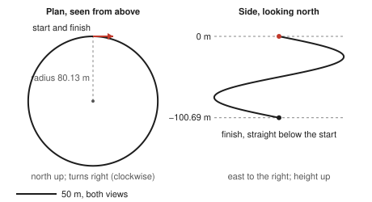

# Fundamental theorem of curves: bending and twisting fix the shape

[Syllabus](../../../SYLLABUS.md) → [Differential geometry and Lie groups](../README.md) → [Curves](../README.md#s01) → Fundamental theorem of curves

---

## General Overview

A snow groomer drives a new ski run with a sensor box on board. The box has no GPS. It records only two numbers for each metre driven: how sharply the run bends, and how fast it twists out of its plane.

The log is short. The bend is 0.012 per metre all the way, a turn of radius 83.33 m. The twist is 0.0024 per metre all the way. From those two numbers, a start point and the groomer's heading at the top, the whole run can be rebuilt.

It comes out as a spiral. One full turn is 513.43 m of snow. It turns right, holds a 20% grade (11.31°), and finishes straight below the top station, 100.69 m lower.

The method works for any log, not only a constant one. Bend and twist say how the groomer's own axes turn per metre. Turn the axes metre by metre, move forward along the first axis each time, and the run appears.

**A curve's curvature and torsion, given at every point along its length, fix its shape completely: a start point and a start direction only decide where the shape sits.**

**What kind of fact this is:** a theorem, proved on this card in Why it works. It is global along the curve: it holds on the whole length, provided the curvature never reaches zero.

### The picture: the rebuilt run

<p align="center"></p>

Left: the run from above, a circle of radius 80.13 m traced clockwise. Right: the same run seen from the south, looking north, dropping 100.69 m in one turn. Both views share one scale.

---

## The formula

Notation first, as the earlier cards on this shelf set it up.

- $`s`$ is **arc length**: metres travelled along the run from the top ([Regular curve and arc length](01-regular-curves-and-arc-length.md)). A prime means the rate per metre, $`d/ds`$.
- $`\mathbf{T}`$ is the **unit tangent**, the direction of travel. $`\mathbf{N}`$ is the **normal**, the direction the run is turning toward. $`\mathbf{B} = \mathbf{T} \times \mathbf{N}`$ is the **binormal**, at right angles to both ([Frenet-Serret frame](04-frenet-serret-frames.md)). Together they are the **frame**: three axes the skier carries.
- $`\kappa`$ (kappa) is the **curvature**, how fast $`\mathbf{T}`$ turns, in 1/m ([Curvature](02-curvature-of-plane-curves.md)). In space it is never negative.
- $`\tau`$ (tau) is the **torsion**, how fast the run twists out of its own plane, in 1/m ([Torsion](05-torsion-and-the-helix.md)). Its sign says which way the twist goes.

The frame turns by the **Frenet-Serret equations**. Add the fact that position moves along the tangent, and the rebuild is one system:

```math
\mathbf{r}' = \mathbf{T}, \qquad \mathbf{T}' = \kappa\,\mathbf{N}, \qquad \mathbf{N}' = -\kappa\,\mathbf{T} + \tau\,\mathbf{B}, \qquad \mathbf{B}' = -\tau\,\mathbf{N}
```

**Read it aloud:** per metre, the position moves along the tangent; the tangent swings toward the normal at the curvature rate; the binormal swings against the normal at the torsion rate; the normal moves to keep all three at right angles.

The theorem says what this system delivers:

```math
\kappa(s) > 0 \text{ and } \tau(s), \text{ both continuous on } 0 \le s \le L \;\Longrightarrow\; \text{one curve, up to } \mathbf{r} \mapsto M\mathbf{r} + \mathbf{p}
```

**Read it aloud:** give a positive curvature and any torsion along a length $`L`$, both changing without jumps, and exactly one curve has them, once you choose where it starts and which way it faces; any two such curves differ by a rotation $`M`$ and a shift $`\mathbf{p}`$.

A rotation followed by a shift is a **rigid motion**: it moves a shape without stretching, bending or mirroring it.

For constant $`\kappa`$ and $`\tau`$ the curve is a helix of radius $`a`$ that drops $`c`$ per radian turned, with $`\kappa = a/(a^2+c^2)`$ and $`\tau = c/(a^2+c^2)`$. [Torsion](05-torsion-and-the-helix.md) proves this and runs it backwards, which rebuilds the run by hand:

```math
a = \frac{\kappa}{\kappa^2 + \tau^2}, \qquad c = \frac{\tau}{\kappa^2 + \tau^2}, \qquad \text{grade} = \frac{c}{a} = \frac{\tau}{\kappa}
```

**Read it aloud:** the spiral's radius is the bend over bend squared plus twist squared; its drop per radian is the twist over the same sum; and the grade is twist over bend.

| Symbol | Plain meaning | In our example | Push it up and the answer… |
| --- | --- | --- | --- |
| $`s`$ | arc length: metres along the run from the top | 0 to 513.43 m | further round the spiral |
| $`\mathbf{r}(s)`$, $`\mathbf{r}_0`$ | position: metres east, north and up from the top station; $`\mathbf{r}_0`$ is the start | finish (0, 0, −100.69); start (0, 0, 0) | — |
| $`\mathbf{T}`$, $`\theta`$ | unit tangent: the direction of travel; for a curve in a plane, $`\theta`$ is its direction angle, anticlockwise from east, starting at $`\theta_0`$ | starts (0.98, 0, −0.20): east, 20% down | — |
| $`\mathbf{N}`$ | normal: the way the run turns | starts (0, −1, 0): south, so a right turn | — |
| $`\mathbf{B}`$ | binormal $`\mathbf{T} \times \mathbf{N}`$ | starts (−0.20, 0, −0.98) | — |
| $`\kappa`$ | curvature: bend per metre, 1/m | 0.012, a turn radius of 83.33 m | tighter spiral |
| $`\tau`$ | torsion: twist per metre, 1/m | 0.0024 | steeper spiral, more drop per turn |
| $`a`$, $`c`$ | helix radius, and drop per radian turned | 80.128 m and 16.026 m | — |
| $`L`$ | length of the run | 513.43 m, one turn | — |
| $`h`$ | step length when the equations are stepped by computer | about 10 m and 1 m | bigger error at the finish |
| $`M`$, $`\mathbf{p}`$ | a rotation and a shift: a rigid motion | the second start in the code | the run lands elsewhere, same shape |
| $`\mathbf{T}_2`$, $`\mathbf{N}_2`$, $`\mathbf{B}_2`$ | a second curve's frame, in the proof | — | — |

### When it holds

- **Curvature above zero everywhere.** Where $`\kappa = 0`$ the run is straight and has no turning direction, so $`\mathbf{N}`$ and $`\mathbf{B}`$ are undefined. On a straight stretch the frame may spin freely about $`\mathbf{T}`$. Two runs with identical logs, a quarter turn, 60 m straight, a quarter turn, finish 227.73 m and 259.64 m from the top.
- **Rates per metre, not per second.** The equations use arc length. A sensor that logs per second at changing speed must be converted first, by [Curvature and torsion at any speed](06-curvature-and-torsion-from-any-parametrisation.md).
- **One handedness for torsion.** The sign of $`\tau`$ depends on $`\mathbf{B} = \mathbf{T} \times \mathbf{N}`$. Flip the sign and the rebuilt run is the mirror image: from the same start it climbs, and finishes 197.47 m from the bottom station.
- **A start point and a start frame.** These are six numbers: three for position, three for which way the frame faces. The theorem fixes the shape, not its place. Without them the run could sit anywhere.
- **Global, with no extra hypothesis.** The frame equations are linear (each rate is a sum of frame vectors times $`\kappa`$ or $`\tau`$), so their solution exists along the whole run.

---

## Why it works

### Step 0: the frame is a record of where you are facing

This is dead reckoning, as a ship's navigator does it, for a path in three dimensions. The frame at one point, plus how it turns per metre, gives the frame a metre later. The tangent in that frame gives the next metre of position.

So the proof is about the frame. Once the turning rates fix the frame, position follows by adding up the tangent.

### Step 1: the frame equations are a linear system

Stack the three frame vectors into one list of nine numbers. The Frenet-Serret equations then say: the rate of the list is a 9×9 matrix times the list. The matrix holds only $`\kappa(s)`$ and $`\tau(s)`$.

That is a linear system of first-order equations, the form in [From one equation to a system](../../08-Differential%20equations%20and%20dynamics/04-Systems%20and%20the%20Matrix%20Exponential/01-from-one-equation-to-a-system.md). Its coefficients change with $`s`$, so that shelf's matrix-exponential formula does not apply directly. But a linear system with continuous coefficients has exactly one solution from each start, on the whole interval. Two results give this. Its rate obeys a Lipschitz bound (a cap on how fast the rate can change with the state) over the whole run, so [The Picard-Lindelof theorem](../../08-Differential%20equations%20and%20dynamics/02-Existence%2C%20Uniqueness%20and%20Sensitivity/02-lipschitz-and-the-picard-lindelof-theorem.md) gives exactly one solution for a stretch it computes in advance. For a linear system that guaranteed stretch can be made the same length from every start, so the stretches chain end to end along the whole 513.43 m: linear equations never blow up ([Blow-up](../../08-Differential%20equations%20and%20dynamics/02-Existence%2C%20Uniqueness%20and%20Sensitivity/03-blow-up-and-the-life-span-of-a-solution.md)). That pair is the engine here.

### Step 2: the solution stays a right-handed frame

Nine numbers need not be three perpendicular unit vectors. These stay so, because the matrix is **skew-symmetric**: the effect of $`\mathbf{T}`$ on $`\mathbf{N}`$ is exactly minus the effect of $`\mathbf{N}`$ on $`\mathbf{T}`$, and likewise for the other pair.

As a result, the six dot products $`\mathbf{T}\cdot\mathbf{T}`$, $`\mathbf{T}\cdot\mathbf{N}`$ and so on obey their own linear system. Their starting values (1, 0, 0, 1, 0, 1) form a constant solution of it, so by uniqueness they stay at those values. The frame stays perpendicular and of unit length. Its handedness cannot jump from right to left, because it changes continuously.

<details>
<summary>Detailed proof: the dot products stay fixed</summary>

Take $`\mathbf{T}\cdot\mathbf{N}`$. Its rate is

$`\displaystyle (\mathbf{T}\cdot\mathbf{N})' = \kappa\,\mathbf{N}\cdot\mathbf{N} - \kappa\,\mathbf{T}\cdot\mathbf{T} + \tau\,\mathbf{T}\cdot\mathbf{B}.`$

Each of the six rates is, in the same way, a fixed combination of the six dot products. So the six form a linear system with continuous coefficients.

Put $`\mathbf{T}\cdot\mathbf{T} = \mathbf{N}\cdot\mathbf{N} = \mathbf{B}\cdot\mathbf{B} = 1`$ and the three mixed products $`\mathbf{T}\cdot\mathbf{N}`$, $`\mathbf{T}\cdot\mathbf{B}`$, $`\mathbf{N}\cdot\mathbf{B}`$ at 0. The rate above becomes $`\kappa - \kappa + 0 = 0`$, and all six rates vanish the same way. So "unit lengths, right angles" is a constant solution.

The real dot products start at those values. By uniqueness they equal the constant solution for every $`s`$.

Handedness: $`\mathbf{B}\cdot(\mathbf{T} \times \mathbf{N})`$ is a continuous function of $`s`$. For three perpendicular unit vectors it is either +1 or −1. It starts at +1, so it stays at +1.

</details>

### Step 3: add up the tangent, and the curve has the asked bend and twist

Set $`\mathbf{r}(s)`$ to the start point plus the running total of $`\mathbf{T}`$ over the metres travelled. Then $`\mathbf{r}' = \mathbf{T}`$ is a unit vector, so $`s`$ really is arc length.

The tangent turns as $`\mathbf{T}' = \kappa\,\mathbf{N}`$, at rate $`\kappa`$ toward $`\mathbf{N}`$. Because $`\kappa > 0`$, that makes $`\kappa`$ the curve's curvature and $`\mathbf{N}`$ its normal. The binormal is then $`\mathbf{T}\times\mathbf{N} = \mathbf{B}`$. And $`\mathbf{B}' = -\tau\,\mathbf{N}`$ is exactly the definition of torsion $`\tau`$. The curve exists.

### Step 4: two curves with the same log are one shape

Take a second curve with the same $`\kappa`$ and $`\tau`$. Move it rigidly so its start point and start frame land on the first curve's. That is always possible with a rotation $`M`$ and a shift $`\mathbf{p}`$, because both start frames are right-handed. A rigid motion keeps lengths, angles and handedness, so the moved curve still has the same $`\kappa`$ and $`\tau`$.

Now compare frames with one number: $`\mathbf{T}\cdot\mathbf{T}_2 + \mathbf{N}\cdot\mathbf{N}_2 + \mathbf{B}\cdot\mathbf{B}_2`$. It starts at 3. Its rate is zero, as the fold shows. So it stays at 3. Each dot product of unit vectors is at most 1, so all three are 1, and the frames agree everywhere. Equal tangents, equal start, so equal positions.

<details>
<summary>Detailed proof: the match between the two frames never changes</summary>

Differentiate each product, then use the frame equations for both curves:

$`\displaystyle (\mathbf{T}\cdot\mathbf{T}_2)' = \kappa\,\mathbf{N}\cdot\mathbf{T}_2 + \kappa\,\mathbf{T}\cdot\mathbf{N}_2`$

$`\displaystyle (\mathbf{N}\cdot\mathbf{N}_2)' = -\kappa\,\mathbf{T}\cdot\mathbf{N}_2 + \tau\,\mathbf{B}\cdot\mathbf{N}_2 - \kappa\,\mathbf{N}\cdot\mathbf{T}_2 + \tau\,\mathbf{N}\cdot\mathbf{B}_2`$

$`\displaystyle (\mathbf{B}\cdot\mathbf{B}_2)' = -\tau\,\mathbf{N}\cdot\mathbf{B}_2 - \tau\,\mathbf{B}\cdot\mathbf{N}_2`$

Add the three lines. Every term appears once with each sign, so the sum is 0. The sum of the three dot products is therefore constant, and it equals its starting value, 3.

</details>

### Step 5: a mirror flips the twist

A mirror keeps lengths and angles, so it keeps $`\kappa`$. But it turns a right-handed frame into a left-handed one, so the binormal $`\mathbf{T}\times\mathbf{N}`$ points the other way and $`\tau`$ changes sign. That is why the theorem says "rotation", not "rotation or mirror".

The code measures handedness directly. Take the chords from the top to the quarter-turn points. The signed volume of the box they span is +646,496 m³ for the run and −646,496 m³ when the twist is flipped. Same chord lengths, opposite hands.

In the plane, torsion is zero and the frame has one free angle: the direction angle $`\theta`$ of $`\mathbf{T}`$, anticlockwise from east ([Curvature](02-curvature-of-plane-curves.md)). Signed curvature is its rate, $`\theta' = \kappa`$, so the rebuild is two running totals:

```math
\theta(s) = \theta_0 + \int_0^s \kappa\, ds, \qquad \mathbf{r}(s) = \mathbf{r}_0 + \int_0^s (\cos\theta, \sin\theta)\, ds
```

**Read it aloud:** the direction angle is the start angle plus the curvature added up so far; the position is the start point plus the unit steps in that direction added up so far.

A new start point $`\mathbf{r}_0`$ shifts the curve and a new start angle $`\theta_0`$ turns it, so signed curvature alone fixes the shape. Here $`\kappa`$ may be zero or change sign, because $`\mathbf{N}`$ is always $`\mathbf{T}`$ turned a quarter turn left. This is the shelf's plane-curve version of the same theorem.

---

## Worked numbers, by hand

The log: $`\kappa = 0.012`$ 1/m and $`\tau = 0.0024`$ 1/m for the whole run. The start: the top station at (0, 0, 0), heading east and 20% down, turning south.

| Step | Arithmetic | Value |
| --- | --- | --- |
| frame after one 10 m step | $`\mathbf{T} + 10\kappa\mathbf{N}`$; $`\mathbf{N} + 10(-\kappa\mathbf{T} + \tau\mathbf{B})`$; $`\mathbf{B} - 10\tau\mathbf{N}`$ | T (0.98, −0.12, −0.20), N (−0.12, −1.00, 0.00), B (−0.20, 0.02, −0.98) |
| position after 10 m, from $`\mathbf{r}'' = \mathbf{T}' = \kappa\mathbf{N}`$ | $`10\mathbf{T} + \tfrac12 \times 10^2 \times \kappa\mathbf{N}`$ | (9.81, −0.60, −1.96); helix formula (9.78, −0.60, −1.96), 0.024 m apart |
| turn radius $`1/\kappa`$ | 1 / 0.012 | 83.33 m |
| $`\kappa^2 + \tau^2`$ | 0.012² + 0.0024² | 0.00014976 1/m² |
| helix radius $`a`$ | 0.012 / 0.00014976 | 80.128 m |
| drop per radian $`c`$ | 0.0024 / 0.00014976 | 16.026 m |
| grade $`\tau/\kappa`$ | 0.0024 / 0.012 | 0.200, or 11.31° |
| metres per radian, $`\sqrt{a^2+c^2}`$ | 1 / √0.00014976 | 81.715 m |
| one turn $`L`$ | 2π × 81.715 | 513.43 m |
| quarter turn, s = 128.36 m | (a, −a, −π/2 × c) | (80.13, −80.13, −25.17) |
| half turn, s = 256.72 m | (0, −2a, −π × c) | (0, −160.26, −50.35) |
| **finish, s = 513.43 m** | (0, 0, −2π × c) | **(0, 0, −100.69)** |

The first two rows solve the frame equations by hand for one step: the tangent swings 0.12 toward the south, and the position lands within 0.024 m of the helix formula. The computer repeats such steps along the whole run, by RK4 below. Constant bend and twist allow the shortcut in the other rows.

The run comes back over the top station after one turn, 100.69 m lower. Seen from above its radius is 80.13 m, smaller than the 83.33 m turn radius of its best-fitting circle ([Osculating circle](03-osculating-circle.md)). Each metre skied covers only cos(11.31°) of a metre of ground, while the sideways pull $`\kappa\mathbf{N}`$ is level and shows in full. Curvature is sideways pull over speed squared ([Curvature](02-curvature-of-plane-curves.md)), so the plan radius is 83.33 × cos²(11.31°) = 83.33 / (1 + 0.200²) = 80.13 m.

A log with no formula rebuilds the same way. The tightening run, whose bend grows from 0.006 to 0.016 1/m over 500 m, finishes at (3.87, −69.86, −112.17): 112.17 m below the top station and 69.86 m south of it.

### What breaks if you drop a piece

| Mistake | Comes out at | What went wrong |
| --- | --- | --- |
| Drop the twist: $`\tau = 0`$ | finish (−9.95, −0.62, 1.99), 103.16 m from the bottom station | A flat circle in the tilted start plane: it dips, then climbs back near the top |
| Flip the twist's sign | finish (38.73, 0, 92.95), 197.47 m from the bottom station | The mirror image: same bend, opposite hand, so it climbs |
| Step by Euler's method, steps of 1.003 m | 3.15 m off; the tangent's length grows to 1.0378 | Each straight-line step lengthens the frame; errors pile up |
| Log through a straight 60 m stretch | two runs with one log, 227.73 m and 259.64 m from the top | $`\kappa = 0`$ there, so the frame's spin is not recorded |

The code prints all four.

---

## Code, from first principles, and it actually runs

The code steps the frame equations by RK4 (the classical fourth-order Runge-Kutta method: four trial slopes per step, averaged). Nothing is imported beyond square roots and sines. It takes three independent roads:

1. **Formula against stepping.** The rebuilt run is compared with the helix formula at every quarter turn, at steps of about 10 m and 1 m.
2. **Measure it back.** A second run, whose bend tightens from 0.006 to 0.016 1/m over 500 m, has no simple formula. Its bend and twist are measured back off the rebuilt points by the any-speed formulas of [Curvature and torsion at any speed](06-curvature-and-torsion-from-any-parametrisation.md), with 1 m differences.
3. **Same log, other start.** The run is rebuilt from a different place and heading. Its chords (straight-line distances between points) match the first run's and the helix's chord formula.

### Python

```python
# Fundamental theorem of curves -- the check behind the card.  Standard library
# only.  A ski run is known only by its bend kappa and twist tau (1/m) along the
# distance s skied (m).  The frame equations T' = kN, N' = -kT + tB, B' = -tN,
# r' = T are stepped by RK4 to rebuild it.  Roads: the helix formula, bend and
# twist measured back off the rebuilt points, and a second start.
import math

K0, TW = 0.012, 0.0024                       # the survey: bend and twist, 1/m
W2 = K0 * K0 + TW * TW
A, C, RAD = K0 / W2, TW / W2, 1 / math.sqrt(W2)   # radius, drop per radian, m per radian
L = 2 * math.pi * RAD                         # one full turn of the run, m

def add(u, v, k=1.0): return [u[0] + k * v[0], u[1] + k * v[1], u[2] + k * v[2]]
def dot(u, v): return u[0] * v[0] + u[1] * v[1] + u[2] * v[2]
def cross(u, v): return [u[1]*v[2] - u[2]*v[1], u[2]*v[0] - u[0]*v[2], u[0]*v[1] - u[1]*v[0]]
def dist(u, v): return math.sqrt(dot(add(u, v, -1.0), add(u, v, -1.0)))
def f(x, d): return f"{0.0 if abs(x) < 0.5 * 10.0 ** -d else x:.{d}f}"
def pt(p): return "(" + ", ".join(f(x, 2) for x in p) + ")"

def rates(st, k, t):                         # the Frenet-Serret equations
    r, T, N, Bv = st
    return [T, [k * x for x in N], add([-k * x for x in T], Bv, t), [-t * x for x in N]]

def step(st, kap, tau, s, h, euler):
    k1 = rates(st, kap(s), tau(s))
    if euler:
        return [add(st[j], k1[j], h) for j in range(4)]
    k2 = rates([add(st[j], k1[j], h / 2) for j in range(4)], kap(s + h / 2), tau(s + h / 2))
    k3 = rates([add(st[j], k2[j], h / 2) for j in range(4)], kap(s + h / 2), tau(s + h / 2))
    k4 = rates([add(st[j], k3[j], h) for j in range(4)], kap(s + h), tau(s + h))
    return [[st[j][i] + h / 6 * (k1[j][i] + 2 * k2[j][i] + 2 * k3[j][i] + k4[j][i])
             for i in range(3)] for j in range(4)]

def rebuild(st, kap, tau, length, n, euler=False):   # n equal steps; every position kept
    h, pts = length / n, [st[0]]
    for i in range(n):
        st = step(st, kap, tau, i * h, h, euler)
        pts.append(st[0])
    return st, pts

def start(r0, T0, N0): return [r0, T0, N0, cross(T0, N0)]
def helix(s): return [A * math.sin(s / RAD), -A * (1 - math.cos(s / RAD)), -C * s / RAD]
def chord(dt): return math.sqrt(2 * A * A * (1 - math.cos(dt)) + C * C * dt * dt)
def vol(p): return dot(cross(add(p[1], p[0], -1.0), add(p[2], p[0], -1.0)), add(p[3], p[0], -1.0))
kc, tc = (lambda s: K0), (lambda s: TW)
S0 = start([0.0, 0.0, 0.0], [A / RAD, 0.0, -C / RAD], [0.0, -1.0, 0.0])

print(f"survey: bend {f(K0, 4)} 1/m, twist {f(TW, 4)} 1/m, turn radius 1/bend {f(1 / K0, 2)} m")
print(f"helix: radius {f(A, 3)} m, drop per radian {f(C, 3)} m, grade twist/bend {f(TW / K0, 3)}"
      f" = {f(math.degrees(math.atan(TW / K0)), 2)} deg")
print(f"bend^2 + twist^2 = {f(W2, 8)} 1/m^2; {f(RAD, 3)} m per radian; one turn: length {f(L, 2)} m, drop {f(2 * math.pi * C, 2)} m")
print(f"start frame: T {pt(S0[1])}, N {pt(S0[2])}, B {pt(S0[3])}")
T1, N1, B1 = add(S0[1], S0[2], 10 * K0), add(S0[2], add([-K0 * x for x in S0[1]], S0[3], TW), 10.0), add(S0[3], S0[2], -10 * TW)
r1 = add([10 * x for x in S0[1]], S0[2], 50 * K0)          # one 10 m step by hand; r'' = T' = kN gives the 50 k N
print(f"one 10 m step by hand: T {pt(T1)}, N {pt(N1)}, B {pt(B1)}; r = 10 T + 50 k N = {pt(r1)}, helix {pt(helix(10.0))}, {f(dist(r1, helix(10.0)), 3)} m apart")
for n in (52, 512):
    end, pts = rebuild(S0, kc, tc, L, n)
    err = max(dist(pts[i], helix(i * L / n)) for i in range(0, n + 1, n // 4))
    print(f"RK4, step {f(L / n, 3)} m: finish {pt(end[0])}, worst miss at quarter points {f(1000 * err, 4)} mm")
fine = pts
for q in range(5):
    print(f"s = {f(q * L / 4, 2)} m: rebuilt {pt(fine[q * 128])}, helix formula {pt(helix(q * L / 4))}")
print(f"frame still orthonormal at finish: |T| = {f(math.sqrt(dot(end[1], end[1])), 9)}, T.N = {f(dot(end[1], end[2]), 9)}")
S2 = start([350.0, 120.0, -40.0], [0.0, A / RAD, -C / RAD], [1.0, 0.0, 0.0])   # another place, heading north
end2, pts2 = rebuild(S2, kc, tc, L, 512)
print(f"second start (350, 120, -40) heading north: finish {pt(end2[0])}")
for (i, j) in ((0, 128), (0, 256), (128, 384), (0, 512)):
    c1, c2, c3 = dist(fine[i], fine[j]), dist(pts2[i], pts2[j]), chord(math.pi * (j - i) / 256)
    print(f"chord quarter {i // 128} to {j // 128}: run 1 {f(c1, 3)} m, run 2 {f(c2, 3)} m, formula {f(c3, 3)} m")
    assert abs(c1 - c3) < 1e-6 and abs(c2 - c3) < 1e-6           # rigid copies, one shape
kt = lambda s: 0.006 + 0.00002 * s                               # a run whose bend tightens
e10, _ = rebuild(S0, kt, tc, 500.0, 50)
e1, p1 = rebuild(S0, kt, tc, 500.0, 500)
print(f"tightening run, 500 m: finish at step 10 m {pt(e10[0])}, at 1 m {pt(e1[0])}, gap {f(1000 * dist(e10[0], e1[0]), 3)} mm")
for s in (100, 250, 400):                   # measure back: any-speed formulas, 1 m differences
    m2, m1, z, q1, q2 = p1[s - 2], p1[s - 1], p1[s], p1[s + 1], p1[s + 2]
    d1 = [(q1[i] - m1[i]) / 2 for i in range(3)]
    d2 = [q1[i] - 2 * z[i] + m1[i] for i in range(3)]
    d3 = [(q2[i] - 2 * q1[i] + 2 * m1[i] - m2[i]) / 2 for i in range(3)]
    x = cross(d1, d2)
    km, tm = math.sqrt(dot(x, x)) / dot(d1, d1) ** 1.5, dot(x, d3) / dot(x, x)
    print(f"measured back at s = {s} m: bend {f(km, 6)} (asked {f(kt(s), 6)}), twist {f(tm, 7)} (asked {f(TW, 7)})")
    assert abs(km - kt(s)) < 1e-6 and abs(tm - TW) < 1e-7        # the rebuilt run has the asked bend and twist
mir, pm = rebuild(S0, kc, lambda s: -TW, L, 512)
flat, _ = rebuild(S0, kc, lambda s: 0.0, L, 512)
eul, _ = rebuild(S0, kc, tc, L, 512, euler=True)
fin = helix(L)
v1, v2 = vol([fine[0], fine[128], fine[256], fine[384]]), vol([pm[0], pm[128], pm[256], pm[384]])
print(f"handedness, signed volume of quarter-point chords: run {f(v1, 0)} m^3, twist flipped {f(v2, 0)} m^3")
print(f"mistake 1, twist dropped: finish {pt(flat[0])}, {f(dist(flat[0], fin), 2)} m from the bottom station")
print(f"mistake 2, twist sign flipped: finish {pt(mir[0])}, {f(dist(mir[0], fin), 2)} m from the bottom station")
print(f"mistake 3, Euler steps of {f(L / 512, 3)} m: finish {pt(eul[0])}, {f(dist(eul[0], fin), 2)} m off, |T| = {f(math.sqrt(dot(eul[1], eul[1])), 4)}")
q = 128                                     # mistake 4: a straight 60 m schuss, where bend = 0
for spin in (0, 90):
    st, _ = rebuild(S0, kc, tc, L / 4, q)
    st[0] = add(st[0], st[1], 60.0)
    if spin:                                # bend 0: N and B are free to turn about T
        st[2], st[3] = st[3], [-x for x in st[2]]
    st, _ = rebuild(st, kc, tc, L / 4, q)
    print(f"mistake 4, turn, 60 m straight, turn, frame spun {spin} deg on the straight: finish {pt(st[0])}, {f(dist(st[0], [0.0, 0.0, 0.0]), 2)} m from the top")
print(f"figure, plan centre (0.00, {f(-A, 2)}), radius {f(A, 2)}; side: x = {f(A, 2)} sin(s/{f(RAD, 3)}), z = -{f(C, 3)} s/{f(RAD, 3)}")
assert dist(fine[512], fin) < 1e-5 and dist(fine[256], helix(L / 2)) < 1e-5   # RK4 against the formula
assert v1 > 1000 and abs(v1 + v2) < 1e-3 * abs(v1)                          # a mirror flips handedness
assert dist(mir[0], fin) > 1 and dist(flat[0], fin) > 1                     # the twist matters
print("ALL CHECKS PASS")
```

**Ran 2026-11-19 on macOS, Python 3.14.10, standard library only. All checks passed. Output, pasted from the run:**

```
survey: bend 0.0120 1/m, twist 0.0024 1/m, turn radius 1/bend 83.33 m
helix: radius 80.128 m, drop per radian 16.026 m, grade twist/bend 0.200 = 11.31 deg
bend^2 + twist^2 = 0.00014976 1/m^2; 81.715 m per radian; one turn: length 513.43 m, drop 100.69 m
start frame: T (0.98, 0.00, -0.20), N (0.00, -1.00, 0.00), B (-0.20, 0.00, -0.98)
one 10 m step by hand: T (0.98, -0.12, -0.20), N (-0.12, -1.00, 0.00), B (-0.20, 0.02, -0.98); r = 10 T + 50 k N = (9.81, -0.60, -1.96), helix (9.78, -0.60, -1.96), 0.024 m apart
RK4, step 9.874 m: finish (0.00, 0.00, -100.69), worst miss at quarter points 0.8942 mm
RK4, step 1.003 m: finish (0.00, 0.00, -100.69), worst miss at quarter points 0.0001 mm
s = 0.00 m: rebuilt (0.00, 0.00, 0.00), helix formula (0.00, 0.00, 0.00)
s = 128.36 m: rebuilt (80.13, -80.13, -25.17), helix formula (80.13, -80.13, -25.17)
s = 256.72 m: rebuilt (0.00, -160.26, -50.35), helix formula (0.00, -160.26, -50.35)
s = 385.07 m: rebuilt (-80.13, -80.13, -75.52), helix formula (-80.13, -80.13, -75.52)
s = 513.43 m: rebuilt (0.00, 0.00, -100.69), helix formula (0.00, 0.00, -100.69)
frame still orthonormal at finish: |T| = 1.000000000, T.N = 0.000000000
second start (350, 120, -40) heading north: finish (350.00, 120.00, -140.69)
chord quarter 0 to 1: run 1 116.081 m, run 2 116.081 m, formula 116.081 m
chord quarter 0 to 2: run 1 167.979 m, run 2 167.979 m, formula 167.979 m
chord quarter 1 to 3: run 1 167.979 m, run 2 167.979 m, formula 167.979 m
chord quarter 0 to 4: run 1 100.692 m, run 2 100.692 m, formula 100.692 m
tightening run, 500 m: finish at step 10 m (3.87, -69.86, -112.17), at 1 m (3.87, -69.86, -112.17), gap 0.762 mm
measured back at s = 100 m: bend 0.008000 (asked 0.008000), twist 0.0024000 (asked 0.0024000)
measured back at s = 250 m: bend 0.011000 (asked 0.011000), twist 0.0024000 (asked 0.0024000)
measured back at s = 400 m: bend 0.014001 (asked 0.014000), twist 0.0024001 (asked 0.0024000)
handedness, signed volume of quarter-point chords: run 646496 m^3, twist flipped -646496 m^3
mistake 1, twist dropped: finish (-9.95, -0.62, 1.99), 103.16 m from the bottom station
mistake 2, twist sign flipped: finish (38.73, 0.00, 92.95), 197.47 m from the bottom station
mistake 3, Euler steps of 1.003 m: finish (-0.03, 3.15, -100.69), 3.15 m off, |T| = 1.0378
mistake 4, turn, 60 m straight, turn, frame spun 0 deg on the straight: finish (0.00, -219.09, -62.11), 227.73 m from the top
mistake 4, turn, 60 m straight, turn, frame spun 90 deg on the straight: finish (89.10, -205.14, -131.89), 259.64 m from the top
figure, plan centre (0.00, -80.13), radius 80.13; side: x = 80.13 sin(s/81.715), z = -16.026 s/81.715
ALL CHECKS PASS
```

### Rust

Same numbers, same labels, built with `rustc --edition 2021 -O`.

```rust
// Fundamental theorem of curves -- the same check as the Python, in Rust.  No
// crates.  A ski run is known only by its bend kappa and twist tau (1/m) along
// the distance s skied (m).  The frame equations T' = kN, N' = -kT + tB,
// B' = -tN, r' = T are stepped by RK4 to rebuild it.  Roads: the helix formula,
// bend and twist measured back off the rebuilt points, and a second start.
use std::f64::consts::PI;
type V = [f64; 3];
type St = [V; 4]; // position r, then the frame T, N, B
const K0: f64 = 0.012;
const TW: f64 = 0.0024;

fn add(u: V, v: V, k: f64) -> V { [u[0] + k * v[0], u[1] + k * v[1], u[2] + k * v[2]] }
fn dot(u: V, v: V) -> f64 { u[0] * v[0] + u[1] * v[1] + u[2] * v[2] }
fn cross(u: V, v: V) -> V { [u[1]*v[2] - u[2]*v[1], u[2]*v[0] - u[0]*v[2], u[0]*v[1] - u[1]*v[0]] }
fn dist(u: V, v: V) -> f64 { dot(add(u, v, -1.0), add(u, v, -1.0)).sqrt() }
fn scale(k: f64, u: V) -> V { [k * u[0], k * u[1], k * u[2]] }
fn f(x: f64, d: i32) -> String {
    let y = if x.abs() < 0.5 * 10f64.powi(-d) { 0.0 } else { x };
    format!("{:.*}", d as usize, y)
}
fn pt(p: V) -> String { format!("({}, {}, {})", f(p[0], 2), f(p[1], 2), f(p[2], 2)) }

fn rates(st: &St, k: f64, t: f64) -> St { // the Frenet-Serret equations
    [st[1], scale(k, st[2]), add(scale(-k, st[1]), st[3], t), scale(-t, st[2])]
}
fn shift(st: &St, d: &St, h: f64) -> St {
    [add(st[0], d[0], h), add(st[1], d[1], h), add(st[2], d[2], h), add(st[3], d[3], h)]
}
fn step(st: &St, kap: &dyn Fn(f64) -> f64, tau: &dyn Fn(f64) -> f64, s: f64, h: f64, euler: bool) -> St {
    let k1 = rates(st, kap(s), tau(s));
    if euler { return shift(st, &k1, h); }
    let k2 = rates(&shift(st, &k1, h / 2.0), kap(s + h / 2.0), tau(s + h / 2.0));
    let k3 = rates(&shift(st, &k2, h / 2.0), kap(s + h / 2.0), tau(s + h / 2.0));
    let k4 = rates(&shift(st, &k3, h), kap(s + h), tau(s + h));
    let mut out = *st;
    for j in 0..4 { for i in 0..3 {
        out[j][i] = st[j][i] + h / 6.0 * (k1[j][i] + 2.0 * k2[j][i] + 2.0 * k3[j][i] + k4[j][i]);
    } }
    out
}
fn rebuild(st0: St, kap: &dyn Fn(f64) -> f64, tau: &dyn Fn(f64) -> f64, length: f64, n: usize, euler: bool) -> (St, Vec<V>) {
    let h = length / n as f64;
    let (mut st, mut pts) = (st0, vec![st0[0]]);
    for i in 0..n {
        st = step(&st, kap, tau, i as f64 * h, h, euler);
        pts.push(st[0]);
    }
    (st, pts)
}
fn start(r0: V, t0: V, n0: V) -> St { [r0, t0, n0, cross(t0, n0)] }
fn vol(p: [V; 4]) -> f64 { dot(cross(add(p[1], p[0], -1.0), add(p[2], p[0], -1.0)), add(p[3], p[0], -1.0)) }

fn main() {
    let w2 = K0 * K0 + TW * TW;
    let (a, c, rad) = (K0 / w2, TW / w2, 1.0 / w2.sqrt()); // radius, drop per radian, m per radian
    let l = 2.0 * PI * rad; // one full turn of the run, m
    let helix = |s: f64| -> V { [a * (s / rad).sin(), -a * (1.0 - (s / rad).cos()), -c * s / rad] };
    let chord = |dt: f64| (2.0 * a * a * (1.0 - dt.cos()) + c * c * dt * dt).sqrt();
    let kc = |_s: f64| K0;
    let tc = |_s: f64| TW;
    let s0 = start([0.0, 0.0, 0.0], [a / rad, 0.0, -c / rad], [0.0, -1.0, 0.0]);
    println!("survey: bend {} 1/m, twist {} 1/m, turn radius 1/bend {} m", f(K0, 4), f(TW, 4), f(1.0 / K0, 2));
    println!("helix: radius {} m, drop per radian {} m, grade twist/bend {} = {} deg",
             f(a, 3), f(c, 3), f(TW / K0, 3), f((TW / K0).atan().to_degrees(), 2));
    println!("bend^2 + twist^2 = {} 1/m^2; {} m per radian; one turn: length {} m, drop {} m", f(w2, 8), f(rad, 3), f(l, 2), f(2.0 * PI * c, 2));
    println!("start frame: T {}, N {}, B {}", pt(s0[1]), pt(s0[2]), pt(s0[3]));
    let (t1, n1, b1) = (add(s0[1], s0[2], 10.0 * K0), add(s0[2], add(scale(-K0, s0[1]), s0[3], TW), 10.0), add(s0[3], s0[2], -10.0 * TW));
    let r1 = add(scale(10.0, s0[1]), s0[2], 50.0 * K0); // one 10 m step by hand; r'' = T' = kN gives the 50 k N
    println!("one 10 m step by hand: T {}, N {}, B {}; r = 10 T + 50 k N = {}, helix {}, {} m apart", pt(t1), pt(n1), pt(b1), pt(r1), pt(helix(10.0)), f(dist(r1, helix(10.0)), 3));
    let (mut end, mut fine) = (s0, vec![]);
    for n in [52usize, 512] {
        let (e, pts) = rebuild(s0, &kc, &tc, l, n, false);
        let mut err: f64 = 0.0;
        for i in (0..=n).step_by(n / 4) { err = err.max(dist(pts[i], helix(i as f64 * l / n as f64))); }
        println!("RK4, step {} m: finish {}, worst miss at quarter points {} mm", f(l / n as f64, 3), pt(e[0]), f(1000.0 * err, 4));
        end = e;
        fine = pts;
    }
    for q in 0..5 {
        println!("s = {} m: rebuilt {}, helix formula {}", f(q as f64 * l / 4.0, 2), pt(fine[q * 128]), pt(helix(q as f64 * l / 4.0)));
    }
    println!("frame still orthonormal at finish: |T| = {}, T.N = {}", f(dot(end[1], end[1]).sqrt(), 9), f(dot(end[1], end[2]), 9));
    let s2 = start([350.0, 120.0, -40.0], [0.0, a / rad, -c / rad], [1.0, 0.0, 0.0]); // another place, heading north
    let (end2, pts2) = rebuild(s2, &kc, &tc, l, 512, false);
    println!("second start (350, 120, -40) heading north: finish {}", pt(end2[0]));
    for (i, j) in [(0usize, 128usize), (0, 256), (128, 384), (0, 512)] {
        let (c1, c2, c3) = (dist(fine[i], fine[j]), dist(pts2[i], pts2[j]), chord(PI * (j - i) as f64 / 256.0));
        println!("chord quarter {} to {}: run 1 {} m, run 2 {} m, formula {} m", i / 128, j / 128, f(c1, 3), f(c2, 3), f(c3, 3));
        assert!((c1 - c3).abs() < 1e-6 && (c2 - c3).abs() < 1e-6); // rigid copies, one shape
    }
    let kt = |s: f64| 0.006 + 0.00002 * s; // a run whose bend tightens
    let (e10, _) = rebuild(s0, &kt, &tc, 500.0, 50, false);
    let (e1, p1) = rebuild(s0, &kt, &tc, 500.0, 500, false);
    println!("tightening run, 500 m: finish at step 10 m {}, at 1 m {}, gap {} mm", pt(e10[0]), pt(e1[0]), f(1000.0 * dist(e10[0], e1[0]), 3));
    for s in [100usize, 250, 400] { // measure back: any-speed formulas, 1 m differences
        let (m2, m1, z, q1, q2) = (p1[s - 2], p1[s - 1], p1[s], p1[s + 1], p1[s + 2]);
        let mut d1 = [0.0; 3];
        let mut d2 = [0.0; 3];
        let mut d3 = [0.0; 3];
        for i in 0..3 {
            d1[i] = (q1[i] - m1[i]) / 2.0;
            d2[i] = q1[i] - 2.0 * z[i] + m1[i];
            d3[i] = (q2[i] - 2.0 * q1[i] + 2.0 * m1[i] - m2[i]) / 2.0;
        }
        let x = cross(d1, d2);
        let (km, tm) = (dot(x, x).sqrt() / dot(d1, d1).powf(1.5), dot(x, d3) / dot(x, x));
        println!("measured back at s = {} m: bend {} (asked {}), twist {} (asked {})", s, f(km, 6), f(kt(s as f64), 6), f(tm, 7), f(TW, 7));
        assert!((km - kt(s as f64)).abs() < 1e-6 && (tm - TW).abs() < 1e-7); // the asked bend and twist
    }
    let (mir, pm) = rebuild(s0, &kc, &|_s: f64| -TW, l, 512, false);
    let (flat, _) = rebuild(s0, &kc, &|_s: f64| 0.0, l, 512, false);
    let (eul, _) = rebuild(s0, &kc, &tc, l, 512, true);
    let fin = helix(l);
    let (v1, v2) = (vol([fine[0], fine[128], fine[256], fine[384]]), vol([pm[0], pm[128], pm[256], pm[384]]));
    println!("handedness, signed volume of quarter-point chords: run {} m^3, twist flipped {} m^3", f(v1, 0), f(v2, 0));
    println!("mistake 1, twist dropped: finish {}, {} m from the bottom station", pt(flat[0]), f(dist(flat[0], fin), 2));
    println!("mistake 2, twist sign flipped: finish {}, {} m from the bottom station", pt(mir[0]), f(dist(mir[0], fin), 2));
    println!("mistake 3, Euler steps of {} m: finish {}, {} m off, |T| = {}", f(l / 512.0, 3), pt(eul[0]), f(dist(eul[0], fin), 2), f(dot(eul[1], eul[1]).sqrt(), 4));
    for spin in [0, 90] { // mistake 4: a straight 60 m schuss, where bend = 0
        let (mut st, _) = rebuild(s0, &kc, &tc, l / 4.0, 128, false);
        st[0] = add(st[0], st[1], 60.0);
        if spin != 0 { // bend 0: N and B are free to turn about T
            let n = st[2];
            st[2] = st[3];
            st[3] = scale(-1.0, n);
        }
        let (st, _) = rebuild(st, &kc, &tc, l / 4.0, 128, false);
        println!("mistake 4, turn, 60 m straight, turn, frame spun {} deg on the straight: finish {}, {} m from the top", spin, pt(st[0]), f(dist(st[0], [0.0, 0.0, 0.0]), 2));
    }
    println!("figure, plan centre (0.00, {}), radius {}; side: x = {} sin(s/{}), z = -{} s/{}", f(-a, 2), f(a, 2), f(a, 2), f(rad, 3), f(c, 3), f(rad, 3));
    assert!(dist(fine[512], fin) < 1e-5 && dist(fine[256], helix(l / 2.0)) < 1e-5); // RK4 against the formula
    assert!(v1 > 1000.0 && (v1 + v2).abs() < 1e-3 * v1.abs()); // a mirror flips handedness
    assert!(dist(mir[0], fin) > 1.0 && dist(flat[0], fin) > 1.0); // the twist matters
    println!("ALL CHECKS PASS");
}
```

**Ran 2026-11-19 on macOS, rustc 1.98.1, no crates. All checks passed. Output, pasted from the run:**

```
survey: bend 0.0120 1/m, twist 0.0024 1/m, turn radius 1/bend 83.33 m
helix: radius 80.128 m, drop per radian 16.026 m, grade twist/bend 0.200 = 11.31 deg
bend^2 + twist^2 = 0.00014976 1/m^2; 81.715 m per radian; one turn: length 513.43 m, drop 100.69 m
start frame: T (0.98, 0.00, -0.20), N (0.00, -1.00, 0.00), B (-0.20, 0.00, -0.98)
one 10 m step by hand: T (0.98, -0.12, -0.20), N (-0.12, -1.00, 0.00), B (-0.20, 0.02, -0.98); r = 10 T + 50 k N = (9.81, -0.60, -1.96), helix (9.78, -0.60, -1.96), 0.024 m apart
RK4, step 9.874 m: finish (0.00, 0.00, -100.69), worst miss at quarter points 0.8942 mm
RK4, step 1.003 m: finish (0.00, 0.00, -100.69), worst miss at quarter points 0.0001 mm
s = 0.00 m: rebuilt (0.00, 0.00, 0.00), helix formula (0.00, 0.00, 0.00)
s = 128.36 m: rebuilt (80.13, -80.13, -25.17), helix formula (80.13, -80.13, -25.17)
s = 256.72 m: rebuilt (0.00, -160.26, -50.35), helix formula (0.00, -160.26, -50.35)
s = 385.07 m: rebuilt (-80.13, -80.13, -75.52), helix formula (-80.13, -80.13, -75.52)
s = 513.43 m: rebuilt (0.00, 0.00, -100.69), helix formula (0.00, 0.00, -100.69)
frame still orthonormal at finish: |T| = 1.000000000, T.N = 0.000000000
second start (350, 120, -40) heading north: finish (350.00, 120.00, -140.69)
chord quarter 0 to 1: run 1 116.081 m, run 2 116.081 m, formula 116.081 m
chord quarter 0 to 2: run 1 167.979 m, run 2 167.979 m, formula 167.979 m
chord quarter 1 to 3: run 1 167.979 m, run 2 167.979 m, formula 167.979 m
chord quarter 0 to 4: run 1 100.692 m, run 2 100.692 m, formula 100.692 m
tightening run, 500 m: finish at step 10 m (3.87, -69.86, -112.17), at 1 m (3.87, -69.86, -112.17), gap 0.762 mm
measured back at s = 100 m: bend 0.008000 (asked 0.008000), twist 0.0024000 (asked 0.0024000)
measured back at s = 250 m: bend 0.011000 (asked 0.011000), twist 0.0024000 (asked 0.0024000)
measured back at s = 400 m: bend 0.014001 (asked 0.014000), twist 0.0024001 (asked 0.0024000)
handedness, signed volume of quarter-point chords: run 646496 m^3, twist flipped -646496 m^3
mistake 1, twist dropped: finish (-9.95, -0.62, 1.99), 103.16 m from the bottom station
mistake 2, twist sign flipped: finish (38.73, 0.00, 92.95), 197.47 m from the bottom station
mistake 3, Euler steps of 1.003 m: finish (-0.03, 3.15, -100.69), 3.15 m off, |T| = 1.0378
mistake 4, turn, 60 m straight, turn, frame spun 0 deg on the straight: finish (0.00, -219.09, -62.11), 227.73 m from the top
mistake 4, turn, 60 m straight, turn, frame spun 90 deg on the straight: finish (89.10, -205.14, -131.89), 259.64 m from the top
figure, plan centre (0.00, -80.13), radius 80.13; side: x = 80.13 sin(s/81.715), z = -16.026 s/81.715
ALL CHECKS PASS
```

The two outputs match line for line.

The stepped finish is approximate. At about 10 m steps it misses the formula by 0.8942 mm; at about 1 m, by 0.0001 mm. Ten times smaller steps give roughly ten thousand times less error, as a fourth-order method should. The tightening run's finish moves 0.762 mm between 10 m and 1 m steps.

The bend measured back at 400 m reads 0.014001 against 0.014000 asked. That last digit is the cost of 1 m differences, not of the rebuild.

### Lean

Lean proves the theorem for any curvature above zero and any torsion, both continuous, and checks the ski run's by-hand numbers.

- Take a curvature $`\kappa(s) > 0`$ and a torsion $`\tau(s)`$, both continuous on $`0 \le s \le L`$. Then some curve, with $`s`$ as its arc length, has exactly that curvature and torsion.
- Take two curves with that same curvature and torsion. Then a rotation $`M`$, never a mirror, followed by a shift $`\mathbf{p}`$, carries the first onto the second.
- Take any start point $`\mathbf{r}_0`$ and any start frame: two perpendicular unit vectors for the tangent and normal. Then the Frenet-Serret equations rebuild a curve that starts at $`\mathbf{r}_0`$ with that frame.
- Take a curve with curvature $`\kappa`$ and torsion $`\tau`$, and look at it in a mirror. Then the mirrored curve keeps curvature $`\kappa`$ and has torsion $`-\tau`$.
- Take the ski run's log, $`\kappa = 0.012`$ and $`\tau = 0.0024`$ per metre. Then $`\kappa^2 + \tau^2 = 0.00014976`$ 1/m², and the grade $`\tau/\kappa`$ is 0.200.
- Take the helix radius $`a`$ and drop $`c`$ from that log. Then the helix formulas give back $`\kappa = 0.012`$ and $`\tau = 0.0024`$ exactly.
- Take the turn radius $`1/\kappa`$, 83.33 m. Then $`1/\kappa`$ divided by $`1 + 0.200^2`$ equals the helix radius $`a`$, 80.128 m.
- Take the start tangent along (5, 0, −1) and the start normal (0, −1, 0). Then they are perpendicular, and $`\mathbf{T} \times \mathbf{N}`$ lies along (−1, 0, −5).

The RK4 rebuild, the measured-back bend and twist, the chords, the signed volumes and the four mistakes are left to the Python and Rust checks.

```lean
-- Fundamental theorem of curves: a positive continuous curvature and a continuous torsion, given along a length, belong to a space curve, from any start point and start frame, and any two curves that share them differ only by a rotation followed by a shift.
import Mathlib.LinearAlgebra.CrossProduct
import Mathlib.LinearAlgebra.UnitaryGroup
import Mathlib.Analysis.Calculus.Deriv.Basic
import Mathlib.Topology.ContinuousOn
import Mathlib.Tactic.NormNum
import Mathlib.Tactic.FinCases
import Mathlib.Analysis.ODE.ExistUnique
import Mathlib.Analysis.Calculus.MeanValue
import Mathlib.Analysis.Calculus.Deriv.Prod
import Mathlib.Analysis.Calculus.Deriv.Mul
import Mathlib.Topology.Order.ProjIcc
import Mathlib.LinearAlgebra.Matrix.DotProduct

open Matrix

/-- The card's Frenet-Serret system on the run 0 ≤ s ≤ L, with s the arc length in metres.
The curve r carries the frame of unit tangent T, normal N and binormal B: T and N are
perpendicular unit vectors, B = T × N (one handedness), and per metre

  r' = T,  T' = κ N,  N' = −κ T + τ B,  B' = −τ N.

Rates are taken inside the interval, one-sided at its two ends. Because r' = T is a unit vector,
s is arc length. When κ > 0 this says exactly that r has curvature κ and torsion τ: then
‖r''‖ = κ, the normal is N = r''/κ, the binormal is T × N, and B' = −τ N defines the torsion. -/
def IsFrenetFrame (L : ℝ) (κ τ : ℝ → ℝ) (r T N B : ℝ → Fin 3 → ℝ) : Prop :=
  ∀ s ∈ Set.Icc 0 L,
    T s ⬝ᵥ T s = 1 ∧ N s ⬝ᵥ N s = 1 ∧ T s ⬝ᵥ N s = 0 ∧ B s = T s ⨯₃ N s ∧
    HasDerivWithinAt r (T s) (Set.Icc 0 L) s ∧
    HasDerivWithinAt T (κ s • N s) (Set.Icc 0 L) s ∧
    HasDerivWithinAt N (-(κ s • T s) + τ s • B s) (Set.Icc 0 L) s ∧
    HasDerivWithinAt B (-(τ s • N s)) (Set.Icc 0 L) s

/-- The curve r, travelled at unit speed on 0 ≤ s ≤ L, has curvature κ(s) and torsion τ(s):
it carries a Frenet-Serret frame with those rates. -/
def HasCurvatureTorsion (L : ℝ) (κ τ : ℝ → ℝ) (r : ℝ → Fin 3 → ℝ) : Prop :=
  ∃ T N B : ℝ → Fin 3 → ℝ, IsFrenetFrame L κ τ r T N B

theorem fsc_local_step {E : Type*} [NormedAddCommGroup E] [NormedSpace ℝ E] [CompleteSpace E]
    {f : ℝ → E → E} {K : NNReal}
    (hcont : ∀ x, Continuous fun t => f t x)
    (hlip : ∀ t x y, dist (f t x) (f t y) ≤ K * dist x y)
    (hbd : ∀ t x, ‖f t x‖ ≤ K * ‖x‖) (t₀ : ℝ) (x : E) :
    ∃ α : ℝ → E, α t₀ = x ∧ ∀ t ∈ Set.Icc t₀ (t₀ + 1 / (2 * K + 1)),
      HasDerivWithinAt α (f t (α t)) (Set.Icc t₀ (t₀ + 1 / (2 * K + 1))) t := by
  have hh : (0:ℝ) ≤ 1 / (2 * K + 1) := by positivity
  have hP : IsPicardLindelof f (tmin := t₀) (tmax := t₀ + 1 / (2 * K + 1))
      ⟨t₀, ⟨le_rfl, by linarith⟩⟩ x (‖x‖₊ + 1) 0 (K * (2 * ‖x‖₊ + 1)) K := by
    refine ⟨fun t _ => ?_, fun y _ => (hcont y).continuousOn, fun t _ y hy => ?_, ?_⟩
    · exact (LipschitzWith.of_dist_le_mul (hlip t)).lipschitzOnWith
    · have h1 : dist y x ≤ ((‖x‖₊ + 1 : NNReal) : ℝ) := hy
      rw [dist_eq_norm] at h1
      have h3 := norm_sub_norm_le y x
      have h2 : ‖y‖ ≤ 2 * ‖x‖ + 1 := by push_cast at h1; linarith
      calc ‖f t y‖ ≤ K * ‖y‖ := hbd t y
        _ ≤ K * (2 * ‖x‖ + 1) := by gcongr
        _ = _ := by push_cast; ring
    · push_cast
      have hK : (0:ℝ) ≤ K := K.2
      have hx : (0:ℝ) ≤ ‖x‖ := norm_nonneg x
      rw [max_eq_left (by linarith)]
      simp only [add_sub_cancel_left, sub_zero]
      rw [← mul_div_assoc, mul_one, div_le_iff₀ (by positivity)]
      nlinarith
  exact hP.exists_eq_forall_mem_Icc_hasDerivWithinAt₀

#print axioms fsc_local_step

theorem fsc_glue {E : Type*} [NormedAddCommGroup E] [NormedSpace ℝ E]
    {f : ℝ → E → E} {a b c : ℝ} {α β : ℝ → E} (hab : a ≤ b) (hbc : b ≤ c)
    (hα : ∀ t ∈ Set.Icc a b, HasDerivWithinAt α (f t (α t)) (Set.Icc a b) t)
    (hβ : ∀ t ∈ Set.Icc b c, HasDerivWithinAt β (f t (β t)) (Set.Icc b c) t)
    (hb : α b = β b) :
    ∀ t ∈ Set.Icc a c, HasDerivWithinAt (fun t => if t ≤ b then α t else β t)
      (f t (if t ≤ b then α t else β t)) (Set.Icc a c) t := by
  set γ : ℝ → E := fun t => if t ≤ b then α t else β t with hγ
  have eα : ∀ t ∈ Set.Icc a b, γ t = α t := fun t ht => by simp [hγ, ht.2]
  have eβ : ∀ t ∈ Set.Icc b c, γ t = β t := fun t ht => by
    rcases eq_or_lt_of_le ht.1 with h | h
    · subst h; simp [hγ, hb]
    · simp [hγ, not_le.2 h]
  have gα : ∀ t ∈ Set.Icc a b, HasDerivWithinAt γ (f t (γ t)) (Set.Icc a b) t := fun t ht => by
    rw [eα t ht]; exact (hα t ht).congr_of_mem eα ht
  have gβ : ∀ t ∈ Set.Icc b c, HasDerivWithinAt γ (f t (γ t)) (Set.Icc b c) t := fun t ht => by
    rw [eβ t ht]; exact (hβ t ht).congr_of_mem eβ ht
  intro t ht
  show HasDerivWithinAt γ (f t (γ t)) (Set.Icc a c) t
  rcases lt_trichotomy t b with h | h | h
  · refine (gα t ⟨ht.1, h.le⟩).mono_of_mem_nhdsWithin ?_
    exact mem_nhdsWithin.2 ⟨Set.Iio b, isOpen_Iio, h, fun y hy => ⟨hy.2.1, le_of_lt hy.1⟩⟩
  · subst h
    rw [← Set.Icc_union_Icc_eq_Icc hab hbc]
    exact (gα t ⟨hab, le_rfl⟩).union (gβ t ⟨le_rfl, hbc⟩)
  · refine (gβ t ⟨h.le, ht.2⟩).mono_of_mem_nhdsWithin ?_
    exact mem_nhdsWithin.2 ⟨Set.Ioi b, isOpen_Ioi, h, fun y hy => ⟨le_of_lt hy.1, hy.2.2⟩⟩

#print axioms fsc_glue

theorem fsc_steps {E : Type*} [NormedAddCommGroup E] [NormedSpace ℝ E] [CompleteSpace E]
    {f : ℝ → E → E} {K : NNReal}
    (hcont : ∀ x, Continuous fun t => f t x)
    (hlip : ∀ t x y, dist (f t x) (f t y) ≤ K * dist x y)
    (hbd : ∀ t x, ‖f t x‖ ≤ K * ‖x‖) (n : ℕ) :
    ∀ (t₀ : ℝ) (x : E), ∃ α : ℝ → E, α t₀ = x ∧
      ∀ t ∈ Set.Icc t₀ (t₀ + (n + 1) * (1 / (2 * K + 1))),
      HasDerivWithinAt α (f t (α t)) (Set.Icc t₀ (t₀ + (n + 1) * (1 / (2 * K + 1)))) t := by
  have hh : (0:ℝ) ≤ 1 / (2 * K + 1) := by positivity
  induction n with
  | zero =>
    intro t₀ x
    simpa using fsc_local_step hcont hlip hbd t₀ x
  | succ n ih =>
    intro t₀ x
    obtain ⟨α, hα0, hα⟩ := fsc_local_step hcont hlip hbd t₀ x
    obtain ⟨β, hβ0, hβ⟩ := ih (t₀ + 1 / (2 * K + 1)) (α (t₀ + 1 / (2 * K + 1)))
    refine ⟨fun t => if t ≤ t₀ + 1 / (2 * K + 1) then α t else β t, by
      beta_reduce; split_ifs with h
      · exact hα0
      · exfalso; linarith, ?_⟩
    have := fsc_glue (f := f) (a := t₀) (b := t₀ + 1 / (2 * K + 1))
      (c := t₀ + 1 / (2 * K + 1) + (n + 1) * (1 / (2 * K + 1)))
      (by linarith) (by nlinarith) hα hβ hβ0.symm
    have e : t₀ + (((n + 1 : ℕ) : ℝ) + 1) * (1 / (2 * K + 1)) =
        t₀ + 1 / (2 * K + 1) + (n + 1) * (1 / (2 * K + 1)) := by push_cast; ring
    rw [e]; exact this

#print axioms fsc_steps

theorem fsc_exists {E : Type*} [NormedAddCommGroup E] [NormedSpace ℝ E] [CompleteSpace E]
    {f : ℝ → E → E} {K : NNReal}
    (hcont : ∀ x, Continuous fun t => f t x)
    (hlip : ∀ t x y, dist (f t x) (f t y) ≤ K * dist x y)
    (hbd : ∀ t x, ‖f t x‖ ≤ K * ‖x‖) (L : ℝ) (x : E) :
    ∃ α : ℝ → E, α 0 = x ∧ ∀ t ∈ Set.Icc 0 L,
      HasDerivWithinAt α (f t (α t)) (Set.Icc 0 L) t := by
  have hh : (0:ℝ) < 1 / (2 * K + 1) := by positivity
  obtain ⟨n, hn⟩ := exists_nat_gt (L / (1 / (2 * K + 1)))
  obtain ⟨α, hα0, hα⟩ := fsc_steps hcont hlip hbd n 0 x
  have hsub : Set.Icc 0 L ⊆ Set.Icc (0:ℝ) (0 + (n + 1) * (1 / (2 * K + 1))) := by
    apply Set.Icc_subset_Icc le_rfl
    rw [div_lt_iff₀ hh] at hn
    nlinarith
  exact ⟨α, hα0, fun t ht => (hα t (hsub ht)).mono hsub⟩

#print axioms fsc_exists

theorem fsc_hd_dot {u v : ℝ → Fin 3 → ℝ} {u' v' : Fin 3 → ℝ} {s : Set ℝ} {x : ℝ}
    (hu : HasDerivWithinAt u u' s x) (hv : HasDerivWithinAt v v' s x) :
    HasDerivWithinAt (fun t => u t ⬝ᵥ v t) (u' ⬝ᵥ v x + u x ⬝ᵥ v') s x := by
  have a := hasDerivWithinAt_pi.1 hu
  have b := hasDerivWithinAt_pi.1 hv
  have h := (((a 0).mul (b 0)).add ((a 1).mul (b 1))).add ((a 2).mul (b 2))
  convert h using 1
  · funext t; simp [dotProduct, Fin.sum_univ_three]
  · simp [dotProduct, Fin.sum_univ_three]; ring

#print axioms fsc_hd_dot

theorem fsc_hd_triple {u v w : ℝ → Fin 3 → ℝ} {u' v' w' : Fin 3 → ℝ} {s : Set ℝ} {x : ℝ}
    (hu : HasDerivWithinAt u u' s x) (hv : HasDerivWithinAt v v' s x)
    (hw : HasDerivWithinAt w w' s x) :
    HasDerivWithinAt (fun t => u t ⬝ᵥ (v t ⨯₃ w t))
      (u' ⬝ᵥ (v x ⨯₃ w x) + u x ⬝ᵥ (v' ⨯₃ w x) + u x ⬝ᵥ (v x ⨯₃ w')) s x := by
  have a := hasDerivWithinAt_pi.1 hu
  have b := hasDerivWithinAt_pi.1 hv
  have c := hasDerivWithinAt_pi.1 hw
  have h := (((a 0).mul (((b 1).mul (c 2)).sub ((b 2).mul (c 1)))).add
    ((a 1).mul (((b 2).mul (c 0)).sub ((b 0).mul (c 2))))).add
    ((a 2).mul (((b 0).mul (c 1)).sub ((b 1).mul (c 0))))
  convert h using 1
  · funext t; simp [dotProduct, Fin.sum_univ_three, cross_apply]
  · simp [dotProduct, Fin.sum_univ_three, cross_apply]; ring

#print axioms fsc_hd_triple

theorem fsc_hd_mulVec (M : Matrix (Fin 3) (Fin 3) ℝ) {u : ℝ → Fin 3 → ℝ} {u' : Fin 3 → ℝ}
    {s : Set ℝ} {x : ℝ} (hu : HasDerivWithinAt u u' s x) :
    HasDerivWithinAt (fun t => M *ᵥ u t) (M *ᵥ u') s x := by
  have := (LinearMap.toContinuousLinearMap (Matrix.mulVecLin M)).hasFDerivAt.comp_hasDerivWithinAt
    x hu
  exact this

#print axioms fsc_hd_mulVec

theorem fsc_gram_deriv {T N B : ℝ → Fin 3 → ℝ} {k τ : ℝ} {s : Set ℝ} {x : ℝ}
    (hT : HasDerivWithinAt T (k • N x) s x)
    (hN : HasDerivWithinAt N (-(k • T x) + τ • B x) s x)
    (hB : HasDerivWithinAt B (-(τ • N x)) s x) :
    HasDerivWithinAt (fun t => (T t ⬝ᵥ T t - 1) * (T t ⬝ᵥ T t - 1)
      + (N t ⬝ᵥ N t - 1) * (N t ⬝ᵥ N t - 1) + (B t ⬝ᵥ B t - 1) * (B t ⬝ᵥ B t - 1)
      + 2 * ((T t ⬝ᵥ N t) * (T t ⬝ᵥ N t)) + 2 * ((T t ⬝ᵥ B t) * (T t ⬝ᵥ B t))
      + 2 * ((N t ⬝ᵥ B t) * (N t ⬝ᵥ B t))) 0 s x := by
  have tt := (fsc_hd_dot hT hT).sub_const 1
  have nn := (fsc_hd_dot hN hN).sub_const 1
  have bb := (fsc_hd_dot hB hB).sub_const 1
  have tn := fsc_hd_dot hT hN
  have tb := fsc_hd_dot hT hB
  have nb := fsc_hd_dot hN hB
  have h := (((((tt.mul tt).add (nn.mul nn)).add (bb.mul bb)).add ((tn.mul tn).const_mul 2)).add
    ((tb.mul tb).const_mul 2)).add ((nb.mul nb).const_mul 2)
  convert h using 1
  simp [dotProduct, Fin.sum_univ_three]; ring

#print axioms fsc_gram_deriv

theorem fsc_triple_deriv {T N B : ℝ → Fin 3 → ℝ} {k τ : ℝ} {s : Set ℝ} {x : ℝ}
    (hT : HasDerivWithinAt T (k • N x) s x)
    (hN : HasDerivWithinAt N (-(k • T x) + τ • B x) s x)
    (hB : HasDerivWithinAt B (-(τ • N x)) s x) :
    HasDerivWithinAt (fun t => B t ⬝ᵥ (T t ⨯₃ N t)) 0 s x := by
  convert fsc_hd_triple hB hT hN using 1
  simp [dotProduct, Fin.sum_univ_three, cross_apply]; ring

#print axioms fsc_triple_deriv

theorem fsc_energy_deriv {T N B T₂ N₂ B₂ : ℝ → Fin 3 → ℝ} {k τ : ℝ} {s : Set ℝ} {x : ℝ}
    (hT : HasDerivWithinAt T (k • N x) s x)
    (hN : HasDerivWithinAt N (-(k • T x) + τ • B x) s x)
    (hB : HasDerivWithinAt B (-(τ • N x)) s x)
    (hT₂ : HasDerivWithinAt T₂ (k • N₂ x) s x)
    (hN₂ : HasDerivWithinAt N₂ (-(k • T₂ x) + τ • B₂ x) s x)
    (hB₂ : HasDerivWithinAt B₂ (-(τ • N₂ x)) s x) :
    HasDerivWithinAt (fun t => T t ⬝ᵥ T₂ t + N t ⬝ᵥ N₂ t + B t ⬝ᵥ B₂ t) 0 s x := by
  convert ((fsc_hd_dot hT hT₂).add (fsc_hd_dot hN hN₂)).add (fsc_hd_dot hB hB₂) using 1
  simp [dotProduct, Fin.sum_univ_three]; ring

#print axioms fsc_energy_deriv

theorem fsc_const {F : Type*} [NormedAddCommGroup F] [NormedSpace ℝ F] {g : ℝ → F} {L : ℝ}
    (h : ∀ s ∈ Set.Icc 0 L, HasDerivWithinAt g 0 (Set.Icc 0 L) s) :
    ∀ s ∈ Set.Icc 0 L, g s = g 0 :=
  constant_of_has_deriv_right_zero (fun s hs => (h s hs).continuousWithinAt)
    (fun s hs => (h s (Set.Ico_subset_Icc_self hs)).mono_of_mem_nhdsWithin
      (Icc_mem_nhdsGE_of_mem hs))

#print axioms fsc_const

theorem fsc_orth_dot {M : Matrix (Fin 3) (Fin 3) ℝ} (hM : Mᵀ * M = 1) (v w : Fin 3 → ℝ) :
    (M *ᵥ v) ⬝ᵥ (M *ᵥ w) = v ⬝ᵥ w := by
  rw [dotProduct_comm, dotProduct_mulVec, ← mulVec_transpose, mulVec_mulVec, hM, one_mulVec,
    dotProduct_comm]

#print axioms fsc_orth_dot

theorem fsc_cross_mulVec (M : Matrix (Fin 3) (Fin 3) ℝ) (u v : Fin 3 → ℝ) :
    Mᵀ *ᵥ ((M *ᵥ u) ⨯₃ (M *ᵥ v)) = M.det • (u ⨯₃ v) := by
  ext i
  fin_cases i <;>
  · simp [cross_apply, mulVec, dotProduct, Fin.sum_univ_three, det_fin_three]; ring

#print axioms fsc_cross_mulVec

theorem fsc_sq_nonneg (v : Fin 3 → ℝ) : 0 ≤ v ⬝ᵥ v := by
  simp only [dotProduct, Fin.sum_univ_three]
  exact add_nonneg (add_nonneg (mul_self_nonneg _) (mul_self_nonneg _)) (mul_self_nonneg _)

#print axioms fsc_sq_nonneg

theorem fsc_frame_mat {T N B : Fin 3 → ℝ} (h1 : T ⬝ᵥ T = 1) (h2 : N ⬝ᵥ N = 1) (h3 : T ⬝ᵥ N = 0)
    (hB : B = T ⨯₃ N) :
    Matrix.of ![T, N, B] * (Matrix.of ![T, N, B])ᵀ = 1 ∧
      (Matrix.of ![T, N, B]).det = 1 := by
  subst hB
  have h3' : N ⬝ᵥ T = 0 := by rw [dotProduct_comm]; exact h3
  have hBB : (T ⨯₃ N) ⬝ᵥ (T ⨯₃ N) = 1 := by rw [cross_dot_cross, h1, h2, h3, h3']; ring
  have hTB : T ⬝ᵥ (T ⨯₃ N) = 0 := dot_self_cross T N
  have hNB : N ⬝ᵥ (T ⨯₃ N) = 0 := dot_cross_self T N
  have hBT : (T ⨯₃ N) ⬝ᵥ T = 0 := by rw [dotProduct_comm]; exact hTB
  have hBN : (T ⨯₃ N) ⬝ᵥ N = 0 := by rw [dotProduct_comm]; exact hNB
  constructor
  · ext i j
    have e : (Matrix.of ![T, N, T ⨯₃ N] * (Matrix.of ![T, N, T ⨯₃ N])ᵀ) i j =
        ![T, N, T ⨯₃ N] i ⬝ᵥ ![T, N, T ⨯₃ N] j := rfl
    rw [e]
    fin_cases i <;> fin_cases j <;> simp [h1, h2, h3, h3', hBB, hTB, hNB, hBT, hBN]
  · show Matrix.det ![T, N, T ⨯₃ N] = 1
    rw [← triple_product_eq_det, triple_product_permutation, triple_product_permutation, hBB]

#print axioms fsc_frame_mat

theorem fsc_rowmap {P Q : Matrix (Fin 3) (Fin 3) ℝ} (hP : P * Pᵀ = 1) (i : Fin 3) :
    (Qᵀ * P) *ᵥ P i = Q i := by
  have e : ∀ R : Matrix (Fin 3) (Fin 3) ℝ, R i = Rᵀ *ᵥ Pi.single i 1 := fun R => by
    rw [mulVec_transpose, single_one_vecMul]; rfl
  rw [e P, e Q, mulVec_mulVec, Matrix.mul_assoc, hP, Matrix.mul_one]

#print axioms fsc_rowmap

theorem fsc_rebuild {L : ℝ} {κ τ : ℝ → ℝ}
    (hκ : ContinuousOn κ (Set.Icc 0 L)) (hτ : ContinuousOn τ (Set.Icc 0 L))
    (r₀ T₀ N₀ : Fin 3 → ℝ) (hT₀ : T₀ ⬝ᵥ T₀ = 1) (hN₀ : N₀ ⬝ᵥ N₀ = 1) (hTN₀ : T₀ ⬝ᵥ N₀ = 0) :
    ∃ r T N B : ℝ → Fin 3 → ℝ, IsFrenetFrame L κ τ r T N B ∧
      r 0 = r₀ ∧ T 0 = T₀ ∧ N 0 = N₀ := by
  by_cases hL : 0 ≤ L
  swap
  · refine ⟨fun _ => r₀, fun _ => T₀, fun _ => N₀, fun _ => T₀ ⨯₃ N₀, ?_, rfl, rfl, rfl⟩
    intro s hs; exact absurd (hs.1.trans hs.2) hL
  set k : ℝ → ℝ := fun t => κ (Set.projIcc 0 L hL t) with hk
  set w : ℝ → ℝ := fun t => τ (Set.projIcc 0 L hL t) with hw
  have kc : Continuous k := hκ.comp_continuous
    (continuous_subtype_val.comp continuous_projIcc) (fun t => (Set.projIcc 0 L hL t).2)
  have wc : Continuous w := hτ.comp_continuous
    (continuous_subtype_val.comp continuous_projIcc) (fun t => (Set.projIcc 0 L hL t).2)
  have kI : ∀ t ∈ Set.Icc 0 L, k t = κ t := fun t ht => by simp [hk, Set.projIcc_of_mem hL ht]
  have wI : ∀ t ∈ Set.Icc 0 L, w t = τ t := fun t ht => by simp [hw, Set.projIcc_of_mem hL ht]
  obtain ⟨Ck, hCk⟩ := (isCompact_Icc (a := (0:ℝ)) (b := L)).exists_bound_of_continuousOn hκ
  obtain ⟨Cw, hCw⟩ := (isCompact_Icc (a := (0:ℝ)) (b := L)).exists_bound_of_continuousOn hτ
  have kb : ∀ t, |k t| ≤ |Ck| := fun t =>
    ((Real.norm_eq_abs _).symm.le.trans (hCk _ (Set.projIcc 0 L hL t).2)).trans (le_abs_self _)
  have wb : ∀ t, |w t| ≤ |Cw| := fun t =>
    ((Real.norm_eq_abs _).symm.le.trans (hCw _ (Set.projIcc 0 L hL t).2)).trans (le_abs_self _)
  set K : NNReal := ⟨|Ck| + |Cw| + 1, by positivity⟩ with hK
  have hKr : (K : ℝ) = |Ck| + |Cw| + 1 := rfl
  set f : ℝ → (Fin 4 → Fin 3 → ℝ) → (Fin 4 → Fin 3 → ℝ) := fun t x =>
    ![x 1, k t • x 2, -(k t • x 1) + w t • x 3, -(w t • x 2)] with hf
  have flin : ∀ t x y, f t x - f t y = f t (x - y) := by
    intro t x y; ext i j; fin_cases i <;> simp [hf] <;> ring
  have fbd : ∀ t x, ‖f t x‖ ≤ K * ‖x‖ := by
    intro t x
    rw [hKr]
    have hx := norm_nonneg x
    have a0 := abs_nonneg Ck
    have a1 := abs_nonneg Cw
    have n1 := norm_le_pi_norm x 1
    have n2 := norm_le_pi_norm x 2
    have n3 := norm_le_pi_norm x 3
    have p1 : |k t| * ‖x 1‖ ≤ |Ck| * ‖x‖ :=
      mul_le_mul (kb t) n1 (norm_nonneg _) (abs_nonneg _)
    have p2 : |k t| * ‖x 2‖ ≤ |Ck| * ‖x‖ :=
      mul_le_mul (kb t) n2 (norm_nonneg _) (abs_nonneg _)
    have q2 : |w t| * ‖x 2‖ ≤ |Cw| * ‖x‖ :=
      mul_le_mul (wb t) n2 (norm_nonneg _) (abs_nonneg _)
    have q3 : |w t| * ‖x 3‖ ≤ |Cw| * ‖x‖ :=
      mul_le_mul (wb t) n3 (norm_nonneg _) (abs_nonneg _)
    refine (pi_norm_le_iff_of_nonneg (by positivity)).2 fun i => ?_
    fin_cases i
    · show ‖x 1‖ ≤ _; nlinarith
    · show ‖k t • x 2‖ ≤ _
      rw [norm_smul, Real.norm_eq_abs]; nlinarith
    · show ‖-(k t • x 1) + w t • x 3‖ ≤ _
      refine (norm_add_le _ _).trans ?_
      rw [norm_neg, norm_smul, norm_smul, Real.norm_eq_abs, Real.norm_eq_abs]; nlinarith
    · show ‖-(w t • x 2)‖ ≤ _
      rw [norm_neg, norm_smul, Real.norm_eq_abs]; nlinarith
  have fcont : ∀ x, Continuous fun t => f t x := by
    intro x
    refine continuous_pi fun i => ?_
    fin_cases i
    · exact continuous_const
    · exact kc.smul continuous_const
    · exact (kc.smul continuous_const).neg.add (wc.smul continuous_const)
    · exact (wc.smul continuous_const).neg
  have flip : ∀ t x y, dist (f t x) (f t y) ≤ K * dist x y := fun t x y => by
    rw [dist_eq_norm, dist_eq_norm, flin]; exact fbd t _
  obtain ⟨α, hα0, hα⟩ := fsc_exists fcont flip fbd L ![r₀, T₀, N₀, T₀ ⨯₃ N₀]
  set r : ℝ → Fin 3 → ℝ := fun t => α t 0 with hr
  set T : ℝ → Fin 3 → ℝ := fun t => α t 1 with hT
  set N : ℝ → Fin 3 → ℝ := fun t => α t 2 with hN
  set B : ℝ → Fin 3 → ℝ := fun t => α t 3 with hB
  have r0 : r 0 = r₀ := by simp [hr, hα0]
  have T0 : T 0 = T₀ := by simp [hT, hα0]
  have N0 : N 0 = N₀ := by simp [hN, hα0]
  have B0 : B 0 = T₀ ⨯₃ N₀ := by simp [hB, hα0]
  have hd : ∀ t ∈ Set.Icc 0 L,
      HasDerivWithinAt r (T t) (Set.Icc 0 L) t ∧
      HasDerivWithinAt T (κ t • N t) (Set.Icc 0 L) t ∧
      HasDerivWithinAt N (-(κ t • T t) + τ t • B t) (Set.Icc 0 L) t ∧
      HasDerivWithinAt B (-(τ t • N t)) (Set.Icc 0 L) t := by
    intro t ht
    have h := hasDerivWithinAt_pi.1 (hα t ht)
    refine ⟨?_, ?_, ?_, ?_⟩
    · exact h 0
    · exact (h 1).congr_deriv (show k t • α t 2 = κ t • α t 2 by rw [kI t ht])
    · exact (h 2).congr_deriv (show -(k t • α t 1) + w t • α t 3 = -(κ t • α t 1) + τ t • α t 3 by
        rw [kI t ht, wI t ht])
    · exact (h 3).congr_deriv (show -(w t • α t 2) = -(τ t • α t 2) by rw [wI t ht])
  have I0 : (0:ℝ) ∈ Set.Icc 0 L := ⟨le_rfl, hL⟩
  have hG := fsc_const (fun s hs => fsc_gram_deriv (hd s hs).2.1 (hd s hs).2.2.1 (hd s hs).2.2.2)
  have hP := fsc_const (fun s hs => fsc_triple_deriv (hd s hs).2.1 (hd s hs).2.2.1 (hd s hs).2.2.2)
  have hNT₀ : N₀ ⬝ᵥ T₀ = 0 := by rw [dotProduct_comm]; exact hTN₀
  have hBB₀ : (T₀ ⨯₃ N₀) ⬝ᵥ (T₀ ⨯₃ N₀) = 1 := by
    rw [cross_dot_cross, hT₀, hN₀, hTN₀, hNT₀]; ring
  refine ⟨r, T, N, B, ?_, r0, T0, N0⟩
  intro s hs
  have G := hG s hs
  have P := hP s hs
  simp only [T0, N0, B0, hT₀, hN₀, hTN₀, hBB₀, dot_self_cross, dot_cross_self] at G P
  have g1 := mul_self_nonneg (T s ⬝ᵥ T s - 1)
  have g2 := mul_self_nonneg (N s ⬝ᵥ N s - 1)
  have g3 := mul_self_nonneg (B s ⬝ᵥ B s - 1)
  have g4 := mul_self_nonneg (T s ⬝ᵥ N s)
  have g5 := mul_self_nonneg (T s ⬝ᵥ B s)
  have g6 := mul_self_nonneg (N s ⬝ᵥ B s)
  have e1 : (T s ⬝ᵥ T s - 1) * (T s ⬝ᵥ T s - 1) = 0 := by norm_num at G; linarith
  have e2 : (N s ⬝ᵥ N s - 1) * (N s ⬝ᵥ N s - 1) = 0 := by norm_num at G; linarith
  have e3 : (B s ⬝ᵥ B s - 1) * (B s ⬝ᵥ B s - 1) = 0 := by norm_num at G; linarith
  have e4 : (T s ⬝ᵥ N s) * (T s ⬝ᵥ N s) = 0 := by norm_num at G; linarith
  have hTT : T s ⬝ᵥ T s = 1 := sub_eq_zero.1 (mul_self_eq_zero.1 e1)
  have hNN : N s ⬝ᵥ N s = 1 := sub_eq_zero.1 (mul_self_eq_zero.1 e2)
  have hBB : B s ⬝ᵥ B s = 1 := sub_eq_zero.1 (mul_self_eq_zero.1 e3)
  have hTN : T s ⬝ᵥ N s = 0 := mul_self_eq_zero.1 e4
  have hNT : N s ⬝ᵥ T s = 0 := by rw [dotProduct_comm]; exact hTN
  have hBeq : B s = T s ⨯₃ N s := by
    have : (B s - T s ⨯₃ N s) ⬝ᵥ (B s - T s ⨯₃ N s) = 0 := by
      rw [sub_dotProduct, dotProduct_sub, dotProduct_sub, cross_dot_cross,
        dotProduct_comm (T s ⨯₃ N s) (B s), hBB, hTT, hNN, hTN, hNT]
      have P' : B s ⬝ᵥ T s ⨯₃ N s = 1 := P
      rw [P']; ring
    exact sub_eq_zero.1 (dotProduct_self_eq_zero.1 this)
  exact ⟨hTT, hNN, hTN, hBeq, hd s hs⟩

#print axioms fsc_rebuild

/-- **Bending and twisting fix the shape.** Give a curvature κ(s) > 0 and a torsion τ(s) along
the length 0 ≤ s ≤ L, both continuous. Then some unit-speed space curve has exactly that
curvature and torsion, and any two such curves differ by a rigid motion: a rotation M
(a 3 × 3 orthogonal matrix of determinant +1, so no mirror) followed by a shift p. -/
theorem curvature_and_torsion_fix_the_curve {L : ℝ} {κ τ : ℝ → ℝ}
    (hκ : ContinuousOn κ (Set.Icc 0 L)) (hτ : ContinuousOn τ (Set.Icc 0 L))
    (hpos : ∀ s ∈ Set.Icc 0 L, 0 < κ s) :
    (∃ r : ℝ → Fin 3 → ℝ, HasCurvatureTorsion L κ τ r) ∧
    ∀ r₁ r₂ : ℝ → Fin 3 → ℝ, HasCurvatureTorsion L κ τ r₁ → HasCurvatureTorsion L κ τ r₂ →
      ∃ M ∈ specialOrthogonalGroup (Fin 3) ℝ, ∃ p : Fin 3 → ℝ,
        ∀ s ∈ Set.Icc 0 L, r₂ s = M *ᵥ r₁ s + p := by
  refine ⟨?_, ?_⟩
  · obtain ⟨r, T, N, B, h, -⟩ := fsc_rebuild hκ hτ 0 ![1, 0, 0] ![0, 1, 0]
      (by simp [dotProduct, Fin.sum_univ_three]) (by simp [dotProduct, Fin.sum_univ_three])
      (by simp [dotProduct, Fin.sum_univ_three])
    exact ⟨r, T, N, B, h⟩
  · rintro r₁ r₂ ⟨T₁, N₁, B₁, h1⟩ ⟨T₂, N₂, B₂, h2⟩
    by_cases hL : 0 ≤ L
    swap
    · exact ⟨1, one_mem _, 0, fun s hs => absurd (hs.1.trans hs.2) hL⟩
    have I0 : (0:ℝ) ∈ Set.Icc 0 L := ⟨le_rfl, hL⟩
    obtain ⟨a1, b1, c1, d1, -⟩ := h1 0 I0
    obtain ⟨a2, b2, c2, d2, -⟩ := h2 0 I0
    obtain ⟨hP1, hdet1⟩ := fsc_frame_mat a1 b1 c1 d1
    obtain ⟨hP2, hdet2⟩ := fsc_frame_mat a2 b2 c2 d2
    set P₁ := Matrix.of ![T₁ 0, N₁ 0, B₁ 0] with hP₁
    set P₂ := Matrix.of ![T₂ 0, N₂ 0, B₂ 0] with hP₂
    have hP1' : P₁ᵀ * P₁ = 1 := mul_eq_one_comm.1 hP1
    set M := P₂ᵀ * P₁ with hM
    have hMM : Mᵀ * M = 1 := by
      rw [hM, transpose_mul, transpose_transpose]
      calc P₁ᵀ * P₂ * (P₂ᵀ * P₁) = P₁ᵀ * (P₂ * P₂ᵀ) * P₁ := by simp only [Matrix.mul_assoc]
        _ = 1 := by rw [hP2, Matrix.mul_one, hP1']
    have hMdet : M.det = 1 := by rw [hM, det_mul, det_transpose, hdet1, hdet2, one_mul]
    have MT0 : M *ᵥ T₁ 0 = T₂ 0 := fsc_rowmap hP1 0
    have MN0 : M *ᵥ N₁ 0 = N₂ 0 := fsc_rowmap hP1 1
    have MB0 : M *ᵥ B₁ 0 = B₂ 0 := fsc_rowmap hP1 2
    have hU : ∀ s ∈ Set.Icc 0 L, HasDerivWithinAt (fun t => M *ᵥ T₁ t)
        (κ s • (M *ᵥ N₁ s)) (Set.Icc 0 L) s := fun s hs => by
      have := fsc_hd_mulVec M (h1 s hs).2.2.2.2.2.1
      rwa [mulVec_smul] at this
    have hV : ∀ s ∈ Set.Icc 0 L, HasDerivWithinAt (fun t => M *ᵥ N₁ t)
        (-(κ s • (M *ᵥ T₁ s)) + τ s • (M *ᵥ B₁ s)) (Set.Icc 0 L) s := fun s hs => by
      have := fsc_hd_mulVec M (h1 s hs).2.2.2.2.2.2.1
      rwa [mulVec_add, mulVec_neg, mulVec_smul, mulVec_smul] at this
    have hW : ∀ s ∈ Set.Icc 0 L, HasDerivWithinAt (fun t => M *ᵥ B₁ t)
        (-(τ s • (M *ᵥ N₁ s))) (Set.Icc 0 L) s := fun s hs => by
      have := fsc_hd_mulVec M (h1 s hs).2.2.2.2.2.2.2
      rwa [mulVec_neg, mulVec_smul] at this
    have hE := fsc_const (fun s hs => fsc_energy_deriv (T := fun t => M *ᵥ T₁ t)
      (N := fun t => M *ᵥ N₁ t) (B := fun t => M *ᵥ B₁ t) (hU s hs) (hV s hs) (hW s hs)
      (h2 s hs).2.2.2.2.2.1 (h2 s hs).2.2.2.2.2.2.1 (h2 s hs).2.2.2.2.2.2.2)
    have hBB : ∀ {T N B : Fin 3 → ℝ}, T ⬝ᵥ T = 1 → N ⬝ᵥ N = 1 → T ⬝ᵥ N = 0 → B = T ⨯₃ N →
        B ⬝ᵥ B = 1 := by
      intro T N B ha hb hc hd
      rw [hd, cross_dot_cross, ha, hb, hc, dotProduct_comm N T, hc]; ring
    have bb20 := hBB a2 b2 c2 d2
    have hTeq : ∀ s ∈ Set.Icc 0 L, M *ᵥ T₁ s = T₂ s := by
      intro s hs
      have E := hE s hs
      simp only [MT0, MN0, MB0, a2, b2, bb20] at E
      obtain ⟨a1s, b1s, c1s, d1s, -⟩ := h1 s hs
      obtain ⟨a2s, b2s, c2s, d2s, -⟩ := h2 s hs
      have bb1 := hBB a1s b1s c1s d1s
      have bb2 := hBB a2s b2s c2s d2s
      have u1 : (M *ᵥ T₁ s) ⬝ᵥ (M *ᵥ T₁ s) = 1 := by rw [fsc_orth_dot hMM, a1s]
      have u2 : (M *ᵥ N₁ s) ⬝ᵥ (M *ᵥ N₁ s) = 1 := by rw [fsc_orth_dot hMM, b1s]
      have u3 : (M *ᵥ B₁ s) ⬝ᵥ (M *ᵥ B₁ s) = 1 := by rw [fsc_orth_dot hMM, bb1]
      have k1 := dotProduct_comm (T₂ s) (M *ᵥ T₁ s)
      have k2 := dotProduct_comm (N₂ s) (M *ᵥ N₁ s)
      have k3 := dotProduct_comm (B₂ s) (M *ᵥ B₁ s)
      have n1 := fsc_sq_nonneg (M *ᵥ T₁ s - T₂ s)
      have n2 := fsc_sq_nonneg (M *ᵥ N₁ s - N₂ s)
      have n3 := fsc_sq_nonneg (M *ᵥ B₁ s - B₂ s)
      simp only [sub_dotProduct, dotProduct_sub] at n1 n2 n3
      have z : (M *ᵥ T₁ s - T₂ s) ⬝ᵥ (M *ᵥ T₁ s - T₂ s) = 0 := by
        simp only [sub_dotProduct, dotProduct_sub]; linarith
      exact sub_eq_zero.1 (dotProduct_self_eq_zero.1 z)
    refine ⟨M, mem_specialOrthogonalGroup_iff.2 ⟨(mem_orthogonalGroup_iff' (Fin 3) ℝ).2 hMM, hMdet⟩,
      r₂ 0 - M *ᵥ r₁ 0, ?_⟩
    intro s hs
    have hg : ∀ t ∈ Set.Icc 0 L,
        HasDerivWithinAt (fun t => r₂ t - M *ᵥ r₁ t) 0 (Set.Icc 0 L) t := by
      intro t ht
      have := (h2 t ht).2.2.2.2.1.sub (fsc_hd_mulVec M (h1 t ht).2.2.2.2.1)
      rwa [hTeq t ht, sub_self] at this
    have := fsc_const hg s hs
    exact sub_eq_iff_eq_add'.1 this

/-- **The start only decides where the shape sits.** With the same curvature and torsion,
choose any start point r₀ and any start frame: perpendicular unit vectors T₀ (the heading)
and N₀ (the way the run turns), with B₀ = T₀ × N₀. Then the Frenet-Serret equations rebuild a
curve that starts at r₀ with exactly that frame. -/
theorem curve_rebuilt_from_any_start {L : ℝ} {κ τ : ℝ → ℝ}
    (hκ : ContinuousOn κ (Set.Icc 0 L)) (hτ : ContinuousOn τ (Set.Icc 0 L))
    (hpos : ∀ s ∈ Set.Icc 0 L, 0 < κ s)
    (r₀ T₀ N₀ : Fin 3 → ℝ) (hT₀ : T₀ ⬝ᵥ T₀ = 1) (hN₀ : N₀ ⬝ᵥ N₀ = 1) (hTN₀ : T₀ ⬝ᵥ N₀ = 0) :
    ∃ r T N B : ℝ → Fin 3 → ℝ, IsFrenetFrame L κ τ r T N B ∧
      r 0 = r₀ ∧ T 0 = T₀ ∧ N 0 = N₀ := by
  exact fsc_rebuild hκ hτ r₀ T₀ N₀ hT₀ hN₀ hTN₀

/-- **A mirror flips the twist.** A mirror M (an orthogonal 3 × 3 matrix of determinant −1)
keeps lengths and angles, so the mirrored curve s ↦ M r(s) keeps the curvature κ, but it turns
a right-handed frame into a left-handed one, so its torsion is −τ. -/
theorem mirror_flips_torsion {L : ℝ} {κ τ : ℝ → ℝ} {r : ℝ → Fin 3 → ℝ}
    {M : Matrix (Fin 3) (Fin 3) ℝ} (hM : M ∈ orthogonalGroup (Fin 3) ℝ) (hdet : M.det = -1)
    (hr : HasCurvatureTorsion L κ τ r) :
    HasCurvatureTorsion L κ (-τ) (fun s => M *ᵥ r s) := by
  obtain ⟨T, N, B, h⟩ := hr
  have hMM : M * Mᵀ = 1 := (mem_orthogonalGroup_iff (Fin 3) ℝ).1 hM
  have hMM' : Mᵀ * M = 1 := (mem_orthogonalGroup_iff' (Fin 3) ℝ).1 hM
  have cross : ∀ u v : Fin 3 → ℝ, (M *ᵥ u) ⨯₃ (M *ᵥ v) = -(M *ᵥ (u ⨯₃ v)) := fun u v => by
    have e := fsc_cross_mulVec M u v
    have : M *ᵥ (Mᵀ *ᵥ ((M *ᵥ u) ⨯₃ (M *ᵥ v))) = (M *ᵥ u) ⨯₃ (M *ᵥ v) := by
      rw [mulVec_mulVec, hMM, one_mulVec]
    rw [← this, e, hdet, mulVec_smul, neg_one_smul]
  refine ⟨fun t => M *ᵥ T t, fun t => M *ᵥ N t, fun t => -(M *ᵥ B t), fun s hs => ?_⟩
  obtain ⟨a, b, c, d, hr', hT, hN, hB⟩ := h s hs
  refine ⟨?_, ?_, ?_, ?_, fsc_hd_mulVec M hr', ?_, ?_, ?_⟩
  · show (M *ᵥ T s) ⬝ᵥ (M *ᵥ T s) = 1
    rw [fsc_orth_dot hMM', a]
  · show (M *ᵥ N s) ⬝ᵥ (M *ᵥ N s) = 1
    rw [fsc_orth_dot hMM', b]
  · show (M *ᵥ T s) ⬝ᵥ (M *ᵥ N s) = 0
    rw [fsc_orth_dot hMM', c]
  · show -(M *ᵥ B s) = (M *ᵥ T s) ⨯₃ (M *ᵥ N s)
    rw [d, cross]
  · have := fsc_hd_mulVec M hT
    rwa [mulVec_smul] at this
  · have := fsc_hd_mulVec M hN
    rw [mulVec_add, mulVec_neg, mulVec_smul, mulVec_smul] at this
    convert this using 1
    simp
  · have := (fsc_hd_mulVec M hB).neg
    rw [mulVec_neg, mulVec_smul] at this
    convert this using 1
    simp

-- The ski run's log: bend κ = 0.012 = 12/1000 per metre, twist τ = 0.0024 = 24/10000 per metre.
-- κ^2 + τ^2 = 0.00014976 = 14976/10^8 per square metre.
example : ((12 : ℚ) / 1000) ^ 2 + (24 / 10000) ^ 2 = 14976 / 10 ^ 8 := by norm_num
-- The grade is twist over bend: 0.0024 / 0.012 = 0.200 = 1/5, a 20% grade.
example : ((24 : ℚ) / 10000) / (12 / 1000) = 1 / 5 := by norm_num
-- Running the helix formulas backwards and forwards: with a = κ/(κ^2+τ^2) and
-- c = τ/(κ^2+τ^2), the helix of radius a and drop c per radian has κ = a/(a^2+c^2)
-- and τ = c/(a^2+c^2) again.
example :
    let κ : ℚ := 12 / 1000
    let τ : ℚ := 24 / 10000
    let a := κ / (κ ^ 2 + τ ^ 2)
    let c := τ / (κ ^ 2 + τ ^ 2)
    a / (a ^ 2 + c ^ 2) = κ ∧ c / (a ^ 2 + c ^ 2) = τ := by
  norm_num
-- The plan radius: the turn radius 1/κ = 83.33 m times cos^2 of the grade angle,
-- 1/(1 + 0.200^2), equals the helix radius a = κ/(κ^2+τ^2) = 80.128 m.
example : (1 / ((12 : ℚ) / 1000)) / (1 + (1 / 5) ^ 2) =
    (12 / 1000) / (((12 : ℚ) / 1000) ^ 2 + (24 / 10000) ^ 2) := by norm_num
-- The start frame, scaled to whole numbers: T along (5, 0, −1) (east, 20% down) and
-- N = (0, −1, 0) (south) are perpendicular, and B = T × N lies along (−1, 0, −5),
-- the card's (−0.20, 0.00, −0.98).
example : ![(5 : ℤ), 0, -1] ⬝ᵥ ![0, -1, 0] = 0 := by decide
example : ![(5 : ℤ), 0, -1] ⨯₃ ![0, -1, 0] = ![-1, 0, -5] := by
  rw [cross_apply]; ext i; fin_cases i <;> rfl

#print axioms curvature_and_torsion_fix_the_curve
#print axioms curve_rebuilt_from_any_start
#print axioms mirror_flips_torsion
```

**Checked 2026-11-19 on macOS, Lean 4.36.0-rc2, Mathlib v4.36.0-rc2. Every proof is complete and uses only Lean's standard axioms. Output, pasted from the run:**

```
'fsc_local_step' depends on axioms: [propext, Classical.choice, Quot.sound]
'fsc_glue' depends on axioms: [propext, Classical.choice, Quot.sound]
'fsc_steps' depends on axioms: [propext, Classical.choice, Quot.sound]
'fsc_exists' depends on axioms: [propext, Classical.choice, Quot.sound]
'fsc_hd_dot' depends on axioms: [propext, Classical.choice, Quot.sound]
'fsc_hd_triple' depends on axioms: [propext, Classical.choice, Quot.sound]
'fsc_hd_mulVec' depends on axioms: [propext, Classical.choice, Quot.sound]
'fsc_gram_deriv' depends on axioms: [propext, Classical.choice, Quot.sound]
'fsc_triple_deriv' depends on axioms: [propext, Classical.choice, Quot.sound]
'fsc_energy_deriv' depends on axioms: [propext, Classical.choice, Quot.sound]
'fsc_const' depends on axioms: [propext, Classical.choice, Quot.sound]
'fsc_orth_dot' depends on axioms: [propext, Classical.choice, Quot.sound]
'fsc_cross_mulVec' depends on axioms: [propext, Classical.choice, Quot.sound]
'fsc_sq_nonneg' depends on axioms: [propext, Classical.choice, Quot.sound]
'fsc_frame_mat' depends on axioms: [propext, Classical.choice, Quot.sound]
'fsc_rowmap' depends on axioms: [propext, Classical.choice, Quot.sound]
'fsc_rebuild' depends on axioms: [propext, Classical.choice, Quot.sound]
'curvature_and_torsion_fix_the_curve' depends on axioms: [propext, Classical.choice, Quot.sound]
'curve_rebuilt_from_any_start' depends on axioms: [propext, Classical.choice, Quot.sound]
'mirror_flips_torsion' depends on axioms: [propext, Classical.choice, Quot.sound]
```

> [!TIP]
> **Try changing**
> Guess first, then run it.
> - **Double the bend.** Set `K0` to `0.024`. Guess first: radius and drop. The spiral shrinks to radius 41.254 m, grade 0.100, and one turn is 260.50 m dropping 25.92 m. All checks still pass.
> - **Turn left at the start.** In `S0`, change the normal to `[0.0, 1.0, 0.0]`. Guess first: does the run still descend? It finishes at (38.73, 0.00, 92.95), climbing. With a left turn, a descending spiral needs negative twist: now "twist sign flipped" lands on (0.00, 0.00, −100.69). The last asserts stop the program.
> - **Shrink Euler's steps.** Change the Euler rebuild from `512` to `5120` steps (and its label). Guess first: how far off? The miss falls from 3.15 m to 0.31 m, ten times less for ten times the work.

---

## The usual mistake

> [!warning]
> **Expecting bend and twist to fix where the run is.** They fix only its shape. The same log from (350, 120, −40), heading north, finishes at (350.00, 120.00, −140.69): every chord is identical, every coordinate different. The start point and start frame, six numbers, must come from somewhere else.
>
> - **Dropping the twist.** A survey that keeps only the bend rebuilds a flat circle: finish 103.16 m from the true bottom station.
> - **Losing the twist's sign.** Same sizes, wrong sign gives the mirror run, which climbs to 92.95 m above the start.
> - **Plain Euler steps.** Straight-line steps of 1.003 m let the frame grow 3.78% too long; the finish lands 3.15 m off.
> - **Trusting the log across a straight.** Where the bend is zero the frame's spin is unrecorded: one log, finishes 227.73 m and 259.64 m from the top.

---

## Where you meet it in real life

- **Shape-sensing optical fibres.** A glass fibre with several cores measures how much it bends and twists along its length. Integrating the frame equations rebuilds its shape. Surgical catheters and robot arms use this to know where their tip is.
- **Proteins and DNA.** A chain molecule is described by the angles between successive bonds and the twist about each bond: a stepwise curvature and torsion. Chemists rebuild the 3D backbone from the bond lengths and those angles.
- **Track and road design.** Railway, highway and rollercoaster track is often specified by how its bend changes along its length, then integrated to give positions. Pieces with constant rates are circles and helices.
- **Drilling and pipeline inspection.** Survey tools inside a borehole or a pipe record turning, not position. The path is rebuilt by stepping along it.

> **Say it back**
> Curvature says how fast a curve's direction turns; torsion says how fast it twists out of its plane. Together they are the turning rates of the frame a traveller carries. Those rates, plus a start point and start frame, fix the frame at every later point, and adding up the direction of travel gives the curve. Two curves with the same curvature and torsion differ only by a rotation and a shift. The snow groomer's log of 0.012 and 0.0024 per metre rebuilds a right-turning spiral that finishes 100.69 m below its start.

---

## What this builds on

- [Curvature and torsion at any speed](06-curvature-and-torsion-from-any-parametrisation.md): measures bend and twist from any parametrisation; the code uses it to measure the rebuilt run back.
- [From one equation to a system](../../08-Differential%20equations%20and%20dynamics/04-Systems%20and%20the%20Matrix%20Exponential/01-from-one-equation-to-a-system.md): the form "rate of a state is a matrix times the state", which the frame equations take.

## Where this goes next

- [Turning and winding numbers](08-turning-number-and-winding-number.md): for a closed plane curve, the total of the signed curvature counts whole turns of the tangent.

This card rebuilds a curve from its turning rates. The open question is which logs make the curve close up on itself, as a track loop must.

---

## Sources

Verified 2026-11-19: every link below resolves to the publisher's page.

- do Carmo, Manfredo P. *Differential Geometry of Curves and Surfaces*, revised and updated 2nd ed. Dover, 2016. [Publisher page](https://store.doverpublications.com/products/9780486806990). States and proves the fundamental theorem of space curves, by the frame-matching argument of Step 4.
- Pressley, Andrew. *Elementary Differential Geometry*, 2nd ed. Springer, 2010. [doi:10.1007/978-1-84882-891-9](https://doi.org/10.1007/978-1-84882-891-9). The Frenet-Serret equations and the existence half, with worked helices.
- Bishop, Richard L. "There Is More than One Way to Frame a Curve." *The American Mathematical Monthly* 82, no. 3 (1975): 246–251. [doi:10.1080/00029890.1975.11993807](https://doi.org/10.1080/00029890.1975.11993807). Why the Frenet frame fails where the curvature is zero, and a frame that does not.
- Moore, Jason P., and Matthew D. Rogge. "Shape Sensing Using Multi-Core Fiber Optic Cable and Parametric Curve Solutions." *Optics Express* 20, no. 3 (2012): 2967. [doi:10.1364/OE.20.002967](https://doi.org/10.1364/OE.20.002967). Rebuilds a fibre's shape from measured curvature and torsion with the frame equations.
