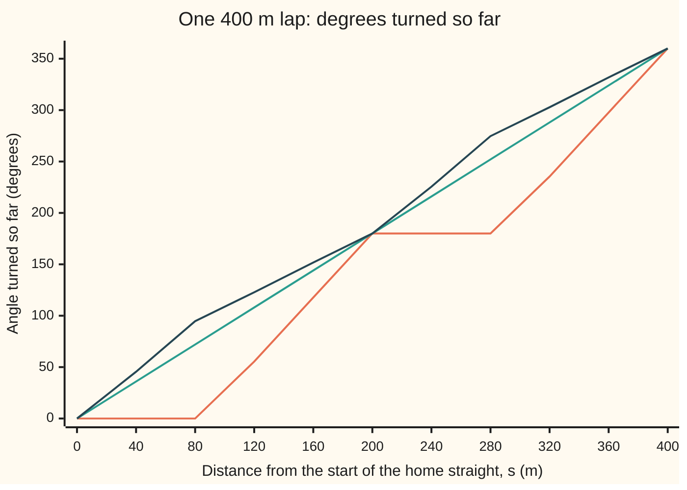

# Turning and winding numbers: whole turns a closed loop makes

[Syllabus](../../../SYLLABUS.md) → [Differential geometry and Lie groups](../README.md) → [Curves](../README.md#s01) → Turning and winding numbers

---

## General Overview

A runner laps a standard 400 m track anticlockwise, the direction races run. The track is two straights of 84.39 m joined by two half-circle bends. On the running line, the line a runner hugging the inside actually follows, each bend has radius 36.80 m. One lap of that line is 400.00 m.

Count the lap's turns in two ways.

- **Watch the runner's heading**, the compass direction of travel. It stays fixed on each straight and swings through 180° on each bend. Over the lap it turns through 360°: one whole turn. This count is the **turning number**.
- **Stand at the centre of the infield and watch the runner.** Your line of sight to the runner sweeps round you, 360° over the lap: one whole turn again. This count is the **winding number** round the centre.

Both counts are whole numbers, because the runner ends where they started, heading the way they started. Both survive bending: reshape the track into a circle or a kidney, and as long as the runner never stops dead, the heading still turns once. The two counts differ in general: a coach standing beyond the outer lane is circled 0 times.

**The turning number counts the whole turns a closed loop's direction of travel makes, and the winding number counts the whole turns the loop makes round one point; the turning number survives any smooth reshaping that keeps the loop moving, and the winding number survives any reshaping that never crosses the point.**

**What kind of fact this is:** two definitions and two theorems. The turning and winding numbers are definitions. That a loop without self-crossings turns exactly once (Hopf's theorem) is proved on this card in Why it works. That the turning number decides which loops can be reshaped into which (the Whitney–Graustein theorem) is proved there for a nonzero turning number; the zero case is left to Whitney's paper.

### The picture: the lap counted two ways



Orange: the track runner's heading, flat on the straights and climbing on the bends. Green: the heading on a circle of the same 400 m length, climbing steadily. Dark blue: the line of sight from the infield centre to the track runner. The three lines take different routes and all end at 360°, one whole turn.

---

## The formula

Notation first, in words. The loop $`\gamma`$ (gamma) is the runner's path, labelled by arc length $`s`$, the metres run from the start of the home straight (the straight that ends at the finish line), from 0 to the lap length $`L`$ ([Regular curve and arc length](01-regular-curves-and-arc-length.md)). $`\mathbf{T}(s)`$ is the unit tangent, the arrow of length 1 pointing along the direction of travel.

The heading $`\theta(s)`$ (theta) is the angle of $`\mathbf{T}`$, in radians anticlockwise from due east, followed continuously without jumping back at 360°. (Here θ is a heading; on the globe the same letter is longitude.) Signed curvature $`\kappa`$ (kappa) is the rate the heading turns, positive turning left, in 1/m: $`\kappa = d\theta/ds`$ ([Curvature](02-curvature-of-plane-curves.md)).

This card introduces the **turning number** $`\mathrm{rot}(\gamma)`$, read "the turning number of gamma" and also called the rotation index:

```math
\mathrm{rot}(\gamma) = \frac{1}{2\pi}\oint_\gamma \kappa\, ds = \frac{\theta(L) - \theta(0)}{2\pi}
```

**Read it aloud:** add up the curvature over the whole lap, which is the total angle the heading turns through, and divide by one full turn.

On the track: the straights have $`\kappa = 0`$, and each bend has $`\kappa = 1/36.80 = 0.027174`$ per metre over 115.61 m, which is π radians (180°). Two bends give 2π, so $`\mathrm{rot} = 1`$.

The **winding number** $`n(\gamma, a)`$ is the one met in [Deforming a loop](../../07-Complex%20analysis/03-Contour%20Integrals%20and%20Cauchy%27s%20Theorem/04-deforming-contours-and-winding-numbers.md): the net anticlockwise laps the loop makes round the point $`a`$. Written with the bearing $`\alpha(s)`$ (alpha), the angle of the arrow from $`a`$ to the runner, followed continuously:

```math
n(\gamma, a) = \frac{1}{2\pi}\oint_\gamma d\alpha = \frac{\alpha(L) - \alpha(0)}{2\pi}
```

**Read it aloud:** the winding number is the total angle the arrow from the point to the runner sweeps, divided by one full turn.

The link between the two is one line. Draw every tangent arrow from one origin. The heading is then the bearing of the arrow's tip, seen from the origin:

```math
\mathrm{rot}(\gamma) = n(\mathbf{T}, 0)
```

**Read it aloud:** the turning number of a loop is the winding number of its unit tangent round zero.

| Symbol | Plain meaning | In our example | Push it up and the answer… |
| --- | --- | --- | --- |
| $`\gamma`$ | the closed loop: the runner's path | the running line of lane 1 | — |
| $`s`$, $`L`$ | arc length from the start of the home straight; the lap length | 0 to 400.00 m | — |
| $`\ell`$, $`\rho`$ | straight length; bend radius, $`\rho = 1/\lvert\kappa\rvert`$ | 84.39 m; 36.80 m | lap longer, turn count unchanged |
| $`\mathbf{T}(s)`$ | unit tangent: the direction of travel | due east on the home straight | — |
| $`\theta(s)`$ | heading: angle of $`\mathbf{T}`$ from due east, unwrapped | 0 to 2π (360°) | — |
| $`\kappa`$ | signed curvature, $`d\theta/ds`$, positive turning left | 0 on straights, 0.027174 1/m on bends | heading turns faster there |
| $`\mathrm{rot}(\gamma)`$ | turning number: whole turns of the heading | 1 | one extra small loop adds 1 |
| $`a`$ | a point the loop may go round | infield centre (0, 0); coach (0, −50) m | — |
| $`\alpha(s)`$ | bearing of the runner seen from $`a`$, unwrapped | starts at 221.09° from the centre | — |
| $`n(\gamma, a)`$ | winding number: whole turns round $`a`$ | 1 round the centre, 0 round the coach | 0 once the loop leaves $`a`$ outside |
| $`u`$ | stage of a reshaping, from 0 to 1 | track at 0, circle at 1 | — |
| $`b`$, $`r`$, $`t`$ | limaçon $`r = b + 20\cos t`$: offset, distance from the origin, angle | $`b`$ = 30, 20, 10 m | the loop rounds out, turning number still 1; push it down below 20 m instead and an inner loop makes it 2 |

### When it holds

- **The loop is closed and ends heading the way it started.** Half a lap turns the heading 180°, 0.5 of a turn: no whole number.
- **The loop never stops: speed stays above zero.** At a point of zero speed the heading has no value. The limaçon $`r = 20 + 20\cos t`$ (a heart-shaped loop) stops at its cusp, and reshaping through it changes the turning number from 1 to 2.
- **The point $`a`$ is not on the loop.** On the loop the bearing has no value. Reshaping that drags the loop across the coach changes the winding number round the coach from 0 to 1.
- **The loop is smooth enough to have a heading.** A corner, as on a polygon, needs its turn added by hand as an exterior angle (the angle the direction jumps at the corner); with that the same count works.
- **The loop lies in a plane.** In space a direction has no single angle, and the count disappears: directions in space fill a sphere, not a circle, and a loop on a sphere can always be shrunk to a point, so the tangent's turns leave nothing to count. The count's heir in higher dimensions is the degree of a map ([Sard's theorem and degree](../03-Manifolds/10-sards-theorem-and-degree.md)).

---

## Why it works

### Step 0: an angle followed continuously, on a closed loop, must end a whole number of turns away

The heading is a direction, and a direction is a point on a circle. Follow its angle continuously, without resetting at 360°. Back where the lap began, the runner points the same way as at the start. So the angle has moved by a whole number of full turns.

The same holds for the bearing from a point. The runner is back at the start, so the arrow from the point is back where it began. Everything below makes this exact and asks what can change the count.

### Step 1: adding up curvature adds up the heading's turns

Curvature is the rate of turning, $`\kappa = d\theta/ds`$. Adding a rate over the lap gives the total change: $`\oint \kappa\, ds = \theta(L) - \theta(0)`$. That is the fundamental theorem of calculus, nothing more.

On the track the total comes in four pieces:

- home straight: $`0 \times 84.39 = 0`$;
- first bend: $`(1/36.80) \times (\pi \times 36.80) = \pi = 3.141593`$ rad, 180.00°;
- back straight: 0;
- second bend: 180.00° again.

Total 360.00°, one turn. The code samples 4000 points round the lap, adds the angle between each step and the next, and also gets 6.283185 rad.

### Step 2: the turning number is the winding number of the tangent

Draw each tangent arrow $`\mathbf{T}(s)`$ from one fixed origin. Its tip runs round the circle of radius 1. Its angle from the origin is the heading. So the turns of the heading are the turns of the tip round the origin: $`\mathrm{rot}(\gamma) = n(\mathbf{T}, 0)`$.

So one tool counts both. The code's winding function, run on the lap's points, gives the winding number; run on the lap's steps, the sampled velocity, it gives the turning number. A second function counts signed crossings of a ray due east of the point, +1 anticlockwise and −1 clockwise, with no angles at all. It agrees: 1 for the heading, 1 round the centre, 0 round the coach.

### Step 3: why a turn count cannot change under smooth reshaping

[The circle's fundamental group is the integers](../../17-Topology/04-Homotopy/04-fundamental-group-of-the-circle.md) proves the key fact: a loop on a circle has a whole-number count, and sliding the loop continuously cannot change it.

Apply it twice.

1. **Winding number.** Reshape the loop without touching $`a`$. The direction from $`a`$ to the runner is a loop on the circle that slides continuously, so its count stays fixed. [Deforming a loop](../../07-Complex%20analysis/03-Contour%20Integrals%20and%20Cauchy%27s%20Theorem/04-deforming-contours-and-winding-numbers.md) showed this for roundabout laps.
2. **Turning number.** Reshape the loop so its speed never reaches zero. Then $`\mathbf{T}`$ is defined at every stage and slides continuously on the circle, so its count stays fixed. Such a reshaping is a **regular homotopy**: a continuous family of closed curves, each with nonzero speed everywhere, whose velocity also changes continuously.

The section "Bending the lap into a circle", below, runs both cases on the track.

### Step 4: a loop that never crosses itself turns exactly once

The track never crosses itself. Hopf's theorem, from 1935, says every such loop has turning number +1 if run anticlockwise and −1 if clockwise. So for a simple loop the turning number equals the winding number round any point inside it: both 1 for the track.

The idea: compare the tangent with the **secant**, the arrow from one point of the loop to a later one. Shrink the gap between the two points to zero and the secant becomes the tangent. Open the gap from the lowest point of the loop and the secant can only sweep through the upper half of its directions, a half turn, and then a second half turn back.

<details>
<summary>Detailed proof: Hopf's theorem on simple closed loops</summary>

Start the lap at the lowest point $`p`$ of the loop, the one with the least height. The whole loop lies on or above the level line through $`p`$, so the tangent there is level. Run anticlockwise, so it points due east: $`\theta(0) = 0`$.

Take every pair of times with $`0 \le s_1 \le s_2 \le L`$: a solid triangle of pairs. To each pair give a direction:

$`\displaystyle S(s_1, s_2) = \frac{\gamma(s_2) - \gamma(s_1)}{\lvert \gamma(s_2) - \gamma(s_1)\rvert},`$

the unit secant. On the diagonal $`s_1 = s_2`$ use $`\mathbf{T}(s_1)`$, and at the corner $`(0, L)`$, where both points are $`p`$ again, use $`-\mathbf{T}(0)`$. The loop never crosses itself, so the secant is never zero elsewhere, and this direction is continuous on the whole triangle.

Path one runs along the diagonal from $`(0, 0)`$ to $`(L, L)`$. There $`S`$ is the tangent, so $`S`$ turns through $`2\pi\,\mathrm{rot}(\gamma)`$.

Path two runs from $`(0, 0)`$ up to $`(0, L)`$, then across to $`(L, L)`$. On the first leg $`S`$ is the arrow from $`p`$ to a later point, which never points below level. It starts due east and ends due west, so it turns through exactly $`+\pi`$. On the second leg $`S`$ is the arrow from a point back to $`p`$, which never points above level. It runs from due west to due east through the lower half, another $`+\pi`$.

The triangle has no hole, so path one slides onto path two with its ends held. By Step 3 the turn counts agree: $`2\pi\,\mathrm{rot}(\gamma) = \pi + \pi`$, so $`\mathrm{rot}(\gamma) = 1`$. Clockwise reverses every sign.

</details>

### Step 5: the turning number is the only obstruction

Step 3 says loops with different turning numbers cannot be reshaped into each other without stopping. The Whitney–Graustein theorem, from 1937, says the reverse: two closed plane loops with equal turning numbers can always be joined by a regular homotopy. So the turning number sorts all smooth closed loops completely.

The figure-eight $`(60\sin t,\ 30\sin 2t)`$ m, a warm-down jog round two cones at $`(\pm 40, 0)`$ m, has turning number 0. The track has 1. No reshaping without a stop turns one into the other.

<details>
<summary>Detailed proof: equal turning numbers can be joined (Whitney–Graustein)</summary>

Take two loops with the same turning number $`k`$. Scaling and rotating are regular homotopies, so give both the same length $`L`$, unit speed and starting heading. Their unwrapped headings $`\theta_0(s)`$ and $`\theta_1(s)`$ both start at the same angle and both end $`2\pi k`$ higher.

Mix the headings: $`\theta_u = (1 - u)\theta_0 + u\theta_1`$. It also ends $`2\pi k`$ above its start, so its direction closes up. Walking along it gives a path that may miss its start by a gap

$`\displaystyle c_u = \int_0^L (\cos\theta_u,\ \sin\theta_u)\, ds.`$

Close the gap evenly: give the path velocity $`(\cos\theta_u, \sin\theta_u) - c_u/L`$. The result is closed for every $`u`$ and moves continuously with $`u`$.

The gap is the sum of $`L`$ metres of unit steps, so $`\lvert c_u\rvert \le L`$, with equality only if $`\theta_u`$ never changes. When $`k \ne 0`$, $`\theta_u`$ climbs by $`2\pi k`$, so it must change and $`\lvert c_u\rvert < L`$. Then the velocity is a unit arrow minus an arrow shorter than 1, never zero. Every stage is regular, and the family runs from the first loop ($`u = 0`$) to the second ($`u = 1`$).

When $`k = 0`$ this mix can fail. Mix a loop with its mirror image: at $`u = 1/2`$ the heading is constant, the gap is $`L`$ and the velocity is zero. This case needs a separate argument, given in Whitney's paper (Sources); the theorem holds for every $`k`$.

</details>

### Step 6: what changes the count: a stop

The limaçon $`r = b + 20\cos t`$ m (a loop drawn by a point at distance $`r`$ from the origin at angle $`t`$) shows the hypothesis at work.

| $`b`$ (m) | Least speed (m per radian of $`t`$) | Turning number | Winding round (5, 0), (20, 0), (40, 0) |
| --- | --- | --- | --- |
| 30 | 10.000000 | 1 | 1, 1, 1 |
| 20 | 0.000000, a cusp | none | — |
| 10 | 10.000000 | 2 | 2, 1, 0 |

As $`b`$ falls from 30 to 10, the loop grows an inner loop and the heading gains a turn. It must pass $`b = 20`$, where the loop stops at a cusp, a sharp point where the heading flips. Turning and winding also differ here: (20, 0) is circled once, (5, 0) inside the small loop twice, (40, 0) not at all.

---

## Worked numbers, by hand

| Step | Arithmetic | Value |
| --- | --- | --- |
| bend length | π × 36.80 | 115.61 m |
| lap length | 2 × 84.39 + 2 × 115.61 | 400.00 m |
| bend curvature | 1 / 36.80 | 0.027174 1/m |
| heading turned on one bend | (1 / 36.80) × (π × 36.80) = π | 3.141593 rad = 180.00° |
| heading turned on the lap | 0 + 180.00 + 0 + 180.00 | 360.00° |
| turning number | 360.00 / 360 | **1** |
| centre to a straight's end | the angle whose tangent is 36.80 / 42.195 (half of 84.39 is 42.195), measured from level | 41.093° |
| sight-line sweep on a straight | 180 − 2 × 41.093 | 97.81° |
| sight-line sweep on a bend | 2 × 41.093 | 82.19° |
| sight line on the lap | 97.81 + 82.19 + 97.81 + 82.19 | 360.00° |
| winding number round the centre | 360.00 / 360 | **1** |

The heading does all its turning on the bends; the sight line from the centre turns most on the straights. The totals still agree: for a loop that never crosses itself, both are one whole turn.

### What breaks if you drop a piece

| Mistake | Comes out at | What went wrong |
| --- | --- | --- |
| Reshaping through a stop | limaçon jumps from turning 1 to 2 at $`b = 20`$, least speed 0.000000 | At the cusp the heading has no value, so Step 3 does not apply |
| Counting half a lap | 180.00°, 0.500000 turns | The loop is not closed, so no whole number is forced |
| Adding $`\lvert\kappa\rvert`$ instead of $`\kappa`$ on the figure-eight | 1.500000 turns, not 0 | Right turns must cancel left turns |
| Sampling the inner-loop limaçon at 5 points | turning 1.000000, not 2 | A step turned more than half a turn and was read the short way round |

The code prints all four.

---

## Bending the lap into a circle

The puzzle: the track's curvature sits on its bends, a circle's is spread evenly. Bending one into the other moves curvature around. Does the total move too?

The code mixes the track with a circle of the same length, 63.66 m in radius: stage $`u`$ takes $`(1 - u)`$ times the track point plus $`u`$ times the circle point at each $`s`$.

| Stage $`u`$ | Least speed | Turning number (angle sum; crossings) | Winding round centre | Winding round coach (0, −50) |
| --- | --- | --- | --- | --- |
| 0.00 (track) | 1.000000 | 1.000000; 1 | 1 | 0 |
| 0.25 | 0.846213 | 1.000000; 1 | 1 | 0 |
| 0.50 | 0.788311 | 1.000000; 1 | 1 | 0 |
| 0.75 | 0.846213 | 1.000000; 1 | 1 | 1 |
| 1.00 (circle) | 1.000000 | 1.000000; 1 | 1 | 1 |

Read down the columns:

- **Least speed** dips but stays well above zero, so every stage is regular and Step 3 holds.
- **Turning number** never moves: curvature shifts from the bends onto the straights, but the total stays 2π.
- **Winding round the centre** never moves: the loop never touches the centre.
- **Winding round the coach** jumps once, between $`u = 0.5`$ and $`u = 0.75`$, when the swelling loop sweeps over the coach. The winding number counts only round a point the loop never touches; the turning number has no point to cross.

---

## Code, from first principles, and it actually runs

The code samples the track at 4000 points and counts turns by three independent roads: curvature times length piece by piece; the sum of each sampled step's turn, from atan2 (the angle of a point, from −180° to 180°); and signed crossings of a ray, which uses no angles. Roads two and three get the turning number from the steps as a velocity loop round zero: $`\mathrm{rot}(\gamma) = n(\mathbf{T}, 0)`$ in code. Each hand sight-line sweep, straight and bend, is checked against the samples, and the samples are checked to be evenly spaced, with no jumps. The same tools then run on the reshaping, the figure-eight and the limaçon.

### Python

```python
# Turning and winding numbers -- the check behind the card.  Only math is
# imported.  A 400 m running track (straights 84.39 m, bends of radius 36.80 m
# on the running line) is lapped anticlockwise.  Its turns are counted two
# ways, the heading (turning number) and the arrow from a point (winding
# number), each by an angle sum and by a signed crossing count.
from math import atan2, cos, sin, pi, hypot

ELL, RHO, N = 84.39, 36.80, 4000
BEND = pi * RHO                         # length of one bend
L = 2 * ELL + 2 * BEND                  # length of the lap on the running line
RC = L / (2 * pi)                       # radius of a circle of the same length

def heading(s):                         # exact heading, radians from due east, by pieces
    s %= L
    if s < ELL: return 0.0
    if s < ELL + BEND: return (s - ELL) / RHO
    if s < 2 * ELL + BEND: return pi
    return pi + (s - 2 * ELL - BEND) / RHO

def track(s):                           # position, s metres from the home straight's start
    s %= L
    if s < ELL: return (-ELL / 2 + s, -RHO)
    if s < ELL + BEND:
        t = (s - ELL) / RHO
        return (ELL / 2 + RHO * sin(t), -RHO * cos(t))
    if s < 2 * ELL + BEND: return (ELL / 2 - (s - ELL - BEND), RHO)
    t = (s - 2 * ELL - BEND) / RHO
    return (-ELL / 2 - RHO * sin(t), RHO * cos(t))

def circle(s): return (RC * sin(s / RC), -RC * cos(s / RC))

def angle_sum(pts, a):                  # road 2: add up each step's turn of the arrow from a
    tot = 0.0
    for k in range(len(pts)):
        (x1, y1), (x2, y2) = pts[k], pts[(k + 1) % len(pts)]
        x1, y1, x2, y2 = x1 - a[0], y1 - a[1], x2 - a[0], y2 - a[1]
        tot += atan2(x1 * y2 - y1 * x2, x1 * x2 + y1 * y2)
    return tot

def crossings(pts, a):                  # road 3: signed crossings of the ray due east of a
    n = 0
    for k in range(len(pts)):
        (x1, y1), (x2, y2) = pts[k], pts[(k + 1) % len(pts)]
        y1, y2 = y1 - a[1], y2 - a[1]
        if (y1 < 0) != (y2 < 0) and x1 + (x2 - x1) * y1 / (y1 - y2) > a[0]:
            n += 1 if y2 >= 0 else -1
    return n

def steps(pts):                         # the chord directions: a sampled velocity curve
    return [(pts[(k + 1) % len(pts)][0] - pts[k][0], pts[(k + 1) % len(pts)][1] - pts[k][1])
            for k in range(len(pts))]

def turns(pts):                         # turning number two ways: the velocity's winding round 0
    return angle_sum(steps(pts), (0.0, 0.0)) / (2 * pi), crossings(steps(pts), (0.0, 0.0))

def sweep(pts):                         # an open path's turn of the arrow from the origin
    return sum(atan2(x1 * y2 - y1 * x2, x1 * x2 + y1 * y2) for (x1, y1), (x2, y2) in zip(pts, pts[1:]))

def f6(x): return f"{0.0 if abs(x) < 5e-7 else x:.6f}"
def d2(x): return f"{x * 180 / pi:.2f}"

lap = [track(L * k / N) for k in range(N)]
print(f"track: straights {ELL:.2f} m, bends of radius {RHO:.2f} m, lap {L:.2f} m")
print(f"bend {BEND:.2f} m long, curvature {1 / RHO:.6f} 1/m, heading turned {f6(BEND / RHO)} rad = {d2(BEND / RHO)} deg")
pieces = [k * ds for k, ds in [(0.0, ELL), (1 / RHO, BEND), (0.0, ELL), (1 / RHO, BEND)]]
print("curvature x length, by pieces: " + " + ".join(d2(p) for p in pieces) + f" = {d2(sum(pieces))} deg")
c0 = atan2(RHO, ELL / 2)                # angle of a straight's end seen from the centre
sweeps = [pi - 2 * c0, 2 * c0, pi - 2 * c0, 2 * c0]
print(f"bearing from the centre: a straight's end {c0 * 180 / pi:.3f} deg off level (half-straight {ELL / 2:.3f} m); start {d2(pi + c0)} deg")
print("sight-line sweeps: " + " + ".join(d2(p) for p in sweeps) + f" = {d2(sum(sweeps))} deg")
ta, tc = turns(lap)
print(f"sampled lap, {N} points: heading angle sum {f6(2 * pi * ta)} rad = {f6(ta)} turns; velocity crossings {tc}")
CENTRE, COACH = (0.0, 0.0), (0.0, -50.0)
for name, a in [("centre (0, 0)", CENTRE), ("coach (0, -50)", COACH)]:
    print(f"winding round the {name}: angle sum {f6(angle_sum(lap, a) / (2 * pi))} turns; ray crossings {crossings(lap, a)}")
chart_s = [L * k / 10 for k in range(11)]
bear, acc, prev = [], 0.0, atan2(*track(0)[::-1])
for s in chart_s:
    b = atan2(*track(s)[::-1])
    acc += (b - prev + pi) % (2 * pi) - pi
    prev = b
    bear.append(acc)
print("chart s (m): " + ", ".join(f"{s:.0f}" for s in chart_s))
print("chart track heading turned (deg): " + ", ".join(f"{h * 180 / pi:.1f}" for h in [heading(s) for s in chart_s[:-1]] + [2 * pi]))
print("chart circle heading turned (deg): " + ", ".join(f"{s / RC * 180 / pi:.1f}" for s in chart_s))
print("chart bearing from centre turned (deg): " + ", ".join(f"{b * 180 / pi:.1f}" for b in bear))
print(f"deformation: track (u = 0) into a circle of radius {RC:.2f} m (u = 1), both start heading east, same s")
stages = []
for u in [0.0, 0.25, 0.5, 0.75, 1.0]:
    pts = [((1 - u) * track(s)[0] + u * circle(s)[0], (1 - u) * track(s)[1] + u * circle(s)[1])
           for s in [L * k / N for k in range(N)]]
    slow = min(hypot((1 - u) * cos(heading(s)) + u * cos(s / RC), (1 - u) * sin(heading(s)) + u * sin(s / RC))
               for s in [L * k / N for k in range(N)])
    t, c = turns(pts)
    wc, wk = angle_sum(pts, CENTRE) / (2 * pi), angle_sum(pts, COACH) / (2 * pi)
    stages.append((slow, round(t), c, round(wc), round(wk), crossings(pts, COACH)))
    print(f"  u = {u:.2f}: least speed {f6(slow)}, turning {f6(t)} (crossings {c}), winding round centre {round(wc)}, round coach {round(wk)} (crossings {crossings(pts, COACH)})")
eight = [(60 * sin(2 * pi * k / N), 30 * sin(4 * pi * k / N)) for k in range(N)]
e_t, e_c = turns(eight)
e_w = [round(angle_sum(eight, (x, 0.0)) / (2 * pi)) for x in (40.0, -40.0)]
print(f"figure-eight (60 sin t, 30 sin 2t) m: turning {f6(e_t)} (crossings {e_c}); winding round (40, 0) {e_w[0]}, round (-40, 0) {e_w[1]}")
def limacon(b, m):
    return [((b + 20 * cos(t)) * cos(t), (b + 20 * cos(t)) * sin(t)) for t in [2 * pi * k / m for k in range(m)]]
lim = {}
for b in [30.0, 20.0, 10.0]:
    slow = min(hypot(-20 * sin(t) * cos(t) - (b + 20 * cos(t)) * sin(t), -20 * sin(t) * sin(t) + (b + 20 * cos(t)) * cos(t))
               for t in [2 * pi * k / N for k in range(N)])
    if slow < 1e-9:
        print(f"limacon r = {b:.0f} + 20 cos t m: least speed {f6(slow)} at the cusp, so no tangent there and no turning number")
        lim[b] = (slow,)
        continue
    pts = limacon(b, N)
    t, c = turns(pts)
    w = [round(angle_sum(pts, (x, 0.0)) / (2 * pi)) for x in (5.0, 20.0, 40.0)]
    lim[b] = (slow, round(t), c, w)
    print(f"limacon r = {b:.0f} + 20 cos t m: least speed {f6(slow)}, turning {f6(t)} (crossings {c}); winding round (5, 0), (20, 0), (40, 0): {w}")
half = heading(L / 2) / (2 * pi)
absk = sum(abs(atan2(x1 * y2 - y1 * x2, x1 * x2 + y1 * y2)) for (x1, y1), (x2, y2) in zip(steps(eight), steps(eight)[1:] + steps(eight)[:1])) / (2 * pi)
COARSE = 5                              # sample points for mistake 3
coarse = turns(limacon(10.0, COARSE))
print(f"mistake 1, half a lap is no loop: heading turned {d2(2 * pi * half)} deg = {f6(half)} turns")
print(f"mistake 2, adding |kappa| on the figure-eight: {f6(absk)} turns, not 0")
print(f"mistake 3, limacon r = 10 + 20 cos t sampled at {COARSE} points: turning {f6(coarse[0])}, not 2")
assert abs(2 * pi * ta - sum(pieces)) < 1e-9 and tc == round(ta) == 1      # exact pieces vs samples
assert abs(sum(sweeps) - angle_sum(lap, CENTRE)) < 1e-9                       # by hand vs samples
assert all(abs(sweep([track(a + d * k / 100) for k in range(101)]) - w) < 1e-9 for a, d, w in [(0.0, ELL, sweeps[0]), (ELL, BEND, sweeps[1])])
assert crossings(lap, CENTRE) == 1 and crossings(lap, COACH) == 0
assert max(abs(hypot(*d) - L / N) for d in steps(lap)) < 1e-6                 # samples evenly spaced: no jumps
assert all(st[0] > 0.5 and st[1] == st[2] == 1 and st[3] == 1 for st in stages)
assert [st[4] for st in stages] == [st[5] for st in stages] and stages[0][4] == 0 and stages[-1][4] == 1
assert round(e_t) == e_c == 0 and e_w == [-1, 1]
assert lim[30.0][1] == lim[30.0][2] == 1 and lim[10.0][1] == lim[10.0][2] == 2 and len(lim[20.0]) == 1
assert all(abs(lim[b][0] - abs(b - 20)) < 1e-6 for b in lim)                # least speed = |b - 20|, at t = pi
print("ALL CHECKS PASS")
```

**Ran 2026-11-19 on macOS, Python 3.14.10, standard library only. All checks passed. Output, pasted from the run:**

```
track: straights 84.39 m, bends of radius 36.80 m, lap 400.00 m
bend 115.61 m long, curvature 0.027174 1/m, heading turned 3.141593 rad = 180.00 deg
curvature x length, by pieces: 0.00 + 180.00 + 0.00 + 180.00 = 360.00 deg
bearing from the centre: a straight's end 41.093 deg off level (half-straight 42.195 m); start 221.09 deg
sight-line sweeps: 97.81 + 82.19 + 97.81 + 82.19 = 360.00 deg
sampled lap, 4000 points: heading angle sum 6.283185 rad = 1.000000 turns; velocity crossings 1
winding round the centre (0, 0): angle sum 1.000000 turns; ray crossings 1
winding round the coach (0, -50): angle sum 0.000000 turns; ray crossings 0
chart s (m): 0, 40, 80, 120, 160, 200, 240, 280, 320, 360, 400
chart track heading turned (deg): 0.0, 0.0, 0.0, 55.4, 117.7, 180.0, 180.0, 180.0, 235.4, 297.7, 360.0
chart circle heading turned (deg): 0.0, 36.0, 72.0, 108.0, 144.0, 180.0, 216.0, 252.0, 288.0, 324.0, 360.0
chart bearing from centre turned (deg): 0.0, 45.5, 94.7, 122.8, 151.8, 180.0, 225.5, 274.7, 302.8, 331.8, 360.0
deformation: track (u = 0) into a circle of radius 63.66 m (u = 1), both start heading east, same s
  u = 0.00: least speed 1.000000, turning 1.000000 (crossings 1), winding round centre 1, round coach 0 (crossings 0)
  u = 0.25: least speed 0.846213, turning 1.000000 (crossings 1), winding round centre 1, round coach 0 (crossings 0)
  u = 0.50: least speed 0.788311, turning 1.000000 (crossings 1), winding round centre 1, round coach 0 (crossings 0)
  u = 0.75: least speed 0.846213, turning 1.000000 (crossings 1), winding round centre 1, round coach 1 (crossings 1)
  u = 1.00: least speed 1.000000, turning 1.000000 (crossings 1), winding round centre 1, round coach 1 (crossings 1)
figure-eight (60 sin t, 30 sin 2t) m: turning 0.000000 (crossings 0); winding round (40, 0) -1, round (-40, 0) 1
limacon r = 30 + 20 cos t m: least speed 10.000000, turning 1.000000 (crossings 1); winding round (5, 0), (20, 0), (40, 0): [1, 1, 1]
limacon r = 20 + 20 cos t m: least speed 0.000000 at the cusp, so no tangent there and no turning number
limacon r = 10 + 20 cos t m: least speed 10.000000, turning 2.000000 (crossings 2); winding round (5, 0), (20, 0), (40, 0): [2, 1, 0]
mistake 1, half a lap is no loop: heading turned 180.00 deg = 0.500000 turns
mistake 2, adding |kappa| on the figure-eight: 1.500000 turns, not 0
mistake 3, limacon r = 10 + 20 cos t sampled at 5 points: turning 1.000000, not 2
ALL CHECKS PASS
```

### Rust

Same numbers, same labels, built with `rustc --edition 2021 -O`.

```rust
// Turning and winding numbers -- the same check as the Python, in Rust.  No
// crates.  A 400 m running track (straights 84.39 m, bends of radius 36.80 m
// on the running line) is lapped anticlockwise.  Its turns are counted two
// ways, the heading (turning number) and the arrow from a point (winding
// number), each by an angle sum and by a signed crossing count.
use std::f64::consts::PI;
type P = (f64, f64);
const ELL: f64 = 84.39;
const RHO: f64 = 36.80;
const N: usize = 4000;
const BEND: f64 = PI * RHO;             // length of one bend
const L: f64 = 2.0 * ELL + 2.0 * BEND;  // length of the lap on the running line
const RC: f64 = L / (2.0 * PI);         // radius of a circle of the same length

fn heading(s: f64) -> f64 {             // exact heading, radians from due east, by pieces
    let s = s % L;
    if s < ELL { 0.0 } else if s < ELL + BEND { (s - ELL) / RHO }
    else if s < 2.0 * ELL + BEND { PI } else { PI + (s - 2.0 * ELL - BEND) / RHO }
}

fn track(s: f64) -> P {                 // position, s metres from the home straight's start
    let s = s % L;
    if s < ELL { return (-ELL / 2.0 + s, -RHO) }
    if s < ELL + BEND {
        let t = (s - ELL) / RHO;
        return (ELL / 2.0 + RHO * t.sin(), -RHO * t.cos());
    }
    if s < 2.0 * ELL + BEND { return (ELL / 2.0 - (s - ELL - BEND), RHO) }
    let t = (s - 2.0 * ELL - BEND) / RHO;
    (-ELL / 2.0 - RHO * t.sin(), RHO * t.cos())
}

fn circle(s: f64) -> P { (RC * (s / RC).sin(), -RC * (s / RC).cos()) }

fn angle_sum(pts: &[P], a: P) -> f64 {  // road 2: add up each step's turn of the arrow from a
    let mut tot = 0.0;
    for k in 0..pts.len() {
        let ((x1, y1), (x2, y2)) = (pts[k], pts[(k + 1) % pts.len()]);
        let (x1, y1, x2, y2) = (x1 - a.0, y1 - a.1, x2 - a.0, y2 - a.1);
        tot += (x1 * y2 - y1 * x2).atan2(x1 * x2 + y1 * y2);
    }
    tot
}

fn crossings(pts: &[P], a: P) -> i64 {  // road 3: signed crossings of the ray due east of a
    let mut n = 0;
    for k in 0..pts.len() {
        let ((x1, y1), (x2, y2)) = (pts[k], pts[(k + 1) % pts.len()]);
        let (y1, y2) = (y1 - a.1, y2 - a.1);
        if (y1 < 0.0) != (y2 < 0.0) && x1 + (x2 - x1) * y1 / (y1 - y2) > a.0 {
            n += if y2 >= 0.0 { 1 } else { -1 };
        }
    }
    n
}

fn steps(pts: &[P]) -> Vec<P> {         // the chord directions: a sampled velocity curve
    (0..pts.len()).map(|k| { let q = pts[(k + 1) % pts.len()]; (q.0 - pts[k].0, q.1 - pts[k].1) }).collect()
}

fn turns(pts: &[P]) -> (f64, i64) {     // turning number two ways: the velocity's winding round 0
    (angle_sum(&steps(pts), (0.0, 0.0)) / (2.0 * PI), crossings(&steps(pts), (0.0, 0.0)))
}

fn sweep(pts: &[P]) -> f64 {            // an open path's turn of the arrow from the origin
    pts.windows(2).map(|w| (w[0].0 * w[1].1 - w[0].1 * w[1].0).atan2(w[0].0 * w[1].0 + w[0].1 * w[1].1)).sum()
}

fn f6(x: f64) -> String { format!("{:.6}", if x.abs() < 5e-7 { 0.0 } else { x }) }
fn d2(x: f64) -> String { format!("{:.2}", x * 180.0 / PI) }
fn join(v: &[String]) -> String { v.join(", ") }

fn limacon(b: f64, m: usize) -> Vec<P> {
    (0..m).map(|k| { let t = 2.0 * PI * k as f64 / m as f64; let r = b + 20.0 * t.cos(); (r * t.cos(), r * t.sin()) }).collect()
}

fn main() {
    let ss: Vec<f64> = (0..N).map(|k| L * k as f64 / N as f64).collect();
    let lap: Vec<P> = ss.iter().map(|&s| track(s)).collect();
    println!("track: straights {:.2} m, bends of radius {:.2} m, lap {:.2} m", ELL, RHO, L);
    println!("bend {:.2} m long, curvature {:.6} 1/m, heading turned {} rad = {} deg", BEND, 1.0 / RHO, f6(BEND / RHO), d2(BEND / RHO));
    let pieces: Vec<f64> = [(0.0, ELL), (1.0 / RHO, BEND), (0.0, ELL), (1.0 / RHO, BEND)].iter().map(|&(k, ds)| k * ds).collect();
    let psum: f64 = pieces.iter().sum();
    println!("curvature x length, by pieces: {} = {} deg", pieces.iter().map(|&p| d2(p)).collect::<Vec<_>>().join(" + "), d2(psum));
    let c0 = RHO.atan2(ELL / 2.0);      // angle of a straight's end seen from the centre
    let sweeps = [PI - 2.0 * c0, 2.0 * c0, PI - 2.0 * c0, 2.0 * c0];
    let wsum: f64 = sweeps.iter().sum();
    println!("bearing from the centre: a straight's end {:.3} deg off level (half-straight {:.3} m); start {} deg", c0 * 180.0 / PI, ELL / 2.0, d2(PI + c0));
    println!("sight-line sweeps: {} = {} deg", sweeps.iter().map(|&p| d2(p)).collect::<Vec<_>>().join(" + "), d2(wsum));
    let (ta, tc) = turns(&lap);
    println!("sampled lap, {} points: heading angle sum {} rad = {} turns; velocity crossings {}", N, f6(2.0 * PI * ta), f6(ta), tc);
    let (centre, coach): (P, P) = ((0.0, 0.0), (0.0, -50.0));
    for (name, a) in [("centre (0, 0)", centre), ("coach (0, -50)", coach)] {
        println!("winding round the {}: angle sum {} turns; ray crossings {}", name, f6(angle_sum(&lap, a) / (2.0 * PI)), crossings(&lap, a));
    }
    let chart_s: Vec<f64> = (0..11).map(|k| L * k as f64 / 10.0).collect();
    let (mut bear, mut acc) = (Vec::new(), 0.0);
    let mut prev = track(0.0).1.atan2(track(0.0).0);
    for &s in &chart_s {
        let b = track(s).1.atan2(track(s).0);
        acc += (b - prev + PI).rem_euclid(2.0 * PI) - PI;
        prev = b;
        bear.push(acc);
    }
    let mut th: Vec<f64> = chart_s[..10].iter().map(|&s| heading(s)).collect();
    th.push(2.0 * PI);
    println!("chart s (m): {}", join(&chart_s.iter().map(|s| format!("{:.0}", s)).collect::<Vec<_>>()));
    println!("chart track heading turned (deg): {}", join(&th.iter().map(|h| format!("{:.1}", h * 180.0 / PI)).collect::<Vec<_>>()));
    println!("chart circle heading turned (deg): {}", join(&chart_s.iter().map(|s| format!("{:.1}", s / RC * 180.0 / PI)).collect::<Vec<_>>()));
    println!("chart bearing from centre turned (deg): {}", join(&bear.iter().map(|b| format!("{:.1}", b * 180.0 / PI)).collect::<Vec<_>>()));
    println!("deformation: track (u = 0) into a circle of radius {:.2} m (u = 1), both start heading east, same s", RC);
    let mut stages = Vec::new();
    for u in [0.0, 0.25, 0.5, 0.75, 1.0] {
        let pts: Vec<P> = ss.iter().map(|&s| ((1.0 - u) * track(s).0 + u * circle(s).0, (1.0 - u) * track(s).1 + u * circle(s).1)).collect();
        let slow = ss.iter().map(|&s| ((1.0 - u) * heading(s).cos() + u * (s / RC).cos()).hypot((1.0 - u) * heading(s).sin() + u * (s / RC).sin()))
            .fold(f64::INFINITY, f64::min);
        let (t, c) = turns(&pts);
        let (wc, wk) = ((angle_sum(&pts, centre) / (2.0 * PI)).round() as i64, (angle_sum(&pts, coach) / (2.0 * PI)).round() as i64);
        let kc = crossings(&pts, coach);
        stages.push((slow, t.round() as i64, c, wc, wk, kc));
        println!("  u = {:.2}: least speed {}, turning {} (crossings {}), winding round centre {}, round coach {} (crossings {})", u, f6(slow), f6(t), c, wc, wk, kc);
    }
    let eight: Vec<P> = (0..N).map(|k| { let t = 2.0 * PI * k as f64 / N as f64; (60.0 * t.sin(), 30.0 * (2.0 * t).sin()) }).collect();
    let (e_t, e_c) = turns(&eight);
    let e_w: Vec<i64> = [40.0, -40.0].iter().map(|&x| (angle_sum(&eight, (x, 0.0)) / (2.0 * PI)).round() as i64).collect();
    println!("figure-eight (60 sin t, 30 sin 2t) m: turning {} (crossings {}); winding round (40, 0) {}, round (-40, 0) {}", f6(e_t), e_c, e_w[0], e_w[1]);
    let mut lim: Vec<(f64, i64, i64)> = Vec::new();
    for b in [30.0, 20.0, 10.0] {
        let slow = (0..N).map(|k| { let t = 2.0 * PI * k as f64 / N as f64;
            (-20.0 * t.sin() * t.cos() - (b + 20.0 * t.cos()) * t.sin()).hypot(-20.0 * t.sin() * t.sin() + (b + 20.0 * t.cos()) * t.cos()) })
            .fold(f64::INFINITY, f64::min);
        if slow < 1e-9 {
            println!("limacon r = {:.0} + 20 cos t m: least speed {} at the cusp, so no tangent there and no turning number", b, f6(slow));
            lim.push((slow, -99, -99));
            continue;
        }
        let pts = limacon(b, N);
        let (t, c) = turns(&pts);
        let w: Vec<i64> = [5.0, 20.0, 40.0].iter().map(|&x| (angle_sum(&pts, (x, 0.0)) / (2.0 * PI)).round() as i64).collect();
        lim.push((slow, t.round() as i64, c));
        println!("limacon r = {:.0} + 20 cos t m: least speed {}, turning {} (crossings {}); winding round (5, 0), (20, 0), (40, 0): {:?}", b, f6(slow), f6(t), c, w);
    }
    let half = heading(L / 2.0) / (2.0 * PI);
    let st8 = steps(&eight);
    let absk: f64 = (0..N).map(|k| { let ((x1, y1), (x2, y2)) = (st8[k], st8[(k + 1) % N]); (x1 * y2 - y1 * x2).atan2(x1 * x2 + y1 * y2).abs() }).sum::<f64>() / (2.0 * PI);
    let coarse_n = 5;                    // sample points for mistake 3
    let coarse = turns(&limacon(10.0, coarse_n));
    println!("mistake 1, half a lap is no loop: heading turned {} deg = {} turns", d2(2.0 * PI * half), f6(half));
    println!("mistake 2, adding |kappa| on the figure-eight: {} turns, not 0", f6(absk));
    println!("mistake 3, limacon r = 10 + 20 cos t sampled at {} points: turning {}, not 2", coarse_n, f6(coarse.0));
    assert!((2.0 * PI * ta - psum).abs() < 1e-9 && tc == ta.round() as i64 && tc == 1);  // exact pieces vs samples
    assert!((wsum - angle_sum(&lap, centre)).abs() < 1e-9);                                // by hand vs samples
    assert!([(0.0, ELL, sweeps[0]), (ELL, BEND, sweeps[1])].iter().all(|&(a, d, w)| (sweep(&(0..101).map(|k| track(a + d * k as f64 / 100.0)).collect::<Vec<P>>()) - w).abs() < 1e-9));
    assert!(crossings(&lap, centre) == 1 && crossings(&lap, coach) == 0);
    assert!(steps(&lap).iter().all(|d| (d.0.hypot(d.1) - L / N as f64).abs() < 1e-6));   // samples evenly spaced: no jumps
    assert!(stages.iter().all(|st| st.0 > 0.5 && st.1 == 1 && st.2 == 1 && st.3 == 1));
    assert!(stages.iter().all(|st| st.4 == st.5) && stages[0].4 == 0 && stages[4].4 == 1);
    assert!(e_t.round() as i64 == 0 && e_c == 0 && e_w == vec![-1, 1]);
    assert!(lim[0].1 == 1 && lim[0].2 == 1 && lim[2].1 == 2 && lim[2].2 == 2 && lim[1].0 < 1e-9);
    assert!([30.0f64, 20.0, 10.0].iter().zip(&lim).all(|(&b, l)| (l.0 - (b - 20.0).abs()).abs() < 1e-6)); // least speed = |b - 20|, at t = pi
    println!("ALL CHECKS PASS");
}
```

**Ran 2026-11-19 on macOS, rustc 1.98.1, no crates. All checks passed. Output, pasted from the run:**

```
track: straights 84.39 m, bends of radius 36.80 m, lap 400.00 m
bend 115.61 m long, curvature 0.027174 1/m, heading turned 3.141593 rad = 180.00 deg
curvature x length, by pieces: 0.00 + 180.00 + 0.00 + 180.00 = 360.00 deg
bearing from the centre: a straight's end 41.093 deg off level (half-straight 42.195 m); start 221.09 deg
sight-line sweeps: 97.81 + 82.19 + 97.81 + 82.19 = 360.00 deg
sampled lap, 4000 points: heading angle sum 6.283185 rad = 1.000000 turns; velocity crossings 1
winding round the centre (0, 0): angle sum 1.000000 turns; ray crossings 1
winding round the coach (0, -50): angle sum 0.000000 turns; ray crossings 0
chart s (m): 0, 40, 80, 120, 160, 200, 240, 280, 320, 360, 400
chart track heading turned (deg): 0.0, 0.0, 0.0, 55.4, 117.7, 180.0, 180.0, 180.0, 235.4, 297.7, 360.0
chart circle heading turned (deg): 0.0, 36.0, 72.0, 108.0, 144.0, 180.0, 216.0, 252.0, 288.0, 324.0, 360.0
chart bearing from centre turned (deg): 0.0, 45.5, 94.7, 122.8, 151.8, 180.0, 225.5, 274.7, 302.8, 331.8, 360.0
deformation: track (u = 0) into a circle of radius 63.66 m (u = 1), both start heading east, same s
  u = 0.00: least speed 1.000000, turning 1.000000 (crossings 1), winding round centre 1, round coach 0 (crossings 0)
  u = 0.25: least speed 0.846213, turning 1.000000 (crossings 1), winding round centre 1, round coach 0 (crossings 0)
  u = 0.50: least speed 0.788311, turning 1.000000 (crossings 1), winding round centre 1, round coach 0 (crossings 0)
  u = 0.75: least speed 0.846213, turning 1.000000 (crossings 1), winding round centre 1, round coach 1 (crossings 1)
  u = 1.00: least speed 1.000000, turning 1.000000 (crossings 1), winding round centre 1, round coach 1 (crossings 1)
figure-eight (60 sin t, 30 sin 2t) m: turning 0.000000 (crossings 0); winding round (40, 0) -1, round (-40, 0) 1
limacon r = 30 + 20 cos t m: least speed 10.000000, turning 1.000000 (crossings 1); winding round (5, 0), (20, 0), (40, 0): [1, 1, 1]
limacon r = 20 + 20 cos t m: least speed 0.000000 at the cusp, so no tangent there and no turning number
limacon r = 10 + 20 cos t m: least speed 10.000000, turning 2.000000 (crossings 2); winding round (5, 0), (20, 0), (40, 0): [2, 1, 0]
mistake 1, half a lap is no loop: heading turned 180.00 deg = 0.500000 turns
mistake 2, adding |kappa| on the figure-eight: 1.500000 turns, not 0
mistake 3, limacon r = 10 + 20 cos t sampled at 5 points: turning 1.000000, not 2
ALL CHECKS PASS
```

The two outputs match line for line.

### Lean

Lean proves Steps 3 and 4 for every closed loop in the plane, and checks the track's sum by pieces.

- Take a regular homotopy of closed loops in the plane. Then the first and last loops have the same turning number, a whole number.
- Take a reshaping of a closed loop that never touches the point $`a`$. Then the first and last loops have the same winding number round $`a`$, a whole number.
- Take a closed loop that never stops and never crosses itself. Then its turning number is +1 or −1.
- Take the track's lap by pieces: 0°, 180°, 0° and 180°. Then the heading turns 360°, one whole turn.

The sampled lap, the sight-line sweeps, the reshaping table, the figure-eight and the limaçon are left to the Python and Rust checks.

```lean
-- Turning and winding numbers: a closed plane loop's heading and its bearing from a point each turn a whole number of times, and these counts survive reshaping that never stops the loop or crosses the point; a loop without self-crossings turns exactly once.
import Mathlib.Analysis.Complex.CoveringMap
import Mathlib.Topology.Homotopy.Lifting
import Mathlib.Analysis.Calculus.ContDiff.Basic
import Mathlib.Analysis.Calculus.Deriv.Basic
import Mathlib.Analysis.SpecialFunctions.Trigonometric.Basic
import Mathlib.Analysis.SpecialFunctions.Complex.Arg
import Mathlib.Analysis.SpecialFunctions.Trigonometric.Inverse
import Mathlib.Topology.UniformSpace.HeineCantor
import Mathlib.Analysis.Calculus.ContDiff.RCLike
import Mathlib.Analysis.Calculus.Deriv.Shift
import Mathlib.Analysis.Calculus.LocalExtr.Basic
import Mathlib.Algebra.Order.ToIntervalMod

open Complex Set Function

/-! The plane is `ℂ`. A closed loop is a map `γ : ℝ → ℂ` with period `L` (`γ (s + L) = γ s`).
A stage-by-stage reshaping is `H : ℝ → ℝ → ℂ`, where `H u` is the loop at stage `u ∈ [0, 1]`.
The heading `θ` is a continuous angle with velocity `γ' s = |γ' s| · e^{iθ(s)}`; the bearing `α`
from a point `a` is a continuous angle with `γ s - a = |γ s - a| · e^{iα(s)}`. The turning number
is `(θ L - θ 0) / 2π` and the winding number round `a` is `(α L - α 0) / 2π`. -/

/-! ### Helper lemmas -/
/-- Two angles giving the same direction differ by a whole number of turns. -/
lemma tw_exp_eq_int {a b : ℝ} (h : exp (a * I) = exp (b * I)) :
    ∃ k : ℤ, a - b = 2 * Real.pi * k := by
  obtain ⟨n, hn⟩ := Complex.exp_eq_exp_iff_exists_int.mp h
  refine ⟨n, ?_⟩
  have := congrArg Complex.im hn
  simp at this
  linarith

/-- Two continuous angle functions giving the same direction differ by a constant. -/
lemma tw_lift_diff {X : Type*} [TopologicalSpace X] {S : Set X} (hS : IsPreconnected S)
    {f g : X → ℝ} (hf : ContinuousOn f S) (hg : ContinuousOn g S)
    (h : ∀ x ∈ S, exp (f x * I) = exp (g x * I)) {x y : X} (hx : x ∈ S) (hy : y ∈ S) :
    f x - g x = f y - g y := by
  have hint : ∀ z ∈ S, ∃ k : ℤ, f z - g z = 2 * Real.pi * k :=
    fun z hz => tw_exp_eq_int (h z hz)
  have hd : ContinuousOn (fun z => f z - g z) S := hf.sub hg
  have key : ∀ x ∈ S, ∀ y ∈ S, f x - g x < f y - g y → False := by
    intro x hx y hy hlt
    obtain ⟨m, hm⟩ := hint x hx
    obtain ⟨n, hn⟩ := hint y hy
    have hmn : m < n := by
      by_contra hc
      have : (n : ℝ) ≤ m := by exact_mod_cast (not_lt.mp hc)
      nlinarith [Real.pi_pos]
    have hmn' : (m : ℝ) + 1 ≤ n := by exact_mod_cast hmn
    have hmem : 2 * Real.pi * (m + 1 / 2) ∈ Icc (f x - g x) (f y - g y) := by
      constructor <;> nlinarith [Real.pi_pos]
    obtain ⟨z, hz, hzv⟩ := hS.intermediate_value hx hy hd hmem
    obtain ⟨k, hk⟩ := hint z hz
    have hzv' : f z - g z = 2 * Real.pi * (m + 1 / 2) := hzv
    have h1 : (k : ℝ) = m + 1 / 2 := by
      have := mul_left_cancel₀ (by positivity : (2 * Real.pi) ≠ 0) (hk.symm.trans hzv')
      exact this
    have h2 : ((2 * k : ℤ) : ℝ) = ((2 * m + 1 : ℤ) : ℝ) := by push_cast; linarith
    have h3 : 2 * k = 2 * m + 1 := by exact_mod_cast h2
    omega
  by_contra hne
  rcases lt_or_gt_of_ne hne with hlt | hlt
  · exact key x hx y hy hlt
  · exact key y hy x hx hlt

lemma tw_exp_arg_of_norm_one {z : ℂ} (h : ‖z‖ = 1) : exp (arg z * I) = z := by
  have := norm_mul_exp_arg_mul_I z
  rw [h] at this
  simpa using this

/-- A continuous nowhere-zero map on a compact convex set has a continuous angle. -/
lemma tw_exists_lift {E : Type*} [NormedAddCommGroup E] [NormedSpace ℝ E] {K : Set E}
    (hK : IsCompact K) (hconv : Convex ℝ K) {p₀ : E} (hp₀ : p₀ ∈ K) {g : E → ℂ}
    (hg : ContinuousOn g K) (hne : ∀ p ∈ K, g p ≠ 0) :
    ∃ Θ : E → ℝ, ContinuousOn Θ K ∧ ∀ p ∈ K, g p = (‖g p‖ : ℂ) * exp (Θ p * I) := by
  set u : E → ℂ := fun p => g p / (‖g p‖ : ℂ) with hu_def
  have hnorm_ne : ∀ p ∈ K, (‖g p‖ : ℂ) ≠ 0 := fun p hp => by
    exact_mod_cast (norm_ne_zero_iff.mpr (hne p hp))
  have hu_cont : ContinuousOn u K :=
    hg.div (Complex.continuous_ofReal.comp_continuousOn hg.norm) hnorm_ne
  have hu_norm : ∀ p ∈ K, ‖u p‖ = 1 := by
    intro p hp
    simp only [hu_def, norm_div, Complex.norm_real, norm_norm]
    exact div_self (norm_ne_zero_iff.mpr (hne p hp))
  have hu_ne : ∀ p ∈ K, u p ≠ 0 := by
    intro p hp h
    have := hu_norm p hp
    rw [h, norm_zero] at this
    exact zero_ne_one this
  obtain ⟨δ, hδ, hδu⟩ := Metric.uniformContinuousOn_iff.mp
    (hK.uniformContinuousOn_of_continuous hu_cont) 1 one_pos
  obtain ⟨R, hR⟩ := (Metric.isBounded_iff_subset_closedBall p₀).mp hK.isBounded
  have hR0 : 0 ≤ R := by
    have := hR hp₀
    simpa using this
  obtain ⟨N, hN⟩ := exists_nat_gt (R / δ)
  have hNpos : (0 : ℝ) < N := lt_of_le_of_lt (div_nonneg hR0 hδ.le) hN
  set pt : ℕ → E → E := fun j p => p₀ + ((j : ℝ) / N) • (p - p₀) with hpt
  have hpt_mem : ∀ j ≤ N, ∀ p ∈ K, pt j p ∈ K := by
    intro j hj p hp
    apply hconv.add_smul_sub_mem hp₀ hp
    constructor
    · positivity
    · rw [div_le_one hNpos]
      exact_mod_cast hj
  have hpt_cont : ∀ j, Continuous (pt j) := fun j => by
    simp only [hpt]
    fun_prop
  have hstep : ∀ j, ∀ p ∈ K, dist (pt (j + 1) p) (pt j p) < δ := by
    intro j p hp
    have hdiff : pt (j + 1) p - pt j p = (1 / (N : ℝ)) • (p - p₀) := by
      simp only [hpt]
      rw [add_sub_add_left_eq_sub, ← sub_smul]
      congr 1
      push_cast
      ring
    rw [dist_eq_norm, hdiff, norm_smul]
    have hp' : ‖p - p₀‖ ≤ R := by
      have := hR hp
      rwa [Metric.mem_closedBall, dist_eq_norm] at this
    rw [Real.norm_eq_abs, abs_of_pos (by positivity)]
    have hRN : R < δ * N := by
      rw [div_lt_iff₀ hδ] at hN
      linarith
    calc 1 / (N : ℝ) * ‖p - p₀‖ ≤ 1 / N * R := by gcongr
      _ = R / N := by ring
      _ < δ := by rw [div_lt_iff₀ hNpos]; linarith
  set w : ℕ → E → ℂ := fun j p => u (pt (j + 1) p) / u (pt j p) with hw
  have hw_norm : ∀ j < N, ∀ p ∈ K, ‖w j p‖ = 1 := by
    intro j hj p hp
    simp only [hw, norm_div, hu_norm _ (hpt_mem (j + 1) hj p hp),
      hu_norm _ (hpt_mem j hj.le p hp), div_one]
  have hw_slit : ∀ j < N, ∀ p ∈ K, w j p ∈ slitPlane := by
    intro j hj p hp
    have h1 := hpt_mem (j + 1) hj p hp
    have h0 := hpt_mem j hj.le p hp
    have hd : ‖u (pt (j + 1) p) - u (pt j p)‖ < 1 := by
      rw [← dist_eq_norm]
      exact hδu _ h1 _ h0 (hstep j p hp)
    have hw1 : ‖w j p - 1‖ < 1 := by
      have : w j p - 1 = (u (pt (j + 1) p) - u (pt j p)) / u (pt j p) := by
        simp only [hw]
        field_simp [hu_ne _ h0]
      rw [this, norm_div, hu_norm _ h0, div_one]
      exact hd
    have hre : |(w j p - 1).re| < 1 := lt_of_le_of_lt (Complex.abs_re_le_norm _) hw1
    rw [Complex.sub_re, Complex.one_re] at hre
    rw [Complex.mem_slitPlane_iff]
    left
    linarith [(abs_lt.mp hre).1]
  refine ⟨fun p => arg (u p₀) + ∑ j ∈ Finset.range N, arg (w j p), ?_, ?_⟩
  · apply continuousOn_const.add
    apply continuousOn_finsetSum
    intro j hj
    have hj' := Finset.mem_range.mp hj
    intro p hp
    have h1 : ContinuousOn (fun p => u (pt (j + 1) p)) K :=
      hu_cont.comp (hpt_cont _).continuousOn (fun q hq => hpt_mem _ hj' q hq)
    have h0 : ContinuousOn (fun p => u (pt j p)) K :=
      hu_cont.comp (hpt_cont _).continuousOn (fun q hq => hpt_mem _ hj'.le q hq)
    have hwc : ContinuousWithinAt (w j) K p :=
      (h1.div h0 (fun q hq => hu_ne _ (hpt_mem _ hj'.le q hq))) p hp
    exact (continuousAt_arg (hw_slit j hj' p hp)).comp_continuousWithinAt hwc
  · intro p hp
    have key : ∀ n ≤ N,
        exp (((arg (u p₀) + ∑ j ∈ Finset.range n, arg (w j p) : ℝ) : ℂ) * I) = u (pt n p) := by
      intro n
      induction n with
      | zero =>
        intro _
        simp only [Finset.range_zero, Finset.sum_empty, add_zero, hpt, Nat.cast_zero, zero_div,
          zero_smul]
        exact tw_exp_arg_of_norm_one (hu_norm p₀ hp₀)
      | succ n ih =>
        intro hn
        rw [Finset.sum_range_succ, ← add_assoc, Complex.ofReal_add, add_mul, Complex.exp_add,
          ih (by omega), tw_exp_arg_of_norm_one (hw_norm n (by omega) p hp)]
        simp only [hw]
        field_simp [hu_ne _ (hpt_mem n (by omega) p hp)]
    have hptN : pt N p = p := by
      simp only [hpt]
      rw [div_self hNpos.ne', one_smul, add_sub_cancel]
    have := key N le_rfl
    rw [hptN] at this
    show g p = (‖g p‖ : ℂ) * exp (((arg (u p₀) + ∑ j ∈ Finset.range N, arg (w j p) : ℝ) : ℂ) * I)
    rw [this]
    simp only [hu_def]
    field_simp [hnorm_ne p hp]

/-- A unit-length angle from a polar form. -/
lemma tw_exp_eq_of_polar {z : ℂ} (hz : z ≠ 0) {a b : ℝ} (ha : z = (‖z‖ : ℂ) * exp (a * I))
    (hb : z = (‖z‖ : ℂ) * exp (b * I)) : exp (a * I) = exp (b * I) := by
  have hn : (‖z‖ : ℂ) ≠ 0 := by exact_mod_cast (norm_ne_zero_iff.mpr hz)
  exact mul_left_cancel₀ hn (ha.symm.trans hb)

lemma tw_deriv_periodic {f : ℝ → ℂ} {L : ℝ} (h : Periodic f L) (s : ℝ) :
    deriv f (s + L) = deriv f s := by
  have hf : (fun x => f (x + L)) = f := funext h
  rw [← deriv_comp_add_const, hf]


/-- The unit vector in the direction of `z`. -/
noncomputable def twUnit (z : ℂ) : ℂ := z / (‖z‖ : ℂ)

lemma tw_unit_norm {z : ℂ} (hz : z ≠ 0) : ‖twUnit z‖ = 1 := by
  simp only [twUnit, norm_div, Complex.norm_real, norm_norm]
  exact div_self (norm_ne_zero_iff.mpr hz)

lemma tw_unit_ne {z : ℂ} (hz : z ≠ 0) : twUnit z ≠ 0 := by
  intro h
  have := tw_unit_norm hz
  rw [h, norm_zero] at this
  exact zero_ne_one this

lemma tw_unit_continuousAt {z : ℂ} (hz : z ≠ 0) : ContinuousAt twUnit z := by
  have hn : (‖z‖ : ℂ) ≠ 0 := by exact_mod_cast (norm_ne_zero_iff.mpr hz)
  exact continuousAt_id.div (Complex.continuous_ofReal.comp continuous_norm).continuousAt hn

lemma tw_unit_im (z : ℂ) : (twUnit z).im = z.im / ‖z‖ := by
  simp only [twUnit, Complex.div_ofReal_im]

lemma tw_unit_div_pos (z : ℂ) {r : ℝ} (hr : 0 < r) : twUnit (z / (r : ℂ)) = twUnit z := by
  simp only [twUnit, norm_div, Complex.norm_real, Real.norm_eq_abs, abs_of_pos hr]
  have hr' : (r : ℂ) ≠ 0 := by exact_mod_cast hr.ne'
  rcases eq_or_ne z 0 with h | h
  · simp [h]
  have hz : (‖z‖ : ℂ) ≠ 0 := by exact_mod_cast (norm_ne_zero_iff.mpr h)
  push_cast
  field_simp

lemma tw_exp_eq_unit {z : ℂ} (hz : z ≠ 0) {a : ℝ} (h : z = (‖z‖ : ℂ) * exp (a * I)) :
    exp (a * I) = twUnit z := by
  have hn : (‖z‖ : ℂ) ≠ 0 := by exact_mod_cast (norm_ne_zero_iff.mpr hz)
  rw [twUnit, eq_div_iff hn, mul_comm]
  exact h.symm

lemma tw_exp_eq_self {z : ℂ} (h1 : ‖z‖ = 1) {a : ℝ} (h : z = (‖z‖ : ℂ) * exp (a * I)) :
    exp (a * I) = z := by
  rw [h1] at h
  simpa using h.symm

/-- On the closed upper half of the unit circle, `arccos` of the real part is an angle. -/
lemma tw_exp_arccos {z : ℂ} (h1 : ‖z‖ = 1) (him : 0 ≤ z.im) :
    exp (Real.arccos z.re * I) = z := by
  have hre := Complex.abs_re_le_norm z
  rw [h1] at hre
  have hsq : z.im ^ 2 = 1 - z.re ^ 2 := by
    have := Complex.sq_norm_sub_sq_re z
    rw [h1] at this
    linarith
  rw [Complex.exp_mul_I, ← Complex.ofReal_cos, ← Complex.ofReal_sin,
    Real.cos_arccos (abs_le.mp hre).1 (abs_le.mp hre).2, Real.sin_arccos, ← hsq,
    Real.sqrt_sq him]
  apply Complex.ext <;> simp

/-- On the closed lower half of the unit circle, minus `arccos` of the real part is an angle. -/
lemma tw_exp_neg_arccos {z : ℂ} (h1 : ‖z‖ = 1) (him : z.im ≤ 0) :
    exp ((-Real.arccos z.re : ℝ) * I) = z := by
  have hre := Complex.abs_re_le_norm z
  rw [h1] at hre
  have hsq : (-z.im) ^ 2 = 1 - z.re ^ 2 := by
    have := Complex.sq_norm_sub_sq_re z
    rw [h1] at this
    linarith
  rw [Complex.exp_mul_I, ← Complex.ofReal_cos, ← Complex.ofReal_sin, Real.cos_neg, Real.sin_neg,
    Real.cos_arccos (abs_le.mp hre).1 (abs_le.mp hre).2, Real.sin_arccos, ← hsq,
    Real.sqrt_sq (by linarith)]
  apply Complex.ext <;> simp

/-- The chord slope of a `C¹` curve, with the velocity on the diagonal, is continuous. -/
lemma tw_slope_continuous {γ : ℝ → ℂ} (hsmooth : ContDiff ℝ 1 γ) :
    Continuous (fun p : ℝ × ℝ =>
      if p.1 = p.2 then deriv γ p.1 else (γ p.2 - γ p.1) / ((p.2 - p.1 : ℝ) : ℂ)) := by
  have hγc : Continuous γ := hsmooth.continuous
  rw [continuous_iff_continuousAt]
  rintro ⟨x, y⟩
  by_cases hxy : x = y
  · subst hxy
    have hval : (if x = x then deriv γ x else (γ x - γ x) / ((x - x : ℝ) : ℂ)) = deriv γ x := by
      simp
    show Filter.Tendsto _ _
      (nhds (if x = x then deriv γ x else (γ x - γ x) / ((x - x : ℝ) : ℂ)))
    rw [hval]
    apply Filter.Tendsto.if
    · exact (((hsmooth.continuous_deriv le_rfl).tendsto x).comp
        (continuous_fst.tendsto (x, x))).mono_left inf_le_left
    · have hs : HasStrictDerivAt γ (deriv γ x) x :=
        hsmooth.contDiffAt.hasStrictDerivAt (by norm_num)
      have lo := hasDerivAtFilter_iff_isLittleO.mp hs
      have t := (lo.tendsto_inv_smul_nhds_zero.mono_left
        (inf_le_left : nhds (x, x) ⊓ Filter.principal {p : ℝ × ℝ | ¬p.1 = p.2} ≤ nhds (x, x))).add_const
        (deriv γ x)
      rw [zero_add] at t
      refine t.congr' ?_
      refine Filter.eventually_inf_principal.mpr (Filter.Eventually.of_forall ?_)
      intro p hp
      have h1 : (p.1 : ℂ) - p.2 ≠ 0 := sub_ne_zero.mpr (by exact_mod_cast hp)
      have h2 : (p.2 : ℂ) - p.1 ≠ 0 := sub_ne_zero.mpr (by exact_mod_cast (Ne.symm hp))
      simp only [Complex.real_smul]
      push_cast
      field_simp
      ring
  · have hopen : IsOpen {p : ℝ × ℝ | p.1 ≠ p.2} := isOpen_ne_fun continuous_fst continuous_snd
    have hev : (fun p : ℝ × ℝ => (γ p.2 - γ p.1) / ((p.2 - p.1 : ℝ) : ℂ)) =ᶠ[nhds (x, y)]
        (fun p : ℝ × ℝ =>
          if p.1 = p.2 then deriv γ p.1 else (γ p.2 - γ p.1) / ((p.2 - p.1 : ℝ) : ℂ)) := by
      filter_upwards [hopen.mem_nhds (show (x, y) ∈ {p : ℝ × ℝ | p.1 ≠ p.2} from hxy)] with p hp
      simp [hp]
    refine ContinuousAt.congr ?_ hev
    have hden : (((y - x : ℝ)) : ℂ) ≠ 0 := by
      exact_mod_cast sub_ne_zero.mpr (Ne.symm hxy)
    exact ((hγc.comp continuous_snd).sub (hγc.comp continuous_fst)).continuousAt.div
      (Complex.continuous_ofReal.comp (continuous_snd.sub continuous_fst)).continuousAt hden

/-- At a lowest point of a differentiable curve the velocity is horizontal. -/
lemma tw_im_deriv_zero_of_min {γ : ℝ → ℂ} (hd : Differentiable ℝ γ) {c : ℝ}
    (hmin : ∀ s, (γ c).im ≤ (γ s).im) : (deriv γ c).im = 0 := by
  have h := Complex.imCLM.hasFDerivAt.comp_hasDerivAt c (hd c).hasDerivAt
  have hloc : IsLocalMin (Complex.imCLM ∘ γ) c :=
    Filter.Eventually.of_forall (fun s => by simpa using hmin s)
  simpa using hloc.hasDerivAt_eq_zero h

lemma tw_unit_re (z : ℂ) : (twUnit z).re = z.re / ‖z‖ := by
  simp only [twUnit, Complex.div_ofReal_re]

/-- Hopf's theorem for a loop whose lowest point is at parameter `0`. -/
lemma tw_hopf_core (L : ℝ) (hL : 0 < L) (γ : ℝ → ℂ)
    (hclosed : Periodic γ L) (hsmooth : ContDiff ℝ 1 γ)
    (hmoving : ∀ s, deriv γ s ≠ 0) (hsimple : InjOn γ (Ico 0 L))
    (hmin : ∀ s, (γ 0).im ≤ (γ s).im)
    (θ : ℝ → ℝ) (hθ : Continuous θ)
    (hhead : ∀ s, deriv γ s = (‖deriv γ s‖ : ℂ) * exp (θ s * I)) :
    θ L - θ 0 = 2 * Real.pi ∨ θ L - θ 0 = -(2 * Real.pi) := by
  set D : ℝ × ℝ → ℂ := fun p =>
    if p.1 = p.2 then deriv γ p.1 else (γ p.2 - γ p.1) / ((p.2 - p.1 : ℝ) : ℂ) with hD
  have hDc : Continuous D := tw_slope_continuous hsmooth
  have hDdiag : ∀ s, D (s, s) = deriv γ s := fun s => by simp [hD]
  have hDoff : ∀ s t, s ≠ t → D (s, t) = (γ t - γ s) / ((t - s : ℝ) : ℂ) :=
    fun s t h => by simp [hD, h]
  have hγL : γ L = γ 0 := by simpa using hclosed 0
  have hdL : deriv γ L = deriv γ 0 := by simpa using tw_deriv_periodic hclosed 0
  have him0 : (deriv γ 0).im = 0 :=
    tw_im_deriv_zero_of_min (hsmooth.differentiable (by norm_num)) hmin
  have hinj : ∀ s t, 0 ≤ s → s < t → t ≤ L → t - s < L → γ t ≠ γ s := by
    intro s t hs hst htL hlt heq
    rcases lt_or_eq_of_le htL with ht | ht
    · have := hsimple ⟨by linarith, ht⟩ ⟨hs, by linarith⟩ heq
      linarith
    · rw [ht, hγL] at heq
      have := hsimple ⟨le_rfl, hL⟩ ⟨hs, by linarith⟩ heq
      linarith
  set K : Set (ℝ × ℝ) := {p | 0 ≤ p.1 ∧ p.1 ≤ p.2 ∧ p.2 ≤ L} with hK
  have hKc : IsCompact K := by
    apply (isCompact_Icc.prod isCompact_Icc :
      IsCompact (Icc (0 : ℝ) L ×ˢ Icc (0 : ℝ) L)).of_isClosed_subset
    · exact (isClosed_le continuous_const continuous_fst).inter
        ((isClosed_le continuous_fst continuous_snd).inter
          (isClosed_le continuous_snd continuous_const))
    · rintro ⟨s, t⟩ ⟨h1, h2, h3⟩
      exact ⟨⟨h1, by simp only at *; linarith⟩, ⟨by simp only at *; linarith, h3⟩⟩
  have hKconv : Convex ℝ K := by
    intro p hp q hq a b ha hb hab
    obtain ⟨hp1, hp2, hp3⟩ := hp
    obtain ⟨hq1, hq2, hq3⟩ := hq
    simp only [hK, mem_ofPred_eq, Prod.fst_add, Prod.snd_add, Prod.smul_fst, Prod.smul_snd,
      smul_eq_mul]
    refine ⟨by positivity, by nlinarith, by nlinarith⟩
  have h00 : ((0 : ℝ), (0 : ℝ)) ∈ K := ⟨le_rfl, le_rfl, hL.le⟩
  set g : ℝ × ℝ → ℂ := fun p =>
    if p.2 - p.1 < L then twUnit (D p) else twUnit (-D (p.2 - L, p.1)) with hg
  have hKcorner : ∀ p ∈ K, ¬ (p.2 - p.1 < L) → p = (0, L) := by
    rintro ⟨s, t⟩ ⟨h1, h2, h3⟩ h
    simp only at h h1 h2 h3
    have h4 : s = 0 := by linarith
    have h5 : t = L := by linarith
    rw [h4, h5]
  have hDne : ∀ p ∈ K, p.2 - p.1 < L → D p ≠ 0 := by
    rintro ⟨s, t⟩ ⟨h1, h2, h3⟩ h
    simp only at h h1 h2 h3
    by_cases hst : s = t
    · rw [hst, hDdiag]
      exact hmoving t
    · rw [hDoff s t hst]
      have hlt : s < t := lt_of_le_of_ne h2 hst
      refine div_ne_zero (sub_ne_zero.mpr (hinj s t h1 hlt h3 h)) ?_
      exact_mod_cast sub_ne_zero.mpr (Ne.symm hst)
  have hgcorner : g (0, L) = twUnit (-deriv γ 0) := by
    simp [hg, hDdiag]
  have hgdiag : ∀ s, g (s, s) = twUnit (deriv γ s) := by
    intro s
    simp [hg, hL, hDdiag]
  have hgne : ∀ p ∈ K, g p ≠ 0 := by
    intro p hp
    by_cases h : p.2 - p.1 < L
    · simp only [hg, h, ite_true]
      exact tw_unit_ne (hDne p hp h)
    · rw [hKcorner p hp h, hgcorner]
      exact tw_unit_ne (neg_ne_zero.mpr (hmoving 0))
  have hgnorm : ∀ p ∈ K, ‖g p‖ = 1 := by
    intro p hp
    by_cases h : p.2 - p.1 < L
    · simp only [hg, h, ite_true]
      exact tw_unit_norm (hDne p hp h)
    · rw [hKcorner p hp h, hgcorner]
      exact tw_unit_norm (neg_ne_zero.mpr (hmoving 0))
  have hgcont : ContinuousOn g K := by
    intro p hp
    by_cases h : p.2 - p.1 < L
    · have hev : (fun q => twUnit (D q)) =ᶠ[nhds p] g := by
        filter_upwards [(isOpen_lt (continuous_snd.sub continuous_fst) continuous_const).mem_nhds
          (show p ∈ {q : ℝ × ℝ | q.2 - q.1 < L} from h)] with q hq
        have hq' : q.2 - q.1 < L := hq
        simp only [hg, hq', ite_true]
      exact (((tw_unit_continuousAt (hDne p hp h)).comp hDc.continuousAt).congr
        hev).continuousWithinAt
    · rw [hKcorner p hp h]
      have hF : ContinuousAt (fun q : ℝ × ℝ => twUnit (-D (q.2 - L, q.1))) (0, L) := by
        have h1 : ContinuousAt (fun q : ℝ × ℝ => -D (q.2 - L, q.1)) (0, L) :=
          (hDc.comp (by fun_prop : Continuous fun q : ℝ × ℝ => (q.2 - L, q.1))).neg.continuousAt
        have h2 : -D (((0 : ℝ), L).2 - L, ((0 : ℝ), L).1) ≠ 0 := by
          simp only [sub_self, hDdiag]
          exact neg_ne_zero.mpr (hmoving 0)
        exact (tw_unit_continuousAt h2).comp (f := fun q : ℝ × ℝ => -D (q.2 - L, q.1)) h1
      refine hF.continuousWithinAt.congr_of_eventuallyEq ?_ ?_
      · have hopen : {q : ℝ × ℝ | q.1 < q.2} ∈ nhds ((0 : ℝ), L) :=
          (isOpen_lt continuous_fst continuous_snd).mem_nhds (show (0 : ℝ) < L from hL)
        filter_upwards [self_mem_nhdsWithin, mem_nhdsWithin_of_mem_nhds hopen] with q hqK hq
        have hq' : q.1 < q.2 := hq
        obtain ⟨hq1, hq2, hq3⟩ := hqK
        by_cases hlt : q.2 - q.1 < L
        · simp only [hg, hlt, ite_true]
          rw [hDoff _ _ (ne_of_lt hq'), hDoff _ _ (by linarith : q.2 - L ≠ q.1),
            hclosed.sub_eq, ← neg_div, neg_sub, tw_unit_div_pos _ (by linarith : (0 : ℝ) < q.2 - q.1),
            tw_unit_div_pos _ (by linarith : (0 : ℝ) < q.1 - (q.2 - L))]
        · simp only [hg, hlt, ite_false]
      · simp [hg]
  obtain ⟨Θ, hΘc, hΘ⟩ := tw_exists_lift hKc hKconv h00 hgcont hgne
  have hΘe : ∀ p ∈ K, exp (Θ p * I) = g p := fun p hp => tw_exp_eq_self (hgnorm p hp) (hΘ p hp)
  have hmemd : ∀ s ∈ Icc (0 : ℝ) L, (s, s) ∈ K := fun s hs => ⟨hs.1, le_rfl, hs.2⟩
  have hmem1 : ∀ t ∈ Icc (0 : ℝ) L, ((0 : ℝ), t) ∈ K := fun t ht => ⟨le_rfl, ht.1, ht.2⟩
  have hmem2 : ∀ s ∈ Icc (0 : ℝ) L, (s, L) ∈ K := fun s hs => ⟨hs.1, hs.2, le_rfl⟩
  have hL0 : (0 : ℝ) ∈ Icc (0 : ℝ) L := left_mem_Icc.2 hL.le
  have hLL : L ∈ Icc (0 : ℝ) L := right_mem_Icc.2 hL.le
  have hcd : ContinuousOn (fun s : ℝ => g (s, s)) (Icc 0 L) :=
    hgcont.comp (by fun_prop : Continuous fun s : ℝ => (s, s)).continuousOn hmemd
  have hc1 : ContinuousOn (fun t : ℝ => g (0, t)) (Icc 0 L) :=
    hgcont.comp (by fun_prop : Continuous fun t : ℝ => ((0 : ℝ), t)).continuousOn hmem1
  have hc2 : ContinuousOn (fun s : ℝ => g (s, L)) (Icc 0 L) :=
    hgcont.comp (by fun_prop : Continuous fun s : ℝ => (s, L)).continuousOn hmem2
  -- along the diagonal the lift follows the heading
  have hdiag := tw_lift_diff isPreconnected_Icc (f := θ) (g := fun s => Θ (s, s))
    hθ.continuousOn
    (hΘc.comp (by fun_prop : Continuous fun s : ℝ => (s, s)).continuousOn hmemd)
    (fun s hs => by
      show exp (θ s * I) = exp (Θ (s, s) * I)
      rw [hΘe _ (hmemd s hs), hgdiag]
      exact tw_exp_eq_unit (hmoving s) (hhead s)) hLL hL0
  -- the chord from the lowest point stays in the upper half plane
  have hup : ∀ t ∈ Icc (0 : ℝ) L, 0 ≤ (g (0, t)).im := by
    intro t ht
    by_cases h : t - 0 < L
    · simp only [hg, h, ite_true]
      rw [tw_unit_im]
      apply div_nonneg _ (norm_nonneg _)
      by_cases h0 : (0 : ℝ) = t
      · rw [← h0, hDdiag, him0]
      · rw [hDoff 0 t h0, Complex.div_ofReal_im, Complex.sub_im]
        apply div_nonneg
        · linarith [hmin t]
        · linarith [ht.1]
    · have : t = L := by linarith [ht.2]
      rw [this, hgcorner, tw_unit_im]
      simp [him0]
  -- the chord into the lowest point stays in the lower half plane
  have hlow : ∀ s ∈ Icc (0 : ℝ) L, (g (s, L)).im ≤ 0 := by
    intro s hs
    by_cases h : L - s < L
    · simp only [hg, h, ite_true]
      rw [tw_unit_im]
      apply div_nonpos_of_nonpos_of_nonneg _ (norm_nonneg _)
      by_cases hsL : s = L
      · rw [hsL, hDdiag, hdL, him0]
      · rw [hDoff s L hsL, Complex.div_ofReal_im, Complex.sub_im, hγL]
        apply div_nonpos_of_nonpos_of_nonneg
        · linarith [hmin s]
        · linarith [hs.2]
    · have : s = 0 := by linarith [hs.1]
      rw [this, hgcorner, tw_unit_im]
      simp [him0]
  have hedge1 := tw_lift_diff isPreconnected_Icc (f := fun t => Θ (0, t))
    (g := fun t => Real.arccos (g (0, t)).re)
    (hΘc.comp (by fun_prop : Continuous fun t : ℝ => ((0 : ℝ), t)).continuousOn hmem1)
    (Real.continuous_arccos.comp_continuousOn (Complex.continuous_re.comp_continuousOn hc1))
    (fun t ht => by
      show exp (Θ (0, t) * I) = exp (Real.arccos (g (0, t)).re * I)
      rw [hΘe _ (hmem1 t ht), tw_exp_arccos (hgnorm _ (hmem1 t ht)) (hup t ht)]) hLL hL0
  have hedge2 := tw_lift_diff isPreconnected_Icc (f := fun s => Θ (s, L))
    (g := fun s => -Real.arccos (g (s, L)).re)
    (hΘc.comp (by fun_prop : Continuous fun s : ℝ => (s, L)).continuousOn hmem2)
    ((Real.continuous_arccos.comp_continuousOn
      (Complex.continuous_re.comp_continuousOn hc2)).neg)
    (fun s hs => by
      show exp (Θ (s, L) * I) = exp ((-Real.arccos (g (s, L)).re : ℝ) * I)
      rw [hΘe _ (hmem2 s hs), tw_exp_neg_arccos (hgnorm _ (hmem2 s hs)) (hlow s hs)]) hLL hL0
  set r : ℝ := (deriv γ 0).re / ‖deriv γ 0‖ with hr
  have hg00 : (g (0, 0)).re = r := by rw [hgdiag, tw_unit_re]
  have hgLL : (g (L, L)).re = r := by rw [hgdiag, hdL, tw_unit_re]
  have hg0L : (g (0, L)).re = -r := by
    rw [hgcorner, tw_unit_re, norm_neg, Complex.neg_re, neg_div]
  rw [hg00, hg0L] at hedge1
  rw [hgLL, hg0L] at hedge2
  have hr2 : r ^ 2 = 1 := by
    have hn : ‖deriv γ 0‖ ≠ 0 := norm_ne_zero_iff.mpr (hmoving 0)
    have hre2 : (deriv γ 0).re ^ 2 = ‖deriv γ 0‖ ^ 2 := by
      have := Complex.sq_norm_sub_sq_re (deriv γ 0)
      rw [him0] at this
      linarith
    rw [hr, div_pow, hre2, div_self (pow_ne_zero 2 hn)]
  have hr' : (r - 1) * (r + 1) = 0 := by nlinarith
  rcases mul_eq_zero.mp hr' with h | h
  · have : r = 1 := by linarith
    rw [this, Real.arccos_one, Real.arccos_neg_one] at hedge1 hedge2
    left
    linarith
  · have : r = -1 := by linarith
    rw [this, neg_neg, Real.arccos_one, Real.arccos_neg_one] at hedge1 hedge2
    right
    linarith

#print axioms tw_exp_eq_int
#print axioms tw_lift_diff
#print axioms tw_exp_arg_of_norm_one
#print axioms tw_exists_lift
#print axioms tw_exp_eq_of_polar
#print axioms tw_deriv_periodic
#print axioms tw_unit_norm
#print axioms tw_unit_ne
#print axioms tw_unit_continuousAt
#print axioms tw_unit_im
#print axioms tw_unit_div_pos
#print axioms tw_exp_eq_unit
#print axioms tw_exp_eq_self
#print axioms tw_exp_arccos
#print axioms tw_exp_neg_arccos
#print axioms tw_slope_continuous
#print axioms tw_im_deriv_zero_of_min
#print axioms tw_unit_re
#print axioms tw_hopf_core

/-- **The turning number is a whole number and survives regular reshaping.** Take a family of
closed plane loops, stage `u` running from 0 to 1, that changes continuously, each loop smooth
enough to have a velocity and never stopping (speed above zero everywhere), with the velocity also
changing continuously. Follow the heading of the first loop and of the last loop continuously.
Then over one lap both headings turn through the same whole number `k` of full turns, `2πk`. -/
theorem turning_number_survives_regular_homotopy (L : ℝ) (H : ℝ → ℝ → ℂ)
    (hH : ContinuousOn (fun p : ℝ × ℝ => H p.1 p.2) (Icc 0 1 ×ˢ univ))
    (hclosed : ∀ u ∈ Icc (0 : ℝ) 1, Periodic (H u) L)
    (hsmooth : ∀ u ∈ Icc (0 : ℝ) 1, ContDiff ℝ 1 (H u))
    (hvel : ContinuousOn (fun p : ℝ × ℝ => deriv (H p.1) p.2) (Icc 0 1 ×ˢ univ))
    (hmoving : ∀ u ∈ Icc (0 : ℝ) 1, ∀ s, deriv (H u) s ≠ 0)
    (θ₀ θ₁ : ℝ → ℝ) (hθ₀ : Continuous θ₀) (hθ₁ : Continuous θ₁)
    (hhead₀ : ∀ s, deriv (H 0) s = (‖deriv (H 0) s‖ : ℂ) * exp (θ₀ s * I))
    (hhead₁ : ∀ s, deriv (H 1) s = (‖deriv (H 1) s‖ : ℂ) * exp (θ₁ s * I)) :
    ∃ k : ℤ, θ₀ L - θ₀ 0 = 2 * Real.pi * k ∧ θ₁ L - θ₁ 0 = 2 * Real.pi * k := by
  have hKsub : Icc (0 : ℝ) 1 ×ˢ uIcc 0 L ⊆ Icc 0 1 ×ˢ univ := prod_mono subset_rfl (subset_univ _)
  have h00 : ((0 : ℝ), (0 : ℝ)) ∈ Icc (0 : ℝ) 1 ×ˢ uIcc 0 L :=
    ⟨left_mem_Icc.2 zero_le_one, left_mem_uIcc⟩
  obtain ⟨Θ, hΘc, hΘ⟩ := tw_exists_lift (isCompact_Icc.prod isCompact_uIcc)
    ((convex_Icc 0 1).prod (convex_uIcc 0 L)) h00 (g := fun p => deriv (H p.1) p.2) (hvel.mono hKsub)
    (fun p hp => hmoving p.1 (hKsub hp).1 p.2)
  have hu0 : (0 : ℝ) ∈ Icc (0 : ℝ) 1 := left_mem_Icc.2 zero_le_one
  have hu1 : (1 : ℝ) ∈ Icc (0 : ℝ) 1 := right_mem_Icc.2 zero_le_one
  have hdper : ∀ u ∈ Icc (0 : ℝ) 1, deriv (H u) L = deriv (H u) 0 := by
    intro u hu
    simpa using tw_deriv_periodic (hclosed u hu) 0
  -- the lap angle of the lift does not change with the stage
  have hstage : Θ (0, L) - Θ (0, 0) = Θ (1, L) - Θ (1, 0) := by
    refine tw_lift_diff isPreconnected_Icc (f := fun u => Θ (u, L)) (g := fun u => Θ (u, 0))
      (hΘc.comp (by fun_prop : Continuous fun u : ℝ => (u, L)).continuousOn
        (fun u hu => ⟨hu, right_mem_uIcc⟩))
      (hΘc.comp (by fun_prop : Continuous fun u : ℝ => (u, (0 : ℝ))).continuousOn
        (fun u hu => ⟨hu, left_mem_uIcc⟩)) ?_ hu0 hu1
    intro u hu
    have h1 := hΘ (u, L) ⟨hu, right_mem_uIcc⟩
    have h2 := hΘ (u, 0) ⟨hu, left_mem_uIcc⟩
    simp only at h1 h2
    rw [← hdper u hu] at h2
    exact tw_exp_eq_of_polar (hmoving u hu L) h1 h2
  -- a given heading differs from the lift by a constant
  have hcmp : ∀ u ∈ Icc (0 : ℝ) 1, ∀ θ : ℝ → ℝ, Continuous θ →
      (∀ s, deriv (H u) s = (‖deriv (H u) s‖ : ℂ) * exp (θ s * I)) →
      θ L - θ 0 = Θ (u, L) - Θ (u, 0) := by
    intro u hu θ hθ hh
    have := tw_lift_diff isPreconnected_uIcc (f := θ) (g := fun s => Θ (u, s)) hθ.continuousOn
      (hΘc.comp (by fun_prop : Continuous fun s : ℝ => (u, s)).continuousOn
        (fun s hs => ⟨hu, hs⟩))
      (fun s hs => by
        have h2 := hΘ (u, s) ⟨hu, hs⟩
        exact tw_exp_eq_of_polar (hmoving u hu s) (hh s) h2)
      (right_mem_uIcc : L ∈ uIcc 0 L) (left_mem_uIcc : (0 : ℝ) ∈ uIcc 0 L)
    linarith
  have e0 := hcmp 0 hu0 θ₀ hθ₀ hhead₀
  have e1 := hcmp 1 hu1 θ₁ hθ₁ hhead₁
  have hex : exp (θ₀ L * I) = exp (θ₀ 0 * I) := by
    have h1 := hhead₀ L
    have h2 := hhead₀ 0
    rw [← hdper 0 hu0] at h2
    exact tw_exp_eq_of_polar (hmoving 0 hu0 L) h1 h2
  obtain ⟨k, hk⟩ := tw_exp_eq_int hex
  exact ⟨k, hk, by linarith⟩

/-- **The winding number is a whole number and survives reshaping that avoids the point.** Take a
family of closed plane loops, stage `u` running from 0 to 1, that changes continuously and never
touches the point `a`. Follow the bearing from `a` to the first loop and to the last loop
continuously. Then over one lap both bearings turn through the same whole number `k` of full
turns, `2πk`. -/
theorem winding_number_survives_homotopy_avoiding_point (L : ℝ) (a : ℂ) (H : ℝ → ℝ → ℂ)
    (hH : ContinuousOn (fun p : ℝ × ℝ => H p.1 p.2) (Icc 0 1 ×ˢ univ))
    (hclosed : ∀ u ∈ Icc (0 : ℝ) 1, Periodic (H u) L)
    (havoid : ∀ u ∈ Icc (0 : ℝ) 1, ∀ s, H u s ≠ a)
    (α₀ α₁ : ℝ → ℝ) (hα₀ : Continuous α₀) (hα₁ : Continuous α₁)
    (hbear₀ : ∀ s, H 0 s - a = (‖H 0 s - a‖ : ℂ) * exp (α₀ s * I))
    (hbear₁ : ∀ s, H 1 s - a = (‖H 1 s - a‖ : ℂ) * exp (α₁ s * I)) :
    ∃ k : ℤ, α₀ L - α₀ 0 = 2 * Real.pi * k ∧ α₁ L - α₁ 0 = 2 * Real.pi * k := by
  have hKsub : Icc (0 : ℝ) 1 ×ˢ uIcc 0 L ⊆ Icc 0 1 ×ˢ univ := prod_mono subset_rfl (subset_univ _)
  have h00 : ((0 : ℝ), (0 : ℝ)) ∈ Icc (0 : ℝ) 1 ×ˢ uIcc 0 L :=
    ⟨left_mem_Icc.2 zero_le_one, left_mem_uIcc⟩
  have hne : ∀ u ∈ Icc (0 : ℝ) 1, ∀ s, H u s - a ≠ 0 :=
    fun u hu s => sub_ne_zero.mpr (havoid u hu s)
  obtain ⟨Θ, hΘc, hΘ⟩ := tw_exists_lift (isCompact_Icc.prod isCompact_uIcc)
    ((convex_Icc 0 1).prod (convex_uIcc 0 L)) h00 (g := fun p => H p.1 p.2 - a)
    ((hH.mono hKsub).sub continuousOn_const)
    (fun p hp => hne p.1 (hKsub hp).1 p.2)
  have hu0 : (0 : ℝ) ∈ Icc (0 : ℝ) 1 := left_mem_Icc.2 zero_le_one
  have hu1 : (1 : ℝ) ∈ Icc (0 : ℝ) 1 := right_mem_Icc.2 zero_le_one
  have hper : ∀ u ∈ Icc (0 : ℝ) 1, H u L - a = H u 0 - a := by
    intro u hu
    simpa using congrArg (· - a) (hclosed u hu 0)
  have hstage : Θ (0, L) - Θ (0, 0) = Θ (1, L) - Θ (1, 0) := by
    refine tw_lift_diff isPreconnected_Icc (f := fun u => Θ (u, L)) (g := fun u => Θ (u, 0))
      (hΘc.comp (by fun_prop : Continuous fun u : ℝ => (u, L)).continuousOn
        (fun u hu => ⟨hu, right_mem_uIcc⟩))
      (hΘc.comp (by fun_prop : Continuous fun u : ℝ => (u, (0 : ℝ))).continuousOn
        (fun u hu => ⟨hu, left_mem_uIcc⟩)) ?_ hu0 hu1
    intro u hu
    have h1 := hΘ (u, L) ⟨hu, right_mem_uIcc⟩
    have h2 := hΘ (u, 0) ⟨hu, left_mem_uIcc⟩
    simp only at h1 h2
    rw [← hper u hu] at h2
    exact tw_exp_eq_of_polar (hne u hu L) h1 h2
  have hcmp : ∀ u ∈ Icc (0 : ℝ) 1, ∀ α : ℝ → ℝ, Continuous α →
      (∀ s, H u s - a = (‖H u s - a‖ : ℂ) * exp (α s * I)) →
      α L - α 0 = Θ (u, L) - Θ (u, 0) := by
    intro u hu α hα hh
    have := tw_lift_diff isPreconnected_uIcc (f := α) (g := fun s => Θ (u, s)) hα.continuousOn
      (hΘc.comp (by fun_prop : Continuous fun s : ℝ => (u, s)).continuousOn
        (fun s hs => ⟨hu, hs⟩))
      (fun s hs => by
        have h2 := hΘ (u, s) ⟨hu, hs⟩
        exact tw_exp_eq_of_polar (hne u hu s) (hh s) h2)
      (right_mem_uIcc : L ∈ uIcc 0 L) (left_mem_uIcc : (0 : ℝ) ∈ uIcc 0 L)
    linarith
  have e0 := hcmp 0 hu0 α₀ hα₀ hbear₀
  have e1 := hcmp 1 hu1 α₁ hα₁ hbear₁
  have hex : exp (α₀ L * I) = exp (α₀ 0 * I) := by
    have h1 := hbear₀ L
    have h2 := hbear₀ 0
    rw [← hper 0 hu0] at h2
    exact tw_exp_eq_of_polar (hne 0 hu0 L) h1 h2
  obtain ⟨k, hk⟩ := tw_exp_eq_int hex
  exact ⟨k, hk, by linarith⟩

/-- **Hopf's theorem: a loop without self-crossings turns exactly once.** A closed plane loop of
lap length `L > 0`, smooth enough to have a velocity, that never stops and never crosses itself
within one lap, has heading that turns through exactly one full turn over the lap: `+2π` when
run anticlockwise, `-2π` when run clockwise. So its turning number is `1` or `-1`. -/
theorem simple_loop_turning_number_eq_one_or_neg_one (L : ℝ) (hL : 0 < L) (γ : ℝ → ℂ)
    (hclosed : Periodic γ L) (hsmooth : ContDiff ℝ 1 γ)
    (hmoving : ∀ s, deriv γ s ≠ 0) (hsimple : InjOn γ (Ico 0 L))
    (θ : ℝ → ℝ) (hθ : Continuous θ)
    (hhead : ∀ s, deriv γ s = (‖deriv γ s‖ : ℂ) * exp (θ s * I)) :
    θ L - θ 0 = 2 * Real.pi ∨ θ L - θ 0 = -(2 * Real.pi) := by
  obtain ⟨c, -, hcmin⟩ := isCompact_Icc.exists_isMinOn (nonempty_Icc.2 hL.le)
    (Complex.continuous_im.comp hsmooth.continuous).continuousOn
  have hmin : ∀ s, (γ c).im ≤ (γ s).im := by
    intro s
    obtain ⟨y, hy, hys⟩ := hclosed.exists_mem_Ico₀ hL s
    rw [hys]
    exact hcmin (Ico_subset_Icc_self hy)
  have hmod : ∀ x, γ (toIcoMod hL 0 x) = γ x := fun x => by
    rw [← self_sub_toIcoDiv_zsmul]
    exact hclosed.sub_zsmul_eq _
  have hper' : Periodic (fun s => γ (s + c)) L := fun s => by
    show γ (s + L + c) = γ (s + c)
    rw [add_right_comm]
    exact hclosed _
  have hsm' : ContDiff ℝ 1 (fun s => γ (s + c)) :=
    hsmooth.comp (contDiff_id.add contDiff_const)
  have hder' : ∀ s, deriv (fun s => γ (s + c)) s = deriv γ (s + c) :=
    fun s => deriv_comp_add_const _ _ _
  have hinj' : InjOn (fun s => γ (s + c)) (Ico 0 L) := by
    intro s hs t ht hst
    simp only at hst
    have hm : toIcoMod hL 0 (s + c) = toIcoMod hL 0 (t + c) := by
      apply hsimple
      · simpa using toIcoMod_mem_Ico hL 0 (s + c)
      · simpa using toIcoMod_mem_Ico hL 0 (t + c)
      · rw [hmod, hmod]
        exact hst
    obtain ⟨n, hn⟩ := (toIcoMod_eq_toIcoMod hL).mp hm
    rw [zsmul_eq_mul] at hn
    have hts : t - s = n * L := by linarith
    have hn0 : n = 0 := by
      by_contra hne
      rcases lt_or_gt_of_ne hne with h | h
      · have : (n : ℝ) + 1 ≤ 0 := by exact_mod_cast (Int.lt_iff_add_one_le.mp h)
        nlinarith [hs.1, hs.2, ht.1, ht.2]
      · have : (1 : ℝ) ≤ n := by exact_mod_cast h
        nlinarith [hs.1, hs.2, ht.1, ht.2]
    rw [hn0] at hts
    simp at hts
    linarith
  have hcore := tw_hopf_core L hL (fun s => γ (s + c)) hper' hsm'
    (fun s => by rw [hder']; exact hmoving _) hinj'
    (fun s => by simp only [zero_add]; exact hmin _)
    (fun s => θ (s + c)) (hθ.comp (continuous_id.add continuous_const))
    (fun s => by rw [hder']; exact hhead _)
  have hshift := tw_lift_diff isPreconnected_univ (f := fun s => θ (s + L)) (g := θ)
    (hθ.comp (continuous_id.add continuous_const)).continuousOn hθ.continuousOn
    (fun s _ => by
      show exp (θ (s + L) * I) = exp (θ s * I)
      rw [tw_exp_eq_unit (hmoving _) (hhead (s + L)), tw_exp_eq_unit (hmoving _) (hhead s),
        tw_deriv_periodic hclosed s])
    (mem_univ c) (mem_univ 0)
  simp only [zero_add] at hcore hshift
  rcases hcore with h | h
  · left
    rw [add_comm L c] at h
    linarith
  · right
    rw [add_comm L c] at h
    linarith

-- The track's lap, by pieces, in degrees: straight, bend, straight, bend.
example : (0 + 180 + 0 + 180 : ℕ) = 360 := by norm_num

-- One whole turn of the heading: turning number 1.
example : ((0 + 180 + 0 + 180 : ℤ) : ℚ) / 360 = 1 := by norm_num

#print axioms turning_number_survives_regular_homotopy
#print axioms winding_number_survives_homotopy_avoiding_point
#print axioms simple_loop_turning_number_eq_one_or_neg_one
```

**Checked 2026-11-19 on macOS, Lean 4.36.0-rc2, Mathlib v4.36.0-rc2. Every proof is complete and uses only Lean's standard axioms. Output, pasted from the run:**

```
'tw_exp_eq_int' depends on axioms: [propext, Classical.choice, Quot.sound]
'tw_lift_diff' depends on axioms: [propext, Classical.choice, Quot.sound]
'tw_exp_arg_of_norm_one' depends on axioms: [propext, Classical.choice, Quot.sound]
'tw_exists_lift' depends on axioms: [propext, Classical.choice, Quot.sound]
'tw_exp_eq_of_polar' depends on axioms: [propext, Classical.choice, Quot.sound]
'tw_deriv_periodic' depends on axioms: [propext, Classical.choice, Quot.sound]
'tw_unit_norm' depends on axioms: [propext, Classical.choice, Quot.sound]
'tw_unit_ne' depends on axioms: [propext, Classical.choice, Quot.sound]
'tw_unit_continuousAt' depends on axioms: [propext, Classical.choice, Quot.sound]
'tw_unit_im' depends on axioms: [propext, Classical.choice, Quot.sound]
'tw_unit_div_pos' depends on axioms: [propext, Classical.choice, Quot.sound]
'tw_exp_eq_unit' depends on axioms: [propext, Classical.choice, Quot.sound]
'tw_exp_eq_self' depends on axioms: [propext, Classical.choice, Quot.sound]
'tw_exp_arccos' depends on axioms: [propext, Classical.choice, Quot.sound]
'tw_exp_neg_arccos' depends on axioms: [propext, Classical.choice, Quot.sound]
'tw_slope_continuous' depends on axioms: [propext, Classical.choice, Quot.sound]
'tw_im_deriv_zero_of_min' depends on axioms: [propext, Classical.choice, Quot.sound]
'tw_unit_re' depends on axioms: [propext, Classical.choice, Quot.sound]
'tw_hopf_core' depends on axioms: [propext, Classical.choice, Quot.sound]
'turning_number_survives_regular_homotopy' depends on axioms: [propext, Classical.choice, Quot.sound]
'winding_number_survives_homotopy_avoiding_point' depends on axioms: [propext, Classical.choice, Quot.sound]
'simple_loop_turning_number_eq_one_or_neg_one' depends on axioms: [propext, Classical.choice, Quot.sound]
```

> [!TIP]
> **Try changing**
> Guess first, then run it.
> - **Move the coach closer.** Set `COACH` to `(0.0, -40.0)`, just outside the home straight. Guess when the winding number round the coach flips. It flips by $`u = 0.25`$; the turning number stays 1 at every stage, and the checks still pass.
> - **Remove the straights.** Set `ELL` to `0.0`. The track becomes a circle of radius 36.80 m and a lap of 231.22 m, still turning number 1. The coach is now outside every stage, so the assert on the coach's winding stops the run.
> - **Approach the cusp.** Add `25.0` to the list `[30.0, 20.0, 10.0]`. The least speed falls to 5.000000, yet the turning number stays 1: only reaching zero speed changes it.
> - **Sample more finely.** Set `COARSE` to `6`. The inner-loop limaçon now reads turning 2.000000, because no step turns more than half a turn.

---

## The usual mistake

> [!warning]
> **Treating any reshaping as safe for the turning number.** The winding number survives any reshaping that avoids its point. The turning number needs more: the loop must keep moving. Pass through a stop, as the limaçon does at its cusp, and the turning number jumps from 1 to 2.
>
> - **Calling the two counts the same.** They agree for a loop that never crosses itself, round a point inside it. The figure-eight has turning number 0 but winds −1 round the east cone and +1 round the west one.
> - **Adding the size of the curvature, not its sign.** On the figure-eight, $`\oint \lvert\kappa\rvert\, ds`$ gives 1.500000 turns instead of 0. Turning right must cancel turning left.
> - **Counting an open path.** Half a lap turns the heading 180.00°, 0.500000 turns. Only a closed loop forces a whole number.
> - **Sampling too coarsely.** With 5 points, the inner-loop limaçon reads turning 1.000000, not 2. Each sampled step must turn less than half a turn.

---

## Where you meet it in real life

- **Rollercoaster layouts.** Seen from above, a closed circuit's heading changes must add up to a whole number of full turns, and each helix adds one. A designer checks this sum of curvature as one test that the layout closes.
- **Robot and vehicle navigation.** A robot or a car integrates its gyroscope's turn rate to track its heading. After one closed lap the true total is a whole number of turns, so any difference is drift in the gyroscope.
- **Fonts and vector graphics.** The nonzero fill rule in SVG and PostScript colours a point when the outline's winding number round it is not 0. The hole in the letter O is an inner contour run the opposite way, so its points wind 1 − 1 = 0 and stay empty.

> **Say it back**
> A closed loop in the plane makes two kinds of whole-number turn count. The turning number counts the turns of the direction of travel, the total curvature divided by 2π; the winding number counts the turns of the sight line from a chosen point. The turning number is the winding number of the tangent round zero, so both counts are whole for the same reason. The winding number stays fixed while the loop avoids the point, and the turning number stays fixed while the loop never stops. A loop that never crosses itself turns exactly once, and loops with equal turning numbers can always be reshaped into each other.

---

## What this builds on

- [Fundamental theorem of curves](07-fundamental-theorem-of-curves.md): curvature as a function of arc length fixes a plane curve; this card adds it up over a closed loop.
- [Deforming a loop](../../07-Complex%20analysis/03-Contour%20Integrals%20and%20Cauchy%27s%20Theorem/04-deforming-contours-and-winding-numbers.md): the winding number round a point, and why it survives any reshaping that avoids the point.
- [The circle's fundamental group is the integers](../../17-Topology/04-Homotopy/04-fundamental-group-of-the-circle.md): loops on a circle carry a whole-number count that sliding cannot change; Steps 3 and 4 rest on it.
- [Curvature](02-curvature-of-plane-curves.md): signed curvature as the rate the heading turns, positive turning left.

## Where this goes next

- [Isoperimetric and four-vertex](09-isoperimetric-and-four-vertex-theorems.md): two more global theorems on simple closed loops, which use the fact that such a loop turns exactly once.
- [Sard's theorem and degree](../03-Manifolds/10-sards-theorem-and-degree.md): the turn count becomes the degree of a map between manifolds of any dimension.
- [Gauss-Bonnet](../02-Surfaces/10-gauss-bonnet-theorem.md): on a curved surface, the total turning of a loop's tangent plus the curvature it encloses is again 2π.
- [Hairy ball theorem](../06-Lie%20Groups/09-vector-field-zeros-and-the-hairy-ball.md): the index of a vector field at a zero is a winding number of the field's direction.

The question this card leaves open: the turning number fixes the total curvature of a simple loop at 2π, so what does that total say about the loop's length and area?

---

## Sources

Verified 2026-11-19: every link below resolves to the publisher's page, except the two Numdam links, which resolve to each paper's record in Numdam, a French archive of digitised mathematics journals.

- Hopf, Heinz. "Über die Drehung der Tangenten und Sehnen ebener Kurven." *Compositio Mathematica* 2 (1935): 50–62. [Numdam record](http://www.numdam.org/item/CM_1935__2__50_0/). The original proof that a simple closed curve turns once, by comparing tangents and secants; the fold in Step 4.
- Whitney, Hassler. "On regular closed curves in the plane." *Compositio Mathematica* 4 (1937): 276–284. [Numdam record](http://www.numdam.org/item/CM_1937__4__276_0/). Proves that the turning number classifies closed plane curves up to regular homotopy; the result of Step 5.
- do Carmo, Manfredo P. *Differential Geometry of Curves and Surfaces*, revised and updated 2nd ed. Dover, 2016. [Publisher page](https://store.doverpublications.com/products/9780486806990). The rotation index and the theorem of turning tangents in the textbook setting, with exercises.
