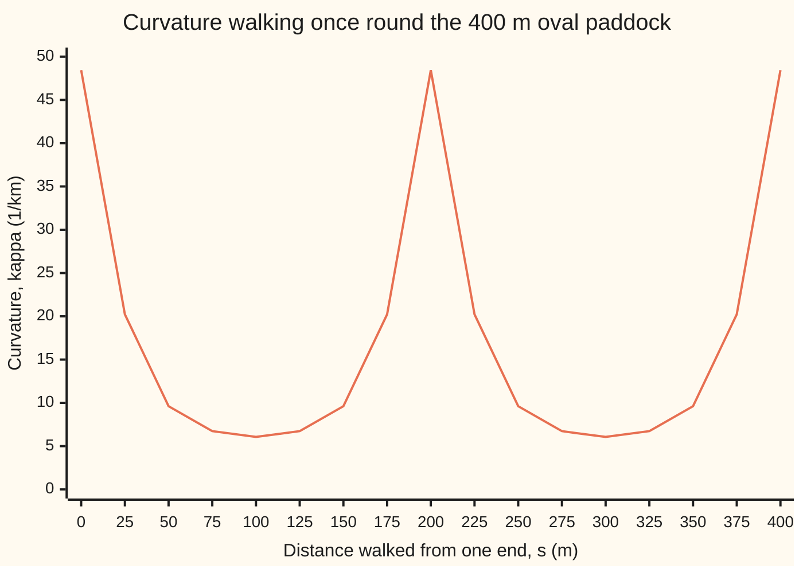

# Isoperimetric and four-vertex: two theorems the circle wins

[Syllabus](../../../SYLLABUS.md) → [Differential geometry and Lie groups](../README.md) → [Curves](../README.md#s01) → Isoperimetric and four-vertex

---

## General Overview

A farmer has 400 m of fencing wire and wants the biggest paddock it can close. Bent into a 100 m square, it holds 10,000 m², one hectare. Bent into a circle of radius 63.661977 m, it holds 12,732.4 m². That is 2,732.4 m² more ground for the same wire.

No shape does better. This is the **isoperimetric inequality** ("isoperimetric" means "same perimeter"): of all closed fences of one length, the circle encloses the most area. [Paths with a budget](../../08-Differential%20equations%20and%20dynamics/12-Calculus%20of%20Variations%20and%20Optimal%20Control/03-constrained-paths-and-the-hanging-chain.md) already showed with a multiplier that a best fence, if one exists, is a circle (its 100 m fence holds 795.77 m²). This card proves that every other closed fence holds less, and measures how much less.

Now walk an oval paddock fence and feel how hard it bends. The **curvature** κ (kappa) is how fast the direction of travel turns per metre walked, in 1/m ([Curvature](02-curvature-of-plane-curves.md)). On the oval it peaks at both ends and dips at both long sides. Those four points are **vertices**: places where curvature stops changing for a moment, at a peak or a dip. The second theorem, the **four-vertex theorem**, says every smooth loop that never crosses itself has at least four. On the circle curvature never changes, so every point is a vertex.

**Of all closed curves of one length the circle alone holds the most area, and every smooth closed curve that does not cross itself has at least two curvature peaks and two curvature dips.**

**What kind of fact this is:** two global theorems: each is about a whole closed curve, not one stretch of it. The isoperimetric inequality is proved on this card in full, for every closed curve with corners allowed. The four-vertex theorem is proved here for convex curves (closed loops that never cross themselves and bend one way only); for every simple closed curve it is stated, with the proof in the named source.

### The picture: 400 m of wire, six paddocks

```
equilateral triangle ###################                 7698.0 m^2  ratio 4piA/L^2 = 0.6046
2:1 rectangle        ######################              8888.9 m^2  ratio 4piA/L^2 = 0.6981
square               #########################          10000.0 m^2  ratio 4piA/L^2 = 0.7854
2:1 ellipse          ###########################        10710.0 m^2  ratio 4piA/L^2 = 0.8412
regular hexagon      #############################      11547.0 m^2  ratio 4piA/L^2 = 0.9069
circle               ################################   12732.4 m^2  ratio 4piA/L^2 = 1.0000
```

Each bar is the area one shape encloses with 400 m of wire; one `#` is 400 m². The ratio $`4\pi A/L^2`$ is the area as a fraction of the circle's. Only the circle reaches 1.

---

## The formula

Notation first, in words. $`L`$ is the fence's length and $`A`$ the area inside. Write each point of the fence as one complex number $`z = x + iy`$, where $`i`$ is the square root of −1, with east as the real part and north as the imaginary part, both in metres. Walk the fence once anticlockwise at constant speed, with a clock $`t`$ that runs from 0 to $`2\pi`$. Then the fence is a sum of circles, its Fourier series ([Fourier series](../../07-Complex%20analysis/08-Transforms%20in%20Outline/01-fourier-series-in-complex-form.md)):

```math
z(t) = \sum_{n=-\infty}^{\infty} c_n\, e^{int}
```

The term $`c_n e^{int}`$ is a point going round a circle of radius $`|c_n|`$, $`n`$ times per lap. The isoperimetric inequality, and the exact size of its gap, are:

```math
L^2 \ge 4\pi A, \qquad \frac{L^2}{4\pi} - A = \pi \sum_{n=-\infty}^{\infty} (n^2 - n)\, |c_n|^2
```

**Read it aloud:** the circle's area for this length, minus the fence's own area, equals pi times the sum over every circle in the fence of its turns squared minus its turns, times its radius squared.

Every term is zero or positive, so the gap is never negative. The four-vertex theorem is about the curvature $`\kappa(s)`$ along the fence, where $`s`$ is distance walked:

```math
\kappa'(s) = \frac{d\kappa}{ds} = 0 \text{ at two or more maxima and two or more minima of } \kappa \text{ on every smooth simple closed curve}
```

**Read it aloud:** walking once round any smooth loop that does not cross itself, curvature reaches at least two peaks and at least two dips, and its rate of change is zero at each.

| Symbol | Plain meaning | In our example | Push it up and the answer… |
| --- | --- | --- | --- |
| $`L`$ | length of the fence, in m | 400 m of wire | the circle's area grows as $`L^2`$ |
| $`A`$ | area inside the fence, in m²; $`4\pi A/L^2`$ is the roundness ratio, area as a fraction of the circle's | square 10,000 m², ratio 0.7854 | the ratio reaches 1 only for a circle |
| $`s`$ | distance walked along the fence, in m | 0 to 400 m | — |
| $`t`$ | a parameter running once round the loop, 0 to $`2\pi`$: the lap clock $`t = 2\pi s/L`$ in the proof, else the ellipse's own angle or the polar angle | quarter lap at $`t = \pi/2`$ | — |
| $`z(t)`$ | the fence point at clock $`t`$, as $`x + iy`$ in m: $`x`$ east, $`y`$ north, $`i = \sqrt{-1}`$ | a corner of the square at $`100 + 100i`$ | — |
| $`n`$ | how many times one circle turns per lap; negative turns clockwise | square: 1, −3, 5, −7, … | the circle costs more length per area |
| $`c_n`$ | complex size of circle $`n`$; $`\lvert c_n\rvert`$ is its radius, in m | square: $`\lvert c_1\rvert = 57.315917`$, $`\lvert c_{-3}\rvert = 6.368435`$ | a bigger gap to the circle |
| $`\kappa`$, $`\kappa'`$ | signed curvature, positive turning left, in 1/m; $`\kappa' = d\kappa/ds`$, how fast it changes per metre, in 1/m² | oval: 0.048442 at the ends, 0.006055 at the sides; $`\kappa' = 0`$ at all four | a tighter bend |
| $`T`$, $`N`$ | unit tangent (direction of travel) and unit normal (that direction turned 90° left) | at the oval's east end, north and west | — |
| $`\ell(x, y)`$ | a straight line's equation: zero on the line, positive one side, negative the other | the line through the oval's peak and dip | — |
| $`a`$, $`b`$ | the oval's half-length and half-width, in m | 82.5726 m and 41.2863 m | a 3:1 oval at $`a/b = 3`$ |
| $`r`$ | polar radius: distance from the centre at polar angle $`t`$, in m | the loop $`r = 30 + 60\cos t`$ | — |

A **vertex** is a point where $`\kappa' = 0`$. Where $`\kappa'`$ changes sign, curvature has a local peak or dip, and the theorem counts those. Where $`\kappa'`$ only touches zero and keeps its sign, curvature merely pauses on its way up or down.

### When it holds

- **The fence is closed.** If its two ends rest on a straight river bank, the bank is free fence. A half-circle then holds 25,464.79 m², twice the closed circle's 12,732.40 m².
- **The ground is flat.** On a sphere a cap holds more than a flat disc with the same rim. For a paddock on the Earth the effect is negligible.
- **Corners are allowed for the inequality.** The proof needs only a fence of finite length, so the square and triangle count. The four-vertex theorem needs curvature at every point, so it needs a curve smooth enough to have $`\kappa'`$.
- **The loop must not cross itself for four vertices.** The looped curve $`r = 30 + 60\cos t`$ crosses itself and has only 2 vertices.
- **Convex for this card's proof.** The proof below needs a convex curve: a closed loop that never crosses itself and bends one way only. Bending one way is not enough alone: the looped curve above bends left all the way round and still has only 2 vertices. The theorem itself holds for every simple closed curve (one loop, no crossings); that wider proof is cited, not given.

---

## Why it works

### Step 0: the idea that makes it possible

Break the fence into circles. Length charges each circle in proportion to $`n^2`$, the square of its turns. Area pays each circle in proportion to $`n`$. For every whole number except 0 and 1, $`n^2`$ is bigger than $`n`$. So every circle apart from the one big lap costs more length than it repays in area. The fence that wastes nothing is a single circle.

### Step 1: walk at constant speed

Let $`t = 2\pi s / L`$. Then the walking speed is fixed: $`|dz/dt| = L/(2\pi)`$, which is 63.661977 m per radian for 400 m of wire. Differentiating the Fourier series term by term gives the velocity as a sum of circles too:

```math
\frac{dz}{dt} = \sum_{n} i n\, c_n\, e^{int}
```

A circle turned $`n`$ times per lap moves $`n`$ times as fast, hence the factor $`n`$.

### Step 2: length from Parseval

Parseval's identity says the average of a squared size over one lap equals the sum of the squared sizes of its circles ([Fourier series](../../07-Complex%20analysis/08-Transforms%20in%20Outline/01-fourier-series-in-complex-form.md), Step 5). Apply it to the velocity, whose size is always $`L/(2\pi)`$:

```math
\frac{L^2}{4\pi^2} = \sum_{n} n^2\, |c_n|^2
```

### Step 3: area from Green's theorem

Green's theorem turns the area inside a loop into a walk round it: $`A = \tfrac12 \oint (x\,dy - y\,dx)`$ ([Green's theorem](../../06-Calculus%20and%20analysis/09-Vector%20Calculus/06-greens-theorem.md)). In complex form, $`x\,dy - y\,dx`$ is the imaginary part of $`\bar z\, dz`$, where $`\bar z = x - iy`$. Multiply the two series and average: only matching circles survive, by orthogonality (two different circles average to zero against each other). That leaves:

```math
A = \pi \sum_{n} n\, |c_n|^2
```

### Step 4: subtract, and see the circle

Multiply Step 2 by $`\pi`$ and subtract Step 3:

```math
\frac{L^2}{4\pi} - A = \pi \sum_{n} (n^2 - n)\, |c_n|^2 = \pi \sum_{n} n(n-1)\, |c_n|^2 \ge 0
```

For a whole number $`n`$, $`n(n-1)`$ is a product of two neighbouring whole numbers, so it is never negative. It is zero only for $`n = 0`$ and $`n = 1`$. So the gap is zero only when every other $`c_n`$ is zero, which leaves $`z(t) = c_0 + c_1 e^{it}`$: a circle with centre $`c_0`$ and radius $`|c_1|`$. Every other fence holds strictly less.

This argument compares each fence with the circle directly. It never assumes that a best fence exists, which is the gap the multiplier argument leaves open.

<details>
<summary>Detailed proof: the two averages in Steps 2 and 3</summary>

Over one lap, the average of $`e^{imt}\, e^{-int}`$ is 1 when $`m = n`$ and 0 otherwise ([Fourier series](../../07-Complex%20analysis/08-Transforms%20in%20Outline/01-fourier-series-in-complex-form.md), Step 1).

Length. The speed is constant, so the average of $`|dz/dt|^2`$ over the lap is $`L^2/(4\pi^2)`$. The conjugate of $`dz/dt`$ is the sum of $`-i m\, \bar c_m e^{-imt}`$. Multiply and average:

$`\displaystyle \frac{1}{2\pi}\int_0^{2\pi} \Big|\frac{dz}{dt}\Big|^2 dt = \sum_{m,n} (-im)(in)\, \bar c_m c_n \cdot [m = n] = \sum_{n} n^2 |c_n|^2 ,`$

where $`[m = n]`$ is 1 when $`m = n`$ and 0 otherwise.

Area. Green's theorem gives the area as half the imaginary part of the lap integral of $`\bar z\, dz/dt`$:

$`\displaystyle \frac{1}{2\pi}\int_0^{2\pi} \bar z\, \frac{dz}{dt}\, dt = \sum_{m,n} \bar c_m\, (in)\, c_n \cdot [m = n] = i \sum_{n} n |c_n|^2 .`$

So the lap integral is $`2\pi i \sum n |c_n|^2`$, its imaginary part is $`2\pi \sum n |c_n|^2`$, and half of that is $`A = \pi \sum n |c_n|^2`$.

What the proof needs. The fence has finite length and is walked at constant speed, so $`dz/dt`$ has bounded size and Parseval applies, corners included. The constant speed matters: with any other clock, the Cauchy-Schwarz inequality (an average is at most the root of the average square) gives only $`L^2 \le 4\pi^2 \sum n^2 |c_n|^2`$, which points the wrong way for the proof (What breaks, second row).

</details>

### Step 5: curvature's change, weighted by position, totals zero

Now the four-vertex theorem. Let $`T`$ be the unit tangent (the direction of travel) and $`N`$ the unit normal (the direction $`T`$ turns towards on a left turn). In the plane, the Frenet-Serret equations read $`T' = \kappa N`$ and $`N' = -\kappa T`$, with prime meaning $`d/ds`$ ([Frenet-Serret frame](04-frenet-serret-frames.md)). Integrate by parts round the closed loop:

```math
\oint x\, \kappa'\, ds = -\oint \kappa\, x'\, ds = -\oint \kappa\, T_x\, ds = \oint N_x'\, ds = 0
```

Here $`x' = T_x`$ is the east part of $`T`$ and $`N_x`$ the east part of $`N`$. The last integral is zero because $`N`$ returns to its start after one lap. The same holds for $`y`$, and $`\oint \kappa'\, ds = 0`$ because $`\kappa`$ returns to its start too. A line's equation $`\ell`$ is a constant plus multiples of $`x`$ and $`y`$, so for every straight line:

```math
\oint \ell(x, y)\, \kappa'\, ds = 0
```

### Step 6: two vertices are not enough on a convex loop

Curvature is a continuous function round a closed loop, so it has a highest point (the peak) and a lowest point (the dip). That gives two vertices for free. If the peak equals the dip, curvature is constant, the loop is a circle and every point is a vertex. Otherwise, suppose $`\kappa'`$ changes sign only at the peak and the dip. Then $`\kappa' \ge 0`$ all along the arc from the dip to the peak, and $`\kappa' \le 0`$ all along the arc back.

Draw the straight line through the peak and the dip. A convex loop meets a line at most twice, so $`\ell`$ is positive on one arc and negative on the other. Choose its sign to match: then $`\ell\, \kappa' \ge 0`$ everywhere. Step 5 says its integral round the loop is zero, so $`\ell\, \kappa' = 0`$ everywhere. Away from the peak and the dip $`\ell \ne 0`$, so $`\kappa' = 0`$ there. Then curvature is constant and the peak equals the dip, a contradiction.

So $`\kappa'`$ changes sign at a third point. Each sign change is a peak or a dip, and going round a closed loop they alternate, so their number is even. Three is impossible, which leaves at least four: two peaks and two dips.

<details>
<summary>Detailed proof: the edge cases in Step 6</summary>

The line meets the loop at most twice. A convex loop bounds a convex region. A line through two of its boundary points either cuts the region into two pieces, crossing the loop exactly at those two points, or runs along a straight stretch of the loop that holds both points. On a straight stretch $`\kappa = 0`$ throughout, so the peak and the dip would both be 0: curvature would be constant, the case already set aside.

Why the count is even. Each sign change of $`\kappa'`$ is a peak or a dip, and they alternate. After one lap the sign is back where it started, so peaks and dips come in pairs.

</details>

### Step 7: beyond convex loops

A dented loop can meet a line four times, so Step 6 fails as written. The theorem still holds for every smooth simple closed curve; this card states that without proof, which is in the 1985 Osserman source. The converse holds too, in a weaker form than [Fundamental theorem of curves](07-fundamental-theorem-of-curves.md) might suggest: any continuous curvature profile round a loop with two or more peaks and two or more dips belongs to some simple closed curve once the points along the curve are relabelled, matched point by point but not metre by metre (Dahlberg source). Read as a function of arc length, such a profile usually rebuilds a curve that misses its own start.

---

## Worked numbers, by hand

The square paddock, side 100 m, broken into circles. Apart from $`c_0`$, the square's centre, only $`n = 1, -3, 5, -7, \dots`$ appear, by symmetry: turning the square a quarter turn about its centre must leave it unchanged. Each radius is $`|c_n| = (L/2\pi)(2\sqrt2/\pi)/n^2`$.

| Step | Arithmetic | Value |
| --- | --- | --- |
| Walking speed | $`L/(2\pi) = 400/(2\pi)`$ | 63.661977 m |
| Big lap, $`n = 1`$ | $`\lvert c_1\rvert = 57.315917/1^2`$; $`n^2 - n = 0`$ | 57.315917 m, gap term 0 |
| $`n = -3`$ | $`\lvert c_{-3}\rvert = 57.315917/9`$; $`\pi \times 12 \times 6.368435^2`$ | 1,528.96 m² |
| $`n = 5`$ | $`\lvert c_5\rvert = 57.315917/25`$; $`\pi \times 20 \times 2.292637^2`$ | 330.26 m² |
| $`n = -7`$ | $`\lvert c_{-7}\rvert = 57.315917/49`$; $`\pi \times 56 \times 1.169713^2`$ | 240.71 m² |
| First three gap terms | $`1528.96 + 330.26 + 240.71`$ | 2,099.93 m² |
| Every term | sums $`\pi^2/8`$ and $`\pi^3/32`$ give $`L^2/(4\pi) - L^2/16`$ | **2,732.40 m²** |

The circle holds 2,732.40 m² more than the square. Most of it, 1,528.96 m², is the $`n = -3`$ circle: the wobble that makes four corners.

The last row uses two classic sums over $`n = 1, -3, 5, -7, \dots`$: $`\sum 1/n^2 = \pi^2/8`$, the Fourier series card's Parseval sum, and $`\sum 1/n^3 = 1 - 1/27 + 1/125 - \cdots = \pi^3/32`$.

### The oval paddock's four vertices

The oval is an ellipse with half-length $`a`$ twice its half-width $`b`$, and a 400 m perimeter. Its curvature is $`\kappa = ab/(a^2\sin^2 t + b^2\cos^2 t)^{3/2}`$, with $`t`$ here the ellipse's own angle.

| Step | Arithmetic | Value |
| --- | --- | --- |
| Half-axes for 400 m | solve perimeter = 400 m by halving, Simpson's rule for length | $`a = 82.5726`$ m, $`b = 41.2863`$ m |
| Perimeter, two step counts | Simpson with 20 and with 2,000 steps | 400.0278 m and 400.0000 m |
| Ends, $`t = 0`$ | $`\kappa = a/b^2`$ | 0.048442 1/m, radius 20.643 m |
| Sides, $`t = \pi/2`$ | $`\kappa = b/a^2`$ | 0.006055 1/m, radius 165.145 m |
| **Vertices** | two maxima, two minima | **4** |

The ends bend like a circle of radius 20.643 m, the sides like one of 165.145 m. Curvature rises and falls twice per lap.

### The picture: curvature round the oval paddock



The one line is curvature in 1/km (1,000 times its value in 1/m). It peaks at the two ends (0 m and 200 m) and dips at the two sides (100 m and 300 m): four vertices.

### What breaks if you drop a piece

| Mistake | Comes out at | What went wrong |
| --- | --- | --- |
| Fence ends on a straight river bank, compared with the closed bound | 25,464.79 m² against 12,732.40 m² | The fence is not closed: the bank does half the work for free |
| Use the oval's own angle as the clock, not constant speed | "length" 410.16 m; gap 2,677.51 m² against the true 2,022.35 m² | Step 2 needs constant speed; any other clock overstates length |
| Stop the square's sum at $`n = -7`$ | 2,099.93 m² against 2,732.40 m² | Corners need many circles; the missing tail shrinks only tenfold per tenfold more circles |
| Count vertices on the loop $`r = 30 + 60\cos t`$, which crosses itself | 2 vertices | The loop is not simple, so the theorem does not apply |

---

## Code, from first principles, and it actually runs

Both scripts print every number on this card, along **four independent roads**:

- Areas from closed forms, from the shoelace sum (half the sum of cross-products of neighbouring corners) and from each polygon's exact Fourier circles.
- The square's gap summed to $`|n| = 10`$, 100, 1,000 and 10,000, against the exact $`L^2/(4\pi) - L^2/16`$.
- Vertices counted from the curvature formula and again from circles through three neighbouring fence points.
- Step 5's identity summed round a lopsided egg, $`r = 60 + 20\cos t + 4\sin 2t`$ m, with no symmetry to make it vanish.

### Python

```python
# Isoperimetric and four-vertex theorems -- the check behind the card.
# Standard library only. Areas from closed forms, shoelace sums and exact Fourier coefficients;
# vertices counted from the curvature formula and from circles through three neighbouring points.
import math, cmath

PI = math.pi
L = 400.0                                   # metres of fencing wire
M = 4000                                    # points round each smooth curve
def f(x, d=6): return f"{x:.{d}f}"

def shoelace(V):                            # area of a polygon, corners anticlockwise
    return 0.5 * sum((V[j].conjugate() * V[(j + 1) % len(V)]).imag for j in range(len(V)))

def regular(k, side):                       # regular k-sided polygon
    R = side / (2 * math.sin(PI / k))
    return [R * cmath.exp(2j * PI * j / k) for j in range(k)]

def coeffs(V, N):                           # exact c_n, 0 < |n| <= N, polygon walked at constant speed
    sides = [V[(j + 1) % len(V)] - V[j] for j in range(len(V))]
    P = sum(abs(e) for e in sides); ts = [0.0]
    for e in sides: ts.append(ts[-1] + 2 * PI * abs(e) / P)
    c = {}
    for n in [m for m in range(-N, N + 1) if m != 0]:
        d = sum(e / abs(e) * P / (2 * PI) * (cmath.exp(-1j * n * ts[j]) - cmath.exp(-1j * n * ts[j + 1]))
                for j, e in enumerate(sides)) / (2j * PI * n)
        c[n] = d / (1j * n)                 # z' has coefficient i n c_n
    return c
def area_sum(c, N): return PI * sum(n * abs(v) ** 2 for n, v in c.items() if abs(n) <= N)
def lost_sum(c, N): return PI * sum((n * n - n) * abs(v) ** 2 for n, v in c.items() if abs(n) <= N)

def simpson(g, a, b, steps):
    h = (b - a) / steps
    return h / 3 * sum((1 if i in (0, steps) else 4 if i % 2 else 2) * g(a + i * h) for i in range(steps + 1))
def ell_len(a, b, t, steps=200):            # arc length of the ellipse from angle 0 to t
    return simpson(lambda u: math.hypot(a * math.sin(u), b * math.cos(u)), 0.0, t, steps)
def ellipse_for(ratio):                     # semi-axes (a, b), a = ratio * b, perimeter exactly L
    lo, hi = 1.0, L
    for _ in range(100):
        b = (lo + hi) / 2
        lo, hi = (lo, b) if ell_len(ratio * b, b, 2 * PI, 2000) > L else (b, hi)
    return ratio * b, b
def ell_kappa(a, b, t): return a * b / (a * a * math.sin(t) ** 2 + b * b * math.cos(t) ** 2) ** 1.5
def ell_pts(a, b): return [complex(a * math.cos(2 * PI * i / M), b * math.sin(2 * PI * i / M)) for i in range(M)]
def pol_r(p, q, w, t): return p + q * math.cos(t) + w * math.sin(2 * t)   # polar curve, r in metres
def pol_pts(p, q, w): return [pol_r(p, q, w, 2 * PI * i / M) * cmath.exp(2j * PI * i / M) for i in range(M)]
def pol_kappa(p, q, w):
    out = []
    for t in [2 * PI * i / M for i in range(M)]:
        r, r1, r2 = pol_r(p, q, w, t), -q * math.sin(t) + 2 * w * math.cos(2 * t), -q * math.cos(t) - 4 * w * math.sin(2 * t)
        out.append((r * r + 2 * r1 * r1 - r * r2) / (r * r + r1 * r1) ** 1.5)
    return out
def kappa3(z0, z1, z2):                     # signed curvature of the circle through three points
    u, v = z1 - z0, z2 - z1
    return 2 * (u.conjugate() * v).imag / (abs(u) * abs(v) * abs(z2 - z0))
def discrete(Z): return [kappa3(Z[i - 1], Z[i], Z[(i + 1) % M]) for i in range(M)]
def extremes(K): return sum(1 for i in range(len(K)) if (K[i] - K[i - 1]) * (K[(i + 1) % len(K)] - K[i]) < 0)

# 1. The circle and five other paddocks, all fenced with 400 m
r = L / (2 * PI); A_circle = L * L / (4 * PI)
print("paddock, wire length L (m)", f(L), " circle radius (m)", f(r), " circle area (m^2)", f(A_circle))
a, b = ellipse_for(2.0)
shapes = [("equilateral triangle", regular(3, L / 3)), ("2:1 rectangle", [0j, L / 3, L / 3 + L / 6 * 1j, L / 6 * 1j]),
          ("square", [0j, L / 4, L / 4 + L / 4 * 1j, L / 4 * 1j]), ("2:1 ellipse", ell_pts(a, b)), ("regular hexagon", regular(6, L / 6))]
for name, V in shapes:
    A = shoelace(V) if name != "2:1 ellipse" else PI * a * b
    if name != "2:1 ellipse":
        assert abs(area_sum(coeffs(V, 1000), 1000) - A) < 1e-6 * A, name      # Fourier area = shoelace area
    else:
        assert abs(shoelace(V) - A) < 1e-6 * A                                # 4000-gon against pi a b
    assert A < A_circle
    bar = "#" * round(A / 400)
    print(f"bars, {name:<20} {bar:<32} {f(A, 1):>9} m^2  ratio 4piA/L^2 = {f(4 * PI * A / L ** 2, 4)}")
print(f"bars, {'circle':<20} {'#' * round(A_circle / 400):<32} {f(A_circle, 1):>9} m^2  ratio 4piA/L^2 = {f(1.0, 4)}")

# 2. The square, circle by circle
sq = coeffs(shapes[2][1], 10000)
closed = lambda n: L / (2 * PI) * 2 * math.sqrt(2) / (PI * n * n)            # |c_n| for n = 1 mod 4
for n in (1, -3, 5, -7):
    assert abs(abs(sq[n]) - closed(n)) < 1e-9
    print(f"square, n = {n:>2}  |c_n| (m) {f(abs(sq[n]))}  term pi (n^2 - n)|c_n|^2 (m^2) {f(PI * (n * n - n) * abs(sq[n]) ** 2, 2)}")
assert max(abs(v) for n, v in sq.items() if n % 4 != 1) < 1e-9          # only n = 1, -3, 5, -7, ...
exact = L * L / (4 * PI) - L * L / 16                         # from the sums pi^2/8 and pi^3/32
assert abs(lost_sum(sq, 10000) + PI * closed(1) ** 2 / 20000 - exact) < 1e-3   # sum plus its 1/N tail
print("square, L/(2 pi) (m)", f(L / (2 * PI)), " area from Fourier, N = 1000 (m^2)", f(area_sum(sq, 1000)))
for N in (10, 100, 1000, 10000):
    print(f"square, lost area to the circle, sum to |n| = {N:>5} (m^2) {f(lost_sum(sq, N), 4)}  short by {f(exact - lost_sum(sq, N), 4)}")
print("square, lost area exact, L^2/(4 pi) - L^2/16 (m^2)", f(exact, 4))
assert 9 < (exact - lost_sum(sq, 100)) / (exact - lost_sum(sq, 1000)) < 11          # tail falls like 1/N

# 3. Four vertices on the 2:1 oval paddock
K = [ell_kappa(a, b, 2 * PI * i / M) for i in range(M)]
Kd = discrete(ell_pts(a, b))
assert extremes(K) == 4 and extremes(Kd) == 4
assert max(abs(K[i] - Kd[i]) for i in range(M)) < 1e-6 and abs(Kd[0] - a / b ** 2) < 1e-6
print("oval, semi-axes a, b (m)", f(a, 4), f(b, 4), " perimeter, Simpson 20 and 2000 steps (m)",
      f(ell_len(a, b, 2 * PI, 20), 4), f(ell_len(a, b, 2 * PI, 2000), 4))
print("oval, kappa max a/b^2 (1/m)", f(a / b ** 2), " radius", f(b * b / a, 3), " three-point circle", f(Kd[0]))
print("oval, kappa min b/a^2 (1/m)", f(b / a ** 2), " radius", f(a * a / b, 3), " three-point circle", f(Kd[M // 4]))
print("oval, vertices from the formula", extremes(K), " from three-point circles", extremes(Kd))
s_pts, k_pts = [], []
for j in range(17):
    lo, hi = 0.0, 2 * PI
    for _ in range(60):
        mid = (lo + hi) / 2
        lo, hi = (mid, hi) if ell_len(a, b, mid) < 25 * j else (lo, mid)
    s_pts.append(str(25 * j)); k_pts.append(f(1000 * ell_kappa(a, b, (lo + hi) / 2), 2))
print("chart, arc length s (m)  ", " ".join(s_pts))
print("chart, kappa (1/km)      ", " ".join(k_pts))

# 4. A lopsided egg, and the proof's identity: x and y weighted by d kappa total zero
Z, Kl = pol_pts(60, 20, 4), pol_kappa(60, 20, 4)
assert min(Kl) > 0 and extremes(Kl) == 4 and extremes(discrete(Z)) == 4
print("egg, r = 60 + 20 cos t + 4 sin 2t: vertices", extremes(Kl), " three-point", extremes(discrete(Z)),
      " kappa min, max (1/m)", f(min(Kl)), f(max(Kl)))
for part, name in ((lambda z: z.real, "x"), (lambda z: z.imag, "y")):
    tot = sum(part((Z[i] + Z[(i + 1) % M]) / 2) * (Kl[(i + 1) % M] - Kl[i]) for i in range(M))
    size = sum(abs(part(Z[i]) * (Kl[(i + 1) % M] - Kl[i])) for i in range(M))
    assert abs(tot) < 1e-6 * size
    print(f"identity, egg: sum {name} d(kappa) = {f(tot, 9)}  against sum |{name} d(kappa)| = {f(size, 6)}")

# 5. What breaks, and the experiments
semi = [L / PI * cmath.exp(1j * PI * i / M) for i in range(M + 1)]
assert abs(shoelace(semi) - L * L / (2 * PI)) < 1e-7 * L * L
print("breaks, fence ends on a straight river bank: semicircle (m^2)", f(L * L / (2 * PI), 2), " 4000-gon", f(shoelace(semi), 2))
wrong = PI * math.sqrt(2 * (a * a + b * b))
assert wrong > L
print("breaks, oval's angle parameter, not constant speed: 'length' (m)", f(wrong, 2), " lost area", f(wrong ** 2 / (4 * PI) - PI * a * b, 2),
      " true", f(A_circle - PI * a * b, 2))
print("breaks, square's sum cut at n = 1, -3, 5, -7 (m^2)", f(lost_sum(sq, 7), 2), " true", f(exact, 2))
loop = pol_kappa(30, 60, 0)
assert min(loop) > 0 and extremes(loop) == 2 and extremes(discrete(pol_pts(30, 60, 0))) == 2   # bends left throughout
print("breaks, loop r = 30 + 60 cos t crosses itself: vertices", extremes(loop))
a3, b3 = ellipse_for(3.0)
assert extremes([ell_kappa(a3, b3, 2 * PI * i / M) for i in range(M)]) == 4
print("try, 3:1 oval: a, b (m)", f(a3, 4), f(b3, 4), " area (m^2)", f(PI * a3 * b3, 2), " vertices 4")
print("try, 800 m of wire: square's lost area (m^2)", f(800 ** 2 / (4 * PI) - 200 ** 2, 2), " a 100 m circle (m^2)", f(100 ** 2 / (4 * PI), 2))
six = pol_kappa(60, 30, 12)
assert extremes(six) == 6 and extremes(discrete(pol_pts(60, 30, 12))) == 6
print("try, egg r = 60 + 30 cos t + 12 sin 2t: vertices", extremes(six))
print("ALL CHECKS PASS")
```

**Ran 2026-11-19 on macOS, Python 3.14.10, standard library only. All checks passed. Output, pasted from the run:**

```
paddock, wire length L (m) 400.000000  circle radius (m) 63.661977  circle area (m^2) 12732.395447
bars, equilateral triangle ###################                 7698.0 m^2  ratio 4piA/L^2 = 0.6046
bars, 2:1 rectangle        ######################              8888.9 m^2  ratio 4piA/L^2 = 0.6981
bars, square               #########################          10000.0 m^2  ratio 4piA/L^2 = 0.7854
bars, 2:1 ellipse          ###########################        10710.0 m^2  ratio 4piA/L^2 = 0.8412
bars, regular hexagon      #############################      11547.0 m^2  ratio 4piA/L^2 = 0.9069
bars, circle               ################################   12732.4 m^2  ratio 4piA/L^2 = 1.0000
square, n =  1  |c_n| (m) 57.315917  term pi (n^2 - n)|c_n|^2 (m^2) 0.00
square, n = -3  |c_n| (m) 6.368435  term pi (n^2 - n)|c_n|^2 (m^2) 1528.96
square, n =  5  |c_n| (m) 2.292637  term pi (n^2 - n)|c_n|^2 (m^2) 330.26
square, n = -7  |c_n| (m) 1.169713  term pi (n^2 - n)|c_n|^2 (m^2) 240.71
square, L/(2 pi) (m) 63.661977  area from Fourier, N = 1000 (m^2) 9999.999995
square, lost area to the circle, sum to |n| =    10 (m^2) 2213.1849  short by 519.2105
square, lost area to the circle, sum to |n| =   100 (m^2) 2680.7999  short by 51.5956
square, lost area to the circle, sum to |n| =  1000 (m^2) 2727.2352  short by 5.1602
square, lost area to the circle, sum to |n| = 10000 (m^2) 2731.8794  short by 0.5160
square, lost area exact, L^2/(4 pi) - L^2/16 (m^2) 2732.3954
oval, semi-axes a, b (m) 82.5726 41.2863  perimeter, Simpson 20 and 2000 steps (m) 400.0278 400.0000
oval, kappa max a/b^2 (1/m) 0.048442  radius 20.643  three-point circle 0.048442
oval, kappa min b/a^2 (1/m) 0.006055  radius 165.145  three-point circle 0.006055
oval, vertices from the formula 4  from three-point circles 4
chart, arc length s (m)   0 25 50 75 100 125 150 175 200 225 250 275 300 325 350 375 400
chart, kappa (1/km)       48.44 20.23 9.61 6.73 6.06 6.73 9.61 20.23 48.44 20.23 9.61 6.73 6.06 6.73 9.61 20.23 48.44
egg, r = 60 + 20 cos t + 4 sin 2t: vertices 4  three-point 4  kappa min, max (1/m) 0.005899 0.021463
identity, egg: sum x d(kappa) = -0.000000251  against sum |x d(kappa)| = 1.327159
identity, egg: sum y d(kappa) = -0.000000260  against sum |y d(kappa)| = 1.060352
breaks, fence ends on a straight river bank: semicircle (m^2) 25464.79  4000-gon 25464.79
breaks, oval's angle parameter, not constant speed: 'length' (m) 410.16  lost area 2677.51  true 2022.35
breaks, square's sum cut at n = 1, -3, 5, -7 (m^2) 2099.93  true 2732.40
breaks, loop r = 30 + 60 cos t crosses itself: vertices 2
try, 3:1 oval: a, b (m) 89.7875 29.9292  area (m^2) 8442.29  vertices 4
try, 800 m of wire: square's lost area (m^2) 10929.58  a 100 m circle (m^2) 795.77
try, egg r = 60 + 30 cos t + 12 sin 2t: vertices 6
ALL CHECKS PASS
```

### Rust

```rust
// Isoperimetric and four-vertex theorems -- the same check as the Python, in Rust. No crates.
// Areas from closed forms, shoelace sums and exact Fourier coefficients;
// vertices counted from the curvature formula and from circles through three neighbouring points.
use std::collections::BTreeMap;
use std::f64::consts::PI;

const L: f64 = 400.0; // metres of fencing wire
const M: usize = 4000; // points round each smooth curve

#[derive(Clone, Copy)]
struct C { re: f64, im: f64 } // complex number
fn c(re: f64, im: f64) -> C { C { re, im } }
fn add(a: C, b: C) -> C { c(a.re + b.re, a.im + b.im) }  fn sub(a: C, b: C) -> C { c(a.re - b.re, a.im - b.im) }
fn mul(a: C, b: C) -> C { c(a.re * b.re - a.im * b.im, a.re * b.im + a.im * b.re) }  fn scale(a: C, k: f64) -> C { c(a.re * k, a.im * k) }
fn div(a: C, b: C) -> C { let d = b.re * b.re + b.im * b.im; c((a.re * b.re + a.im * b.im) / d, (a.im * b.re - a.re * b.im) / d) }
fn abs(a: C) -> f64 { a.re.hypot(a.im) }  fn cis(t: f64) -> C { c(t.cos(), t.sin()) }
fn f(x: f64, d: usize) -> String { format!("{:.*}", d, x) }

fn shoelace(v: &[C]) -> f64 { // area of a polygon, corners anticlockwise
    0.5 * (0..v.len()).fold(0.0, |s, j| { let (p, q) = (v[j], v[(j + 1) % v.len()]); s + (p.re * q.im - p.im * q.re) })
}
fn regular(k: usize, side: f64) -> Vec<C> {
    let r = side / (2.0 * (PI / k as f64).sin());
    (0..k).map(|j| scale(cis(2.0 * PI * j as f64 / k as f64), r)).collect()
}
fn coeffs(v: &[C], n_max: i64) -> BTreeMap<i64, C> { // exact c_n of a polygon walked at constant speed
    let sides: Vec<C> = (0..v.len()).map(|j| sub(v[(j + 1) % v.len()], v[j])).collect();
    let p: f64 = sides.iter().map(|e| abs(*e)).sum();
    let mut ts = vec![0.0];
    for e in &sides { let last = *ts.last().unwrap(); ts.push(last + 2.0 * PI * abs(*e) / p); }
    let mut out = BTreeMap::new();
    for n in -n_max..=n_max {
        if n == 0 { continue; }
        let mut d = c(0.0, 0.0);  for (j, e) in sides.iter().enumerate() {
            let ae = abs(*e); let dir = c(e.re / ae * p / (2.0 * PI), e.im / ae * p / (2.0 * PI));
            d = add(d, mul(dir, sub(cis(-(n as f64) * ts[j]), cis(-(n as f64) * ts[j + 1]))));
        }  d = div(d, c(0.0, 2.0 * PI * n as f64));
        out.insert(n, div(d, c(0.0, n as f64))); // z' has coefficient i n c_n
    }
    out
}
fn weighted(cs: &BTreeMap<i64, C>, n_max: i64, w: fn(i64) -> i64) -> f64 {
    let mut s = 0.0;
    for (n, v) in cs { if n.abs() <= n_max { s += w(*n) as f64 * (abs(*v) * abs(*v)); } }
    PI * s
}
fn area_sum(cs: &BTreeMap<i64, C>, n_max: i64) -> f64 { weighted(cs, n_max, |n| n) }
fn lost_sum(cs: &BTreeMap<i64, C>, n_max: i64) -> f64 { weighted(cs, n_max, |n| n * n - n) }
fn simpson(g: &dyn Fn(f64) -> f64, a: f64, b: f64, steps: usize) -> f64 {
    let h = (b - a) / steps as f64;
    let mut s = 0.0;  for i in 0..=steps { let w = if i == 0 || i == steps { 1.0 } else if i % 2 == 1 { 4.0 } else { 2.0 }; s += w * g(a + i as f64 * h); }
    h / 3.0 * s
}
fn ell_len(a: f64, b: f64, t: f64, steps: usize) -> f64 { simpson(&|u: f64| (a * u.sin()).hypot(b * u.cos()), 0.0, t, steps) }
fn ellipse_for(ratio: f64) -> (f64, f64) { // semi-axes, a = ratio * b, perimeter exactly L
    let (mut lo, mut hi, mut b) = (1.0, L, 0.0);
    for _ in 0..100 { b = (lo + hi) / 2.0; if ell_len(ratio * b, b, 2.0 * PI, 2000) > L { hi = b; } else { lo = b; } }
    (ratio * b, b)
}
fn ell_kappa(a: f64, b: f64, t: f64) -> f64 { a * b / (a * a * t.sin().powi(2) + b * b * t.cos().powi(2)).powf(1.5) }
fn ell_pts(a: f64, b: f64) -> Vec<C> { (0..M).map(|i| { let t = 2.0 * PI * i as f64 / M as f64; c(a * t.cos(), b * t.sin()) }).collect() }
fn pol_r(p: f64, q: f64, w: f64, t: f64) -> f64 { p + q * t.cos() + w * (2.0 * t).sin() } // polar curve, metres
fn pol_pts(p: f64, q: f64, w: f64) -> Vec<C> { (0..M).map(|i| { let t = 2.0 * PI * i as f64 / M as f64; scale(cis(t), pol_r(p, q, w, t)) }).collect() }
fn pol_kappa(p: f64, q: f64, w: f64) -> Vec<f64> {
    (0..M).map(|i| { let t = 2.0 * PI * i as f64 / M as f64;
        let (r, r1, r2) = (pol_r(p, q, w, t), -q * t.sin() + 2.0 * w * (2.0 * t).cos(), -q * t.cos() - 4.0 * w * (2.0 * t).sin());
        (r * r + 2.0 * r1 * r1 - r * r2) / (r * r + r1 * r1).powf(1.5)
    }).collect()
}
fn kappa3(z0: C, z1: C, z2: C) -> f64 { // signed curvature of the circle through three points
    let (u, v) = (sub(z1, z0), sub(z2, z1));  2.0 * (u.re * v.im - u.im * v.re) / (abs(u) * abs(v) * abs(sub(z2, z0)))
}
fn discrete(z: &[C]) -> Vec<f64> { (0..M).map(|i| kappa3(z[(i + M - 1) % M], z[i], z[(i + 1) % M])).collect() }
fn extremes(k: &[f64]) -> usize { let n = k.len(); (0..n).filter(|&i| (k[i] - k[(i + n - 1) % n]) * (k[(i + 1) % n] - k[i]) < 0.0).count() }

fn main() {
    // 1. The circle and five other paddocks, all fenced with 400 m
    let r = L / (2.0 * PI); let a_circle = L * L / (4.0 * PI);
    println!("paddock, wire length L (m) {}  circle radius (m) {}  circle area (m^2) {}", f(L, 6), f(r, 6), f(a_circle, 6));
    let (a, b) = ellipse_for(2.0);
    let s4 = L / 4.0; let square = vec![c(0.0, 0.0), c(s4, 0.0), c(s4, s4), c(0.0, s4)]; // side L/4
    let shapes: Vec<(&str, Vec<C>)> = vec![("equilateral triangle", regular(3, L / 3.0)),
        ("2:1 rectangle", vec![c(0.0, 0.0), c(L / 3.0, 0.0), c(L / 3.0, L / 6.0), c(0.0, L / 6.0)]),
        ("square", square.clone()), ("2:1 ellipse", ell_pts(a, b)), ("regular hexagon", regular(6, L / 6.0))];
    for (name, v) in &shapes {
        let area = if *name != "2:1 ellipse" { shoelace(v) } else { PI * a * b };
        if *name != "2:1 ellipse" { assert!((area_sum(&coeffs(v, 1000), 1000) - area).abs() < 1e-6 * area, "{}", name); }
        else { assert!((shoelace(v) - area).abs() < 1e-6 * area); }
        assert!(area < a_circle);
        let bar = "#".repeat((area / 400.0).round() as usize);
        println!("bars, {:<20} {:<32} {:>9} m^2  ratio 4piA/L^2 = {}", name, bar, f(area, 1), f(4.0 * PI * area / (L * L), 4));
    }
    println!("bars, {:<20} {:<32} {:>9} m^2  ratio 4piA/L^2 = {}", "circle", "#".repeat((a_circle / 400.0).round() as usize), f(a_circle, 1), f(1.0, 4));

    // 2. The square, circle by circle
    let sq = coeffs(&square, 10000);
    let closed = |n: i64| L / (2.0 * PI) * 2.0 * 2f64.sqrt() / (PI * (n * n) as f64); // |c_n| for n = 1 mod 4
    for n in [1i64, -3, 5, -7] {
        let m = abs(sq[&n]);
        assert!((m - closed(n)).abs() < 1e-9);
        println!("square, n = {:>2}  |c_n| (m) {}  term pi (n^2 - n)|c_n|^2 (m^2) {}", n, f(m, 6), f(PI * (n * n - n) as f64 * (m * m), 2));
    }
    assert!(sq.iter().filter(|(n, _)| n.rem_euclid(4) != 1).all(|(_, v)| abs(*v) < 1e-9)); // only n = 1, -3, 5, -7, ...
    let exact = L * L / (4.0 * PI) - L * L / 16.0; // from the sums pi^2/8 and pi^3/32
    assert!((lost_sum(&sq, 10000) + PI * closed(1).powi(2) / 20000.0 - exact).abs() < 1e-3); // sum plus its 1/N tail
    println!("square, L/(2 pi) (m) {}  area from Fourier, N = 1000 (m^2) {}", f(L / (2.0 * PI), 6), f(area_sum(&sq, 1000), 6));
    for n in [10i64, 100, 1000, 10000] {
        let s = lost_sum(&sq, n);
        println!("square, lost area to the circle, sum to |n| = {:>5} (m^2) {}  short by {}", n, f(s, 4), f(exact - s, 4));
    }
    println!("square, lost area exact, L^2/(4 pi) - L^2/16 (m^2) {}", f(exact, 4));
    let ratio = (exact - lost_sum(&sq, 100)) / (exact - lost_sum(&sq, 1000));
    assert!(9.0 < ratio && ratio < 11.0); // tail falls like 1/N

    // 3. Four vertices on the 2:1 oval paddock
    let k: Vec<f64> = (0..M).map(|i| ell_kappa(a, b, 2.0 * PI * i as f64 / M as f64)).collect();
    let kd = discrete(&ell_pts(a, b));
    assert!(extremes(&k) == 4 && extremes(&kd) == 4);
    assert!((0..M).all(|i| (k[i] - kd[i]).abs() < 1e-6) && (kd[0] - a / (b * b)).abs() < 1e-6);
    println!("oval, semi-axes a, b (m) {} {}  perimeter, Simpson 20 and 2000 steps (m) {} {}",
        f(a, 4), f(b, 4), f(ell_len(a, b, 2.0 * PI, 20), 4), f(ell_len(a, b, 2.0 * PI, 2000), 4));
    println!("oval, kappa max a/b^2 (1/m) {}  radius {}  three-point circle {}", f(a / (b * b), 6), f(b * b / a, 3), f(kd[0], 6));
    println!("oval, kappa min b/a^2 (1/m) {}  radius {}  three-point circle {}", f(b / (a * a), 6), f(a * a / b, 3), f(kd[M / 4], 6));
    println!("oval, vertices from the formula {}  from three-point circles {}", extremes(&k), extremes(&kd));
    let (mut s_pts, mut k_pts) = (vec![], vec![]);
    for j in 0..17 {
        let (mut lo, mut hi) = (0.0, 2.0 * PI);
        for _ in 0..60 { let mid = (lo + hi) / 2.0; if ell_len(a, b, mid, 200) < 25.0 * j as f64 { lo = mid; } else { hi = mid; } }
        s_pts.push(format!("{}", 25 * j)); k_pts.push(f(1000.0 * ell_kappa(a, b, (lo + hi) / 2.0), 2));
    }
    println!("chart, arc length s (m)   {}", s_pts.join(" "));
    println!("chart, kappa (1/km)       {}", k_pts.join(" "));

    // 4. A lopsided egg, and the proof's identity: x and y weighted by d kappa total zero
    let (z, kl) = (pol_pts(60.0, 20.0, 4.0), pol_kappa(60.0, 20.0, 4.0));
    let (kmin, kmax) = kl.iter().fold((f64::MAX, f64::MIN), |(lo, hi), &x| (lo.min(x), hi.max(x)));
    assert!(kmin > 0.0 && extremes(&kl) == 4 && extremes(&discrete(&z)) == 4);
    println!("egg, r = 60 + 20 cos t + 4 sin 2t: vertices {}  three-point {}  kappa min, max (1/m) {} {}",
        extremes(&kl), extremes(&discrete(&z)), f(kmin, 6), f(kmax, 6));
    for (name, part) in [("x", (|w: C| w.re) as fn(C) -> f64), ("y", |w: C| w.im)] {
        let (mut tot, mut size) = (0.0, 0.0);
        for i in 0..M { tot += part(scale(add(z[i], z[(i + 1) % M]), 0.5)) * (kl[(i + 1) % M] - kl[i]); size += (part(z[i]) * (kl[(i + 1) % M] - kl[i])).abs(); }
        assert!(tot.abs() < 1e-6 * size);
        println!("identity, egg: sum {} d(kappa) = {}  against sum |{} d(kappa)| = {}", name, f(tot, 9), name, f(size, 6));
    }

    // 5. What breaks, and the experiments
    let semi: Vec<C> = (0..=M).map(|i| scale(cis(PI * i as f64 / M as f64), L / PI)).collect();
    assert!((shoelace(&semi) - L * L / (2.0 * PI)).abs() < 1e-7 * L * L);
    println!("breaks, fence ends on a straight river bank: semicircle (m^2) {}  4000-gon {}", f(L * L / (2.0 * PI), 2), f(shoelace(&semi), 2));
    let wrong = PI * (2.0 * (a * a + b * b)).sqrt();
    assert!(wrong > L);
    println!("breaks, oval's angle parameter, not constant speed: 'length' (m) {}  lost area {}  true {}",
        f(wrong, 2), f(wrong * wrong / (4.0 * PI) - PI * a * b, 2), f(a_circle - PI * a * b, 2));
    println!("breaks, square's sum cut at n = 1, -3, 5, -7 (m^2) {}  true {}", f(lost_sum(&sq, 7), 2), f(exact, 2));
    let lp = pol_kappa(30.0, 60.0, 0.0);
    assert!(lp.iter().all(|&k| k > 0.0) && extremes(&lp) == 2 && extremes(&discrete(&pol_pts(30.0, 60.0, 0.0))) == 2); // bends left throughout
    println!("breaks, loop r = 30 + 60 cos t crosses itself: vertices {}", extremes(&lp));
    let (a3, b3) = ellipse_for(3.0);
    assert!(extremes(&(0..M).map(|i| ell_kappa(a3, b3, 2.0 * PI * i as f64 / M as f64)).collect::<Vec<f64>>()) == 4);
    println!("try, 3:1 oval: a, b (m) {} {}  area (m^2) {}  vertices 4", f(a3, 4), f(b3, 4), f(PI * a3 * b3, 2));
    println!("try, 800 m of wire: square's lost area (m^2) {}  a 100 m circle (m^2) {}", f(800.0 * 800.0 / (4.0 * PI) - 200.0 * 200.0, 2), f(100.0 * 100.0 / (4.0 * PI), 2));
    let six = pol_kappa(60.0, 30.0, 12.0);
    assert!(extremes(&six) == 6 && extremes(&discrete(&pol_pts(60.0, 30.0, 12.0))) == 6);
    println!("try, egg r = 60 + 30 cos t + 12 sin 2t: vertices {}", extremes(&six));
    println!("ALL CHECKS PASS");
}
```

**Ran 2026-11-19 on macOS, rustc 1.98.1, no crates. All checks passed. Output, pasted from the run:**

```
paddock, wire length L (m) 400.000000  circle radius (m) 63.661977  circle area (m^2) 12732.395447
bars, equilateral triangle ###################                 7698.0 m^2  ratio 4piA/L^2 = 0.6046
bars, 2:1 rectangle        ######################              8888.9 m^2  ratio 4piA/L^2 = 0.6981
bars, square               #########################          10000.0 m^2  ratio 4piA/L^2 = 0.7854
bars, 2:1 ellipse          ###########################        10710.0 m^2  ratio 4piA/L^2 = 0.8412
bars, regular hexagon      #############################      11547.0 m^2  ratio 4piA/L^2 = 0.9069
bars, circle               ################################   12732.4 m^2  ratio 4piA/L^2 = 1.0000
square, n =  1  |c_n| (m) 57.315917  term pi (n^2 - n)|c_n|^2 (m^2) 0.00
square, n = -3  |c_n| (m) 6.368435  term pi (n^2 - n)|c_n|^2 (m^2) 1528.96
square, n =  5  |c_n| (m) 2.292637  term pi (n^2 - n)|c_n|^2 (m^2) 330.26
square, n = -7  |c_n| (m) 1.169713  term pi (n^2 - n)|c_n|^2 (m^2) 240.71
square, L/(2 pi) (m) 63.661977  area from Fourier, N = 1000 (m^2) 9999.999995
square, lost area to the circle, sum to |n| =    10 (m^2) 2213.1849  short by 519.2105
square, lost area to the circle, sum to |n| =   100 (m^2) 2680.7999  short by 51.5956
square, lost area to the circle, sum to |n| =  1000 (m^2) 2727.2352  short by 5.1602
square, lost area to the circle, sum to |n| = 10000 (m^2) 2731.8794  short by 0.5160
square, lost area exact, L^2/(4 pi) - L^2/16 (m^2) 2732.3954
oval, semi-axes a, b (m) 82.5726 41.2863  perimeter, Simpson 20 and 2000 steps (m) 400.0278 400.0000
oval, kappa max a/b^2 (1/m) 0.048442  radius 20.643  three-point circle 0.048442
oval, kappa min b/a^2 (1/m) 0.006055  radius 165.145  three-point circle 0.006055
oval, vertices from the formula 4  from three-point circles 4
chart, arc length s (m)   0 25 50 75 100 125 150 175 200 225 250 275 300 325 350 375 400
chart, kappa (1/km)       48.44 20.23 9.61 6.73 6.06 6.73 9.61 20.23 48.44 20.23 9.61 6.73 6.06 6.73 9.61 20.23 48.44
egg, r = 60 + 20 cos t + 4 sin 2t: vertices 4  three-point 4  kappa min, max (1/m) 0.005899 0.021463
identity, egg: sum x d(kappa) = -0.000000251  against sum |x d(kappa)| = 1.327159
identity, egg: sum y d(kappa) = -0.000000260  against sum |y d(kappa)| = 1.060352
breaks, fence ends on a straight river bank: semicircle (m^2) 25464.79  4000-gon 25464.79
breaks, oval's angle parameter, not constant speed: 'length' (m) 410.16  lost area 2677.51  true 2022.35
breaks, square's sum cut at n = 1, -3, 5, -7 (m^2) 2099.93  true 2732.40
breaks, loop r = 30 + 60 cos t crosses itself: vertices 2
try, 3:1 oval: a, b (m) 89.7875 29.9292  area (m^2) 8442.29  vertices 4
try, 800 m of wire: square's lost area (m^2) 10929.58  a 100 m circle (m^2) 795.77
try, egg r = 60 + 30 cos t + 12 sin 2t: vertices 6
ALL CHECKS PASS
```

The two outputs are identical line for line. The lopsided egg has 4 vertices by both counts, and its weighted sums are below 0.000001 against totals above 1, as Step 5 requires.

### Lean

Lean proves both theorems as this card states them: the inequality for every closed curve of finite length, four vertices for convex curves.

- Take a closed curve of finite length $`L`$, corners allowed, walked either way round. Then its area $`A`$ obeys $`4\pi A \le L^2`$, with equality only on a circle.
- Take such a curve walked at constant speed, the lap clock running from 0 to $`2\pi`$. Then $`L^2/(4\pi) - A = \pi \sum (n^2 - n)\lvert c_n\rvert^2`$, summed over every circle.
- Take a smooth closed curve that never stops, never crosses itself and bends one way only. Then round one lap its curvature has a peak, a dip, a peak and a dip, with $`\kappa' = 0`$ at each.
- Take 400 m of wire. Then a square holds 10,000 m², a circle $`40000/\pi`$ m², and a half-circle on a straight bank twice the circle.
- Take the square's circles $`n = 1, -3, 5, -7`$. Then their gap weights $`n^2 - n`$ are 0, 12, 20 and 56.

The paddock areas, the oval's and egg's vertices, the square's summed gap and the broken cases are left to the Python and Rust checks.

```lean
-- Isoperimetric and four-vertex: a closed fence of length L holds area at most L^2/(4 pi), with equality only on a circle, the gap is pi times the sum of (n^2 - n)|c_n|^2 over its Fourier circles, and a convex smooth loop has two curvature peaks and two curvature dips.
import Mathlib.Analysis.Calculus.Rademacher
import Mathlib.Analysis.Fourier.AddCircle
import Mathlib.Analysis.SpecialFunctions.Trigonometric.Basic
import Mathlib.Analysis.Calculus.ContDiff.Basic
import Mathlib.Topology.Order.LocalExtr
import Mathlib.MeasureTheory.Integral.IntervalIntegral.AbsolutelyContinuousFun
import Mathlib.Analysis.SpecialFunctions.Integrals.Basic
import Mathlib.Analysis.Complex.CoveringMap
import Mathlib.Topology.Homotopy.Lifting

open Complex MeasureTheory Real

/-- The length of a closed curve `γ` walked once as the lap clock `t` runs from `0` to `2π`:
`L = ∫ |dz/dt| dt`. -/
noncomputable def lapLength (γ : ℝ → ℂ) : ℝ :=
  ∫ t in (0)..(2 * π), ‖deriv γ t‖

/-- The area inside a closed curve by Green's theorem, `A = ½ ∮ (x dy − y dx)`, written as half the
imaginary part of `∫ conj z · dz/dt dt` over one lap (positive when the loop runs anticlockwise). -/
noncomputable def greenArea (γ : ℝ → ℂ) : ℝ :=
  (1 / 2) * ∫ t in (0)..(2 * π), (starRingEnd ℂ (γ t) * deriv γ t).im

/-- Signed curvature of a plane curve, positive when it turns left:
`κ = Im(conj z' · z'') / |z'|³`, which is `x'y'' − y'x''` divided by the speed cubed. -/
noncomputable def signedCurvature (γ : ℝ → ℂ) (s : ℝ) : ℝ :=
  (starRingEnd ℂ (deriv γ s) * deriv (deriv γ) s).im / ‖deriv γ s‖ ^ 3

/-- FTC for an absolutely continuous complex-valued function. -/
theorem iso_ftc_ac {f : ℝ → ℂ} {a b : ℝ} (hf : AbsolutelyContinuousOnInterval f a b) :
    ∫ x in a..b, deriv f x = f b - f a := by
  have hre : AbsolutelyContinuousOnInterval (fun x => (f x).re) a b :=
    reCLM.lipschitzWith.comp_absolutelyContinuousOnInterval hf
  have him : AbsolutelyContinuousOnInterval (fun x => (f x).im) a b :=
    imCLM.lipschitzWith.comp_absolutelyContinuousOnInterval hf
  have hae : ∀ᵐ x, x ∈ Set.uIoc a b → deriv f x =
      ((deriv (fun x => (f x).re) x : ℝ) : ℂ) + ((deriv (fun x => (f x).im) x : ℝ) : ℂ) * I := by
    filter_upwards [hre.ae_differentiableAt, him.ae_differentiableAt] with x h1 h2 hx
    have hx' : x ∈ Set.uIcc a b := Set.uIoc_subset_uIcc hx
    have d1 := (h1 hx').hasDerivAt
    have d2 := (h2 hx').hasDerivAt
    have : HasDerivAt f (((deriv (fun x => (f x).re) x : ℝ) : ℂ) +
        ((deriv (fun x => (f x).im) x : ℝ) : ℂ) * I) x := by
      have := (d1.ofReal_comp).add (d2.ofReal_comp.mul_const I)
      convert this using 1
      funext y; simp [Complex.re_add_im]
    exact this.deriv
  rw [intervalIntegral.integral_congr_ae hae]
  have i1 := hre.intervalIntegrable_deriv
  have i2 := him.intervalIntegrable_deriv
  have j1 : IntervalIntegrable (fun x => ((deriv (fun x => (f x).re) x : ℝ) : ℂ)) volume a b :=
    ⟨i1.1.ofReal, i1.2.ofReal⟩
  have j2 : IntervalIntegrable (fun x => ((deriv (fun x => (f x).im) x : ℝ) : ℂ)) volume a b :=
    ⟨i2.1.ofReal, i2.2.ofReal⟩
  rw [intervalIntegral.integral_add j1 (j2.mul_const I),
    intervalIntegral.integral_mul_const, intervalIntegral.integral_ofReal,
    intervalIntegral.integral_ofReal, hre.integral_deriv_eq_sub, him.integral_deriv_eq_sub]
  apply Complex.ext <;> simp

theorem iso_ftc_lip {f : ℝ → ℂ} {K : NNReal} (hf : LipschitzWith K f) (a b : ℝ) :
    ∫ x in a..b, deriv f x = f b - f a :=
  iso_ftc_ac hf.lipschitzOnWith.absolutelyContinuousOnInterval

theorem iso_ftc_lip_real {f : ℝ → ℝ} {K : NNReal} (hf : LipschitzWith K f) (a b : ℝ) :
    ∫ x in a..b, deriv f x = f b - f a :=
  (hf.lipschitzOnWith (s := Set.uIcc a b)).absolutelyContinuousOnInterval.integral_deriv_eq_sub

/-- The Fourier exponential `e^{-int}` on `[0, 2π]`, as used by `fourierCoeffOn`. -/
theorem iso_fourier_hasDerivAt (n : ℤ) (x : ℝ) :
    HasDerivAt (fun y : ℝ => fourier (-n) (y : AddCircle (2 * π - 0)))
      (-(n : ℂ) * I * fourier (-n) (x : AddCircle (2 * π - 0))) x := by
  convert hasDerivAt_fourier_neg (2 * π - 0) n x using 1
  have : ((2 * π - 0 : ℝ) : ℂ) = 2 * π := by push_cast; ring
  rw [this]
  field_simp

theorem iso_fourier_contDiff (n : ℤ) :
    ContDiff ℝ 1 (fun y : ℝ => fourier (-n) (y : AddCircle (2 * π - 0))) := by
  rw [contDiff_one_iff_deriv]
  refine ⟨fun x => (iso_fourier_hasDerivAt n x).differentiableAt, ?_⟩
  have : deriv (fun y : ℝ => fourier (-n) (y : AddCircle (2 * π - 0))) =
      fun x : ℝ => -(n : ℂ) * I * fourier (-n) (x : AddCircle (2 * π - 0)) :=
    funext fun x => (iso_fourier_hasDerivAt n x).deriv
  rw [this]
  exact continuous_const.mul ((map_continuous _).comp (AddCircle.continuous_mk' _))

theorem iso_fourier_period (n : ℤ) :
    fourier (-n) ((2 * π : ℝ) : AddCircle (2 * π - 0)) = fourier (-n) ((0 : ℝ) : AddCircle (2 * π - 0)) := by
  congr 1
  have := AddCircle.coe_add_period (2 * π - 0) (0 : ℝ)
  simp at this ⊢

theorem iso_deriv_intervalIntegrable {γ : ℝ → ℂ} {K : NNReal} (hlen : LipschitzWith K γ)
    (a b : ℝ) : IntervalIntegrable (deriv γ) volume a b := by
  refine (intervalIntegrable_const (c := (K : ℝ))).mono_fun'
    (measurable_deriv γ).aestronglyMeasurable ?_
  exact Filter.Eventually.of_forall fun x => norm_deriv_le_of_lipschitz hlen

theorem iso_coeff_deriv {γ : ℝ → ℂ} {K : NNReal} (hclosed : Function.Periodic γ (2 * π))
    (hlen : LipschitzWith K γ) (n : ℤ) :
    fourierCoeffOn Real.two_pi_pos (deriv γ) n = (n : ℂ) * I * fourierCoeffOn Real.two_pi_pos γ n := by
  set E : ℝ → ℂ := fun y => fourier (-n) (y : AddCircle (2 * π - 0)) with hE
  rw [fourierCoeffOn_eq_integral, fourierCoeffOn_eq_integral]
  simp only [smul_eq_mul]
  have hEc : Continuous E := (iso_fourier_contDiff n).continuous
  have hac : AbsolutelyContinuousOnInterval (fun x => E x * γ x) 0 (2 * π) := by
    have h1 := ((iso_fourier_contDiff n).contDiffOn (s := Set.uIcc 0 (2 * π))).absolutelyContinuousOnInterval
    have h2 := (hlen.lipschitzOnWith (s := Set.uIcc 0 (2 * π))).absolutelyContinuousOnInterval
    exact h1.smul h2
  have hftc := iso_ftc_ac hac
  have hend : E (2 * π) * γ (2 * π) - E 0 * γ 0 = 0 := by
    have := hclosed 0
    simp only [zero_add] at this
    rw [this]
    simp only [hE, iso_fourier_period]; ring
  rw [hend] at hftc
  have hae : ∀ᵐ x, x ∈ Set.uIoc 0 (2 * π) → deriv (fun x => E x * γ x) x =
      (-(n : ℂ) * I * E x) * γ x + E x * deriv γ x := by
    filter_upwards [hlen.ae_differentiableAt_real] with x hx _
    exact ((iso_fourier_hasDerivAt n x).mul hx.hasDerivAt).deriv
  rw [intervalIntegral.integral_congr_ae hae] at hftc
  have i1 : IntervalIntegrable (fun x => (-(n : ℂ) * I * E x) * γ x) volume 0 (2 * π) :=
    ((continuous_const.mul hEc).mul hlen.continuous).intervalIntegrable _ _
  have i2 : IntervalIntegrable (fun x => E x * deriv γ x) volume 0 (2 * π) :=
    (iso_deriv_intervalIntegrable hlen 0 (2 * π)).continuousOn_mul hEc.continuousOn
  rw [intervalIntegral.integral_add i1 i2] at hftc
  have h3 : ∫ x in (0)..(2 * π), (-(n : ℂ) * I * E x) * γ x =
      -(n : ℂ) * I * ∫ x in (0)..(2 * π), E x * γ x := by
    rw [← intervalIntegral.integral_const_mul]; congr 1; funext x; ring
  rw [h3] at hftc
  have h4 : ∫ x in (0)..(2 * π), E x * deriv γ x = (n : ℂ) * I * ∫ x in (0)..(2 * π), E x * γ x := by
    linear_combination hftc
  simp only [hE] at h4
  rw [h4, Complex.real_smul, Complex.real_smul]; ring

theorem iso_bounded_memLp {f : ℝ → ℂ} (hf : AEStronglyMeasurable f volume) (C : ℝ)
    (hC : ∀ x, ‖f x‖ ≤ C) (a b : ℝ) : MemLp f 2 (volume.restrict (Set.Ioc a b)) :=
  MemLp.of_bound hf.restrict C (Filter.Eventually.of_forall hC)

theorem iso_bounded_intervalIntegrable {f : ℝ → ℝ} (hf : AEStronglyMeasurable f volume) (C : ℝ)
    (hC : ∀ x, x ∈ Set.uIoc 0 (2 * π) → |f x| ≤ C) :
    IntervalIntegrable f volume 0 (2 * π) := by
  refine (intervalIntegrable_const (c := C)).mono_fun' hf.restrict ?_
  rw [Filter.EventuallyLE, ae_restrict_iff' measurableSet_uIoc]
  exact Filter.Eventually.of_forall fun x hx => by simpa using hC x hx

/-- A periodic property that holds almost everywhere on one period holds almost everywhere. -/
theorem iso_ae_of_periodic {P : ℝ → Prop} {T a : ℝ} (hT : 0 < T) (hP : Function.Periodic P T)
    (h : ∀ᵐ t, t ∈ Set.Ioc a (a + T) → P t) : ∀ᵐ t, P t := by
  rw [ae_iff] at h ⊢
  set S := {t | ¬(t ∈ Set.Ioc a (a + T) → P t)}
  have hsub : {t | ¬P t} ⊆ ⋃ k : ℤ, (fun t => t + (-(k * T))) ⁻¹' S := by
    intro t ht
    simp only [Set.mem_ofPred_eq] at ht
    rw [Set.mem_iUnion]
    refine ⟨⌈(t - a) / T⌉ - 1, ?_⟩
    simp only [Set.mem_preimage, S, Set.mem_ofPred_eq, Set.mem_Ioc]
    have h1 := Int.le_ceil ((t - a) / T)
    have h2 := Int.ceil_lt_add_one ((t - a) / T)
    rw [div_le_iff₀ hT] at h1
    have h2' : (↑⌈(t - a) / T⌉ - 1) * T < t - a := by
      have := (lt_div_iff₀ hT).mp (show (↑⌈(t - a) / T⌉ : ℝ) - 1 < (t - a) / T by linarith)
      exact this
    have hPk := (hP.int_mul (-(⌈(t - a) / T⌉ - 1))) t
    intro H
    apply ht
    push_cast at H
    have := H ⟨by linarith, by linarith⟩
    have e : t + -((↑⌈(t - a) / T⌉ - 1) * T) = t + ↑(-(⌈(t - a) / T⌉ - 1)) * T := by push_cast; ring
    rw [e, hPk] at this
    exact this
  refine measure_mono_null hsub (measure_iUnion_null fun k => ?_)
  rw [measure_preimage_add_right]
  exact h

/-- The half-disc area function `G v = ∫_{-r}^{v} √(r² - w²) dw` has derivative `√(r² - v²)`. -/
theorem isoG_hasDerivAt (r v : ℝ) :
    HasDerivAt (fun x => ∫ w in (-r)..x, √(r ^ 2 - w ^ 2)) (√(r ^ 2 - v ^ 2)) v :=
  ((continuous_const.sub (continuous_pow 2)).sqrt.integral_hasStrictDerivAt (-r) v).hasDerivAt

theorem isoG_lipschitz {r : ℝ} (hr : 0 ≤ r) :
    LipschitzWith (Real.toNNReal r) (fun x => ∫ w in (-r)..x, √(r ^ 2 - w ^ 2)) := by
  refine lipschitzWith_of_nnnorm_deriv_le (fun v => (isoG_hasDerivAt r v).differentiableAt) ?_
  intro v
  rw [(isoG_hasDerivAt r v).deriv, ← NNReal.coe_le_coe, coe_nnnorm, Real.norm_eq_abs,
    abs_of_nonneg (Real.sqrt_nonneg _), Real.coe_toNNReal _ hr]
  calc √(r ^ 2 - v ^ 2) ≤ √(r ^ 2) := Real.sqrt_le_sqrt (by nlinarith)
    _ = r := Real.sqrt_sq hr

theorem isoG_full {r : ℝ} (hr : 0 ≤ r) :
    (∫ w in (-r)..r, √(r ^ 2 - w ^ 2)) - (∫ w in (-r)..(-r), √(r ^ 2 - w ^ 2)) = π * r ^ 2 / 2 := by
  simp only [intervalIntegral.integral_same, sub_zero]
  rcases hr.eq_or_lt with h | h
  · subst h; simp
  have key : ∫ x in (-1 : ℝ)..1, √(r ^ 2 - (r * x) ^ 2) = r⁻¹ • ∫ w in (r * -1)..(r * 1), √(r ^ 2 - w ^ 2) :=
    intervalIntegral.integral_comp_mul_left (fun w => √(r ^ 2 - w ^ 2)) h.ne'
  have e2 : ∀ x : ℝ, √(r ^ 2 - (r * x) ^ 2) = r * √(1 - x ^ 2) := by
    intro x
    rw [show r ^ 2 - (r * x) ^ 2 = r ^ 2 * (1 - x ^ 2) by ring, Real.sqrt_mul (sq_nonneg r),
      Real.sqrt_sq hr]
  simp_rw [e2] at key
  rw [intervalIntegral.integral_const_mul, integral_sqrt_one_sub_sq, mul_neg, mul_one,
    smul_eq_mul] at key
  field_simp at key
  linarith

/-- Chain rule plus FTC for a Lipschitz inner function. -/
theorem iso_chain_ftc {u : ℝ → ℝ} {K : NNReal} (hu : LipschitzWith K u) {G g : ℝ → ℝ} {C : NNReal}
    (hG : ∀ v, HasDerivAt G (g v) v) (hGl : LipschitzWith C G) (a b : ℝ) :
    ∫ t in a..b, g (u t) * deriv u t = G (u b) - G (u a) := by
  have H := iso_ftc_lip_real (hGl.comp hu) a b
  simp only [Function.comp_apply] at H
  rw [← H]
  apply intervalIntegral.integral_congr_ae
  filter_upwards [hu.ae_differentiableAt_real] with t ht _
  exact ((hG (u t)).comp t ht.hasDerivAt).deriv.symm

/-- Cauchy–Schwarz in the plane, with its equality case. -/
theorem iso_cs {u s p q r N : ℝ} (hr : 0 ≤ r) (hN : 0 ≤ N) (hus : u ^ 2 + s ^ 2 = r ^ 2)
    (hNpq : N ^ 2 = p ^ 2 + q ^ 2) : u * q + s * p ≤ r * N := by
  nlinarith [sq_nonneg (u * p - s * q), mul_nonneg hr hN, sq_nonneg (u * q + s * p - r * N),
    sq_nonneg (u * q + s * p + r * N)]

theorem iso_cs_eq {u s p q r N : ℝ} (hr : 0 ≤ r) (hN : 0 ≤ N) (hus : u ^ 2 + s ^ 2 = r ^ 2)
    (hNpq : N ^ 2 = p ^ 2 + q ^ 2) (heq : u * q + s * p = r * N) : u * N = r * q := by
  have h : (u * N - r * q) ^ 2 + (s * N - r * p) ^ 2 = 0 := by
    have : (u * N - r * q) ^ 2 + (s * N - r * p) ^ 2 =
        (u ^ 2 + s ^ 2) * N ^ 2 - 2 * r * N * (u * q + s * p) + r ^ 2 * (p ^ 2 + q ^ 2) := by ring
    rw [this, hus, heq, ← hNpq]; ring
  have h1 : (u * N - r * q) ^ 2 = 0 := by nlinarith [sq_nonneg (u * N - r * q), sq_nonneg (s * N - r * p)]
  nlinarith [pow_eq_zero_iff (n := 2) (a := u * N - r * q) two_ne_zero |>.mp h1]

theorem iso_intervalIntegrable_of_bound {f : ℝ → ℝ} (hf : AEStronglyMeasurable f volume) (C : ℝ)
    (hC : ∀ x, |f x| ≤ C) (a b : ℝ) : IntervalIntegrable f volume a b :=
  (intervalIntegrable_const (c := C)).mono_fun' hf.restrict
    (Filter.Eventually.of_forall fun x => by simpa using hC x)


theorem iso_periodic_deriv {F : Type*} [NormedAddCommGroup F] [NormedSpace ℝ F] {f : ℝ → F} {T : ℝ}
    (h : Function.Periodic f T) : Function.Periodic (deriv f) T := by
  intro t
  have : (fun x => f (x + T)) = f := funext h
  rw [← deriv_comp_add_const, this]

theorem iso_re_lip {γ : ℝ → ℂ} {K : NNReal} (hlen : LipschitzWith K γ) :
    ∃ K' : NNReal, LipschitzWith K' (fun t => (γ t).re) :=
  ⟨_, reCLM.lipschitzWith.comp hlen⟩

theorem iso_im_lip {γ : ℝ → ℂ} {K : NNReal} (hlen : LipschitzWith K γ) :
    ∃ K' : NNReal, LipschitzWith K' (fun t => (γ t).im) :=
  ⟨_, imCLM.lipschitzWith.comp hlen⟩

theorem iso_deriv_re {γ : ℝ → ℂ} {t : ℝ} (h : DifferentiableAt ℝ γ t) :
    HasDerivAt (fun t => (γ t).re) (deriv γ t).re t :=
  reCLM.hasFDerivAt.comp_hasDerivAt t h.hasDerivAt

theorem iso_deriv_im {γ : ℝ → ℂ} {t : ℝ} (h : DifferentiableAt ℝ γ t) :
    HasDerivAt (fun t => (γ t).im) (deriv γ t).im t :=
  imCLM.hasFDerivAt.comp_hasDerivAt t h.hasDerivAt

theorem iso_norm_sq (z : ℂ) : ‖z‖ ^ 2 = z.re ^ 2 + z.im ^ 2 := by
  rw [← Complex.normSq_eq_norm_sq, Complex.normSq_apply]; ring

/-- Basic integral facts about a Lipschitz loop. -/
theorem iso_facts {γ : ℝ → ℂ} {K : NNReal} (hclosed : Function.Periodic γ (2 * π))
    (hlen : LipschitzWith K γ) :
    (∀ c, ∫ t in c..c + 2 * π, (deriv γ t).im = 0) ∧
    (∀ c, ∫ t in c..c + 2 * π, ‖deriv γ t‖ = lapLength γ) ∧
    (∀ c, ∫ t in c..c + 2 * π, (γ t).re * (deriv γ t).im = greenArea γ) := by
  have hd : Function.Periodic (deriv γ) (2 * π) := iso_periodic_deriv hclosed
  obtain ⟨KX, hX⟩ := iso_re_lip hlen
  obtain ⟨KY, hY⟩ := iso_im_lip hlen
  have hdm : Measurable (deriv γ) := measurable_deriv γ
  have hdb : ∀ x, ‖deriv γ x‖ ≤ K := fun x => norm_deriv_le_of_lipschitz hlen
  have iQ : ∀ a b, IntervalIntegrable (fun t => (deriv γ t).im) volume a b := fun a b =>
    iso_intervalIntegrable_of_bound (Complex.measurable_im.comp hdm).aestronglyMeasurable K
      (fun x => (Complex.abs_im_le_norm _).trans (hdb x)) a b
  have iP : ∀ a b, IntervalIntegrable (fun t => (deriv γ t).re) volume a b := fun a b =>
    iso_intervalIntegrable_of_bound (Complex.measurable_re.comp hdm).aestronglyMeasurable K
      (fun x => (Complex.abs_re_le_norm _).trans (hdb x)) a b
  have hYQ : ∀ a b, ∫ t in a..b, (deriv γ t).im = (γ b).im - (γ a).im := by
    intro a b
    rw [← iso_ftc_lip_real hY a b]
    apply intervalIntegral.integral_congr_ae
    filter_upwards [hlen.ae_differentiableAt_real] with t ht _
    exact (iso_deriv_im ht).deriv.symm
  refine ⟨fun c => ?_, fun c => ?_, fun c => ?_⟩
  · rw [hYQ, hclosed c, sub_self]
  · have hp : Function.Periodic (fun t => ‖deriv γ t‖) (2 * π) := fun t => by simp [hd t]
    rw [hp.intervalIntegral_add_eq c 0, zero_add, lapLength]
  · have hp : Function.Periodic (fun t => (γ t).re * (deriv γ t).im) (2 * π) :=
      fun t => by simp [hd t, hclosed t]
    rw [hp.intervalIntegral_add_eq c 0, zero_add, greenArea]
    -- integration by parts
    have hXac := (hX.lipschitzOnWith (s := Set.uIcc 0 (2 * π))).absolutelyContinuousOnInterval
    have hYac := (hY.lipschitzOnWith (s := Set.uIcc 0 (2 * π))).absolutelyContinuousOnInterval
    have ibp := hXac.integral_mul_deriv_eq_deriv_mul hYac
    have e1 : ∫ x in (0)..(2 * π), (γ x).re * deriv (fun t => (γ t).im) x =
        ∫ x in (0)..(2 * π), (γ x).re * (deriv γ x).im := by
      apply intervalIntegral.integral_congr_ae
      filter_upwards [hlen.ae_differentiableAt_real] with t ht _
      rw [(iso_deriv_im ht).deriv]
    have e2 : ∫ x in (0)..(2 * π), deriv (fun t => (γ t).re) x * (γ x).im =
        ∫ x in (0)..(2 * π), (deriv γ x).re * (γ x).im := by
      apply intervalIntegral.integral_congr_ae
      filter_upwards [hlen.ae_differentiableAt_real] with t ht _
      rw [(iso_deriv_re ht).deriv]
    rw [e1, e2] at ibp
    have h2 := hclosed 0
    rw [zero_add] at h2
    simp only [h2, sub_self, zero_sub] at ibp
    have hγc := hlen.continuous
    have j1 : IntervalIntegrable (fun x => (γ x).re * (deriv γ x).im) volume 0 (2 * π) :=
      (iQ 0 (2 * π)).continuousOn_mul (Complex.continuous_re.comp hγc).continuousOn
    have j2 : IntervalIntegrable (fun x => (γ x).im * (deriv γ x).re) volume 0 (2 * π) :=
      (iP 0 (2 * π)).continuousOn_mul (Complex.continuous_im.comp hγc).continuousOn
    have e3 : ∀ x, (starRingEnd ℂ (γ x) * deriv γ x).im =
        (γ x).re * (deriv γ x).im - (γ x).im * (deriv γ x).re := by
      intro x; simp [Complex.mul_im]; ring
    simp_rw [e3]
    rw [intervalIntegral.integral_sub j1 j2]
    have e4 : ∫ x in (0)..(2 * π), (γ x).im * (deriv γ x).re =
        ∫ x in (0)..(2 * π), (deriv γ x).re * (γ x).im := by
      congr 1; funext x; ring
    rw [e4, ibp]; ring

/-- Schmidt's comparison with a circle of the same width. -/
theorem iso_core {γ : ℝ → ℂ} {K : NNReal} (hclosed : Function.Periodic γ (2 * π))
    (hlen : LipschitzWith K γ) :
    ∃ r m : ℝ, 0 ≤ r ∧ ∀ e : ℝ, e ^ 2 = 1 →
      (e * greenArea γ + π * r ^ 2 ≤ r * lapLength γ) ∧
      (e * greenArea γ + π * r ^ 2 = r * lapLength γ →
        ∀ᵐ t, e * ((γ t).re - m) * ‖deriv γ t‖ = r * (deriv γ t).im) := by
  obtain ⟨fQ, fN, fA⟩ := iso_facts hclosed hlen
  have hd : Function.Periodic (deriv γ) (2 * π) := iso_periodic_deriv hclosed
  obtain ⟨KX, hX⟩ := iso_re_lip hlen
  have hdm : Measurable (deriv γ) := measurable_deriv γ
  have hdb : ∀ x, ‖deriv γ x‖ ≤ K := fun x => norm_deriv_le_of_lipschitz hlen
  have iQ : ∀ a b, IntervalIntegrable (fun t => (deriv γ t).im) volume a b := fun a b =>
    iso_intervalIntegrable_of_bound (Complex.measurable_im.comp hdm).aestronglyMeasurable K
      (fun x => (Complex.abs_im_le_norm _).trans (hdb x)) a b
  have iP : ∀ a b, IntervalIntegrable (fun t => (deriv γ t).re) volume a b := fun a b =>
    iso_intervalIntegrable_of_bound (Complex.measurable_re.comp hdm).aestronglyMeasurable K
      (fun x => (Complex.abs_re_le_norm _).trans (hdb x)) a b
  have iN : ∀ a b, IntervalIntegrable (fun t => ‖deriv γ t‖) volume a b := fun a b =>
    iso_intervalIntegrable_of_bound hdm.norm.aestronglyMeasurable K
      (fun x => by rw [abs_norm]; exact hdb x) a b
  set X : ℝ → ℝ := fun t => (γ t).re with hXdef
  have hXc : Continuous X := Complex.continuous_re.comp hlen.continuous
  have hXp : Function.Periodic X (2 * π) := fun t => by simp [X, hclosed t]
  have hpi := Real.two_pi_pos
  obtain ⟨t₀, -, ht₀⟩ := isCompact_Icc.exists_isMinOn (Set.nonempty_Icc.2 hpi.le) hXc.continuousOn
  have hmin : ∀ t, X t₀ ≤ X t := by
    intro t
    obtain ⟨y, hy, hXy⟩ := hXp.exists_mem_Ico₀ hpi t
    rw [hXy]; exact ht₀ (Set.Ico_subset_Icc_self hy)
  obtain ⟨t₁, ht₁mem, ht₁⟩ := isCompact_Icc.exists_isMaxOn
    (Set.nonempty_Icc.2 (by linarith : t₀ ≤ t₀ + 2 * π)) hXc.continuousOn
  have hmax : ∀ t, X t ≤ X t₁ := by
    intro t
    obtain ⟨y, hy, hXy⟩ := hXp.exists_mem_Ico hpi t t₀
    rw [hXy]; exact ht₁ (Set.Ico_subset_Icc_self hy)
  set r := (X t₁ - X t₀) / 2 with hr
  set m := (X t₁ + X t₀) / 2 with hm
  have hr0 : 0 ≤ r := by have := hmax t₀; rw [hr]; linarith
  refine ⟨r, m, hr0, fun e he => ?_⟩
  set u : ℝ → ℝ := fun t => X t - m with hu
  have hul : LipschitzWith (KX + 0) u := hX.sub (LipschitzWith.const m)
  have huc : Continuous u := hXc.sub continuous_const
  have hu2 : ∀ t, u t ^ 2 ≤ r ^ 2 := by
    intro t
    have h1 := hmin t; have h2 := hmax t
    simp only [u, hr, hm]
    nlinarith
  set σ : ℝ → ℝ := fun t => √(r ^ 2 - u t ^ 2) with hσ
  have hσc : Continuous σ := (continuous_const.sub (huc.pow 2)).sqrt
  have hσ2 : ∀ t, (e * u t) ^ 2 + σ t ^ 2 = r ^ 2 := by
    intro t
    simp only [σ]
    rw [Real.sq_sqrt (by linarith [hu2 t]), mul_pow, he]; ring
  have hσ2' : ∀ t, (e * u t) ^ 2 + (-σ t) ^ 2 = r ^ 2 := fun t => by rw [neg_sq]; exact hσ2 t
  have hN2 : ∀ t, ‖deriv γ t‖ ^ 2 = (deriv γ t).re ^ 2 + (deriv γ t).im ^ 2 :=
    fun t => iso_norm_sq _
  -- the half-disc integrals
  have hderu : ∀ᵐ t, deriv u t = (deriv γ t).re := by
    filter_upwards [hlen.ae_differentiableAt_real] with t ht
    simp only [u]
    rw [deriv_sub_const]
    exact (iso_deriv_re ht).deriv
  have hchain : ∀ a b, ∫ t in a..b, σ t * (deriv γ t).re =
      (∫ w in (-r)..(u b), √(r ^ 2 - w ^ 2)) - ∫ w in (-r)..(u a), √(r ^ 2 - w ^ 2) := by
    intro a b
    rw [← iso_chain_ftc hul (isoG_hasDerivAt r) (isoG_lipschitz hr0) a b]
    apply intervalIntegral.integral_congr_ae
    filter_upwards [hderu] with t ht _
    rw [ht]
  have hut₀ : u t₀ = -r := by simp only [u, hr, hm]; ring
  have hut₁ : u t₁ = r := by simp only [u, hr, hm]; ring
  have hut₂ : u (t₀ + 2 * π) = -r := by simp only [u]; rw [hXp t₀]; exact hut₀
  have I1 : ∫ t in t₀..t₁, σ t * (deriv γ t).re = π * r ^ 2 / 2 := by
    rw [hchain, hut₁, hut₀, isoG_full hr0]
  have I2 : ∫ t in t₁..t₀ + 2 * π, σ t * (deriv γ t).re = -(π * r ^ 2 / 2) := by
    rw [hchain, hut₁, hut₂, ← isoG_full hr0]; ring
  -- integrability
  have iuQ : ∀ a b, IntervalIntegrable (fun t => e * u t * (deriv γ t).im) volume a b :=
    fun a b => (iQ a b).continuousOn_mul (continuous_const.mul huc).continuousOn
  have iσP : ∀ a b, IntervalIntegrable (fun t => σ t * (deriv γ t).re) volume a b :=
    fun a b => (iP a b).continuousOn_mul hσc.continuousOn
  have irN : ∀ a b, IntervalIntegrable (fun t => r * ‖deriv γ t‖) volume a b :=
    fun a b => (iN a b).const_mul r
  have IA : ∫ t in t₀..t₀ + 2 * π, e * u t * (deriv γ t).im = e * greenArea γ := by
    have : ∀ t, e * u t * (deriv γ t).im = e * ((γ t).re * (deriv γ t).im) - (e * m) * (deriv γ t).im := by
      intro t; simp only [u, X]; ring
    simp_rw [this]
    have j : IntervalIntegrable (fun t => (γ t).re * (deriv γ t).im) volume t₀ (t₀ + 2 * π) :=
      (iQ _ _).continuousOn_mul hXc.continuousOn
    rw [intervalIntegral.integral_sub (j.const_mul e) ((iQ _ _).const_mul (e * m)),
      intervalIntegral.integral_const_mul, intervalIntegral.integral_const_mul, fA, fQ]
    ring
  have IL : ∫ t in t₀..t₀ + 2 * π, r * ‖deriv γ t‖ = r * lapLength γ := by
    rw [intervalIntegral.integral_const_mul, fN]
  have ht01 : t₀ ≤ t₁ := ht₁mem.1
  have ht12 : t₁ ≤ t₀ + 2 * π := ht₁mem.2
  set f1 : ℝ → ℝ := fun t => e * u t * (deriv γ t).im + σ t * (deriv γ t).re with hf1
  set f2 : ℝ → ℝ := fun t => e * u t * (deriv γ t).im - σ t * (deriv γ t).re with hf2
  have if1 : ∀ a b, IntervalIntegrable f1 volume a b := fun a b => (iuQ a b).add (iσP a b)
  have if2 : ∀ a b, IntervalIntegrable f2 volume a b := fun a b => (iuQ a b).sub (iσP a b)
  have hsplit : e * greenArea γ + π * r ^ 2 =
      (∫ t in t₀..t₁, f1 t) + ∫ t in t₁..t₀ + 2 * π, f2 t := by
    rw [intervalIntegral.integral_add (iuQ _ _) (iσP _ _),
      intervalIntegral.integral_sub (iuQ _ _) (iσP _ _), I1, I2, ← IA,
      ← intervalIntegral.integral_add_adjacent_intervals (iuQ t₀ t₁) (iuQ t₁ (t₀ + 2 * π))]
    ring
  have hsplitL : r * lapLength γ =
      (∫ t in t₀..t₁, r * ‖deriv γ t‖) + ∫ t in t₁..t₀ + 2 * π, r * ‖deriv γ t‖ := by
    rw [intervalIntegral.integral_add_adjacent_intervals (irN _ _) (irN _ _), IL]
  have p1 : ∀ t, f1 t ≤ r * ‖deriv γ t‖ := fun t =>
    iso_cs hr0 (norm_nonneg _) (hσ2 t) (hN2 t)
  have p2 : ∀ t, f2 t ≤ r * ‖deriv γ t‖ := by
    intro t
    have := iso_cs hr0 (norm_nonneg _) (hσ2' t) (hN2 t)
    simp only [f2]; linarith
  have m1 : ∫ t in t₀..t₁, f1 t ≤ ∫ t in t₀..t₁, r * ‖deriv γ t‖ :=
    intervalIntegral.integral_mono_on ht01 (if1 _ _) (irN _ _) (fun t _ => p1 t)
  have m2 : ∫ t in t₁..t₀ + 2 * π, f2 t ≤ ∫ t in t₁..t₀ + 2 * π, r * ‖deriv γ t‖ :=
    intervalIntegral.integral_mono_on ht12 (if2 _ _) (irN _ _) (fun t _ => p2 t)
  refine ⟨by linarith, fun heq => ?_⟩
  -- equality case
  have z1 : ∫ t in t₀..t₁, (r * ‖deriv γ t‖ - f1 t) = 0 := by
    rw [intervalIntegral.integral_sub (irN _ _) (if1 _ _)]; linarith
  have z2 : ∫ t in t₁..t₀ + 2 * π, (r * ‖deriv γ t‖ - f2 t) = 0 := by
    rw [intervalIntegral.integral_sub (irN _ _) (if2 _ _)]; linarith
  rw [intervalIntegral.integral_eq_zero_iff_of_le_of_nonneg_ae ht01
    (Filter.Eventually.of_forall fun t => sub_nonneg.2 (p1 t)) ((irN _ _).sub (if1 _ _))] at z1
  rw [intervalIntegral.integral_eq_zero_iff_of_le_of_nonneg_ae ht12
    (Filter.Eventually.of_forall fun t => sub_nonneg.2 (p2 t)) ((irN _ _).sub (if2 _ _))] at z2
  rw [Filter.EventuallyEq, ae_restrict_iff' measurableSet_Ioc] at z1 z2
  apply iso_ae_of_periodic hpi (a := t₀)
  · intro t
    simp only [hd t, hclosed t]
  · filter_upwards [z1, z2] with t h1 h2 ht
    rcases le_or_gt t t₁ with h | h
    · have := h1 ⟨ht.1, h⟩
      simp only [Pi.zero_apply, sub_eq_zero] at this
      have := iso_cs_eq hr0 (norm_nonneg _) (hσ2 t) (hN2 t) this.symm
      simpa [u, X, mul_assoc] using this
    · have := h2 ⟨h, ht.2⟩
      simp only [Pi.zero_apply, sub_eq_zero, f2] at this
      have := iso_cs_eq hr0 (norm_nonneg _) (hσ2' t) (hN2 t) (by linarith)
      simpa [u, X, mul_assoc] using this

theorem iso_rot_facts {γ : ℝ → ℂ} {K : NNReal} (hclosed : Function.Periodic γ (2 * π))
    (hlen : LipschitzWith K γ) :
    Function.Periodic (fun t => -I * γ t) (2 * π) ∧ LipschitzWith K (fun t => -I * γ t) ∧
    greenArea (fun t => -I * γ t) = greenArea γ ∧ lapLength (fun t => -I * γ t) = lapLength γ ∧
    (∀ t, deriv (fun t => -I * γ t) t = -I * deriv γ t) := by
  have hd : ∀ t, deriv (fun t => -I * γ t) t = -I * deriv γ t := fun t => deriv_const_mul_field _
  refine ⟨fun t => by simp [hclosed t], ?_, ?_, ?_, hd⟩
  · refine LipschitzWith.of_dist_le_mul fun x y => ?_
    rw [dist_eq_norm, ← mul_sub, norm_mul, norm_neg, Complex.norm_I, one_mul, ← dist_eq_norm]
    exact hlen.dist_le_mul x y
  · simp only [greenArea, hd]
    congr 2; funext t
    simp only [map_mul, map_neg, Complex.conj_I]
    ring_nf; rw [Complex.I_sq]; ring_nf
  · simp only [lapLength, hd, norm_mul, norm_neg, Complex.norm_I, one_mul]

theorem fv_v_contDiff {γ : ℝ → ℂ} (h : ContDiff ℝ 3 γ) : ContDiff ℝ 2 (deriv γ) :=
  ContDiff.deriv' (n := 2) h

theorem fv_w_contDiff {γ : ℝ → ℂ} (h : ContDiff ℝ 3 γ) : ContDiff ℝ 1 (deriv (deriv γ)) :=
  ContDiff.deriv' (n := 1) (fv_v_contDiff h)

theorem fv_v_hasDerivAt {γ : ℝ → ℂ} (h : ContDiff ℝ 3 γ) (t : ℝ) :
    HasDerivAt (deriv γ) (deriv (deriv γ) t) t :=
  ((fv_v_contDiff h).differentiable (by norm_num) t).hasDerivAt

theorem fv_hasDerivAt {γ : ℝ → ℂ} (h : ContDiff ℝ 3 γ) (t : ℝ) :
    HasDerivAt γ (deriv γ t) t :=
  (h.differentiable (by norm_num) t).hasDerivAt

theorem fv_kappa_contDiff {γ : ℝ → ℂ} (h : ContDiff ℝ 3 γ) (hreg : ∀ s, deriv γ s ≠ 0) :
    ContDiff ℝ 1 (signedCurvature γ) := by
  have hv : ContDiff ℝ 1 (deriv γ) := (fv_v_contDiff h).of_le (by norm_num)
  have hw := fv_w_contDiff h
  have hnum : ContDiff ℝ 1 (fun s => (starRingEnd ℂ (deriv γ s) * deriv (deriv γ) s).im) :=
    imCLM.contDiff.comp ((conjCLE.contDiff.comp hv).mul hw)
  have hden : ContDiff ℝ 1 (fun s => ‖deriv γ s‖ ^ 3) := (hv.norm ℝ hreg).pow 3
  exact hnum.div hden (fun s => pow_ne_zero 3 (norm_ne_zero_iff.mpr (hreg s)))

theorem fv_kappa_periodic {γ : ℝ → ℂ} {p : ℝ} (hclosed : Function.Periodic γ p) :
    Function.Periodic (signedCurvature γ) p := by
  have h1 : Function.Periodic (deriv γ) p := by
    intro t
    have : (fun x => γ (x + p)) = γ := funext hclosed
    rw [← deriv_comp_add_const, this]
  have h2 : Function.Periodic (deriv (deriv γ)) p := by
    intro t
    have : (fun x => deriv γ (x + p)) = deriv γ := funext h1
    rw [← deriv_comp_add_const, this]
  intro t
  simp only [signedCurvature, h1 t, h2 t]

/-- A differentiable angle for the tangent direction. -/
theorem fv_angle {γ : ℝ → ℂ} (h : ContDiff ℝ 3 γ) (hreg : ∀ s, deriv γ s ≠ 0) :
    ∃ θ : ℝ → ℝ, (∀ t, HasDerivAt θ
        ((starRingEnd ℂ (deriv γ t) * deriv (deriv γ) t).im / ‖deriv γ t‖ ^ 2) t) ∧
      (∀ t, deriv γ t = (‖deriv γ t‖ : ℂ) * exp (θ t * I)) := by
  set v := deriv γ with hvdef
  set w := deriv (deriv γ) with hwdef
  have hvc : Continuous v := (fv_v_contDiff h).continuous
  have hwc : Continuous w := (fv_w_contDiff h).continuous
  have hns : ∀ s, ((Complex.normSq (v s) : ℝ) : ℂ) ≠ 0 := fun s => by
    rw [Complex.ofReal_ne_zero]; exact (Complex.normSq_pos.2 (hreg s)).ne'
  set ℓ : ℝ → ℂ := fun s => starRingEnd ℂ (v s) * w s / ((Complex.normSq (v s) : ℝ) : ℂ) with hℓ
  have hℓc : Continuous ℓ :=
    ((Complex.continuous_conj.comp hvc).mul hwc).div
      (Complex.continuous_ofReal.comp (Complex.continuous_normSq.comp hvc)) hns
  set Λ : ℝ → ℂ := fun t => ∫ s in (0)..t, ℓ s with hΛ
  have hΛd : ∀ t, HasDerivAt Λ (ℓ t) t := fun t => (hℓc.integral_hasStrictDerivAt 0 t).hasDerivAt
  have hΛ0 : Λ 0 = 0 := by simp [Λ]
  -- v * exp(-Λ) is constant
  have hF : ∀ t, HasDerivAt (fun t => v t * exp (-Λ t)) 0 t := by
    intro t
    have := (fv_v_hasDerivAt h t).mul ((hΛd t).neg.cexp)
    convert this using 1
    have hvl : v t * ℓ t = w t := by
      simp only [ℓ]
      rw [← mul_div_assoc, ← mul_assoc, Complex.mul_conj, mul_comm, mul_div_assoc,
        div_self (hns t), mul_one]
    rw [show deriv (deriv γ) t = w t from rfl]
    linear_combination (exp (-Λ t)) * hvl
  have hconst : ∀ t, v t * exp (-Λ t) = v 0 := by
    intro t
    have := is_const_of_deriv_eq_zero (fun t => (hF t).differentiableAt) (fun t => (hF t).deriv) t 0
    simpa [hΛ0] using this
  have hv : ∀ t, v t = v 0 * exp (Λ t) := by
    intro t
    have := hconst t
    rw [← this, mul_assoc, ← Complex.exp_add, neg_add_cancel, Complex.exp_zero, mul_one]
  refine ⟨fun t => arg (v 0) + (Λ t).im, fun t => ?_, fun t => ?_⟩
  · have := ((imCLM.hasFDerivAt).comp_hasDerivAt t (hΛd t)).const_add (arg (v 0))
    have e : ((starRingEnd ℂ (v t) * w t).im / ‖v t‖ ^ 2) = imCLM (ℓ t) := by
      rw [imCLM_apply]; simp only [ℓ]; rw [Complex.div_ofReal_im, Complex.normSq_eq_norm_sq]
    rw [e]; exact this
  · have h1 := Complex.norm_mul_exp_arg_mul_I (v 0)
    have hexp : exp (Λ t) = (Real.exp (Λ t).re : ℂ) * exp ((Λ t).im * I) := by
      rw [Complex.ofReal_exp, ← Complex.exp_add, Complex.re_add_im]
    have hnorm : ‖v t‖ = ‖v 0‖ * Real.exp (Λ t).re := by
      rw [hv t, norm_mul, Complex.norm_exp]
    calc v t = v 0 * exp (Λ t) := hv t
      _ = ((‖v 0‖ : ℂ) * exp (arg (v 0) * I)) * ((Real.exp (Λ t).re : ℂ) * exp ((Λ t).im * I)) := by
          rw [h1, hexp]
      _ = (‖v t‖ : ℂ) * exp (((arg (v 0) + (Λ t).im : ℝ) : ℂ) * I) := by
          rw [hnorm]; push_cast; rw [add_mul, Complex.exp_add]; ring

/-- Points with the same image differ by a whole number of periods. -/
theorem fv_inj {γ : ℝ → ℂ} {p : ℝ} (hp : 0 < p) (hclosed : Function.Periodic γ p)
    (hsimple : Set.InjOn γ (Set.Ico 0 p)) {s t : ℝ} (h1 : s < t) (h2 : t < s + p) : γ s ≠ γ t := by
  intro heq
  have hs := self_sub_toIcoDiv_zsmul hp 0 s
  have ht := self_sub_toIcoDiv_zsmul hp 0 t
  have e : toIcoMod hp 0 s = toIcoMod hp 0 t := by
    apply hsimple (by simpa using toIcoMod_mem_Ico hp 0 s) (by simpa using toIcoMod_mem_Ico hp 0 t)
    rw [← hs, ← ht, hclosed.sub_zsmul_eq, hclosed.sub_zsmul_eq, heq]
  rw [← hs, ← ht] at e
  have hk : t - s = ((toIcoDiv hp 0 t - toIcoDiv hp 0 s : ℤ) : ℝ) * p := by
    rw [zsmul_eq_mul, zsmul_eq_mul] at e; push_cast; linarith
  set k := toIcoDiv hp 0 t - toIcoDiv hp 0 s
  have k1 : (0 : ℝ) < k := by
    by_contra hc; have := not_lt.mp hc; nlinarith
  have k2 : (k : ℝ) < 1 := by
    by_contra hc; have := not_lt.mp hc; nlinarith
  have : (0 : ℤ) < k := by exact_mod_cast k1
  have : k < (1 : ℤ) := by exact_mod_cast k2
  omega

/-- The averaged velocity between two times. -/
theorem fv_D_cont {γ : ℝ → ℂ} (h : ContDiff ℝ 3 γ) :
    Continuous (fun x : ℝ × ℝ => ∫ r in (0 : ℝ)..1, deriv γ (x.1 + (x.2 - x.1) * r)) := by
  have hv : Continuous (deriv γ) := (fv_v_contDiff h).continuous
  apply intervalIntegral.continuous_parametric_intervalIntegral_of_continuous'
  exact hv.comp (by fun_prop)

theorem fv_D_diag {γ : ℝ → ℂ} (s : ℝ) :
    ∫ r in (0 : ℝ)..1, deriv γ (s + (s - s) * r) = deriv γ s := by
  simp

theorem fv_D_mul {γ : ℝ → ℂ} (h : ContDiff ℝ 3 γ) (s t : ℝ) :
    ((t - s : ℝ) : ℂ) * ∫ r in (0 : ℝ)..1, deriv γ (s + (t - s) * r) = γ t - γ s := by
  have hv : Continuous (deriv γ) := (fv_v_contDiff h).continuous
  have := intervalIntegral.smul_integral_comp_add_mul (f := deriv γ) (a := 0) (b := 1) (t - s) s
  rw [Complex.real_smul] at this
  rw [this, mul_zero, add_zero, mul_one, add_sub_cancel]
  exact intervalIntegral.integral_deriv_eq_sub (fun x _ => (fv_hasDerivAt h x).differentiableAt)
    (hv.intervalIntegrable _ _)

/-- The secant vector `W s t`, a positive multiple of `γ t - γ s` strictly inside one lap. -/
theorem fv_W_int {γ : ℝ → ℂ} {p : ℝ} (hclosed : Function.Periodic γ p) {D : ℝ → ℝ → ℂ}
    (hDm : ∀ s t, ((t - s : ℝ) : ℂ) * D s t = γ t - γ s) {s t : ℝ} (h1 : s < t) (h2 : t < s + p) :
    ∃ l : ℝ, 0 < l ∧ ((p - (t - s) : ℝ) : ℂ) * D s t - ((t - s : ℝ) : ℂ) * D (t - p) s =
      (l : ℂ) * (γ t - γ s) := by
  have hδ : 0 < t - s := by linarith
  have hε : 0 < p - (t - s) := by linarith
  refine ⟨(p - (t - s)) / (t - s) + (t - s) / (p - (t - s)), by positivity, ?_⟩
  have e1 : D s t = (γ t - γ s) / ((t - s : ℝ) : ℂ) := by
    rw [← hDm s t, mul_comm, mul_div_assoc, div_self (Complex.ofReal_ne_zero.mpr hδ.ne'), mul_one]
  have e2 : D (t - p) s = (γ s - γ t) / ((p - (t - s) : ℝ) : ℂ) := by
    have := hDm (t - p) s
    rw [hclosed.sub_eq] at this
    rw [← this, show s - (t - p) = p - (t - s) by ring, mul_comm, mul_div_assoc,
      div_self (Complex.ofReal_ne_zero.mpr hε.ne'), mul_one]
  rw [e1, e2]
  have hδ' : ((t - s : ℝ) : ℂ) ≠ 0 := Complex.ofReal_ne_zero.mpr hδ.ne'
  have hε' : ((p - (t - s) : ℝ) : ℂ) ≠ 0 := Complex.ofReal_ne_zero.mpr hε.ne'
  push_cast at hδ' hε' ⊢
  field_simp
  ring

theorem fv_sin_neg {x : ℝ} (n : ℤ) (h1 : 2 * π * n + π < x) (h2 : x < 2 * π * n + 2 * π) :
    Real.sin x < 0 := by
  have e : Real.sin x = Real.sin (x - 2 * π * n) := by
    rw [show x - 2 * π * n = x - (n : ℝ) * (2 * π) by ring, Real.sin_sub_int_mul_two_pi]
  rw [e]
  have : 0 < Real.sin (x - 2 * π * n - π) :=
    Real.sin_pos_of_pos_of_lt_pi (by linarith) (by linarith)
  rw [Real.sin_sub_pi] at this
  linarith

/-- A continuous angle on `[0, 1]` that stays in the closed upper half-plane, starting at
`σ = ±1` and ending at `-σ`, turns by exactly `σπ`. -/
theorem fv_halfplane {G : unitInterval → ℝ} (hG : Continuous G) (hs : ∀ τ, 0 ≤ Real.sin (G τ))
    {σ : ℝ} (hσ : σ = 1 ∨ σ = -1) (h0 : Real.cos (G 0) = σ) (h1 : Real.cos (G 1) = -σ) :
    G 1 - G 0 = σ * π := by
  have hpi := Real.pi_pos
  set k := ⌊G 0 / (2 * π)⌋
  have hk1 := Int.floor_le (G 0 / (2 * π))
  have hk2 := Int.lt_floor_add_one (G 0 / (2 * π))
  rw [le_div_iff₀ (by positivity)] at hk1
  rw [div_lt_iff₀ (by positivity)] at hk2
  have hG0 : G 0 ≤ 2 * π * k + π := by
    by_contra hc
    have := fv_sin_neg k (by linarith) (by nlinarith)
    linarith [hs 0]
  have hk : ∀ τ, 2 * π * k ≤ G τ ∧ G τ ≤ 2 * π * k + π := by
    intro τ
    constructor
    · by_contra hc
      rcases lt_or_ge (2 * π * k - π) (G τ) with h | h
      · have := fv_sin_neg (k - 1) (by push_cast; linarith) (by push_cast; linarith)
        linarith [hs τ]
      · obtain ⟨τ', hτ'⟩ := intermediate_value_univ τ 0 hG
          (show 2 * π * k - π / 2 ∈ Set.Icc (G τ) (G 0) by constructor <;> linarith)
        have := fv_sin_neg (k - 1) (x := G τ') (by push_cast; linarith) (by push_cast; linarith)
        linarith [hs τ']
    · by_contra hc
      rcases lt_or_ge (G τ) (2 * π * k + 2 * π) with h | h
      · have := fv_sin_neg k (by linarith) h
        linarith [hs τ]
      · obtain ⟨τ', hτ'⟩ := intermediate_value_univ 0 τ hG
          (show 2 * π * k + 3 * π / 2 ∈ Set.Icc (G 0) (G τ) by constructor <;> linarith)
        have := fv_sin_neg k (x := G τ') (by linarith) (by linarith)
        linarith [hs τ']
  have hc : ∀ τ, Real.cos (G τ - 2 * π * k) = Real.cos (G τ) := by
    intro τ
    rw [show G τ - 2 * π * k = G τ - (k : ℝ) * (2 * π) by ring, Real.cos_sub_int_mul_two_pi]
  have m0 : G 0 - 2 * π * k ∈ Set.Icc 0 π := ⟨by linarith [(hk 0).1], by linarith [(hk 0).2]⟩
  have m1 : G 1 - 2 * π * k ∈ Set.Icc 0 π := ⟨by linarith [(hk 1).1], by linarith [(hk 1).2]⟩
  have z0 : (0 : ℝ) ∈ Set.Icc 0 π := ⟨le_refl _, hpi.le⟩
  have zπ : π ∈ Set.Icc 0 π := ⟨hpi.le, le_refl _⟩
  rcases hσ with rfl | rfl
  · have a0 := Real.injOn_cos m0 z0 (by rw [hc, h0, Real.cos_zero])
    have a1 := Real.injOn_cos m1 zπ (by rw [hc, h1, Real.cos_pi])
    linarith
  · have a0 := Real.injOn_cos m0 zπ (by rw [hc, h0, Real.cos_pi])
    have a1 := Real.injOn_cos m1 z0 (by rw [hc, h1, Real.cos_zero, neg_neg])
    linarith

theorem fv_exp_cos {z : ℂ} {x : ℝ} (h : exp z = (x : ℂ)) :
    (0 < x → Real.cos z.im = 1) ∧ (x < 0 → Real.cos z.im = -1) := by
  have hre := congrArg Complex.re h
  have him := congrArg Complex.im h
  rw [Complex.exp_re] at hre
  rw [Complex.exp_im, Complex.ofReal_im] at him
  have he := Real.exp_pos z.re
  have hs : Real.sin z.im = 0 := by
    rcases mul_eq_zero.mp him with h | h
    · linarith
    · exact h
  have hsc := Real.sin_sq_add_cos_sq z.im
  rw [hs] at hsc
  simp only [Complex.ofReal_re] at hre
  constructor
  · intro hx
    have : 0 < Real.cos z.im := by
      by_contra hc; have := not_lt.mp hc; nlinarith
    nlinarith
  · intro hx
    have : Real.cos z.im < 0 := by
      by_contra hc; have := not_lt.mp hc; nlinarith
    nlinarith

theorem fv_exp_sin {z : ℂ} (h : 0 ≤ (exp z).im) : 0 ≤ Real.sin z.im := by
  rw [Complex.exp_im] at h
  by_contra hc
  have := not_le.mp hc
  nlinarith [Real.exp_pos z.re]

theorem fv_exp_sin' {z : ℂ} (h : (exp z).im ≤ 0) : Real.sin z.im ≤ 0 := by
  rw [Complex.exp_im] at h
  by_contra hc
  have := not_le.mp hc
  nlinarith [Real.exp_pos z.re]

/-- **Hopf's Umlaufsatz** for a simple closed curve: the tangent turns by `±2π` in one lap. -/
theorem fv_turning {γ : ℝ → ℂ} (h3 : ContDiff ℝ 3 γ) (hreg : ∀ s, deriv γ s ≠ 0) {p : ℝ}
    (hp : 0 < p) (hclosed : Function.Periodic γ p) (hsimple : Set.InjOn γ (Set.Ico 0 p))
    {θ : ℝ → ℝ} (hθc : Continuous θ) (hθ : ∀ t, deriv γ t = (‖deriv γ t‖ : ℂ) * exp (θ t * I)) :
    ∃ a : ℝ, θ (a + p) - θ a = 2 * π ∨ θ (a + p) - θ a = -(2 * π) := by
  have hpi := Real.pi_pos
  -- the lowest point
  set Y : ℝ → ℝ := fun t => (γ t).im with hYdef
  have hYc : Continuous Y := Complex.continuous_im.comp h3.continuous
  have hYp : Function.Periodic Y p := fun t => by simp [Y, hclosed t]
  obtain ⟨a, -, ha⟩ := isCompact_Icc.exists_isMinOn (Set.nonempty_Icc.2 hp.le) hYc.continuousOn
  have hmin : ∀ t, Y a ≤ Y t := by
    intro t
    obtain ⟨y, hy, hYy⟩ := hYp.exists_mem_Ico₀ hp t
    rw [hYy]; exact ha (Set.Ico_subset_Icc_self hy)
  have hva : (deriv γ a).im = 0 := by
    have hd : HasDerivAt Y (deriv γ a).im a :=
      imCLM.hasFDerivAt.comp_hasDerivAt a (fv_hasDerivAt h3 a)
    have hlm : IsLocalMin Y a := Filter.Eventually.of_forall hmin
    rw [← hd.deriv]; exact hlm.deriv_eq_zero
  set ρ₀ := (deriv γ a).re with hρ₀def
  have hva' : deriv γ a = (ρ₀ : ℂ) := Complex.ext (by simp [ρ₀]) (by simp [hva])
  have hρ₀ : ρ₀ ≠ 0 := by intro h0; apply hreg a; rw [hva', h0, Complex.ofReal_zero]
  have hvp : deriv γ (a + p) = deriv γ a := by
    have : (fun x => γ (x + p)) = γ := funext hclosed
    rw [← deriv_comp_add_const, this]
  -- secant vectors
  set D : ℝ → ℝ → ℂ := fun s t => ∫ r in (0 : ℝ)..1, deriv γ (s + (t - s) * r) with hDdef
  have hDc : Continuous (fun x : ℝ × ℝ => D x.1 x.2) := fv_D_cont h3
  have hDd : ∀ s, D s s = deriv γ s := fun s => fv_D_diag s
  have hDm : ∀ s t, ((t - s : ℝ) : ℂ) * D s t = γ t - γ s := fv_D_mul h3
  set W : ℝ → ℝ → ℂ := fun s t =>
    ((p - (t - s) : ℝ) : ℂ) * D s t - ((t - s : ℝ) : ℂ) * D (t - p) s with hWdef
  have hWc : Continuous (fun x : ℝ × ℝ => W x.1 x.2) := by
    have h1 : Continuous (fun x : ℝ × ℝ => D (x.2 - p) x.1) :=
      hDc.comp (continuous_snd.sub continuous_const |>.prodMk continuous_fst)
    have h2 : Continuous (fun x : ℝ × ℝ => ((p - (x.2 - x.1) : ℝ) : ℂ)) := by fun_prop
    have h3' : Continuous (fun x : ℝ × ℝ => ((x.2 - x.1 : ℝ) : ℂ)) := by fun_prop
    exact (h2.mul hDc).sub (h3'.mul h1)
  have hWd : ∀ s, W s s = (p : ℂ) * deriv γ s := by intro s; simp [W, hDd]
  have hWe : ∀ s, W s (s + p) = -((p : ℂ) * deriv γ s) := by
    intro s; simp only [W, add_sub_cancel_right, add_sub_cancel_left, sub_self, hDd]; push_cast; ring
  have hpv : ∀ s, (p : ℂ) * deriv γ s ≠ 0 := fun s =>
    mul_ne_zero (Complex.ofReal_ne_zero.2 hp.ne') (hreg s)
  have hWne : ∀ s t, s ≤ t → t ≤ s + p → W s t ≠ 0 := by
    intro s t h1 h2
    rcases h1.eq_or_lt with rfl | h1
    · rw [hWd]; exact hpv s
    rcases h2.eq_or_lt with rfl | h2
    · rw [hWe]; exact neg_ne_zero.2 (hpv s)
    obtain ⟨l, hl, e⟩ := fv_W_int hclosed hDm h1 h2
    change ((p - (t - s) : ℝ) : ℂ) * D s t - ((t - s : ℝ) : ℂ) * D (t - p) s ≠ 0
    rw [e]
    exact mul_ne_zero (Complex.ofReal_ne_zero.2 hl.ne')
      (sub_ne_zero.2 (fv_inj hp hclosed hsimple h1 h2).symm)
  have hW1 : ∀ t, a ≤ t → t ≤ a + p → 0 ≤ (W a t).im := by
    intro t h1 h2
    rcases h1.eq_or_lt with rfl | h1
    · rw [hWd, hva']; simp
    rcases h2.eq_or_lt with rfl | h2
    · rw [hWe, hva']; simp
    obtain ⟨l, hl, e⟩ := fv_W_int hclosed hDm h1 h2
    change 0 ≤ (((p - (t - a) : ℝ) : ℂ) * D a t - ((t - a : ℝ) : ℂ) * D (t - p) a).im
    rw [e, Complex.im_ofReal_mul]
    have := hmin t
    simp only [Y] at this
    rw [Complex.sub_im]
    exact mul_nonneg hl.le (by linarith)
  have hW2 : ∀ s, a ≤ s → s ≤ a + p → (W s (a + p)).im ≤ 0 := by
    intro s h1 h2
    rcases h1.eq_or_lt with rfl | h1
    · rw [hWe, hva']; simp
    rcases h2.eq_or_lt with rfl | h2
    · rw [hWd, hvp, hva']; simp
    obtain ⟨l, hl, e⟩ := fv_W_int hclosed hDm h2 (by linarith)
    change (((p - (a + p - s) : ℝ) : ℂ) * D s (a + p) - ((a + p - s : ℝ) : ℂ) * D (a + p - p) s).im ≤ 0
    rw [e, Complex.im_ofReal_mul, hclosed a, Complex.sub_im]
    have := hmin s
    simp only [Y] at this
    exact mul_nonpos_of_nonneg_of_nonpos hl.le (by linarith)
  -- the homotopy over the triangle
  have hpar : ∀ x : unitInterval × unitInterval,
      a + p * (x.1 : ℝ) * (x.2 : ℝ) ≤ a + p * (x.1 : ℝ) ∧
        a + p * (x.1 : ℝ) ≤ a + p * (x.1 : ℝ) * (x.2 : ℝ) + p := by
    rintro ⟨⟨τ, h0τ, h1τ⟩, ⟨μ, h0μ, h1μ⟩⟩
    simp only
    have e1 := mul_nonneg (mul_nonneg hp.le h0τ) (sub_nonneg.2 h1μ)
    have e2 := mul_nonneg (mul_nonneg hp.le h0τ) h0μ
    have e3 := mul_le_mul_of_nonneg_left h1τ hp.le
    constructor <;> nlinarith
  have hparc : Continuous (fun x : unitInterval × unitInterval =>
      ((a + p * (x.1 : ℝ) * (x.2 : ℝ)), (a + p * (x.1 : ℝ)))) := by fun_prop
  let H : C(unitInterval × unitInterval, {z : ℂ // z ≠ 0}) :=
    ⟨fun x => ⟨W (a + p * (x.1 : ℝ) * (x.2 : ℝ)) (a + p * (x.1 : ℝ)),
      hWne _ _ (hpar x).1 (hpar x).2⟩, (hWc.comp hparc).subtype_mk _⟩
  have hW0 : W a a ≠ 0 := hWne a a le_rfl (by linarith)
  let f : C(unitInterval, ℂ) := ContinuousMap.const _ (Complex.log (W a a))
  have cov := Complex.isCoveringMap_exp
  have H_0 : ∀ μ, H (0, μ) = (⟨exp (f μ), exp_ne_zero _⟩ : {z : ℂ // z ≠ 0}) := by
    intro μ; apply Subtype.ext
    simp [H, f, Complex.exp_log hW0]
  set Φ := cov.liftHomotopy H f H_0 with hΦdef
  have hΦ : ∀ x, exp (Φ x) = W (a + p * (x.1 : ℝ) * (x.2 : ℝ)) (a + p * (x.1 : ℝ)) := by
    intro x
    have := congrFun (cov.liftHomotopy_lifts H f H_0) x
    exact congrArg Subtype.val this
  have hΦ0 : ∀ μ, Φ (0, μ) = Complex.log (W a a) := fun μ => cov.liftHomotopy_zero H f H_0 μ
  have hΦc : Continuous Φ := Φ.continuous
  -- the diagonal follows the tangent angle
  have hnc : Continuous (fun t => ‖deriv γ t‖) := ((fv_v_contDiff h3).continuous).norm
  have hpn : ∀ t, 0 < p * ‖deriv γ t‖ := fun t => mul_pos hp (norm_pos_iff.2 (hreg t))
  have hexpd : ∀ t, exp ((Real.log (p * ‖deriv γ t‖) : ℂ) + (θ t : ℂ) * I) = (p : ℂ) * deriv γ t := by
    intro t
    rw [Complex.exp_add, ← Complex.ofReal_exp, Real.exp_log (hpn t)]
    conv_rhs => rw [hθ t]
    push_cast; ring
  set c₀ : ℂ := Φ (0, 1) - ((Real.log (p * ‖deriv γ a‖) : ℂ) + (θ a : ℂ) * I) with hc₀
  have hc₀e : exp c₀ = 1 := by
    rw [hc₀, Complex.exp_sub, hexpd, hΦ]
    simp only [Set.Icc.coe_zero, mul_zero, zero_mul, add_zero]
    rw [hWd]; exact div_self (hpv a)
  have hdiag : (fun τ : unitInterval => Φ (τ, 1)) = fun τ : unitInterval =>
      c₀ + ((Real.log (p * ‖deriv γ (a + p * (τ : ℝ))‖) : ℂ) + (θ (a + p * (τ : ℝ)) : ℂ) * I) := by
    refine cov.eq_of_comp_eq ?_ ?_ ?_ 0 ?_
    · exact hΦc.comp (Continuous.prodMk_left 1 |>.comp continuous_id) |>.congr fun _ => rfl
    · apply continuous_const.add
      apply Continuous.add
      · exact Complex.continuous_ofReal.comp
          (((continuous_const.mul (hnc.comp (by fun_prop)))).log fun τ => (hpn _).ne')
      · exact (Complex.continuous_ofReal.comp (hθc.comp (by fun_prop))).mul continuous_const
    · funext τ
      apply Subtype.ext
      simp only [Function.comp_apply]
      rw [Complex.exp_add, hexpd, hc₀e, one_mul, hΦ]
      simp only [Set.Icc.coe_one, mul_one]
      rw [hWd]
    · simp only [Set.Icc.coe_zero, mul_zero, add_zero, hc₀]
      ring
  have hd1 := congrFun hdiag 1
  have hd0 := congrFun hdiag 0
  simp only [Set.Icc.coe_one, Set.Icc.coe_zero, mul_one, mul_zero, add_zero] at hd1 hd0
  have hΘ : (Φ (1, 1)).im - (Φ (0, 1)).im = θ (a + p) - θ a := by
    rw [hd1, hd0]; simp
  -- sign of the start direction
  set σ₀ : ℝ := if 0 < ρ₀ then 1 else -1 with hσ₀
  have hσ₀1 : σ₀ = 1 ∨ σ₀ = -1 := by
    by_cases h : 0 < ρ₀ <;> simp [σ₀, h]
  have hcos : ∀ z : ℂ, exp z = ((p * ρ₀ : ℝ) : ℂ) → Real.cos z.im = σ₀ := by
    intro z hz
    obtain ⟨c1, c2⟩ := fv_exp_cos hz
    by_cases h : 0 < ρ₀
    · simp only [σ₀, h, ite_true]; exact c1 (mul_pos hp h)
    · simp only [σ₀, h, ite_false]
      exact c2 (mul_neg_of_pos_of_neg hp (lt_of_le_of_ne (not_lt.mp h) hρ₀))
  have hcos' : ∀ z : ℂ, exp z = ((-(p * ρ₀) : ℝ) : ℂ) → Real.cos z.im = -σ₀ := by
    intro z hz
    obtain ⟨c1, c2⟩ := fv_exp_cos hz
    by_cases h : 0 < ρ₀
    · simp only [σ₀, h, ite_true]; exact c2 (by nlinarith)
    · simp only [σ₀, h, ite_false, neg_neg]
      exact c1 (by nlinarith [lt_of_le_of_ne (not_lt.mp h) hρ₀])
  have hWaa : W a a = ((p * ρ₀ : ℝ) : ℂ) := by rw [hWd, hva']; push_cast; ring
  have hWap : W a (a + p) = ((-(p * ρ₀) : ℝ) : ℂ) := by rw [hWe, hva']; push_cast; ring
  have hWpp : W (a + p) (a + p) = ((p * ρ₀ : ℝ) : ℂ) := by rw [hWd, hvp, hva']; push_cast; ring
  -- first edge: from the lowest point round to itself
  have E1 : (Φ (1, 0)).im - (Φ (0, 0)).im = σ₀ * π := by
    refine fv_halfplane (G := fun τ : unitInterval => (Φ (τ, 0)).im)
      (Complex.continuous_im.comp (hΦc.comp (Continuous.prodMk continuous_id continuous_const)))
      (fun τ => ?_) hσ₀1 ?_ ?_
    · apply fv_exp_sin
      rw [hΦ]
      simp only [Set.Icc.coe_zero, mul_zero, add_zero]
      exact hW1 _ (by nlinarith [τ.2.1]) (by nlinarith [τ.2.2])
    · apply hcos; rw [hΦ]; simp only [Set.Icc.coe_zero, mul_zero, zero_mul, add_zero]; exact hWaa
    · apply hcos'; rw [hΦ]; simp only [Set.Icc.coe_zero, Set.Icc.coe_one, mul_zero, add_zero, mul_one]
      exact hWap
  -- second edge
  have E2 : (Φ (1, 1)).im - (Φ (1, 0)).im = σ₀ * π := by
    have := fv_halfplane (G := fun μ : unitInterval => -(Φ (1, μ)).im)
      (Complex.continuous_im.comp (hΦc.comp (Continuous.prodMk continuous_const continuous_id))).neg
      (fun μ => ?_) (σ := -σ₀) (by rcases hσ₀1 with h | h <;> simp [h]) ?_ ?_
    · linarith
    · rw [Real.sin_neg, neg_nonneg]
      apply fv_exp_sin'
      rw [hΦ]
      simp only [Set.Icc.coe_one, mul_one]
      exact hW2 _ (by nlinarith [μ.2.1]) (by nlinarith [μ.2.2])
    · rw [Real.cos_neg]; apply hcos'; rw [hΦ]
      simp only [Set.Icc.coe_zero, Set.Icc.coe_one, mul_zero, add_zero, mul_one]
      exact hWap
    · rw [Real.cos_neg, neg_neg]; apply hcos; rw [hΦ]
      simp only [Set.Icc.coe_one, mul_one]
      exact hWpp
  have h00 : Φ (0, 0) = Φ (0, 1) := by rw [hΦ0, hΦ0]
  refine ⟨a, ?_⟩
  rcases hσ₀1 with h | h
  · left; rw [h] at E1 E2; rw [h00] at E1; linarith
  · right; rw [h] at E1 E2; rw [h00] at E1; linarith

theorem fv_le_of_deriv {f f' : ℝ → ℝ} {x y : ℝ} (hxy : x ≤ y) (hf : ∀ t, HasDerivAt f (f' t) t)
    (h : ∀ t ∈ Set.Icc x y, 0 ≤ f' t) : f x ≤ f y := by
  have := monotoneOn_of_deriv_nonneg (convex_Icc x y)
    (fun t _ => (hf t).continuousAt.continuousWithinAt)
    (fun t _ => (hf t).differentiableAt.differentiableWithinAt)
    (fun t ht => by
      rw [interior_Icc] at ht
      rw [(hf t).deriv]; exact h t (Set.Ioo_subset_Icc_self ht))
  exact this ⟨le_refl x, hxy⟩ ⟨hxy, le_refl y⟩ hxy

theorem fv_ge_of_deriv {f f' : ℝ → ℝ} {x y : ℝ} (hxy : x ≤ y) (hf : ∀ t, HasDerivAt f (f' t) t)
    (h : ∀ t ∈ Set.Icc x y, f' t ≤ 0) : f y ≤ f x := by
  have := fv_le_of_deriv (f := fun t => -f t) (f' := fun t => -f' t) hxy (fun t => (hf t).neg)
    (fun t ht => by linarith [h t ht])
  linarith

theorem fv_sin_nonneg1 {x : ℝ} (h1 : 0 ≤ x) (h2 : x ≤ π) : 0 ≤ Real.sin x :=
  Real.sin_nonneg_of_nonneg_of_le_pi h1 h2

theorem fv_sin_nonpos2 {x : ℝ} (h1 : π ≤ x) (h2 : x ≤ 2 * π) : Real.sin x ≤ 0 := by
  have := Real.sin_nonneg_of_nonneg_of_le_pi (x := x - π) (by linarith) (by linarith)
  rw [Real.sin_sub_pi] at this; linarith

theorem fv_sin_nonneg3 {x : ℝ} (h1 : 2 * π ≤ x) (h2 : x ≤ 3 * π) : 0 ≤ Real.sin x := by
  have := Real.sin_nonneg_of_nonneg_of_le_pi (x := x - 2 * π) (by linarith) (by linarith)
  rwa [Real.sin_sub_two_pi] at this

/-- Sign pattern of a chord coordinate along a loop whose tangent turns once, monotonically. -/
theorem fv_sign {f ψ ρ : ℝ → ℝ} {a b e : ℝ} (hab : a < b) (hbe : b < e)
    (hf : ∀ t, HasDerivAt f (ρ t * Real.sin (ψ t)) t) (hρ : ∀ t, 0 ≤ ρ t)
    (hψ : MonotoneOn ψ (Set.Icc a e)) (hψe : ψ e ≤ ψ a + 2 * π) (hψ0 : 0 ≤ ψ a) (hψπ : ψ a ≤ π)
    (fa : f a = 0) (fb : f b = 0) (fe : f e = 0) :
    ((∀ t ∈ Set.Icc a b, 0 ≤ f t) ∧ (∀ t ∈ Set.Icc b e, f t ≤ 0)) ∨
      (∀ t ∈ Set.Icc a b, f t = 0) ∨ (∀ t ∈ Set.Icc b e, f t = 0) := by
  have hpi := Real.pi_pos
  have mem : ∀ {x y t : ℝ}, a ≤ x → y ≤ e → t ∈ Set.Icc x y → t ∈ Set.Icc a e :=
    fun hx hy ht => ⟨hx.trans ht.1, ht.2.trans hy⟩
  have hmo : ∀ {x y : ℝ}, x ∈ Set.Icc a e → y ∈ Set.Icc a e → x ≤ y → ψ x ≤ ψ y :=
    fun hx hy hxy => hψ hx hy hxy
  have ha : a ∈ Set.Icc a e := ⟨le_refl a, by linarith⟩
  have hb : b ∈ Set.Icc a e := ⟨hab.le, hbe.le⟩
  have he : e ∈ Set.Icc a e := ⟨by linarith, le_refl e⟩
  -- range of ψ on the loop
  have rng : ∀ t ∈ Set.Icc a e, ψ a ≤ ψ t ∧ ψ t ≤ ψ a + 2 * π := fun t ht =>
    ⟨hmo ha ht ht.1, (hmo ht he ht.2).trans hψe⟩
  rcases le_or_gt (ψ b) π with h1 | h1
  · -- the tangent has not yet turned past the chord direction: `f` vanishes on `[a, b]`
    right; left
    intro t ht
    have up : ∀ s ∈ Set.Icc a b, 0 ≤ ρ s * Real.sin (ψ s) := fun s hs =>
      mul_nonneg (hρ s) (fv_sin_nonneg1 (by linarith [(rng s (mem le_rfl hbe.le hs)).1])
        (by linarith [hmo (mem le_rfl hbe.le hs) hb hs.2]))
    have l1 := fv_le_of_deriv ht.1 hf (fun s hs => up s ⟨hs.1, hs.2.trans ht.2⟩)
    have l2 := fv_le_of_deriv ht.2 hf (fun s hs => up s ⟨ht.1.trans hs.1, hs.2⟩)
    linarith
  rcases le_or_gt (2 * π) (ψ b) with h2 | h2
  · right; right
    intro t ht
    have up : ∀ s ∈ Set.Icc b e, 0 ≤ ρ s * Real.sin (ψ s) := fun s hs =>
      mul_nonneg (hρ s) (fv_sin_nonneg3 (by linarith [hmo hb (mem hab.le le_rfl hs) hs.1])
        (by linarith [(rng s (mem hab.le le_rfl hs)).2]))
    have l1 := fv_le_of_deriv ht.1 hf (fun s hs => up s ⟨hs.1, hs.2.trans ht.2⟩)
    have l2 := fv_le_of_deriv ht.2 hf (fun s hs => up s ⟨ht.1.trans hs.1, hs.2⟩)
    linarith
  left
  constructor
  · intro t ht
    have htm : t ∈ Set.Icc a e := mem le_rfl hbe.le ht
    rcases le_or_gt (ψ t) π with h3 | h3
    · refine fa ▸ fv_le_of_deriv ht.1 hf (fun s hs => ?_)
      have hsm : s ∈ Set.Icc a e := mem le_rfl (ht.2.trans hbe.le) hs
      exact mul_nonneg (hρ s) (fv_sin_nonneg1 (by linarith [(rng s hsm).1])
        (by linarith [hmo hsm htm hs.2]))
    · refine fb ▸ fv_ge_of_deriv ht.2 hf (fun s hs => ?_)
      have hsm : s ∈ Set.Icc a e := ⟨ht.1.trans hs.1, hs.2.trans hbe.le⟩
      exact mul_nonpos_of_nonneg_of_nonpos (hρ s) (fv_sin_nonpos2 (by linarith [hmo htm hsm hs.1])
        (by linarith [hmo hsm hb hs.2]))
  · intro t ht
    have htm : t ∈ Set.Icc a e := mem hab.le le_rfl ht
    rcases le_or_gt (ψ t) (2 * π) with h3 | h3
    · refine fb ▸ fv_ge_of_deriv ht.1 hf (fun s hs => ?_)
      have hsm' : s ∈ Set.Icc a e := ⟨hab.le.trans hs.1, hs.2.trans ht.2⟩
      exact mul_nonpos_of_nonneg_of_nonpos (hρ s) (fv_sin_nonpos2 (by linarith [hmo hb hsm' hs.1])
        (by linarith [hmo hsm' htm hs.2]))
    · refine fe ▸ fv_le_of_deriv ht.2 hf (fun s hs => ?_)
      have hsm : s ∈ Set.Icc a e := ⟨hab.le.trans (ht.1.trans hs.1), hs.2⟩
      exact mul_nonneg (hρ s) (fv_sin_nonneg3 (by linarith [hmo htm hsm hs.1])
        (by linarith [(rng s hsm).2]))

theorem fv_interior_min {κ : ℝ → ℝ} (hc : Continuous κ) {x y : ℝ} (hxy : x ≤ y) {q : ℝ}
    (hq : q ∈ Set.Icc x y) (hx : κ q < κ x) (hy : κ q < κ y) :
    ∃ m, x < m ∧ m < y ∧ κ m ≤ κ q ∧ IsLocalMin κ m := by
  obtain ⟨m, hm, hmin⟩ := isCompact_Icc.exists_isMinOn (Set.nonempty_Icc.2 hxy) hc.continuousOn
  have h1 : κ m ≤ κ q := hmin hq
  have hmx : x < m := lt_of_le_of_ne hm.1 (by rintro rfl; linarith)
  have hmy : m < y := lt_of_le_of_ne hm.2 (by rintro rfl; linarith)
  exact ⟨m, hmx, hmy, h1, hmin.isLocalMin (Icc_mem_nhds hmx hmy)⟩

theorem fv_interior_max {κ : ℝ → ℝ} (hc : Continuous κ) {x y : ℝ} (hxy : x ≤ y) {q : ℝ}
    (hq : q ∈ Set.Icc x y) (hx : κ x < κ q) (hy : κ y < κ q) :
    ∃ m, x < m ∧ m < y ∧ κ q ≤ κ m ∧ IsLocalMax κ m := by
  obtain ⟨m, hm, hmax⟩ := isCompact_Icc.exists_isMaxOn (Set.nonempty_Icc.2 hxy) hc.continuousOn
  have h1 : κ q ≤ κ m := hmax hq
  have hmx : x < m := lt_of_le_of_ne hm.1 (by rintro rfl; linarith)
  have hmy : m < y := lt_of_le_of_ne hm.2 (by rintro rfl; linarith)
  exact ⟨m, hmx, hmy, h1, hmax.isLocalMax (Icc_mem_nhds hmx hmy)⟩

/-- High, low, high, low values round the loop give a peak, a dip, a peak and a dip. -/
theorem fv_pattern {κ : ℝ → ℝ} {p : ℝ} (hc : Continuous κ) (hper : Function.Periodic κ p)
    {q₁ q₂ q₃ q₄ : ℝ} (h12 : q₁ < q₂) (h23 : q₂ < q₃) (h34 : q₃ < q₄) (h41 : q₄ < q₁ + p)
    (c1 : κ q₂ < κ q₁) (c2 : κ q₂ < κ q₃) (c3 : κ q₄ < κ q₃) (c4 : κ q₄ < κ q₁) :
    ∃ s₁ s₂ s₃ s₄ : ℝ, s₁ < s₂ ∧ s₂ < s₃ ∧ s₃ < s₄ ∧ s₄ < s₁ + p ∧
      IsLocalMax κ s₁ ∧ IsLocalMin κ s₂ ∧ IsLocalMax κ s₃ ∧ IsLocalMin κ s₄ := by
  obtain ⟨s₂, a2, b2, v2, m2⟩ := fv_interior_min hc (by linarith : q₁ ≤ q₃)
    ⟨h12.le, h23.le⟩ c1 c2
  have hq1p : κ (q₁ + p) = κ q₁ := hper q₁
  obtain ⟨s₄, a4, b4, v4, m4⟩ := fv_interior_min hc (by linarith : q₃ ≤ q₁ + p)
    ⟨h34.le, h41.le⟩ c3 (by rw [hq1p]; exact c4)
  obtain ⟨s₃, a3, b3, v3, m3⟩ := fv_interior_max hc (q := q₃) (by linarith : s₂ ≤ s₄)
    ⟨by linarith, by linarith⟩ (by linarith) (by linarith)
  have hs4p : κ (s₄ - p) = κ s₄ := by rw [← hper (s₄ - p), sub_add_cancel]
  obtain ⟨s₁, a1, b1, v1, m1⟩ := fv_interior_max hc (q := q₁) (by linarith : s₄ - p ≤ s₂)
    ⟨by linarith, by linarith⟩ (by rw [hs4p]; linarith) (by linarith)
  exact ⟨s₁, s₂, s₃, s₄, b1, a3, b3, by linarith, m1, m2, m3, m4⟩

/-- The combinatorial core of the four-vertex theorem. -/
theorem fv_comb {κ : ℝ → ℝ} {p : ℝ} (hp : 0 < p) (hc : Continuous κ)
    (hper : Function.Periodic κ p)
    (hno : ∀ a b, a < b → b < a + p → κ b < κ a → AntitoneOn κ (Set.Icc a b) →
      MonotoneOn κ (Set.Icc b (a + p)) → False) :
    ∃ s₁ s₂ s₃ s₄ : ℝ, s₁ < s₂ ∧ s₂ < s₃ ∧ s₃ < s₄ ∧ s₄ < s₁ + p ∧
      IsLocalMax κ s₁ ∧ IsLocalMin κ s₂ ∧ IsLocalMax κ s₃ ∧ IsLocalMin κ s₄ := by
  obtain ⟨a, -, ha⟩ := isCompact_Icc.exists_isMaxOn (Set.nonempty_Icc.2 hp.le) hc.continuousOn
  have hmax : ∀ t, κ t ≤ κ a := by
    intro t
    obtain ⟨y, hy, hy'⟩ := hper.exists_mem_Ico₀ hp t
    rw [hy']; exact ha (Set.Ico_subset_Icc_self hy)
  obtain ⟨b, hb, hb'⟩ := isCompact_Icc.exists_isMinOn
    (Set.nonempty_Icc.2 (by linarith : a ≤ a + p)) hc.continuousOn
  have hmin : ∀ t, κ b ≤ κ t := by
    intro t
    obtain ⟨y, hy, hy'⟩ := hper.exists_mem_Ico hp t a
    rw [hy']; exact hb' (Set.Ico_subset_Icc_self hy)
  have hap : κ (a + p) = κ a := hper a
  rcases (hmin a).eq_or_lt with heq | hlt
  · -- constant curvature
    have hcst : ∀ t, κ t = κ a := fun t => le_antisymm (hmax t) (heq ▸ hmin t)
    have lmax : ∀ s, IsLocalMax κ s := fun s =>
      Filter.Eventually.of_forall fun y => by rw [hcst y, hcst s]
    have lmin : ∀ s, IsLocalMin κ s := fun s =>
      Filter.Eventually.of_forall fun y => by rw [hcst y, hcst s]
    exact ⟨0, p / 4, p / 2, 3 * p / 4, by linarith, by linarith, by linarith, by linarith,
      lmax _, lmin _, lmax _, lmin _⟩
  have hab : a < b := lt_of_le_of_ne hb.1 (by rintro rfl; linarith)
  have hbp : b < a + p := lt_of_le_of_ne hb.2 (by rintro rfl; rw [hap] at hlt; linarith)
  by_cases hA : AntitoneOn κ (Set.Icc a b)
  · by_cases hM : MonotoneOn κ (Set.Icc b (a + p))
    · exact (hno a b hab hbp hlt hA hM).elim
    · simp only [MonotoneOn, not_forall, not_le] at hM
      obtain ⟨u, hu, w, hw, huw, hlt'⟩ := hM
      have hub : b < u := lt_of_le_of_ne hu.1 (by rintro rfl; linarith [hmin w])
      have hwp : w < a + p := lt_of_le_of_ne hw.2 (by rintro rfl; rw [hap] at hlt'; linarith [hmax u])
      have huw' : u < w := lt_of_le_of_ne huw (by rintro rfl; linarith)
      exact fv_pattern hc hper hab hub huw' hwp hlt (by linarith [hmin w])
        hlt' (by linarith [hmax u])
  · simp only [AntitoneOn, not_forall, not_le] at hA
    obtain ⟨u, hu, w, hw, huw, hlt'⟩ := hA
    have hau : a < u := lt_of_le_of_ne hu.1 (by rintro rfl; linarith [hmax w])
    have hwb : w < b := lt_of_le_of_ne hw.2 (by rintro rfl; linarith [hmin u])
    have huw' : u < w := lt_of_le_of_ne huw (by rintro rfl; linarith)
    exact fv_pattern hc hper hau huw' hwb (by linarith) (by linarith [hmax w]) hlt'
      (by linarith [hmin u]) hlt

theorem fv_zero_of_integral {g : ℝ → ℝ} (hg : Continuous g) {x y : ℝ} (hxy : x ≤ y)
    (h0 : ∀ t ∈ Set.Icc x y, 0 ≤ g t) (hi : ∫ t in x..y, g t = 0) : ∀ t ∈ Set.Ioo x y, g t = 0 := by
  rw [intervalIntegral.integral_eq_zero_iff_of_le_of_nonneg_ae hxy
    ((ae_restrict_iff' measurableSet_Ioc).2 (Filter.Eventually.of_forall fun t ht =>
      h0 t (Set.Ioc_subset_Icc_self ht))) (hg.intervalIntegrable _ _)] at hi
  have h2 := ae_restrict_of_ae_restrict_of_subset Set.Ioo_subset_Ioc_self hi
  exact fun t ht => Measure.eqOn_open_of_ae_eq h2 isOpen_Ioo hg.continuousOn continuousOn_const ht

theorem fv_cross {c v w : ℂ} (hc : c ≠ 0) (h1 : (starRingEnd ℂ c * v).im = 0)
    (h2 : (starRingEnd ℂ c * w).im = 0) : (starRingEnd ℂ v * w).im = 0 := by
  simp only [Complex.mul_im, Complex.conj_re, Complex.conj_im] at h1 h2 ⊢
  have e1 : c.re * (v.re * w.im - v.im * w.re) = 0 := by linear_combination v.re * h2 - w.re * h1
  have e2 : c.im * (v.re * w.im - v.im * w.re) = 0 := by linear_combination v.im * h2 - w.im * h1
  have hX : v.re * w.im - v.im * w.re = 0 := by
    by_contra hne
    apply hc
    apply Complex.ext
    · simpa using (mul_eq_zero.mp e1).resolve_right hne
    · simpa using (mul_eq_zero.mp e2).resolve_right hne
  linear_combination hX

theorem fv_deriv_nonpos {κ : ℝ → ℝ} {a b t : ℝ} (hA : AntitoneOn κ (Set.Icc a b))
    (ht : t ∈ Set.Ioo a b) : deriv κ t ≤ 0 := by
  rw [← derivWithin_of_mem_nhds (Icc_mem_nhds ht.1 ht.2)]
  exact hA.derivWithin_nonpos

theorem fv_deriv_nonneg {κ : ℝ → ℝ} {a b t : ℝ} (hM : MonotoneOn κ (Set.Icc a b))
    (ht : t ∈ Set.Ioo a b) : 0 ≤ deriv κ t := by
  rw [← derivWithin_of_mem_nhds (Icc_mem_nhds ht.1 ht.2)]
  exact hM.derivWithin_nonneg

/-- A convex simple loop whose curvature only falls then only rises is impossible. -/
theorem fv_geom {γ : ℝ → ℂ} (h3 : ContDiff ℝ 3 γ) (hreg : ∀ s, deriv γ s ≠ 0) {p : ℝ} (hp : 0 < p)
    (hclosed : Function.Periodic γ p) (hsimple : Set.InjOn γ (Set.Ico 0 p))
    (hpos : ∀ s, 0 ≤ signedCurvature γ s) {a b : ℝ} (hab : a < b) (hbp : b < a + p)
    (hlt : signedCurvature γ b < signedCurvature γ a)
    (hA : AntitoneOn (signedCurvature γ) (Set.Icc a b))
    (hM : MonotoneOn (signedCurvature γ) (Set.Icc b (a + p))) : False := by
  have hpi := Real.pi_pos
  have hκ1 := fv_kappa_contDiff h3 hreg
  have hκc : Continuous (signedCurvature γ) := hκ1.continuous
  have hκd : ∀ t, HasDerivAt (signedCurvature γ) (deriv (signedCurvature γ) t) t :=
    fun t => (hκ1.differentiable (by norm_num) t).hasDerivAt
  have hκ'c : Continuous (deriv (signedCurvature γ)) := hκ1.continuous_deriv (by norm_num)
  have hκp := fv_kappa_periodic hclosed
  have hvp : Function.Periodic (deriv γ) p := by
    intro t
    have : (fun x => γ (x + p)) = γ := funext hclosed
    rw [← deriv_comp_add_const, this]
  have hwp : Function.Periodic (deriv (deriv γ)) p := by
    intro t
    have : (fun x => deriv γ (x + p)) = deriv γ := funext hvp
    rw [← deriv_comp_add_const, this]
  have hvn : ∀ t, 0 < ‖deriv γ t‖ := fun t => norm_pos_iff.2 (hreg t)
  -- the tangent angle
  obtain ⟨θ, hθd, hθ⟩ := fv_angle h3 hreg
  set ω : ℝ → ℝ := fun t => (starRingEnd ℂ (deriv γ t) * deriv (deriv γ) t).im / ‖deriv γ t‖ ^ 2 with hωdef
  have hθc : Continuous θ := continuous_iff_continuousAt.2 fun t => (hθd t).continuousAt
  have hω0 : ∀ t, 0 ≤ ω t := by
    intro t
    have h := hpos t
    simp only [signedCurvature] at h
    have hnum : 0 ≤ (starRingEnd ℂ (deriv γ t) * deriv (deriv γ) t).im := by
      have := (div_nonneg_iff.mp h)
      rcases this with ⟨h1, _⟩ | ⟨_, h2⟩
      · exact h1
      · exfalso; have := pow_pos (hvn t) 3; linarith
    exact div_nonneg hnum (by positivity)
  have hκω : ∀ t, (signedCurvature γ) t * ‖deriv γ t‖ = ω t := by
    intro t
    rw [hωdef]; simp only [signedCurvature]
    have := (hvn t).ne'
    field_simp
  have hθmono : Monotone θ :=
    monotone_of_deriv_nonneg (fun t => (hθd t).differentiableAt)
      (fun t => by rw [(hθd t).deriv]; exact hω0 t)
  -- the tangent turns exactly once
  have hshift : ∀ t, θ (t + p) - θ t = θ (0 + p) - θ 0 := by
    intro t
    have hd : ∀ x, HasDerivAt (fun x => θ (x + p) - θ x) 0 x := by
      intro x
      have := (hθd (x + p)).comp_add_const x p |>.sub (hθd x)
      convert this using 1
      simp only [ω, hvp x, hwp x, sub_self]
    exact is_const_of_deriv_eq_zero (fun x => (hd x).differentiableAt) (fun x => (hd x).deriv) t 0
  obtain ⟨a₀, ha₀⟩ := fv_turning h3 hreg hp hclosed hsimple hθc hθ
  have hturn : ∀ t, θ (t + p) = θ t + 2 * π := by
    intro t
    have e1 := hshift t
    have e2 := hshift a₀
    have hnn : 0 ≤ θ (a₀ + p) - θ a₀ := sub_nonneg.2 (hθmono (by linarith))
    rcases ha₀ with h | h <;> linarith
  -- the chord through the peak and the dip
  set c := γ b - γ a with hcdef
  have hc0 : c ≠ 0 := sub_ne_zero.2 (fv_inj hp hclosed hsimple hab hbp).symm
  set f : ℝ → ℝ := fun t => (starRingEnd ℂ c * (γ t - γ a)).im with hfdef
  have hfd : ∀ t, HasDerivAt f ((starRingEnd ℂ c * deriv γ t).im) t := by
    intro t
    have := (((fv_hasDerivAt h3 t).sub_const (γ a)).const_mul (starRingEnd ℂ c))
    exact imCLM.hasFDerivAt.comp_hasDerivAt t this
  have hfa : f a = 0 := by simp [f]
  have hfb : f b = 0 := by
    show (starRingEnd ℂ c * (γ b - γ a)).im = 0
    rw [← hcdef, Complex.conj_mul', ← Complex.ofReal_pow, Complex.ofReal_im]
  have hfp : f (a + p) = 0 := by simp [f, hclosed a]
  -- the derivative of `f` in terms of the angle
  have hfθ : ∀ t, (starRingEnd ℂ c * deriv γ t).im = ‖c‖ * ‖deriv γ t‖ * Real.sin (θ t - arg c) := by
    intro t
    have hcc : starRingEnd ℂ c = (‖c‖ : ℂ) * exp (((-arg c : ℝ) : ℂ) * I) := by
      conv_lhs => rw [← Complex.norm_mul_exp_arg_mul_I c]
      rw [map_mul, Complex.conj_ofReal, ← Complex.exp_conj, map_mul, Complex.conj_ofReal,
        Complex.conj_I]
      push_cast; ring_nf
    conv_lhs => rw [hcc, hθ t]
    have : (‖c‖ : ℂ) * exp (((-arg c : ℝ) : ℂ) * I) * ((‖deriv γ t‖ : ℂ) * exp ((θ t : ℂ) * I)) =
        ((‖c‖ * ‖deriv γ t‖ : ℝ) : ℂ) * exp (((θ t - arg c : ℝ) : ℂ) * I) := by
      push_cast
      rw [show ((θ t : ℂ) - (arg c : ℂ)) * I = (-(arg c : ℂ)) * I + (θ t : ℂ) * I by ring,
        Complex.exp_add]
      ring
    rw [this, Complex.im_ofReal_mul, Complex.exp_ofReal_mul_I_im]
  -- normalise the starting angle
  set n := ⌊(θ a - arg c) / (2 * π)⌋
  set φ := arg c + 2 * π * n with hφdef
  have hn1 := Int.floor_le ((θ a - arg c) / (2 * π))
  have hn2 := Int.lt_floor_add_one ((θ a - arg c) / (2 * π))
  rw [le_div_iff₀ (by positivity)] at hn1
  rw [div_lt_iff₀ (by positivity)] at hn2
  have hsinφ : ∀ t, Real.sin (θ t - arg c) = Real.sin (θ t - φ) := by
    intro t
    rw [show θ t - φ = θ t - arg c - (n : ℝ) * (2 * π) by simp only [φ]; ring,
      Real.sin_sub_int_mul_two_pi]
  have hρ : ∀ t, 0 ≤ ‖c‖ * ‖deriv γ t‖ := fun t => by positivity
  have hmonoψ : ∀ d : ℝ, MonotoneOn (fun t => θ t - d) (Set.Icc a (a + p)) :=
    fun d x _ y _ hxy => by simp only; linarith [hθmono hxy]
  -- the sign pattern
  have hpat : ((∀ t ∈ Set.Icc a b, 0 ≤ f t) ∧ (∀ t ∈ Set.Icc b (a + p), f t ≤ 0)) ∨
      ((∀ t ∈ Set.Icc a b, f t ≤ 0) ∧ (∀ t ∈ Set.Icc b (a + p), 0 ≤ f t)) ∨
      (∀ t ∈ Set.Icc a b, f t = 0) ∨ (∀ t ∈ Set.Icc b (a + p), f t = 0) := by
    rcases le_or_gt (θ a - φ) π with hle | hgt
    · have := fv_sign (f := f) (ψ := fun t => θ t - φ) (ρ := fun t => ‖c‖ * ‖deriv γ t‖) hab hbp
        (fun t => by rw [← hsinφ, ← hfθ]; exact hfd t) hρ (hmonoψ φ)
        (by show θ (a + p) - φ ≤ θ a - φ + 2 * π; rw [hturn]; linarith)
        (by show 0 ≤ θ a - φ; rw [hφdef]; linarith) hle hfa hfb hfp
      rcases this with h | h | h
      · exact Or.inl h
      · exact Or.inr (Or.inr (Or.inl h))
      · exact Or.inr (Or.inr (Or.inr h))
    · have := fv_sign (f := fun t => -f t) (ψ := fun t => θ t - (φ + π))
        (ρ := fun t => ‖c‖ * ‖deriv γ t‖) hab hbp
        (fun t => by
          have := (hfd t).neg
          convert this using 1
          rw [hfθ, hsinφ, show θ t - (φ + π) = (θ t - φ) - π by ring, Real.sin_sub_pi]; ring)
        hρ (hmonoψ (φ + π)) (by show θ (a + p) - (φ + π) ≤ θ a - (φ + π) + 2 * π; rw [hturn]; linarith)
        (by show 0 ≤ θ a - (φ + π); linarith) (by show θ a - (φ + π) ≤ π; rw [hφdef]; linarith)
        (by simp [hfa]) (by simp [hfb]) (by simp [hfp])
      rcases this with ⟨h1, h2⟩ | h | h
      · exact Or.inr (Or.inl ⟨fun t ht => by linarith [h1 t ht], fun t ht => by linarith [h2 t ht]⟩)
      · exact Or.inr (Or.inr (Or.inl fun t ht => by linarith [h t ht]))
      · exact Or.inr (Or.inr (Or.inr fun t ht => by linarith [h t ht]))
  -- where `f` vanishes near a point, so does the curvature, and so does its derivative
  have hkill : ∀ t₀, (∀ᶠ t in nhds t₀, f t = 0) → deriv (signedCurvature γ) t₀ = 0 := by
    intro t₀ ht₀
    have hκ0 : ∀ᶠ y in nhds t₀, (signedCurvature γ) y = 0 := by
      filter_upwards [ht₀.eventually_nhds] with y hy
      have hy' : f =ᶠ[nhds y] fun _ => 0 := hy
      have d1 : (starRingEnd ℂ c * deriv γ y).im = 0 := by
        rw [← (hfd y).deriv, hy'.deriv_eq]; simp
      have hdf : ∀ᶠ z in nhds y, (starRingEnd ℂ c * deriv γ z).im = 0 := by
        filter_upwards [hy'.eventually_nhds] with z hz
        have hz' : f =ᶠ[nhds z] fun _ => 0 := hz
        rw [← (hfd z).deriv, hz'.deriv_eq]; simp
      have hd2 : HasDerivAt (fun z => (starRingEnd ℂ c * deriv γ z).im) ((starRingEnd ℂ c * deriv (deriv γ) y).im) y :=
        imCLM.hasFDerivAt.comp_hasDerivAt y ((fv_v_hasDerivAt h3 y).const_mul _)
      have d2 : (starRingEnd ℂ c * deriv (deriv γ) y).im = 0 := by
        rw [← hd2.deriv]
        have hdf' : (fun z => (starRingEnd ℂ c * deriv γ z).im) =ᶠ[nhds y] fun _ => 0 := hdf
        rw [hdf'.deriv_eq]; simp
      have := fv_cross hc0 d1 d2
      simp only [signedCurvature]
      rw [this, zero_div]
    have hκ0' : (signedCurvature γ) =ᶠ[nhds t₀] fun _ => 0 := hκ0
    rw [hκ0'.deriv_eq]; simp
  -- the integral identity `∫ κ' f = 0`
  have hint : ∫ t in a..a + p, deriv (signedCurvature γ) t * f t = 0 := by
    have hfc : Continuous f := continuous_iff_continuousAt.2 fun t => (hfd t).continuousAt
    have hf'c : Continuous (fun t => (starRingEnd ℂ c * deriv γ t).im) :=
      Complex.continuous_im.comp (continuous_const.mul (fv_v_contDiff h3).continuous)
    have ibp := intervalIntegral.integral_mul_deriv_eq_deriv_mul (a := a) (b := a + p)
      (fun t _ => hfd t) (fun t _ => hκd t) (hf'c.intervalIntegrable _ _)
      (hκ'c.intervalIntegrable _ _)
    have hg : ∀ t, HasDerivAt (fun t => (starRingEnd ℂ c * (-I * exp ((θ t : ℂ) * I))).im)
        ((starRingEnd ℂ c * deriv γ t).im * (signedCurvature γ) t) t := by
      intro t
      have h1 : HasDerivAt (fun t => ((θ t : ℝ) : ℂ) * I) ((ω t : ℂ) * I) t :=
        ((hθd t).ofReal_comp).mul_const I
      have h2 := (h1.cexp.const_mul (-I)).const_mul (starRingEnd ℂ c)
      have h3' := imCLM.hasFDerivAt.comp_hasDerivAt t h2
      refine h3'.congr_deriv ?_
      rw [imCLM_apply]
      conv_rhs => rw [hθ t]
      rw [← hκω t]
      set E := exp ((θ t : ℂ) * I)
      have e1 : starRingEnd ℂ c * (-I * (E * (((signedCurvature γ t * ‖deriv γ t‖ : ℝ) : ℂ) * I))) =
          ((signedCurvature γ t * ‖deriv γ t‖ : ℝ) : ℂ) * (starRingEnd ℂ c * E) := by
        ring_nf; rw [Complex.I_sq]; ring
      have e2 : starRingEnd ℂ c * ((‖deriv γ t‖ : ℂ) * E) = ((‖deriv γ t‖ : ℝ) : ℂ) * (starRingEnd ℂ c * E) := by
        ring
      rw [e1, e2, Complex.im_ofReal_mul, Complex.im_ofReal_mul]
      ring
    have hgi := intervalIntegral.integral_eq_sub_of_hasDerivAt (a := a) (b := a + p)
      (fun t _ => hg t) ((hf'c.mul hκc).intervalIntegrable _ _)
    have hθp : exp ((θ (a + p) : ℂ) * I) = exp ((θ a : ℂ) * I) := by
      rw [hturn a]; push_cast
      rw [add_mul, Complex.exp_add, show (2 * (π : ℂ)) * I = 2 * π * I by ring, Complex.exp_two_pi_mul_I,
        mul_one]
    simp only [hθp, sub_self] at hgi
    rw [hfa, hfp, zero_mul, zero_mul, sub_zero, hgi, sub_zero] at ibp
    rw [← ibp]
    congr 1; funext t; ring
  -- the mean value theorem gives points where `κ'` is nonzero
  obtain ⟨t₁, ht₁, hd₁⟩ := exists_deriv_eq_slope (signedCurvature γ) hab hκc.continuousOn
    (fun t _ => (hκd t).differentiableAt.differentiableWithinAt)
  have hd₁' : deriv (signedCurvature γ) t₁ < 0 := by rw [hd₁]; exact div_neg_of_neg_of_pos (by linarith) (by linarith)
  obtain ⟨t₂, ht₂, hd₂⟩ := exists_deriv_eq_slope (signedCurvature γ) hbp hκc.continuousOn
    (fun t _ => (hκd t).differentiableAt.differentiableWithinAt)
  have hd₂' : 0 < deriv (signedCurvature γ) t₂ := by
    rw [hd₂, hκp a]; exact div_pos (by linarith) (by linarith)
  -- `κ' f` has one sign, so vanishes
  have hvanish : (∀ t ∈ Set.Icc a (a + p), deriv (signedCurvature γ) t * f t ≤ 0) ∨
      (∀ t ∈ Set.Icc a (a + p), 0 ≤ deriv (signedCurvature γ) t * f t) → False := by
    intro hsg
    have hzero : ∀ t ∈ Set.Ioo a (a + p), deriv (signedCurvature γ) t * f t = 0 := by
      have hfc : Continuous f := continuous_iff_continuousAt.2 fun t => (hfd t).continuousAt
      rcases hsg with h | h
      · have := fv_zero_of_integral (g := fun t => -(deriv (signedCurvature γ) t * f t))
          (x := a) (y := a + p) (hκ'c.mul hfc).neg (by linarith) (fun t ht => by linarith [h t ht])
          (by rw [intervalIntegral.integral_neg, hint, neg_zero])
        intro t ht; linarith [this t ht]
      · exact fv_zero_of_integral (x := a) (y := a + p) (hκ'c.mul hfc) (by linarith) h hint
    have hne : ∀ᶠ t in nhds t₁, deriv (signedCurvature γ) t ≠ 0 := hκ'c.continuousAt.eventually_ne hd₁'.ne
    have hin : ∀ᶠ t in nhds t₁, t ∈ Set.Ioo a (a + p) :=
      isOpen_Ioo.mem_nhds ⟨ht₁.1, by linarith [ht₁.2]⟩
    have := hkill t₁ (by
      filter_upwards [hne, hin] with t h1 h2
      exact (mul_eq_zero.mp (hzero t h2)).resolve_left h1)
    linarith
  rcases hpat with ⟨h1, h2⟩ | ⟨h1, h2⟩ | h | h
  · apply hvanish; left
    intro t ht
    rcases le_or_gt t b with htb | htb
    · rcases ht.1.eq_or_lt with rfl | hta
      · rw [hfa, mul_zero]
      rcases htb.eq_or_lt with rfl | htb'
      · rw [hfb, mul_zero]
      exact mul_nonpos_of_nonpos_of_nonneg (fv_deriv_nonpos hA ⟨hta, htb'⟩) (h1 t ⟨ht.1, htb⟩)
    · rcases ht.2.eq_or_lt with rfl | htp
      · rw [hfp, mul_zero]
      exact mul_nonpos_of_nonneg_of_nonpos (fv_deriv_nonneg hM ⟨htb, htp⟩) (h2 t ⟨htb.le, ht.2⟩)
  · apply hvanish; right
    intro t ht
    rcases le_or_gt t b with htb | htb
    · rcases ht.1.eq_or_lt with rfl | hta
      · rw [hfa, mul_zero]
      rcases htb.eq_or_lt with rfl | htb'
      · rw [hfb, mul_zero]
      exact mul_nonneg_of_nonpos_of_nonpos (fv_deriv_nonpos hA ⟨hta, htb'⟩) (h1 t ⟨ht.1, htb⟩)
    · rcases ht.2.eq_or_lt with rfl | htp
      · rw [hfp, mul_zero]
      exact mul_nonneg (fv_deriv_nonneg hM ⟨htb, htp⟩) (h2 t ⟨htb.le, ht.2⟩)
  · have := hkill t₁ (by
      filter_upwards [isOpen_Ioo.mem_nhds ht₁] with t ht
      exact h t (Set.Ioo_subset_Icc_self ht))
    linarith
  · have := hkill t₂ (by
      filter_upwards [isOpen_Ioo.mem_nhds ht₂] with t ht
      exact h t (Set.Ioo_subset_Icc_self ht))
    linarith

/-- The four-vertex theorem for a loop that bends left. -/
theorem fv_pos {γ : ℝ → ℂ} {p : ℝ} (hp : 0 < p) (hsmooth : ContDiff ℝ 3 γ)
    (hregular : ∀ s, deriv γ s ≠ 0) (hclosed : Function.Periodic γ p)
    (hsimple : Set.InjOn γ (Set.Ico 0 p)) (hpos : ∀ s, 0 ≤ signedCurvature γ s) :
    ∃ s₁ s₂ s₃ s₄ : ℝ, s₁ < s₂ ∧ s₂ < s₃ ∧ s₃ < s₄ ∧ s₄ < s₁ + p ∧
      IsLocalMax (signedCurvature γ) s₁ ∧ IsLocalMin (signedCurvature γ) s₂ ∧
      IsLocalMax (signedCurvature γ) s₃ ∧ IsLocalMin (signedCurvature γ) s₄ :=
  fv_comb hp (fv_kappa_contDiff hsmooth hregular).continuous (fv_kappa_periodic hclosed)
    (fun _ _ hab hbp hlt hA hM => fv_geom hsmooth hregular hp hclosed hsimple hpos hab hbp hlt hA hM)

/-- Reflecting the loop in the real axis reverses the sign of its curvature. -/
theorem fv_conj {γ : ℝ → ℂ} (hsmooth : ContDiff ℝ 3 γ) :
    ContDiff ℝ 3 (fun t => starRingEnd ℂ (γ t)) ∧
      (∀ t, deriv (fun t => starRingEnd ℂ (γ t)) t = starRingEnd ℂ (deriv γ t)) ∧
      ∀ t, signedCurvature (fun t => starRingEnd ℂ (γ t)) t = -signedCurvature γ t := by
  have hd : ∀ {g : ℝ → ℂ}, Differentiable ℝ g →
      deriv (fun t => starRingEnd ℂ (g t)) = fun t => starRingEnd ℂ (deriv g t) := by
    intro g hg
    funext t
    exact (conjCLE.hasFDerivAt.comp_hasDerivAt t (hg t).hasDerivAt).deriv
  have h1 : Differentiable ℝ γ := hsmooth.differentiable (by norm_num)
  have h2 : Differentiable ℝ (deriv γ) := (fv_v_contDiff hsmooth).differentiable (by norm_num)
  refine ⟨conjCLE.contDiff.comp hsmooth, fun t => by rw [hd h1], fun t => ?_⟩
  simp only [signedCurvature, hd h1, hd h2, Complex.conj_conj, Complex.norm_conj]
  rw [← neg_div]
  congr 1
  simp [Complex.mul_im]
  ring

#print axioms iso_ftc_ac
#print axioms iso_ftc_lip
#print axioms iso_ftc_lip_real
#print axioms iso_fourier_hasDerivAt
#print axioms iso_fourier_contDiff
#print axioms iso_fourier_period
#print axioms iso_deriv_intervalIntegrable
#print axioms iso_coeff_deriv
#print axioms iso_bounded_memLp
#print axioms iso_bounded_intervalIntegrable
#print axioms iso_ae_of_periodic
#print axioms isoG_hasDerivAt
#print axioms isoG_lipschitz
#print axioms isoG_full
#print axioms iso_chain_ftc
#print axioms iso_cs
#print axioms iso_cs_eq
#print axioms iso_intervalIntegrable_of_bound
#print axioms iso_periodic_deriv
#print axioms iso_re_lip
#print axioms iso_im_lip
#print axioms iso_deriv_re
#print axioms iso_deriv_im
#print axioms iso_norm_sq
#print axioms iso_facts
#print axioms iso_core
#print axioms iso_rot_facts
#print axioms fv_v_contDiff
#print axioms fv_w_contDiff
#print axioms fv_v_hasDerivAt
#print axioms fv_hasDerivAt
#print axioms fv_kappa_contDiff
#print axioms fv_kappa_periodic
#print axioms fv_angle
#print axioms fv_inj
#print axioms fv_D_cont
#print axioms fv_D_diag
#print axioms fv_D_mul
#print axioms fv_W_int
#print axioms fv_sin_neg
#print axioms fv_halfplane
#print axioms fv_exp_cos
#print axioms fv_exp_sin
#print axioms fv_exp_sin'
#print axioms fv_turning
#print axioms fv_le_of_deriv
#print axioms fv_ge_of_deriv
#print axioms fv_sin_nonneg1
#print axioms fv_sin_nonpos2
#print axioms fv_sin_nonneg3
#print axioms fv_sign
#print axioms fv_interior_min
#print axioms fv_interior_max
#print axioms fv_pattern
#print axioms fv_comb
#print axioms fv_zero_of_integral
#print axioms fv_cross
#print axioms fv_deriv_nonpos
#print axioms fv_deriv_nonneg
#print axioms fv_geom
#print axioms fv_pos
#print axioms fv_conj

/-- **Isoperimetric inequality.** Every closed plane curve of finite length `L` (corners allowed:
any Lipschitz loop walked once as `t` runs from `0` to `2π`) encloses area `A` with `4πA ≤ L²`,
and equality holds only when the curve lies on a circle. -/
theorem isoperimetric_inequality (γ : ℝ → ℂ) (K : NNReal)
    (hclosed : Function.Periodic γ (2 * π)) (hlen : LipschitzWith K γ) :
    4 * π * |greenArea γ| ≤ lapLength γ ^ 2 ∧
      (4 * π * |greenArea γ| = lapLength γ ^ 2 → ∃ c : ℂ, ∃ r : ℝ, ∀ t, ‖γ t - c‖ = r) := by
  obtain ⟨r, m, hr, H⟩ := iso_core hclosed hlen
  set A := greenArea γ with hA
  set L := lapLength γ with hL
  have hpi := Real.pi_pos
  have hL0 : 0 ≤ L := intervalIntegral.integral_nonneg Real.two_pi_pos.le (fun t _ => norm_nonneg _)
  -- sign choice
  obtain ⟨e, he, heA⟩ : ∃ e : ℝ, e ^ 2 = 1 ∧ e * A = |A| := by
    rcases le_or_gt 0 A with h | h
    · exact ⟨1, by norm_num, by rw [abs_of_nonneg h]; ring⟩
    · exact ⟨-1, by norm_num, by rw [abs_of_neg h]; ring⟩
  have h1 := (H e he).1
  rw [heA] at h1
  have habs := abs_nonneg A
  refine ⟨?_, fun heq => ?_⟩
  · rcases hr.eq_or_lt with h0 | h0
    · subst h0; nlinarith
    · have hsq : (|A| + π * r ^ 2) ^ 2 ≤ (r * L) ^ 2 :=
        pow_le_pow_left₀ (by positivity) h1 2
      have : r ^ 2 * (L ^ 2 - 4 * π * |A|) ≥ 0 := by
        nlinarith [sq_nonneg (|A| - π * r ^ 2)]
      have := (mul_nonneg_iff_of_pos_left (by positivity : (0:ℝ) < r ^ 2)).mp this
      linarith
  -- equality case
  have key : ∀ ρ : ℝ, 0 ≤ ρ → |A| + π * ρ ^ 2 ≤ ρ * L → |A| = π * ρ ^ 2 ∧ |A| + π * ρ ^ 2 = ρ * L := by
    intro ρ hρ hle
    have e1 : |A| = π * ρ ^ 2 := by
      have hsq : (|A| + π * ρ ^ 2) ^ 2 ≤ (ρ * L) ^ 2 :=
        pow_le_pow_left₀ (by positivity) hle 2
      have h4 : (ρ * L) ^ 2 = ρ ^ 2 * (4 * π * |A|) := by rw [heq]; ring
      have : (|A| - π * ρ ^ 2) ^ 2 ≤ 0 := by nlinarith
      have h5 : (|A| - π * ρ ^ 2) ^ 2 = 0 := le_antisymm this (sq_nonneg _)
      have := pow_eq_zero_iff (n := 2) two_ne_zero |>.mp h5
      linarith
    refine ⟨e1, ?_⟩
    have : L = 2 * π * ρ := by
      have h4 : L ^ 2 = (2 * π * ρ) ^ 2 := by rw [← heq, e1]; ring
      exact (pow_left_inj₀ hL0 (by positivity) two_ne_zero).mp h4
    rw [e1, this]; ring
  obtain ⟨hAr, hEq⟩ := key r hr h1
  -- the rotated curve
  obtain ⟨hc2, hl2, hA2, hL2, hd2⟩ := iso_rot_facts hclosed hlen
  obtain ⟨r₂, m₂, hr₂, H₂⟩ := iso_core hc2 hl2
  have h1' := (H₂ e he).1
  rw [hA2, hL2, ← hA, ← hL, heA] at h1'
  obtain ⟨hAr₂, hEq₂⟩ := key r₂ hr₂ h1'
  have hrr : r₂ = r := by
    have : r₂ ^ 2 = r ^ 2 := by
      have := hAr.symm.trans hAr₂
      field_simp at this; linarith
    exact (pow_left_inj₀ hr₂ hr two_ne_zero).mp this
  have E1 := (H e he).2 (by rw [heA]; exact hEq)
  have E2 := (H₂ e he).2 (by rw [hA2, hL2, ← hA, ← hL, heA, hrr]; exact hEq)
  simp only [hd2, hrr] at E2
  -- the squared distance to the centre is constant
  set c : ℂ := ⟨m, m₂⟩
  set φ : ℝ → ℝ := fun t => ((γ t).re - m) * ((γ t).re - m) + ((γ t).im - m₂) * ((γ t).im - m₂)
  have hφ : ∀ t, ‖γ t - c‖ ^ 2 = φ t := by
    intro t; rw [iso_norm_sq]; simp [c, φ]; ring
  have hderφ : ∀ᵐ t, deriv φ t = 0 := by
    filter_upwards [E1, E2, hlen.ae_differentiableAt_real] with t h1 h2 hdt
    have hX := iso_deriv_re hdt
    have hY := iso_deriv_im hdt
    have hφd : HasDerivAt φ (2 * ((γ t).re - m) * (deriv γ t).re +
        2 * ((γ t).im - m₂) * (deriv γ t).im) t := by
      have := ((hX.sub_const m).mul (hX.sub_const m)).add ((hY.sub_const m₂).mul (hY.sub_const m₂))
      convert this using 1; ring
    rw [hφd.deriv]
    simp only [Complex.mul_im, Complex.mul_re, Complex.neg_re, Complex.neg_im, Complex.I_re,
      Complex.I_im, norm_mul, norm_neg, Complex.norm_I, one_mul] at h2
    have h2' : e * ((γ t).im - m₂) * ‖deriv γ t‖ = -(r * (deriv γ t).re) := by
      linear_combination h2
    have hN2 := iso_norm_sq (deriv γ t)
    have he0 : e ≠ 0 := by rintro rfl; norm_num at he
    have hprod : e * ‖deriv γ t‖ * (2 * ((γ t).re - m) * (deriv γ t).re +
        2 * ((γ t).im - m₂) * (deriv γ t).im) = 0 := by
      have : e * ‖deriv γ t‖ * (2 * ((γ t).re - m) * (deriv γ t).re +
        2 * ((γ t).im - m₂) * (deriv γ t).im) =
          2 * (e * ((γ t).re - m) * ‖deriv γ t‖) * (deriv γ t).re +
          2 * (e * ((γ t).im - m₂) * ‖deriv γ t‖) * (deriv γ t).im := by ring
      rw [this, h1, h2']; ring
    rcases mul_eq_zero.mp hprod with h | h
    · rcases mul_eq_zero.mp h with h | h
      · exact absurd h he0
      · rw [h] at hN2
        have hp : (deriv γ t).re = 0 := by nlinarith [sq_nonneg (deriv γ t).re, sq_nonneg (deriv γ t).im]
        have hq : (deriv γ t).im = 0 := by nlinarith [sq_nonneg (deriv γ t).re, sq_nonneg (deriv γ t).im]
        rw [hp, hq]; ring
    · exact h
  obtain ⟨KX, hXl⟩ := iso_re_lip hlen
  obtain ⟨KY, hYl⟩ := iso_im_lip hlen
  have hconst : ∀ t, φ t = φ 0 := by
    intro t
    have hXac := (hXl.lipschitzOnWith (s := Set.uIcc 0 t)).absolutelyContinuousOnInterval
    have hYac := (hYl.lipschitzOnWith (s := Set.uIcc 0 t)).absolutelyContinuousOnInterval
    have hm1 : AbsolutelyContinuousOnInterval (fun _ : ℝ => m) 0 t :=
      (LipschitzWith.const (α := ℝ) m).lipschitzOnWith.absolutelyContinuousOnInterval
    have hm2 : AbsolutelyContinuousOnInterval (fun _ : ℝ => m₂) 0 t :=
      (LipschitzWith.const (α := ℝ) m₂).lipschitzOnWith.absolutelyContinuousOnInterval
    have hφac : AbsolutelyContinuousOnInterval φ 0 t :=
      ((hXac.sub hm1).mul (hXac.sub hm1)).add ((hYac.sub hm2).mul (hYac.sub hm2))
    have := hφac.integral_deriv_eq_sub
    rw [intervalIntegral.integral_congr_ae (hderφ.mono fun x hx _ => hx)] at this
    simp at this
    linarith
  refine ⟨c, √(φ 0), fun t => ?_⟩
  rw [← hconst t, ← hφ t, Real.sqrt_sq (norm_nonneg _)]

/-- **The gap, circle by circle.** Walk a closed curve of finite length at constant speed
`|dz/dt| = L/(2π)` with the lap clock running from `0` to `2π`, and write it as a Fourier series
`z(t) = Σ cₙ e^{int}`. Then `L²/(4π) − A = π Σ (n² − n) |cₙ|²`. -/
theorem isoperimetric_gap_fourier (γ : ℝ → ℂ) (K : NNReal)
    (hclosed : Function.Periodic γ (2 * π)) (hlen : LipschitzWith K γ)
    (hspeed : ∀ᵐ t, ‖deriv γ t‖ = lapLength γ / (2 * π)) :
    lapLength γ ^ 2 / (4 * π) - greenArea γ =
      π * ∑' n : ℤ, ((n : ℝ) ^ 2 - n) * ‖fourierCoeffOn Real.two_pi_pos γ n‖ ^ 2 := by
  set c := fourierCoeffOn Real.two_pi_pos γ with hc
  set L := lapLength γ
  -- bounds
  have hγc : Continuous γ := hlen.continuous
  have hdm : Measurable (deriv γ) := measurable_deriv γ
  have hdb : ∀ x, ‖deriv γ x‖ ≤ K := fun x => norm_deriv_le_of_lipschitz hlen
  have hγb : ∀ x, x ∈ Set.uIoc 0 (2 * π) → ‖γ x‖ ≤ ‖γ 0‖ + K * (2 * π) := by
    intro x hx
    rw [Set.uIoc_of_le Real.two_pi_pos.le] at hx
    have h1 := hlen.dist_le_mul x 0
    rw [dist_eq_norm, dist_eq_norm] at h1
    have h2 : ‖x - 0‖ ≤ 2 * π := by
      rw [sub_zero, Real.norm_eq_abs, abs_of_pos hx.1]; exact hx.2
    calc ‖γ x‖ = ‖(γ x - γ 0) + γ 0‖ := by ring_nf
      _ ≤ ‖γ x - γ 0‖ + ‖γ 0‖ := norm_add_le _ _
      _ ≤ K * (2 * π) + ‖γ 0‖ := by gcongr; exact h1.trans (by gcongr)
      _ = _ := by ring
  set M := ‖γ 0‖ + K * (2 * π)
  -- Parseval three times
  have hab := Real.two_pi_pos
  have P0 := hasSum_sq_fourierCoeffOn hab (f := γ) (by
    refine MemLp.of_bound hγc.aestronglyMeasurable.restrict M ?_
    rw [ae_restrict_iff' measurableSet_Ioc]
    exact Filter.Eventually.of_forall fun x hx => hγb x (by
      rw [Set.uIoc_of_le hab.le]; exact hx))
  have P1 := hasSum_sq_fourierCoeffOn hab (f := deriv γ)
    (iso_bounded_memLp hdm.aestronglyMeasurable K hdb 0 (2 * π))
  have P2 := hasSum_sq_fourierCoeffOn hab (f := fun x => γ x + I * deriv γ x) (by
    refine MemLp.of_bound (hγc.aestronglyMeasurable.add
      (aestronglyMeasurable_const.mul hdm.aestronglyMeasurable)).restrict (M + K) ?_
    rw [ae_restrict_iff' measurableSet_Ioc]
    refine Filter.Eventually.of_forall fun x hx => ?_
    calc ‖γ x + I * deriv γ x‖ ≤ ‖γ x‖ + ‖I * deriv γ x‖ := norm_add_le _ _
      _ ≤ M + K := by
        gcongr
        · exact hγb x (by rw [Set.uIoc_of_le hab.le]; exact hx)
        · rw [norm_mul, Complex.norm_I, one_mul]; exact hdb x)
  -- coefficients of the combination
  have hEc : ∀ n : ℤ, Continuous (fun y : ℝ => fourier (-n) (y : AddCircle (2 * π - 0))) :=
    fun n => (iso_fourier_contDiff n).continuous
  have hlin : ∀ n : ℤ, fourierCoeffOn hab (fun x => γ x + I * deriv γ x) n =
      (1 - (n : ℂ)) * c n := by
    intro n
    have h1 := iso_coeff_deriv hclosed hlen n
    rw [fourierCoeffOn_eq_integral, fourierCoeffOn_eq_integral] at h1
    rw [hc, fourierCoeffOn_eq_integral, fourierCoeffOn_eq_integral]
    have i1 : IntervalIntegrable (fun x : ℝ => fourier (-n) (x : AddCircle (2 * π - 0)) • γ x)
        volume 0 (2 * π) := ((hEc n).smul hγc).intervalIntegrable _ _
    have i2 : IntervalIntegrable
        (fun x : ℝ => fourier (-n) (x : AddCircle (2 * π - 0)) • (I * deriv γ x)) volume 0 (2 * π) := by
      simp only [smul_eq_mul]
      exact ((iso_deriv_intervalIntegrable hlen 0 (2 * π)).const_mul I).continuousOn_mul
        (hEc n).continuousOn
    simp only [smul_add]
    rw [intervalIntegral.integral_add i1 i2]
    have h3 : ∫ x in (0)..(2 * π), fourier (-n) (x : AddCircle (2 * π - 0)) • (I * deriv γ x) =
        I * ∫ x in (0)..(2 * π), fourier (-n) (x : AddCircle (2 * π - 0)) • deriv γ x := by
      rw [← intervalIntegral.integral_const_mul]; congr 1; funext x; simp only [smul_eq_mul]; ring
    rw [h3]
    simp only [Complex.real_smul] at h1 ⊢
    set G := ∫ x in (0)..(2 * π), fourier (-n) (x : AddCircle (2 * π - 0)) • γ x
    set D := ∫ x in (0)..(2 * π), fourier (-n) (x : AddCircle (2 * π - 0)) • deriv γ x
    set r : ℂ := ((1 / (2 * π - 0) : ℝ) : ℂ)
    linear_combination I * h1 + ((n : ℂ) * (r * G)) * Complex.I_sq
  have Q1 : HasSum (fun n : ℤ => (n : ℝ) ^ 2 * ‖c n‖ ^ 2)
      ((2 * π - 0)⁻¹ • ∫ x in (0)..(2 * π), ‖deriv γ x‖ ^ 2) := by
    convert P1 using 2 with n
    rw [iso_coeff_deriv hclosed hlen n, norm_mul, norm_mul, Complex.norm_I, mul_one, mul_pow,
      Complex.norm_intCast, sq_abs]
  have Q2 : HasSum (fun n : ℤ => (1 - (n : ℝ)) ^ 2 * ‖c n‖ ^ 2)
      ((2 * π - 0)⁻¹ • ∫ x in (0)..(2 * π), ‖γ x + I * deriv γ x‖ ^ 2) := by
    convert P2 using 2 with n
    rw [hlin n, norm_mul, mul_pow]
    congr 1
    have : (1 - (n : ℂ)) = ((1 - (n : ℝ) : ℝ) : ℂ) := by push_cast; ring
    rw [this, Complex.norm_real, Real.norm_eq_abs, sq_abs]
  have Q := ((Q2.add Q1).sub P0).div_const 2
  have hfun : (fun n : ℤ => ((n : ℝ) ^ 2 - n) * ‖c n‖ ^ 2) =
      fun n : ℤ => ((1 - (n : ℝ)) ^ 2 * ‖c n‖ ^ 2 + (n : ℝ) ^ 2 * ‖c n‖ ^ 2 - ‖c n‖ ^ 2) / 2 := by
    funext n; ring
  rw [hfun, Q.tsum_eq]
  -- the integrals
  have hIm : ∀ x, ‖γ x + I * deriv γ x‖ ^ 2 =
      ‖γ x‖ ^ 2 + ‖deriv γ x‖ ^ 2 - 2 * (starRingEnd ℂ (γ x) * deriv γ x).im := by
    intro x
    rw [← Complex.normSq_eq_norm_sq, ← Complex.normSq_eq_norm_sq, ← Complex.normSq_eq_norm_sq]
    simp [Complex.normSq_apply]; ring
  have jm : Measurable (fun x => (starRingEnd ℂ (γ x) * deriv γ x).im) :=
    Complex.measurable_im.comp ((Complex.continuous_conj.measurable.comp hγc.measurable).mul hdm)
  have j0 : IntervalIntegrable (fun x => ‖γ x‖ ^ 2) volume 0 (2 * π) :=
    (hγc.norm.pow 2).intervalIntegrable _ _
  have j1 : IntervalIntegrable (fun x => ‖deriv γ x‖ ^ 2) volume 0 (2 * π) := by
    refine iso_bounded_intervalIntegrable (hdm.norm.pow_const 2).aestronglyMeasurable (K ^ 2) ?_
    intro x _
    rw [abs_of_nonneg (by positivity)]
    gcongr; exact hdb x
  have j2 : IntervalIntegrable (fun x => (starRingEnd ℂ (γ x) * deriv γ x).im) volume 0 (2 * π) := by
    refine iso_bounded_intervalIntegrable jm.aestronglyMeasurable (M * K) ?_
    intro x hx
    calc |(starRingEnd ℂ (γ x) * deriv γ x).im| ≤ ‖starRingEnd ℂ (γ x) * deriv γ x‖ :=
          Complex.abs_im_le_norm _
      _ = ‖γ x‖ * ‖deriv γ x‖ := by rw [norm_mul, Complex.norm_conj]
      _ ≤ M * K := by gcongr; exact hγb x hx; exact hdb x
  have hint2 : ∫ x in (0)..(2 * π), ‖γ x + I * deriv γ x‖ ^ 2 =
      (∫ x in (0)..(2 * π), ‖γ x‖ ^ 2) + (∫ x in (0)..(2 * π), ‖deriv γ x‖ ^ 2) -
        2 * ∫ x in (0)..(2 * π), (starRingEnd ℂ (γ x) * deriv γ x).im := by
    simp_rw [hIm]
    rw [intervalIntegral.integral_sub (j0.add j1) (j2.const_mul 2), intervalIntegral.integral_add j0 j1,
      intervalIntegral.integral_const_mul]
  have hint1 : ∫ x in (0)..(2 * π), ‖deriv γ x‖ ^ 2 = 2 * π * (L / (2 * π)) ^ 2 := by
    have : ∫ x in (0)..(2 * π), ‖deriv γ x‖ ^ 2 = ∫ x in (0)..(2 * π), (L / (2 * π)) ^ 2 := by
      apply intervalIntegral.integral_congr_ae
      filter_upwards [hspeed] with x hx _
      rw [hx]
    rw [this, intervalIntegral.integral_const, smul_eq_mul, sub_zero]
  rw [hint2, hint1]
  simp only [greenArea, smul_eq_mul, sub_zero]
  have hpi := Real.pi_pos
  field_simp
  ring

/-- **Four-vertex theorem, convex case.** A smooth closed curve that never crosses itself and
bends one way only has, within one lap, a curvature peak, a dip, a second peak and a second dip,
in that order round the loop; at each of these four vertices `κ' = 0`. -/
theorem four_vertex_convex (γ : ℝ → ℂ) (p : ℝ) (hp : 0 < p)
    (hsmooth : ContDiff ℝ 3 γ) (hregular : ∀ s, deriv γ s ≠ 0)
    (hclosed : Function.Periodic γ p) (hsimple : Set.InjOn γ (Set.Ico 0 p))
    (hbend : (∀ s, 0 ≤ signedCurvature γ s) ∨ (∀ s, signedCurvature γ s ≤ 0)) :
    ∃ s₁ s₂ s₃ s₄ : ℝ, s₁ < s₂ ∧ s₂ < s₃ ∧ s₃ < s₄ ∧ s₄ < s₁ + p ∧
      IsLocalMax (signedCurvature γ) s₁ ∧ IsLocalMin (signedCurvature γ) s₂ ∧
      IsLocalMax (signedCurvature γ) s₃ ∧ IsLocalMin (signedCurvature γ) s₄ ∧
      ∀ s ∈ ({s₁, s₂, s₃, s₄} : Set ℝ), deriv (signedCurvature γ) s = 0 := by
  suffices H : ∃ s₁ s₂ s₃ s₄ : ℝ, s₁ < s₂ ∧ s₂ < s₃ ∧ s₃ < s₄ ∧ s₄ < s₁ + p ∧
      IsLocalMax (signedCurvature γ) s₁ ∧ IsLocalMin (signedCurvature γ) s₂ ∧
      IsLocalMax (signedCurvature γ) s₃ ∧ IsLocalMin (signedCurvature γ) s₄ by
    obtain ⟨s₁, s₂, s₃, s₄, h12, h23, h34, h41, m1, m2, m3, m4⟩ := H
    refine ⟨s₁, s₂, s₃, s₄, h12, h23, h34, h41, m1, m2, m3, m4, ?_⟩
    intro s hs
    simp only [Set.mem_insert_iff, Set.mem_singleton_iff] at hs
    rcases hs with rfl | rfl | rfl | rfl
    · exact m1.deriv_eq_zero
    · exact m2.deriv_eq_zero
    · exact m3.deriv_eq_zero
    · exact m4.deriv_eq_zero
  rcases hbend with hpos | hneg
  · exact fv_pos hp hsmooth hregular hclosed hsimple hpos
  · obtain ⟨hc3, hcd, hcκ⟩ := fv_conj hsmooth
    have hκeq : signedCurvature (fun t => starRingEnd ℂ (γ t)) = fun t => -signedCurvature γ t :=
      funext hcκ
    obtain ⟨s₁, s₂, s₃, s₄, h12, h23, h34, h41, m1, m2, m3, m4⟩ := fv_pos hp hc3
      (fun s => by rw [hcd]; exact (map_ne_zero _).2 (hregular s))
      (fun t => by simp only [hclosed t])
      (fun x hx y hy hxy => hsimple hx hy (by simpa using congrArg (starRingEnd ℂ) hxy))
      (fun s => by rw [hcκ]; linarith [hneg s])
    rw [hκeq] at m1 m2 m3 m4
    have n1 : IsLocalMin (signedCurvature γ) s₁ := by simpa using m1.neg
    have n2 : IsLocalMax (signedCurvature γ) s₂ := by simpa using m2.neg
    have n3 : IsLocalMin (signedCurvature γ) s₃ := by simpa using m3.neg
    have n4 : IsLocalMax (signedCurvature γ) s₄ := by simpa using m4.neg
    have hκp := fv_kappa_periodic hclosed
    have n1' : IsLocalMin (signedCurvature γ) (s₁ + p) := by
      have : IsLocalMin (signedCurvature γ ∘ fun y => y - p) (s₁ + p) :=
        IsLocalMin.comp_continuous (by simpa using n1) (by fun_prop)
      have e : (signedCurvature γ ∘ fun y => y - p) = signedCurvature γ := funext fun y => hκp.sub_eq y
      rwa [e] at this
    exact ⟨s₂, s₃, s₄, s₁ + p, h23, h34, by linarith, by linarith, n2, n3, n4, n1'⟩

-- 400 m of wire as a 100 m square holds 10,000 m².
example : (4 * 100 : ℕ) = 400 ∧ 100 * 100 = 10000 := by decide

-- The same wire as a circle holds L²/(4π) = 40000/π m²; on a straight bank a half-circle holds twice that.
example : (400 : ℝ) ^ 2 / (4 * π) = 40000 / π := by
  have := Real.pi_pos; field_simp; norm_num
example : (400 : ℝ) ^ 2 / (2 * π) = 2 * (40000 / π) := by
  have := Real.pi_pos; field_simp; norm_num

-- The square's circles n = 1, -3, 5, -7 carry gap weights n² − n = 0, 12, 20, 56.
example : ((1 : ℤ) ^ 2 - 1, (-3 : ℤ) ^ 2 - (-3), (5 : ℤ) ^ 2 - 5, (-7 : ℤ) ^ 2 - (-7)) = (0, 12, 20, 56) := by
  decide

#print axioms isoperimetric_inequality
#print axioms isoperimetric_gap_fourier
#print axioms four_vertex_convex
```

**Checked 2026-11-19 on macOS, Lean 4.36.0-rc2, Mathlib v4.36.0-rc2. Every proof is complete and uses only Lean's standard axioms. Output, pasted from the run:**

```
'iso_ftc_ac' depends on axioms: [propext, Classical.choice, Quot.sound]
'iso_ftc_lip' depends on axioms: [propext, Classical.choice, Quot.sound]
'iso_ftc_lip_real' depends on axioms: [propext, Classical.choice, Quot.sound]
'iso_fourier_hasDerivAt' depends on axioms: [propext, Classical.choice, Quot.sound]
'iso_fourier_contDiff' depends on axioms: [propext, Classical.choice, Quot.sound]
'iso_fourier_period' depends on axioms: [propext, Classical.choice, Quot.sound]
'iso_deriv_intervalIntegrable' depends on axioms: [propext, Classical.choice, Quot.sound]
'iso_coeff_deriv' depends on axioms: [propext, Classical.choice, Quot.sound]
'iso_bounded_memLp' depends on axioms: [propext, Classical.choice, Quot.sound]
'iso_bounded_intervalIntegrable' depends on axioms: [propext, Classical.choice, Quot.sound]
'iso_ae_of_periodic' depends on axioms: [propext, Classical.choice, Quot.sound]
'isoG_hasDerivAt' depends on axioms: [propext, Classical.choice, Quot.sound]
'isoG_lipschitz' depends on axioms: [propext, Classical.choice, Quot.sound]
'isoG_full' depends on axioms: [propext, Classical.choice, Quot.sound]
'iso_chain_ftc' depends on axioms: [propext, Classical.choice, Quot.sound]
'iso_cs' depends on axioms: [propext, Classical.choice, Quot.sound]
'iso_cs_eq' depends on axioms: [propext, Classical.choice, Quot.sound]
'iso_intervalIntegrable_of_bound' depends on axioms: [propext, Classical.choice, Quot.sound]
'iso_periodic_deriv' depends on axioms: [propext, Classical.choice, Quot.sound]
'iso_re_lip' depends on axioms: [propext, Classical.choice, Quot.sound]
'iso_im_lip' depends on axioms: [propext, Classical.choice, Quot.sound]
'iso_deriv_re' depends on axioms: [propext, Classical.choice, Quot.sound]
'iso_deriv_im' depends on axioms: [propext, Classical.choice, Quot.sound]
'iso_norm_sq' depends on axioms: [propext, Classical.choice, Quot.sound]
'iso_facts' depends on axioms: [propext, Classical.choice, Quot.sound]
'iso_core' depends on axioms: [propext, Classical.choice, Quot.sound]
'iso_rot_facts' depends on axioms: [propext, Classical.choice, Quot.sound]
'fv_v_contDiff' depends on axioms: [propext, Classical.choice, Quot.sound]
'fv_w_contDiff' depends on axioms: [propext, Classical.choice, Quot.sound]
'fv_v_hasDerivAt' depends on axioms: [propext, Classical.choice, Quot.sound]
'fv_hasDerivAt' depends on axioms: [propext, Classical.choice, Quot.sound]
'fv_kappa_contDiff' depends on axioms: [propext, Classical.choice, Quot.sound]
'fv_kappa_periodic' depends on axioms: [propext, Classical.choice, Quot.sound]
'fv_angle' depends on axioms: [propext, Classical.choice, Quot.sound]
'fv_inj' depends on axioms: [propext, Classical.choice, Quot.sound]
'fv_D_cont' depends on axioms: [propext, Classical.choice, Quot.sound]
'fv_D_diag' depends on axioms: [propext, Classical.choice, Quot.sound]
'fv_D_mul' depends on axioms: [propext, Classical.choice, Quot.sound]
'fv_W_int' depends on axioms: [propext, Classical.choice, Quot.sound]
'fv_sin_neg' depends on axioms: [propext, Classical.choice, Quot.sound]
'fv_halfplane' depends on axioms: [propext, Classical.choice, Quot.sound]
'fv_exp_cos' depends on axioms: [propext, Classical.choice, Quot.sound]
'fv_exp_sin' depends on axioms: [propext, Classical.choice, Quot.sound]
'fv_exp_sin'' depends on axioms: [propext, Classical.choice, Quot.sound]
'fv_turning' depends on axioms: [propext, Classical.choice, Quot.sound]
'fv_le_of_deriv' depends on axioms: [propext, Classical.choice, Quot.sound]
'fv_ge_of_deriv' depends on axioms: [propext, Classical.choice, Quot.sound]
'fv_sin_nonneg1' depends on axioms: [propext, Classical.choice, Quot.sound]
'fv_sin_nonpos2' depends on axioms: [propext, Classical.choice, Quot.sound]
'fv_sin_nonneg3' depends on axioms: [propext, Classical.choice, Quot.sound]
'fv_sign' depends on axioms: [propext, Classical.choice, Quot.sound]
'fv_interior_min' depends on axioms: [propext, Classical.choice, Quot.sound]
'fv_interior_max' depends on axioms: [propext, Classical.choice, Quot.sound]
'fv_pattern' depends on axioms: [propext, Classical.choice, Quot.sound]
'fv_comb' depends on axioms: [propext, Classical.choice, Quot.sound]
'fv_zero_of_integral' depends on axioms: [propext, Classical.choice, Quot.sound]
'fv_cross' depends on axioms: [propext, Classical.choice, Quot.sound]
'fv_deriv_nonpos' depends on axioms: [propext, Classical.choice, Quot.sound]
'fv_deriv_nonneg' depends on axioms: [propext, Classical.choice, Quot.sound]
'fv_geom' depends on axioms: [propext, Classical.choice, Quot.sound]
'fv_pos' depends on axioms: [propext, Classical.choice, Quot.sound]
'fv_conj' depends on axioms: [propext, Classical.choice, Quot.sound]
'isoperimetric_inequality' depends on axioms: [propext, Classical.choice, Quot.sound]
'isoperimetric_gap_fourier' depends on axioms: [propext, Classical.choice, Quot.sound]
'four_vertex_convex' depends on axioms: [propext, Classical.choice, Quot.sound]
```

> [!TIP]
> **Try changing**
> - **Stretch the oval.** Guess first: does a 3:1 oval have more vertices? Change `ellipse_for(2.0)` to `ellipse_for(3.0)`. The oval lines read $`a = 89.7875`$ m, $`b = 29.9292`$ m, area 8,442.29 m², still exactly 4 vertices, and all checks pass.
> - **Double the wire.** Guess first: what happens to the square's gap with 800 m? Set `L` to `800.0`. The square's side follows $`L/4`$, and the exact gap line reads 10,929.58 m², four times as much, because both areas scale with $`L^2`$.
> - **Fewer circles.** Guess first: how far short is the square's gap summed to $`|n| = 10`$? In the line that cuts the square's sum, change the `7` in the `lost_sum` call to `10`. It prints 2,213.18 m², short by 519.21 m²; the output's other lines show the shortfall falling tenfold per step.
> - **A dented egg.** Guess first: how many vertices does $`r = 60 + 30\cos t + 12\sin 2t`$ have? In section 4, change the egg's 60, 20, 4 to 60, 30, 12 in both calls. It has 6, as the unchanged run's last "try" line shows. Swapped in here, its curvature turns negative, so the assert written for the convex egg stops the run. The theorem promises at least four, not exactly four.

---

## The usual mistake

> [!warning]
> **Taking the multiplier argument as a proof that the circle wins.** The multiplier rule shows only that a best fence, if one exists, must be a circle. That alone proves nothing: the same reasoning would "prove" that the largest whole number is 1, since squaring any other whole number makes it larger. Step 4 closes the gap by comparing every fence with the circle directly, with no assumption that a best fence exists.
>
> Smaller traps, each with the wrong number it gives:
> - **An open fence.** Against a river bank, 400 m holds 25,464.79 m², not 12,732.40 m².
> - **The wrong clock.** The oval's own angle turns 400 m of fence into a "length" of 410.16 m.
> - **A slow sum stopped early.** Three gap terms give 2,099.93 m² for the square, not 2,732.40 m².
> - **A loop that crosses itself.** $`r = 30 + 60\cos t`$ has 2 vertices. Nor is a vertex a corner: at the square's corners curvature is undefined, because the direction jumps at a single point.

---

## Where you meet it in real life

- **Round yards and round tanks.** Horse-training yards and stock-water tanks are often round: a fixed length of rail or wall holds the most that way.
- **Soap films.** A thread loop on a soap film snaps into a circle when the film inside it is popped. Surface tension shrinks the outer film, so the loop encloses the most area for its length.
- **Roundness scores.** The ratio $`4\pi A/L^2`$ measures compactness. Image-analysis software reports it as "circularity" for cells and particles, and it scores the compactness of electoral districts.
- **A closed track.** A flat closed circuit, such as a kart track or the plan of a rollercoaster circuit, cannot have just one tightest bend and one gentlest stretch. The four-vertex theorem forces at least two of each.
- **Evolutes.** The centres of the curve's osculating circles ([Osculating circle](03-osculating-circle.md)) trace a curve called the evolute. Each vertex makes a sharp point on it, so the evolute of any oval has at least four.

> **Say it back**
> Break a closed fence into circles walked at constant speed. Length charges each circle by its turns squared, area pays it by its turns, and only the one-lap circle breaks even. So the circle's area minus the fence's area is a sum of terms that are never negative, zero only for the circle: 400 m of wire holds 12,732.40 m² as a circle and 2,732.40 m² less as a square. Curvature's change, weighted by position, totals zero round any loop, so on a convex loop it cannot rise once and fall once. Every smooth loop that does not cross itself has at least four vertices.

---

## What this builds on

- [Turning and winding numbers](08-turning-number-and-winding-number.md): the tangent of a simple closed curve turns exactly once per lap; a convex loop is one whose tangent makes that turn without ever turning back, the class Step 6 handles.
- [Fourier series](../../07-Complex%20analysis/08-Transforms%20in%20Outline/01-fourier-series-in-complex-form.md): a repeating path is a sum of circles $`c_n e^{int}`$, and Parseval's identity turns average squared size into a sum over circles.
- [Paths with a budget](../../08-Differential%20equations%20and%20dynamics/12-Calculus%20of%20Variations%20and%20Optimal%20Control/03-constrained-paths-and-the-hanging-chain.md): the multiplier argument that the best fixed-length fence, if one exists, is a circle; this card removes the "if".
- [Green's theorem](../../06-Calculus%20and%20analysis/09-Vector%20Calculus/06-greens-theorem.md): the area inside a loop is a walk round it, the shoelace sum on straight fences.
- [Frenet-Serret frame](04-frenet-serret-frames.md): the equations $`T' = \kappa N`$ and $`N' = -\kappa T`$ that drive Step 5.

## Where this goes next

- [Minimal surface](../02-Surfaces/07-minimal-surfaces-and-soap-films.md): the soap film one dimension up, a surface of least area for its rim.
- [Gauss-Bonnet](../02-Surfaces/10-gauss-bonnet-theorem.md): total curvature on a surface, the global theorem that carries the turning number off the flat plane.

The question this card leaves open: on a curved surface such as a sphere, how does Gaussian curvature change the bound $`L^2 \ge 4\pi A`$?

---

## Sources

Verified 2026-11-19: every link below resolves to the publisher's page.

- Hurwitz, Adolf. "Sur quelques applications géométriques des séries de Fourier." *Annales scientifiques de l'École Normale Supérieure* 19 (1902): 357–408. [doi:10.24033/asens.514](https://doi.org/10.24033/asens.514). The Fourier-series proof of the isoperimetric inequality used in Steps 1 to 4.
- Osserman, Robert. "The isoperimetric inequality." *Bulletin of the American Mathematical Society* 84, no. 6 (1978): 1182–1238. [doi:10.1090/S0002-9904-1978-14553-4](https://doi.org/10.1090/S0002-9904-1978-14553-4). Survey of the inequality, its proofs and its versions on curved surfaces.
- Osserman, Robert. "The Four-or-More Vertex Theorem." *The American Mathematical Monthly* 92, no. 5 (1985): 332–337. [doi:10.1080/00029890.1985.11971614](https://doi.org/10.1080/00029890.1985.11971614). A short proof for every simple closed curve, the result Step 7 states.
- Dahlberg, Björn. "The converse of the four vertex theorem." *Proceedings of the American Mathematical Society* 133, no. 7 (2005): 2131–2135. [doi:10.1090/S0002-9939-05-07788-9](https://doi.org/10.1090/S0002-9939-05-07788-9). Every continuous curvature profile with at least two maxima and two minima belongs to a simple closed curve, matched point by point rather than by arc length.
- do Carmo, Manfredo P. *Differential Geometry of Curves and Surfaces*, 2nd ed. Dover, 2016. [Publisher page](https://store.doverpublications.com/products/9780486806990). Textbook treatment of both theorems among the global properties of plane curves.
