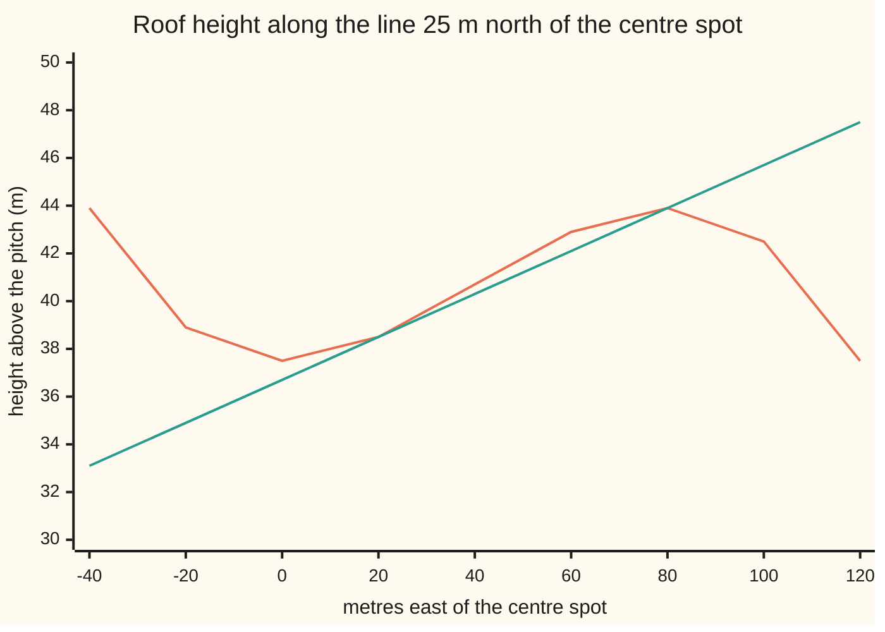
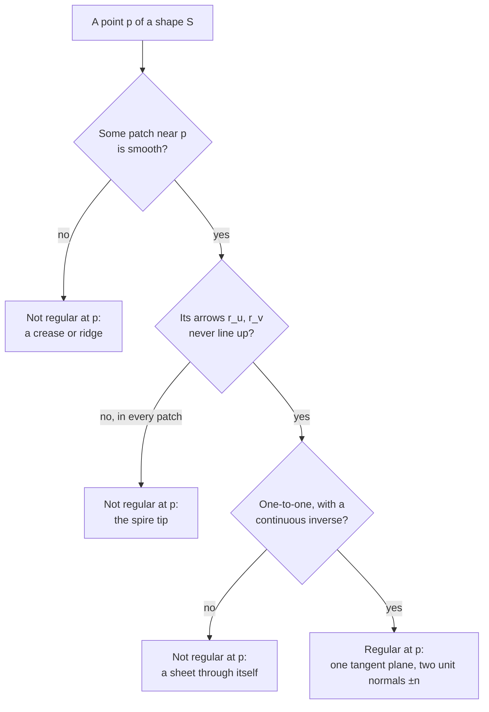

# Regular surface: a shape that looks like a flat patch up close

[Syllabus](../../../SYLLABUS.md) → [Differential geometry and Lie groups](../README.md) → [Surfaces](../README.md#s02) → Regular surface

---

## General Overview

A stadium roof spans 160 m east to west and 100 m north to south. Over the middle it is a saddle: it climbs toward the east and west ends and falls away toward the north and south stands. Over the east end it is a dome, whose crown stands 46.4 m above the pitch.

An inspection drone must hold exactly 2 m off the roof skin at a point P, 20 m east and 25 m north of the centre spot, where the roof is 38.5 m up. A roofer fixing a safety anchor at P needs the bolt square to the skin. Both need the same arrow: the **unit normal**, length 1 and square to the roof. Both also trust that, within a couple of metres, the roof is nearly a flat board: the **tangent plane**.

At P the roof tilts 12.37° from level. The unit normal is (−0.0879, 0.1954, 0.9768), so the drone hovers at (19.82, 25.39, 40.45). One recipe gives this on the dome and on the saddle alike, because the whole roof is written as one **patch**: a smooth map from a flat sheet of map coordinates onto the roof.

Not every shape allows this. The tip of a spire has no flat board that fits, and a sheet that passes through itself has two. A **regular surface**, the term used from here on, is a shape with no such points.

**A regular surface is a set that, near each of its points, is the smooth one-to-one image of a flat patch whose two tangent arrows never line up; the arrows span the tangent plane, which is the same for every such patch, and their cross product scaled to length 1 is the unit normal.**

**What kind of fact this is:** a definition. That the tangent plane does not depend on the patch, and that graphs and level sets are regular surfaces, are theorems proved on this card in Why it works; the level-set part uses the implicit function theorem, which is used here, not proved.

### The picture: the roof and its tangent plane, along one line



Orange: the roof, dipping over the saddle near 0 m and rising over the dome near 80 m. Green: the tangent plane at P, which touches the roof at 20 m east. Close to P the two agree to millimetres; far away they part by metres. A tangent plane is a statement about up close.

---

## The formula

Notation first, in words. $`x`$, $`y`$, $`z`$ are metres east, north and up from the centre spot at pitch level. The roof's height is $`h(x, y) = 40 + x^2(120 - x)/40000 - y^2/250`$, over $`x`$ from −40 to 120 and $`y`$ from −50 to 50.

This formula blends dome and saddle into one, so that the whole roof is a single patch. The later cards on this shelf model the two parts separately: the saddle as $`z = 30 + (x^2 - y^2)/120`$, with $`x`$ and $`y`$ measured from its own centre O ([First fundamental form](02-first-fundamental-form.md)), and the dome as part of a sphere of radius 60 m. Their P, a lamp fixing on the saddle, is a different point from this card's P.

A **patch** $`r(u, v)`$ takes two map numbers $`u`$, $`v`$ from a region of the flat plane to a point of space. Its **tangent arrows** $`r_u`$ and $`r_v`$ are its partial derivatives: how far and which way the point moves per unit of $`u`$, with $`v`$ held still, and the reverse. [Surface integrals](../../06-Calculus%20and%20analysis/09-Vector%20Calculus/05-surface-integrals-and-flux.md) already lifts a sheet this way, takes $`N = r_u \times r_v`$ and asks that it never be zero. This card asks what makes the whole shape fit for that, and why the answer does not depend on the patch chosen.

A set $`S`$ in space is a **regular surface** when every point $`p`$ of $`S`$ has a patch $`r`$, covering all of $`S`$ near $`p`$, with three properties:

1. **Smooth:** $`r`$ has continuous partial derivatives of every order.
2. **One-to-one, with a continuous inverse:** distinct map points go to distinct points of the shape, and points of the shape that are close come from map points that are close.
3. **Never flat-folded:** $`r_u \times r_v \neq 0`$, so the two arrows never line up or vanish.

The tangent plane and unit normal at $`p = r(u_0, v_0)`$ are then

```math
T_pS = \{\, a\, r_u + b\, r_v : a, b \text{ real} \,\}, \qquad n = \frac{r_u \times r_v}{\lVert r_u \times r_v \rVert}
```

**Read it aloud:** the tangent plane is every arrow built from the two tangent arrows; the unit normal is their cross product shrunk to length 1.

Placed at $`p`$, the tangent plane is the flat surface of points $`X`$ whose offset from $`p`$ is square to $`N`$:

```math
N \cdot (X - p) = 0
```

**Read it aloud:** a point lies on the tangent plane when the arrow from $`p`$ to it has no part along the normal.

For the roof the obvious patch is the plan itself, $`r(x, y) = (x, y, h(x, y))`$. Then $`r_x = (1, 0, h_x)`$, $`r_y = (0, 1, h_y)`$ and $`N = (-h_x, -h_y, 1)`$, where $`h_x`$ and $`h_y`$ are the roof's slopes east and north. The letter $`N`$ is reused later on this shelf for a different number; on this card it is always the cross product.

| Symbol | Plain meaning | In our example | Push it up and the answer… |
| --- | --- | --- | --- |
| $`x`$, $`y`$, $`z`$ | metres east, north, up from the centre spot | P at (20, 25, 38.5) | — |
| $`h`$, $`h_x`$, $`h_y`$ | roof height; its slopes east and north | 38.5 m; 0.09 and −0.2 at P | steeper slopes tilt $`n`$ further |
| $`u`$, $`v`$; $`r(u, v)`$ | map numbers; the patch | $`u = x`$, $`v = y`$; $`(x, y, h)`$ | — |
| $`S`$, $`p`$ | the surface; one point of it | the roof; P | — |
| $`r_u`$, $`r_v`$ | tangent arrows | (1, 0, 0.09), (0, 1, −0.2) | — |
| $`N`$ | their cross product | (−0.09, 0.2, 1), length 1.023768 | longer as the roof steepens |
| $`n`$ | unit normal | (−0.087911, 0.195357, 0.976784) | always length 1 |
| $`T_pS`$; $`a`$, $`b`$; $`X`$ | tangent plane at $`p`$; how much of each arrow; a point on the placed plane | $`N \cdot X = 41.7`$ | — |
| $`\rho`$, $`\theta`$; $`s(\sigma, \tau)`$ | second patch: metres from the crown (80, 0), angle anticlockwise from east; in the proof, any second patch | 65 m, 157.380135° at P | — |
| $`J`$, $`\det J`$ | the Jacobian matrix of the switch from one patch's map to the other's; its determinant, the area stretch | $`\det J = \rho`$ = 65 at P | $`N`$ grows by $`\det J`$; $`n`$ stays put |
| $`f`$; $`R`$ | a function of space whose zero set is the surface; a sphere's radius | $`z - h(x, y)`$ | — |
| $`\gamma(t)`$ | a curve on the surface, $`t`$ its time | a walkway through P | — |

### When it holds

- **Smoothness.** Along a sharp ridge the arrows jump, and no single board fits both sides.
- **Arrows never lined up.** At the tip of a 45° spire, normals 1 mm either side differ by 90°, so no plane fits and no smooth patch with $`N \neq 0`$ exists there.
- **One-to-one with a continuous inverse.** A sheet bent into a figure eight meets itself along a line. A patch can be one-to-one there with $`N`$ never zero, yet the crossing carries two planes 53.13° apart.
- **One good patch is enough.** Regularity asks for some patch near each point, not that every patch be good. The polar patch about the crown has $`N = 0`$ at the crown itself; the plan patch is fine there, so the roof is regular.
- **Local, not global.** Each point needs a patch near it. The roof is covered by one; a closed shape such as a ball's skin needs at least two, a global fact this card states without proof.

---

## Why it works

### Step 0: up close, a smooth patch is its linear part

Near a map point, a smooth patch moves almost exactly like its first-order part: step $`a`$ in $`u`$ and $`b`$ in $`v`$ and the point moves by about $`a\,r_u + b\,r_v`$. That is a flat grid of parallelograms. When $`r_u`$ and $`r_v`$ point in different directions, the grid fills a plane, and the shape looks like that plane up close.

The three conditions make that picture honest. Smoothness gives the linear part. $`N \neq 0`$ makes it fill a plane, not a line. The continuous inverse stops a far-off sheet of the same shape from sneaking into the neighbourhood.



### Step 1: the roof is a regular surface, from its plan

The plan patch $`r(x, y) = (x, y, h(x, y))`$ passes all three tests at every point. $`h`$ is a polynomial, so the patch is smooth. Its inverse forgets the height, $`(x, y, z) \mapsto (x, y)`$, which is continuous. And $`N = (-h_x, -h_y, 1)`$ has third entry 1, so it is never zero.

The same holds for any smooth height function: **every graph of a smooth function is a regular surface**, covered by one patch. Dome, saddle and the slope between them are one patch with one recipe.

### Step 2: level sets give a second, chart-free test

The roof is also the set where $`f(x, y, z) = z - h(x, y)`$ equals zero. Its gradient is $`\nabla f = (-h_x, -h_y, 1)`$, the arrow of steepest climb for $`f`$ ([Gradient](../../06-Calculus%20and%20analysis/07-Several%20Variables/03-gradient-and-directional-derivatives.md)), and it is never zero.

The **regular value theorem** says: if $`\nabla f \neq 0`$ at every point where $`f = 0`$, that set is a regular surface, and $`\nabla f`$ is normal to it. The reason: where the $`z`$-entry of $`\nabla f`$ is non-zero, the [Inverse and implicit function theorems](../../06-Calculus%20and%20analysis/07-Several%20Variables/07-inverse-and-implicit-function-theorems.md) solve $`f = 0`$ for $`z`$ near the point, so the set is locally a graph, and Step 1 applies. If another entry is non-zero, solve for that variable instead.

This is how a sphere, $`x^2 + y^2 + z^2 - R^2 = 0`$ with $`R`$ its radius, earns its place: its gradient $`(2x, 2y, 2z)`$ vanishes only at the centre, which is not on it.

### Step 3: the plane hugs the roof to second order

The roof's gap above its tangent plane at P, walking east or north, shrinks as the square of the step:

| Step from P | Gap walking east | Gap per m² | Gap walking north | Gap per m² |
| --- | --- | --- | --- | --- |
| 4 m | 22.4 mm | 1.4 | −64 mm | −4 |
| 2 m | 5.8 mm | 1.45 | −16 mm | −4 |
| 1 m | 1.475 mm | 1.475 | −4 mm | −4 |
| 0.5 m | 0.3719 mm | 1.4875 | −1 mm | −4 |

Halve the step and the gap falls about fourfold. The gap per square metre settles at half the second slope: 1.5 mm per m² east, where the roof curves up, and −4 mm per m² north, where it curves down. Any other plane through P would leave a gap shrinking only in step with the distance. This is the meaning of "a flat patch up close", and it is [Tangent planes](../../06-Calculus%20and%20analysis/07-Several%20Variables/02-differentiability-and-tangent-planes.md) applied to $`h`$.

### Step 4: a second patch gives the same plane

Describe the roof instead by distance $`\rho`$ and angle $`\theta`$ from the crown at (80, 0), as a surveyor standing on the dome would:

```math
r(\rho, \theta) = \big(80 + \rho\cos\theta,\ \rho\sin\theta,\ h(80 + \rho\cos\theta, \rho\sin\theta)\big)
```

**Read it aloud:** walk $`\rho`$ metres from the crown at angle $`\theta`$ in plan, then rise to the roof.

P is 60 m west and 25 m north of the crown, so $`\rho = 65`$ m and $`\theta = 157.380135°`$ (2.746802 rad). The code takes the new tangent arrows by central differences, with no slope formula:

- $`r_\rho = (-0.923077, 0.384615, -0.16)`$ and $`r_\theta = (-25, -60, 9.75)`$.
- Their cross product is $`(-5.85, 13, 65)`$: exactly 65 times the plan patch's $`N`$.
- Scaled to length 1 it is (−0.087911, 0.195357, 0.976784), the same unit normal.

The arrows differ; the plane they span does not. The factor 65 is the Jacobian determinant $`\det J`$ of the switch from $`(x, y)`$ to $`(\rho, \theta)`$, which here equals $`\rho`$ ([Chain rule in several variables](../../06-Calculus%20and%20analysis/07-Several%20Variables/04-multivariable-chain-rule-and-jacobians.md)).

In general, by the chain rule each new arrow is a combination of the old two, so the new span sits inside the old one. Both spans are planes, so they are equal. And the new cross product is the old one times $`\det J`$: the unit normal is unchanged when $`\det J > 0`$ and flips when $`\det J < 0`$.

<details>
<summary>Detailed proof: the tangent plane does not depend on the patch</summary>

Let $`r(u, v)`$ and $`s(\sigma, \tau)`$ be two regular patches covering $`S`$ near $`p`$. Write the switch between them as $`u = u(\sigma, \tau)`$, $`v = v(\sigma, \tau)`$, so that $`s = r(u(\sigma, \tau), v(\sigma, \tau))`$. That the switch is smooth is itself a theorem: it uses condition 3 and the inverse function theorem, and is proved in the first source below, section 2-3.

By the chain rule,

$`\displaystyle s_\sigma = r_u\, u_\sigma + r_v\, v_\sigma, \qquad s_\tau = r_u\, u_\tau + r_v\, v_\tau.`$

So both new arrows lie in the span of $`r_u`$ and $`r_v`$, and so does every combination of them. The cross product is linear in each slot, $`r_u \times r_u = 0`$ and $`r_v \times r_u = -\,r_u \times r_v`$. Expanding,

$`\displaystyle s_\sigma \times s_\tau = (u_\sigma v_\tau - u_\tau v_\sigma)\,(r_u \times r_v) = \det J\, (r_u \times r_v),`$

where $`J`$ is the Jacobian matrix of the switch, with columns $`(u_\sigma, v_\sigma)`$ and $`(u_\tau, v_\tau)`$.

Since $`s_\sigma \times s_\tau \neq 0`$, $`\det J \neq 0`$, so the new arrows are independent and span a plane. A plane inside a plane through the same point is that plane. Dividing by length, the unit normal is multiplied by the sign of $`\det J`$.

A chart-free description seals it. Every curve $`\gamma(t)`$ on $`S`$ through $`p`$ reads $`r(u(t), v(t))`$ in the patch, so its velocity $`r_u u' + r_v v'`$ lies in $`T_pS`$. Conversely $`a\,r_u + b\,r_v`$ is the velocity of $`r(u_0 + at, v_0 + bt)`$. So $`T_pS`$ is exactly the set of velocities of curves on $`S`$ through $`p`$, a description that names no patch.

</details>

### Step 5: a survey with no patch agrees

A third road uses no derivatives at all. Survey four roof points: 4 m east and west of P, and 4 m north and south. The two chords between opposite points lie almost along the roof. Their cross product, scaled to length 1, is within 80.2812 arcseconds of $`n`$. From points 1 m out the gap is 5.0174 arcseconds: a quarter of the distance, a sixteenth of the error. The survey closes in on the same arrow the patches gave, so the normal belongs to the roof, not to a choice of coordinates.

---

## Worked numbers, by hand

At P = (20, 25), with the plan patch.

| Step | Arithmetic | Value |
| --- | --- | --- |
| height | 40 + 400 × 100 / 40000 − 625 / 250 | 38.5 m |
| slope east $`h_x`$ | (240 × 20 − 3 × 400) / 40000 | 0.09 |
| slope north $`h_y`$ | −2 × 25 / 250 | −0.2 |
| tangent arrows | $`(1, 0, h_x)`$, $`(0, 1, h_y)`$ | (1, 0, 0.09), (0, 1, −0.2) |
| cross product $`N`$ | $`(-h_x, -h_y, 1)`$ | (−0.09, 0.2, 1) |
| its length | $`\sqrt{0.0081 + 0.04 + 1}`$ | 1.023768 |
| unit normal $`n`$ | each entry ÷ 1.023768 | **(−0.087911, 0.195357, 0.976784)** |
| tilt from level | arctan of the steepest slope 0.219317 | **12.3701°** |
| tangent plane | −0.09 × 20 + 0.2 × 25 + 38.5 | **−0.09x + 0.2y + z = 41.7** |
| drone, 2 m along $`n`$ | (20, 25, 38.5) + 2$`n`$ | **(19.8242, 25.3907, 40.4536)** |

The drone sits 0.18 m west, 0.39 m north and 1.95 m above P, square to the skin. The same steps on the dome at Q = (100, −15), 44.1 m up, give $`N = (0.15, -0.12, 1)`$, unit normal (0.147307, −0.117845, 0.982045) and tilt 10.8737°.

### What breaks if you drop a piece

| Mistake | Comes out at | What went wrong |
| --- | --- | --- |
| Cross the arrows in the other order, $`r_y \times r_x`$ | n = (0.087911, −0.195357, −0.976784) | The normal points down into the stands; the drone flies into the roof |
| Slopes without their minus signs, $`(h_x, h_y, 1)`$ | 24.7402° off the true normal | The arrow leans downhill instead of uphill |
| Use $`N`$ as if it had length 1 | drone 2.0475 m off, not 2 | $`N`$ has length 1.023768 |
| Polar patch at the crown | $`N = 0`$ there | A bad patch, not a bad roof: the plan patch gives tilt 0, and polar normals 1 mm east and west differ by only 2.48 arcseconds |
| A 45° spire tip | $`N = 0`$; normals 1 mm either side 90° apart | No smooth patch with $`N \neq 0`$ fits the tip: not a regular surface |
| Figure-eight sheet $`(\sin 2u, \sin u, v)`$, $`u`$ strictly between 0 and 2π | normals (−1, −2, 0) and (1, −2, 0), 53.1301° apart | One-to-one with $`N \neq 0`$, but the inverse is not continuous at the crossing |

---

## Code, from first principles, and it actually runs

The code computes the tangent plane and unit normal at P and Q by three independent roads: the plan patch with exact slopes; the polar patch with arrows from central differences; and a survey of roof points with no derivatives. The asserts check that the two patches give one unit normal, that their cross products differ by the Jacobian, that the survey closes in, that the printed gaps shrink as the square of the step, that $`N = 0`$ at the polar patch's centre and at the spire tip, and that the spire tip and the figure-eight crossing really have no single plane.

### Python

```python
# Regular surfaces -- the check behind the card.  Stadium roof, metres:
# z = h(x, y) = 40 + x^2 (120 - x)/40000 - y^2/250 over x in [-40, 120], y in [-50, 50].
# Road one: the graph patch r(x, y) = (x, y, h), tangent arrows from exact slopes.
# Road two: a polar patch about the crown (80, 0), arrows by central differences.
# Road three: a survey, the plane through four roof points, no derivatives at all.
from math import sqrt, cos, sin, atan2, degrees, pi

def h(x, y): return 40 + x * x * (120 - x) / 40000 - y * y / 250
def hx(x, y): return (240 * x - 3 * x * x) / 40000          # slope east
def hy(x, y): return -2 * y / 250                           # slope north
def cross(a, b): return (a[1]*b[2] - a[2]*b[1], a[2]*b[0] - a[0]*b[2], a[0]*b[1] - a[1]*b[0])
def dot(a, b): return a[0]*b[0] + a[1]*b[1] + a[2]*b[2]
def norm(a): return sqrt(dot(a, a))
def unit(a): return tuple(c / norm(a) for c in a)
def sub(a, b): return tuple(p - q for p, q in zip(a, b))
def angle(a, b): return degrees(atan2(norm(cross(a, b)), dot(a, b)))   # degrees between arrows
def vec(a, d=6): return "(" + ", ".join(f"{c:.{d}f}" for c in a) + ")"

def graph(x, y):                          # road one: r_x = (1, 0, h_x), r_y = (0, 1, h_y)
    rx, ry = (1.0, 0.0, hx(x, y)), (0.0, 1.0, hy(x, y))
    return rx, ry, cross(rx, ry)

def polar(rho, th):                       # the roof by distance rho and angle th from the crown
    x, y = 80 + rho * cos(th), rho * sin(th)
    return (x, y, h(x, y))

def polar_arrows(rho, th, d=1e-5):        # road two: tangent arrows by central differences
    rr = tuple(c / (2 * d) for c in sub(polar(rho + d, th), polar(rho - d, th)))
    rt = tuple(c / (2 * d) for c in sub(polar(rho, th + d), polar(rho, th - d)))
    return rr, rt, cross(rr, rt)

def survey(x, y, s):                      # road three: chords between roof points s metres out
    a = sub((x + s, y, h(x + s, y)), (x - s, y, h(x - s, y)))
    b = sub((x, y + s, h(x, y + s)), (x, y - s, h(x, y - s)))
    return unit(cross(a, b))

for name, (x, y) in (("P, over the saddle", (20.0, 25.0)), ("Q, on the dome", (100.0, -15.0))):
    rx, ry, N = graph(x, y)
    n, c = unit(N), dot(N, (x, y, h(x, y)))
    print(f"{name}: ({x:.0f}, {y:.0f}), height {h(x, y):.4f} m")
    print(f"  r_x = {vec(rx, 2)}, r_y = {vec(ry, 2)}, N = {vec(N, 2)}, |N| = {norm(N):.6f}")
    print(f"  n = {vec(n)}, tilt {angle(N, (0, 0, 1)):.4f} degrees, steepest slope {sqrt(N[0] ** 2 + N[1] ** 2):.6f}")
    print(f"  tangent plane: N . (x, y, z) = N . p = {c:.4f}")

P = (20.0, 25.0, h(20.0, 25.0))
rx, ry, N = graph(20.0, 25.0)
n = unit(N)
rho, th = sqrt(60.0 ** 2 + 25.0 ** 2), atan2(25.0, -60.0)
rr, rt, M = polar_arrows(rho, th)
print(f"polar chart at P: rho = {rho:.4f} m, theta = {th:.6f} rad = {degrees(th):.6f} degrees")
print(f"  r_rho = {vec(rr)}, r_theta = {vec(rt)}")
print(f"  N' = {vec(M)}, |N'|/|N| = {norm(M) / norm(N):.6f}, Jacobian rho = {rho:.6f}")
print(f"  n' = {vec(unit(M))}, largest r_rho.n, r_theta.n: {max(abs(dot(rr, n)), abs(dot(rt, n))):.6f}")
for s in (4.0, 1.0):
    m = survey(20.0, 25.0, s)
    print(f"survey {s:.0f} m out: n = {vec(m)}, angle to n {angle(m, n) * 3600:.4f} arcseconds")
print(f"gap, roof minus tangent plane, mm (gap/step^2 in mm per m^2; h_xx/2 = {1000 * (240 - 120) / 80000:.4f}, h_yy/2 = {-1000 / 250:.4f}):")
gaps = [(s, h(20 + s, 25) - (P[2] + 0.09 * s), h(20, 25 + s) - (P[2] - 0.2 * s)) for s in (4.0, 2.0, 1.0, 0.5)]
for s, ge, gn in gaps:
    print(f"  step {s:.1f} m: east {1000 * ge:.4f} ({1000 * ge / s / s:.4f}), north {1000 * gn:.4f} ({1000 * gn / s / s:.4f})")
print(f"chart roof y=25: " + ", ".join(f"{h(x, 25):.1f}" for x in range(-40, 121, 20)))
print(f"chart plane y=25: " + ", ".join(f"{P[2] + 0.09 * (x - 20):.1f}" for x in range(-40, 121, 20)))
D = tuple(p + 2 * c for p, c in zip(P, n))
print(f"drone 2 m off along n: {vec(D, 4)}; along N instead: {2 * norm(N):.4f} m off")
print(f"mistake, r_y x r_x: n = {vec(unit(cross(ry, rx)))}, points into the stands")
bad = (0.09, -0.2, 1.0)
print(f"mistake, slopes without the minus signs: {vec(bad, 2)}, {angle(bad, N):.4f} degrees off")
cz = polar_arrows(0.0, 0.3)[2]
a1, a2 = polar_arrows(0.001, 0.0)[2], polar_arrows(0.001, pi)[2]
print(f"crown (80, 0), {h(80.0, 0.0):.4f} m up: polar |N'| at rho = 0: {norm(cz):.6f}; graph chart tilt {angle(graph(80.0, 0.0)[2], (0, 0, 1)):.4f} degrees")
print(f"crown, polar normals 1 mm east and west differ by {angle(a1, a2) * 3600:.2f} arcseconds")
def cone(u, v): return cross((cos(v), sin(v), -1.0), (-u * sin(v), u * cos(v), 0.0))
k1, k2 = cone(0.001, 0.0), cone(0.001, pi)
print(f"spire, 45-degree cone: |N| at tip {norm(cone(0.0, 0.0)):.6f}; normals 1 mm either side differ by {angle(k1, k2):.4f} degrees")
def eight(u): return cross((2 * cos(2 * u), cos(u), 0.0), (0.0, 0.0, 1.0))
e1, e2 = eight(pi), eight(1e-9)
print(f"figure-eight sheet at the crossing: N = {vec(e1, 2)} and {vec(e2, 2)}, {angle(e1, e2):.4f} degrees apart")
g = [ge / (s * s) for s, ge, gn in gaps[2:]]                     # the printed rows at 1 m and 0.5 m
assert max(abs(p - q) for p, q in zip(unit(M), n)) < 1e-8        # two charts, one unit normal
assert abs(norm(M) / norm(N) - rho) < 1e-6                         # normals differ by the Jacobian
assert max(abs(dot(rr, n)), abs(dot(rt, n))) < 1e-6                # polar arrows lie in the graph plane
assert angle(survey(20.0, 25.0, 1.0), n) < angle(survey(20.0, 25.0, 4.0), n) / 10   # survey closes in
assert abs(g[1] - (240 - 120) / 80000) < abs(g[0] - (240 - 120) / 80000) < 3e-5   # gap/step^2 -> h_xx/2
assert angle(a1, a2) < 0.01 and angle(k1, k2) > 89                 # crown regular, spire tip not
assert angle(e1, e2) > 50                                          # crossing: two planes at one point
assert max(abs(gn / (s * s) + 1 / 250) for s, ge, gn in gaps) < 1e-9   # north gap/step^2 = h_yy/2 exactly
assert norm(cz) < 1e-9 and norm(cone(0.0, 0.0)) < 1e-12           # N = 0 at the polar centre and the spire tip
print("ALL CHECKS PASS")
```

**Ran 2026-11-19 on macOS, Python 3.14.10, standard library only. All checks passed. Output, pasted from the run:**

```
P, over the saddle: (20, 25), height 38.5000 m
  r_x = (1.00, 0.00, 0.09), r_y = (0.00, 1.00, -0.20), N = (-0.09, 0.20, 1.00), |N| = 1.023768
  n = (-0.087911, 0.195357, 0.976784), tilt 12.3701 degrees, steepest slope 0.219317
  tangent plane: N . (x, y, z) = N . p = 41.7000
Q, on the dome: (100, -15), height 44.1000 m
  r_x = (1.00, 0.00, -0.15), r_y = (0.00, 1.00, 0.12), N = (0.15, -0.12, 1.00), |N| = 1.018283
  n = (0.147307, -0.117845, 0.982045), tilt 10.8737 degrees, steepest slope 0.192094
  tangent plane: N . (x, y, z) = N . p = 60.9000
polar chart at P: rho = 65.0000 m, theta = 2.746802 rad = 157.380135 degrees
  r_rho = (-0.923077, 0.384615, -0.160000), r_theta = (-25.000000, -60.000000, 9.750000)
  N' = (-5.850000, 13.000000, 65.000000), |N'|/|N| = 65.000000, Jacobian rho = 65.000000
  n' = (-0.087911, 0.195357, 0.976784), largest r_rho.n, r_theta.n: 0.000000
survey 4 m out: n = (-0.087523, 0.195364, 0.976818), angle to n 80.2812 arcseconds
survey 1 m out: n = (-0.087886, 0.195357, 0.976786), angle to n 5.0174 arcseconds
gap, roof minus tangent plane, mm (gap/step^2 in mm per m^2; h_xx/2 = 1.5000, h_yy/2 = -4.0000):
  step 4.0 m: east 22.4000 (1.4000), north -64.0000 (-4.0000)
  step 2.0 m: east 5.8000 (1.4500), north -16.0000 (-4.0000)
  step 1.0 m: east 1.4750 (1.4750), north -4.0000 (-4.0000)
  step 0.5 m: east 0.3719 (1.4875), north -1.0000 (-4.0000)
chart roof y=25: 43.9, 38.9, 37.5, 38.5, 40.7, 42.9, 43.9, 42.5, 37.5
chart plane y=25: 33.1, 34.9, 36.7, 38.5, 40.3, 42.1, 43.9, 45.7, 47.5
drone 2 m off along n: (19.8242, 25.3907, 40.4536); along N instead: 2.0475 m off
mistake, r_y x r_x: n = (0.087911, -0.195357, -0.976784), points into the stands
mistake, slopes without the minus signs: (0.09, -0.20, 1.00), 24.7402 degrees off
crown (80, 0), 46.4000 m up: polar |N'| at rho = 0: 0.000000; graph chart tilt 0.0000 degrees
crown, polar normals 1 mm east and west differ by 2.48 arcseconds
spire, 45-degree cone: |N| at tip 0.000000; normals 1 mm either side differ by 90.0000 degrees
figure-eight sheet at the crossing: N = (-1.00, -2.00, 0.00) and (1.00, -2.00, 0.00), 53.1301 degrees apart
ALL CHECKS PASS
```

### Rust

```rust
// Regular surfaces -- the check behind the card.  Stadium roof, metres:
// z = h(x, y) = 40 + x^2 (120 - x)/40000 - y^2/250 over x in [-40, 120], y in [-50, 50].
// Road one: the graph patch r(x, y) = (x, y, h), tangent arrows from exact slopes.
// Road two: a polar patch about the crown (80, 0), arrows by central differences.
// Road three: a survey, the plane through four roof points, no derivatives at all.
use std::f64::consts::PI;
type V = [f64; 3];

fn h(x: f64, y: f64) -> f64 { 40.0 + x * x * (120.0 - x) / 40000.0 - y * y / 250.0 }
fn hx(x: f64, _y: f64) -> f64 { (240.0 * x - 3.0 * x * x) / 40000.0 } // slope east
fn hy(_x: f64, y: f64) -> f64 { -2.0 * y / 250.0 } // slope north
fn cross(a: V, b: V) -> V { [a[1] * b[2] - a[2] * b[1], a[2] * b[0] - a[0] * b[2], a[0] * b[1] - a[1] * b[0]] }
fn dot(a: V, b: V) -> f64 { a[0] * b[0] + a[1] * b[1] + a[2] * b[2] }
fn norm(a: V) -> f64 { dot(a, a).sqrt() }
fn unit(a: V) -> V { let l = norm(a); [a[0] / l, a[1] / l, a[2] / l] }
fn sub(a: V, b: V) -> V { [a[0] - b[0], a[1] - b[1], a[2] - b[2]] }
fn scale(a: V, k: f64) -> V { [a[0] * k, a[1] * k, a[2] * k] }
fn angle(a: V, b: V) -> f64 { norm(cross(a, b)).atan2(dot(a, b)).to_degrees() } // degrees between arrows
fn vec(a: V, d: usize) -> String { format!("({:.*}, {:.*}, {:.*})", d, a[0], d, a[1], d, a[2]) }

fn graph(x: f64, y: f64) -> (V, V, V) { // road one: r_x = (1, 0, h_x), r_y = (0, 1, h_y)
    let (rx, ry) = ([1.0, 0.0, hx(x, y)], [0.0, 1.0, hy(x, y)]);
    (rx, ry, cross(rx, ry))
}
fn polar(rho: f64, th: f64) -> V { // the roof by distance rho and angle th from the crown
    let (x, y) = (80.0 + rho * th.cos(), rho * th.sin());
    [x, y, h(x, y)]
}
fn polar_arrows(rho: f64, th: f64) -> (V, V, V) { // road two: tangent arrows by central differences
    let d = 1e-5;
    let rr = scale(sub(polar(rho + d, th), polar(rho - d, th)), 1.0 / (2.0 * d));
    let rt = scale(sub(polar(rho, th + d), polar(rho, th - d)), 1.0 / (2.0 * d));
    (rr, rt, cross(rr, rt))
}
fn survey(x: f64, y: f64, s: f64) -> V { // road three: chords between roof points s metres out
    let a = sub([x + s, y, h(x + s, y)], [x - s, y, h(x - s, y)]);
    let b = sub([x, y + s, h(x, y + s)], [x, y - s, h(x, y - s)]);
    unit(cross(a, b))
}
fn cone(u: f64, v: f64) -> V { cross([v.cos(), v.sin(), -1.0], [-u * v.sin(), u * v.cos(), 0.0]) }
fn eight(u: f64) -> V { cross([2.0 * (2.0 * u).cos(), u.cos(), 0.0], [0.0, 0.0, 1.0]) }

fn main() {
    for (name, x, y) in [("P, over the saddle", 20.0, 25.0), ("Q, on the dome", 100.0, -15.0)] {
        let (rx, ry, nn) = graph(x, y);
        let (n, c) = (unit(nn), dot(nn, [x, y, h(x, y)]));
        println!("{}: ({:.0}, {:.0}), height {:.4} m", name, x, y, h(x, y));
        println!("  r_x = {}, r_y = {}, N = {}, |N| = {:.6}", vec(rx, 2), vec(ry, 2), vec(nn, 2), norm(nn));
        println!("  n = {}, tilt {:.4} degrees, steepest slope {:.6}", vec(n, 6), angle(nn, [0.0, 0.0, 1.0]), (nn[0] * nn[0] + nn[1] * nn[1]).sqrt());
        println!("  tangent plane: N . (x, y, z) = N . p = {:.4}", c);
    }
    let p: V = [20.0, 25.0, h(20.0, 25.0)];
    let (rx, ry, nn) = graph(20.0, 25.0);
    let n = unit(nn);
    let (rho, th) = ((60.0f64 * 60.0 + 25.0 * 25.0).sqrt(), 25.0f64.atan2(-60.0));
    let (rr, rt, m) = polar_arrows(rho, th);
    println!("polar chart at P: rho = {:.4} m, theta = {:.6} rad = {:.6} degrees", rho, th, th.to_degrees());
    println!("  r_rho = {}, r_theta = {}", vec(rr, 6), vec(rt, 6));
    println!("  N' = {}, |N'|/|N| = {:.6}, Jacobian rho = {:.6}", vec(m, 6), norm(m) / norm(nn), rho);
    let worst = dot(rr, n).abs().max(dot(rt, n).abs());
    println!("  n' = {}, largest r_rho.n, r_theta.n: {:.6}", vec(unit(m), 6), worst);
    for s in [4.0, 1.0] {
        let ms = survey(20.0, 25.0, s);
        println!("survey {:.0} m out: n = {}, angle to n {:.4} arcseconds", s, vec(ms, 6), angle(ms, n) * 3600.0);
    }
    let lim = (240.0 - 120.0) / 80000.0;
    println!("gap, roof minus tangent plane, mm (gap/step^2 in mm per m^2; h_xx/2 = {:.4}, h_yy/2 = {:.4}):", 1000.0 * lim, -1000.0 / 250.0);
    let gaps: Vec<(f64, f64, f64)> = [4.0, 2.0, 1.0, 0.5].iter().map(|&s| (s, h(20.0 + s, 25.0) - (p[2] + 0.09 * s), h(20.0, 25.0 + s) - (p[2] - 0.2 * s))).collect();
    for &(s, ge, gn) in &gaps {
        println!("  step {:.1} m: east {:.4} ({:.4}), north {:.4} ({:.4})", s, 1000.0 * ge, 1000.0 * ge / s / s, 1000.0 * gn, 1000.0 * gn / s / s);
    }
    let xs: Vec<f64> = (0..9).map(|i| -40.0 + 20.0 * i as f64).collect();
    let roof: Vec<String> = xs.iter().map(|&x| format!("{:.1}", h(x, 25.0))).collect();
    let plane: Vec<String> = xs.iter().map(|&x| format!("{:.1}", p[2] + 0.09 * (x - 20.0))).collect();
    println!("chart roof y=25: {}", roof.join(", "));
    println!("chart plane y=25: {}", plane.join(", "));
    let dr = [p[0] + 2.0 * n[0], p[1] + 2.0 * n[1], p[2] + 2.0 * n[2]];
    println!("drone 2 m off along n: {}; along N instead: {:.4} m off", vec(dr, 4), 2.0 * norm(nn));
    println!("mistake, r_y x r_x: n = {}, points into the stands", vec(unit(cross(ry, rx)), 6));
    let bad: V = [0.09, -0.2, 1.0];
    println!("mistake, slopes without the minus signs: {}, {:.4} degrees off", vec(bad, 2), angle(bad, nn));
    let cz = polar_arrows(0.0, 0.3).2;
    let (a1, a2) = (polar_arrows(0.001, 0.0).2, polar_arrows(0.001, PI).2);
    println!("crown (80, 0), {:.4} m up: polar |N'| at rho = 0: {:.6}; graph chart tilt {:.4} degrees", h(80.0, 0.0), norm(cz), angle(graph(80.0, 0.0).2, [0.0, 0.0, 1.0]));
    println!("crown, polar normals 1 mm east and west differ by {:.2} arcseconds", angle(a1, a2) * 3600.0);
    let (k1, k2) = (cone(0.001, 0.0), cone(0.001, PI));
    println!("spire, 45-degree cone: |N| at tip {:.6}; normals 1 mm either side differ by {:.4} degrees", norm(cone(0.0, 0.0)), angle(k1, k2));
    let (e1, e2) = (eight(PI), eight(1e-9));
    println!("figure-eight sheet at the crossing: N = {} and {}, {:.4} degrees apart", vec(e1, 2), vec(e2, 2), angle(e1, e2));
    let g: Vec<f64> = gaps[2..].iter().map(|&(s, ge, _)| ge / (s * s)).collect(); // the printed rows at 1 m and 0.5 m
    let un = unit(m);
    assert!((0..3).all(|i| (un[i] - n[i]).abs() < 1e-8)); // two charts, one unit normal
    assert!((norm(m) / norm(nn) - rho).abs() < 1e-6); // normals differ by the Jacobian
    assert!(worst < 1e-6); // polar arrows lie in the graph plane
    assert!(angle(survey(20.0, 25.0, 1.0), n) < angle(survey(20.0, 25.0, 4.0), n) / 10.0); // survey closes in
    assert!((g[1] - lim).abs() < (g[0] - lim).abs() && (g[0] - lim).abs() < 3e-5); // gap/step^2 -> h_xx/2
    assert!(angle(a1, a2) < 0.01 && angle(k1, k2) > 89.0); // crown regular, spire tip not
    assert!(angle(e1, e2) > 50.0); // crossing: two planes at one point
    assert!(gaps.iter().all(|&(s, _, gn)| (gn / (s * s) + 1.0 / 250.0).abs() < 1e-9)); // north gap/step^2 = h_yy/2 exactly
    assert!(norm(cz) < 1e-9 && norm(cone(0.0, 0.0)) < 1e-12); // N = 0 at the polar centre and the spire tip
    println!("ALL CHECKS PASS");
}
```

**Ran 2026-11-19 on macOS, rustc 1.98.1, no crates. All checks passed. Output, pasted from the run:**

```
P, over the saddle: (20, 25), height 38.5000 m
  r_x = (1.00, 0.00, 0.09), r_y = (0.00, 1.00, -0.20), N = (-0.09, 0.20, 1.00), |N| = 1.023768
  n = (-0.087911, 0.195357, 0.976784), tilt 12.3701 degrees, steepest slope 0.219317
  tangent plane: N . (x, y, z) = N . p = 41.7000
Q, on the dome: (100, -15), height 44.1000 m
  r_x = (1.00, 0.00, -0.15), r_y = (0.00, 1.00, 0.12), N = (0.15, -0.12, 1.00), |N| = 1.018283
  n = (0.147307, -0.117845, 0.982045), tilt 10.8737 degrees, steepest slope 0.192094
  tangent plane: N . (x, y, z) = N . p = 60.9000
polar chart at P: rho = 65.0000 m, theta = 2.746802 rad = 157.380135 degrees
  r_rho = (-0.923077, 0.384615, -0.160000), r_theta = (-25.000000, -60.000000, 9.750000)
  N' = (-5.850000, 13.000000, 65.000000), |N'|/|N| = 65.000000, Jacobian rho = 65.000000
  n' = (-0.087911, 0.195357, 0.976784), largest r_rho.n, r_theta.n: 0.000000
survey 4 m out: n = (-0.087523, 0.195364, 0.976818), angle to n 80.2812 arcseconds
survey 1 m out: n = (-0.087886, 0.195357, 0.976786), angle to n 5.0174 arcseconds
gap, roof minus tangent plane, mm (gap/step^2 in mm per m^2; h_xx/2 = 1.5000, h_yy/2 = -4.0000):
  step 4.0 m: east 22.4000 (1.4000), north -64.0000 (-4.0000)
  step 2.0 m: east 5.8000 (1.4500), north -16.0000 (-4.0000)
  step 1.0 m: east 1.4750 (1.4750), north -4.0000 (-4.0000)
  step 0.5 m: east 0.3719 (1.4875), north -1.0000 (-4.0000)
chart roof y=25: 43.9, 38.9, 37.5, 38.5, 40.7, 42.9, 43.9, 42.5, 37.5
chart plane y=25: 33.1, 34.9, 36.7, 38.5, 40.3, 42.1, 43.9, 45.7, 47.5
drone 2 m off along n: (19.8242, 25.3907, 40.4536); along N instead: 2.0475 m off
mistake, r_y x r_x: n = (0.087911, -0.195357, -0.976784), points into the stands
mistake, slopes without the minus signs: (0.09, -0.20, 1.00), 24.7402 degrees off
crown (80, 0), 46.4000 m up: polar |N'| at rho = 0: 0.000000; graph chart tilt 0.0000 degrees
crown, polar normals 1 mm east and west differ by 2.48 arcseconds
spire, 45-degree cone: |N| at tip 0.000000; normals 1 mm either side differ by 90.0000 degrees
figure-eight sheet at the crossing: N = (-1.00, -2.00, 0.00) and (1.00, -2.00, 0.00), 53.1301 degrees apart
ALL CHECKS PASS
```

### Lean

Lean proves, in general, that the tangent plane does not depend on the patch and that smooth graphs are regular surfaces; it checks the roof's numbers exactly.

- Take two patches $`r`$ and $`s`$ that each pass all three tests and cover $`S`$ near $`p`$. Then their tangent arrows at $`p`$ span the same plane, and their cross products differ by a non-zero factor.
- Take any smooth height function $`h`$. Then the plan patch passes all three tests, covers the whole graph, and has $`N = (-h_x, -h_y, 1)`$, never zero.
- Suppose $`s_\sigma = u_\sigma r_u + v_\sigma r_v`$ and $`s_\tau = u_\tau r_u + v_\tau r_v`$. Then $`s_\sigma \times s_\tau = \det J\,(r_u \times r_v)`$.
- Take P = (20, 25) on the roof. Then the height is 38.5 m, the slopes are 0.09 and −0.2, and $`N = (-0.09, 0.2, 1)`$.
- Take that $`N`$ at P. Then $`\lVert N\rVert^2 = 1.0481`$, and the tangent plane is $`-0.09x + 0.2y + z = 41.7`$.
- Take the polar patch's arrows at P, $`(-12/13, 5/13, -0.16)`$ and $`(-25, -60, 9.75)`$. Then their cross product is $`(-5.85, 13, 65)`$, exactly 65 times $`N`$.
- Take Q = (100, −15) on the dome. Then its height is 44.1 m, and $`N = (0.15, -0.12, 1)`$.

The level-set test, the second-order gap, the survey, the failing shapes and the rounded unit normals are left to the Python and Rust checks.

```lean
-- Regular surface: the tangent plane of a regular surface is the same for every regular patch through the point, graphs of smooth functions are regular surfaces, and the worked numbers for the stadium roof are exact.
import Mathlib.Analysis.Calculus.ContDiff.Basic
import Mathlib.Analysis.Calculus.FDeriv.Basic
import Mathlib.LinearAlgebra.CrossProduct
import Mathlib.LinearAlgebra.Span.Basic
import Mathlib.Topology.Maps.Basic
import Mathlib.Tactic
import Mathlib.Analysis.Calculus.ContDiff.Operations
import Mathlib.Analysis.Calculus.FDeriv.Prod
import Mathlib.Analysis.Calculus.FDeriv.Equiv
import Mathlib.Analysis.Normed.Module.FiniteDimension

open scoped ContDiff Matrix

open Filter Topology Asymptotics in
theorem tangentCone_image_subset_range {r : ℝ × ℝ → Fin 3 → ℝ} {U : Set (ℝ × ℝ)}
    (hemb : Topology.IsEmbedding (U.domRestrict r)) {u₀ : ℝ × ℝ} (hu₀ : u₀ ∈ U)
    {L : ℝ × ℝ →L[ℝ] Fin 3 → ℝ} (hL : HasFDerivAt r L u₀) (hinj : Function.Injective L) :
    tangentConeAt ℝ (r '' U) (r u₀) ⊆ LinearMap.range (L : ℝ × ℝ →ₗ[ℝ] Fin 3 → ℝ) := by
  intro w hw
  obtain ⟨α, l, hl, c, d, hd0, hds, hcd⟩ := exists_fun_of_mem_tangentConeAt hw
  have key : ∀ n, ∃ v ∈ U, (r u₀ + d n ∈ r '' U → r v = r u₀ + d n) := by
    intro n
    by_cases hn : r u₀ + d n ∈ r '' U
    · obtain ⟨v, hv, hrv⟩ := hn
      exact ⟨v, hv, fun _ => hrv⟩
    · exact ⟨u₀, hu₀, fun h => absurd h hn⟩
  choose u hu hru using key
  have hrud : ∀ᶠ n in l, r (u n) = r u₀ + d n := hds.mono fun n hn => hru n hn
  -- u n → u₀
  have hr_tend : Tendsto (fun n => r (u n)) l (𝓝 (r u₀)) := by
    have : Tendsto (fun n => r u₀ + d n) l (𝓝 (r u₀)) := by
      simpa using tendsto_const_nhds.add hd0
    exact this.congr' (hrud.mono fun n hn => hn.symm)
  have hsub_tend : Tendsto (fun n => (⟨u n, hu n⟩ : U)) l (𝓝 ⟨u₀, hu₀⟩) := by
    rw [hemb.isInducing.tendsto_nhds_iff]
    simpa [Function.comp_def, Set.domRestrict] using hr_tend
  have hu_tend : Tendsto u l (𝓝 u₀) := by
    exact (continuous_subtype_val.tendsto _).comp hsub_tend
  -- antilipschitz bound
  obtain ⟨K, -, hK⟩ := (L : ℝ × ℝ →ₗ[ℝ] Fin 3 → ℝ).exists_antilipschitzWith
    (LinearMap.ker_eq_bot.mpr hinj)
  have hbound : ∀ z, ‖z‖ ≤ K * ‖L z‖ := fun z => by
    simpa using hK.le_mul_dist 0 z
  have A : (fun z => z - u₀) =O[𝓝 u₀] fun z => L (z - u₀) :=
    isBigO_iff.mpr ⟨K, Eventually.of_forall fun z => hbound (z - u₀)⟩
  have E0 : (fun z => r z - r u₀ - L (z - u₀)) =o[𝓝 u₀] fun z => z - u₀ := hL.isLittleO
  have Equiv : (fun z => r z - r u₀) ~[𝓝 u₀] fun z => L (z - u₀) := E0.trans_isBigO A
  have B : (fun z => z - u₀) =O[𝓝 u₀] fun z => r z - r u₀ := A.trans Equiv.isBigO_symm
  have Bn : (fun n => u n - u₀) =O[l] fun n => d n := by
    refine (B.comp_tendsto hu_tend).congr' (EventuallyEq.refl _ _) ?_
    exact hrud.mono fun n hn => by simp [hn]
  have En : (fun n => r (u n) - r u₀ - L (u n - u₀)) =o[l] fun n => u n - u₀ :=
    E0.comp_tendsto hu_tend
  have hcd_bdd : (fun n => c n • d n) =O[l] (fun _ => (1 : ℝ)) := hcd.isBigO_one ℝ
  have h1 : (fun n => c n • (r (u n) - r u₀ - L (u n - u₀))) =o[l] fun _ => (1 : ℝ) :=
    ((isBigO_refl c l).smul_isLittleO En).trans_isBigO
      (((isBigO_refl c l).smul Bn).trans hcd_bdd)
  have h2 : Tendsto (fun n => c n • (r (u n) - r u₀ - L (u n - u₀))) l (𝓝 0) :=
    isLittleO_one_iff ℝ |>.mp h1
  have h3 : Tendsto (fun n => L (c n • (u n - u₀))) l (𝓝 w) := by
    have := hcd.sub h2
    rw [sub_zero] at this
    refine this.congr' (hrud.mono fun n hn => ?_)
    simp only [map_smul, hn]
    rw [← smul_sub]; congr 1; abel
  have hclosed : IsClosed ((LinearMap.range (L : ℝ × ℝ →ₗ[ℝ] Fin 3 → ℝ)) : Set (Fin 3 → ℝ)) :=
    Submodule.closed_of_finiteDimensional _
  exact hclosed.mem_of_tendsto h3 (Eventually.of_forall fun n => ⟨_, rfl⟩)

theorem cross_switch_helper (r_u r_v : Fin 3 → ℝ) (u_σ v_σ u_τ v_τ : ℝ) :
    (u_σ • r_u + v_σ • r_v) ⨯₃ (u_τ • r_u + v_τ • r_v) =
      (u_σ * v_τ - u_τ * v_σ) • (r_u ⨯₃ r_v) := by
  simp only [LinearMap.map_add, LinearMap.map_smul, LinearMap.add_apply, LinearMap.smul_apply,
    cross_self, smul_zero, zero_add, add_zero, smul_smul]
  rw [← cross_anticomm r_u r_v, sub_smul, smul_neg]
  rw [mul_comm v_σ u_τ, mul_comm u_τ v_σ]
  abel

theorem planeMap_apply_eq (L : ℝ × ℝ →L[ℝ] Fin 3 → ℝ) (q : ℝ × ℝ) :
    L q = q.1 • L (1, 0) + q.2 • L (0, 1) := by
  have : q = q.1 • ((1 : ℝ), (0 : ℝ)) + q.2 • ((0 : ℝ), (1 : ℝ)) := by
    ext <;> simp
  conv_lhs => rw [this]
  rw [map_add, map_smul, map_smul]

theorem planeMap_injective_of_cross_ne_zero (L : ℝ × ℝ →L[ℝ] Fin 3 → ℝ)
    (h : L (1, 0) ⨯₃ L (0, 1) ≠ 0) : Function.Injective L := by
  intro q q' hqq
  have h0 : L (q - q') = 0 := by rw [map_sub, hqq, sub_self]
  rw [planeMap_apply_eq] at h0
  set a := (q - q').1 with ha
  set b := (q - q').2 with hb
  have hA : (a • L (1, 0) + b • L (0, 1)) ⨯₃ L (0, 1) = a • (L (1, 0) ⨯₃ L (0, 1)) := by
    simp [cross_self]
  have hB : L (1, 0) ⨯₃ (a • L (1, 0) + b • L (0, 1)) = b • (L (1, 0) ⨯₃ L (0, 1)) := by
    simp [cross_self]
  rw [h0, LinearMap.map_zero, LinearMap.zero_apply] at hA
  rw [h0, LinearMap.map_zero] at hB
  have ha0 : a = 0 := (smul_eq_zero.mp hA.symm).resolve_right h
  have hb0 : b = 0 := (smul_eq_zero.mp hB.symm).resolve_right h
  have : q - q' = 0 := Prod.ext ha0 hb0
  exact sub_eq_zero.mp this

theorem planeMap_range_eq_span (L : ℝ × ℝ →L[ℝ] Fin 3 → ℝ) :
    LinearMap.range (L : ℝ × ℝ →ₗ[ℝ] Fin 3 → ℝ) = Submodule.span ℝ {L (1, 0), L (0, 1)} := by
  apply le_antisymm
  · rintro _ ⟨q, rfl⟩
    simp only [ContinuousLinearMap.coe_coe]
    rw [planeMap_apply_eq L q]
    have h1 : L (1, 0) ∈ Submodule.span ℝ {L (1, 0), L (0, 1)} :=
      Submodule.subset_span (Set.mem_insert _ _)
    have h2 : L (0, 1) ∈ Submodule.span ℝ {L (1, 0), L (0, 1)} :=
      Submodule.subset_span (Set.mem_insert_of_mem _ (Set.mem_singleton _))
    exact Submodule.add_mem _ (Submodule.smul_mem _ _ h1) (Submodule.smul_mem _ _ h2)
  · rw [Submodule.span_le]
    rintro _ (rfl | rfl)
    · exact ⟨(1, 0), rfl⟩
    · exact ⟨(0, 1), rfl⟩

theorem tangentCone_eq_range_of_patch
    (S : Set (Fin 3 → ℝ)) (p : Fin 3 → ℝ)
    (r : ℝ × ℝ → Fin 3 → ℝ) (U : Set (ℝ × ℝ)) (hU : IsOpen U)
    (hr_smooth : ContDiffOn ℝ ∞ r U)
    (hr_emb : Topology.IsEmbedding (U.domRestrict r))
    (hr_reg : ∀ u ∈ U, fderiv ℝ r u (1, 0) ⨯₃ fderiv ℝ r u (0, 1) ≠ 0)
    (hr_cover : ∃ W : Set (Fin 3 → ℝ), IsOpen W ∧ p ∈ W ∧ r '' U = S ∩ W)
    (u₀ : ℝ × ℝ) (hu₀ : u₀ ∈ U) (hrp : r u₀ = p) :
    tangentConeAt ℝ S p =
      (LinearMap.range (fderiv ℝ r u₀ : ℝ × ℝ →ₗ[ℝ] Fin 3 → ℝ) : Set (Fin 3 → ℝ)) := by
  obtain ⟨W, hW, hpW, hrW⟩ := hr_cover
  have hT : tangentConeAt ℝ (r '' U) (r u₀) = tangentConeAt ℝ S p := by
    rw [hrW, hrp, tangentConeAt_inter_nhds (hW.mem_nhds hpW)]
  have hdiff : DifferentiableAt ℝ r u₀ :=
    (hr_smooth.differentiableOn (by simp) u₀ hu₀).differentiableAt (hU.mem_nhds hu₀)
  have hL : HasFDerivAt r (fderiv ℝ r u₀) u₀ := hdiff.hasFDerivAt
  apply Set.Subset.antisymm
  · rw [← hT]
    exact tangentCone_image_subset_range hr_emb hu₀ hL
      (planeMap_injective_of_cross_ne_zero _ (hr_reg u₀ hu₀))
  · rintro _ ⟨v, rfl⟩
    rw [← hT]
    have hv : v ∈ tangentConeAt ℝ U u₀ := by
      rw [tangentConeAt_of_mem_nhds (hU.mem_nhds hu₀)]; trivial
    exact hL.hasFDerivWithinAt.mapsTo_tangent_cone hv

/-- The tangent plane does not depend on the patch. Let `r(u, v)` and `s(σ, τ)` be two patches
of a set `S` in space, each defined on an open set of map points, each smooth, each one-to-one
with a continuous inverse (an embedding), each covering all of `S` near `p`, and each with tangent
arrows whose cross product is never zero. If `r(u₀) = p = s(σ₀)`, then the arrows `r_u, r_v` and
the arrows `s_σ, s_τ` span the same plane `T_pS`, and the two cross products differ by a non-zero
factor, so the unit normal is the same up to sign. -/
theorem tangent_plane_independent_of_patch
    (S : Set (Fin 3 → ℝ)) (p : Fin 3 → ℝ)
    (r s : ℝ × ℝ → Fin 3 → ℝ) (U V : Set (ℝ × ℝ))
    (hU : IsOpen U) (hV : IsOpen V)
    (hr_smooth : ContDiffOn ℝ ∞ r U) (hs_smooth : ContDiffOn ℝ ∞ s V)
    (hr_emb : Topology.IsEmbedding (U.domRestrict r))
    (hs_emb : Topology.IsEmbedding (V.domRestrict s))
    (hr_reg : ∀ u ∈ U, fderiv ℝ r u (1, 0) ⨯₃ fderiv ℝ r u (0, 1) ≠ 0)
    (hs_reg : ∀ σ ∈ V, fderiv ℝ s σ (1, 0) ⨯₃ fderiv ℝ s σ (0, 1) ≠ 0)
    (hr_cover : ∃ W : Set (Fin 3 → ℝ), IsOpen W ∧ p ∈ W ∧ r '' U = S ∩ W)
    (hs_cover : ∃ W : Set (Fin 3 → ℝ), IsOpen W ∧ p ∈ W ∧ s '' V = S ∩ W)
    (u₀ σ₀ : ℝ × ℝ) (hu₀ : u₀ ∈ U) (hσ₀ : σ₀ ∈ V)
    (hrp : r u₀ = p) (hsp : s σ₀ = p) :
    Submodule.span ℝ {fderiv ℝ r u₀ (1, 0), fderiv ℝ r u₀ (0, 1)} =
        Submodule.span ℝ {fderiv ℝ s σ₀ (1, 0), fderiv ℝ s σ₀ (0, 1)} ∧
      ∃ c : ℝ, c ≠ 0 ∧
        fderiv ℝ s σ₀ (1, 0) ⨯₃ fderiv ℝ s σ₀ (0, 1) =
          c • (fderiv ℝ r u₀ (1, 0) ⨯₃ fderiv ℝ r u₀ (0, 1)) := by
  have hr := tangentCone_eq_range_of_patch S p r U hU hr_smooth hr_emb hr_reg hr_cover u₀ hu₀ hrp
  have hs := tangentCone_eq_range_of_patch S p s V hV hs_smooth hs_emb hs_reg hs_cover σ₀ hσ₀ hsp
  have hrange : LinearMap.range (fderiv ℝ r u₀ : ℝ × ℝ →ₗ[ℝ] Fin 3 → ℝ) =
      LinearMap.range (fderiv ℝ s σ₀ : ℝ × ℝ →ₗ[ℝ] Fin 3 → ℝ) :=
    SetLike.coe_injective (hr.symm.trans hs)
  refine ⟨by rw [← planeMap_range_eq_span, ← planeMap_range_eq_span, hrange], ?_⟩
  have h1 : fderiv ℝ s σ₀ (1, 0) ∈ LinearMap.range (fderiv ℝ r u₀ : ℝ × ℝ →ₗ[ℝ] Fin 3 → ℝ) := by
    rw [hrange]; exact ⟨(1, 0), rfl⟩
  have h2 : fderiv ℝ s σ₀ (0, 1) ∈ LinearMap.range (fderiv ℝ r u₀ : ℝ × ℝ →ₗ[ℝ] Fin 3 → ℝ) := by
    rw [hrange]; exact ⟨(0, 1), rfl⟩
  obtain ⟨q₁, hq₁⟩ := h1
  obtain ⟨q₂, hq₂⟩ := h2
  simp only [ContinuousLinearMap.coe_coe] at hq₁ hq₂
  rw [planeMap_apply_eq (fderiv ℝ r u₀) q₁] at hq₁
  rw [planeMap_apply_eq (fderiv ℝ r u₀) q₂] at hq₂
  have hc := cross_switch_helper (fderiv ℝ r u₀ (1, 0)) (fderiv ℝ r u₀ (0, 1)) q₁.1 q₁.2 q₂.1 q₂.2
  rw [hq₁, hq₂] at hc
  refine ⟨q₁.1 * q₂.2 - q₂.1 * q₁.2, ?_, hc⟩
  intro h0
  apply hs_reg σ₀ hσ₀
  rw [hc, h0, zero_smul]

/-- Every graph of a smooth function is a regular surface, covered by one patch. For a smooth
height function `h`, the plan patch `r(x, y) = (x, y, h(x, y))` is smooth, one-to-one with a
continuous inverse (an embedding), covers the whole graph `z = h(x, y)`, and its tangent arrows
`r_x = (1, 0, h_x)`, `r_y = (0, 1, h_y)` have cross product `N = (-h_x, -h_y, 1)`, which is never
zero. -/
theorem graph_is_regular_surface (h : ℝ × ℝ → ℝ) (hh : ContDiff ℝ ∞ h) :
    let r : ℝ × ℝ → Fin 3 → ℝ := fun q => ![q.1, q.2, h q]
    ContDiff ℝ ∞ r ∧ Topology.IsEmbedding r ∧
      Set.range r = {X : Fin 3 → ℝ | X 2 = h (X 0, X 1)} ∧
      ∀ q : ℝ × ℝ,
        fderiv ℝ r q (1, 0) ⨯₃ fderiv ℝ r q (0, 1) =
            ![-(fderiv ℝ h q (1, 0)), -(fderiv ℝ h q (0, 1)), 1] ∧
          fderiv ℝ r q (1, 0) ⨯₃ fderiv ℝ r q (0, 1) ≠ 0 := by
  intro r
  have hcont : ContDiff ℝ ∞ r := by
    refine contDiff_pi' fun i => ?_
    fin_cases i
    · simpa [r] using contDiff_fst
    · simpa [r] using contDiff_snd
    · simpa [r] using hh
  have hderiv : ∀ q : ℝ × ℝ, ∀ v : ℝ × ℝ, fderiv ℝ r q v = ![v.1, v.2, fderiv ℝ h q v] := by
    intro q v
    let L : ℝ × ℝ →L[ℝ] Fin 3 → ℝ := ContinuousLinearMap.pi
      (fun i => (![ContinuousLinearMap.fst ℝ ℝ ℝ, ContinuousLinearMap.snd ℝ ℝ ℝ, fderiv ℝ h q] :
        Fin 3 → (ℝ × ℝ →L[ℝ] ℝ)) i)
    have hL : HasFDerivAt r L q := by
      refine hasFDerivAt_pi'' fun i => ?_
      have hd : DifferentiableAt ℝ h q := hh.differentiable (by simp) q
      fin_cases i
      · simpa [r, L] using hasFDerivAt_fst
      · simpa [r, L] using hasFDerivAt_snd
      · simpa [r, L] using hd.hasFDerivAt
    rw [hL.fderiv]
    ext i; fin_cases i <;> simp [L]
  refine ⟨hcont, ?_, ?_, ?_⟩
  · refine Function.LeftInverse.isEmbedding (g := r) (f := fun X : Fin 3 → ℝ => (X 0, X 1))
      (fun q => by simp [r]) (by fun_prop) hcont.continuous
  · ext X
    simp only [Set.mem_range, Set.mem_ofPred_eq]
    constructor
    · rintro ⟨q, rfl⟩; simp [r]
    · intro hX
      refine ⟨(X 0, X 1), ?_⟩
      ext i; fin_cases i <;> simp [r, hX]
  · intro q
    have hc : fderiv ℝ r q (1, 0) ⨯₃ fderiv ℝ r q (0, 1) =
        ![-(fderiv ℝ h q (1, 0)), -(fderiv ℝ h q (0, 1)), 1] := by
      rw [hderiv, hderiv]
      ext i; fin_cases i <;> simp [cross_apply]
    refine ⟨hc, ?_⟩
    rw [hc]
    intro h0
    have := congrFun h0 2
    simp at this

/-- Switching patches multiplies the cross product by the Jacobian determinant. If the new
arrows are `s_σ = u_σ r_u + v_σ r_v` and `s_τ = u_τ r_u + v_τ r_v` (the chain rule), then
`s_σ × s_τ = (u_σ v_τ - u_τ v_σ) (r_u × r_v) = det J (r_u × r_v)`. -/
theorem cross_of_switch_eq_det_smul (r_u r_v : Fin 3 → ℝ) (u_σ v_σ u_τ v_τ : ℝ) :
    (u_σ • r_u + v_σ • r_v) ⨯₃ (u_τ • r_u + v_τ • r_v) =
      (u_σ * v_τ - u_τ * v_σ) • (r_u ⨯₃ r_v) := by
  simp only [LinearMap.map_add, LinearMap.map_smul, LinearMap.add_apply, LinearMap.smul_apply,
    cross_self, smul_zero, zero_add, add_zero, smul_smul]
  rw [← cross_anticomm r_u r_v, sub_smul, smul_neg]
  rw [mul_comm v_σ u_τ, mul_comm u_τ v_σ]
  abel

-- Worked numbers at P = (20, 25) on the roof h(x, y) = 40 + x²(120 - x)/40000 - y²/250.
-- Height 38.5 m.
example : (40 : ℝ) + 20 ^ 2 * (120 - 20) / 40000 - 25 ^ 2 / 250 = 77 / 2 := by norm_num
-- Slopes h_x = 0.09 and h_y = -0.2.
example : ((240 : ℝ) * 20 - 3 * 20 ^ 2) / 40000 = 9 / 100 := by norm_num
example : (-2 : ℝ) * 25 / 250 = -1 / 5 := by norm_num
-- N = r_x × r_y = (-0.09, 0.2, 1).
example : ![(1 : ℝ), 0, 9 / 100] ⨯₃ ![0, 1, -1 / 5] = ![-9 / 100, 1 / 5, 1] := by
  ext i; fin_cases i <;> simp [cross_apply] <;> norm_num
-- |N|² = 1.0481, so |N| = 1.023768 to six places.
example : ![(-9 : ℝ) / 100, 1 / 5, 1] ⬝ᵥ ![-9 / 100, 1 / 5, 1] = 10481 / 10000 := by
  simp [dotProduct, Fin.sum_univ_succ]; norm_num
-- Tangent plane: -0.09x + 0.2y + z = 41.7.
example : ![(-9 : ℝ) / 100, 1 / 5, 1] ⬝ᵥ ![20, 25, 77 / 2] = 417 / 10 := by
  simp [dotProduct, Fin.sum_univ_succ]; norm_num
-- Polar patch about the crown at P: r_ρ × r_θ = (-5.85, 13, 65) = 65 N.
example : ![(-12 : ℝ) / 13, 5 / 13, -4 / 25] ⨯₃ ![-25, -60, 39 / 4] =
    (65 : ℝ) • ![-9 / 100, 1 / 5, 1] := by
  ext i; fin_cases i <;> simp [cross_apply] <;> norm_num
-- Q = (100, -15) on the dome: height 44.1 m, N = (0.15, -0.12, 1).
example : (40 : ℝ) + 100 ^ 2 * (120 - 100) / 40000 - (-15) ^ 2 / 250 = 441 / 10 := by norm_num
example : ![(1 : ℝ), 0, -3 / 20] ⨯₃ ![0, 1, 3 / 25] = ![3 / 20, -3 / 25, 1] := by
  ext i; fin_cases i <;> simp [cross_apply] <;> norm_num

#print axioms tangentCone_image_subset_range
#print axioms cross_switch_helper
#print axioms planeMap_apply_eq
#print axioms planeMap_injective_of_cross_ne_zero
#print axioms planeMap_range_eq_span
#print axioms tangentCone_eq_range_of_patch
#print axioms tangent_plane_independent_of_patch
#print axioms graph_is_regular_surface
#print axioms cross_of_switch_eq_det_smul
```

**Checked 2026-11-19 on macOS, Lean 4.36.0-rc2, Mathlib v4.36.0-rc2. Every proof is complete and uses only Lean's standard axioms. Output, pasted from the run:**

```
'tangentCone_image_subset_range' depends on axioms: [propext, Classical.choice, Quot.sound]
'cross_switch_helper' depends on axioms: [propext, Classical.choice, Quot.sound]
'planeMap_apply_eq' depends on axioms: [propext, Classical.choice, Quot.sound]
'planeMap_injective_of_cross_ne_zero' depends on axioms: [propext, Classical.choice, Quot.sound]
'planeMap_range_eq_span' depends on axioms: [propext, Classical.choice, Quot.sound]
'tangentCone_eq_range_of_patch' depends on axioms: [propext, Classical.choice, Quot.sound]
'tangent_plane_independent_of_patch' depends on axioms: [propext, Classical.choice, Quot.sound]
'graph_is_regular_surface' depends on axioms: [propext, Classical.choice, Quot.sound]
'cross_of_switch_eq_det_smul' depends on axioms: [propext, Classical.choice, Quot.sound]
```

> [!TIP]
> **Try changing**
> - **Move P to the crown, `(20.0, 25.0)` → `(80.0, 0.0)` in the loop.** Guess first: the normal points straight up and the tilt reads 0, since both slopes vanish at the top of the dome.
> - **Swap the arguments of `cross` inside `graph`.** Guess first: the plan patch's normals flip, and the first assert fails, because the polar patch still points up.
> - **Survey from 0.25 m out.** Guess first: the angle to $`n`$ falls about sixteenfold again, as it did from 4 m to 1 m.
> - **Steepen the spire, `-1.0` → `-2.0` in `cone`.** Guess first: the tip's normals still disagree by far more than 1°, so the tip stays irregular at any steepness.

---

## The usual mistake

> [!warning]
> **Blaming the surface for a bad patch.** The polar patch about the crown gives $`N = 0`$ at the crown, yet the roof is smooth there: the plan patch gives tilt 0, and normals 1 mm apart differ by 2.48 arcseconds. Regularity needs one good patch near each point. A real defect, like the spire tip, fails in every patch: its normals stay 90° apart however close you look.
>
> - **Using $`N`$ as the unit normal.** A 2 m standoff along $`N`$ lands 2.0475 m from the skin.
> - **Dropping the minus signs.** $`(h_x, h_y, 1)`$ is 24.7402° off the normal at P.
> - **Crossing in the wrong order.** $`r_y \times r_x`$ gives (0.087911, −0.195357, −0.976784), pointing into the stands.
> - **Taking $`N \neq 0`$ as enough.** The figure-eight sheet passes that test everywhere and still carries two planes, 53.1301° apart.

---

## Where you meet it in real life

- **Roof and façade engineering.** Fixings, drains and cladding panels are set square to the skin, along the unit normal at each point.
- **Rainwater on a roof.** Water runs down the tangent plane's steepest line. At P that is along (−0.09, 0.2) in plan, mostly north, falling 0.219317 m per metre.
- **Computer graphics.** Lighting a surface takes the dot product of its unit normal with the direction to the light; a wrong-way normal renders the roof black.
- **Machining and 3D printing.** A cutter or nozzle approaches along the normal, and an offset surface, such as a layer of insulation, moves each point a fixed distance along $`n`$.
- **Drone and robot inspection.** A standoff distance is held along the unit normal, as for the drone at P.

> **Say it back**
> A regular surface is a shape that, near each point, is a smooth, one-to-one copy of a flat patch whose two tangent arrows never line up. The arrows span the tangent plane, which hugs the surface to second order. Their cross product, scaled to length 1, is the unit normal. A second patch gives new arrows but the same plane, and a normal changed only by the sign of the Jacobian. At P on the stadium roof the normal is (−0.0879, 0.1954, 0.9768), a tilt of 12.37°, and the drone hovers at (19.82, 25.39, 40.45).

---

## What this builds on

- [Tangent planes](../../06-Calculus%20and%20analysis/07-Several%20Variables/02-differentiability-and-tangent-planes.md): the plane whose error per metre of step fades to zero, here the plan patch's plane.
- [Lines and planes](../../05-Geometry%20and%20trig/05-Vectors%20in%20Space/02-lines-and-planes-in-space.md): a plane as a point plus a normal, $`N \cdot (X - p) = 0`$.
- [Surface integrals](../../06-Calculus%20and%20analysis/09-Vector%20Calculus/05-surface-integrals-and-flux.md): a sheet as $`r(u, v)`$, its tangent arrows and $`N = r_u \times r_v`$.

## Where this goes next

- [First fundamental form](02-first-fundamental-form.md): lengths and angles measured inside the surface, from dot products of $`r_u`$ and $`r_v`$.
- [Gauss map and second fundamental form](04-gauss-map-and-second-fundamental-form.md): how fast the unit normal turns as a point moves, which is curvature.

From P to Q the unit normal swings from (−0.087911, 0.195357, 0.976784) to (0.147307, −0.117845, 0.982045): how fast it turns, and why it turns one way on the dome and another over the saddle, is the question this card leaves open; [Point types](06-classification-of-surface-points.md) names the two kinds.

---

## Sources

Verified 2026-11-19: every link below resolves to the publisher's page.

- do Carmo, Manfredo P. *Differential Geometry of Curves and Surfaces*, 2nd ed. Dover, 2016. [Publisher page](https://store.doverpublications.com/products/9780486806990). Sections 2-2 to 2-4: the three-condition definition, regular values, change of parameters and the tangent plane.
- Pressley, Andrew. *Elementary Differential Geometry*, 2nd ed. Springer, 2010. [doi:10.1007/978-1-84882-891-9](https://doi.org/10.1007/978-1-84882-891-9). Chapter 4: surfaces, tangent planes and unit normals, with worked parametrisations.
- MIT OpenCourseWare, 18.950 *Differential Geometry*, Fall 2008. [Lecture notes](https://ocw.mit.edu/courses/18-950-differential-geometry-fall-2008/pages/lecture-notes/). Chapter 2: the local geometry of hypersurfaces, surfaces in any dimension, with tangent spaces and normals.
