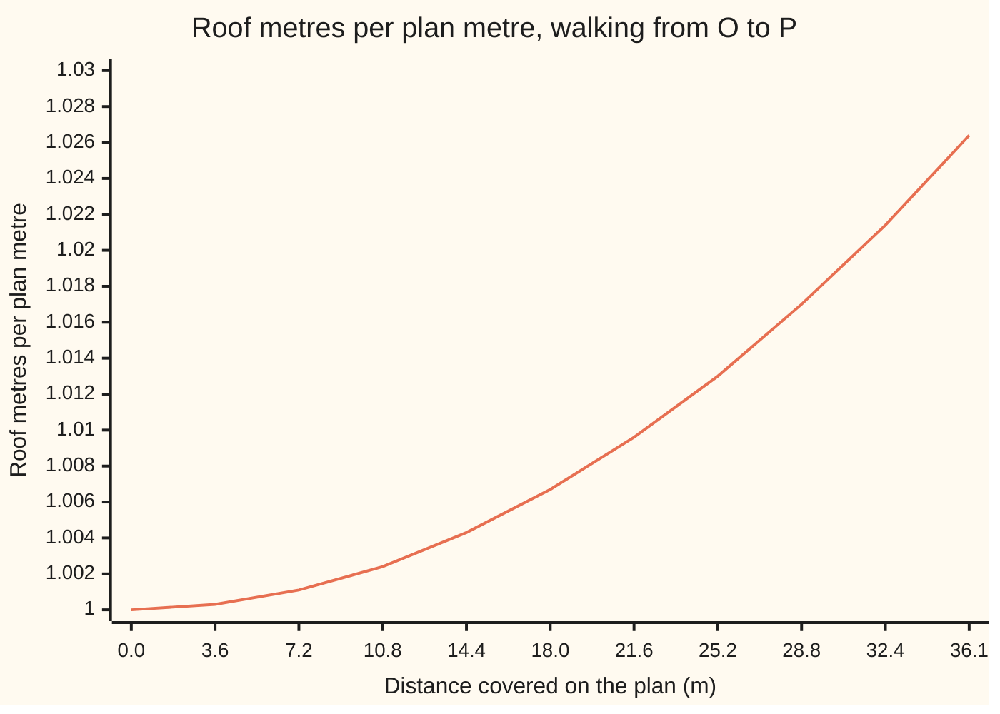

# First fundamental form: measuring lengths and angles inside a surface

[Syllabus](../../../SYLLABUS.md) → [Differential geometry and Lie groups](../README.md) → [Surfaces](../README.md#s02) → First fundamental form

---

## General Overview

A stadium roof is domed over one end and saddle-shaped over the middle. This card works on the saddle. Its centre O sits 30 m above the pitch. A maintenance crew walks from O to a lamp fixing P.

On the architect's plan, P is 30 m east and 20 m north of O. A ruler on the plan gives 36.06 m. But the roof climbs to 34.17 m at P, and its slope changes at every step. The crew really walks **36.37 m**.

The plan also lies about angles. At P, the plan's east line and north line cross at 90°. On the roof itself, the same two lines cross at **98.13°**.

The fix is a small table of three numbers at every point of the roof, called E, F and G. They turn a step in plan coordinates into metres on the roof. With them, lengths and angles come from coordinates alone. Nobody has to step off the roof to measure, and nobody needs the roof's shape in space once the three numbers are known.

**The first fundamental form is a surface's own ruler and protractor: three numbers E, F and G at each point turn a step in coordinates into metres and degrees.**

**What kind of fact this is:** a definition, plus two theorems proved on this card in Why it works: the length and angle formulas, and the fact that every chart (coordinate system) gives the same lengths and angles. It is local: it measures near one point, and a whole path adds those measurements up.

### The picture: how much longer the roof is than the plan

Each point on the walk has its own stretch: metres walked on the roof per metre crossed on the plan.



The single line is the stretch along the walk. At O the roof is level, so one plan metre is one roof metre. By P the roof is steeper, and one plan metre costs 1.0264 roof metres. The 36.37 m is the plan's 36.06 m with every stretch added in.

---

## The formula

The roof is written as a patch ([Regular surface](01-regular-surfaces-and-tangent-planes.md)): a rule $`\mathbf{r}(u, v)`$ that turns two coordinates into a point in space. Here $`u`$ is metres east and $`v`$ metres north on the plan, and

```math
\mathbf{r}(u, v) = \left(u,\ v,\ 30 + \frac{u^2 - v^2}{120}\right).
```

The tangent arrows $`\mathbf{r}_u`$ and $`\mathbf{r}_v`$ are how fast the point moves in space when $`u`$ or $`v`$ grows by one. The dot product ([The dot product](../../03-Algebra/06-Dot%20Products%20and%20Best%20Fits/01-dot-product.md)) gives lengths and angles of arrows. The first fundamental form packs the three dot products that matter:

```math
E = \mathbf{r}_u \cdot \mathbf{r}_u, \qquad F = \mathbf{r}_u \cdot \mathbf{r}_v, \qquad G = \mathbf{r}_v \cdot \mathbf{r}_v, \qquad ds^2 = E\,du^2 + 2F\,du\,dv + G\,dv^2.
```

**Read it aloud:** "the squared length of a small step on the surface is E times the east step squared, plus twice F times the east step times the north step, plus G times the north step squared."

In wing 05, E and F count a solid's edges and faces; on this shelf E, F and G mean only these three numbers. The expression $`ds^2`$ is the usual shorthand for the whole form, often called the metric.

A path on the roof is a pair of coordinate functions $`u(t)`$, $`v(t)`$ for $`t`$ from 0 to 1. A dot over a letter means its rate of change with $`t`$. Two uses follow:

```math
L = \int_0^1 \sqrt{E\,\dot u^2 + 2F\,\dot u\,\dot v + G\,\dot v^2}\;dt, \qquad \cos\theta = \frac{E\,a_1 b_1 + F\,(a_1 b_2 + a_2 b_1) + G\,a_2 b_2}{\lvert a\rvert\,\lvert b\rvert}.
```

**Read it aloud:** "length is the speed from E, F and G, added up along the path; the angle between two directions is their surface dot product over their two surface lengths." Here $`\lvert a\rvert = \sqrt{E a_1^2 + 2F a_1 a_2 + G a_2^2}`$, and the same for $`b`$.

| Symbol | Plain meaning | In our example | Push it up and the answer… |
| --- | --- | --- | --- |
| $`u`$, $`v`$ (seam chart: $`p`$, $`q`$) | the chart's coordinates: plan metres east and north of O; $`p`$, $`q`$ count along the seams | P is (30, 20); in the seam chart (25, 5) | — |
| $`\mathbf{r}(u, v)`$ | the patch: the point in space with those coordinates | P sits at height 34.17 m | — |
| $`\mathbf{r}_u`$, $`\mathbf{r}_v`$ | tangent arrows: the point's velocity in space as $`u`$ or $`v`$ grows | $`(1, 0, u/60)`$ and $`(0, 1, -v/60)`$ | — |
| $`E`$ | squared roof length of one plan metre east | 1.25 at P, so 1.118 m | longer walks east |
| $`F`$ | how far the east and north arrows are from square; 0 means a right angle | −0.1667 at P | $`\lvert F\rvert`$ up: the angle moves further from 90° |
| $`G`$ | squared roof length of one plan metre north | 1.1111 at P, so 1.054 m | longer walks north |
| $`ds`$ | the length of a very small step on the surface | — | — |
| $`t`$, $`\dot u`$, $`\dot v`$ | the walk's clock from 0 to 1, and the coordinate rates | $`\dot u = 30`$, $`\dot v = 20`$ | — |
| $`L`$ | length of the path on the surface, in metres | 36.37 m | — |
| $`a`$, $`b`$ | two directions at one point, in coordinate steps $`(a_1, a_2)`$ | east (1, 0), north (0, 1) | — |
| $`\theta`$ | the angle between them on the surface | 98.13°, or 1.712693 radians | — |
| $`EG - F^2`$ | the test that the chart is regular: it must stay above zero | 1.361111 at P | — |

For our roof the dot products are short to work out:

```math
E = 1 + \frac{u^2}{3600}, \qquad F = -\frac{uv}{3600}, \qquad G = 1 + \frac{v^2}{3600}.
```

At P = (30, 20) that gives E = 1.25, F = −0.166667, G = 1.111111.

### When it holds

- **The chart is regular: $`EG - F^2 > 0`$ at every point used.** At the centre of a polar chart (distance and angle from O) the form is E = 1, F = 0, G = 0. There, $`EG - F^2 = 0`$: every angle names the same point, so the arrow for a change of angle has length 0, and the angle between it and the distance direction has no value.
- **The surface is smooth along the path.** On a crease, such as the ridge between two flat panels, the tangent arrows jump, and E, F, G have two values. Split the path at the crease and add the two lengths.
- **The coordinates and E, F, G come from the same chart.** Feed the plan chart's E, F, G formulas the seam chart's coordinates and rates, and the walk comes out at 26.13 m, not 36.37 m.
- **The form gives lengths along the surface, never through the air.** Along the walk the roof curves upward, so a straight cable from O to P runs through the air above it. The form does not know the cable exists.

---

## Why it works

### Step 0: up close, the surface is flat

Zoom in on any point of a smooth surface and it looks like its tangent plane ([Regular surface](01-regular-surfaces-and-tangent-planes.md)). A small coordinate step $`(du, dv)`$ moves the point by about $`\mathbf{r}_u\,du + \mathbf{r}_v\,dv`$: so much of one tangent arrow, so much of the other. The length of a flat arrow is a dot product. Everything below is that one dot product, expanded.

### Step 1: one small step, measured

The dot product spreads over sums the way multiplication does. So

```math
(\mathbf{r}_u\,du + \mathbf{r}_v\,dv)\cdot(\mathbf{r}_u\,du + \mathbf{r}_v\,dv) = E\,du^2 + 2F\,du\,dv + G\,dv^2.
```

The 2 in front of F comes from the two cross terms, $`\mathbf{r}_u \cdot \mathbf{r}_v`$ and $`\mathbf{r}_v \cdot \mathbf{r}_u`$, which are equal.

E, F and G are ordinary numbers at each point. Once they are tabulated, the shape in space is no longer needed to measure a step.

### Step 2: a path is many small steps

A path $`u(t)`$, $`v(t)`$ has velocity in space $`\mathbf{r}_u\,\dot u + \mathbf{r}_v\,\dot v`$ (the chain rule). Its speed is the square root of Step 1 with $`du`$ and $`dv`$ replaced by $`\dot u`$ and $`\dot v`$. Adding speed times time over $`t`$ from 0 to 1 is the integral for $`L`$. This is arc length ([Regular curve and arc length](../01-Curves/01-regular-curves-and-arc-length.md)), with the speed read off E, F and G.

### Step 3: an angle is a dot product too

Two curves cross at a point with coordinate directions $`a`$ and $`b`$. Their arrows in space are $`a_1\mathbf{r}_u + a_2\mathbf{r}_v`$ and $`b_1\mathbf{r}_u + b_2\mathbf{r}_v`$. Expanding their dot product the same way gives the top of the angle formula. Dividing by both lengths gives the cosine, as on [The dot product](../../03-Algebra/06-Dot%20Products%20and%20Best%20Fits/01-dot-product.md).

For the plan's east and north lines, $`a = (1, 0)`$ and $`b = (0, 1)`$, and the formula collapses to

```math
\cos\theta = \frac{F}{\sqrt{EG}}.
```

So F alone decides whether the coordinate grid is square on the surface. F = 0 means a right angle.

### Step 4: the chart changes the numbers, not the answers

The roof can be described in more than one chart. Its middle carries straight steel seams along the diagonals $`u = v + \text{const}`$ and $`u = -v + \text{const}`$. A second chart counts along them: $`u = p + q`$ and $`v = p - q`$, so

```math
\mathbf{r}(p, q) = \left(p + q,\ p - q,\ 30 + \frac{pq}{30}\right).
```

In this seam chart P is (25, 5), and its form is E = 2.0278, F = 0.1389, G = 2.6944. Every entry differs from the plan chart's. Yet the walk is still 36.37 m and the angle still 98.13°.

The reason: a path's velocity in space is one arrow, whichever chart names it. Both charts compute the length of that same arrow. Only the bookkeeping differs.

<details>
<summary>Detailed proof: how E, F and G change between charts</summary>

Let the new chart be $`(p, q)`$ with $`u = u(p, q)`$ and $`v = v(p, q)`$. The chain rule gives the new tangent arrows:

$`\displaystyle \mathbf{r}_p = u_p\,\mathbf{r}_u + v_p\,\mathbf{r}_v, \qquad \mathbf{r}_q = u_q\,\mathbf{r}_u + v_q\,\mathbf{r}_v.`$

Dot them in pairs. With $`J`$ the Jacobian matrix of the change, columns $`(u_p, v_p)`$ and $`(u_q, v_q)`$:

$`\displaystyle \begin{pmatrix} E' & F' \\ F' & G' \end{pmatrix} = J^{\mathsf T} \begin{pmatrix} E & F \\ F & G \end{pmatrix} J.`$

A path has rates $`(\dot p, \dot q)`$ in the new chart and $`(\dot u, \dot v) = J(\dot p, \dot q)`$ in the old. The squared speed in the new chart is

$`\displaystyle (\dot p, \dot q)\, J^{\mathsf T} \begin{pmatrix} E & F \\ F & G \end{pmatrix} J\, (\dot p, \dot q)^{\mathsf T} = (\dot u, \dot v) \begin{pmatrix} E & F \\ F & G \end{pmatrix} (\dot u, \dot v)^{\mathsf T},`$

which is the squared speed in the old chart. So lengths agree, and the same argument with two different directions shows angles agree.

For the seam chart, $`u_p = 1`$, $`u_q = 1`$, $`v_p = 1`$, $`v_q = -1`$. Then $`E' = E + 2F + G`$, $`F' = E - G`$, $`G' = E - 2F + G`$. At P: $`E' = 1.25 + 2(-0.1667) + 1.1111 = 2.0278`$, $`F' = 1.25 - 1.1111 = 0.1389`$, $`G' = 1.25 - 2(-0.1667) + 1.1111 = 2.6944`$. These match the values the code gets from the seam chart's own formula.

</details>

---

## Worked numbers, by hand

The walk from O = (0, 0) to P = (30, 20) on the plan is $`u = 30t`$, $`v = 20t`$, so $`\dot u = 30`$ and $`\dot v = 20`$.

| Step | Arithmetic | Value |
| --- | --- | --- |
| E, F, G along the walk | $`1 + (30t)^2/3600`$, $`-(30t)(20t)/3600`$, $`1 + (20t)^2/3600`$ | $`1 + t^2/4`$, $`-t^2/6`$, $`1 + t^2/9`$ |
| squared speed, flat part | $`900 + 400`$ | 1300 |
| squared speed, $`t^2`$ part | $`900/4 - 1200/6 + 400/9`$ | $`225 - 200 + 44.444 = 69.444`$ |
| speed at $`t = 0, 0.5, 1`$ | $`\sqrt{1300}`$, $`\sqrt{1300 + 69.444/4}`$, $`\sqrt{1369.444}`$ | 36.0555, 36.2955, 37.0060 |
| Simpson's rule, two slices | $`(36.0555 + 4 \times 36.2955 + 37.0060)/6`$ | 36.3739 |
| exact integral (closed form, in the code) | — | **36.3740 m** |
| E, F, G at P | $`1 + 900/3600`$, $`-600/3600`$, $`1 + 400/3600`$ | 1.25, −0.166667, 1.111111 |
| $`\sqrt{EG}`$ at P | $`\sqrt{1.25 \times 1.111111}`$ | 1.178511 |
| $`\cos\theta`$ at P | $`-0.166667 / 1.178511`$ | −0.141421 |
| angle at P | $`\arccos(-0.141421)`$ | **98.13°** |

The crew walks 36.37 m, 0.32 m more than the plan says, and the plan's square grid meets at 98.13° on the roof. A panel cut square from the plan would not fit at P.

### What breaks if you drop a piece

Same walk, correct answer 36.37 m and 98.13°.

| Mistake | Comes out at | What went wrong |
| --- | --- | --- |
| Measure on the plan (E = G = 1, F = 0) | 36.06 m, 90° | the roof's slope is ignored |
| Drop F | 37.26 m | the grid is treated as square; at P it meets at 98.13° |
| Use F once instead of 2F | 36.82 m | one of the two equal cross terms is lost |
| Plan chart's E, F, G formulas with the seam chart's coordinates $`(25t, 5t)`$ and rates (25, 5) | 26.13 m | the three numbers belong to one chart only |
| Polar chart at the centre: E = 1, F = 0, G = 0 | $`EG - F^2 = 0`$ | the chart is not regular there; no angle between its grid directions can be read |

Every number in that table is printed by the code below.

---

## Code, from first principles, and it actually runs

The code never uses a formula for E, F or G. It builds the tangent arrows from the patch by central differences (two nearby points, subtracted) and takes their dot products. The hand formula is printed beside them as a check. The walk's length is reached **four independent ways**: Simpson's rule on the form in the plan chart, the same in the seam chart, the closed-form integral, and a tape laid along 10 and then 100 straight pieces in space. The angle is reached three ways: the form in each chart, and a tape triangle with 1 m and 0.1 m legs, read by the law of cosines. The stepped values are approximate, so each is shown at two step sizes.

### Python

```python
# First fundamental form -- the check behind the card.  Standard library only.
# Roof: the saddle middle of a stadium roof, z = 30 + (u^2 - v^2)/120 metres.
# Walk: straight on the plan from the centre (0, 0) to the corner P = (30, 20).
# Every number on the card is printed here.  No geometry package is used.
from math import sqrt, asinh, acos, degrees, cos, sin, pi

def plan(u, v):            # chart 1: u metres east, v metres north on the plan
    return (u, v, 30.0 + (u * u - v * v) / 120.0)

def rule(p, q):            # chart 2: diagonal seams, u = p + q, v = p - q
    return (p + q, p - q, 30.0 + p * q / 30.0)

def polar(rho, th):        # chart 3: distance and angle from the centre
    return plan(rho * cos(th), rho * sin(th))

def dot(a, b): return sum(x * y for x, y in zip(a, b))
def sub(a, b): return tuple(x - y for x, y in zip(a, b))

def efg(chart, a, b, h=1e-5):
    # E, F, G from the patch alone: tangent arrows by central differences, then dots
    ru = tuple((x - y) / (2 * h) for x, y in zip(chart(a + h, b), chart(a - h, b)))
    rv = tuple((x - y) / (2 * h) for x, y in zip(chart(a, b + h), chart(a, b - h)))
    return dot(ru, ru), dot(ru, rv), dot(rv, rv)

def form(E, F, G, x, y): return E * x[0] * y[0] + F * (x[0] * y[1] + x[1] * y[0]) + G * x[1] * y[1]

def length(chart, path, vel, n=200, fterm=2.0, efg_chart=None):
    # Simpson's rule on ds/dt = sqrt(E u'^2 + 2F u'v' + G v'^2), t from 0 to 1
    def speed(t):
        E, F, G = efg(efg_chart or chart, *path(t))
        a, b = vel
        return sqrt(E * a * a + fterm * F * a * b + G * b * b)
    h = 1.0 / n
    s = speed(0) + speed(1) + sum((4 if k % 2 else 2) * speed(k * h) for k in range(1, n))
    return s * h / 3

def chords(n):             # road 3: a tape laid along n straight pieces in space
    pts = [plan(30.0 * k / n, 20.0 * k / n) for k in range(n + 1)]
    return sum(sqrt(dot(sub(b, a), sub(b, a))) for a, b in zip(pts, pts[1:]))

def angle(E, F, G, x, y):
    return degrees(acos(form(E, F, G, x, y) / sqrt(form(E, F, G, x, x) * form(E, F, G, y, y))))

def tape_angle(h):         # road 3 for the angle: three tape lengths and the law of cosines
    P, A, B = plan(30, 20), plan(30 + h, 20), plan(30, 20 + h)
    a, b, c = (sqrt(dot(sub(X, Y), sub(X, Y))) for X, Y in ((A, P), (B, P), (A, B)))
    return degrees(acos((a * a + b * b - c * c) / (2 * a * b)))

walk1 = lambda t: (30.0 * t, 20.0 * t)       # chart 1: velocity (30, 20)
walk2 = lambda t: (25.0 * t, 5.0 * t)        # chart 2: p = (u+v)/2, q = (u-v)/2
E1, F1, G1 = efg(plan, 30, 20)
E2, F2, G2 = efg(rule, 25, 5)
a, b = 10.0 * sqrt(13.0), 25.0 / 3.0         # ds/dt = sqrt(a^2 + b^2 t^2) on this walk
closed = 0.5 * (sqrt(a * a + b * b) + a * a / b * asinh(b / a))
L1 = length(plan, walk1, (30, 20))
L2 = length(rule, walk2, (25, 5))
flat = sqrt(30.0 ** 2 + 20.0 ** 2)
noF = length(plan, walk1, (30, 20), fterm=0.0)
oneF = length(plan, walk1, (30, 20), fterm=1.0)
mixed = length(plan, walk2, (25, 5), efg_chart=plan)
th1 = angle(E1, F1, G1, (1, 0), (0, 1))
th2 = angle(E2, F2, G2, (0.5, 0.5), (0.5, -0.5))
Ep, Fp, Gp = efg(polar, 0.0, 0.7)

rows = [
    ("E, F, G at P, plan chart", f"{E1:.6f} {F1:.6f} {G1:.6f}"),
    ("hand formula 1+u^2/3600, -uv/3600, 1+v^2/3600", f"{1 + 900 / 3600:.6f} {-600 / 3600:.6f} {1 + 400 / 3600:.6f}"),
    ("E, F, G at P, seam chart", f"{E2:.6f} {F2:.6f} {G2:.6f}"),
    ("  by J^T I J: E+2F+G, E-G, E-2F+G", f"{E1 + 2 * F1 + G1:.6f} {E1 - G1:.6f} {E1 - 2 * F1 + G1:.6f}"),
    ("EG - F^2 at P", f"{E1 * G1 - F1 * F1:.6f}"),
    ("roof height at P, m", f"{plan(30, 20)[2]:.6f}"),
    ("sqrt(E), sqrt(G), sqrt(EG) at P", f"{sqrt(E1):.6f} {sqrt(G1):.6f} {sqrt(E1 * G1):.6f}"),
    ("t^2 terms: 900/4, -1200/6, 400/9", f"{900 / 4:.6f} {-1200 / 6:.6f} {400 / 9:.6f}"),
    ("speed at t = 0, 0.5, 1, m per unit t", " ".join(f"{sqrt(a * a + b * b * t * t):.6f}" for t in (0, 0.5, 1))),
    ("Simpson by hand, 2 slices, m", f"{(a + 4 * sqrt(a * a + b * b / 4) + sqrt(a * a + b * b)) / 6:.6f}"),
    ("plan distance O to P, m", f"{flat:.6f}"),
    ("1 length, plan chart, Simpson", f"{L1:.6f}"),
    ("2 length, seam chart, Simpson", f"{L2:.6f}"),
    ("3 length, closed form", f"{closed:.6f}"),
    ("4 tape in 10 straight pieces", f"{chords(10):.6f}"),
    ("  tape in 100 straight pieces", f"{chords(100):.6f}"),
    ("roof minus plan, m", f"{closed - flat:.6f}"),
    ("speed^2 at t = 1, (m per unit t)^2", f"{form(E1, F1, G1, (30, 20), (30, 20)):.6f}"),
    ("1 angle at P, plan chart, deg", f"{th1:.6f}"),
    ("2 angle at P, seam chart, deg", f"{th2:.6f}"),
    ("  same angle in radians", f"{th1 * pi / 180:.6f}"),
    ("  cos of the angle, F/sqrt(EG)", f"{F1 / sqrt(E1 * G1):.6f}"),
    ("3 tape triangle, 1 m legs, deg", f"{tape_angle(1.0):.6f}"),
    ("  tape triangle, 0.1 m legs, deg", f"{tape_angle(0.1):.6f}"),
    ("wrong: plan angle, deg", f"{90.0:.6f}"),
    ("wrong: drop F, length", f"{noF:.6f}"),
    ("wrong: F once, not 2F, length", f"{oneF:.6f}"),
    ("wrong: plan E,F,G with seam speeds", f"{mixed:.6f}"),
    ("breaks: polar chart at centre, E F G", f"{Ep:.6f} {Fp:.6f} {Gp:.6f}"),
    ("  EG - F^2 there", f"{Ep * Gp - Fp * Fp:.6f}"),
    ("try: walk along seam to (30, 30), m", f"{length(plan, lambda t: (30 * t, 30 * t), (30, 30)):.6f}"),
    ("  plan distance to (30, 30), m", f"{sqrt(1800.0):.6f}"),
    ("try: walk to (30, -20), m", f"{length(plan, lambda t: (30 * t, -20 * t), (30, -20)):.6f}"),
    ("try: angle at centre, deg", f"{angle(*efg(plan, 0, 0), (1, 0), (0, 1)):.6f}"),
    ("try: seams crossing at P, deg", f"{angle(E1, F1, G1, (1, 1), (1, -1)):.6f}"),
]
for name, v in rows:
    print(f"{name:<46} {v}")
stretch = [sqrt(a * a + b * b * (k / 10) ** 2) / a for k in range(11)]
print("figure, plan metres", " ".join(f"{flat * k / 10:.1f}" for k in range(11)))
print("figure, roof m per plan m", " ".join(f"{s:.4f}" for s in stretch))

assert abs(L1 - closed) < 1e-7, "first-form integral must match the closed form"
assert abs(L2 - closed) < 1e-7, "the seam chart must give the same length"
c10, c100 = chords(10), chords(100)
assert 0 < closed - c10 < 0.001 and (closed - c10) / (closed - c100) > 50, "tape error falls 100-fold"
assert abs(E1 - 2 * F1 + G1 - G2) + abs(E1 - G1 - F2) < 1e-6, "chart change rule J^T I J"
assert abs(th1 - th2) < 1e-6, "the angle must not depend on the chart"
assert abs(tape_angle(0.1) - th1) < abs(tape_angle(1.0) - th1) < 0.5, "tape angle closes in"
assert abs(F1 / sqrt(E1 * G1) + 1 / sqrt(50)) < 1e-9, "cos = -1/sqrt(50) by hand"
assert abs(Ep * Gp - Fp * Fp) < 1e-9, "polar chart is not regular at the centre"
print("ALL CHECKS PASS")
```

**Ran 2026-11-19 on macOS, Python 3.14.10, standard library only. All checks passed. Output, pasted from the run:**

```
E, F, G at P, plan chart                       1.250000 -0.166667 1.111111
hand formula 1+u^2/3600, -uv/3600, 1+v^2/3600  1.250000 -0.166667 1.111111
E, F, G at P, seam chart                       2.027778 0.138889 2.694444
  by J^T I J: E+2F+G, E-G, E-2F+G              2.027778 0.138889 2.694444
EG - F^2 at P                                  1.361111
roof height at P, m                            34.166667
sqrt(E), sqrt(G), sqrt(EG) at P                1.118034 1.054093 1.178511
t^2 terms: 900/4, -1200/6, 400/9               225.000000 -200.000000 44.444444
speed at t = 0, 0.5, 1, m per unit t           36.055513 36.295470 37.006006
Simpson by hand, 2 slices, m                   36.373899
plan distance O to P, m                        36.055513
1 length, plan chart, Simpson                  36.373995
2 length, seam chart, Simpson                  36.373995
3 length, closed form                          36.373995
4 tape in 10 straight pieces                   36.373214
  tape in 100 straight pieces                  36.373988
roof minus plan, m                             0.318483
speed^2 at t = 1, (m per unit t)^2             1369.444444
1 angle at P, plan chart, deg                  98.130102
2 angle at P, seam chart, deg                  98.130102
  same angle in radians                        1.712693
  cos of the angle, F/sqrt(EG)                 -0.141421
3 tape triangle, 1 m legs, deg                 98.424707
  tape triangle, 0.1 m legs, deg               98.159446
wrong: plan angle, deg                         90.000000
wrong: drop F, length                          37.264906
wrong: F once, not 2F, length                  36.824127
wrong: plan E,F,G with seam speeds             26.134504
breaks: polar chart at centre, E F G           1.000000 0.000000 0.000000
  EG - F^2 there                               0.000000
try: walk along seam to (30, 30), m            42.426407
  plan distance to (30, 30), m                 42.426407
try: walk to (30, -20), m                      36.373995
try: angle at centre, deg                      90.000000
try: seams crossing at P, deg                  86.593556
figure, plan metres 0.0 3.6 7.2 10.8 14.4 18.0 21.6 25.2 28.8 32.4 36.1
figure, roof m per plan m 1.0000 1.0003 1.0011 1.0024 1.0043 1.0067 1.0096 1.0130 1.0170 1.0214 1.0264
ALL CHECKS PASS
```

### Rust

```rust
// First fundamental form -- the check behind the card.  std only, no crates.
// Roof: the saddle middle of a stadium roof, z = 30 + (u^2 - v^2)/120 metres.
// Walk: straight on the plan from the centre (0, 0) to the corner P = (30, 20).
type V3 = [f64; 3];
type Chart = fn(f64, f64) -> V3;

fn plan(u: f64, v: f64) -> V3 { [u, v, 30.0 + (u * u - v * v) / 120.0] }
fn rule(p: f64, q: f64) -> V3 { [p + q, p - q, 30.0 + p * q / 30.0] }
fn polar(rho: f64, th: f64) -> V3 { plan(rho * th.cos(), rho * th.sin()) }

fn dot(a: V3, b: V3) -> f64 { a[0] * b[0] + a[1] * b[1] + a[2] * b[2] }
fn sub(a: V3, b: V3) -> V3 { [a[0] - b[0], a[1] - b[1], a[2] - b[2]] }

fn efg(chart: Chart, a: f64, b: f64) -> (f64, f64, f64) {
    // E, F, G from the patch alone: tangent arrows by central differences, then dots
    let h = 1e-5;
    let (pu, mu, pv, mv) = (chart(a + h, b), chart(a - h, b), chart(a, b + h), chart(a, b - h));
    let ru = [(pu[0] - mu[0]) / (2.0 * h), (pu[1] - mu[1]) / (2.0 * h), (pu[2] - mu[2]) / (2.0 * h)];
    let rv = [(pv[0] - mv[0]) / (2.0 * h), (pv[1] - mv[1]) / (2.0 * h), (pv[2] - mv[2]) / (2.0 * h)];
    (dot(ru, ru), dot(ru, rv), dot(rv, rv))
}

fn form(e: (f64, f64, f64), x: (f64, f64), y: (f64, f64)) -> f64 {
    e.0 * x.0 * y.0 + e.1 * (x.0 * y.1 + x.1 * y.0) + e.2 * x.1 * y.1
}

fn length(chart: Chart, end: (f64, f64), vel: (f64, f64), fterm: f64) -> f64 {
    // Simpson's rule on ds/dt = sqrt(E u'^2 + 2F u'v' + G v'^2), t from 0 to 1
    let n = 200;
    let speed = |t: f64| {
        let (e, f, g) = efg(chart, end.0 * t, end.1 * t);
        (e * vel.0 * vel.0 + fterm * f * vel.0 * vel.1 + g * vel.1 * vel.1).sqrt()
    };
    let h = 1.0 / n as f64;
    let mut s = speed(0.0) + speed(1.0);
    for k in 1..n { s += (if k % 2 == 1 { 4.0 } else { 2.0 }) * speed(k as f64 * h); }
    s * h / 3.0
}

fn chords(n: usize) -> f64 {
    // road 3: a tape laid along n straight pieces in space
    let pts: Vec<V3> = (0..=n).map(|k| plan(30.0 * k as f64 / n as f64, 20.0 * k as f64 / n as f64)).collect();
    pts.windows(2).map(|w| { let d = sub(w[1], w[0]); dot(d, d).sqrt() }).sum()
}

fn angle(e: (f64, f64, f64), x: (f64, f64), y: (f64, f64)) -> f64 {
    (form(e, x, y) / (form(e, x, x) * form(e, y, y)).sqrt()).acos().to_degrees()
}

fn tape_angle(h: f64) -> f64 {
    // road 3 for the angle: three tape lengths and the law of cosines
    let (p, a3, b3) = (plan(30.0, 20.0), plan(30.0 + h, 20.0), plan(30.0, 20.0 + h));
    let len = |x: V3, y: V3| { let d = sub(x, y); dot(d, d).sqrt() };
    let (a, b, c) = (len(a3, p), len(b3, p), len(a3, b3));
    ((a * a + b * b - c * c) / (2.0 * a * b)).acos().to_degrees()
}

fn main() {
    let e1 = efg(plan, 30.0, 20.0);
    let e2 = efg(rule, 25.0, 5.0);
    let (a, b) = (10.0 * 13f64.sqrt(), 25.0 / 3.0); // ds/dt = sqrt(a^2 + b^2 t^2) on this walk
    let closed = 0.5 * ((a * a + b * b).sqrt() + a * a / b * (b / a).asinh());
    let l1 = length(plan, (30.0, 20.0), (30.0, 20.0), 2.0);
    let l2 = length(rule, (25.0, 5.0), (25.0, 5.0), 2.0);
    let flat = (30.0f64 * 30.0 + 20.0 * 20.0).sqrt();
    let no_f = length(plan, (30.0, 20.0), (30.0, 20.0), 0.0);
    let one_f = length(plan, (30.0, 20.0), (30.0, 20.0), 1.0);
    let mixed = length(plan, (25.0, 5.0), (25.0, 5.0), 2.0);
    let th1 = angle(e1, (1.0, 0.0), (0.0, 1.0));
    let th2 = angle(e2, (0.5, 0.5), (0.5, -0.5));
    let ep = efg(polar, 0.0, 0.7);
    let three = |e: (f64, f64, f64)| format!("{:.6} {:.6} {:.6}", e.0, e.1, e.2);
    let rows: Vec<(&str, String)> = vec![
        ("E, F, G at P, plan chart", three(e1)),
        ("hand formula 1+u^2/3600, -uv/3600, 1+v^2/3600", three((1.0 + 900.0 / 3600.0, -600.0 / 3600.0, 1.0 + 400.0 / 3600.0))),
        ("E, F, G at P, seam chart", three(e2)),
        ("  by J^T I J: E+2F+G, E-G, E-2F+G", three((e1.0 + 2.0 * e1.1 + e1.2, e1.0 - e1.2, e1.0 - 2.0 * e1.1 + e1.2))),
        ("EG - F^2 at P", format!("{:.6}", e1.0 * e1.2 - e1.1 * e1.1)),
        ("roof height at P, m", format!("{:.6}", plan(30.0, 20.0)[2])),
        ("sqrt(E), sqrt(G), sqrt(EG) at P", three((e1.0.sqrt(), e1.2.sqrt(), (e1.0 * e1.2).sqrt()))),
        ("t^2 terms: 900/4, -1200/6, 400/9", three((900.0 / 4.0, -1200.0 / 6.0, 400.0 / 9.0))),
        ("speed at t = 0, 0.5, 1, m per unit t", three((a, (a * a + b * b / 4.0).sqrt(), (a * a + b * b).sqrt()))),
        ("Simpson by hand, 2 slices, m", format!("{:.6}", (a + 4.0 * (a * a + b * b / 4.0).sqrt() + (a * a + b * b).sqrt()) / 6.0)),
        ("plan distance O to P, m", format!("{:.6}", flat)),
        ("1 length, plan chart, Simpson", format!("{:.6}", l1)),
        ("2 length, seam chart, Simpson", format!("{:.6}", l2)),
        ("3 length, closed form", format!("{:.6}", closed)),
        ("4 tape in 10 straight pieces", format!("{:.6}", chords(10))),
        ("  tape in 100 straight pieces", format!("{:.6}", chords(100))),
        ("roof minus plan, m", format!("{:.6}", closed - flat)),
        ("speed^2 at t = 1, (m per unit t)^2", format!("{:.6}", form(e1, (30.0, 20.0), (30.0, 20.0)))),
        ("1 angle at P, plan chart, deg", format!("{:.6}", th1)),
        ("2 angle at P, seam chart, deg", format!("{:.6}", th2)),
        ("  same angle in radians", format!("{:.6}", th1.to_radians())),
        ("  cos of the angle, F/sqrt(EG)", format!("{:.6}", e1.1 / (e1.0 * e1.2).sqrt())),
        ("3 tape triangle, 1 m legs, deg", format!("{:.6}", tape_angle(1.0))),
        ("  tape triangle, 0.1 m legs, deg", format!("{:.6}", tape_angle(0.1))),
        ("wrong: plan angle, deg", format!("{:.6}", 90.0)),
        ("wrong: drop F, length", format!("{:.6}", no_f)),
        ("wrong: F once, not 2F, length", format!("{:.6}", one_f)),
        ("wrong: plan E,F,G with seam speeds", format!("{:.6}", mixed)),
        ("breaks: polar chart at centre, E F G", three(ep)),
        ("  EG - F^2 there", format!("{:.6}", ep.0 * ep.2 - ep.1 * ep.1)),
        ("try: walk along seam to (30, 30), m", format!("{:.6}", length(plan, (30.0, 30.0), (30.0, 30.0), 2.0))),
        ("  plan distance to (30, 30), m", format!("{:.6}", 1800f64.sqrt())),
        ("try: walk to (30, -20), m", format!("{:.6}", length(plan, (30.0, -20.0), (30.0, -20.0), 2.0))),
        ("try: angle at centre, deg", format!("{:.6}", angle(efg(plan, 0.0, 0.0), (1.0, 0.0), (0.0, 1.0)))),
        ("try: seams crossing at P, deg", format!("{:.6}", angle(e1, (1.0, 1.0), (1.0, -1.0)))),
    ];
    for (name, v) in &rows { println!("{:<46} {}", name, v); }
    let xs: Vec<String> = (0..=10).map(|k| format!("{:.1}", flat * k as f64 / 10.0)).collect();
    let ys: Vec<String> = (0..=10)
        .map(|k| { let t = k as f64 / 10.0; format!("{:.4}", (a * a + b * b * t * t).sqrt() / a) }).collect();
    println!("figure, plan metres {}", xs.join(" "));
    println!("figure, roof m per plan m {}", ys.join(" "));

    assert!((l1 - closed).abs() < 1e-7, "first-form integral must match the closed form");
    assert!((l2 - closed).abs() < 1e-7, "the seam chart must give the same length");
    let (c10, c100) = (chords(10), chords(100));
    assert!(0.0 < closed - c10 && closed - c10 < 0.001 && (closed - c10) / (closed - c100) > 50.0, "tape error falls 100-fold");
    assert!((e1.0 - 2.0 * e1.1 + e1.2 - e2.2).abs() + (e1.0 - e1.2 - e2.1).abs() < 1e-6, "chart change rule J^T I J");
    assert!((th1 - th2).abs() < 1e-6, "the angle must not depend on the chart");
    let (g1, g2) = ((tape_angle(0.1) - th1).abs(), (tape_angle(1.0) - th1).abs());
    assert!(g1 < g2 && g2 < 0.5, "tape angle closes in");
    assert!((e1.1 / (e1.0 * e1.2).sqrt() + 1.0 / 50f64.sqrt()).abs() < 1e-9, "cos = -1/sqrt(50) by hand");
    assert!((ep.0 * ep.2 - ep.1 * ep.1).abs() < 1e-9, "polar chart is not regular at the centre");
    println!("ALL CHECKS PASS");
}
```

**Ran 2026-11-19 on macOS, rustc 1.98.1, no crates. All checks passed. Output, pasted from the run:**

```
E, F, G at P, plan chart                       1.250000 -0.166667 1.111111
hand formula 1+u^2/3600, -uv/3600, 1+v^2/3600  1.250000 -0.166667 1.111111
E, F, G at P, seam chart                       2.027778 0.138889 2.694444
  by J^T I J: E+2F+G, E-G, E-2F+G              2.027778 0.138889 2.694444
EG - F^2 at P                                  1.361111
roof height at P, m                            34.166667
sqrt(E), sqrt(G), sqrt(EG) at P                1.118034 1.054093 1.178511
t^2 terms: 900/4, -1200/6, 400/9               225.000000 -200.000000 44.444444
speed at t = 0, 0.5, 1, m per unit t           36.055513 36.295470 37.006006
Simpson by hand, 2 slices, m                   36.373899
plan distance O to P, m                        36.055513
1 length, plan chart, Simpson                  36.373995
2 length, seam chart, Simpson                  36.373995
3 length, closed form                          36.373995
4 tape in 10 straight pieces                   36.373214
  tape in 100 straight pieces                  36.373988
roof minus plan, m                             0.318483
speed^2 at t = 1, (m per unit t)^2             1369.444444
1 angle at P, plan chart, deg                  98.130102
2 angle at P, seam chart, deg                  98.130102
  same angle in radians                        1.712693
  cos of the angle, F/sqrt(EG)                 -0.141421
3 tape triangle, 1 m legs, deg                 98.424707
  tape triangle, 0.1 m legs, deg               98.159446
wrong: plan angle, deg                         90.000000
wrong: drop F, length                          37.264906
wrong: F once, not 2F, length                  36.824127
wrong: plan E,F,G with seam speeds             26.134504
breaks: polar chart at centre, E F G           1.000000 0.000000 0.000000
  EG - F^2 there                               0.000000
try: walk along seam to (30, 30), m            42.426407
  plan distance to (30, 30), m                 42.426407
try: walk to (30, -20), m                      36.373995
try: angle at centre, deg                      90.000000
try: seams crossing at P, deg                  86.593556
figure, plan metres 0.0 3.6 7.2 10.8 14.4 18.0 21.6 25.2 28.8 32.4 36.1
figure, roof m per plan m 1.0000 1.0003 1.0011 1.0024 1.0043 1.0067 1.0096 1.0130 1.0170 1.0214 1.0264
ALL CHECKS PASS
```

### Lean

Lean proves the length formula, the angle formula and the chart change for any smooth patch, and checks the roof's numbers at P.

- Suppose the patch is smooth along a path $`u(t)`$, $`v(t)`$, with $`t`$ from 0 to 1. Then its length in space, the speed added up over $`t`$, equals $`L`$.
- Suppose a second chart names the same points through $`u = u(p, q)`$, $`v = v(p, q)`$, and both are smooth along a path. Then the path gets the same $`L`$ from each chart's own E, F and G.
- Take two directions $`a`$ and $`b`$ at a point where the patch is smooth. Then the angle between their arrows in space is the $`\theta`$ of the angle formula.
- Take the plan chart at P = (30, 20). Then E = 5/4, F = −1/6 and G = 10/9, so $`EG - F^2 = 49/36`$ exactly.
- Take the seam chart at P. Then the chart-change rule gives E = 73/36, F = 5/36 and G = 97/36.
- Take the walk $`u = 30t`$, $`v = 20t`$. Then its squared speed is $`1300 + 625t^2/9`$, which is 12325/9 at $`t = 1`$.

The 36.37 m length, the 98.13° angle, and the stepped and tape values are left to the Python and Rust checks.

```lean
-- First fundamental form: the dot products E, F, G of a patch's tangent arrows give the true length of a path on the surface and the true angle between two directions, and the length does not depend on the chart.
import Mathlib.Analysis.InnerProductSpace.PiL2
import Mathlib.Analysis.Calculus.FDeriv.Prod
import Mathlib.Analysis.Calculus.Deriv.Basic
import Mathlib.Analysis.SpecialFunctions.Sqrt
import Mathlib.Analysis.SpecialFunctions.Trigonometric.Inverse
import Mathlib.Geometry.Euclidean.Angle.Unoriented.Basic
import Mathlib.MeasureTheory.Integral.IntervalIntegral.Basic
import Mathlib.Tactic.NormNum

open Set Real

namespace FirstFundamentalForm

/-- Space, where the surface sits: ℝ³ with its usual dot product. -/
abbrev Space := EuclideanSpace ℝ (Fin 3)

/-- The tangent arrow r_u: how fast the point moves in space as u grows. -/
noncomputable def ru (r : ℝ × ℝ → Space) (x : ℝ × ℝ) : Space := fderiv ℝ r x (1, 0)

/-- The tangent arrow r_v: how fast the point moves in space as v grows. -/
noncomputable def rv (r : ℝ × ℝ → Space) (x : ℝ × ℝ) : Space := fderiv ℝ r x (0, 1)

/-- E = r_u · r_u. -/
noncomputable def E (r : ℝ × ℝ → Space) (x : ℝ × ℝ) : ℝ := inner ℝ (ru r x) (ru r x)

/-- F = r_u · r_v. -/
noncomputable def F (r : ℝ × ℝ → Space) (x : ℝ × ℝ) : ℝ := inner ℝ (ru r x) (rv r x)

/-- G = r_v · r_v. -/
noncomputable def G (r : ℝ × ℝ → Space) (x : ℝ × ℝ) : ℝ := inner ℝ (rv r x) (rv r x)

/-- The card's L: the integral over t from 0 to 1 of √(E u̇² + 2F u̇ v̇ + G v̇²),
computed in the chart r from the coordinate path (u(t), v(t)) alone. -/
noncomputable def formLength (r : ℝ × ℝ → Space) (u v : ℝ → ℝ) : ℝ :=
  ∫ t in (0 : ℝ)..1,
    √(E r (u t, v t) * deriv u t ^ 2 + 2 * F r (u t, v t) * deriv u t * deriv v t
      + G r (u t, v t) * deriv v t ^ 2)

/-- Helper: the dot product of two image arrows, written with E, F, G. -/
lemma inner_fderiv_eq (r : ℝ × ℝ → Space) (x a b : ℝ × ℝ) :
    inner ℝ (fderiv ℝ r x a) (fderiv ℝ r x b)
      = E r x * a.1 * b.1 + F r x * (a.1 * b.2 + a.2 * b.1) + G r x * a.2 * b.2 := by
  obtain ⟨a1, a2⟩ := a
  obtain ⟨b1, b2⟩ := b
  have ha : ((a1, a2) : ℝ × ℝ) = a1 • ((1 : ℝ), (0 : ℝ)) + a2 • ((0 : ℝ), (1 : ℝ)) := by
    ext <;> simp
  have hb : ((b1, b2) : ℝ × ℝ) = b1 • ((1 : ℝ), (0 : ℝ)) + b2 • ((0 : ℝ), (1 : ℝ)) := by
    ext <;> simp
  rw [ha, hb]
  simp only [map_add, map_smul, inner_add_left, inner_add_right, real_inner_smul_left,
    real_inner_smul_right, E, F, G, ru, rv]
  rw [real_inner_comm (fderiv ℝ r x (0, 1)) (fderiv ℝ r x (1, 0))]
  simp
  ring

/-- Helper: the squared length of an image arrow, written with E, F, G. -/
lemma norm_fderiv_sq (r : ℝ × ℝ → Space) (x a : ℝ × ℝ) :
    ‖fderiv ℝ r x a‖ ^ 2 = E r x * a.1 ^ 2 + 2 * F r x * a.1 * a.2 + G r x * a.2 ^ 2 := by
  rw [← real_inner_self_eq_norm_sq, inner_fderiv_eq]
  ring

/-- Helper: the length of an image arrow, written with E, F, G. -/
lemma norm_fderiv_eq (r : ℝ × ℝ → Space) (x a : ℝ × ℝ) :
    ‖fderiv ℝ r x a‖ = √(E r x * a.1 ^ 2 + 2 * F r x * a.1 * a.2 + G r x * a.2 ^ 2) := by
  rw [← norm_fderiv_sq, Real.sqrt_sq (norm_nonneg _)]

/-- Helper: chain rule for a path through a patch. -/
lemma deriv_comp_path (r : ℝ × ℝ → Space) (u v : ℝ → ℝ) (t : ℝ)
    (hr : DifferentiableAt ℝ r (u t, v t)) (hu : DifferentiableAt ℝ u t)
    (hv : DifferentiableAt ℝ v t) :
    deriv (fun s => r (u s, v s)) t = fderiv ℝ r (u t, v t) (deriv u t, deriv v t) := by
  have hγ : HasDerivAt (fun s => (u s, v s)) (deriv u t, deriv v t) t :=
    hu.hasDerivAt.prodMk hv.hasDerivAt
  exact (hr.hasFDerivAt.comp_hasDerivAt t hγ).deriv

/-- Length formula. On a patch r(u, v) that is regular (EG − F² > 0) and smooth along the path
(u(t), v(t)), t from 0 to 1, the length of the path in space, the integral of its speed, equals
the integral of √(E u̇² + 2F u̇ v̇ + G v̇²): lengths come from E, F, G and the coordinates alone. -/
theorem length_eq_integral_first_fundamental_form (r : ℝ × ℝ → Space) (u v : ℝ → ℝ)
    (hreg : ∀ t ∈ Icc (0 : ℝ) 1, 0 < E r (u t, v t) * G r (u t, v t) - F r (u t, v t) ^ 2)
    (hr : ∀ t ∈ Icc (0 : ℝ) 1, DifferentiableAt ℝ r (u t, v t))
    (hu : ∀ t ∈ Icc (0 : ℝ) 1, DifferentiableAt ℝ u t)
    (hv : ∀ t ∈ Icc (0 : ℝ) 1, DifferentiableAt ℝ v t) :
    ∫ t in (0 : ℝ)..1, ‖deriv (fun s => r (u s, v s)) t‖ = formLength r u v := by
  unfold formLength
  apply intervalIntegral.integral_congr
  intro t ht
  rw [uIcc_of_le zero_le_one] at ht
  simp only
  rw [deriv_comp_path r u v t (hr t ht) (hu t ht) (hv t ht), norm_fderiv_eq]

/-- Chart change. A second chart r ∘ φ of the same surface, with (u, v) = φ(p, q), has its own
E, F, G, different from the first chart's. If both charts are regular and everything is smooth
along the path, a path (p(t), q(t)) in the new chart and its image (u(t), v(t)) = φ(p(t), q(t))
in the old chart get the same length from their own chart's E, F, G. -/
theorem formLength_independent_of_chart (r : ℝ × ℝ → Space) (φ : ℝ × ℝ → ℝ × ℝ) (p q : ℝ → ℝ)
    (hreg : ∀ t ∈ Icc (0 : ℝ) 1,
      0 < E r (φ (p t, q t)) * G r (φ (p t, q t)) - F r (φ (p t, q t)) ^ 2)
    (hreg' : ∀ t ∈ Icc (0 : ℝ) 1,
      0 < E (r ∘ φ) (p t, q t) * G (r ∘ φ) (p t, q t) - F (r ∘ φ) (p t, q t) ^ 2)
    (hr : ∀ t ∈ Icc (0 : ℝ) 1, DifferentiableAt ℝ r (φ (p t, q t)))
    (hφ : ∀ t ∈ Icc (0 : ℝ) 1, DifferentiableAt ℝ φ (p t, q t))
    (hp : ∀ t ∈ Icc (0 : ℝ) 1, DifferentiableAt ℝ p t)
    (hq : ∀ t ∈ Icc (0 : ℝ) 1, DifferentiableAt ℝ q t) :
    formLength (r ∘ φ) p q
      = formLength r (fun t => (φ (p t, q t)).1) (fun t => (φ (p t, q t)).2) := by
  unfold formLength
  apply intervalIntegral.integral_congr
  intro t ht
  rw [uIcc_of_le zero_le_one] at ht
  simp only
  have h1 := norm_fderiv_eq (r ∘ φ) (p t, q t) (deriv p t, deriv q t)
  have h2 := norm_fderiv_eq r (φ (p t, q t))
    (deriv (fun t => (φ (p t, q t)).1) t, deriv (fun t => (φ (p t, q t)).2) t)
  simp only at h1 h2
  rw [← h1, ← h2]
  congr 1
  have hφγ : HasDerivAt (fun s => φ (p s, q s)) (fderiv ℝ φ (p t, q t) (deriv p t, deriv q t)) t :=
    (hφ t ht).hasFDerivAt.comp_hasDerivAt t ((hp t ht).hasDerivAt.prodMk (hq t ht).hasDerivAt)
  have h1' : deriv (fun s => (φ (p s, q s)).1) t
      = (fderiv ℝ φ (p t, q t) (deriv p t, deriv q t)).1 := by
    have h := (hasFDerivAt_fst (𝕜 := ℝ) (E := ℝ) (F := ℝ) (p := φ (p t, q t))).comp_hasDerivAt t hφγ
    exact h.deriv
  have h2' : deriv (fun s => (φ (p s, q s)).2) t
      = (fderiv ℝ φ (p t, q t) (deriv p t, deriv q t)).2 := by
    have h := (hasFDerivAt_snd (𝕜 := ℝ) (E := ℝ) (F := ℝ) (p := φ (p t, q t))).comp_hasDerivAt t hφγ
    exact h.deriv
  rw [h1', h2', fderiv_comp _ (hr t ht) (hφ t ht)]
  rfl

/-- Angle formula. At a point x where the patch is regular and smooth, two coordinate directions
a = (a₁, a₂) and b = (b₁, b₂) give arrows in space whose angle θ has
cos θ = (E a₁ b₁ + F (a₁ b₂ + a₂ b₁) + G a₂ b₂) / (|a| |b|), with |a| = √(E a₁² + 2F a₁ a₂ + G a₂²). -/
theorem angle_eq_arccos_first_fundamental_form (r : ℝ × ℝ → Space) (x a b : ℝ × ℝ)
    (hreg : 0 < E r x * G r x - F r x ^ 2) (hr : DifferentiableAt ℝ r x) :
    InnerProductGeometry.angle (fderiv ℝ r x a) (fderiv ℝ r x b)
      = arccos ((E r x * a.1 * b.1 + F r x * (a.1 * b.2 + a.2 * b.1) + G r x * a.2 * b.2)
          / (√(E r x * a.1 ^ 2 + 2 * F r x * a.1 * a.2 + G r x * a.2 ^ 2)
            * √(E r x * b.1 ^ 2 + 2 * F r x * b.1 * b.2 + G r x * b.2 ^ 2))) := by
  rw [InnerProductGeometry.angle, inner_fderiv_eq, norm_fderiv_eq, norm_fderiv_eq]

end FirstFundamentalForm

-- The card's roof, plan chart: E = 1 + u²/3600, F = −uv/3600, G = 1 + v²/3600. At P = (30, 20):
example : (1 + 30 ^ 2 / 3600 : ℚ) = 5 / 4 := by norm_num
example : (-(30 * 20) / 3600 : ℚ) = -1 / 6 := by norm_num
example : (1 + 20 ^ 2 / 3600 : ℚ) = 10 / 9 := by norm_num
-- Regular at P: EG − F² = 49/36 (the card's 1.361111).
example : (5 / 4 : ℚ) * (10 / 9) - (-1 / 6) ^ 2 = 49 / 36 := by norm_num
-- Roof height at P: 30 + (30² − 20²)/120 = 205/6 m (the card's 34.17 m).
example : (30 + (30 ^ 2 - 20 ^ 2) / 120 : ℚ) = 205 / 6 := by norm_num
-- Seam chart at P by Jᵀ I J: E + 2F + G, E − G, E − 2F + G (the card's 2.0278, 0.1389, 2.6944).
example : (5 / 4 : ℚ) + 2 * (-1 / 6) + 10 / 9 = 73 / 36 := by norm_num
example : (5 / 4 : ℚ) - 10 / 9 = 5 / 36 := by norm_num
example : (5 / 4 : ℚ) - 2 * (-1 / 6) + 10 / 9 = 97 / 36 := by norm_num
-- The walk u = 30t, v = 20t: E, F, G along it are 1 + t²/4, −t²/6, 1 + t²/9, and the squared
-- speed is 1300 + (625/9) t², which is 12325/9 at t = 1 (the card's 1369.444).
example (t : ℚ) : (1 + (30 * t) ^ 2 / 3600) * 30 ^ 2 + 2 * (-(30 * t) * (20 * t) / 3600) * 30 * 20
    + (1 + (20 * t) ^ 2 / 3600) * 20 ^ 2 = 1300 + 625 / 9 * t ^ 2 := by ring
example : (1300 : ℚ) + 625 / 9 = 12325 / 9 := by norm_num
-- The t² part by hand: 900/4 − 1200/6 + 400/9 = 625/9 (the card's 69.444).
example : (900 / 4 : ℚ) - 1200 / 6 + 400 / 9 = 625 / 9 := by norm_num
-- East and north at P: cos² θ = F²/(EG) = 1/50, so cos θ = −1/√50 (the card's −0.141421).
example : (-1 / 6 : ℚ) ^ 2 / ((5 / 4) * (10 / 9)) = 1 / 50 := by norm_num
-- Polar chart at the centre: E = 1, F = 0, G = 0, so EG − F² = 0 and the chart is not regular.
example : (1 : ℚ) * 0 - 0 ^ 2 = 0 := by norm_num

open FirstFundamentalForm

#print axioms inner_fderiv_eq
#print axioms norm_fderiv_sq
#print axioms norm_fderiv_eq
#print axioms deriv_comp_path
#print axioms length_eq_integral_first_fundamental_form
#print axioms formLength_independent_of_chart
#print axioms angle_eq_arccos_first_fundamental_form
```

**Checked 2026-11-19 on macOS, Lean 4.36.0-rc2, Mathlib v4.36.0-rc2. Every proof is complete and uses only Lean's standard axioms. Output, pasted from the run:**

```
'FirstFundamentalForm.inner_fderiv_eq' depends on axioms: [propext, Classical.choice, Quot.sound]
'FirstFundamentalForm.norm_fderiv_sq' depends on axioms: [propext, Classical.choice, Quot.sound]
'FirstFundamentalForm.norm_fderiv_eq' depends on axioms: [propext, Classical.choice, Quot.sound]
'FirstFundamentalForm.deriv_comp_path' depends on axioms: [propext, Classical.choice, Quot.sound]
'FirstFundamentalForm.length_eq_integral_first_fundamental_form' depends on axioms: [propext, Classical.choice, Quot.sound]
'FirstFundamentalForm.formLength_independent_of_chart' depends on axioms: [propext, Classical.choice, Quot.sound]
'FirstFundamentalForm.angle_eq_arccos_first_fundamental_form' depends on axioms: [propext, Classical.choice, Quot.sound]
```

> [!TIP]
> **Try changing**
> - **Mirror the walk.** Guess first: is the walk to (30, −20) longer or shorter? Setting: the end point (30, −20) in the code's `try:` row. Answer: the same 36.373995 m. The roof's height uses $`v^2`$, so it is a mirror image across the east line.
> - **Walk along a seam.** Guess first: how much longer than the plan is the walk to (30, 30)? Setting: end point (30, 30). Answer: not at all, 42.426407 m both ways. Along $`u = v`$ the height stays at 30 m: the seam is a straight level beam.
> - **Stand at the centre.** Guess first: what angle do the east and north lines make at O? Setting: the point (0, 0). Answer: 90.000000°. F = 0 wherever $`u`$ or $`v`$ is zero.
> - **Cross two seams at P.** Guess first: the seams cross at 90° on the plan. On the roof? Setting: directions (1, 1) and (1, −1). Answer: 86.593556°.

The `try:` lines of the output print each answer.

---

## The usual mistake

> [!warning]
> **Treating E, F and G as facts about the roof.** They are facts about the chart. At P the plan chart gives 1.25, −0.1667, 1.1111 and the seam chart gives 2.0278, 0.1389, 2.6944. Only what they compute, 36.37 m and 98.13°, belongs to the roof.
>
> Smaller traps, each with its wrong number:
> - **Reading the plan as the roof.** The plan says 36.06 m and 90°. The roof says 36.37 m and 98.13°.
> - **Dropping F because "the coordinates look square".** Square on paper is not square on the roof: the walk becomes 37.26 m.
> - **Writing F once.** The cross term appears twice. With one F the walk is 36.82 m.
> - **Mixing charts.** Plan-chart E, F, G formulas with seam-chart coordinates and rates give 26.13 m.

---

## Where you meet it in real life

- **Shell roofs.** Saddle-shaped concrete and timber roofs, such as outdoor music stages, are built from straight members along their seams. Cutting the panels needs lengths and angles on the surface, which is this card.
- **Maps and navigation.** On the globe (a sphere of radius 6371 km, a model), latitude and longitude form a chart with F = 0 and a G that shrinks toward the poles. A degree of longitude is shorter in Oslo than in Quito because of G.
- **Texture mapping in computer graphics.** A picture is wrapped onto a 3D model through two coordinates. Where E and G differ, or F is not zero, the picture stretches or shears.
- **Terrain robots and hiking apps.** Distance over a hillside comes from the height map's E, F and G, not from the flat map.
- **Sheet-metal and fabric patterns.** A pattern maker checks that seam lengths match on the curved part and on the flat cut piece.

> **Say it back**
> A surface patch turns two coordinates into a point in space. Its tangent arrows, dotted in pairs, give three numbers E, F and G at each point. A small step then has squared length $`E\,du^2 + 2F\,du\,dv + G\,dv^2`$, so lengths and angles come from coordinates alone. On the roof the plan's 36.06 m walk is really 36.37 m, and its square grid meets at 98.13°. A different chart gives different E, F and G but the same lengths and angles.

---

## What this builds on

- [Regular surface](01-regular-surfaces-and-tangent-planes.md): the patch $`\mathbf{r}(u, v)`$, its tangent arrows $`\mathbf{r}_u`$, $`\mathbf{r}_v`$ and the tangent plane they span. This card measures arrows in that plane.
- [The dot product](../../03-Algebra/06-Dot%20Products%20and%20Best%20Fits/01-dot-product.md): length as the square root of an arrow dotted with itself, and the cosine of an angle as a dot product over two lengths. E, F and G are three dot products.

## Where this goes next

- [Surface area](03-surface-area-from-the-first-fundamental-form.md): a small coordinate rectangle has area $`\sqrt{EG - F^2}\,du\,dv`$, so the same three numbers also give area.
- [Gauss map and second fundamental form](04-gauss-map-and-second-fundamental-form.md): a second set of three numbers that measures how the surface bends away from its tangent plane, which E, F and G cannot see directly.
- [Theorema Egregium](08-theorema-egregium.md): Gaussian curvature can be computed from E, F and G alone, so an inhabitant with a tape measure can detect curvature.

The question this card leaves open: the form measures lengths inside the surface, so how much of the surface's bending can an inhabitant with only E, F and G discover?

---

## Sources

Verified 2026-11-19: every link below resolves to the publisher's page, except the 1902 translation, which is linked to its library scan.

- Gauss, Carl Friedrich. *General Investigations of Curved Surfaces of 1827 and 1825*. Translated by James Caddall Morehead and Adam Miller Hiltebeitel. Princeton University Library, 1902. [Library scan](https://archive.org/details/cu31924001557226). The origin of E, F and G and of measuring a surface from inside.
- Pressley, Andrew. *Elementary Differential Geometry*, 2nd ed. Springer, 2010. [doi:10.1007/978-1-84882-891-9](https://doi.org/10.1007/978-1-84882-891-9). The first fundamental form, lengths and angles on surfaces, and the change-of-chart rule, at the level of this card.
- Simoni, Thomas, and Peter Madsen Nordestgaard. "Hyperbolic paraboloid shape shell structure: As roof for an outdoor music stage." *ce/papers* 1, no. 2–3 (2017): 4486–4491. [doi:10.1002/cepa.508](https://doi.org/10.1002/cepa.508). A built saddle-shaped shell roof, the kind of surface used as this card's example.
