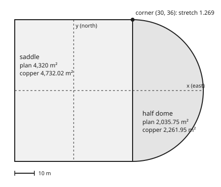

# Surface area: integrate the surface's own measuring rule

[Syllabus](../../../SYLLABUS.md) → [Differential geometry and Lie groups](../README.md) → [Surfaces](../README.md#s02) → Surface area

---

## General Overview

A stadium gets a copper roof. Over the middle sits a saddle: it rises toward the east and west ends and falls toward the north and south sides. Over the east end sits half of a shallow dome. The roofer must order copper sheet by the square metre, and copper is sold flat.

The architect's drawing is a plan: the roof seen from straight above. On the plan the saddle is a 60 m by 72 m rectangle, 4,320 m², and the dome's footprint is a half-disc of radius 36 m, 2,035.75 m². That is 6,355.75 m² in all. But the roof is curved, so it has more surface than its shadow. The true figure is 6,993.97 m²: an order placed from the plan comes up 638.22 m² short.

The true figure comes from a measuring rule that lives on the roof itself. Lay a grid on the roof. At each point, three numbers record how long a grid step is in each direction and how square the grid lines cross. These are the **first fundamental form** $`E`$, $`F`$, $`G`$ ([First fundamental form](02-first-fundamental-form.md)). A surveyor walking on the roof with a tape can measure all three without ever looking at the roof from outside. This card shows that those three numbers alone give the area.

**The area of a curved patch is the sum, over its grid cells, of each cell's size times $`\sqrt{EG - F^2}`$, a stretch factor built only from the surface's own measuring rule; any other grid on the same patch gives the same total.**

**What kind of fact this is:** a theorem, proved on this card in Why it works: the formula equals the cross-product area, and it does not depend on the grid. It is global over the patch, with one global hypothesis: the grid covers each point of the patch exactly once.

### The picture: the roof from above

<p align="center"></p>

To scale, 4 px per metre, north up, a plan (an orthographic view from straight above). Dashed: the axes $`x = 0`$ and $`y = 0`$. The dot marks the saddle's north-east corner, where the hand calculation below finds 1.269 m² of copper above each m² of plan.

---

## The formula

Notation first, in words.

- $`x`$, $`y`$, $`z`$ are metres east, north and up, from the middle of the saddle at ground level. The dome's own charts measure from its sphere's centre instead, which lies below the middle of the saddle's east edge.
- A **chart** is a pair of grid numbers $`(u, v)`$ that name each point of the roof: the point is $`r(u, v)`$, and the grid numbers range over a flat region $`D`$ ([Regular surface](01-regular-surfaces-and-tangent-planes.md)).
- $`r_u`$ and $`r_v`$ are the tangent arrows: how far, and which way, the point moves per unit of $`u`$ (with $`v`$ held still), and per unit of $`v`$.
- $`E = r_u \cdot r_u`$ is the squared length of the $`u`$ arrow, $`G = r_v \cdot r_v`$ the squared length of the $`v`$ arrow, and $`F = r_u \cdot r_v`$ their dot product, which is zero when the grid lines cross square. In wing 05, $`E`$ and $`F`$ also count a solid's edges and faces; here they mean only these dot products.

```math
\text{Area} = \iint_D \sqrt{EG - F^2}\; du\, dv
```

**Read it aloud:** "At each grid point, combine the two squared step lengths and the dot product into one stretch factor, the square metres of roof per unit of grid; then add the stretch over every grid cell."

| Symbol | Plain meaning | In our example | Push it up and the answer… |
| --- | --- | --- | --- |
| $`x`$, $`y`$, $`z`$ | metres east, north and up | saddle over $`\lvert x\rvert \le 30`$, $`\lvert y\rvert \le 36`$ | — |
| $`u`$, $`v`$; $`\Delta u`$, $`\Delta v`$ | grid numbers of a chart, and one small grid step in each; $`s`$, $`t`$ name the saddle's second chart | saddle chart 1: $`u = x`$, $`v = y`$ | — |
| $`r(u, v)`$, $`D`$ | the roof point named by $`(u, v)`$; the region the grid numbers cover | $`r = (x, y, 30 + (x^2 - y^2)/120)`$, the saddle of [First fundamental form](02-first-fundamental-form.md), over a 60 m by 72 m plan | larger $`D`$, more area |
| $`r_u`$, $`r_v`$ | tangent arrows: roof metres per unit of grid | at the corner: $`(1, 0, 0.5)`$ and $`(0, 1, -0.6)`$ | steeper roof, longer arrows |
| $`E`$, $`F`$, $`G`$ | squared step lengths and their dot product: the measuring rule | 1.25, −0.3, 1.36 at the corner | $`E`$ or $`G`$ up: more area; $`F`$ away from 0: less |
| $`\sqrt{EG - F^2}`$ | the stretch: area of one grid cell's parallelogram per unit cell | 1.268858 at the corner | more copper |
| $`\text{Area}`$ | square metres of roof, so of copper sheet | 4,732.024916 m² saddle, 2,261.946711 m² dome | — |
| $`\gamma`$ | the angle between the two tangent arrows (say "gamma") | 60° on a diamond shingle | toward 90°: more area for the same arrows |
| $`R`$, $`h`$ | the dome's sphere radius and its rise | 60 m and 12 m | more dome |
| $`\varphi`$, $`\theta`$; $`\rho`$ | dome chart 1: polar angle down from the top (phi) and longitude (theta); dome chart 2: plan distance from the dome's centre (rho) | $`\varphi`$ up to 0.643501 rad (36.869898°), $`\theta`$ over $`\pi`$ rad (180°) | — |
| $`a`$ | saddle radius: the roof is $`z = 30 + (x^2 - y^2)/(2a)`$ | 60 m | smaller $`a`$: steeper saddle, more copper |
| $`J`$, $`\det J`$ | the Jacobian matrix of a chart change; its determinant, the area stretch from one chart's grid to another's | $`\det J`$ = 4,320 at the corner, chart 2 to chart 1 | — |

### When it holds

- **The chart is regular: $`EG - F^2 > 0`$.** The two tangent arrows must point in different directions. Where one shrinks to zero or they line up, the cell collapses to a line, as at a sphere chart's pole. A few such points or lines carry no area and do no harm; a whole region of them would.
- **The chart covers each point once.** A chart that folds back over the roof counts the copper twice: the saddle comes out at 9,464.05 m², twice the truth (the code's ratio is 2.000000).
- **The roof is smooth on each panel.** The tangent arrows must vary continuously. At a ridge or valley, split the roof into panels and add their areas, as this card does with the dome and the saddle.
- **$`F`$ stays in.** $`\sqrt{EG}`$ alone is the area only when the grid lines cross square everywhere. On a skewed grid it overstates, by 15.5% on a 60° diamond.

---

## Why it works

### Step 0: area is lengths and an angle, and the measuring rule records exactly those

A small grid cell, $`\Delta u`$ by $`\Delta v`$, lands on the roof as a nearly flat parallelogram with edges $`r_u \Delta u`$ and $`r_v \Delta v`$. [Surface integrals](../../06-Calculus%20and%20analysis/09-Vector%20Calculus/05-surface-integrals-and-flux.md) already shows its area is $`\lVert r_u \times r_v \rVert \Delta u \Delta v`$, the length of a cross product, and that the total does not depend on the grid.

That route steps outside the roof: the cross product is an arrow standing off the surface. But a parallelogram's area depends on only two edge lengths and the angle between them. The measuring rule $`E`$, $`F`$, $`G`$ holds exactly that information. So area must be expressible in $`E`$, $`F`$, $`G`$ alone.

### Step 1: the parallelogram's area from $`E`$, $`F`$, $`G`$

A parallelogram with edges of lengths $`\lVert r_u\rVert`$ and $`\lVert r_v\rVert`$ at angle $`\gamma`$ has area $`\lVert r_u\rVert\,\lVert r_v\rVert \sin\gamma`$: base times height. The dot product gives the cosine: $`F = \lVert r_u\rVert\,\lVert r_v\rVert \cos\gamma`$. Since $`\sin^2\gamma = 1 - \cos^2\gamma`$:

```math
(\text{cell area per unit cell})^2 = \lVert r_u\rVert^2 \lVert r_v\rVert^2 - \lVert r_u\rVert^2 \lVert r_v\rVert^2 \cos^2\gamma = EG - F^2
```

This is Lagrange's identity, $`\lVert r_u \times r_v\rVert^2 = EG - F^2`$, reached without the cross product.

Test it on one diamond copper shingle: two edges of 0.5 m at 60°. Then $`E = G = 0.25`$ and $`F = 0.125`$. So $`EG - F^2 = 0.0625 - 0.015625 = 0.046875`$ and the area is 0.216506 m², which is $`0.25 \sin 60°`$. Dropping $`F`$ gives $`\sqrt{EG} = 0.25`$ m², the area of a square, not a diamond.

### Step 2: add the cells

Sum $`\sqrt{EG - F^2}\,\Delta u \Delta v`$ over all cells. As the cells shrink, the parallelograms hug the roof more closely and the sum becomes the double integral in the formula ([Double integrals](../../06-Calculus%20and%20analysis/08-Multiple%20Integrals/01-double-integrals.md)).

At the saddle's north-east corner, $`x = 30`$, $`y = 36`$, the stretch is 1.268858. The code checks it against the cross-product length, 1.268858.

### Step 3: a different chart gives the same area

Each chart gives different $`E`$, $`F`$, $`G`$ at the same point. The area must not care, or it would not belong to the roof.

Take the saddle's second chart, $`x = 15(s + s^3)`$, $`y = 18(t + t^3)`$, with $`s`$ and $`t`$ from −1 to 1. At the same corner ($`s = t = 1`$) it gives $`E = 4500`$, $`F = -1296`$, $`G = 7050.24`$ and a stretch of 5,481.465497. That is 4,320 times the plan chart's 1.268858. And 4,320 is the Jacobian determinant $`\det J`$ there: each unit of $`s`$ is 60 m of $`x`$ and each unit of $`t`$ is 72 m of $`y`$, and 60 × 72 = 4,320.

In general $`EG - F^2`$ is the determinant of the 2-by-2 table of $`E`$, $`F`$, $`G`$. A chart change multiplies that table by the chart change's Jacobian matrix $`J`$ on both sides, so the determinant gains a factor $`(\det J)^2`$ and the stretch a factor $`\lvert \det J\rvert`$. The change-of-variables rule for double integrals removes exactly that factor. Both charts give 4,732.0249 m².

<details>
<summary>Detailed proof: the stretch scales by the Jacobian, so the area does not depend on the chart</summary>

Let a second chart be $`u = u(s, t)`$, $`v = v(s, t)`$, a smooth one-to-one map from a region $`D'`$ onto $`D`$ with a smooth inverse. Write $`\tilde r(s, t) = r(u(s,t), v(s,t))`$.

By the chain rule, $`\tilde r_s = u_s r_u + v_s r_v`$ and $`\tilde r_t = u_t r_u + v_t r_v`$. Put the measuring rule in a table, $`I = \begin{pmatrix} E & F \\ F & G \end{pmatrix}`$, and the derivatives in the Jacobian matrix $`J = \begin{pmatrix} u_s & u_t \\ v_s & v_t \end{pmatrix}`$. Taking dot products of the two new arrows gives the new table:

$`\displaystyle \tilde I = J^{\mathsf T}\, I\, J .`$

Determinants multiply, and a table and its transpose have the same determinant, so with $`\det J = u_s v_t - u_t v_s`$:

$`\displaystyle \tilde E \tilde G - \tilde F^2 = \det \tilde I = (\det J)^2 \,(EG - F^2), \qquad \sqrt{\tilde E \tilde G - \tilde F^2} = \lvert \det J\rvert \sqrt{EG - F^2}.`$

The change-of-variables theorem says $`\iint_{D'} f(u(s,t), v(s,t))\,\lvert \det J\rvert \, ds\, dt = \iint_D f(u, v)\, du\, dv`$. Apply it with $`f = \sqrt{EG - F^2}`$ and the two areas agree.

If the map is not one-to-one, the theorem fails: a chart that covers $`D`$ twice gives twice the integral. That is the folded chart in What breaks.

</details>

### Step 4: what "without leaving the surface" buys

$`E`$, $`F`$ and $`G`$ come from lengths and angles measured along the roof. So any two surfaces with the same measuring rule in matching charts have the same area. A map between them that keeps every length is an isometry, and an isometry keeps area.

Flat copper sheet rolled onto a cylinder keeps its lengths, so it keeps its area: the roofer's order is exact. The dome and the saddle are different. No flat sheet bends onto them without stretching, because their curvature can be felt from inside ([Theorema Egregium](08-theorema-egregium.md)). The copper there is cut in narrow tapered strips and worked to fit, but the area of the finished roof is still the number this card computes.

---

## Worked numbers, by hand

**The half dome.** The sphere chart is $`r(\varphi, \theta) = (R \sin\varphi \cos\theta,\; R \sin\varphi \sin\theta,\; R\cos\varphi)`$, measured from the sphere's centre, with $`\theta`$ over the half turn that faces east, $`-\pi/2`$ to $`\pi/2`$ (−90° to 90°).

| Step | Arithmetic | Value |
| --- | --- | --- |
| footprint radius | $`\sqrt{2Rh - h^2} = \sqrt{1440 - 144}`$ | 36 m |
| rim angle | $`\cos\varphi_0 = (R - h)/R = 48/60`$ | 0.8, so $`\varphi_0`$ = 0.643501 rad |
| measuring rule | $`E = R^2`$, $`F = 0`$, $`G = R^2 \sin^2\varphi`$ | 3600, 0, $`3600 \sin^2\varphi`$ |
| stretch | $`\sqrt{EG - F^2}`$ | $`3600 \sin\varphi`$ |
| add over $`\varphi`$ | $`\int_0^{\varphi_0} \sin\varphi\, d\varphi = 1 - 0.8`$ | 0.2 |
| add over $`\theta`$ | $`3600 \times 0.2 \times \pi`$ | **2,261.946711 m²** |
| plan area | $`\pi \times 36^2 / 2`$ | 2,035.752040 m² |

The dome needs 1.111111 times its plan area in copper. The answer matches Archimedes' cap area $`2\pi R h`$, halved: $`\pi \times 60 \times 12`$.

**The saddle at its north-east corner, $`x = 30`$, $`y = 36`$.** In the plan chart, $`r_x = (1, 0, x/a)`$ and $`r_y = (0, 1, -y/a)`$.

| Step | Arithmetic | Value |
| --- | --- | --- |
| $`E`$ | $`1 + (30/60)^2`$ | 1.25 |
| $`F`$ | $`(30/60)(-36/60)`$ | −0.3 |
| $`G`$ | $`1 + (36/60)^2`$ | 1.36 |
| $`EG - F^2`$ | $`1.7 - 0.09`$ | 1.61 |
| stretch | $`\sqrt{1.61}`$ | **1.268858** |

At that corner each square metre of plan carries 1.268858 m² of copper. Added over the whole panel (by the code), the saddle takes 4,732.024916 m², 1.095376 times its plan.

**The order.** 2,261.946711 + 4,732.024916 = 6,993.971627 m² of copper. At 0.6 mm thick and 8,960 kg/m³, the sheet weighs 5.376 kg/m², so about 37,599.59 kg, or 37.6 tonnes.

### What breaks if you drop a piece

| Mistake | Comes out at | What went wrong |
| --- | --- | --- |
| Plan area for the saddle | 4,320 m², not 4,732.02 | The stretch was taken as 1 everywhere: a flat roof |
| Drop $`F^2`$ on the saddle | 4,750.46 m², 18.43 m² too much | $`\sqrt{EG}`$ assumes square grid lines; here they cross near 90° over most of the panel, so the error is small |
| Drop $`F^2`$ on a diamond shingle | 0.25 m², not 0.216506 | At 60° the error is 15.5% |
| Dome with $`G = R^2`$ | 7,277.83 m², not 2,261.95 | The longitude circles shrink toward the top by $`\sin\varphi`$; that was forgotten |
| A folded chart, $`x = 30(2s^2 - 1)`$ for $`s`$ from −1 to 1 | 9,464.05 m², twice the truth | The hypothesis fails: the chart covers the panel twice |

The code prints all five.

---

## Code, from first principles, and it actually runs

The code computes $`E`$, $`F`$, $`G`$ from the tangent arrows and adds $`\sqrt{EG - F^2}`$ by Simpson's rule, written out. It takes **four independent roads**: each panel in two charts (sphere and plan for the dome; plan and cubic for the saddle), the dome's closed form $`\pi R h`$, and a mesh of flat triangles pinned to the saddle that never forms $`E`$, $`F`$ or $`G`$. The mesh is approximate: its error falls by a factor of 4.000250 when its step halves, from −0.411243 to −0.102804 m².

### Python

```python
# Surface area from the first fundamental form -- the check behind the card.
# Standard library only.  A stadium roof: a half dome over the east end and a
# saddle over the middle.  Area = double integral of sqrt(EG - F^2), done by
# Simpson's rule written out, in two charts per panel; then a flat-triangle mesh
# that never forms E, F or G; then the dome's closed form.
import math

def dot(a, b): return a[0] * b[0] + a[1] * b[1] + a[2] * b[2]
def cross(a, b): return (a[1] * b[2] - a[2] * b[1], a[2] * b[0] - a[0] * b[2], a[0] * b[1] - a[1] * b[0])
def efg(ru, rv): return dot(ru, ru), dot(ru, rv), dot(rv, rv)
def stretch(ru, rv):                         # sqrt(EG - F^2): m^2 of roof per unit of chart
    E, F, G = efg(ru, rv)
    return math.sqrt(E * G - F * F)

def simpson2(chart, a, b, c, d, n):          # Simpson's rule on an n-by-n grid, n even
    hu, hv, s = (b - a) / n, (d - c) / n, 0.0
    w = [1 if i in (0, n) else (4 if i % 2 else 2) for i in range(n + 1)]
    for i in range(n + 1):
        for j in range(n + 1):
            s += w[i] * w[j] * stretch(*chart(a + i * hu, c + j * hv))
    return s * hu * hv / 9

R, H = 60.0, 12.0                            # dome: sphere radius, rise of the cap (m)
B = math.sqrt(2 * R * H - H * H)             # radius of the dome's footprint: 36 m
PHI0 = math.acos((R - H) / R)                # polar angle at the dome's rim
SR, LX, LY = 60.0, 30.0, 36.0                # saddle radius a: z = 30 + (x^2 - y^2)/(2a), |x| <= 30, |y| <= 36
SHEET = 0.0006 * 8960                        # kg per m^2 of 0.6 mm copper sheet

def sphere(p, t):                            # chart 1: polar angle p, longitude t
    return ((R * math.cos(p) * math.cos(t), R * math.cos(p) * math.sin(t), -R * math.sin(p)),
            (-R * math.sin(p) * math.sin(t), R * math.sin(p) * math.cos(t), 0.0))
def plan_polar(rho, t):                      # chart 2: distance rho and angle t on the plan
    s = math.sqrt(R * R - rho * rho)
    return (math.cos(t), math.sin(t), -rho / s), (-rho * math.sin(t), rho * math.cos(t), 0.0)
def saddle(x, y):                            # chart 1: plan coordinates x, y
    return (1.0, 0.0, x / SR), (0.0, 1.0, -y / SR)
def cubic(s, t):                             # chart 2: x = 15(s + s^3), y = 18(t + t^3)
    x, y = LX * (s + s ** 3) / 2, LY * (t + t ** 3) / 2
    xs, yt = LX * (1 + 3 * s * s) / 2, LY * (1 + 3 * t * t) / 2
    return (xs, 0.0, xs * x / SR), (0.0, yt, -yt * y / SR)
def folded(s, y):                            # a chart that doubles back: x = 30(2s^2 - 1)
    x, xs = LX * (2 * s * s - 1), 4 * LX * s
    return (xs, 0.0, xs * x / SR), (0.0, 1.0, -y / SR)
def roof(x, y): return (x, y, 30 + (x * x - y * y) / (2 * SR))

def mesh(n):                                 # flat triangles pinned to the saddle: no E, F, G
    total, hx, hy = 0.0, 2 * LX / n, 2 * LY / n
    for i in range(n):
        for j in range(n):
            x, y = -LX + i * hx, -LY + j * hy
            p, q, r, s = roof(x, y), roof(x + hx, y), roof(x + hx, y + hy), roof(x, y + hy)
            for a, b, c in ((p, q, r), (p, r, s)):
                u = tuple(b[k] - a[k] for k in range(3)); v = tuple(c[k] - a[k] for k in range(3))
                total += math.sqrt(dot(cross(u, v), cross(u, v))) / 2
    return total

f6 = lambda v: f"{v:.6f}"
print("dome, footprint radius m", f6(B))
print("dome, rim polar angle rad", f6(PHI0), "deg", f6(math.degrees(PHI0)), "cos", f6(math.cos(PHI0)))
d_closed = math.pi * R * H                   # half of Archimedes' 2 pi R h
d1 = simpson2(sphere, 0.0, PHI0, -math.pi / 2, math.pi / 2, 100)
d2 = simpson2(plan_polar, 0.0, B, -math.pi / 2, math.pi / 2, 100)
print("dome area, closed form pi R h", f6(d_closed))
print("dome area, chart 1 (sphere)  ", f6(d1))
print("dome area, chart 2 (plan)    ", f6(d2))
d_plan = math.pi * B * B / 2
print("dome plan area", f6(d_plan), "ratio", f6(d_closed / d_plan))
assert abs(d1 - d_closed) < 1e-6
assert abs(d2 - d_closed) < 1e-3

ru, rv = saddle(30.0, 36.0)
E, F, G = efg(ru, rv)
print("saddle corner (30, 36): E", f6(E), "F", f6(F), "G", f6(G))
print("saddle corner: EG", f6(E * G), "F^2", f6(F * F), "EG-F^2", f6(E * G - F * F), "stretch", f6(stretch(ru, rv)))
print("saddle corner: |r_x x r_y|", f6(math.sqrt(dot(cross(ru, rv), cross(ru, rv)))))
assert abs(math.sqrt(dot(cross(ru, rv), cross(ru, rv))) - stretch(ru, rv)) < 1e-12
cu, cv = cubic(1.0, 1.0)                     # same corner in chart 2
E2, F2, G2 = efg(cu, cv)
print("same corner, chart 2: E", f6(E2), "F", f6(F2), "G", f6(G2), "stretch", f6(stretch(cu, cv)))
print("chart 2 stretch / chart 1 stretch", f6(stretch(cu, cv) / stretch(ru, rv)), "Jacobian x_s y_t", f6(60.0 * 72.0))
s1 = simpson2(saddle, -LX, LX, -LY, LY, 200)
s2 = simpson2(cubic, -1.0, 1.0, -1.0, 1.0, 200)
print("saddle area, chart 1 (plan x, y)", f6(s1))
print("saddle area, chart 2 (cubic s, t)", f6(s2))
assert abs(s1 - s2) < 1e-4
m1, m2 = mesh(30), mesh(60)
print("saddle area, mesh 30 x 30", f6(m1), "error", f6(m1 - s1))
print("saddle area, mesh 60 x 60", f6(m2), "error", f6(m2 - s1), "ratio", f6((m1 - s1) / (m2 - s1)))
assert abs(m2 - s1) < abs(m1 - s1) / 3.5
s_plan = 2 * LX * 2 * LY
print("saddle plan area", f6(s_plan), "ratio", f6(s1 / s_plan))

total = d_closed + s1
print("copper, m^2", f6(total), "kg at 5.376 kg/m^2", f6(total * SHEET))
print("plan m^2", f6(d_plan + s_plan), "short by", f6(total - d_plan - s_plan))
no_f = simpson2(lambda x, y: ((math.sqrt(efg(*saddle(x, y))[0]), 0, 0), (0, math.sqrt(efg(*saddle(x, y))[2]), 0)), -LX, LX, -LY, LY, 200)
no_sin = R * R * PHI0 * math.pi              # G taken as R^2: the sin(p)^2 forgotten
a60 = (0.5, 0.0, 0.0); b60 = (0.25, 0.5 * math.sqrt(3) / 2, 0.0)   # diamond shingle, 0.5 m sides at 60 deg
E, F, G = efg(a60, b60)
print("diamond shingle: E", f6(E), "F", f6(F), "G", f6(G), "area", f6(stretch(a60, b60)), "sqrt(EG)", f6(math.sqrt(E * G)),
      "ratio", f6(math.sqrt(E * G) / stretch(a60, b60)))
assert abs(stretch(a60, b60) - 0.25 * math.sin(math.pi / 3)) < 1e-12
fold = simpson2(folded, -1.0, 1.0, -LY, LY, 200)
print("breaks: plan area for saddle", f6(s_plan))
print("breaks: drop F^2, sqrt(EG)", f6(no_f), "excess", f6(no_f - s1))
print("breaks: dome with G = R^2", f6(no_sin), "times", f6(no_sin / d_closed))
print("breaks: folded chart", f6(fold), "times", f6(fold / s1))
assert no_f > s1 + 1.0
assert abs(fold / s1 - 2.0) < 1e-6

print("try: saddle a = 90", f6(simpson2(lambda x, y: ((1.0, 0.0, x / 90), (0.0, 1.0, -y / 90)), -LX, LX, -LY, LY, 200)))
print("try: dome rise 18 m", f6(math.pi * R * 18), "footprint radius", f6(math.sqrt(2 * R * 18 - 18 * 18)))
print("try: Simpson n = 4", f6(simpson2(saddle, -LX, LX, -LY, LY, 4)))
print("try: mesh 6 x 6", f6(mesh(6)))
print("figure, saddle plan x", f6(-LX), f6(LX), "y", f6(-LY), f6(LY), "dome centre x", f6(LX), "radius", f6(B))
print("ALL CHECKS PASS")
```

**Ran 2026-11-19 on macOS, Python 3.14.10, standard library only. All checks passed. Output, pasted from the run:**

```
dome, footprint radius m 36.000000
dome, rim polar angle rad 0.643501 deg 36.869898 cos 0.800000
dome area, closed form pi R h 2261.946711
dome area, chart 1 (sphere)   2261.946711
dome area, chart 2 (plan)     2261.946713
dome plan area 2035.752040 ratio 1.111111
saddle corner (30, 36): E 1.250000 F -0.300000 G 1.360000
saddle corner: EG 1.700000 F^2 0.090000 EG-F^2 1.610000 stretch 1.268858
saddle corner: |r_x x r_y| 1.268858
same corner, chart 2: E 4500.000000 F -1296.000000 G 7050.240000 stretch 5481.465497
chart 2 stretch / chart 1 stretch 4320.000000 Jacobian x_s y_t 4320.000000
saddle area, chart 1 (plan x, y) 4732.024916
saddle area, chart 2 (cubic s, t) 4732.024928
saddle area, mesh 30 x 30 4731.613673 error -0.411243
saddle area, mesh 60 x 60 4731.922112 error -0.102804 ratio 4.000250
saddle plan area 4320.000000 ratio 1.095376
copper, m^2 6993.971627 kg at 5.376 kg/m^2 37599.591464
plan m^2 6355.752040 short by 638.219587
diamond shingle: E 0.250000 F 0.125000 G 0.250000 area 0.216506 sqrt(EG) 0.250000 ratio 1.154701
breaks: plan area for saddle 4320.000000
breaks: drop F^2, sqrt(EG) 4750.455447 excess 18.430531
breaks: dome with G = R^2 7277.826081 times 3.217506
breaks: folded chart 9464.049847 times 2.000000
try: saddle a = 90 4509.395604
try: dome rise 18 m 3392.920066 footprint radius 42.848571
try: Simpson n = 4 4731.614128
try: mesh 6 x 6 4721.723329
figure, saddle plan x -30.000000 30.000000 y -36.000000 36.000000 dome centre x 30.000000 radius 36.000000
ALL CHECKS PASS
```

### Rust

Same roads, same numbers, printed in the same format. No crates.

```rust
// Surface area from the first fundamental form -- the check behind the card.
// std only, no crates.  A stadium roof: a half dome over the east end and a
// saddle over the middle.  Area = double integral of sqrt(EG - F^2), done by
// Simpson's rule written out, in two charts per panel; then a flat-triangle mesh
// that never forms E, F or G; then the dome's closed form.
use std::f64::consts::PI;
type V = [f64; 3];

fn dot(a: V, b: V) -> f64 { a[0] * b[0] + a[1] * b[1] + a[2] * b[2] }
fn cross(a: V, b: V) -> V { [a[1] * b[2] - a[2] * b[1], a[2] * b[0] - a[0] * b[2], a[0] * b[1] - a[1] * b[0]] }
fn efg(ru: V, rv: V) -> (f64, f64, f64) { (dot(ru, ru), dot(ru, rv), dot(rv, rv)) }
fn stretch(ru: V, rv: V) -> f64 {
    // sqrt(EG - F^2): m^2 of roof per unit of chart
    let (e, f, g) = efg(ru, rv);
    (e * g - f * f).sqrt()
}

fn simpson2<C: Fn(f64, f64) -> (V, V)>(chart: C, a: f64, b: f64, c: f64, d: f64, n: usize) -> f64 {
    let (hu, hv) = ((b - a) / n as f64, (d - c) / n as f64);
    let w = |i: usize| -> f64 { if i == 0 || i == n { 1.0 } else if i % 2 == 1 { 4.0 } else { 2.0 } };
    let mut s = 0.0;
    for i in 0..=n {
        for j in 0..=n {
            let (ru, rv) = chart(a + i as f64 * hu, c + j as f64 * hv);
            s += w(i) * w(j) * stretch(ru, rv);
        }
    }
    s * hu * hv / 9.0
}

const R: f64 = 60.0; // dome: sphere radius (m)
const H: f64 = 12.0; // rise of the cap (m)
const SR: f64 = 60.0; // saddle radius a: z = 30 + (x^2 - y^2)/(2a)
const LX: f64 = 30.0;
const LY: f64 = 36.0;

fn sphere(p: f64, t: f64) -> (V, V) {
    // chart 1: polar angle p, longitude t
    ([R * p.cos() * t.cos(), R * p.cos() * t.sin(), -R * p.sin()], [-R * p.sin() * t.sin(), R * p.sin() * t.cos(), 0.0])
}
fn plan_polar(rho: f64, t: f64) -> (V, V) {
    // chart 2: distance rho and angle t on the plan
    let s = (R * R - rho * rho).sqrt();
    ([t.cos(), t.sin(), -rho / s], [-rho * t.sin(), rho * t.cos(), 0.0])
}
fn saddle(x: f64, y: f64) -> (V, V) { ([1.0, 0.0, x / SR], [0.0, 1.0, -y / SR]) }
fn cubic(s: f64, t: f64) -> (V, V) {
    // chart 2: x = 15(s + s^3), y = 18(t + t^3)
    let (x, y) = (LX * (s + s * s * s) / 2.0, LY * (t + t * t * t) / 2.0);
    let (xs, yt) = (LX * (1.0 + 3.0 * s * s) / 2.0, LY * (1.0 + 3.0 * t * t) / 2.0);
    ([xs, 0.0, xs * x / SR], [0.0, yt, -yt * y / SR])
}
fn folded(s: f64, y: f64) -> (V, V) {
    // a chart that doubles back: x = 30(2s^2 - 1)
    let (x, xs) = (LX * (2.0 * s * s - 1.0), 4.0 * LX * s);
    ([xs, 0.0, xs * x / SR], [0.0, 1.0, -y / SR])
}
fn roof(x: f64, y: f64) -> V { [x, y, 30.0 + (x * x - y * y) / (2.0 * SR)] }
fn sub(b: V, a: V) -> V { [b[0] - a[0], b[1] - a[1], b[2] - a[2]] }

fn mesh(n: usize) -> f64 {
    // flat triangles pinned to the saddle: no E, F, G
    let (hx, hy) = (2.0 * LX / n as f64, 2.0 * LY / n as f64);
    let mut total = 0.0;
    for i in 0..n {
        for j in 0..n {
            let (x, y) = (-LX + i as f64 * hx, -LY + j as f64 * hy);
            let (p, q, r, s) = (roof(x, y), roof(x + hx, y), roof(x + hx, y + hy), roof(x, y + hy));
            for (a, b, c) in [(p, q, r), (p, r, s)] {
                let n3 = cross(sub(b, a), sub(c, a));
                total += dot(n3, n3).sqrt() / 2.0;
            }
        }
    }
    total
}

fn main() {
    let b = (2.0 * R * H - H * H).sqrt(); // radius of the dome's footprint: 36 m
    let phi0 = ((R - H) / R).acos(); // polar angle at the dome's rim
    let sheet = 0.0006 * 8960.0; // kg per m^2 of 0.6 mm copper sheet
    println!("dome, footprint radius m {:.6}", b);
    println!("dome, rim polar angle rad {:.6} deg {:.6} cos {:.6}", phi0, phi0.to_degrees(), phi0.cos());
    let d_closed = PI * R * H; // half of Archimedes' 2 pi R h
    let d1 = simpson2(sphere, 0.0, phi0, -PI / 2.0, PI / 2.0, 100);
    let d2 = simpson2(plan_polar, 0.0, b, -PI / 2.0, PI / 2.0, 100);
    println!("dome area, closed form pi R h {:.6}", d_closed);
    println!("dome area, chart 1 (sphere)   {:.6}", d1);
    println!("dome area, chart 2 (plan)     {:.6}", d2);
    let d_plan = PI * b * b / 2.0;
    println!("dome plan area {:.6} ratio {:.6}", d_plan, d_closed / d_plan);
    assert!((d1 - d_closed).abs() < 1e-6);
    assert!((d2 - d_closed).abs() < 1e-3);

    let (ru, rv) = saddle(30.0, 36.0);
    let (e, f, g) = efg(ru, rv);
    println!("saddle corner (30, 36): E {:.6} F {:.6} G {:.6}", e, f, g);
    println!("saddle corner: EG {:.6} F^2 {:.6} EG-F^2 {:.6} stretch {:.6}", e * g, f * f, e * g - f * f, stretch(ru, rv));
    let nn = cross(ru, rv);
    println!("saddle corner: |r_x x r_y| {:.6}", dot(nn, nn).sqrt());
    assert!((dot(nn, nn).sqrt() - stretch(ru, rv)).abs() < 1e-12);
    let (cu, cv) = cubic(1.0, 1.0); // same corner in chart 2
    let (e2, f2, g2) = efg(cu, cv);
    println!("same corner, chart 2: E {:.6} F {:.6} G {:.6} stretch {:.6}", e2, f2, g2, stretch(cu, cv));
    println!("chart 2 stretch / chart 1 stretch {:.6} Jacobian x_s y_t {:.6}", stretch(cu, cv) / stretch(ru, rv), 60.0 * 72.0);
    let s1 = simpson2(saddle, -LX, LX, -LY, LY, 200);
    let s2 = simpson2(cubic, -1.0, 1.0, -1.0, 1.0, 200);
    println!("saddle area, chart 1 (plan x, y) {:.6}", s1);
    println!("saddle area, chart 2 (cubic s, t) {:.6}", s2);
    assert!((s1 - s2).abs() < 1e-4);
    let (m1, m2) = (mesh(30), mesh(60));
    println!("saddle area, mesh 30 x 30 {:.6} error {:.6}", m1, m1 - s1);
    println!("saddle area, mesh 60 x 60 {:.6} error {:.6} ratio {:.6}", m2, m2 - s1, (m1 - s1) / (m2 - s1));
    assert!((m2 - s1).abs() < (m1 - s1).abs() / 3.5);
    let s_plan = 2.0 * LX * 2.0 * LY;
    println!("saddle plan area {:.6} ratio {:.6}", s_plan, s1 / s_plan);

    let total = d_closed + s1;
    println!("copper, m^2 {:.6} kg at 5.376 kg/m^2 {:.6}", total, total * sheet);
    println!("plan m^2 {:.6} short by {:.6}", d_plan + s_plan, total - d_plan - s_plan);
    let no_f = simpson2(|x, y| { let (e, _, g) = efg(saddle(x, y).0, saddle(x, y).1); ([e.sqrt(), 0.0, 0.0], [0.0, g.sqrt(), 0.0]) }, -LX, LX, -LY, LY, 200);
    let no_sin = R * R * phi0 * PI; // G taken as R^2: the sin(p)^2 forgotten
    let (a60, b60) = ([0.5, 0.0, 0.0], [0.25, 0.5 * 3f64.sqrt() / 2.0, 0.0]); // diamond shingle, 0.5 m sides at 60 deg
    let (e, f, g) = efg(a60, b60);
    println!("diamond shingle: E {:.6} F {:.6} G {:.6} area {:.6} sqrt(EG) {:.6} ratio {:.6}", e, f, g, stretch(a60, b60), (e * g).sqrt(), (e * g).sqrt() / stretch(a60, b60));
    assert!((stretch(a60, b60) - 0.25 * (PI / 3.0).sin()).abs() < 1e-12);
    let fold = simpson2(folded, -1.0, 1.0, -LY, LY, 200);
    println!("breaks: plan area for saddle {:.6}", s_plan);
    println!("breaks: drop F^2, sqrt(EG) {:.6} excess {:.6}", no_f, no_f - s1);
    println!("breaks: dome with G = R^2 {:.6} times {:.6}", no_sin, no_sin / d_closed);
    println!("breaks: folded chart {:.6} times {:.6}", fold, fold / s1);
    assert!(no_f > s1 + 1.0);
    assert!((fold / s1 - 2.0).abs() < 1e-6);

    println!("try: saddle a = 90 {:.6}", simpson2(|x, y| ([1.0, 0.0, x / 90.0], [0.0, 1.0, -y / 90.0]), -LX, LX, -LY, LY, 200));
    println!("try: dome rise 18 m {:.6} footprint radius {:.6}", PI * R * 18.0, (2.0 * R * 18.0 - 18.0 * 18.0).sqrt());
    println!("try: Simpson n = 4 {:.6}", simpson2(saddle, -LX, LX, -LY, LY, 4));
    println!("try: mesh 6 x 6 {:.6}", mesh(6));
    println!("figure, saddle plan x {:.6} {:.6} y {:.6} {:.6} dome centre x {:.6} radius {:.6}", -LX, LX, -LY, LY, LX, b);
    println!("ALL CHECKS PASS");
}
```

**Ran 2026-11-19 on macOS, rustc 1.98.1, no crates. All checks passed. Output, pasted from the run:**

```
dome, footprint radius m 36.000000
dome, rim polar angle rad 0.643501 deg 36.869898 cos 0.800000
dome area, closed form pi R h 2261.946711
dome area, chart 1 (sphere)   2261.946711
dome area, chart 2 (plan)     2261.946713
dome plan area 2035.752040 ratio 1.111111
saddle corner (30, 36): E 1.250000 F -0.300000 G 1.360000
saddle corner: EG 1.700000 F^2 0.090000 EG-F^2 1.610000 stretch 1.268858
saddle corner: |r_x x r_y| 1.268858
same corner, chart 2: E 4500.000000 F -1296.000000 G 7050.240000 stretch 5481.465497
chart 2 stretch / chart 1 stretch 4320.000000 Jacobian x_s y_t 4320.000000
saddle area, chart 1 (plan x, y) 4732.024916
saddle area, chart 2 (cubic s, t) 4732.024928
saddle area, mesh 30 x 30 4731.613673 error -0.411243
saddle area, mesh 60 x 60 4731.922112 error -0.102804 ratio 4.000250
saddle plan area 4320.000000 ratio 1.095376
copper, m^2 6993.971627 kg at 5.376 kg/m^2 37599.591464
plan m^2 6355.752040 short by 638.219587
diamond shingle: E 0.250000 F 0.125000 G 0.250000 area 0.216506 sqrt(EG) 0.250000 ratio 1.154701
breaks: plan area for saddle 4320.000000
breaks: drop F^2, sqrt(EG) 4750.455447 excess 18.430531
breaks: dome with G = R^2 7277.826081 times 3.217506
breaks: folded chart 9464.049847 times 2.000000
try: saddle a = 90 4509.395604
try: dome rise 18 m 3392.920066 footprint radius 42.848571
try: Simpson n = 4 4731.614128
try: mesh 6 x 6 4721.723329
figure, saddle plan x -30.000000 30.000000 y -36.000000 36.000000 dome centre x 30.000000 radius 36.000000
ALL CHECKS PASS
```

The two outputs agree line for line.

### Lean

Lean proves, for every chart, that area from $`E`$, $`F`$, $`G`$ does not depend on the chart, and checks the roof's hand numbers.

- Take a regular chart with continuous tangent arrows that covers each point of its region once. Then any one-to-one smooth chart change onto that region gives the same area.
- Take any two arrows in space, with $`E`$, $`F`$, $`G`$ their dot products. Then their cross product's squared length is $`EG - F^2`$, Lagrange's identity.
- Suppose a chart change has Jacobian determinant $`\det J`$. Then $`EG - F^2`$ gains a factor $`(\det J)^2`$, and the stretch gains $`\lvert \det J\rvert`$.
- Take the saddle's north-east corner, $`x = 30`$, $`y = 36`$. Then $`E`$, $`F`$, $`G`$ are 1.25, −0.3 and 1.36, so $`EG - F^2`$ is 1.61.
- Take the cross product $`r_x \times r_y`$ at that corner. Then it is $`(-0.5, 0.6, 1)`$, and its squared length is also 1.61.
- Take the cubic chart at that corner. Then its $`EG - F^2`$ is 4,320² times 1.61, and 4,320 = 60 × 72.
- Take the diamond shingle. Then $`EG - F^2`$ is 0.0625 − 0.015625 = 0.046875.
- Take the dome with $`R = 60`$ m and $`h = 12`$ m. Then its footprint radius is 36 m and $`\cos\varphi_0`$ is 0.8.
- Take that dome's copper and plan areas, 720π and 648π m². Then their ratio is 10/9, or 1.111111.
- Take copper sheet 0.6 mm thick at 8,960 kg/m³. Then it weighs 5.376 kg/m².

The summed areas of the roof, the mesh, the folded chart and the decimal square roots are left to the Python and Rust checks.

```lean
-- Surface area: the area of a patch, the sum over the grid of √(EG − F²), equals the cross-product area and is the same in every one-to-one smooth chart, and the card's roof numbers check exactly.
import Mathlib.MeasureTheory.Function.Jacobian
import Mathlib.MeasureTheory.Integral.Bochner.Set
import Mathlib.MeasureTheory.Constructions.BorelSpace.Real
import Mathlib.LinearAlgebra.CrossProduct
import Mathlib.Analysis.Calculus.ContDiff.Basic
import Mathlib.Analysis.SpecialFunctions.Sqrt
import Mathlib.Data.Fin.VecNotation
import Mathlib.Tactic.NormNum
import Mathlib.Tactic.Ring
import Mathlib.LinearAlgebra.Matrix.ToLin
import Mathlib.Topology.Algebra.Module.FiniteDimension

/-! A grid point is a pair `p = (u, v) : ℝ × ℝ`, and a chart's region `D` is a set of pairs.
A point of space is a list of three real numbers, `Fin 3 → ℝ` (east, north, up). A chart is
a map `r : ℝ × ℝ → Fin 3 → ℝ`. Its tangent arrows at `p` are `r_u = fderiv ℝ r p (1, 0)` and
`r_v = fderiv ℝ r p (0, 1)`. Mathlib's `a ⬝ᵥ b` is the dot product and `a ⨯₃ b` the cross
product. The measuring rule is `E = r_u ⬝ᵥ r_u`, `F = r_u ⬝ᵥ r_v`, `G = r_v ⬝ᵥ r_v`. Integrals
over the grid are Lebesgue integrals for area on the plane. A chart change is a map `φ` from a
new region `D'` onto `D`; `(fderiv ℝ φ p).det` is its Jacobian determinant. -/

open MeasureTheory Set Matrix

/-- `E = r_u · r_u`, the squared length of the `u` arrow. -/
noncomputable def firstFormE (r : ℝ × ℝ → Fin 3 → ℝ) (p : ℝ × ℝ) : ℝ :=
  fderiv ℝ r p (1, 0) ⬝ᵥ fderiv ℝ r p (1, 0)

/-- `F = r_u · r_v`, the dot product of the two arrows. -/
noncomputable def firstFormF (r : ℝ × ℝ → Fin 3 → ℝ) (p : ℝ × ℝ) : ℝ :=
  fderiv ℝ r p (1, 0) ⬝ᵥ fderiv ℝ r p (0, 1)

/-- `G = r_v · r_v`, the squared length of the `v` arrow. -/
noncomputable def firstFormG (r : ℝ × ℝ → Fin 3 → ℝ) (p : ℝ × ℝ) : ℝ :=
  fderiv ℝ r p (0, 1) ⬝ᵥ fderiv ℝ r p (0, 1)

/-- Area = ∬_D √(EG − F²) du dv: the area built from the measuring rule alone. -/
noncomputable def areaFromFirstForm (r : ℝ × ℝ → Fin 3 → ℝ) (D : Set (ℝ × ℝ)) : ℝ :=
  ∫ p in D, √(firstFormE r p * firstFormG r p - firstFormF r p ^ 2)


/-- Determinant of a linear map of the plane, read off from where it sends the two unit arrows. -/
theorem det_plane_clm (L : ℝ × ℝ →L[ℝ] ℝ × ℝ) :
    L.det = (L (1, 0)).1 * (L (0, 1)).2 - (L (0, 1)).1 * (L (1, 0)).2 := by
  have hx : ∀ x : ℝ × ℝ, x = x.1 • ((1 : ℝ), (0 : ℝ)) + x.2 • ((0 : ℝ), (1 : ℝ)) := by
    intro x; ext <;> simp
  have hL : L = (Matrix.toLin (Module.Basis.finTwoProd ℝ) (Module.Basis.finTwoProd ℝ)
      !![(L (1, 0)).1, (L (0, 1)).1; (L (1, 0)).2, (L (0, 1)).2]).toContinuousLinearMap := by
    refine ContinuousLinearMap.ext fun x => ?_
    conv_lhs => rw [hx x]
    rw [map_add, map_smul, map_smul]
    simp only [LinearMap.coe_toContinuousLinearMap', Matrix.toLin_finTwoProd_apply]
    ext <;> simp <;> ring
  conv_lhs => rw [hL]
  simp only [LinearMap.det_toContinuousLinearMap, LinearMap.det_toLin, Matrix.det_fin_two_of]

#print axioms det_plane_clm

/-- A linear map from the plane is fixed by the images of the two unit arrows. -/
theorem plane_clm_apply (M : ℝ × ℝ →L[ℝ] (Fin 3 → ℝ)) (w : ℝ × ℝ) :
    M w = w.1 • M (1, 0) + w.2 • M (0, 1) := by
  have hx : w = w.1 • ((1 : ℝ), (0 : ℝ)) + w.2 • ((0 : ℝ), (1 : ℝ)) := by
    ext <;> simp
  conv_lhs => rw [hx]
  rw [map_add, map_smul, map_smul]

#print axioms plane_clm_apply


/-- Helper: the stretch under a change of arrows scales by the absolute determinant. -/
theorem stretch_scales_aux (ru rv : Fin 3 → ℝ) (us ut vs vt : ℝ) :
    √(((us • ru + vs • rv) ⬝ᵥ (us • ru + vs • rv)) * ((ut • ru + vt • rv) ⬝ᵥ (ut • ru + vt • rv))
        - ((us • ru + vs • rv) ⬝ᵥ (ut • ru + vt • rv)) ^ 2)
        = |us * vt - ut * vs| * √((ru ⬝ᵥ ru) * (rv ⬝ᵥ rv) - (ru ⬝ᵥ rv) ^ 2) := by
  have h : ((us • ru + vs • rv) ⬝ᵥ (us • ru + vs • rv)) * ((ut • ru + vt • rv) ⬝ᵥ (ut • ru + vt • rv))
        - ((us • ru + vs • rv) ⬝ᵥ (ut • ru + vt • rv)) ^ 2
      = (us * vt - ut * vs) ^ 2 * ((ru ⬝ᵥ ru) * (rv ⬝ᵥ rv) - (ru ⬝ᵥ rv) ^ 2) := by
    simp only [add_dotProduct, dotProduct_add, smul_dotProduct, dotProduct_smul,
      smul_eq_mul, dotProduct_comm rv ru]
    ring
  rw [h, Real.sqrt_mul (sq_nonneg _), Real.sqrt_sq_eq_abs]

#print axioms stretch_scales_aux

/-- **Area does not depend on the chart.** Take a chart `r` on an open grid region `D` that is
smooth (continuous tangent arrows), regular (EG − F² > 0 at every grid point) and covers each
point once. Take a second chart: a smooth map `φ` that sends an open region `D'` one-to-one onto
`D`, so that `r ∘ φ` names the same patch. Then adding √(EG − F²) over the second grid gives
the same area as adding it over the first. -/
theorem area_from_first_form_independent_of_chart
    (r : ℝ × ℝ → Fin 3 → ℝ) (D : Set (ℝ × ℝ)) (hD : IsOpen D)
    (hr : ContDiffOn ℝ 1 r D)
    (h_regular : ∀ p ∈ D, 0 < firstFormE r p * firstFormG r p - firstFormF r p ^ 2)
    (hr_once : InjOn r D)
    (φ : ℝ × ℝ → ℝ × ℝ) (D' : Set (ℝ × ℝ)) (hD' : IsOpen D')
    (hφ : ContDiffOn ℝ 1 φ D') (hφ_once : InjOn φ D') (hφ_onto : φ '' D' = D) :
    areaFromFirstForm (r ∘ φ) D' = areaFromFirstForm r D := by
  have hmeas : MeasurableSet D' := hD'.measurableSet
  have hmaps : ∀ x ∈ D', φ x ∈ D := fun x hx => hφ_onto ▸ mem_image_of_mem φ hx
  have hφd : ∀ x ∈ D', HasFDerivAt φ (fderiv ℝ φ x) x := fun x hx =>
    (((hφ.differentiableOn one_ne_zero) x hx).differentiableAt (hD'.mem_nhds hx)).hasFDerivAt
  have hrd : ∀ y ∈ D, HasFDerivAt r (fderiv ℝ r y) y := fun y hy =>
    (((hr.differentiableOn one_ne_zero) y hy).differentiableAt (hD.mem_nhds hy)).hasFDerivAt
  have : Measure.IsAddHaarMeasure (volume : Measure (ℝ × ℝ)) :=
    Measure.prod.instIsAddHaarMeasure _ _
  unfold areaFromFirstForm
  rw [← hφ_onto, integral_image_eq_integral_abs_det_fderiv_smul volume hmeas
    (fun x hx => (hφd x hx).hasFDerivWithinAt) hφ_once]
  refine setIntegral_congr_fun hmeas (fun x hx => ?_)
  have hcomp : fderiv ℝ (r ∘ φ) x = (fderiv ℝ r (φ x)).comp (fderiv ℝ φ x) :=
    ((hrd _ (hmaps x hx)).comp x (hφd x hx)).fderiv
  simp only [firstFormE, firstFormF, firstFormG, hcomp, ContinuousLinearMap.comp_apply,
    smul_eq_mul]
  rw [plane_clm_apply (fderiv ℝ r (φ x)) (fderiv ℝ φ x (1, 0)),
    plane_clm_apply (fderiv ℝ r (φ x)) (fderiv ℝ φ x (0, 1)), det_plane_clm]
  exact stretch_scales_aux (fderiv ℝ r (φ x) (1, 0))
    (fderiv ℝ r (φ x) (0, 1)) (fderiv ℝ φ x (1, 0)).1 (fderiv ℝ φ x (0, 1)).1
    (fderiv ℝ φ x (1, 0)).2 (fderiv ℝ φ x (0, 1)).2

/-- **The stretch is the cross-product length (Lagrange's identity).** For any two tangent
arrows `a` and `b` in space, with `E = a · a`, `F = a · b`, `G = b · b`, the squared length of
`a × b` is EG − F², so the stretch √(EG − F²) is the area of the parallelogram they span. -/
theorem cross_length_sq_eq_first_form (a b : Fin 3 → ℝ) :
    (a ⨯₃ b) ⬝ᵥ (a ⨯₃ b) = (a ⬝ᵥ a) * (b ⬝ᵥ b) - (a ⬝ᵥ b) ^ 2 ∧
    √((a ⨯₃ b) ⬝ᵥ (a ⨯₃ b)) = √((a ⬝ᵥ a) * (b ⬝ᵥ b) - (a ⬝ᵥ b) ^ 2) := by
  have h : (a ⨯₃ b) ⬝ᵥ (a ⨯₃ b) = (a ⬝ᵥ a) * (b ⬝ᵥ b) - (a ⬝ᵥ b) ^ 2 := by
    simp only [cross_apply, dotProduct, Fin.sum_univ_three]
    simp
    ring
  exact ⟨h, by rw [h]⟩

/-- **The stretch scales by the Jacobian.** Under a chart change `u = u(s, t)`, `v = v(s, t)`
the new arrows are `r̃_s = u_s r_u + v_s r_v` and `r̃_t = u_t r_u + v_t r_v`. Then the new
ẼG̃ − F̃² is (det J)² times EG − F², with det J = u_s v_t − u_t v_s, and the new stretch is
|det J| times the old one. -/
theorem first_form_stretch_scales_by_jacobian (ru rv : Fin 3 → ℝ) (us ut vs vt : ℝ) :
    let rs := us • ru + vs • rv
    let rt := ut • ru + vt • rv
    (rs ⬝ᵥ rs) * (rt ⬝ᵥ rt) - (rs ⬝ᵥ rt) ^ 2
        = (us * vt - ut * vs) ^ 2 * ((ru ⬝ᵥ ru) * (rv ⬝ᵥ rv) - (ru ⬝ᵥ rv) ^ 2) ∧
    √((rs ⬝ᵥ rs) * (rt ⬝ᵥ rt) - (rs ⬝ᵥ rt) ^ 2)
        = |us * vt - ut * vs| * √((ru ⬝ᵥ ru) * (rv ⬝ᵥ rv) - (ru ⬝ᵥ rv) ^ 2) := by
  intro rs rt
  have h : (rs ⬝ᵥ rs) * (rt ⬝ᵥ rt) - (rs ⬝ᵥ rt) ^ 2
      = (us * vt - ut * vs) ^ 2 * ((ru ⬝ᵥ ru) * (rv ⬝ᵥ rv) - (ru ⬝ᵥ rv) ^ 2) := by
    simp only [rs, rt, add_dotProduct, dotProduct_add, smul_dotProduct, dotProduct_smul,
      smul_eq_mul, dotProduct_comm rv ru]
    ring
  refine ⟨h, ?_⟩
  rw [h, Real.sqrt_mul (sq_nonneg _), Real.sqrt_sq_eq_abs]

-- The saddle's corner (30, 36) with a = 60: r_x = (1, 0, 1/2), r_y = (0, 1, −3/5), so
-- E = 1.25, F = −0.3, G = 1.36 and EG − F² = 1.7 − 0.09 = 1.61.
example : (![1, 0, 1/2] : Fin 3 → ℚ) ⬝ᵥ ![1, 0, 1/2] = 5/4 ∧
    (![1, 0, 1/2] : Fin 3 → ℚ) ⬝ᵥ ![0, 1, -3/5] = -3/10 ∧
    (![0, 1, -3/5] : Fin 3 → ℚ) ⬝ᵥ ![0, 1, -3/5] = 34/25 := by
  simp [dotProduct, Fin.sum_univ_succ]; norm_num
example : (5/4 : ℚ) * (34/25) = 17/10 ∧ (-3/10 : ℚ) ^ 2 = 9/100 ∧
    (5/4 : ℚ) * (34/25) - (-3/10) ^ 2 = 161/100 := by norm_num
-- Lagrange at the corner: r_x × r_y = (−1/2, 3/5, 1), whose squared length is also 1.61.
example : (![1, 0, 1/2] : Fin 3 → ℚ) ⨯₃ ![0, 1, -3/5] = ![-1/2, 3/5, 1] := by
  ext i; fin_cases i <;> simp [cross_apply] <;> norm_num
example : (![-1/2, 3/5, 1] : Fin 3 → ℚ) ⬝ᵥ ![-1/2, 3/5, 1] = 161/100 := by
  simp [dotProduct, Fin.sum_univ_succ]; norm_num
-- The cubic chart at the same corner: E = 4500, F = −1296, G = 7050.24, and its EG − F² is
-- 4320² times 1.61, where 4320 = 60 × 72 is the Jacobian determinant there.
example : (60 : ℚ) * 72 = 4320 ∧ (4500 : ℚ) * (176256/25) - (-1296) ^ 2 = 30046464 ∧
    (4320 : ℚ) ^ 2 * (161/100) = 30046464 := by norm_num
-- The diamond shingle, 0.5 m edges at 60°: E = G = 0.25, F = 0.125, EG − F² = 0.046875 = 3/64.
example : (1/4 : ℚ) * (1/4) - (1/8) ^ 2 = 3/64 := by norm_num
-- The dome, R = 60 m, rise h = 12 m: footprint radius 36 (36² + 48² = 60²), cos φ₀ = 48/60 = 0.8,
-- 3600 × (1 − 0.8) = 720 = 60 × 12 (so area 720π = πRh), plan 36²/2 = 648 (plan 648π),
-- ratio 720/648 = 10/9 = 1.111111.
example : 2 * 60 * 12 - 12 ^ 2 = (36 : ℕ) ^ 2 ∧ (36 : ℕ) ^ 2 + 48 ^ 2 = 60 ^ 2 := by norm_num
example : (48 : ℚ) / 60 = 4/5 ∧ (3600 : ℚ) * (1 - 4/5) = 720 ∧ (720 : ℚ) = 60 * 12 ∧
    (36 : ℚ) ^ 2 / 2 = 648 ∧ (720 : ℚ) / 648 = 10/9 := by norm_num
-- Copper sheet 0.6 mm thick at 8960 kg/m³ weighs 5.376 kg per m².
example : (6/10000 : ℚ) * 8960 = 672/125 ∧ (672/125 : ℚ) = 5376/1000 := by norm_num

#print axioms area_from_first_form_independent_of_chart
#print axioms cross_length_sq_eq_first_form
#print axioms first_form_stretch_scales_by_jacobian
```

**Checked 2026-11-19 on macOS, Lean 4.36.0-rc2, Mathlib v4.36.0-rc2. Every proof is complete and uses only Lean's standard axioms. Output, pasted from the run:**

```
'det_plane_clm' depends on axioms: [propext, Classical.choice, Quot.sound]
'plane_clm_apply' depends on axioms: [propext, Classical.choice, Quot.sound]
'stretch_scales_aux' depends on axioms: [propext, Classical.choice, Quot.sound]
'area_from_first_form_independent_of_chart' depends on axioms: [propext, Classical.choice, Quot.sound]
'cross_length_sq_eq_first_form' depends on axioms: [propext, Classical.choice, Quot.sound]
'first_form_stretch_scales_by_jacobian' depends on axioms: [propext, Classical.choice, Quot.sound]
```

> [!TIP]
> **Try changing**
> - Guess first: does a shallower saddle need much less copper? Set the saddle radius `SR = 90` at the top. The panel shrinks from 4,732.02 to **4,509.395604** m².
> - Guess first: how much copper for a dome that rises 18 m instead of 12? Set `H = 18`. It needs **3,392.920066** m², over a footprint of radius 42.848571 m.
> - Guess first: how coarse can Simpson's grid be? Set `n = 4` for the saddle. It gives **4,731.614128** m², already within 0.42 m².
> - Guess first: does a coarse mesh of flat triangles overshoot or undershoot? Use `mesh(6)`. It gives **4,721.723329** m², low: flat pieces cut across the curve.

---

## The usual mistake

> [!warning]
> **Taking $`\sqrt{EG}`$ as the stretch.** That is the area of a rectangle with the two step lengths as sides. It is right only when $`F = 0`$, so that the grid lines cross square. On the 60° diamond shingle it gives 0.25 m² instead of 0.216506. On a skewed grid, $`F`$ is not a detail.
>
> Smaller traps:
> - **Ordering from the plan.** The plan says 6,355.75 m²; the roof needs 6,993.97. The order is 638.22 m² short.
> - **Forgetting that $`G`$ changes across the sphere chart.** Taking $`G = R^2`$ gives the dome 7,277.83 m², 3.2 times too much.
> - **Reading the stretch as a property of the roof.** In the cubic chart the stretch at the corner is 5,481.47, not 1.268858. The stretch depends on the chart; only the integrated area does not.
> - **Trusting a coarse mesh.** Six by six flat-triangle cells give 4,721.72 m², about 10 m² low. Halve the step and the error falls about fourfold.

---

## Where you meet it in real life

- **Roofing and cladding estimates.** Copper, zinc and membrane are bought by true area. Design software computes it from the surface's grid, cell by cell, as this card does.
- **Tensile fabric roofs.** Saddle-shaped membrane roofs over stadiums are priced and cut by surface area, and the cutting patterns come from the same measuring rule.
- **Map projections.** A map is a chart of the Earth. The local area scale of a projection is the stretch $`\sqrt{EG - F^2}`$ compared with the map's own cell. Equal-area maps hold it fixed so that countries keep their true relative sizes.
- **Computer graphics.** Painting a flat picture onto a 3D model uses a chart. Its stretch shows where the picture spreads thin or bunches up.
- **Brain and organ scans.** The surface area of the brain's folded cortex is measured from triangle meshes, the mesh road in the code.

> **Say it back**
> A curved roof has more surface than its plan, so area must be measured on the roof. At each point the measuring rule $`E`$, $`F`$, $`G`$ gives two step lengths and the angle between them. The parallelogram they span has area $`\sqrt{EG - F^2}`$ per grid cell, by the sine and cosine of that angle. Adding the cells gives the area: 6,993.97 m² of copper for this roof. Any one-to-one chart gives the same total, because the stretch and the cell size change by the same factor.

---

## What this builds on

- [First fundamental form](02-first-fundamental-form.md): the measuring rule $`E`$, $`F`$, $`G`$ and lengths on a surface. This card adds area.
- [Double integrals](../../06-Calculus%20and%20analysis/08-Multiple%20Integrals/01-double-integrals.md): adding a quantity over a flat region in strips of strips, and the change-of-variables rule.
- [Surface area](../../06-Calculus%20and%20analysis/05-Curves%20and%20Solids/04-surface-area-of-revolution.md): the area of a spun surface by thin bands. The dome here is a spun arc, and gives the same answer.
- [Surface integrals](../../06-Calculus%20and%20analysis/09-Vector%20Calculus/05-surface-integrals-and-flux.md): area as the length of a cross product, independent of the grid. This card rewrites that length in $`E`$, $`F`$, $`G`$.

## Where this goes next

- [Gauss map and second fundamental form](04-gauss-map-and-second-fundamental-form.md): the next card. It measures how the roof bends in space, which $`E`$, $`F`$, $`G`$ cannot see on their own.
- [Minimal surface](07-minimal-surfaces-and-soap-films.md): surfaces whose area cannot be lowered by a small change, like a soap film on a wire.
- [Theorema Egregium](08-theorema-egregium.md): Gaussian curvature is also built from $`E`$, $`F`$, $`G`$ alone, which is why flat copper cannot cover a dome without stretching.
- [Gauss-Bonnet](10-gauss-bonnet-theorem.md): adds curvature times this card's area element over a whole surface and gets $`2\pi`$ times a whole number fixed by its shape.

The question this card leaves open: area ignores how the roof bends in space, so what measures the bend?

---

## Sources

Verified 2026-11-19: every link below resolves to the publisher's page.

- do Carmo, Manfredo P. *Differential Geometry of Curves and Surfaces*, revised and updated 2nd ed. Dover, 2016. [Publisher page](https://store.doverpublications.com/products/9780486806990). The first fundamental form and the area of a region, with the proof that area does not depend on the chart.
- Pressley, Andrew. *Elementary Differential Geometry*, 2nd ed. Springer, 2010. [doi:10.1007/978-1-84882-891-9](https://doi.org/10.1007/978-1-84882-891-9). Area from $`E`$, $`F`$, $`G`$ with worked examples, and isometries that keep area.
- Snyder, John P. *Map Projections: A Working Manual*. U.S. Geological Survey Professional Paper 1395, 1987. [doi:10.3133/pp1395](https://doi.org/10.3133/pp1395). Area scale and equal-area projections, the map-making use of this card's stretch.
