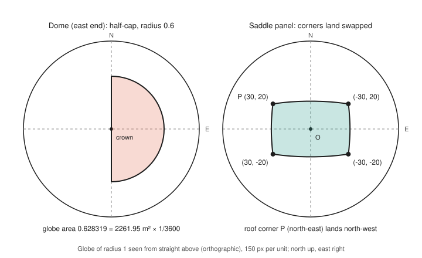

# Gauss map and second fundamental form: how a surface leaves its tangent plane

[Syllabus](../../../SYLLABUS.md) → [Differential geometry and Lie groups](../README.md) → [Surfaces](../README.md#s02) → Gauss map and second fundamental form

---

## General Overview

A stadium roof is domed over its east end and saddle-shaped over the middle. At every point, an arrow of length 1 stands straight out of the roof, at right angles to it. This is the unit normal: a light sensor bolted flush to the roof points along it.

Copy every one of those arrows to the centre of a globe of radius 1, keeping its direction. Its tip marks one point on the globe. This rule, roof point to globe point, is the Gauss map.

- A flat roof sends every point to the same globe point.
- The half dome (radius 60 m, 2,261.95 m² of copper) sends its normals over a half-cap of globe area 0.628319. That is 1/3600 of the roof area: the dome turns its normal by 1/60 radian per metre.
- The saddle spreads its normals backwards. Its north-east lamp fixing P sends its normal to the globe's north-west.

The normal turns because the roof leaves its tangent plane (the flat plane touching it at P). Go 10 m east of P on the plan, and the roof there stands 0.714286 m off that plane, measured square to it (0.833333 m straight up). Three numbers $`L`$, $`M`$, $`N`$, the second fundamental form, record that lift. Combined with the first form, they give a 2 × 2 table, the shape operator $`W`$: how fast the normal turns in each direction.

**The Gauss map sends each point of a surface to its unit normal on a globe; the second fundamental form measures how far the surface rises off its tangent plane, and the shape operator built from the two forms says how fast the normal turns in each direction.**

**What kind of fact this is:** definitions, plus theorems proved on this card in Why it works: the lift formula, the Weingarten equations, the area rule, and that the determinant and trace of $`W`$ ignore the chart. All of it is local: it describes the roof near one point.

### The picture: the roof's normals plotted on a globe

<p align="center"></p>

To scale: the globe seen from straight above (an orthographic view), north up, east right. The centre dot is straight up, where the dome's crown and the saddle's centre O land. Right: the saddle panel between its lamp fixings $`(\pm 30, \pm 20)`$ lands with east and west swapped.

---

## The formula

The roof is a patch ([Regular surface](01-regular-surfaces-and-tangent-planes.md)): a rule $`\mathbf{r}(u, v)`$ that turns two plan coordinates into a point in space. On the saddle, $`u`$ is metres east and $`v`$ metres north of the centre O, and

```math
\mathbf{r}(u, v) = \left(u,\ v,\ 30 + \frac{u^2 - v^2}{120}\right).
```

The tangent arrows $`\mathbf{r}_u`$, $`\mathbf{r}_v`$ and the numbers $`E = \mathbf{r}_u \cdot \mathbf{r}_u`$, $`F = \mathbf{r}_u \cdot \mathbf{r}_v`$, $`G = \mathbf{r}_v \cdot \mathbf{r}_v`$ come from [First fundamental form](02-first-fundamental-form.md). This card adds three things.

**The Gauss map.** It sends each point to its unit normal (an arrow of length 1 at right angles to the tangent plane), taken pointing up, out of the roof:

```math
\mathbf{n}(u, v) = \frac{\mathbf{r}_u \times \mathbf{r}_v}{\lVert \mathbf{r}_u \times \mathbf{r}_v \rVert}.
```

**The second fundamental form.** Three numbers $`L`$, $`M`$, $`N`$: the second derivatives of the patch, measured along the normal. A subscript means a rate of change, so $`\mathbf{r}_{uv}`$ is the rate of change of $`\mathbf{r}_u`$ as $`v`$ grows.

```math
L = \mathbf{r}_{uu} \cdot \mathbf{n}, \qquad M = \mathbf{r}_{uv} \cdot \mathbf{n}, \qquad N = \mathbf{r}_{vv} \cdot \mathbf{n}, \qquad \mathrm{II} = L\,du^2 + 2M\,du\,dv + N\,dv^2.
```

On the curves shelf, N is a curve's normal; on the regular-surface card, N is the cross product $`\mathbf{r}_u \times \mathbf{r}_v`$; on the first-form card, L is a length. Here $`L`$, $`M`$ and $`N`$ mean only these three numbers.

**The shape operator.** Write the two forms as matrices and divide one by the other:

```math
W = \mathrm{I}^{-1}\,\mathrm{II} = \begin{pmatrix} E & F \\ F & G \end{pmatrix}^{-1} \begin{pmatrix} L & M \\ M & N \end{pmatrix}, \qquad -\mathbf{n}_u = W_{11}\,\mathbf{r}_u + W_{21}\,\mathbf{r}_v, \qquad -\mathbf{n}_v = W_{12}\,\mathbf{r}_u + W_{22}\,\mathbf{r}_v.
```

**Read it aloud:** "the shape operator is the first form's inverse times the second form; its first column says how the normal turns, written in the two tangent arrows, for a step in $`u`$, and its second column the same for a step in $`v`$."

| Symbol | Plain meaning | In our example | Push it up and the answer… |
| --- | --- | --- | --- |
| $`\mathbf{r}(u, v)`$; $`u`$, $`v`$; $`\mathbf{r}_u`$, $`\mathbf{r}_v`$ | the patch: plan metres east and north of O to a roof point; its tangent arrows, the rates of change of $`\mathbf{r}`$ | P is (30, 20); there $`\mathbf{r}_u \times \mathbf{r}_v = (-0.5, 0.333333, 1)`$ | — |
| $`\mathbf{n}`$; $`\mathbf{n}_u`$, $`\mathbf{n}_v`$ | the unit normal, pointing up, where the Gauss map sends a point; how fast it turns per plan metre east, or north | $`(-0.428571, 0.285714, 0.857143)`$ at P, 31.00° from vertical | — |
| $`\mathbf{r}_{uu}`$, $`\mathbf{r}_{uv}`$, $`\mathbf{r}_{vv}`$ | second derivatives of the patch: how the tangent arrows change | $`(0, 0, 0.016667)`$, $`0`$, $`(0, 0, -0.016667)`$ at P | — |
| $`L`$, $`M`$, $`N`$ | the second fundamental form, in 1/m: bending along the normal | 0.014286, 0, −0.014286 at P | the roof leaves its tangent plane faster |
| $`\mathrm{I}`$, $`\mathrm{II}`$; $`E`$, $`F`$, $`G`$ | the first and second forms as 2 × 2 matrices; the first form's entries, dot products of the tangent arrows | $`E, F, G`$ = 1.25, −0.166667, 1.111111 | — |
| $`W`$, $`W_{ij}`$; $`a`$, $`b`$ | the shape operator and its entries, in 1/m; $`a`$, $`b`$ write the turning $`-\mathbf{n}_u`$ as $`a\,\mathbf{r}_u + b\,\mathbf{r}_v`$ (Step 3), its first column | rows (0.011662, −0.001749) and (0.001749, −0.013120) | — |
| $`\det W`$ | its determinant $`W_{11}W_{22} - W_{12}W_{21}`$: globe area per square metre of roof, negative if turned backwards | −0.000149938 per m² at P | — |
| $`\mathrm{tr}\,W`$ | its trace, $`W_{11} + W_{22}`$; its sign follows the normal's direction | −0.001457726 per m at P | — |
| $`du`$, $`dv`$; $`\tfrac12\mathrm{II}`$ | a small plan step, in metres; the roof's distance from its tangent plane after it, measured square to the plane | 10 m east, $`(10, 0)`$: 0.714286 m | larger, as the step squared |
| $`p`$, $`q`$; $`J`$ | the seam chart's coordinates, $`u = p + q`$, $`v = p - q`$; the Jacobian matrix of that change | P is (25, 5); $`\det J = -2`$ | — |
| $`R`$ | the dome's radius | 60 m | gentler dome, smaller $`W`$ |
| $`h`$ | step size in the code's stepped roads | 1 m and 0.1 m; 2 m and 0.2 m | larger error |

At P the second derivatives are short: $`\mathbf{r}_{uu} = (0, 0, 1/60)`$, $`\mathbf{r}_{uv} = 0`$, $`\mathbf{r}_{vv} = (0, 0, -1/60)`$. Dotted with $`\mathbf{n}`$, whose height part is 6/7, they give $`L = 1/70`$, $`M = 0`$, $`N = -1/70`$.

### When it holds

- **The chart is regular: $`\mathbf{r}_u \times \mathbf{r}_v \ne 0`$.** Otherwise the normal is 0 divided by 0, as at the centre of a polar chart (distance and bearing).
- **The surface is smooth.** On the ridge of a pitched roof sloping 0.3 each way, the normal jumps. Its rate of change reads 0.574696 per m over 1 m and 5.746958 per m over 0.1 m, growing without limit: no $`W`$ exists there.
- **One normal direction is fixed for the whole surface.** Flip $`\mathbf{n}`$ and $`L`$, $`M`$, $`N`$ and $`W`$ all change sign. This card takes $`\mathbf{n}`$ pointing up, so a positive $`L`$ means the roof curves up, toward $`\mathbf{n}`$, along $`u`$. The seam chart's raw cross product points down; left there, it flips the trace to +0.001457726.
- **The normal is made unit length.** With the bare cross product, every entry of $`W`$ at P is 1.166667 times too big.

---

## Why it works

### Step 0: up close, the surface is its tangent plane plus a bowl

Up close, a step across the roof has a first-order part, which lies in the tangent plane, and a second-order part, the curving. Measured along the normal, only the curving is left. That is the second fundamental form.

### Step 1: the distance from the tangent plane is half of II

Take a small plan step $`(du, dv)`$ from P. Taylor's formula to second order ([Hessian](../../06-Calculus%20and%20analysis/07-Several%20Variables/05-hessian-and-second-order-approximation.md)) gives the move in space:

```math
\mathbf{r}(u + du, v + dv) - \mathbf{r}(u, v) = \mathbf{r}_u\,du + \mathbf{r}_v\,dv + \tfrac12\left(\mathbf{r}_{uu}\,du^2 + 2\mathbf{r}_{uv}\,du\,dv + \mathbf{r}_{vv}\,dv^2\right) + \ldots
```

Dot both sides with $`\mathbf{n}`$. The tangent arrows are at right angles to $`\mathbf{n}`$, so the first two terms vanish. What remains is $`\tfrac12(L\,du^2 + 2M\,du\,dv + N\,dv^2) = \tfrac12\mathrm{II}`$.

At P a 10 m step east lifts the roof 0.714286 m off the tangent plane, measured along $`\mathbf{n}`$, exactly, because this roof is quadratic in $`u`$ and $`v`$. A 10 m step north drops it 0.714286 m below. A 10 m step along the seam $`(10, 10)`$ gives exactly 0: there $`L + 2M + N = 0`$, and the steel seam is a straight line lying in the roof.

### Step 2: the same numbers say how fast the normal turns

The normal is at right angles to $`\mathbf{r}_u`$ everywhere, so $`\mathbf{n} \cdot \mathbf{r}_u = 0`$ at every point. Take the rate of change in $`u`$ (the product rule):

```math
\mathbf{n}_u \cdot \mathbf{r}_u + \mathbf{n} \cdot \mathbf{r}_{uu} = 0, \quad \text{so} \quad \mathbf{n}_u \cdot \mathbf{r}_u = -L.
```

In the same way $`\mathbf{n}_u \cdot \mathbf{r}_v = \mathbf{n}_v \cdot \mathbf{r}_u = -M`$ and $`\mathbf{n}_v \cdot \mathbf{r}_v = -N`$. So the bending that lifts the roof off its tangent plane is the same thing as the turning of its normal.

### Step 3: solving for the turning gives W

Since $`\mathbf{n} \cdot \mathbf{n} = 1`$, the rate $`\mathbf{n}_u`$ is at right angles to $`\mathbf{n}`$, so it lies in the tangent plane. Write $`-\mathbf{n}_u = a\,\mathbf{r}_u + b\,\mathbf{r}_v`$. Dot with $`\mathbf{r}_u`$ and with $`\mathbf{r}_v`$, and use Step 2:

```math
E\,a + F\,b = L, \qquad F\,a + G\,b = M.
```

That is $`\mathrm{I}\,(a, b) = (L, M)`$, so $`(a, b) = \mathrm{I}^{-1}(L, M)`$, the first column of $`W`$. The $`v`$ step gives the second column. These are the Weingarten equations in the formula.

The $`\mathrm{I}^{-1}`$ is there because the plan grid is not square on the roof. At the centre O, where $`E = G = 1`$ and $`F = 0`$, $`W`$ equals $`\mathrm{II}`$.

### Step 4: the determinant is the Gauss map's area stretch

A small plan square sits on the roof as a parallelogram with area vector $`\mathbf{r}_u \times \mathbf{r}_v`$ per unit of plan. Its normals sit on the globe as a parallelogram with area vector $`\mathbf{n}_u \times \mathbf{n}_v`$. The fold below shows

```math
\mathbf{n}_u \times \mathbf{n}_v = \det W \; (\mathbf{r}_u \times \mathbf{r}_v).
```

So $`\det W`$ is globe area per roof area. A negative value means the image is traced the other way round: the saddle's backwards turn in the figure. At P the code measures this ratio directly on 2 m and 0.2 m squares and gets −0.000149901 and −0.000149937, closing in on −0.000149938.

On the dome, with outward normal $`\mathbf{n} = (\mathbf{r} - \text{centre})/R`$, the normal turns exactly like the point, scaled by $`1/R`$. So $`W = -\tfrac{1}{60}`$ times the identity, and $`\det W = 1/3600`$. The half dome's 2,261.946711 m² times 1/3600 is 0.628319, the globe area of the half-cap its normals fill. That cap reaches 36.869898° from vertical, the tilt of the roof at the dome's rim.

### Step 5: the chart changes the entries of W, not its determinant or trace

In the seam chart $`u = p + q`$, $`v = p - q`$ from [First fundamental form](02-first-fundamental-form.md), P is (25, 5). There $`L = N = 0`$ and $`M = 0.028571`$: the seams are straight, so the roof does not leave its tangent plane along them. The shape operator becomes rows $`(-0.000729, 0.014140)`$ and $`(0.010641, -0.000729)`$. Every entry differs from the plan chart's. Yet $`\det W = -0.000149938`$ and $`\mathrm{tr}\,W = -0.001457726`$ in both charts, the hand values $`-9/60025`$ and $`-1/686`$.

The reason: $`W`$ is one turning of one normal, written in each chart's own tangent arrows. The fold shows the determinant and trace survive any change of arrows.

<details>
<summary>Detailed proof: the area rule and the change of chart</summary>

**Area rule.** By the Weingarten equations, $`\mathbf{n}_u = -W_{11}\mathbf{r}_u - W_{21}\mathbf{r}_v`$ and $`\mathbf{n}_v = -W_{12}\mathbf{r}_u - W_{22}\mathbf{r}_v`$. Expand the cross product. The terms $`\mathbf{r}_u \times \mathbf{r}_u`$ and $`\mathbf{r}_v \times \mathbf{r}_v`$ are zero, and $`\mathbf{r}_v \times \mathbf{r}_u = -\mathbf{r}_u \times \mathbf{r}_v`$:

$`\displaystyle \mathbf{n}_u \times \mathbf{n}_v = (W_{11}W_{22} - W_{21}W_{12})\,(\mathbf{r}_u \times \mathbf{r}_v) = \det W\,(\mathbf{r}_u \times \mathbf{r}_v).`$

**Change of chart.** Let $`J`$ be the Jacobian matrix of the change $`(p, q) \mapsto (u, v)`$. The chain rule gives $`\mathbf{r}_p = u_p\mathbf{r}_u + v_p\mathbf{r}_v`$ and the same for $`q`$, so $`\mathrm{I}' = J^{\mathsf T}\mathrm{I}\,J`$. The second form changes the same way, $`\mathrm{II}' = J^{\mathsf T}\mathrm{II}\,J`$, provided the normal is the same arrow: the extra terms $`u_{pp}\mathbf{r}_u + \ldots`$ in $`\mathbf{r}_{pp}`$ are tangent and vanish against $`\mathbf{n}`$. Then

$`\displaystyle W' = (J^{\mathsf T}\mathrm{I}\,J)^{-1}J^{\mathsf T}\mathrm{II}\,J = J^{-1}\,\mathrm{I}^{-1}\mathrm{II}\,J = J^{-1}W J.`$

So $`\det W' = \det W`$ and $`\mathrm{tr}\,W' = \mathrm{tr}\,W`$, because $`\det(J^{-1}WJ) = \det W`$ and $`\mathrm{tr}(J^{-1}WJ) = \mathrm{tr}(WJJ^{-1})`$.

For the seam chart $`\det J = -2`$: it reverses the turning order of the arrows, so $`\mathbf{r}_p \times \mathbf{r}_q`$ points down. Keeping that downward normal multiplies $`\mathrm{II}'`$ and $`W'`$ by −1. The determinant of a 2 × 2 matrix does not notice ($`(-1)^2 = 1`$); the trace does.

</details>

---

## Worked numbers, by hand

At the lamp fixing P = (30, 20): from [First fundamental form](02-first-fundamental-form.md), $`\mathbf{r}_u = (1, 0, u/60)`$ and $`\mathbf{r}_v = (0, 1, -v/60)`$.

| Step | Arithmetic | Value |
| --- | --- | --- |
| cross product at P | $`(1, 0, 30/60) \times (0, 1, -20/60)`$ | $`(-0.5, 0.333333, 1)`$, length 1.166667 |
| unit normal | divide by 1.166667 | $`(-0.428571, 0.285714, 0.857143)`$ |
| tilt from vertical | $`\arccos 0.857143`$ | 31.00° |
| $`L`$, $`M`$, $`N`$ | $`0.016667 \times 0.857143`$, $`0`$, $`-0.016667 \times 0.857143`$ | 0.014286, 0, −0.014286 |
| $`EG - F^2`$ | $`1.25 \times 1.111111 - 0.166667^2`$ | 1.361111 |
| $`\mathrm{I}^{-1}`$ | $`(G, -F;\ -F, E)/1.361111`$ | rows (0.816327, 0.122449), (0.122449, 0.918367) |
| $`W = \mathrm{I}^{-1}\mathrm{II}`$, column 1 | $`0.014286 \times (0.816327, 0.122449)`$ | (0.011662, 0.001749) |
| column 2 | $`-0.014286 \times (0.122449, 0.918367)`$ | (−0.001749, −0.013120) |
| $`\det W`$ | $`0.011662 \times (-0.013120) - (-0.001749)(0.001749)`$ | **−0.000149938 per m²** |
| cross-check | $`(LN - M^2)/(EG - F^2) = -0.000204082/1.361111`$ | −0.000149938 |

Near P, each square metre of saddle sends its normals over 0.000149938 of globe area, traced backwards. The dome sends each square metre over 0.000277778, the right way round.

### What breaks if you drop a piece

Same point P; the correct $`W`$ has rows (0.011662, −0.001749) and (0.001749, −0.013120), and $`\det W = -0.000149938`$.

| Mistake | Comes out at | What went wrong |
| --- | --- | --- |
| Normal not made unit length | rows (0.013605, −0.002041), (0.002041, −0.015306) | every entry is 1.166667 times too big |
| $`W = \mathrm{II}`$, forgetting $`\mathrm{I}^{-1}`$ | $`\det = -0.000204082`$ | the plan grid is treated as square metres on the roof |
| Seam chart with its downward normal | trace +0.001457726 | the normal's direction flips every sign of $`W`$; $`\det W`$ survives |
| A crease: the ridge of a pitched roof | 0.574696, then 5.746958 per m | the normal jumps, so its rate of change has no limit |

The code below prints every number in that table.

---

## Code, from first principles, and it actually runs

The code is given only the patches. It builds tangent arrows and second derivatives by central differences (nearby points, subtracted), then forms $`\mathbf{n}`$, $`L`$, $`M`$, $`N`$ and $`W`$ by the formulas written out. On the saddle those points sit 0.1 m apart: its height is quadratic, so the differences are exact there, and the wider step keeps rounding error out of the ninth decimal. It reaches $`W`$ at P by **four independent roads**: $`\mathrm{I}^{-1}\mathrm{II}`$ in the plan chart; the Gauss map's own turning, stepped 1 m and 0.1 m; the seam chart, compared by determinant and trace; and globe area over roof area on 2 m and 0.2 m squares. The dome is checked against $`-1/R`$ and the half-cap's area, the lift off the tangent plane by subtraction against half of II, and $`\det W`$ and $`\mathrm{tr}\,W`$ against the hand values.

### Python

```python
# Gauss map and second fundamental form -- the check behind the card.  Standard library only.
# Roof: the saddle middle, z = 30 + (u^2 - v^2)/120 m (plan chart), the same saddle in the
# seam chart u = p + q, v = p - q, and the dome over the east end, a sphere of radius 60 m.
# Every number on the card is printed here.  No geometry package is used.
from math import sqrt, sin, cos, acos, pi, degrees

R = 60.0
def plan(u, v): return (u, v, 30.0 + (u * u - v * v) / 120.0)
def seam(p, q): return (p + q, p - q, 30.0 + p * q / 30.0)
def dome(f, t): return (R * sin(f) * cos(t), R * sin(f) * sin(t), R * cos(f))
def barrel(u, v): return (R * sin(u / R), v, R * cos(u / R))      # a barrel vault, for "try"
def ridge(u, v): return (u, v, 30.0 - 0.3 * abs(u))              # a crease, for "breaks"

def sub(a, b): return tuple(x - y for x, y in zip(a, b))
def scl(a, s): return tuple(x * s for x in a)
def dot(a, b): return sum(x * y for x, y in zip(a, b))
def cross(a, b): return (a[1] * b[2] - a[2] * b[1], a[2] * b[0] - a[0] * b[2], a[0] * b[1] - a[1] * b[0])
def unit(a): return scl(a, 1.0 / sqrt(dot(a, a)))

def arrows(ch, a, b, h=1e-3):
    # tangent arrows r_u, r_v and second derivatives r_uu, r_uv, r_vv by central differences
    c, pu, mu, pv, mv = ch(a, b), ch(a + h, b), ch(a - h, b), ch(a, b + h), ch(a, b - h)
    ru, rv = scl(sub(pu, mu), 0.5 / h), scl(sub(pv, mv), 0.5 / h)
    ruu = scl(sub(sub(pu, c), sub(c, mu)), 1 / h ** 2)
    rvv = scl(sub(sub(pv, c), sub(c, mv)), 1 / h ** 2)
    ruv = scl(sub(sub(ch(a + h, b + h), ch(a + h, b - h)), sub(ch(a - h, b + h), ch(a - h, b - h))), 0.25 / h ** 2)
    return ru, rv, ruu, ruv, rvv

def up(n): return n if n[2] > 0 else scl(n, -1.0)     # house rule: the normal points up, out of the roof

def gauss(ch, a, b): ru, rv = arrows(ch, a, b)[:2]; return up(unit(cross(ru, rv)))

def forms(ch, a, b, unit_normal=True, h=1e-3):   # h = 0.1 on the quadratic saddle: exact, less rounding
    ru, rv, ruu, ruv, rvv = arrows(ch, a, b, h)
    n = up(cross(ru, rv))
    if unit_normal: n = unit(n)
    return (dot(ru, ru), dot(ru, rv), dot(rv, rv)), (dot(ruu, n), dot(ruv, n), dot(rvv, n))

def shape(I, II):          # road 1: W = I^-1 II, written out
    (E, F, G), (L, M, N) = I, II
    d = E * G - F * F
    return ((G * L - F * M) / d, (G * M - F * N) / d), ((E * M - F * L) / d, (E * N - F * M) / d)

def weingarten(ch, a, b, h):   # road 2: how the Gauss map moves; -n_u = w11 r_u + w21 r_v
    ru, rv = arrows(ch, a, b)[:2]
    nu = scl(sub(gauss(ch, a + h, b), gauss(ch, a - h, b)), -0.5 / h)
    nv = scl(sub(gauss(ch, a, b + h), gauss(ch, a, b - h)), -0.5 / h)
    E, F, G = dot(ru, ru), dot(ru, rv), dot(rv, rv)
    d = E * G - F * F
    col = [((G * dot(x, ru) - F * dot(x, rv)) / d, (E * dot(x, rv) - F * dot(x, ru)) / d) for x in (nu, nv)]
    return (col[0][0], col[1][0]), (col[0][1], col[1][1])

def det(W): return W[0][0] * W[1][1] - W[0][1] * W[1][0]
def tr(W): return W[0][0] + W[1][1]
def fx(x, d=6): return f"{0.0 if abs(x) < 0.5 * 10 ** -d else x:.{d}f}"   # no "-0.000000"
def two(W): return f"{fx(W[0][0])} {fx(W[0][1])} / {fx(W[1][0])} {fx(W[1][1])}"

def image_ratio(ch, a, b, h):  # road 4: signed globe area of a small square's normals / roof area
    c = [(a - h / 2, b - h / 2), (a + h / 2, b - h / 2), (a + h / 2, b + h / 2), (a - h / 2, b + h / 2)]
    n, r, n0 = [gauss(ch, *p) for p in c], [ch(*p) for p in c], gauss(ch, a, b)
    return dot(cross(sub(n[2], n[0]), sub(n[3], n[1])), n0) / dot(cross(sub(r[2], r[0]), sub(r[3], r[1])), n0)

def gap(a, b):             # the roof's distance from P's tangent plane, along n, after a plan step (a, b)
    return dot(sub(plan(30 + a, 20 + b), plan(30, 20)), gauss(plan, 30, 20))

I1, II1 = forms(plan, 30, 20, h=0.1); W1 = shape(I1, II1)
I2, II2 = forms(seam, 25, 5, h=0.1); W2 = shape(I2, II2)
n = gauss(plan, 30, 20)
F0 = 0.5 * 0.643501108793284          # halfway up the dome's slope; rim polar angle acos(0.8)
Wd = shape(*forms(dome, F0, 0.0))
dome_area, cap = pi * R * 12.0, pi * (1 - 0.8)  # half dome pi R h; its half-cap on the globe
Iu, IIu = forms(plan, 30, 20, unit_normal=False, h=0.1)
Wdn = shape(I2, tuple(-x for x in II2))         # r_p x r_q points down; not flipped
kink = [sqrt(dot(sub(gauss(ridge, h / 2, 0), gauss(ridge, -h / 2, 0)), sub(gauss(ridge, h / 2, 0), gauss(ridge, -h / 2, 0)))) / h for h in (1.0, 0.1)]
E, F, G = I1; L, M, N = II1
ar = arrows(plan, 30, 20); c = cross(ar[0], ar[1])
rows = [
    ("unit normal n at P", f"{n[0]:.6f} {n[1]:.6f} {n[2]:.6f}"),
    ("  by hand (-3, 2, 6)/7", f"{-3 / 7:.6f} {2 / 7:.6f} {6 / 7:.6f}"),
    ("  tilt from vertical, deg", f"{degrees(acos(n[2])):.6f}"),
    ("r_u x r_v at P, its length", f"{c[0]:.6f} {c[1]:.6f} {c[2]:.6f} {sqrt(dot(c, c)):.6f}"),
    ("r_uu, r_vv at P", f"{fx(ar[2][0])} {fx(ar[2][1])} {ar[2][2]:.6f} / {fx(ar[4][0])} {fx(ar[4][1])} {ar[4][2]:.6f}"),
    ("E, F, G at P", f"{E:.6f} {F:.6f} {G:.6f}"),
    ("I^-1 at P", two(shape(I1, (1.0, 0.0, 1.0)))),
    ("L, M, N at P, plan chart", f"{fx(L)} {fx(M)} {fx(N)}"),
    ("  by hand 1/70, 0, -1/70", f"{1 / 70:.6f} {0.0:.6f} {-1 / 70:.6f}"),
    ("EG - F^2, LN - M^2", f"{E * G - F * F:.6f} {L * N - M * M:.9f}"),
    ("1 W = I^-1 II, plan chart", two(W1)),
    ("2 W from the Gauss map, h = 1 m", two(weingarten(plan, 30, 20, 1.0))),
    ("  same, h = 0.1 m", two(weingarten(plan, 30, 20, 0.1))),
    ("3 W in the seam chart at (25, 5)", two(W2)),
    ("  seam L, M, N", f"{fx(II2[0])} {fx(II2[1])} {fx(II2[2])}"),
    ("det W: plan, seam", f"{det(W1):.9f} {det(W2):.9f}"),
    ("  (LN - M^2)/(EG - F^2)", f"{(L * N - M * M) / (E * G - F * F):.9f}"),
    ("trace W: plan, seam", f"{tr(W1):.9f} {tr(W2):.9f}"),
    ("  by hand -9/60025, -1/686", f"{-9 / 60025:.9f} {-1 / 686:.9f}"),
    ("4 globe area / roof area, 2 m square", f"{image_ratio(plan, 30, 20, 2.0):.9f}"),
    ("  same, 0.2 m square", f"{image_ratio(plan, 30, 20, 0.2):.9f}"),
    ("gap above tangent plane, 10 m east", f"{gap(10, 0):.6f} half II {0.5 * L * 100:.6f}"),
    ("  10 m east, measured straight up", f"{plan(40, 20)[2] - plan(30, 20)[2] - 10 * ar[0][2]:.6f}"),
    ("  10 m north", f"{gap(0, 10):.6f} half II {0.5 * N * 100:.6f}"),
    ("  10 m along the seam (10, 10)", f"{fx(gap(10, 10))} half II {fx(0.5 * (L + 2 * M + N) * 100)}"),
    ("  1 m east", f"{gap(1, 0):.6f}"),
    ("dome W halfway up, outward n", two(Wd)),
    ("  -1/R", f"{-1 / R:.6f}"),
    ("  det W and 1/R^2", f"{det(Wd):.9f} {1 / R ** 2:.9f}"),
    ("half dome: roof area m^2", f"{dome_area:.6f}"),
    ("  globe area of its normals, cap", f"{cap:.6f}"),
    ("  det W times roof area", f"{det(Wd) * dome_area:.6f}"),
    ("  rim tilt, deg; globe radius", f"{degrees(0.643501108793284):.6f} {sin(0.643501108793284):.6f}"),
    ("wrong: normal not unit, W", two(shape(Iu, IIu))),
    ("wrong: W = II, det", f"{L * N - M * M:.9f}"),
    ("wrong: seam normal left pointing down", two(Wdn)),
    ("  its det and trace", f"{det(Wdn):.9f} {tr(Wdn):.9f}"),
    ("breaks: crease, |dn|/h at h = 1, 0.1", f"{kink[0]:.6f} {kink[1]:.6f}"),
    ("try: W at the centre O", two(shape(*forms(plan, 0, 0)))),
    ("try: barrel vault R = 60, W", two(shape(*forms(barrel, 10.0, 5.0)))),
    ("try: lamp fixing (30, -20), det W", f"{det(shape(*forms(plan, 30, -20))):.9f}"),
]
for name, v in rows:
    print(f"{name:<38} {v}")
for u, v in ((30, -20), (30, 20), (-30, 20), (-30, -20)):
    g = gauss(plan, u, v)
    print(f"figure, saddle corner ({u}, {v}) -> globe {g[0]:.4f} {g[1]:.4f}")

assert abs(n[0] + 3 / 7) + abs(n[1] - 2 / 7) + abs(n[2] - 6 / 7) < 1e-9, "unit normal by hand"
assert abs(L - 1 / 70) + abs(M) + abs(N + 1 / 70) < 1e-6, "second form by hand"
Wg = weingarten(plan, 30, 20, 0.1)
assert max(abs(Wg[i][j] - W1[i][j]) for i in (0, 1) for j in (0, 1)) < 1e-5, "Gauss map road agrees"
assert abs(det(W1) - det(W2)) < 1e-9 and abs(tr(W1) - tr(W2)) < 1e-8, "det and trace ignore the chart"
assert abs(W1[0][0] - W2[0][0]) > 1e-3, "entries of W do depend on the chart"
assert abs(det(W1) + 9 / 60025) < 1e-12 and abs(tr(W1) + 1 / 686) < 1e-10, "det and trace by hand"
e2, e02 = abs(image_ratio(plan, 30, 20, 2.0) - det(W1)), abs(image_ratio(plan, 30, 20, 0.2) - det(W1))
assert e02 < e2 / 50 and e02 < 1e-9, "the globe area ratio closes in on det W"
assert abs(gap(10, 0) - 0.5 * L * 100) < 1e-6, "the roof leaves its tangent plane by II/2"
assert abs(Wd[0][0] + 1 / R) + abs(Wd[1][1] + 1 / R) + abs(Wd[0][1]) < 1e-6, "dome W = -I/R"
assert abs(det(Wd) * dome_area - cap) < 1e-6, "dome: det W times area = globe area"
assert kink[1] > 9 * kink[0], "a crease has no shape operator"
print("ALL CHECKS PASS")
```

**Ran 2026-11-19 on macOS, Python 3.14.10, standard library only. All checks passed. Output, pasted from the run:**

```
unit normal n at P                     -0.428571 0.285714 0.857143
  by hand (-3, 2, 6)/7                 -0.428571 0.285714 0.857143
  tilt from vertical, deg              31.002719
r_u x r_v at P, its length             -0.500000 0.333333 1.000000 1.166667
r_uu, r_vv at P                        0.000000 0.000000 0.016667 / 0.000000 0.000000 -0.016667
E, F, G at P                           1.250000 -0.166667 1.111111
I^-1 at P                              0.816327 0.122449 / 0.122449 0.918367
L, M, N at P, plan chart               0.014286 0.000000 -0.014286
  by hand 1/70, 0, -1/70               0.014286 0.000000 -0.014286
EG - F^2, LN - M^2                     1.361111 -0.000204082
1 W = I^-1 II, plan chart              0.011662 -0.001749 / 0.001749 -0.013120
2 W from the Gauss map, h = 1 m        0.011661 -0.001749 / 0.001749 -0.013119
  same, h = 0.1 m                      0.011662 -0.001749 / 0.001749 -0.013120
3 W in the seam chart at (25, 5)       -0.000729 0.014140 / 0.010641 -0.000729
  seam L, M, N                         0.000000 0.028571 0.000000
det W: plan, seam                      -0.000149938 -0.000149938
  (LN - M^2)/(EG - F^2)                -0.000149938
trace W: plan, seam                    -0.001457726 -0.001457726
  by hand -9/60025, -1/686             -0.000149938 -0.001457726
4 globe area / roof area, 2 m square   -0.000149901
  same, 0.2 m square                   -0.000149937
gap above tangent plane, 10 m east     0.714286 half II 0.714286
  10 m east, measured straight up      0.833333
  10 m north                           -0.714286 half II -0.714286
  10 m along the seam (10, 10)         0.000000 half II 0.000000
  1 m east                             0.007143
dome W halfway up, outward n           -0.016667 0.000000 / 0.000000 -0.016667
  -1/R                                 -0.016667
  det W and 1/R^2                      0.000277778 0.000277778
half dome: roof area m^2               2261.946711
  globe area of its normals, cap       0.628319
  det W times roof area                0.628319
  rim tilt, deg; globe radius          36.869898 0.600000
wrong: normal not unit, W              0.013605 -0.002041 / 0.002041 -0.015306
wrong: W = II, det                     -0.000204082
wrong: seam normal left pointing down  0.000729 -0.014140 / -0.010641 0.000729
  its det and trace                    -0.000149938 0.001457726
breaks: crease, |dn|/h at h = 1, 0.1   0.574696 5.746958
try: W at the centre O                 0.016667 0.000000 / 0.000000 -0.016667
try: barrel vault R = 60, W            -0.016667 0.000000 / 0.000000 0.000000
try: lamp fixing (30, -20), det W      -0.000149938
figure, saddle corner (30, -20) -> globe -0.4286 -0.2857
figure, saddle corner (30, 20) -> globe -0.4286 0.2857
figure, saddle corner (-30, 20) -> globe 0.4286 0.2857
figure, saddle corner (-30, -20) -> globe 0.4286 -0.2857
ALL CHECKS PASS
```

### Rust

```rust
// Gauss map and second fundamental form -- the check behind the card.  std only, no crates.
// Roof: the saddle middle, z = 30 + (u^2 - v^2)/120 m (plan chart), the same saddle in the
// seam chart u = p + q, v = p - q, and the dome over the east end, a sphere of radius 60 m.
use std::f64::consts::PI;
type V = [f64; 3];
type Chart = fn(f64, f64) -> V;
type M2 = [[f64; 2]; 2];
const R: f64 = 60.0;

fn plan(u: f64, v: f64) -> V { [u, v, 30.0 + (u * u - v * v) / 120.0] }
fn seam(p: f64, q: f64) -> V { [p + q, p - q, 30.0 + p * q / 30.0] }
fn dome(f: f64, t: f64) -> V { [R * f.sin() * t.cos(), R * f.sin() * t.sin(), R * f.cos()] }
fn barrel(u: f64, v: f64) -> V { [R * (u / R).sin(), v, R * (u / R).cos()] } // a barrel vault, for "try"
fn ridge(u: f64, v: f64) -> V { [u, v, 30.0 - 0.3 * u.abs()] } // a crease, for "breaks"

fn sub(a: V, b: V) -> V { [a[0] - b[0], a[1] - b[1], a[2] - b[2]] }
fn scl(a: V, s: f64) -> V { [a[0] * s, a[1] * s, a[2] * s] }
fn dot(a: V, b: V) -> f64 { a[0] * b[0] + a[1] * b[1] + a[2] * b[2] }
fn cross(a: V, b: V) -> V { [a[1] * b[2] - a[2] * b[1], a[2] * b[0] - a[0] * b[2], a[0] * b[1] - a[1] * b[0]] }
fn unit(a: V) -> V { scl(a, 1.0 / dot(a, a).sqrt()) }
fn up(n: V) -> V { if n[2] > 0.0 { n } else { scl(n, -1.0) } } // house rule: the normal points up

fn arrows(ch: Chart, a: f64, b: f64, h: f64) -> [V; 5] {
    // tangent arrows r_u, r_v and second derivatives r_uu, r_uv, r_vv by central differences
    let (c, pu, mu, pv, mv) = (ch(a, b), ch(a + h, b), ch(a - h, b), ch(a, b + h), ch(a, b - h));
    let (ru, rv) = (scl(sub(pu, mu), 0.5 / h), scl(sub(pv, mv), 0.5 / h));
    let ruu = scl(sub(sub(pu, c), sub(c, mu)), 1.0 / h.powi(2));
    let rvv = scl(sub(sub(pv, c), sub(c, mv)), 1.0 / h.powi(2));
    let ruv = scl(sub(sub(ch(a + h, b + h), ch(a + h, b - h)), sub(ch(a - h, b + h), ch(a - h, b - h))), 0.25 / h.powi(2));
    [ru, rv, ruu, ruv, rvv]
}
fn gauss(ch: Chart, a: f64, b: f64) -> V { let r = arrows(ch, a, b, 1e-3); up(unit(cross(r[0], r[1]))) }
fn forms(ch: Chart, a: f64, b: f64, unit_normal: bool, h: f64) -> ([f64; 3], [f64; 3]) {
    // h = 0.1 on the quadratic saddle: exact, less rounding
    let [ru, rv, ruu, ruv, rvv] = arrows(ch, a, b, h);
    let mut n = up(cross(ru, rv));
    if unit_normal { n = unit(n); }
    ([dot(ru, ru), dot(ru, rv), dot(rv, rv)], [dot(ruu, n), dot(ruv, n), dot(rvv, n)])
}
fn shape(i: [f64; 3], ii: [f64; 3]) -> M2 {
    // road 1: W = I^-1 II, written out
    let ([e, f, g], [l, m, n]) = (i, ii);
    let d = e * g - f * f;
    [[(g * l - f * m) / d, (g * m - f * n) / d], [(e * m - f * l) / d, (e * n - f * m) / d]]
}
fn weingarten(ch: Chart, a: f64, b: f64, h: f64) -> M2 {
    // road 2: how the Gauss map moves; -n_u = w11 r_u + w21 r_v
    let r = arrows(ch, a, b, 1e-3);
    let (ru, rv) = (r[0], r[1]);
    let nu = scl(sub(gauss(ch, a + h, b), gauss(ch, a - h, b)), -0.5 / h);
    let nv = scl(sub(gauss(ch, a, b + h), gauss(ch, a, b - h)), -0.5 / h);
    let (e, f, g) = (dot(ru, ru), dot(ru, rv), dot(rv, rv));
    let d = e * g - f * f;
    let col = |x: V| ((g * dot(x, ru) - f * dot(x, rv)) / d, (e * dot(x, rv) - f * dot(x, ru)) / d);
    let (c0, c1) = (col(nu), col(nv));
    [[c0.0, c1.0], [c0.1, c1.1]]
}
fn det(w: M2) -> f64 { w[0][0] * w[1][1] - w[0][1] * w[1][0] }
fn tr(w: M2) -> f64 { w[0][0] + w[1][1] }
fn fx(x: f64) -> String { format!("{:.6}", if x.abs() < 0.5 * 10f64.powi(-6) { 0.0 } else { x }) } // no "-0.000000"
fn two(w: M2) -> String { format!("{} {} / {} {}", fx(w[0][0]), fx(w[0][1]), fx(w[1][0]), fx(w[1][1])) }
fn image_ratio(ch: Chart, a: f64, b: f64, h: f64) -> f64 {
    // road 4: signed globe area of a small square's normals / roof area
    let c = [(a - h / 2.0, b - h / 2.0), (a + h / 2.0, b - h / 2.0), (a + h / 2.0, b + h / 2.0), (a - h / 2.0, b + h / 2.0)];
    let n: Vec<V> = c.iter().map(|p| gauss(ch, p.0, p.1)).collect();
    let r: Vec<V> = c.iter().map(|p| ch(p.0, p.1)).collect();
    let n0 = gauss(ch, a, b);
    dot(cross(sub(n[2], n[0]), sub(n[3], n[1])), n0) / dot(cross(sub(r[2], r[0]), sub(r[3], r[1])), n0)
}
fn gap(a: f64, b: f64) -> f64 { dot(sub(plan(30.0 + a, 20.0 + b), plan(30.0, 20.0)), gauss(plan, 30.0, 20.0)) }

fn main() {
    let (i1, ii1) = forms(plan, 30.0, 20.0, true, 0.1);
    let w1 = shape(i1, ii1);
    let (i2, ii2) = forms(seam, 25.0, 5.0, true, 0.1);
    let w2 = shape(i2, ii2);
    let n = gauss(plan, 30.0, 20.0);
    let f0 = 0.5 * 0.643501108793284; // halfway up the dome's slope; rim polar angle acos(0.8)
    let (id, iid) = forms(dome, f0, 0.0, true, 1e-3);
    let wd = shape(id, iid);
    let (dome_area, cap) = (PI * R * 12.0, PI * (1.0 - 0.8)); // half dome pi R h; its half-cap on the globe
    let (iu, iiu) = forms(plan, 30.0, 20.0, false, 0.1);
    let wdn = shape(i2, [-ii2[0], -ii2[1], -ii2[2]]); // r_p x r_q points down; not flipped
    let kink: Vec<f64> = [1.0, 0.1].iter().map(|&h: &f64| { let d = sub(gauss(ridge, h / 2.0, 0.0), gauss(ridge, -h / 2.0, 0.0)); dot(d, d).sqrt() / h }).collect();
    let ([e, f, g], [l, m, nn]) = (i1, ii1);
    let ar = arrows(plan, 30.0, 20.0, 1e-3);
    let c = cross(ar[0], ar[1]);
    let (ic, iic) = forms(plan, 0.0, 0.0, true, 1e-3);
    let (ib, iib) = forms(barrel, 10.0, 5.0, true, 1e-3);
    let (il, iil) = forms(plan, 30.0, -20.0, true, 1e-3);
    let rows: Vec<(&str, String)> = vec![
        ("unit normal n at P", format!("{:.6} {:.6} {:.6}", n[0], n[1], n[2])),
        ("  by hand (-3, 2, 6)/7", format!("{:.6} {:.6} {:.6}", -3.0 / 7.0, 2.0 / 7.0, 6.0 / 7.0)),
        ("  tilt from vertical, deg", format!("{:.6}", n[2].acos().to_degrees())),
        ("r_u x r_v at P, its length", format!("{:.6} {:.6} {:.6} {:.6}", c[0], c[1], c[2], dot(c, c).sqrt())),
        ("r_uu, r_vv at P", format!("{} {} {:.6} / {} {} {:.6}", fx(ar[2][0]), fx(ar[2][1]), ar[2][2], fx(ar[4][0]), fx(ar[4][1]), ar[4][2])),
        ("E, F, G at P", format!("{:.6} {:.6} {:.6}", e, f, g)),
        ("I^-1 at P", two(shape(i1, [1.0, 0.0, 1.0]))),
        ("L, M, N at P, plan chart", format!("{} {} {}", fx(l), fx(m), fx(nn))),
        ("  by hand 1/70, 0, -1/70", format!("{:.6} {:.6} {:.6}", 1.0 / 70.0, 0.0, -1.0 / 70.0)),
        ("EG - F^2, LN - M^2", format!("{:.6} {:.9}", e * g - f * f, l * nn - m * m)),
        ("1 W = I^-1 II, plan chart", two(w1)),
        ("2 W from the Gauss map, h = 1 m", two(weingarten(plan, 30.0, 20.0, 1.0))),
        ("  same, h = 0.1 m", two(weingarten(plan, 30.0, 20.0, 0.1))),
        ("3 W in the seam chart at (25, 5)", two(w2)),
        ("  seam L, M, N", format!("{} {} {}", fx(ii2[0]), fx(ii2[1]), fx(ii2[2]))),
        ("det W: plan, seam", format!("{:.9} {:.9}", det(w1), det(w2))),
        ("  (LN - M^2)/(EG - F^2)", format!("{:.9}", (l * nn - m * m) / (e * g - f * f))),
        ("trace W: plan, seam", format!("{:.9} {:.9}", tr(w1), tr(w2))),
        ("  by hand -9/60025, -1/686", format!("{:.9} {:.9}", -9.0 / 60025.0, -1.0 / 686.0)),
        ("4 globe area / roof area, 2 m square", format!("{:.9}", image_ratio(plan, 30.0, 20.0, 2.0))),
        ("  same, 0.2 m square", format!("{:.9}", image_ratio(plan, 30.0, 20.0, 0.2))),
        ("gap above tangent plane, 10 m east", format!("{:.6} half II {:.6}", gap(10.0, 0.0), 0.5 * l * 100.0)),
        ("  10 m east, measured straight up", format!("{:.6}", plan(40.0, 20.0)[2] - plan(30.0, 20.0)[2] - 10.0 * ar[0][2])),
        ("  10 m north", format!("{:.6} half II {:.6}", gap(0.0, 10.0), 0.5 * nn * 100.0)),
        ("  10 m along the seam (10, 10)", format!("{} half II {}", fx(gap(10.0, 10.0)), fx(0.5 * (l + 2.0 * m + nn) * 100.0))),
        ("  1 m east", format!("{:.6}", gap(1.0, 0.0))),
        ("dome W halfway up, outward n", two(wd)),
        ("  -1/R", format!("{:.6}", -1.0 / R)),
        ("  det W and 1/R^2", format!("{:.9} {:.9}", det(wd), 1.0 / R.powi(2))),
        ("half dome: roof area m^2", format!("{:.6}", dome_area)),
        ("  globe area of its normals, cap", format!("{:.6}", cap)),
        ("  det W times roof area", format!("{:.6}", det(wd) * dome_area)),
        ("  rim tilt, deg; globe radius", format!("{:.6} {:.6}", 0.643501108793284f64.to_degrees(), 0.643501108793284f64.sin())),
        ("wrong: normal not unit, W", two(shape(iu, iiu))),
        ("wrong: W = II, det", format!("{:.9}", l * nn - m * m)),
        ("wrong: seam normal left pointing down", two(wdn)),
        ("  its det and trace", format!("{:.9} {:.9}", det(wdn), tr(wdn))),
        ("breaks: crease, |dn|/h at h = 1, 0.1", format!("{:.6} {:.6}", kink[0], kink[1])),
        ("try: W at the centre O", two(shape(ic, iic))),
        ("try: barrel vault R = 60, W", two(shape(ib, iib))),
        ("try: lamp fixing (30, -20), det W", format!("{:.9}", det(shape(il, iil)))),
    ];
    for (name, v) in &rows { println!("{:<38} {}", name, v); }
    for (u, v) in [(30, -20), (30, 20), (-30, 20), (-30, -20)] {
        let g = gauss(plan, u as f64, v as f64);
        println!("figure, saddle corner ({}, {}) -> globe {:.4} {:.4}", u, v, g[0], g[1]);
    }

    assert!((n[0] + 3.0 / 7.0).abs() + (n[1] - 2.0 / 7.0).abs() + (n[2] - 6.0 / 7.0).abs() < 1e-9, "unit normal by hand");
    assert!((l - 1.0 / 70.0).abs() + m.abs() + (nn + 1.0 / 70.0).abs() < 1e-6, "second form by hand");
    let wg = weingarten(plan, 30.0, 20.0, 0.1);
    let worst = (0..2).flat_map(|i| (0..2).map(move |j| (i, j))).map(|(i, j)| (wg[i][j] - w1[i][j]).abs()).fold(0.0, f64::max);
    assert!(worst < 1e-5, "Gauss map road agrees");
    assert!((det(w1) - det(w2)).abs() < 1e-9 && (tr(w1) - tr(w2)).abs() < 1e-8, "det and trace ignore the chart");
    assert!((w1[0][0] - w2[0][0]).abs() > 1e-3, "entries of W do depend on the chart");
    assert!((det(w1) + 9.0 / 60025.0).abs() < 1e-12 && (tr(w1) + 1.0 / 686.0).abs() < 1e-10, "det and trace by hand");
    let (e2, e02) = ((image_ratio(plan, 30.0, 20.0, 2.0) - det(w1)).abs(), (image_ratio(plan, 30.0, 20.0, 0.2) - det(w1)).abs());
    assert!(e02 < e2 / 50.0 && e02 < 1e-9, "the globe area ratio closes in on det W");
    assert!((gap(10.0, 0.0) - 0.5 * l * 100.0).abs() < 1e-6, "the roof leaves its tangent plane by II/2");
    assert!((wd[0][0] + 1.0 / R).abs() + (wd[1][1] + 1.0 / R).abs() + wd[0][1].abs() < 1e-6, "dome W = -I/R");
    assert!((det(wd) * dome_area - cap).abs() < 1e-6, "dome: det W times area = globe area");
    assert!(kink[1] > 9.0 * kink[0], "a crease has no shape operator");
    println!("ALL CHECKS PASS");
}
```

**Ran 2026-11-19 on macOS, rustc 1.98.1, no crates. All checks passed. Output, pasted from the run:**

```
unit normal n at P                     -0.428571 0.285714 0.857143
  by hand (-3, 2, 6)/7                 -0.428571 0.285714 0.857143
  tilt from vertical, deg              31.002719
r_u x r_v at P, its length             -0.500000 0.333333 1.000000 1.166667
r_uu, r_vv at P                        0.000000 0.000000 0.016667 / 0.000000 0.000000 -0.016667
E, F, G at P                           1.250000 -0.166667 1.111111
I^-1 at P                              0.816327 0.122449 / 0.122449 0.918367
L, M, N at P, plan chart               0.014286 0.000000 -0.014286
  by hand 1/70, 0, -1/70               0.014286 0.000000 -0.014286
EG - F^2, LN - M^2                     1.361111 -0.000204082
1 W = I^-1 II, plan chart              0.011662 -0.001749 / 0.001749 -0.013120
2 W from the Gauss map, h = 1 m        0.011661 -0.001749 / 0.001749 -0.013119
  same, h = 0.1 m                      0.011662 -0.001749 / 0.001749 -0.013120
3 W in the seam chart at (25, 5)       -0.000729 0.014140 / 0.010641 -0.000729
  seam L, M, N                         0.000000 0.028571 0.000000
det W: plan, seam                      -0.000149938 -0.000149938
  (LN - M^2)/(EG - F^2)                -0.000149938
trace W: plan, seam                    -0.001457726 -0.001457726
  by hand -9/60025, -1/686             -0.000149938 -0.001457726
4 globe area / roof area, 2 m square   -0.000149901
  same, 0.2 m square                   -0.000149937
gap above tangent plane, 10 m east     0.714286 half II 0.714286
  10 m east, measured straight up      0.833333
  10 m north                           -0.714286 half II -0.714286
  10 m along the seam (10, 10)         0.000000 half II 0.000000
  1 m east                             0.007143
dome W halfway up, outward n           -0.016667 0.000000 / 0.000000 -0.016667
  -1/R                                 -0.016667
  det W and 1/R^2                      0.000277778 0.000277778
half dome: roof area m^2               2261.946711
  globe area of its normals, cap       0.628319
  det W times roof area                0.628319
  rim tilt, deg; globe radius          36.869898 0.600000
wrong: normal not unit, W              0.013605 -0.002041 / 0.002041 -0.015306
wrong: W = II, det                     -0.000204082
wrong: seam normal left pointing down  0.000729 -0.014140 / -0.010641 0.000729
  its det and trace                    -0.000149938 0.001457726
breaks: crease, |dn|/h at h = 1, 0.1   0.574696 5.746958
try: W at the centre O                 0.016667 0.000000 / 0.000000 -0.016667
try: barrel vault R = 60, W            -0.016667 0.000000 / 0.000000 0.000000
try: lamp fixing (30, -20), det W      -0.000149938
figure, saddle corner (30, -20) -> globe -0.4286 -0.2857
figure, saddle corner (30, 20) -> globe -0.4286 0.2857
figure, saddle corner (-30, 20) -> globe 0.4286 0.2857
figure, saddle corner (-30, -20) -> globe 0.4286 -0.2857
ALL CHECKS PASS
```

### Lean

Lean proves the Weingarten equations and Step 4's area rule for every smooth regular patch, and Step 5's change of chart for every $`J`$.

- Take a patch that is smooth and regular, $`\mathbf{r}_u \times \mathbf{r}_v \ne 0`$, near a point. Then the Weingarten equations in the formula hold there, with $`\mathbf{n}`$ the unit normal.
- Take the same patch. Then $`\mathbf{n}_u \times \mathbf{n}_v = \det W (\mathbf{r}_u \times \mathbf{r}_v)`$, Step 4's area rule.
- Take a change of chart with $`\det J \ne 0`$, and $`\det \mathrm{I} \ne 0`$. Then $`W'`$, from the forms $`J^{\mathsf T}\mathrm{I}J`$ and $`J^{\mathsf T}\mathrm{II}J`$, keeps the determinant and trace of $`W`$.
- Take the same change, with the new normal pointing the other way, so the second form is $`-J^{\mathsf T}\mathrm{II}J`$. Then $`\det W'`$ still equals $`\det W`$, and $`\mathrm{tr}\,W'`$ equals $`-\mathrm{tr}\,W`$.

Step 1's lift formula, the chain rule that changes the forms, and every printed number are left to the Python and Rust checks.

```lean
-- Gauss map and second fundamental form: for a smooth regular patch with its unit normal, the normal turns by the shape operator W = I⁻¹ II (the Weingarten equations), det W is the globe area its normals cover per unit of surface area, and det W and trace W do not depend on the chart.
import Mathlib.Analysis.Calculus.ContDiff.Basic
import Mathlib.Analysis.Calculus.FDeriv.Basic
import Mathlib.Analysis.SpecialFunctions.Sqrt
import Mathlib.LinearAlgebra.CrossProduct
import Mathlib.LinearAlgebra.Matrix.NonsingularInverse
import Mathlib.LinearAlgebra.Matrix.Trace
import Mathlib.Tactic
import Mathlib.Analysis.Calculus.FDeriv.Bilinear
import Mathlib.Analysis.Calculus.FDeriv.Symmetric
import Mathlib.Topology.Algebra.Module.FiniteDimension
import Mathlib.LinearAlgebra.Matrix.ToLin
import Mathlib.Analysis.Calculus.ContDiff.Operations

open scoped ContDiff Matrix

namespace GaussMap

/-- The tangent arrow `r_u`: the rate of change of the patch `r(u, v)` as `u` grows. -/
noncomputable def ru (r : ℝ × ℝ → Fin 3 → ℝ) (q : ℝ × ℝ) : Fin 3 → ℝ := fderiv ℝ r q (1, 0)

/-- The tangent arrow `r_v`: the rate of change of the patch `r(u, v)` as `v` grows. -/
noncomputable def rv (r : ℝ × ℝ → Fin 3 → ℝ) (q : ℝ × ℝ) : Fin 3 → ℝ := fderiv ℝ r q (0, 1)

/-- The Gauss map: the unit normal `n = (r_u × r_v) / ‖r_u × r_v‖`, the cross product divided by
its Euclidean length. -/
noncomputable def normal (r : ℝ × ℝ → Fin 3 → ℝ) (q : ℝ × ℝ) : Fin 3 → ℝ :=
  (Real.sqrt ((ru r q ⨯₃ rv r q) ⬝ᵥ (ru r q ⨯₃ rv r q)))⁻¹ • (ru r q ⨯₃ rv r q)

/-- The first fundamental form `I = (E, F; F, G)`, with `E = r_u · r_u`, `F = r_u · r_v`,
`G = r_v · r_v`. -/
noncomputable def firstForm (r : ℝ × ℝ → Fin 3 → ℝ) (q : ℝ × ℝ) : Matrix (Fin 2) (Fin 2) ℝ :=
  !![ru r q ⬝ᵥ ru r q, ru r q ⬝ᵥ rv r q; ru r q ⬝ᵥ rv r q, rv r q ⬝ᵥ rv r q]

/-- The second fundamental form `II = (L, M; M, N)`, with `L = r_uu · n`, `M = r_uv · n`,
`N = r_vv · n`. -/
noncomputable def secondForm (r : ℝ × ℝ → Fin 3 → ℝ) (q : ℝ × ℝ) : Matrix (Fin 2) (Fin 2) ℝ :=
  !![fderiv ℝ (ru r) q (1, 0) ⬝ᵥ normal r q, fderiv ℝ (ru r) q (0, 1) ⬝ᵥ normal r q;
     fderiv ℝ (ru r) q (0, 1) ⬝ᵥ normal r q, fderiv ℝ (rv r) q (0, 1) ⬝ᵥ normal r q]

/-- The shape operator `W = I⁻¹ II`. -/
noncomputable def shapeOperator (r : ℝ × ℝ → Fin 3 → ℝ) (q : ℝ × ℝ) : Matrix (Fin 2) (Fin 2) ℝ :=
  (firstForm r q)⁻¹ * secondForm r q

lemma fderiv_bilin_aux {X : Type*} [NormedAddCommGroup X] [NormedSpace ℝ X]
    [FiniteDimensional ℝ X]
    (B : (Fin 3 → ℝ) →ₗ[ℝ] (Fin 3 → ℝ) →ₗ[ℝ] X) {f g : ℝ × ℝ → Fin 3 → ℝ} {q : ℝ × ℝ}
    (hf : DifferentiableAt ℝ f q) (hg : DifferentiableAt ℝ g q) :
    DifferentiableAt ℝ (fun y => B (f y) (g y)) q ∧
      ∀ v, fderiv ℝ (fun y => B (f y) (g y)) q v =
        B (fderiv ℝ f q v) (g q) + B (f q) (fderiv ℝ g q v) := by
  let B' : (Fin 3 → ℝ) →L[ℝ] (Fin 3 → ℝ) →L[ℝ] X :=
    LinearMap.toContinuousLinearMap (LinearMap.toContinuousLinearMap.toLinearMap ∘ₗ B)
  have hB : (fun y => B (f y) (g y)) = fun y => B' (f y) (g y) := by
    funext y; simp [B']
  have h := B'.hasFDerivAt_of_bilinear hf.hasFDerivAt hg.hasFDerivAt
  rw [hB]
  refine ⟨h.differentiableAt, fun v => ?_⟩
  rw [h.fderiv]
  simp [B', add_comm]

#print axioms fderiv_bilin_aux

/-- If `x` is orthogonal to `a × b ≠ 0`, it is the combination of `a` and `b` whose
coefficients solve the first-form system. -/
lemma decomp_aux (a b x : Fin 3 → ℝ) (hN : a ⨯₃ b ≠ 0) (II : Matrix (Fin 2) (Fin 2) ℝ)
    (j : Fin 2) (hxN : x ⬝ᵥ (a ⨯₃ b) = 0) (hxa : x ⬝ᵥ a = II 0 j) (hxb : x ⬝ᵥ b = II 1 j) :
    x = ((!![a ⬝ᵥ a, a ⬝ᵥ b; a ⬝ᵥ b, b ⬝ᵥ b])⁻¹ * II) 0 j • a +
      ((!![a ⬝ᵥ a, a ⬝ᵥ b; a ⬝ᵥ b, b ⬝ᵥ b])⁻¹ * II) 1 j • b := by
  set I : Matrix (Fin 2) (Fin 2) ℝ := !![a ⬝ᵥ a, a ⬝ᵥ b; a ⬝ᵥ b, b ⬝ᵥ b] with hIdef
  set W := I⁻¹ * II with hW
  have hNN : (a ⨯₃ b) ⬝ᵥ (a ⨯₃ b) ≠ 0 := by
    intro h; exact hN (dotProduct_self_eq_zero.1 h)
  have hdet : I.det = (a ⨯₃ b) ⬝ᵥ (a ⨯₃ b) := by
    rw [hIdef, Matrix.det_fin_two_of, cross_dot_cross, dotProduct_comm b a]
  have hIW : I * W = II := Matrix.mul_nonsing_inv_cancel_left _ _ (by rw [hdet]; exact hNN.isUnit)
  have e0 : a ⬝ᵥ a * W 0 j + a ⬝ᵥ b * W 1 j = II 0 j := by
    rw [← hIW]; simp [Matrix.mul_apply, Fin.sum_univ_two, hIdef]
  have e1 : a ⬝ᵥ b * W 0 j + b ⬝ᵥ b * W 1 j = II 1 j := by
    rw [← hIW]; simp [Matrix.mul_apply, Fin.sum_univ_two, hIdef]
  set z := x - (W 0 j • a + W 1 j • b) with hz
  have za : z ⬝ᵥ a = 0 := by
    rw [hz, sub_dotProduct, add_dotProduct, smul_dotProduct, smul_dotProduct, hxa, ← e0,
      dotProduct_comm b a]
    simp only [smul_eq_mul]; ring
  have zb : z ⬝ᵥ b = 0 := by
    rw [hz, sub_dotProduct, add_dotProduct, smul_dotProduct, smul_dotProduct, hxb, ← e1]
    simp only [smul_eq_mul]; ring
  have zN : z ⬝ᵥ (a ⨯₃ b) = 0 := by
    rw [hz, sub_dotProduct, add_dotProduct, smul_dotProduct, smul_dotProduct, hxN,
      dot_self_cross, dot_cross_self]
    simp
  have zc : z ⨯₃ (a ⨯₃ b) = 0 := by
    rw [cross_cross_eq_smul_sub_smul', zb, dotProduct_comm a z, za]; simp
  have hzz : (z ⬝ᵥ z) * ((a ⨯₃ b) ⬝ᵥ (a ⨯₃ b)) = 0 := by
    have := cross_dot_cross z (a ⨯₃ b) z (a ⨯₃ b)
    rw [zc, zero_dotProduct, zN, dotProduct_comm (a ⨯₃ b) z, zN] at this
    linarith
  have hz0 : z = 0 := by
    rcases mul_eq_zero.1 hzz with h | h
    · exact dotProduct_self_eq_zero.1 h
    · exact absurd h hNN
  exact sub_eq_zero.1 hz0

#print axioms decomp_aux

lemma dot_aux {f g : ℝ × ℝ → Fin 3 → ℝ} {q : ℝ × ℝ}
    (hf : DifferentiableAt ℝ f q) (hg : DifferentiableAt ℝ g q) :
    DifferentiableAt ℝ (fun y => f y ⬝ᵥ g y) q ∧
      ∀ v, fderiv ℝ (fun y => f y ⬝ᵥ g y) q v =
        fderiv ℝ f q v ⬝ᵥ g q + f q ⬝ᵥ fderiv ℝ g q v := by
  simpa using fderiv_bilin_aux (dotProductBilin ℝ ℝ) hf hg

#print axioms dot_aux

lemma cross_aux {f g : ℝ × ℝ → Fin 3 → ℝ} {q : ℝ × ℝ}
    (hf : DifferentiableAt ℝ f q) (hg : DifferentiableAt ℝ g q) :
    DifferentiableAt ℝ (fun y => f y ⨯₃ g y) q :=
  (fderiv_bilin_aux crossProduct hf hg).1

#print axioms cross_aux

lemma smooth_aux (r : ℝ × ℝ → Fin 3 → ℝ) (U : Set (ℝ × ℝ)) (hU : IsOpen U)
    (hr : ContDiffOn ℝ ∞ r U) (q : ℝ × ℝ) (hq : q ∈ U) :
    DifferentiableAt ℝ (ru r) q ∧ DifferentiableAt ℝ (rv r) q ∧
      fderiv ℝ (ru r) q (0, 1) = fderiv ℝ (rv r) q (1, 0) := by
  have hfd : ContDiffOn ℝ ∞ (fderiv ℝ r) U := ((contDiffOn_infty_iff_fderiv_of_isOpen hU).1 hr).2
  have hfdq : DifferentiableAt ℝ (fderiv ℝ r) q :=
    (hfd.contDiffAt (hU.mem_nhds hq)).differentiableAt (by simp)
  have hsymm : IsSymmSndFDerivAt ℝ r q :=
    (hr.contDiffAt (hU.mem_nhds hq)).isSymmSndFDerivAt (by simp)
  have eu : ru r = fun y => fderiv ℝ r y (1, 0) := rfl
  have ev : rv r = fun y => fderiv ℝ r y (0, 1) := rfl
  have du : ∀ w, fderiv ℝ (ru r) q w = fderiv ℝ (fderiv ℝ r) q w (1, 0) := by
    intro w
    rw [eu, fderiv_clm_apply hfdq (differentiableAt_const _)]
    simp
  have dv : ∀ w, fderiv ℝ (rv r) q w = fderiv ℝ (fderiv ℝ r) q w (0, 1) := by
    intro w
    rw [ev, fderiv_clm_apply hfdq (differentiableAt_const _)]
    simp
  refine ⟨?_, ?_, ?_⟩
  · rw [eu]; exact hfdq.clm_apply (differentiableAt_const _)
  · rw [ev]; exact hfdq.clm_apply (differentiableAt_const _)
  · rw [du, dv]; exact hsymm _ _

#print axioms smooth_aux

lemma dot_self_pos_aux (v : Fin 3 → ℝ) (h : v ≠ 0) : 0 < v ⬝ᵥ v := by
  have h0 : 0 ≤ v ⬝ᵥ v := Finset.sum_nonneg fun i _ => mul_self_nonneg (v i)
  exact lt_of_le_of_ne h0 fun h' => h (dotProduct_self_eq_zero.1 h'.symm)

#print axioms dot_self_pos_aux

lemma normal_dot_ru (r : ℝ × ℝ → Fin 3 → ℝ) (y : ℝ × ℝ) : normal r y ⬝ᵥ ru r y = 0 := by
  rw [normal, smul_dotProduct, dotProduct_comm _ (ru r y), dot_self_cross, smul_zero]

#print axioms normal_dot_ru

lemma normal_dot_rv (r : ℝ × ℝ → Fin 3 → ℝ) (y : ℝ × ℝ) : normal r y ⬝ᵥ rv r y = 0 := by
  rw [normal, smul_dotProduct, dotProduct_comm _ (rv r y), dot_cross_self, smul_zero]

#print axioms normal_dot_rv

lemma normal_dot_normal (r : ℝ × ℝ → Fin 3 → ℝ) (y : ℝ × ℝ) (h : ru r y ⨯₃ rv r y ≠ 0) :
    normal r y ⬝ᵥ normal r y = 1 := by
  have hpos : 0 < (ru r y ⨯₃ rv r y) ⬝ᵥ (ru r y ⨯₃ rv r y) := by
    exact dot_self_pos_aux _ h
  rw [normal, smul_dotProduct, dotProduct_smul, smul_eq_mul, smul_eq_mul]
  have hs := Real.mul_self_sqrt hpos.le
  have hs0 : Real.sqrt ((ru r y ⨯₃ rv r y) ⬝ᵥ (ru r y ⨯₃ rv r y)) ≠ 0 :=
    (Real.sqrt_pos.2 hpos).ne'
  field_simp
  linarith

#print axioms normal_dot_normal

lemma normal_differentiableAt (r : ℝ × ℝ → Fin 3 → ℝ) (q : ℝ × ℝ)
    (hu : DifferentiableAt ℝ (ru r) q) (hv : DifferentiableAt ℝ (rv r) q)
    (h : ru r q ⨯₃ rv r q ≠ 0) : DifferentiableAt ℝ (normal r) q := by
  have hN := cross_aux hu hv
  have hD := (dot_aux hN hN).1
  have hpos : 0 < (ru r q ⨯₃ rv r q) ⬝ᵥ (ru r q ⨯₃ rv r q) := by
    exact dot_self_pos_aux _ h
  have hS := hD.sqrt hpos.ne'
  have hI := hS.inv (Real.sqrt_pos.2 hpos).ne'
  exact hI.smul hN

#print axioms normal_differentiableAt

lemma normal_deriv_aux (r : ℝ × ℝ → Fin 3 → ℝ) (U : Set (ℝ × ℝ)) (hU : IsOpen U)
    (hr : ContDiffOn ℝ ∞ r U) (hreg : ∀ q ∈ U, ru r q ⨯₃ rv r q ≠ 0)
    (q : ℝ × ℝ) (hq : q ∈ U) (e : ℝ × ℝ) :
    -fderiv ℝ (normal r) q e ⬝ᵥ (ru r q ⨯₃ rv r q) = 0 ∧
      -fderiv ℝ (normal r) q e ⬝ᵥ ru r q = fderiv ℝ (ru r) q e ⬝ᵥ normal r q ∧
      -fderiv ℝ (normal r) q e ⬝ᵥ rv r q = fderiv ℝ (rv r) q e ⬝ᵥ normal r q := by
  obtain ⟨hu, hv, -⟩ := smooth_aux r U hU hr q hq
  have hn := normal_differentiableAt r q hu hv (hreg q hq)
  -- n · r_u is identically zero
  have h1 := (dot_aux hn hu).2 e
  have c1 : (fun y => normal r y ⬝ᵥ ru r y) = fun _ => (0 : ℝ) := funext (normal_dot_ru r)
  rw [c1, fderiv_const_apply] at h1
  have h2 := (dot_aux hn hv).2 e
  have c2 : (fun y => normal r y ⬝ᵥ rv r y) = fun _ => (0 : ℝ) := funext (normal_dot_rv r)
  rw [c2, fderiv_const_apply] at h2
  have h3 := (dot_aux hn hn).2 e
  have c3 : (fun y => normal r y ⬝ᵥ normal r y) =ᶠ[nhds q] fun _ => (1 : ℝ) :=
    Filter.eventuallyEq_of_mem (hU.mem_nhds hq) fun y hy => normal_dot_normal r y (hreg y hy)
  rw [c3.fderiv_eq, fderiv_const_apply] at h3
  simp only [zero_apply] at h1 h2 h3
  rw [dotProduct_comm (normal r q)] at h3
  have hnn : fderiv ℝ (normal r) q e ⬝ᵥ normal r q = 0 := by linarith
  have hc : (Real.sqrt ((ru r q ⨯₃ rv r q) ⬝ᵥ (ru r q ⨯₃ rv r q)))⁻¹ ≠ 0 := by
    have hpos : 0 < (ru r q ⨯₃ rv r q) ⬝ᵥ (ru r q ⨯₃ rv r q) := by
      exact dot_self_pos_aux _ (hreg q hq)
    exact inv_ne_zero (Real.sqrt_pos.2 hpos).ne'
  rw [normal, dotProduct_smul, smul_eq_mul] at hnn
  refine ⟨?_, ?_, ?_⟩
  · rw [neg_dotProduct, (mul_eq_zero.1 hnn).resolve_left hc, neg_zero]
  · rw [neg_dotProduct, dotProduct_comm (fderiv ℝ (ru r) q e)]; linarith
  · rw [neg_dotProduct, dotProduct_comm (fderiv ℝ (rv r) q e)]; linarith

#print axioms normal_deriv_aux

/-- The Weingarten equations: the shape operator says how fast the normal turns. Let `r(u, v)` be
a patch that is smooth on an open set `U` of plan points and regular there (`r_u × r_v ≠ 0`), and
let `n` be its unit normal `(r_u × r_v)/‖r_u × r_v‖`. At every point of `U`, with
`W = I⁻¹ II`,
`-n_u = W₁₁ r_u + W₂₁ r_v` and `-n_v = W₁₂ r_u + W₂₂ r_v`. -/
theorem weingarten_equations (r : ℝ × ℝ → Fin 3 → ℝ) (U : Set (ℝ × ℝ)) (hU : IsOpen U)
    (hr : ContDiffOn ℝ ∞ r U) (hreg : ∀ q ∈ U, ru r q ⨯₃ rv r q ≠ 0)
    (q : ℝ × ℝ) (hq : q ∈ U) :
    -fderiv ℝ (normal r) q (1, 0) =
        shapeOperator r q 0 0 • ru r q + shapeOperator r q 1 0 • rv r q ∧
      -fderiv ℝ (normal r) q (0, 1) =
        shapeOperator r q 0 1 • ru r q + shapeOperator r q 1 1 • rv r q := by
  obtain ⟨-, -, hsym⟩ := smooth_aux r U hU hr q hq
  obtain ⟨a1, a2, a3⟩ := normal_deriv_aux r U hU hr hreg q hq (1, 0)
  obtain ⟨b1, b2, b3⟩ := normal_deriv_aux r U hU hr hreg q hq (0, 1)
  constructor
  · exact decomp_aux (ru r q) (rv r q) _ (hreg q hq) (secondForm r q) 0 a1
      (by rw [a2]; simp [secondForm]) (by rw [a3, ← hsym]; simp [secondForm])
  · exact decomp_aux (ru r q) (rv r q) _ (hreg q hq) (secondForm r q) 1 b1
      (by rw [b2]; simp [secondForm]) (by rw [b3]; simp [secondForm])

/-- The area rule: `det W` is the Gauss map's area stretch. Under the same hypotheses,
`n_u × n_v = det W (r_u × r_v)`: a small patch of surface with area vector `r_u × r_v` sends its
normals over a patch of the unit globe with area vector `det W` times as large, traced the other
way round when `det W < 0`. -/
theorem gauss_map_area_rule (r : ℝ × ℝ → Fin 3 → ℝ) (U : Set (ℝ × ℝ)) (hU : IsOpen U)
    (hr : ContDiffOn ℝ ∞ r U) (hreg : ∀ q ∈ U, ru r q ⨯₃ rv r q ≠ 0)
    (q : ℝ × ℝ) (hq : q ∈ U) :
    fderiv ℝ (normal r) q (1, 0) ⨯₃ fderiv ℝ (normal r) q (0, 1) =
      (shapeOperator r q).det • (ru r q ⨯₃ rv r q) := by
  obtain ⟨h1, h2⟩ := weingarten_equations r U hU hr hreg q hq
  rw [← neg_neg (fderiv ℝ (normal r) q (1, 0)), ← neg_neg (fderiv ℝ (normal r) q (0, 1)),
    h1, h2, Matrix.det_fin_two]
  ext i
  fin_cases i <;> simp [cross_apply] <;> ring

/-- The determinant and trace of `W` ignore the chart. A change of chart with Jacobian matrix `J`
(`det J ≠ 0`) changes the first form to `Jᵀ I J` and, with the same normal, the second form to
`Jᵀ II J`; then `W' = (Jᵀ I J)⁻¹ (Jᵀ II J)` has the same determinant and trace as `W = I⁻¹ II`.
If the new chart's normal points the other way, the second form is `-(Jᵀ II J)`: the determinant
is still the same and the trace changes sign. -/
theorem det_trace_shape_operator_chart_invariant (I II J : Matrix (Fin 2) (Fin 2) ℝ)
    (hI : I.det ≠ 0) (hJ : J.det ≠ 0) :
    ((Jᵀ * I * J)⁻¹ * (Jᵀ * II * J)).det = (I⁻¹ * II).det ∧
      ((Jᵀ * I * J)⁻¹ * (Jᵀ * II * J)).trace = (I⁻¹ * II).trace ∧
      ((Jᵀ * I * J)⁻¹ * -(Jᵀ * II * J)).det = (I⁻¹ * II).det ∧
      ((Jᵀ * I * J)⁻¹ * -(Jᵀ * II * J)).trace = -(I⁻¹ * II).trace := by
  have hJt : IsUnit Jᵀ.det := by rw [Matrix.det_transpose]; exact hJ.isUnit
  have hJu : IsUnit J := (Matrix.isUnit_iff_isUnit_det J).2 hJ.isUnit
  have key : (Jᵀ * I * J)⁻¹ * (Jᵀ * II * J) = J⁻¹ * (I⁻¹ * II) * J := by
    rw [Matrix.mul_inv_rev, Matrix.mul_inv_rev]
    simp only [Matrix.mul_assoc]
    rw [Matrix.nonsing_inv_mul_cancel_left (h := hJt)]
  have hd : (J⁻¹ * (I⁻¹ * II) * J).det = (I⁻¹ * II).det := Matrix.det_conj' hJu _
  have ht : (J⁻¹ * (I⁻¹ * II) * J).trace = (I⁻¹ * II).trace := by
    rw [Matrix.mul_assoc, Matrix.trace_mul_comm, Matrix.mul_assoc,
      Matrix.mul_nonsing_inv _ hJ.isUnit, Matrix.mul_one]
  refine ⟨by rw [key, hd], by rw [key, ht], ?_, ?_⟩
  · rw [Matrix.mul_neg, key, Matrix.det_neg, hd]; simp
  · rw [Matrix.mul_neg, key, Matrix.trace_neg, ht]

open Matrix

-- The saddle r(u, v) = (u, v, 30 + (u² - v²)/120) at the lamp fixing P = (30, 20).
-- r_u × r_v = (1, 0, 1/2) × (0, 1, -1/3) = (-1/2, 1/3, 1), with squared length 49/36.
example : ![(1 : ℝ), 0, 1 / 2] ⨯₃ ![0, 1, -1 / 3] = ![-1 / 2, 1 / 3, 1] := by
  ext i; fin_cases i <;> simp [cross_apply] <;> norm_num
example : ![(-1 : ℝ) / 2, 1 / 3, 1] ⬝ᵥ ![-1 / 2, 1 / 3, 1] = 49 / 36 := by
  simp [dotProduct, Fin.sum_univ_succ]; norm_num
-- The unit normal is (-3, 2, 6)/7.
example : (Real.sqrt (49 / 36))⁻¹ • ![(-1 : ℝ) / 2, 1 / 3, 1] = ![-3 / 7, 2 / 7, 6 / 7] := by
  have h : Real.sqrt (49 / 36) = 7 / 6 := by
    rw [Real.sqrt_eq_iff_mul_self_eq] <;> norm_num
  rw [h]; ext i; fin_cases i <;> simp <;> norm_num
-- L = r_uu · n = 1/70 and N = r_vv · n = -1/70.
example : ![(0 : ℝ), 0, 1 / 60] ⬝ᵥ ![-3 / 7, 2 / 7, 6 / 7] = 1 / 70 := by
  simp [dotProduct, Fin.sum_univ_succ]; norm_num
example : ![(0 : ℝ), 0, -1 / 60] ⬝ᵥ ![-3 / 7, 2 / 7, 6 / 7] = -1 / 70 := by
  simp [dotProduct, Fin.sum_univ_succ]; norm_num
-- E, F, G = 5/4, -1/6, 10/9, so EG - F² = 49/36.
example : (!![5 / 4, -1 / 6; -1 / 6, 10 / 9] : Matrix (Fin 2) (Fin 2) ℝ).det = 49 / 36 := by
  rw [det_fin_two_of]; norm_num
-- det W = -9/60025 and trace W = -1/686 at P.
example : ((!![5 / 4, -1 / 6; -1 / 6, 10 / 9] : Matrix (Fin 2) (Fin 2) ℝ)⁻¹ *
    !![1 / 70, 0; 0, -1 / 70]).det = -9 / 60025 := by
  rw [inv_def, det_fin_two_of, adjugate_fin_two_of]; simp [det_fin_two_of]; norm_num
example : ((!![5 / 4, -1 / 6; -1 / 6, 10 / 9] : Matrix (Fin 2) (Fin 2) ℝ)⁻¹ *
    !![1 / 70, 0; 0, -1 / 70]).trace = -1 / 686 := by
  rw [inv_def, det_fin_two_of, adjugate_fin_two_of]; simp [trace_fin_two]; norm_num
-- The seam chart u = p + q, v = p - q: det J = -2, and the second form becomes L, M, N = 0, 1/35, 0.
example : (!![1, 1; 1, -1] : Matrix (Fin 2) (Fin 2) ℝ).det = -2 := by
  rw [det_fin_two_of]; norm_num
example : (!![1, 1; 1, -1] : Matrix (Fin 2) (Fin 2) ℝ)ᵀ * !![1 / 70, 0; 0, -1 / 70] *
    !![1, 1; 1, -1] = !![0, 1 / 35; 1 / 35, 0] := by
  ext i j; fin_cases i <;> fin_cases j <;> simp [Matrix.mul_apply, Fin.sum_univ_succ] <;> norm_num
-- Ten metres east of P the roof stands II/2 = (1/2)(1/70)(10²) = 5/7 m off its tangent plane.
example : (1 / 2 : ℝ) * (1 / 70) * 10 ^ 2 = 5 / 7 := by norm_num
-- The dome of radius 60 m: W = -(1/60) times the identity, so det W = 1/3600.
example : (!![-1 / 60, 0; 0, -1 / 60] : Matrix (Fin 2) (Fin 2) ℝ).det = 1 / 3600 := by
  rw [det_fin_two_of]; norm_num

#print axioms weingarten_equations
#print axioms gauss_map_area_rule
#print axioms det_trace_shape_operator_chart_invariant

end GaussMap
```

**Checked 2026-11-19 on macOS, Lean 4.36.0-rc2, Mathlib v4.36.0-rc2. Every proof is complete and uses only Lean's standard axioms. Output, pasted from the run:**

```
'GaussMap.fderiv_bilin_aux' depends on axioms: [propext, Classical.choice, Quot.sound]
'GaussMap.decomp_aux' depends on axioms: [propext, Classical.choice, Quot.sound]
'GaussMap.dot_aux' depends on axioms: [propext, Classical.choice, Quot.sound]
'GaussMap.cross_aux' depends on axioms: [propext, Classical.choice, Quot.sound]
'GaussMap.smooth_aux' depends on axioms: [propext, Classical.choice, Quot.sound]
'GaussMap.dot_self_pos_aux' depends on axioms: [propext, Classical.choice, Quot.sound]
'GaussMap.normal_dot_ru' depends on axioms: [propext, Classical.choice, Quot.sound]
'GaussMap.normal_dot_rv' depends on axioms: [propext, Classical.choice, Quot.sound]
'GaussMap.normal_dot_normal' depends on axioms: [propext, Classical.choice, Quot.sound]
'GaussMap.normal_differentiableAt' depends on axioms: [propext, Classical.choice, Quot.sound]
'GaussMap.normal_deriv_aux' depends on axioms: [propext, Classical.choice, Quot.sound]
'GaussMap.weingarten_equations' depends on axioms: [propext, Classical.choice, Quot.sound]
'GaussMap.gauss_map_area_rule' depends on axioms: [propext, Classical.choice, Quot.sound]
'GaussMap.det_trace_shape_operator_chart_invariant' depends on axioms: [propext, Classical.choice, Quot.sound]
```

> [!TIP]
> **Try changing**
> - **Stand at the centre O.** Guess first: does the grid's skew still matter? Setting: the point (0, 0). Answer: no. There $`E = G = 1`$, $`F = 0`$, so $`W = \mathrm{II}`$ = rows (0.016667, 0), (0, −0.016667).
> - **Roof the stadium with a barrel vault.** Guess first: how much globe area does it cover? Setting: a cylinder of radius 60 m. Answer: none. $`W`$ = rows (−0.016667, 0), (0, 0), so $`\det W = 0`$: the normals trace an arc, not a patch.
> - **Move to the lamp fixing (30, −20).** Guess first: does the spread change sign? Setting: the point (30, −20). Answer: no, $`\det W = -0.000149938`$ again. The roof is a mirror image across the east line.
> - **Lay a 10 m straight edge along a seam.** Guess first: how big is the gap under its far end? Setting: step (10, 10). Answer: 0. East it is 0.714286 m, and after 1 m east only 0.007143 m.

The `try:` lines and the gap lines of the output print each answer.

---

## The usual mistake

> [!warning]
> **Reading the entries of $`W`$, or of $`\mathrm{II}`$, as facts about the roof.** They are facts about the chart. At P the plan chart gives $`W_{11} = 0.011662`$ and the seam chart gives $`-0.000729`$; the plan chart gives $`L = 0.014286`$ and the seam chart $`L = 0`$. Only what survives a change of chart belongs to the roof: $`\det W = -0.000149938`$ per m² and, once the normal's direction is fixed, $`\mathrm{tr}\,W = -0.001457726`$ per m.
>
> Smaller traps, each with its wrong number:
> - **A normal not made unit length.** $`W_{11}`$ becomes 0.013605.
> - **Taking $`W = \mathrm{II}`$.** True only where the grid is square and unit, as at O. At P, $`\det = -0.000204082`$.
> - **Letting the normal flip between charts.** The trace comes out +0.001457726.
> - **Expecting a shape operator on a crease.** The rate reads 0.574696, then 5.746958 per m, and never settles.

---

## Where you meet it in real life

- **Reflections and glare.** A mirror sends light off in a direction set by its normal. In 2013 a concave glass tower in London focused sunlight onto the street, hot enough to warp parts of a parked car.
- **Car-body design.** Designers judge a panel by the reflections of straight light strips, which bend where the normal turns.
- **Solar panels on curved roofs.** The Gauss image is the set of directions the panels face. On this dome every panel faces within 36.87° of straight up.
- **Computer graphics.** Shading needs the normal at every pixel; smooth shading blends normals so the Gauss map has no creases.

> **Say it back**
> The Gauss map sends each point of a surface to its unit normal, a point on a globe of radius 1. The second fundamental form $`L`$, $`M`$, $`N`$ measures how far the surface rises off its tangent plane: half of II. The same numbers say how fast the normal turns, and dividing by the first form gives the shape operator $`W = \mathrm{I}^{-1}\mathrm{II}`$. At the saddle's lamp fixing, $`\det W = -0.000149938`$ per m²: normals spread over globe area, traced backwards. The entries of $`W`$ change with the chart; its determinant and trace do not.

---

## What this builds on

- [Regular surface](01-regular-surfaces-and-tangent-planes.md): the patch $`\mathbf{r}(u, v)`$, its tangent arrows and tangent plane, and the surface normal. This card follows that normal from point to point.
- [First fundamental form](02-first-fundamental-form.md): $`E`$, $`F`$, $`G`$ and the seam chart. The matrix $`\mathrm{I}`$ converts the second form's numbers into the shape operator.
- [Surface area](03-surface-area-from-the-first-fundamental-form.md): the half dome's 2,261.946711 m² used in Step 4.

## Where this goes next

- [Principal, mean and Gaussian curvature](05-principal-mean-and-gaussian-curvature.md): the next card. The eigenvalues of $`W`$ are the two principal curvatures, its determinant is the Gaussian curvature $`K`$, and half its trace is the mean curvature $`H`$.
- [Point types](06-classification-of-surface-points.md): the signs of those eigenvalues sort points into dome-like, saddle-like and flat-in-one-direction, as the dome, the saddle and the barrel vault show here.
- [Theorema Egregium](08-theorema-egregium.md): $`\det W`$ comes out of $`E`$, $`F`$, $`G`$ alone, although $`W`$ was built from outside the surface.
- [Gauss-Bonnet](10-gauss-bonnet-theorem.md): adding $`\det W`$ over a whole surface gives the total globe area its normals sweep; for a closed surface it depends only on how many holes the surface has.
- [Gauss, Codazzi and Ricci equations](../05-Riemannian%20Geometry/11-second-fundamental-form-and-gauss-codazzi.md): a submanifold's curvature split into inside and outside.

The question this card leaves open: $`W`$ is built using the normal, an arrow outside the surface, so how much of it could an inhabitant who never leaves the roof discover?

---

## Sources

Verified 2026-11-19: every link below resolves to the publisher's page, except the 1902 translation, which is linked to its library scan.

- Gauss, Carl Friedrich. *General Investigations of Curved Surfaces of 1827 and 1825*. Translated by James Caddall Morehead and Adam Miller Hiltebeitel. Princeton University Library, 1902. [Library scan](https://archive.org/details/cu31924001557226). The origin of the Gauss map (the spherical image of a surface) and of curvature as the ratio of its area to the surface's area.
- Pressley, Andrew. *Elementary Differential Geometry*, 2nd ed. Springer, 2010. [doi:10.1007/978-1-84882-891-9](https://doi.org/10.1007/978-1-84882-891-9). The second fundamental form, the Gauss and Weingarten maps, and their change of chart, at the level of this card.
- Simoni, Thomas, and Peter Madsen Nordestgaard. "Hyperbolic paraboloid shape shell structure: As roof for an outdoor music stage." *ce/papers* 1, no. 2–3 (2017): 4486–4491. [doi:10.1002/cepa.508](https://doi.org/10.1002/cepa.508). A built saddle-shaped shell roof with straight members along its seams, like this card's saddle.
