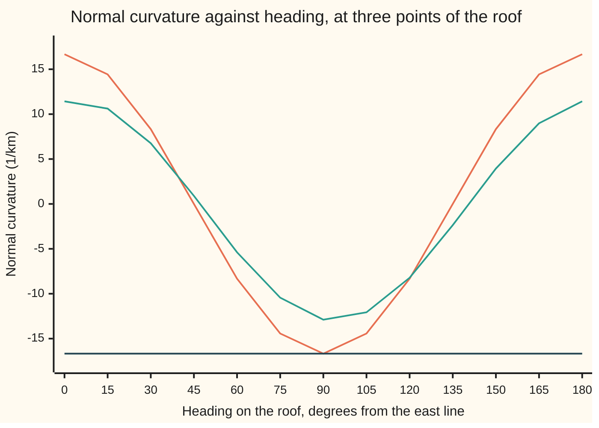

# Principal, mean and Gaussian curvature: two bending rates and their combinations

[Syllabus](../../../SYLLABUS.md) → [Differential geometry and Lie groups](../README.md) → [Surfaces](../README.md#s02) → Principal, mean and Gaussian curvature

---

## General Overview

A stadium has a copper roof. Over the east end sits a shallow dome, part of a sphere of radius 60 m. Over the middle sits a saddle, $`z = 30 + (x^2 - y^2)/120`$ metres, where $`x`$ is metres east and $`y`$ metres north of the saddle's centre O. An engineer checking how the panels bend asks one question at each point: how fast does the roof turn away from its flat tangent plane, in each direction?

On the dome the answer is the same in every direction: the roof falls away on a circle of radius 60 m whichever way you face. At the saddle's centre O the answer depends on the heading. Walking east, the roof curves up on a circle of radius 60 m. Walking north, it curves down on a circle of radius 60 m. Every heading in between gives a rate between those two.

So each point has a largest and a smallest bending rate, at right angles to each other. These two are the **principal curvatures**. Their product, the **Gaussian curvature** $`K`$, says dome or saddle: positive on the dome (+0.000277778 per m²), negative at O (−0.000277778 per m², the same size with the opposite sign). Their average, the **mean curvature** $`H`$, says how hard the point bends on balance: −0.016667 per m on the dome, exactly 0 at O.

**At each point of a surface the bending rate takes a largest and a smallest value, on two perpendicular headings; they are the eigenvalues of the shape operator, their product is the Gaussian curvature and their average is the mean curvature.**

**What kind of fact this is:** a definition (the three numbers) plus a theorem, Euler's, published in 1767, proved on this card in Why it works: the extremes exist, sit at right angles, and fix the bending rate in every other direction. All three numbers are local: each describes one point.

### The picture: bending rate against heading

The bending rate in one heading is the **normal curvature** $`\kappa_n`$: the curvature of the roof's cross-section along that heading, counted toward the up normal. The chart turns the heading on the roof through half a turn, measured from the east line, at three points. P is the north-east lamp fixing, (30, 20) on the plan, the point whose bending [Gauss map and second fundamental form](04-gauss-map-and-second-fundamental-form.md) worked out. D is a point on the dome, 20 m from its centre on the plan. Rates are per kilometre, so 16.67 means a circle of radius 60 m.



First line (orange): the saddle's centre O, swinging between +16.67 and −16.67. Second line (green): the lamp fixing P, a lopsided swing whose peak sits 3.82° off east. Third line (dark): the dome point D, flat at −16.67, because every heading bends alike. Each swing is one wave per half turn, and its top and bottom are the two principal curvatures.

---

## The formula

The roof is a patch $`\mathbf{r}(x, y)`$ ([Regular surface](01-regular-surfaces-and-tangent-planes.md)), with unit normal $`\mathbf{n}`$ chosen to point up, to the sky. The first fundamental form $`E`$, $`F`$, $`G`$ measures steps on the roof ([First fundamental form](02-first-fundamental-form.md)). The second fundamental form $`L`$, $`M`$, $`N`$ measures how the roof leaves its tangent plane, and the **shape operator** $`W`$ is the matrix that combines the two ([Gauss map and second fundamental form](04-gauss-map-and-second-fundamental-form.md)):

```math
W = \begin{pmatrix} E & F \\ F & G \end{pmatrix}^{-1} \begin{pmatrix} L & M \\ M & N \end{pmatrix}, \qquad \kappa_1,\ \kappa_2 = \text{eigenvalues of } W, \qquad K = \kappa_1 \kappa_2 = \frac{LN - M^2}{EG - F^2}, \qquad H = \frac{\kappa_1 + \kappa_2}{2} = \frac{EN - 2FM + GL}{2\,(EG - F^2)}.
```

**Read it aloud:** "undo the chart's distortion of lengths, then read the two stretch factors of the bending; their product is $`K`$ and their average is $`H`$."

Going back from $`K`$ and $`H`$ to the pair is the quadratic formula, since $`\kappa_1`$ and $`\kappa_2`$ are the roots of $`\kappa^2 - 2H\kappa + K = 0`$:

```math
\kappa_{1,2} = H \pm \sqrt{H^2 - K}, \qquad \kappa_n(\theta) = \kappa_1 \cos^2(\theta - \theta_1) + \kappa_2 \sin^2(\theta - \theta_1).
```

**Read it aloud:** "the two principal curvatures sit equally above and below the mean; and the bending rate in any heading is a cosine-squared blend of the two, measured from the first principal heading." The second formula is **Euler's theorem**.

| Symbol | Plain meaning | In our example | Push it up and the answer… |
| --- | --- | --- | --- |
| $`x`$, $`y`$; $`p`$, $`q`$ | plan coordinates: metres east and north of O; the height's slopes east and north | P = (30, 20); slopes 0.5 and −0.333333 | — |
| $`a`$, $`R`$ | saddle radius in $`z = 30 + (x^2 - y^2)/(2a)`$; dome sphere radius | 60 m and 60 m | gentler bending: all rates fall |
| $`\mathbf{n}`$ | unit normal, pointing up | at O, straight up | — |
| $`E`$, $`F`$, $`G`$, together $`\mathrm{I}`$ | first form: squared step lengths and their dot product | 1.25, −0.166667, 1.111111 at P | — |
| $`L`$, $`M`$, $`N`$, together $`\mathrm{II}`$ | second form: bending of the chart's grid lines toward $`\mathbf{n}`$, per m | 0.014285714, 0, −0.014285714 at P | — |
| $`W`$, entries $`W_{ij}`$; $`S`$, entries $`s_{ij}`$ | shape operator: first form undone, second form applied; $`S`$ is the same map in a frame square on the roof, a symmetric matrix | eigenvalues below; $`S`$ in Step 1 | — |
| $`\mathbf{t}`$; $`\mathbf{e}_1`$, $`\mathbf{e}_2`$; $`\mathbf{u}_1`$, $`\mathbf{u}_2`$; $`\mathbf{v}_1`$, $`\mathbf{v}_2`$; $`Q`$ | a unit arrow along the roof; the roof-square frame, east and square to it, as plan steps per metre of roof; unit eigenvectors of $`S`$; eigenvectors of $`W`$, as plan steps; the matrix whose columns are $`\mathbf{e}_1`$, $`\mathbf{e}_2`$ | $`\mathbf{e}_1`$ = (0.894427, 0), $`\mathbf{e}_2`$ = (0.127775, 0.958315) at P | — |
| $`\kappa_n(\theta)`$ | normal curvature: bending rate along heading $`\theta`$, per m, positive toward $`\mathbf{n}`$ | 0.011429 east at P | — |
| $`\theta`$, $`\theta_1`$ | heading on the roof from the east line; heading of $`\kappa_1`$ | $`\theta_1`$ = 3.82° at P | — |
| $`\kappa_1`$, $`\kappa_2`$ | principal curvatures: largest and smallest $`\kappa_n`$, per m | 0.011537708 and −0.012995434 at P | — |
| $`K`$ | Gaussian curvature, per m² | −0.000149937526 at P | more dome-like |
| $`H`$ | mean curvature, per m | −0.000728863 at P | bends more toward the sky on balance |

A few letters mean other things elsewhere in the library, said once here: $`\kappa`$ is also a condition number, $`H`$ a Hamiltonian, $`K`$ a triangle's area in wing 05, and $`E`$, $`F`$ count edges and faces there. On this card they mean only the curvatures and the forms. A **principal heading** is the heading of $`\kappa_1`$ or $`\kappa_2`$.

### When it holds

- **The surface is smooth at the point.** The forms need second derivatives. Along the ridge where the dome meets the saddle the bending jumps, so curvature is taken on each panel separately.
- **A normal is chosen.** Turn $`\mathbf{n}`$ over and both principal curvatures change sign, so $`H`$ changes sign. $`K`$, a product of two signs, does not. At P: $`H`$ becomes 0.000728863, and $`K`$ stays −0.000149937526.
- **Principal headings need $`\kappa_1 \ne \kappa_2`$.** At a point where they are equal, called an **umbilic** ([Point types](06-classification-of-surface-points.md)), every heading is principal and there is no pair of axes to pick. Every point of the dome is one.
- **The chart is regular, $`EG - F^2 > 0`$.** $`W`$ inverts the first form, which fails where the grid collapses.

---

## Why it works

### Step 0: the bending rate is a ratio of two quadratic forms

Point a unit arrow $`\mathbf{t}`$ along the roof. Any roof curve leaving the point along $`\mathbf{t}`$ has the same bending toward $`\mathbf{n}`$: $`\kappa_n = \mathrm{II}(\mathbf{t}, \mathbf{t}) / \mathrm{I}(\mathbf{t}, \mathbf{t})`$, where $`\mathrm{I}`$ and $`\mathrm{II}`$ are the first and second forms applied to the arrow's plan components ([Gauss map and second fundamental form](04-gauss-map-and-second-fundamental-form.md)). Both are quadratic in the arrow. So the question "which heading bends most?" is "where is a ratio of two quadratics largest?". That is an eigenvalue question.

### Step 1: in a frame that is square on the roof, the ratio is a symmetric matrix

Pick two unit arrows along the roof that are perpendicular on the roof, not on the plan: $`\mathbf{e}_1`$ along the east line, $`\mathbf{e}_2`$ square to it. As plan steps (metres east and north per metre of roof) they are $`\mathbf{e}_1 = (1/\sqrt{E},\ 0)`$ and $`\mathbf{e}_2 = (-F/E,\ 1)/\sqrt{G - F^2/E}`$: at P, (0.894427, 0) and (0.127775, 0.958315). In that frame $`\mathrm{I}`$ is the identity, and $`\mathrm{II}`$ becomes a symmetric 2-by-2 matrix $`S`$ with entries $`s_{ij} = \mathrm{II}(\mathbf{e}_i, \mathbf{e}_j)`$. At P it has $`s_{11}`$ = 0.011428571 and $`s_{22}`$ = −0.012886297 down the diagonal and $`s_{12}`$ = 0.001632653 off it.

The spectral theorem ([The spectral theorem](../../03-Algebra/07-Eigenvalues%20and%20Symmetric%20Matrices/04-spectral-theorem.md)) says a symmetric matrix has two real eigenvalues on perpendicular axes. On those axes the ratio is the eigenvalue itself. Any other heading mixes the two axes with weights $`\cos^2`$ and $`\sin^2`$, which is Euler's formula. A blend of two numbers lies between them, so the two eigenvalues are the largest and smallest bending rates. One rotation of the frame, by the angle $`\theta_1`$ with $`\tan 2\theta_1 = 2s_{12}/(s_{11} - s_{22})`$, clears the off-diagonal entry: at P that is 0.134293, so $`\theta_1`$ = 3.82°.

### Step 2: in plan coordinates the same numbers come from W

Plan coordinates are not square on the roof: at P the east and north lines cross at 98.13° on the roof. In them, $`\mathrm{II}`$ alone is the wrong matrix. Undoing the first form first gives $`W = \mathrm{I}^{-1}\mathrm{II}`$. $`W`$ is not symmetric, but it is $`S`$ written in another basis, so it has the same eigenvalues. The determinant and trace of a matrix are the product and sum of its eigenvalues, which gives $`K`$ and $`H`$ in the formula.

<details>
<summary>Detailed proof: W and S have the same eigenvalues, and Euler's formula</summary>

Write the frame arrows' plan components as the columns of a 2-by-2 matrix $`Q`$. The frame is square and of unit length on the roof, so

$`\displaystyle Q^{\mathsf T}\,\mathrm{I}\,Q = \mathrm{Id}, \qquad S = Q^{\mathsf T}\,\mathrm{II}\,Q.`$

The first equation says $`Q^{\mathsf T}\,\mathrm{I} = Q^{-1}`$. Put that into the second:

$`\displaystyle S = Q^{\mathsf T}\,\mathrm{I}\,\mathrm{I}^{-1}\,\mathrm{II}\,Q = Q^{-1}\,W\,Q.`$

So $`S`$ and $`W`$ are similar: they describe one map of the tangent plane in two bases, and share eigenvalues, determinant and trace. Taking determinants, $`\det W = \det \mathrm{II} / \det \mathrm{I} = (LN - M^2)/(EG - F^2)`$.

For Euler's formula, let $`\mathbf{u}_1`$, $`\mathbf{u}_2`$ be unit eigenvectors of $`S`$, perpendicular by the spectral theorem. A unit heading at angle $`\theta - \theta_1`$ from $`\mathbf{u}_1`$ is $`\mathbf{t} = \cos(\theta - \theta_1)\,\mathbf{u}_1 + \sin(\theta - \theta_1)\,\mathbf{u}_2`$, and

$`\displaystyle \kappa_n = \mathbf{t}^{\mathsf T} S\, \mathbf{t} = \kappa_1 \cos^2(\theta - \theta_1) + \kappa_2 \sin^2(\theta - \theta_1),`$

since the cross terms vanish: $`\mathbf{u}_1^{\mathsf T} S\, \mathbf{u}_2 = \kappa_2\,\mathbf{u}_1 \cdot \mathbf{u}_2 = 0`$.

</details>

### Step 3: the numbers belong to the roof, not to the chart

$`W`$ is a map of the tangent plane to itself: it takes a step along the roof to the change in the normal along that step, with a minus sign. Its eigenvalues do not depend on the coordinates used to write it down. The code checks this with a second chart for the saddle: the seam chart of [Gauss map and second fundamental form](04-gauss-map-and-second-fundamental-form.md), whose grid lines are the roof's straight diagonal seams and in which P is (25, 5). That card calls the seam coordinates $`p`$ and $`q`$; on this card $`p`$ and $`q`$ are slopes. The seam chart gives the same $`\kappa_1`$, $`\kappa_2`$ and $`K`$ at P. The dome gives −0.016667 for $`H`$ in its plan chart and in its sphere chart.

### Step 4: K is also how fast the normal spreads

$`K`$ has a second meaning. Walk a small patch of roof and track the unit normal on a sphere of directions (the Gauss map). The normal sweeps a small patch there too. $`K`$ is the ratio of the two areas, negative when the normal's patch comes out mirror-reversed, as on a saddle. The code computes it this way, from how fast the normal turns, with finite-difference steps of 0.02 m and 0.01 m. It gets −0.000149937519 and −0.000149937524 at P, closing in on −0.000149937526 from the formula as the step shrinks. [Theorema Egregium](08-theorema-egregium.md) shows that $`K`$ can even be computed from $`E`$, $`F`$, $`G`$ alone. $`H`$ cannot: rolling the flat sheet into a vault keeps $`E`$, $`F`$, $`G`$ and changes $`H`$.

---

## Worked numbers, by hand

At P = (30, 20) the saddle's height is $`30 + (x^2 - y^2)/120`$. Its slopes are $`p = x/60`$ east and $`q = -y/60`$ north, and its second derivatives are 1/60 and −1/60, with no cross term.

| Step | Arithmetic | Value |
| --- | --- | --- |
| slopes $`p`$, $`q`$ | 30/60 and −20/60 | 0.500000, −0.333333 |
| first form | $`E = 1 + p^2`$, $`F = pq`$, $`G = 1 + q^2`$ | 1.250000, −0.166667, 1.111111 |
| $`EG - F^2`$ and its root | $`1 + p^2 + q^2`$ | 1.361111 and 1.166667 |
| second form | $`L = (1/60)/1.166667`$, $`M = 0`$, $`N = -L`$ | 0.014285714, 0, −0.014285714 |
| shape operator $`W = \mathrm{I}^{-1}\mathrm{II}`$ | $`W_{11} = GL/1.361111`$, $`W_{12} = -FN/1.361111`$, $`W_{21} = -FL/1.361111`$, $`W_{22} = EN/1.361111`$ | rows (0.011661808, −0.001749271) and (0.001749271, −0.013119534) |
| its eigenvalue equation | $`\kappa^2 - (W_{11} + W_{22})\,\kappa + (W_{11}W_{22} - W_{12}W_{21}) = 0`$ | trace −0.001457726 = $`2H`$, determinant −0.000149937526 = $`K`$ |
| $`K`$ | $`(LN - M^2)/(EG - F^2)`$ | −0.000149937526 per m² |
| $`H`$ | $`(EN - 2FM + GL)/(2 \times 1.361111)`$ | −0.000728863 per m |
| root | $`\sqrt{H^2 - K}`$ | 0.012266571 per m |
| $`\kappa_1`$, $`\kappa_2`$ | $`H \pm 0.012266571`$ | **0.011537708 and −0.012995434 per m** |
| radii | $`1/\kappa_1`$, $`1/\kappa_2`$ | 86.672 m up, 76.950 m down |
| eigenvectors of $`W`$ | second row of $`(W - \kappa)\mathbf{v} = 0`$: $`\mathbf{v} = (\kappa - W_{22},\ W_{21})`$, as plan steps | $`\mathbf{v}_1`$ = (0.024657242, 0.001749271), heading 4.06° on the plan; $`\mathbf{v}_2`$ = (0.000124099, 0.001749271), heading 85.94° |
| principal headings on the roof | $`\tan 2\theta_1 = 2s_{12}/(s_{11} - s_{22}) = 2 \times 0.001632653/(0.011428571 + 0.012886297)`$ | 0.134293, so 3.82° and 93.82° from the east line |

At the lamp fixing the roof curves up along a circle of radius about 87 m, 3.82° north of east. At right angles, on the roof, it curves down along a circle of about 77 m. The two nearly cancel: $`H`$ is small and negative, and $`K`$ is negative, so P is saddle-shaped. This $`K`$ is the −0.000149938 that [Gauss map and second fundamental form](04-gauss-map-and-second-fundamental-form.md) found as $`\det W`$ at the same point. On the plan the two principal headings are 4.06° and 85.94°, lines meeting at 81.88°. On the roof they are exactly perpendicular: the code finds their first-form dot product to be 0 to twelve places, and turns $`\mathbf{v}_1`$ into the same roof heading, 3.82°, that the rotation of $`S`$ gives.

### What breaks if you drop a piece

| Mistake | Comes out at | What went wrong |
| --- | --- | --- |
| Take eigenvalues of $`L`$, $`M`$, $`N`$ alone, skipping $`\mathrm{I}^{-1}`$ | 0.014285714 and −0.014285714; $`K`$ = −0.000204081633 | the plan grid is not square or unit length on the roof; the error is the factor $`EG - F^2`$ = 1.361111 |
| Use the height's second derivatives as the curvature | $`K`$ = −0.000277777778, $`H`$ = 0 | right only where the roof is level, as at O; at P the slope tilts the normal |
| Take the east and north lines as principal | 0.011428571 and −0.012857143; $`K`$ = −0.000146938776, $`H`$ = −0.000714286 | those lines are not principal and not even perpendicular on the roof |
| Ask for principal headings at a dome point | every heading gives −0.016667; $`\kappa_1 - \kappa_2`$ is 0 up to finite-difference error: 0.000000000478 at step 0.02 m, 0.000000000125 at 0.01 m | an umbilic: the hypothesis $`\kappa_1 \ne \kappa_2`$ fails, so no pair of axes exists |
| Treat $`H`$ as a property of the copper alone | vault and flat sheet: same $`E`$, $`F`$, $`G`$ (1, 0, 1); $`K`$ = 0 for both; $`H`$ = −0.025000 against 0 | $`H`$ depends on how the sheet sits in space; only $`K`$ survives bending without stretching |

The vault is the copper sheet rolled into a half-cylinder of radius 20 m. Its two principal curvatures are −1/20 across and 0 along, so $`H`$ = −0.025 per m and $`K`$ = 0.

---

## Code, from first principles, and it actually runs

Both programs compute the curvatures at P five independent ways and print every number on this card. Road 1 is the formula for $`K`$ and $`H`$, then the quadratic formula. Road 2 builds the symmetric matrix $`S`$ in a roof-square frame and turns it by one Jacobi rotation (a rotation chosen to clear the off-diagonal entry). Road 3 never uses $`L`$, $`M`$, $`N`$: it walks 3600 headings, measures the bending of each roof curve from raw 3D points, and takes the largest and smallest. Road 4 repeats road 1 in the seam chart. Road 5 gets $`K`$ from the spread of the normal. The dome is done in two charts, and the vault and flat sheet are compared. Differences of points on the quadratic saddle are exact. Road 5, which differences the normal, and the dome and the vault are not exact, so the code prints them at two step sizes, and their errors shrink as the step halves.

### Python

```python
# Principal, mean and Gaussian curvature -- the check behind the card.
# Standard library only.  A stadium roof: a saddle z = 30 + (x^2 - y^2)/120
# over the middle and a dome (a sphere of radius 60 m) over the east end.
# The unit normal n points up, to the sky; a bending rate is positive where the
# roof bends toward n (up, like a bowl).  Roads to the two bending rates:
# (1) the formulas K = det II / det I and H = half the trace of W = I^-1 II,
# (2) a symmetric 2-by-2 matrix in a roof-perpendicular frame, turned by one
# Jacobi rotation, (3) a sweep of 3600 directions measuring each curve on the
# roof from raw 3D points, (4) a second chart, (5) K from the spread of n.
from math import sqrt, sin, cos, atan2, asin, acos, pi, degrees, radians

A, R = 60.0, 60.0                                  # saddle radius a; dome sphere radius (m)
def saddle(x, y): return (x, y, 30 + (x * x - y * y) / (2 * A))
def seam(s, t): return saddle(s + t, s - t)        # second saddle chart: along the seams
def dome_plan(x, y): return (x, y, -10.5 + sqrt(R * R - (x - 30) ** 2 - y * y))
def dome_sphere(p, t): return (30 + R * sin(p) * cos(t), R * sin(p) * sin(t), -10.5 + R * cos(p))
def vault(x, s): return (x, 20 * sin(s / 20), 20 * cos(s / 20))   # copper rolled to radius 20 m
def sheet(x, s): return (x, s, 0.0)                                # the same copper laid flat

def dot(a, b): return a[0] * b[0] + a[1] * b[1] + a[2] * b[2]
def cross(a, b): return (a[1] * b[2] - a[2] * b[1], a[2] * b[0] - a[0] * b[2], a[0] * b[1] - a[1] * b[0])
def comb(cs, vs): return tuple(sum(c * v[k] for c, v in zip(cs, vs)) for k in range(3))
def unit_up(f, u, v, h):                           # the unit normal, turned to point up
    ru = comb((0.5 / h, -0.5 / h), (f(u + h, v), f(u - h, v)))
    rv = comb((0.5 / h, -0.5 / h), (f(u, v + h), f(u, v - h)))
    n = cross(ru, rv); s = sqrt(dot(n, n)) * (1 if n[2] > 0 else -1)
    return ru, rv, (n[0] / s, n[1] / s, n[2] / s)

def forms(f, u, v, h):                             # E, F, G, L, M, N by central differences
    ru, rv, n = unit_up(f, u, v, h)
    ruu = comb((1 / h / h, -2 / h / h, 1 / h / h), (f(u + h, v), f(u, v), f(u - h, v)))
    rvv = comb((1 / h / h, -2 / h / h, 1 / h / h), (f(u, v + h), f(u, v), f(u, v - h)))
    q = 0.25 / h / h
    ruv = comb((q, -q, -q, q), (f(u + h, v + h), f(u + h, v - h), f(u - h, v + h), f(u - h, v - h)))
    return dot(ru, ru), dot(ru, rv), dot(rv, rv), dot(ruu, n), dot(ruv, n), dot(rvv, n)

def curv(E, F, G, L, M, N):                        # road 1: K, H, kappa_1, kappa_2
    K = (L * N - M * M) / (E * G - F * F)
    H = (E * N - 2 * F * M + G * L) / (2 * (E * G - F * F))
    d = sqrt(max(H * H - K, 0.0))
    return K, H, H + d, H - d

def frame(E, F, G):                                # roof-perpendicular unit steps, as (du, dv)
    w = sqrt(G - F * F / E)
    return (1 / sqrt(E), 0.0), (-F / E / w, 1 / w)
def II(L, M, N, a, b): return L * a[0] * b[0] + M * (a[0] * b[1] + a[1] * b[0]) + N * a[1] * b[1]
def jacobi(E, F, G, L, M, N):                      # road 2: one rotation diagonalises S
    e1, e2 = frame(E, F, G)
    s11, s12, s22 = II(L, M, N, e1, e1), II(L, M, N, e1, e2), II(L, M, N, e2, e2)
    th = 0.5 * atan2(2 * s12, s11 - s22)
    c, s = cos(th), sin(th)
    return s11 * c * c + 2 * s12 * s * c + s22 * s * s, s11 * s * s - 2 * s12 * s * c + s22 * c * c, th, s12

def kn_raw(f, u, v, th, h):                        # road 3: bend of a roof curve from 3D points
    E, F, G = forms(f, u, v, h)[:3]
    e1, e2 = frame(E, F, G)
    a, b = cos(th) * e1[0] + sin(th) * e2[0], cos(th) * e1[1] + sin(th) * e2[1]
    n = unit_up(f, u, v, h)[2]
    g1 = comb((0.5 / h, -0.5 / h), (f(u + a * h, v + b * h), f(u - a * h, v - b * h)))
    g2 = comb((1 / h / h, -2 / h / h, 1 / h / h), (f(u + a * h, v + b * h), f(u, v), f(u - a * h, v - b * h)))
    return dot(g2, n) / dot(g1, g1), (a, b)

def gauss_map_K(f, u, v, h):                       # road 5: area spread of n over area of roof
    ru, rv, n = unit_up(f, u, v, h)
    nu = comb((0.5 / h, -0.5 / h), (unit_up(f, u + h, v, h)[2], unit_up(f, u - h, v, h)[2]))
    nv = comb((0.5 / h, -0.5 / h), (unit_up(f, u, v + h, h)[2], unit_up(f, u, v - h, h)[2]))
    return dot(cross(nu, nv), n) / dot(cross(ru, rv), n)

def f9(v): return f"{v:.9f}"
def f12(v): return f"{v:.12f}"
def show(label, val): print(f"{label:<44} {val}")

P = (30.0, 20.0)                                   # the north-east lamp fixing
p, q = P[0] / A, -P[1] / A                         # its two slopes
E, F, G = 1 + p * p, p * q, 1 + q * q
L, M, N = (1 / A) / sqrt(1 + p * p + q * q), 0.0, (-1 / A) / sqrt(1 + p * p + q * q)
K, H, k1, k2 = curv(E, F, G, L, M, N)
for name, val in (("P slopes east, north", f"{p:.6f} {q:.6f}"), ("P E, F, G", f"{E:.6f} {F:.6f} {G:.6f}"),
                  ("P EG - F^2, its root", f"{E * G - F * F:.6f} {sqrt(E * G - F * F):.6f}"), ("P L, M, N (1/m)", f"{f9(L)} {f9(M)} {f9(N)}"),
                  ("P K (1/m^2), road 1", f12(K)), ("P H (1/m), road 1", f9(H)), ("P root of H^2 - K (1/m)", f9(sqrt(H * H - K))),
                  ("P kappa_1, kappa_2 (1/m), road 1", f"{f9(k1)} {f9(k2)}"),
                  ("P signed radii 1/kappa (m)", f"{1 / k1:.3f} {1 / k2:.3f}")):
    show(name, val)
j1, j2, th, s12 = jacobi(E, F, G, L, M, N)
e1, e2 = frame(E, F, G)
s11, s22 = II(L, M, N, e1, e1), II(L, M, N, e2, e2)
show("P frame e1, e2 as plan steps (dx, dy)", f"{e1[0]:.6f} {e1[1]:.6f} {e2[0]:.6f} {e2[1]:.6f}")
show("P frame matrix S: s11, s22, s12 (1/m)", f"{f9(s11)} {f9(s22)} {f9(s12)}")
show("P tan 2 theta_1 = 2 s12 / (s11 - s22)", f"{2 * s12 / (s11 - s22):.6f}")
show("P kappa_1, kappa_2, road 2 Jacobi", f"{f9(j1)} {f9(j2)}")
W = tuple(x / (E * G - F * F) for x in (G * L - F * M, G * M - F * N, E * M - F * L, E * N - F * M))   # W = I^-1 II
show("P W row by row (1/m)", " ".join(f9(w) for w in W))
show("P trace W = 2H, det W = K", f"{f9(W[0] + W[3])} {f12(W[0] * W[3] - W[1] * W[2])}")
v1, v2 = (k1 - W[3], W[2]), (k2 - W[3], W[2])     # eigenvectors of W in (dx, dy), from its second row
show("P v1, v2: eigenvectors of W (dx, dy)", f"{f9(v1[0])} {f9(v1[1])} {f9(v2[0])} {f9(v2[1])}")
hd = [degrees(atan2(v[1], v[0])) % 180 for v in (v1, v2)]
show("P plan headings of v1, v2; angle between", f"{hd[0]:.4f} {hd[1]:.4f} {hd[1] - hd[0]:.4f}")
roof = degrees(atan2(II(E, F, G, v1, e2), II(E, F, G, v1, e1)))   # II's formula fed E, F, G is the first form
show("P kappa_1 roof deg from east: Jacobi, v1", f"{degrees(th):.4f} {roof:.4f}")
sweep = [(kn_raw(saddle, P[0], P[1], pi * i / 3600, 1.0)[0], i / 20) for i in range(3600)]
hi, lo = max(sweep), min(sweep)
show("P sweep max, min (1/m), road 3", f"{f9(hi[0])} {f9(lo[0])}")
show("P sweep at roof deg", f"{hi[1]:.2f} {lo[1]:.2f}")
euler = max(abs(k - (k1 * cos(radians(d) - th) ** 2 + k2 * sin(radians(d) - th) ** 2)) for k, d in sweep)
show("P worst gap to Euler's formula (1/m)", f12(euler))
s_seam = curv(*forms(seam, 25.0, 5.0, 1.0))
show("P K, kappa_1, kappa_2, road 4 seam chart", f"{f12(s_seam[0])} {f9(s_seam[2])} {f9(s_seam[3])}")
gK2, gK = (gauss_map_K(saddle, P[0], P[1], h) for h in (0.02, 0.01))
show("P K by road 5, step 0.02 | 0.01 m", f"{f12(gK2)} | {f12(gK)}")
show("P |I(v1, v2)|, roof dot of the two", f12(abs(II(E, F, G, v1, v2))))
show("P east and north lines, roof angle (deg)", f"{degrees(acos(F / sqrt(E * G))):.4f}")
O = curv(*forms(saddle, 0.0, 0.0, 1.0))
show("O K, H, kappa_1, kappa_2", f"{f12(O[0])} {f9(O[1])} {f9(O[2])} {f9(O[3])}")
D1c, D1 = (curv(*forms(dome_plan, 42.0, 16.0, h)) for h in (0.02, 0.01))
D2c, D2 = (curv(*forms(dome_sphere, asin(1 / 3), atan2(16, 12), h)) for h in (0.0004, 0.0002))
show("D plan K, H, step 0.02 | 0.01 m", f"{f12(D1c[0])} {f9(D1c[1])} | {f12(D1[0])} {f9(D1[1])}")
show("D sphere K, H, step 0.0004 | 0.0002 rad", f"{f12(D2c[0])} {f9(D2c[1])} | {f12(D2[0])} {f9(D2[1])}")
djc, dj = (jacobi(*forms(dome_plan, 42.0, 16.0, h)) for h in (0.02, 0.01))
show("D kappa_1 - kappa_2, step 0.02 | 0.01 m", f"{f12(djc[0] - djc[1])} | {f12(dj[0] - dj[1])}")
cyl, flat = forms(vault, 0.0, 0.0, 0.01), forms(sheet, 0.0, 0.0, 0.01)
show("vault E, F, G | sheet E, F, G", " ".join(f"{x:.6f}" for x in cyl[:3] + flat[:3]))
show("vault K, H | sheet K, H", f"{f12(curv(*cyl)[0])} {f9(curv(*cyl)[1])} {f12(curv(*flat)[0])} {f9(curv(*flat)[1])}")
show("vault H, step 0.02 | 0.01 m", f"{f9(curv(*forms(vault, 0.0, 0.0, 0.02))[1])} | {f9(curv(*cyl)[1])}")
show("wrong: eigenvalues of II alone; product", f"{f9(L)} {f9(N)} {f12(L * N)}")
show("wrong: height Hessian K, H", f"{f12(-1 / A / A)} {f9(0.0)}")
show("wrong: east, north as principal; K, H", f"{f9(L / E)} {f9(N / G)} {f12(L / E * N / G)} {f9((L / E + N / G) / 2)}")
show("flip n: K, H", f"{f12(curv(E, F, G, -L, -M, -N)[0])} {f9(curv(E, F, G, -L, -M, -N)[1])}")
for name, f, u, v, h in (("O", saddle, 0.0, 0.0, 1.0), ("P", saddle, P[0], P[1], 1.0), ("D", dome_plan, 42.0, 16.0, 0.01)):
    print("chart, " + name + " kappa_n (1/km) every 15 roof deg:", " ".join(f"{1000 * kn_raw(f, u, v, radians(15 * i), h)[0]:.2f}" for i in range(13)))

assert abs(j1 - k1) < 1e-12 and abs(j2 - k2) < 1e-12          # road 2 against road 1
assert abs(hi[0] - k1) < 1e-8 and abs(lo[0] - k2) < 1e-8 and euler < 1e-9   # road 3
assert abs(s_seam[0] - K) < 1e-12 and abs(s_seam[2] - k1) < 1e-9 and abs(s_seam[3] - k2) < 1e-9
assert abs(gK - K) < 1e-9                                       # road 5: Gauss map against det II / det I
assert abs(II(E, F, G, v1, v2)) < 1e-15 and abs(roof - degrees(th)) < 1e-9 and abs(W[0] * W[3] - W[1] * W[2] - K) < 1e-15
assert abs(gK - K) < abs(gK2 - K) / 3 and abs(dj[0] - dj[1]) < abs(djc[0] - djc[1]) / 3   # stepped errors shrink
assert abs(D1[0] - 1 / R / R) < 1e-8 and abs(D2[0] - 1 / R / R) < 1e-8 and abs(D1[1] + 1 / R) < 1e-6 and abs(D2[1] + 1 / R) < 1e-6
assert abs(dj[0] - dj[1]) < 1e-6 and abs(L * N - K) > 1e-5      # dome umbilic; II alone is wrong
assert abs(curv(*cyl)[1] + 1 / 40) < 1e-6 and abs(curv(*cyl)[0]) < 1e-9 and abs(cyl[0] - flat[0]) + abs(cyl[2] - flat[2]) < 1e-6
print("ALL CHECKS PASS")
```

**Ran 2026-11-19 on macOS, Python 3.14.10, standard library only. All checks passed. Output, pasted from the run:**

```
P slopes east, north                         0.500000 -0.333333
P E, F, G                                    1.250000 -0.166667 1.111111
P EG - F^2, its root                         1.361111 1.166667
P L, M, N (1/m)                              0.014285714 0.000000000 -0.014285714
P K (1/m^2), road 1                          -0.000149937526
P H (1/m), road 1                            -0.000728863
P root of H^2 - K (1/m)                      0.012266571
P kappa_1, kappa_2 (1/m), road 1             0.011537708 -0.012995434
P signed radii 1/kappa (m)                   86.672 -76.950
P frame e1, e2 as plan steps (dx, dy)        0.894427 0.000000 0.127775 0.958315
P frame matrix S: s11, s22, s12 (1/m)        0.011428571 -0.012886297 0.001632653
P tan 2 theta_1 = 2 s12 / (s11 - s22)        0.134293
P kappa_1, kappa_2, road 2 Jacobi            0.011537708 -0.012995434
P W row by row (1/m)                         0.011661808 -0.001749271 0.001749271 -0.013119534
P trace W = 2H, det W = K                    -0.001457726 -0.000149937526
P v1, v2: eigenvectors of W (dx, dy)         0.024657242 0.001749271 0.000124099 0.001749271
P plan headings of v1, v2; angle between     4.0580 85.9420 81.8841
P kappa_1 roof deg from east: Jacobi, v1     3.8243 3.8243
P sweep max, min (1/m), road 3               0.011537704 -0.012995430
P sweep at roof deg                          3.80 93.80
P worst gap to Euler's formula (1/m)         0.000000000000
P K, kappa_1, kappa_2, road 4 seam chart     -0.000149937526 0.011537708 -0.012995434
P K by road 5, step 0.02 | 0.01 m            -0.000149937519 | -0.000149937524
P |I(v1, v2)|, roof dot of the two           0.000000000000
P east and north lines, roof angle (deg)     98.1301
O K, H, kappa_1, kappa_2                     -0.000277777778 0.000000000 0.016666667 -0.016666667
D plan K, H, step 0.02 | 0.01 m              0.000277777792 -0.016666667 | 0.000277777781 -0.016666667
D sphere K, H, step 0.0004 | 0.0002 rad      0.000277777800 -0.016666667 | 0.000277777780 -0.016666667
D kappa_1 - kappa_2, step 0.02 | 0.01 m      0.000000000478 | 0.000000000125
vault E, F, G | sheet E, F, G                1.000000 0.000000 1.000000 1.000000 0.000000 1.000000
vault K, H | sheet K, H                      -0.000000000000 -0.025000002 0.000000000000 0.000000000
vault H, step 0.02 | 0.01 m                  -0.025000006 | -0.025000002
wrong: eigenvalues of II alone; product      0.014285714 -0.014285714 -0.000204081633
wrong: height Hessian K, H                   -0.000277777778 0.000000000
wrong: east, north as principal; K, H        0.011428571 -0.012857143 -0.000146938776 -0.000714286
flip n: K, H                                 -0.000149937526 0.000728863
chart, O kappa_n (1/km) every 15 roof deg: 16.67 14.43 8.33 0.00 -8.33 -14.43 -16.67 -14.43 -8.33 0.00 8.33 14.43 16.67
chart, P kappa_n (1/km) every 15 roof deg: 11.43 10.62 6.76 0.90 -5.39 -10.44 -12.89 -12.07 -8.22 -2.36 3.94 8.98 11.43
chart, D kappa_n (1/km) every 15 roof deg: -16.67 -16.67 -16.67 -16.67 -16.67 -16.67 -16.67 -16.67 -16.67 -16.67 -16.67 -16.67 -16.67
ALL CHECKS PASS
```

### Rust

```rust
// Principal, mean and Gaussian curvature -- the check behind the card.
// Standard library only.  A stadium roof: a saddle z = 30 + (x^2 - y^2)/120
// over the middle and a dome (a sphere of radius 60 m) over the east end.
// The unit normal n points up, to the sky; a bending rate is positive where the
// roof bends toward n (up, like a bowl).  Roads to the two bending rates:
// (1) the formulas K = det II / det I and H = half the trace of W = I^-1 II,
// (2) a symmetric 2-by-2 matrix in a roof-perpendicular frame, turned by one
// Jacobi rotation, (3) a sweep of 3600 directions measuring each curve on the
// roof from raw 3D points, (4) a second chart, (5) K from the spread of n.
use std::f64::consts::PI;
type V = [f64; 3];
type Chart = fn(f64, f64) -> V;
const A: f64 = 60.0; // saddle radius a (m)
const R: f64 = 60.0; // dome sphere radius (m)
fn saddle(x: f64, y: f64) -> V { [x, y, 30.0 + (x * x - y * y) / (2.0 * A)] }
fn seam(s: f64, t: f64) -> V { saddle(s + t, s - t) } // second saddle chart: along the seams
fn dome_plan(x: f64, y: f64) -> V { [x, y, -10.5 + (R * R - (x - 30.0).powi(2) - y * y).sqrt()] }
fn dome_sphere(p: f64, t: f64) -> V { [30.0 + R * p.sin() * t.cos(), R * p.sin() * t.sin(), -10.5 + R * p.cos()] }
fn vault(x: f64, s: f64) -> V { [x, 20.0 * (s / 20.0).sin(), 20.0 * (s / 20.0).cos()] } // copper rolled to radius 20 m
fn sheet(x: f64, s: f64) -> V { [x, s, 0.0] } // the same copper laid flat

fn dot(a: V, b: V) -> f64 { a[0] * b[0] + a[1] * b[1] + a[2] * b[2] }
fn cross(a: V, b: V) -> V { [a[1] * b[2] - a[2] * b[1], a[2] * b[0] - a[0] * b[2], a[0] * b[1] - a[1] * b[0]] }
fn comb(cs: &[f64], vs: &[V]) -> V {
    let mut r = [0.0; 3];
    for k in 0..3 { r[k] = cs.iter().zip(vs).fold(0.0, |acc, (c, v)| acc + c * v[k]); }
    r
}
fn unit_up(f: Chart, u: f64, v: f64, h: f64) -> (V, V, V) { // the unit normal, turned to point up
    let ru = comb(&[0.5 / h, -0.5 / h], &[f(u + h, v), f(u - h, v)]);
    let rv = comb(&[0.5 / h, -0.5 / h], &[f(u, v + h), f(u, v - h)]);
    let n = cross(ru, rv);
    let s = dot(n, n).sqrt() * if n[2] > 0.0 { 1.0 } else { -1.0 };
    (ru, rv, [n[0] / s, n[1] / s, n[2] / s])
}
fn forms(f: Chart, u: f64, v: f64, h: f64) -> [f64; 6] { // E, F, G, L, M, N by central differences
    let (ru, rv, n) = unit_up(f, u, v, h);
    let w = [1.0 / h / h, -2.0 / h / h, 1.0 / h / h];
    let ruu = comb(&w, &[f(u + h, v), f(u, v), f(u - h, v)]);
    let rvv = comb(&w, &[f(u, v + h), f(u, v), f(u, v - h)]);
    let q = 0.25 / h / h;
    let ruv = comb(&[q, -q, -q, q], &[f(u + h, v + h), f(u + h, v - h), f(u - h, v + h), f(u - h, v - h)]);
    [dot(ru, ru), dot(ru, rv), dot(rv, rv), dot(ruu, n), dot(ruv, n), dot(rvv, n)]
}
fn curv(x: [f64; 6]) -> [f64; 4] { // road 1: K, H, kappa_1, kappa_2
    let [e, f, g, l, m, n] = x;
    let k = (l * n - m * m) / (e * g - f * f);
    let h = (e * n - 2.0 * f * m + g * l) / (2.0 * (e * g - f * f));
    let d = (h * h - k).max(0.0).sqrt();
    [k, h, h + d, h - d]
}
fn frame(e: f64, f: f64, g: f64) -> ([f64; 2], [f64; 2]) { // roof-perpendicular unit steps, as (du, dv)
    let w = (g - f * f / e).sqrt();
    ([1.0 / e.sqrt(), 0.0], [-f / e / w, 1.0 / w])
}
fn ii(l: f64, m: f64, n: f64, a: [f64; 2], b: [f64; 2]) -> f64 { l * a[0] * b[0] + m * (a[0] * b[1] + a[1] * b[0]) + n * a[1] * b[1] }
fn jacobi(x: [f64; 6]) -> [f64; 4] { // road 2: one rotation diagonalises S
    let [e, f, g, l, m, n] = x;
    let (e1, e2) = frame(e, f, g);
    let (s11, s12, s22) = (ii(l, m, n, e1, e1), ii(l, m, n, e1, e2), ii(l, m, n, e2, e2));
    let th = 0.5 * (2.0 * s12).atan2(s11 - s22);
    let (c, s) = (th.cos(), th.sin());
    [s11 * c * c + 2.0 * s12 * s * c + s22 * s * s, s11 * s * s - 2.0 * s12 * s * c + s22 * c * c, th, s12]
}
fn kn_raw(f: Chart, u: f64, v: f64, th: f64, h: f64) -> f64 { // road 3: bend of a roof curve from 3D points
    let x = forms(f, u, v, h);
    let (e1, e2) = frame(x[0], x[1], x[2]);
    let (a, b) = (th.cos() * e1[0] + th.sin() * e2[0], th.cos() * e1[1] + th.sin() * e2[1]);
    let n = unit_up(f, u, v, h).2;
    let g1 = comb(&[0.5 / h, -0.5 / h], &[f(u + a * h, v + b * h), f(u - a * h, v - b * h)]);
    let g2 = comb(&[1.0 / h / h, -2.0 / h / h, 1.0 / h / h], &[f(u + a * h, v + b * h), f(u, v), f(u - a * h, v - b * h)]);
    dot(g2, n) / dot(g1, g1)
}
fn gauss_map_k(f: Chart, u: f64, v: f64, h: f64) -> f64 { // road 5: area spread of n over area of roof
    let (ru, rv, n) = unit_up(f, u, v, h);
    let nu = comb(&[0.5 / h, -0.5 / h], &[unit_up(f, u + h, v, h).2, unit_up(f, u - h, v, h).2]);
    let nv = comb(&[0.5 / h, -0.5 / h], &[unit_up(f, u, v + h, h).2, unit_up(f, u, v - h, h).2]);
    dot(cross(nu, nv), n) / dot(cross(ru, rv), n)
}
fn f9(v: f64) -> String { format!("{:.9}", v) }
fn f12(v: f64) -> String { format!("{:.12}", v) }
fn show(label: &str, val: String) { println!("{:<44} {}", label, val); }

fn main() {
    let (px, py) = (30.0, 20.0); // the north-east lamp fixing
    let (p, q) = (px / A, -py / A); // its two slopes
    let (e, f, g) = (1.0 + p * p, p * q, 1.0 + q * q);
    let (l, m, n) = ((1.0 / A) / (1.0 + p * p + q * q).sqrt(), 0.0, (-1.0 / A) / (1.0 + p * p + q * q).sqrt());
    let [k, h, k1, k2] = curv([e, f, g, l, m, n]);
    show("P slopes east, north", format!("{:.6} {:.6}", p, q));
    show("P E, F, G", format!("{:.6} {:.6} {:.6}", e, f, g));
    show("P EG - F^2, its root", format!("{:.6} {:.6}", e * g - f * f, (e * g - f * f).sqrt()));
    show("P L, M, N (1/m)", format!("{} {} {}", f9(l), f9(m), f9(n)));
    show("P K (1/m^2), road 1", f12(k));
    show("P H (1/m), road 1", f9(h));
    show("P root of H^2 - K (1/m)", f9((h * h - k).sqrt()));
    show("P kappa_1, kappa_2 (1/m), road 1", format!("{} {}", f9(k1), f9(k2)));
    show("P signed radii 1/kappa (m)", format!("{:.3} {:.3}", 1.0 / k1, 1.0 / k2));
    let [j1, j2, th, s12] = jacobi([e, f, g, l, m, n]);
    let (e1, e2) = frame(e, f, g);
    let (s11, s22) = (ii(l, m, n, e1, e1), ii(l, m, n, e2, e2));
    show("P frame e1, e2 as plan steps (dx, dy)", format!("{:.6} {:.6} {:.6} {:.6}", e1[0], e1[1], e2[0], e2[1]));
    show("P frame matrix S: s11, s22, s12 (1/m)", format!("{} {} {}", f9(s11), f9(s22), f9(s12)));
    show("P tan 2 theta_1 = 2 s12 / (s11 - s22)", format!("{:.6}", 2.0 * s12 / (s11 - s22)));
    show("P kappa_1, kappa_2, road 2 Jacobi", format!("{} {}", f9(j1), f9(j2)));
    let w = [g * l - f * m, g * m - f * n, e * m - f * l, e * n - f * m].map(|x| x / (e * g - f * f)); // W = I^-1 II
    show("P W row by row (1/m)", w.map(f9).join(" "));
    show("P trace W = 2H, det W = K", format!("{} {}", f9(w[0] + w[3]), f12(w[0] * w[3] - w[1] * w[2])));
    let (v1, v2) = ([k1 - w[3], w[2]], [k2 - w[3], w[2]]); // eigenvectors of W in (dx, dy), from its second row
    show("P v1, v2: eigenvectors of W (dx, dy)", format!("{} {} {} {}", f9(v1[0]), f9(v1[1]), f9(v2[0]), f9(v2[1])));
    let hd = [v1, v2].map(|v| v[1].atan2(v[0]).to_degrees().rem_euclid(180.0));
    show("P plan headings of v1, v2; angle between", format!("{:.4} {:.4} {:.4}", hd[0], hd[1], hd[1] - hd[0]));
    let roof = ii(e, f, g, v1, e2).atan2(ii(e, f, g, v1, e1)).to_degrees(); // ii's formula fed E, F, G is the first form
    show("P kappa_1 roof deg from east: Jacobi, v1", format!("{:.4} {:.4}", th.to_degrees(), roof));
    let sweep: Vec<(f64, f64)> = (0..3600).map(|i| (kn_raw(saddle, px, py, PI * i as f64 / 3600.0, 1.0), i as f64 / 20.0)).collect();
    let (mut hi, mut lo) = (sweep[0], sweep[0]);
    for &(kk, d) in &sweep {
        if kk > hi.0 || (kk == hi.0 && d > hi.1) { hi = (kk, d); }
        if kk < lo.0 || (kk == lo.0 && d < lo.1) { lo = (kk, d); }
    }
    show("P sweep max, min (1/m), road 3", format!("{} {}", f9(hi.0), f9(lo.0)));
    show("P sweep at roof deg", format!("{:.2} {:.2}", hi.1, lo.1));
    let euler = sweep.iter().map(|&(kk, d)| (kk - (k1 * (d.to_radians() - th).cos().powi(2) + k2 * (d.to_radians() - th).sin().powi(2))).abs()).fold(0.0, f64::max);
    show("P worst gap to Euler's formula (1/m)", f12(euler));
    let s_seam = curv(forms(seam, 25.0, 5.0, 1.0));
    show("P K, kappa_1, kappa_2, road 4 seam chart", format!("{} {} {}", f12(s_seam[0]), f9(s_seam[2]), f9(s_seam[3])));
    let (gk2, gk) = (gauss_map_k(saddle, px, py, 0.02), gauss_map_k(saddle, px, py, 0.01));
    show("P K by road 5, step 0.02 | 0.01 m", format!("{} | {}", f12(gk2), f12(gk)));
    let i12 = ii(e, f, g, v1, v2);
    show("P |I(v1, v2)|, roof dot of the two", f12(i12.abs()));
    show("P east and north lines, roof angle (deg)", format!("{:.4}", (f / (e * g).sqrt()).acos().to_degrees()));
    let o = curv(forms(saddle, 0.0, 0.0, 1.0));
    show("O K, H, kappa_1, kappa_2", format!("{} {} {} {}", f12(o[0]), f9(o[1]), f9(o[2]), f9(o[3])));
    let [d1c, d1] = [0.02, 0.01].map(|h| curv(forms(dome_plan, 42.0, 16.0, h)));
    let [d2c, d2] = [0.0004, 0.0002].map(|h| curv(forms(dome_sphere, (1.0f64 / 3.0).asin(), 16.0f64.atan2(12.0), h)));
    show("D plan K, H, step 0.02 | 0.01 m", format!("{} {} | {} {}", f12(d1c[0]), f9(d1c[1]), f12(d1[0]), f9(d1[1])));
    show("D sphere K, H, step 0.0004 | 0.0002 rad", format!("{} {} | {} {}", f12(d2c[0]), f9(d2c[1]), f12(d2[0]), f9(d2[1])));
    let [djc, dj] = [0.02, 0.01].map(|h| jacobi(forms(dome_plan, 42.0, 16.0, h)));
    show("D kappa_1 - kappa_2, step 0.02 | 0.01 m", format!("{} | {}", f12(djc[0] - djc[1]), f12(dj[0] - dj[1])));
    let (cyl, flat) = (forms(vault, 0.0, 0.0, 0.01), forms(sheet, 0.0, 0.0, 0.01));
    let efg: Vec<String> = cyl[..3].iter().chain(flat[..3].iter()).map(|x| format!("{:.6}", x)).collect();
    show("vault E, F, G | sheet E, F, G", efg.join(" "));
    let (cc, ff) = (curv(cyl), curv(flat));
    show("vault K, H | sheet K, H", format!("{} {} {} {}", f12(cc[0]), f9(cc[1]), f12(ff[0]), f9(ff[1])));
    show("vault H, step 0.02 | 0.01 m", format!("{} | {}", f9(curv(forms(vault, 0.0, 0.0, 0.02))[1]), f9(cc[1])));
    show("wrong: eigenvalues of II alone; product", format!("{} {} {}", f9(l), f9(n), f12(l * n)));
    show("wrong: height Hessian K, H", format!("{} {}", f12(-1.0 / A / A), f9(0.0)));
    show("wrong: east, north as principal; K, H", format!("{} {} {} {}", f9(l / e), f9(n / g), f12(l / e * n / g), f9((l / e + n / g) / 2.0)));
    let fl = curv([e, f, g, -l, -m, -n]);
    show("flip n: K, H", format!("{} {}", f12(fl[0]), f9(fl[1])));
    let rows: [(&str, Chart, f64, f64, f64); 3] = [("O", saddle, 0.0, 0.0, 1.0), ("P", saddle, px, py, 1.0), ("D", dome_plan, 42.0, 16.0, 0.01)];
    for (name, ch, u, v, hh) in rows {
        let pts: Vec<String> = (0..13).map(|i| format!("{:.2}", 1000.0 * kn_raw(ch, u, v, (15.0 * i as f64).to_radians(), hh))).collect();
        println!("chart, {} kappa_n (1/km) every 15 roof deg: {}", name, pts.join(" "));
    }

    assert!((j1 - k1).abs() < 1e-12 && (j2 - k2).abs() < 1e-12); // road 2 against road 1
    assert!((hi.0 - k1).abs() < 1e-8 && (lo.0 - k2).abs() < 1e-8 && euler < 1e-9); // road 3
    assert!((s_seam[0] - k).abs() < 1e-12 && (s_seam[2] - k1).abs() < 1e-9 && (s_seam[3] - k2).abs() < 1e-9);
    assert!((gk - k).abs() < 1e-9); // road 5: Gauss map against det II / det I
    assert!(i12.abs() < 1e-15 && (roof - th.to_degrees()).abs() < 1e-9 && (w[0] * w[3] - w[1] * w[2] - k).abs() < 1e-15); // W's eigenvectors against the Jacobi turn
    assert!((d1[0] - 1.0 / R / R).abs() < 1e-8 && (d2[0] - 1.0 / R / R).abs() < 1e-8 && (d1[1] + 1.0 / R).abs() < 1e-6 && (d2[1] + 1.0 / R).abs() < 1e-6);
    assert!((dj[0] - dj[1]).abs() < 1e-6 && (l * n - k).abs() > 1e-5); // dome umbilic; II alone is wrong
    assert!((gk - k).abs() < (gk2 - k).abs() / 3.0 && (dj[0] - dj[1]).abs() < (djc[0] - djc[1]).abs() / 3.0); // stepped errors shrink
    assert!((cc[1] + 1.0 / 40.0).abs() < 1e-6 && cc[0].abs() < 1e-9 && (cyl[0] - flat[0]).abs() + (cyl[2] - flat[2]).abs() < 1e-6);
    println!("ALL CHECKS PASS");
}
```

**Ran 2026-11-19 on macOS, rustc 1.98.1, no crates. All checks passed. Output, pasted from the run:**

```
P slopes east, north                         0.500000 -0.333333
P E, F, G                                    1.250000 -0.166667 1.111111
P EG - F^2, its root                         1.361111 1.166667
P L, M, N (1/m)                              0.014285714 0.000000000 -0.014285714
P K (1/m^2), road 1                          -0.000149937526
P H (1/m), road 1                            -0.000728863
P root of H^2 - K (1/m)                      0.012266571
P kappa_1, kappa_2 (1/m), road 1             0.011537708 -0.012995434
P signed radii 1/kappa (m)                   86.672 -76.950
P frame e1, e2 as plan steps (dx, dy)        0.894427 0.000000 0.127775 0.958315
P frame matrix S: s11, s22, s12 (1/m)        0.011428571 -0.012886297 0.001632653
P tan 2 theta_1 = 2 s12 / (s11 - s22)        0.134293
P kappa_1, kappa_2, road 2 Jacobi            0.011537708 -0.012995434
P W row by row (1/m)                         0.011661808 -0.001749271 0.001749271 -0.013119534
P trace W = 2H, det W = K                    -0.001457726 -0.000149937526
P v1, v2: eigenvectors of W (dx, dy)         0.024657242 0.001749271 0.000124099 0.001749271
P plan headings of v1, v2; angle between     4.0580 85.9420 81.8841
P kappa_1 roof deg from east: Jacobi, v1     3.8243 3.8243
P sweep max, min (1/m), road 3               0.011537704 -0.012995430
P sweep at roof deg                          3.80 93.80
P worst gap to Euler's formula (1/m)         0.000000000000
P K, kappa_1, kappa_2, road 4 seam chart     -0.000149937526 0.011537708 -0.012995434
P K by road 5, step 0.02 | 0.01 m            -0.000149937519 | -0.000149937524
P |I(v1, v2)|, roof dot of the two           0.000000000000
P east and north lines, roof angle (deg)     98.1301
O K, H, kappa_1, kappa_2                     -0.000277777778 0.000000000 0.016666667 -0.016666667
D plan K, H, step 0.02 | 0.01 m              0.000277777792 -0.016666667 | 0.000277777781 -0.016666667
D sphere K, H, step 0.0004 | 0.0002 rad      0.000277777800 -0.016666667 | 0.000277777780 -0.016666667
D kappa_1 - kappa_2, step 0.02 | 0.01 m      0.000000000478 | 0.000000000125
vault E, F, G | sheet E, F, G                1.000000 0.000000 1.000000 1.000000 0.000000 1.000000
vault K, H | sheet K, H                      -0.000000000000 -0.025000002 0.000000000000 0.000000000
vault H, step 0.02 | 0.01 m                  -0.025000006 | -0.025000002
wrong: eigenvalues of II alone; product      0.014285714 -0.014285714 -0.000204081633
wrong: height Hessian K, H                   -0.000277777778 0.000000000
wrong: east, north as principal; K, H        0.011428571 -0.012857143 -0.000146938776 -0.000714286
flip n: K, H                                 -0.000149937526 0.000728863
chart, O kappa_n (1/km) every 15 roof deg: 16.67 14.43 8.33 0.00 -8.33 -14.43 -16.67 -14.43 -8.33 0.00 8.33 14.43 16.67
chart, P kappa_n (1/km) every 15 roof deg: 11.43 10.62 6.76 0.90 -5.39 -10.44 -12.89 -12.07 -8.22 -2.36 3.94 8.98 11.43
chart, D kappa_n (1/km) every 15 roof deg: -16.67 -16.67 -16.67 -16.67 -16.67 -16.67 -16.67 -16.67 -16.67 -16.67 -16.67 -16.67 -16.67
ALL CHECKS PASS
```

### Lean

Lean proves Euler's theorem at every point where the patch is smooth, the normal has unit length and the chart is regular.

- Take a patch smooth at a point, a unit normal $`\mathbf{n}`$ there, and $`EG - F^2 > 0`$. Then $`W`$ has two real eigenvalues $`\kappa_1 \ge \kappa_2`$, and no others.
- Their eigenvectors can be chosen of length 1 and perpendicular, both measured on the roof by the first form.
- Take the heading turned by $`\theta`$ on the roof from the first eigenvector. Then $`\kappa_n = \kappa_1 \cos^2\theta + \kappa_2 \sin^2\theta`$, Euler's formula.
- So every heading's bending rate lies between $`\kappa_2`$ and $`\kappa_1`$: they are the largest and smallest.
- Take a point as in the first bullet. Then $`\kappa_1 \kappa_2 = (LN - M^2)/(EG - F^2)`$, the formula for $`K`$.
- Take a point as in the first bullet. Then $`(\kappa_1 + \kappa_2)/2 = (EN - 2FM + GL)/(2(EG - F^2))`$, the formula for $`H`$.
- Take any patch, point and normal. Then turning $`\mathbf{n}`$ over turns $`W`$ into $`-W`$, flips the sign of $`H`$ and keeps $`K`$.
- Take a point where $`W`$ has only one eigenvalue $`\kappa`$, an umbilic. Then every heading is principal, with bending rate $`\kappa`$.
- Take the by-hand table at P. Then each step's arithmetic holds in exact fractions, such as $`K = -9/60025`$ per m².

P's forms from the saddle, the sweep, the seam chart, the normal's spread and the dome are left to the Python and Rust checks.

```lean
-- Principal, mean and Gaussian curvature: at a point of a surface patch with a regular chart, the shape operator W = I⁻¹ II has two real eigenvalues κ₁ ≥ κ₂ with eigen-headings perpendicular on the surface, they are the largest and smallest bending rates II(t, t)/I(t, t) with Euler's formula in between, their product is (LN − M²)/(EG − F²) and their average is (EN − 2FM + GL)/(2(EG − F²)).
import Mathlib.Analysis.Calculus.ContDiff.Defs
import Mathlib.Analysis.Calculus.FDeriv.Basic
import Mathlib.Analysis.InnerProductSpace.PiL2
import Mathlib.Analysis.SpecialFunctions.Trigonometric.Basic
import Mathlib.LinearAlgebra.Matrix.NonsingularInverse
import Mathlib.LinearAlgebra.Matrix.Notation
import Mathlib.Tactic.NormNum

open Matrix Real

/-- Space, where the roof sits: three coordinates in metres. -/
abbrev Space := EuclideanSpace ℝ (Fin 3)

/-! ### The card's objects at the point `p` of a patch `r(u, v)`

`r : ℝ × ℝ → Space` is the patch, `p` the plan point, `n` the chosen unit normal.
A plan step `t = (a, b)` (metres east and north on the plan) is a vector `Fin 2 → ℝ`. -/

/-- `r_u`, the patch's first derivative along the first chart coordinate. -/
noncomputable def ru (r : ℝ × ℝ → Space) (p : ℝ × ℝ) : Space := fderiv ℝ r p (1, 0)
/-- `r_v`, the patch's first derivative along the second chart coordinate. -/
noncomputable def rv (r : ℝ × ℝ → Space) (p : ℝ × ℝ) : Space := fderiv ℝ r p (0, 1)
/-- `r_uu`. -/
noncomputable def ruu (r : ℝ × ℝ → Space) (p : ℝ × ℝ) : Space :=
  fderiv ℝ (fun q => fderiv ℝ r q (1, 0)) p (1, 0)
/-- `r_uv`. -/
noncomputable def ruv (r : ℝ × ℝ → Space) (p : ℝ × ℝ) : Space :=
  fderiv ℝ (fun q => fderiv ℝ r q (1, 0)) p (0, 1)
/-- `r_vv`. -/
noncomputable def rvv (r : ℝ × ℝ → Space) (p : ℝ × ℝ) : Space :=
  fderiv ℝ (fun q => fderiv ℝ r q (0, 1)) p (0, 1)

/-- First fundamental form `E = r_u · r_u`. -/
noncomputable def formE (r : ℝ × ℝ → Space) (p : ℝ × ℝ) : ℝ := inner ℝ (ru r p) (ru r p)
/-- First fundamental form `F = r_u · r_v`. -/
noncomputable def formF (r : ℝ × ℝ → Space) (p : ℝ × ℝ) : ℝ := inner ℝ (ru r p) (rv r p)
/-- First fundamental form `G = r_v · r_v`. -/
noncomputable def formG (r : ℝ × ℝ → Space) (p : ℝ × ℝ) : ℝ := inner ℝ (rv r p) (rv r p)
/-- Second fundamental form `L = r_uu · n`. -/
noncomputable def formL (r : ℝ × ℝ → Space) (n : Space) (p : ℝ × ℝ) : ℝ := inner ℝ (ruu r p) n
/-- Second fundamental form `M = r_uv · n`. -/
noncomputable def formM (r : ℝ × ℝ → Space) (n : Space) (p : ℝ × ℝ) : ℝ := inner ℝ (ruv r p) n
/-- Second fundamental form `N = r_vv · n`. -/
noncomputable def formN (r : ℝ × ℝ → Space) (n : Space) (p : ℝ × ℝ) : ℝ := inner ℝ (rvv r p) n

/-- The first form as the matrix `I = [[E, F], [F, G]]`. -/
noncomputable def firstForm (r : ℝ × ℝ → Space) (p : ℝ × ℝ) : Matrix (Fin 2) (Fin 2) ℝ :=
  !![formE r p, formF r p; formF r p, formG r p]

/-- The second form as the matrix `II = [[L, M], [M, N]]`. -/
noncomputable def secondForm (r : ℝ × ℝ → Space) (n : Space) (p : ℝ × ℝ) :
    Matrix (Fin 2) (Fin 2) ℝ :=
  !![formL r n p, formM r n p; formM r n p, formN r n p]

/-- The shape operator `W = I⁻¹ II`, acting on plan steps. -/
noncomputable def shapeOperator (r : ℝ × ℝ → Space) (n : Space) (p : ℝ × ℝ) :
    Matrix (Fin 2) (Fin 2) ℝ :=
  (firstForm r p)⁻¹ * secondForm r n p

/-- The normal curvature along the plan step `t`: the bending rate `κ_n = II(t, t) / I(t, t)`
toward `n` (the formula from the card on the Gauss map and second fundamental form). -/
noncomputable def normalCurvature (r : ℝ × ℝ → Space) (n : Space) (p : ℝ × ℝ)
    (t : Fin 2 → ℝ) : ℝ :=
  (t ⬝ᵥ (secondForm r n p *ᵥ t)) / (t ⬝ᵥ (firstForm r p *ᵥ t))

/-- Gaussian curvature by the card's formula, `K = (LN − M²)/(EG − F²)`. -/
noncomputable def gaussianCurvature (r : ℝ × ℝ → Space) (n : Space) (p : ℝ × ℝ) : ℝ :=
  (formL r n p * formN r n p - formM r n p ^ 2) /
    (formE r p * formG r p - formF r p ^ 2)

/-- Mean curvature by the card's formula, `H = (EN − 2FM + GL)/(2(EG − F²))`. -/
noncomputable def meanCurvature (r : ℝ × ℝ → Space) (n : Space) (p : ℝ × ℝ) : ℝ :=
  (formE r p * formN r n p - 2 * formF r p * formM r n p + formG r p * formL r n p) /
    (2 * (formE r p * formG r p - formF r p ^ 2))

lemma sym2_eigen (a b c : ℝ) : ∃ (l1 l2 : ℝ) (w1 w2 : Fin 2 → ℝ), l2 ≤ l1 ∧
    w1 ⬝ᵥ w1 = 1 ∧ w2 ⬝ᵥ w2 = 1 ∧ w1 ⬝ᵥ w2 = 0 ∧
    !![a, b; b, c] *ᵥ w1 = l1 • w1 ∧ !![a, b; b, c] *ᵥ w2 = l2 • w2 ∧
    l1 + l2 = a + c ∧ l1 * l2 = a * c - b ^ 2 := by
  by_cases hb : b = 0
  · subst hb
    rcases le_total c a with h | h
    · refine ⟨a, c, ![1, 0], ![0, 1], h, ?_, ?_, ?_, ?_, ?_, ?_, ?_⟩
      all_goals first
        | (ext i; fin_cases i <;> simp [Matrix.mulVec, dotProduct, Fin.sum_univ_two])
        | (simp [dotProduct, Fin.sum_univ_two]; done)
        | (simp [dotProduct, Fin.sum_univ_two]; ring)
        | ring
    · refine ⟨c, a, ![0, 1], ![1, 0], h, ?_, ?_, ?_, ?_, ?_, ?_, ?_⟩
      all_goals first
        | (ext i; fin_cases i <;> simp [Matrix.mulVec, dotProduct, Fin.sum_univ_two])
        | (simp [dotProduct, Fin.sum_univ_two]; done)
        | (simp [dotProduct, Fin.sum_univ_two]; ring)
        | ring
  · set R := √((a - c) ^ 2 + 4 * b ^ 2) with hRdef
    have hb2 : 0 < b ^ 2 := by positivity
    have hR2 : R ^ 2 = (a - c) ^ 2 + 4 * b ^ 2 := Real.sq_sqrt (by positivity)
    have hR : 0 < R := Real.sqrt_pos.mpr (by positivity)
    set l1 := (a + c + R) / 2
    set l2 := (a + c - R) / 2
    have e1 : l1 ^ 2 - (a + c) * l1 + (a * c - b ^ 2) = 0 := by
      simp only [l1]; linear_combination (1 / 4 : ℝ) * hR2
    have e2 : l2 ^ 2 - (a + c) * l2 + (a * c - b ^ 2) = 0 := by
      simp only [l2]; linear_combination (1 / 4 : ℝ) * hR2
    set n1 := √(b ^ 2 + (l1 - a) ^ 2)
    set n2 := √(b ^ 2 + (l2 - a) ^ 2)
    have hn1 : n1 ^ 2 = b ^ 2 + (l1 - a) ^ 2 := Real.sq_sqrt (by positivity)
    have hn2 : n2 ^ 2 = b ^ 2 + (l2 - a) ^ 2 := Real.sq_sqrt (by positivity)
    have hn1p : 0 < n1 := Real.sqrt_pos.mpr (by positivity)
    have hn2p : 0 < n2 := Real.sqrt_pos.mpr (by positivity)
    refine ⟨l1, l2, ![b / n1, (l1 - a) / n1], ![b / n2, (l2 - a) / n2], ?_, ?_, ?_, ?_, ?_, ?_,
      ?_, ?_⟩
    · simp only [l1, l2]; linarith
    · simp [dotProduct, Fin.sum_univ_two]
      field_simp
      linarith
    · simp [dotProduct, Fin.sum_univ_two]
      field_simp
      linarith
    · simp [dotProduct, Fin.sum_univ_two]
      field_simp
      have : l1 + l2 = a + c := by simp only [l1, l2]; ring
      have : l1 * l2 = a * c - b ^ 2 := by simp only [l1, l2]; linear_combination (-1 / 4 : ℝ) * hR2
      linear_combination (by assumption : l1 * l2 = a * c - b ^ 2) - a * (by assumption : l1 + l2 = a + c)
    · ext i; fin_cases i <;> simp [Matrix.mulVec, dotProduct, Fin.sum_univ_two] <;> field_simp
      · ring
      · linear_combination (-1 : ℝ) * e1
    · ext i; fin_cases i <;> simp [Matrix.mulVec, dotProduct, Fin.sum_univ_two] <;> field_simp
      · ring
      · linear_combination (-1 : ℝ) * e2
    · simp only [l1, l2]; ring
    · simp only [l1, l2]; linear_combination (-1 / 4 : ℝ) * hR2

lemma sym2_char (a b c μ : ℝ) (w : Fin 2 → ℝ) (hw : w ≠ 0)
    (h : !![a, b; b, c] *ᵥ w = μ • w) : (a - μ) * (c - μ) - b ^ 2 = 0 := by
  have h0 := congrFun h 0
  have h1 := congrFun h 1
  simp [Matrix.mulVec, dotProduct, Fin.sum_univ_two] at h0 h1
  have hx : ((a - μ) * (c - μ) - b ^ 2) * w 0 = 0 := by
    linear_combination (c - μ) * h0 - b * h1
  have hy : ((a - μ) * (c - μ) - b ^ 2) * w 1 = 0 := by
    linear_combination (a - μ) * h1 - b * h0
  by_contra hne
  apply hw
  ext i; fin_cases i
  · simpa using (mul_eq_zero.mp hx).resolve_left hne
  · simpa using (mul_eq_zero.mp hy).resolve_left hne

lemma quad_nonneg (α β b x y : ℝ) (hab : α * β = b ^ 2) (hs : 0 ≤ α + β) :
    0 ≤ α * x ^ 2 - 2 * b * x * y + β * y ^ 2 := by
  have k1 : α * (α * x ^ 2 - 2 * b * x * y + β * y ^ 2) = (α * x - b * y) ^ 2 := by
    linear_combination y ^ 2 * hab
  have k2 : β * (α * x ^ 2 - 2 * b * x * y + β * y ^ 2) = (β * y - b * x) ^ 2 := by
    linear_combination x ^ 2 * hab
  rcases hs.lt_or_eq with hs | hs
  · nlinarith [sq_nonneg (α * x - b * y), sq_nonneg (β * y - b * x)]
  · have hβ : β = -α := by linarith
    subst hβ
    have h2 : α ^ 2 + b ^ 2 = 0 := by linear_combination -hab
    have ha2 : α ^ 2 = 0 := by nlinarith [sq_nonneg α, sq_nonneg b]
    have hb2 : b ^ 2 = 0 := by nlinarith [sq_nonneg α, sq_nonneg b]
    have ha : α = 0 := pow_eq_zero_iff (n := 2) (by norm_num) |>.mp ha2
    have hb : b = 0 := pow_eq_zero_iff (n := 2) (by norm_num) |>.mp hb2
    subst ha hb
    simp

lemma sym2_rayleigh (a b c l1 l2 : ℝ) (h12 : l2 ≤ l1) (hs : l1 + l2 = a + c)
    (hp : l1 * l2 = a * c - b ^ 2) (w : Fin 2 → ℝ) :
    l2 * (w ⬝ᵥ w) ≤ w ⬝ᵥ (!![a, b; b, c] *ᵥ w) ∧
      w ⬝ᵥ (!![a, b; b, c] *ᵥ w) ≤ l1 * (w ⬝ᵥ w) := by
  simp only [Matrix.mulVec, dotProduct, Fin.sum_univ_two, Matrix.of_apply, Matrix.cons_val',
    Matrix.cons_val_zero, Matrix.cons_val_one, Matrix.empty_val', Matrix.cons_val_fin_one]
  have q1 : (l1 - a) * (l1 - c) = b ^ 2 := by linear_combination l1 * hs - hp
  have q2 : (a - l2) * (c - l2) = (-b) ^ 2 := by linear_combination l2 * hs - hp
  have n1 := quad_nonneg (l1 - a) (l1 - c) b (w 0) (w 1) q1 (by linarith)
  have n2 := quad_nonneg (a - l2) (c - l2) (-b) (w 0) (w 1) q2 (by linarith)
  constructor <;> nlinarith [n1, n2]

/-- The Cholesky frame of a positive definite 2×2 Gram matrix, and the shape operator seen in it. -/
lemma spec_data (E F G L M N : ℝ) (hE : 0 < E) (hD : 0 < E * G - F ^ 2) :
    ∃ (P : Matrix (Fin 2) (Fin 2) ℝ) (a b c : ℝ),
      Pᵀ * !![E, F; F, G] * P = 1 ∧ Pᵀ * !![L, M; M, N] * P = !![a, b; b, c] ∧
      (∀ v, P *ᵥ ((Pᵀ * !![E, F; F, G]) *ᵥ v) = v) ∧
      (∀ z, (Pᵀ * !![E, F; F, G]) *ᵥ (P *ᵥ z) = z) ∧
      (∀ w, ((!![E, F; F, G])⁻¹ * !![L, M; M, N]) *ᵥ (P *ᵥ w) = P *ᵥ (!![a, b; b, c] *ᵥ w)) ∧
      a + c = (E * N - 2 * F * M + G * L) / (E * G - F ^ 2) ∧
      a * c - b ^ 2 = (L * N - M ^ 2) / (E * G - F ^ 2) := by
  obtain ⟨s, hs, rfl⟩ : ∃ s : ℝ, 0 < s ∧ E = s ^ 2 :=
    ⟨√E, Real.sqrt_pos.mpr hE, (Real.sq_sqrt hE.le).symm⟩
  obtain ⟨d, hd, hdD⟩ : ∃ d : ℝ, 0 < d ∧ d ^ 2 = s ^ 2 * G - F ^ 2 :=
    ⟨√(s ^ 2 * G - F ^ 2), Real.sqrt_pos.mpr hD, Real.sq_sqrt hD.le⟩
  obtain rfl : G = (d ^ 2 + F ^ 2) / s ^ 2 := by field_simp; linarith
  have hDd : s ^ 2 * ((d ^ 2 + F ^ 2) / s ^ 2) - F ^ 2 = d ^ 2 := by field_simp; ring
  rw [hDd]
  clear hdD hD hDd hE
  set I : Matrix (Fin 2) (Fin 2) ℝ := !![s ^ 2, F; F, (d ^ 2 + F ^ 2) / s ^ 2] with hI
  set II : Matrix (Fin 2) (Fin 2) ℝ := !![L, M; M, N] with hII
  set P : Matrix (Fin 2) (Fin 2) ℝ := !![1 / s, -F / (s * d); 0, s / d] with hP
  set C : Matrix (Fin 2) (Fin 2) ℝ :=
    !![(d ^ 2 + F ^ 2) / s ^ 2 / d ^ 2, -F / d ^ 2; -F / d ^ 2, s ^ 2 / d ^ 2] with hC
  have hPIP : Pᵀ * I * P = 1 := by
    ext i j; fin_cases i <;> fin_cases j <;>
      simp [hP, hI, Matrix.mul_apply, Fin.sum_univ_two] <;> field_simp <;> first | ring1 | simp
  have hCI : C * I = 1 := by
    ext i j; fin_cases i <;> fin_cases j <;>
      simp [hC, hI, Matrix.mul_apply, Fin.sum_univ_two] <;> field_simp <;> ring1
  have hPP : P * Pᵀ = C := by
    ext i j; fin_cases i <;> fin_cases j <;>
      simp [hP, hC, Matrix.mul_apply, Fin.sum_univ_two] <;> field_simp
  have hIinv : I⁻¹ = C := Matrix.inv_eq_left_inv hCI
  set S : Matrix (Fin 2) (Fin 2) ℝ := Pᵀ * II * P with hSdef
  have hsym : S 1 0 = S 0 1 := by
    simp [hSdef, hP, hII, Matrix.mul_apply, Fin.sum_univ_two]; ring
  have hS : S = !![S 0 0, S 0 1; S 0 1, S 1 1] := by
    conv_lhs => rw [Matrix.eta_fin_two S]
    rw [hsym]
  refine ⟨P, S 0 0, S 0 1, S 1 1, hPIP, hS, ?_, ?_, ?_, ?_, ?_⟩
  · intro v
    rw [Matrix.mulVec_mulVec, ← Matrix.mul_assoc, hPP, hCI, Matrix.one_mulVec]
  · intro z
    rw [Matrix.mulVec_mulVec, hPIP, Matrix.one_mulVec]
  · intro w
    rw [← hS, hIinv, ← hPP, Matrix.mulVec_mulVec, Matrix.mulVec_mulVec, hSdef]
    simp only [Matrix.mul_assoc]
  · simp [hSdef, hP, hII, Matrix.mul_apply, Fin.sum_univ_two]
    field_simp
    ring
  · simp [hSdef, hP, hII, Matrix.mul_apply, Fin.sum_univ_two]
    field_simp
    ring

lemma dot_self_pos (w : Fin 2 → ℝ) (hw : w ≠ 0) : 0 < w ⬝ᵥ w := by
  simp only [dotProduct, Fin.sum_univ_two]
  by_contra h
  rw [not_lt] at h
  apply hw
  have h0 : w 0 * w 0 = 0 := by nlinarith [mul_self_nonneg (w 0), mul_self_nonneg (w 1)]
  have h1 : w 1 * w 1 = 0 := by nlinarith [mul_self_nonneg (w 0), mul_self_nonneg (w 1)]
  ext i; fin_cases i
  · simpa using mul_self_eq_zero.mp h0
  · simpa using mul_self_eq_zero.mp h1

lemma main_lin (E F G L M N : ℝ) (hE : 0 < E) (hD : 0 < E * G - F ^ 2) :
    ∃ (κ₁ κ₂ : ℝ) (u₁ u₂ : Fin 2 → ℝ),
      κ₂ ≤ κ₁ ∧
      u₁ ⬝ᵥ (!![E, F; F, G] *ᵥ u₁) = 1 ∧ u₂ ⬝ᵥ (!![E, F; F, G] *ᵥ u₂) = 1 ∧
      u₁ ⬝ᵥ (!![E, F; F, G] *ᵥ u₂) = 0 ∧
      ((!![E, F; F, G])⁻¹ * !![L, M; M, N]) *ᵥ u₁ = κ₁ • u₁ ∧
      ((!![E, F; F, G])⁻¹ * !![L, M; M, N]) *ᵥ u₂ = κ₂ • u₂ ∧
      (∀ (μ : ℝ) (v : Fin 2 → ℝ), v ≠ 0 →
        ((!![E, F; F, G])⁻¹ * !![L, M; M, N]) *ᵥ v = μ • v → μ = κ₁ ∨ μ = κ₂) ∧
      (∀ θ : ℝ, ((cos θ • u₁ + sin θ • u₂) ⬝ᵥ (!![L, M; M, N] *ᵥ (cos θ • u₁ + sin θ • u₂))) /
          ((cos θ • u₁ + sin θ • u₂) ⬝ᵥ (!![E, F; F, G] *ᵥ (cos θ • u₁ + sin θ • u₂))) =
        κ₁ * cos θ ^ 2 + κ₂ * sin θ ^ 2) ∧
      (∀ t : Fin 2 → ℝ, t ≠ 0 →
        κ₂ ≤ (t ⬝ᵥ (!![L, M; M, N] *ᵥ t)) / (t ⬝ᵥ (!![E, F; F, G] *ᵥ t)) ∧
        (t ⬝ᵥ (!![L, M; M, N] *ᵥ t)) / (t ⬝ᵥ (!![E, F; F, G] *ᵥ t)) ≤ κ₁) ∧
      κ₁ * κ₂ = (L * N - M ^ 2) / (E * G - F ^ 2) ∧
      (κ₁ + κ₂) / 2 = (E * N - 2 * F * M + G * L) / (2 * (E * G - F ^ 2)) := by
  obtain ⟨P, a, b, c, hPIP, hS, hleft, hright, hW, htr, hdet⟩ := spec_data E F G L M N hE hD
  obtain ⟨l1, l2, w1, w2, h12, h11, h22, h1_2, hev1, hev2, hsum, hprod⟩ := sym2_eigen a b c
  have hform : ∀ (A : Matrix (Fin 2) (Fin 2) ℝ) (w w' : Fin 2 → ℝ),
      (P *ᵥ w) ⬝ᵥ (A *ᵥ (P *ᵥ w')) = w ⬝ᵥ ((Pᵀ * A * P) *ᵥ w') := by
    intro A w w'
    simp [Matrix.mulVec, dotProduct, Fin.sum_univ_two, Matrix.mul_apply]
    ring
  have hI' : ∀ w w', (P *ᵥ w) ⬝ᵥ (!![E, F; F, G] *ᵥ (P *ᵥ w')) = w ⬝ᵥ w' := by
    intro w w'; rw [hform, hPIP, Matrix.one_mulVec]
  have hII' : ∀ w w', (P *ᵥ w) ⬝ᵥ (!![L, M; M, N] *ᵥ (P *ᵥ w')) =
      w ⬝ᵥ (!![a, b; b, c] *ᵥ w') := by
    intro w w'; rw [hform, hS]
  have h21 : w2 ⬝ᵥ w1 = 0 := by rw [dotProduct_comm]; exact h1_2
  refine ⟨l1, l2, P *ᵥ w1, P *ᵥ w2, h12, by rw [hI']; exact h11, by rw [hI']; exact h22,
    by rw [hI']; exact h1_2, by rw [hW, hev1, Matrix.mulVec_smul],
    by rw [hW, hev2, Matrix.mulVec_smul], ?_, ?_, ?_, by rw [hprod, hdet], by rw [hsum, htr, div_div, mul_comm (E * G - F ^ 2) 2]⟩
  · intro μ v hv hμ
    have hvw : P *ᵥ ((Pᵀ * !![E, F; F, G]) *ᵥ v) = v := hleft v
    set w := (Pᵀ * !![E, F; F, G]) *ᵥ v with hwdef
    have hw0 : w ≠ 0 := by
      intro h; apply hv; rw [← hvw, h, Matrix.mulVec_zero]
    have hSw : !![a, b; b, c] *ᵥ w = μ • w := by
      have h1 := hW w
      rw [hvw, hμ] at h1
      have h2 := congrArg (fun x => (Pᵀ * !![E, F; F, G]) *ᵥ x) h1
      simp only [Matrix.mulVec_smul, hright] at h2
      exact h2.symm
    have hc := sym2_char a b c μ w hw0 hSw
    have hm : (μ - l1) * (μ - l2) = 0 := by linear_combination hc - μ * hsum + hprod
    rcases mul_eq_zero.mp hm with h | h
    · left; linarith
    · right; linarith
  · intro θ
    have ht : cos θ • P *ᵥ w1 + sin θ • P *ᵥ w2 = P *ᵥ (cos θ • w1 + sin θ • w2) := by
      rw [Matrix.mulVec_add, Matrix.mulVec_smul, Matrix.mulVec_smul]
    have hnum : (cos θ • w1 + sin θ • w2) ⬝ᵥ (!![a, b; b, c] *ᵥ (cos θ • w1 + sin θ • w2)) =
        l1 * cos θ ^ 2 + l2 * sin θ ^ 2 := by
      rw [Matrix.mulVec_add, Matrix.mulVec_smul, Matrix.mulVec_smul, hev1, hev2]
      simp only [dotProduct_add, add_dotProduct, dotProduct_smul, smul_dotProduct, smul_eq_mul,
        h11, h22, h1_2, h21]
      ring
    have hden : (cos θ • w1 + sin θ • w2) ⬝ᵥ (cos θ • w1 + sin θ • w2) = 1 := by
      simp only [dotProduct_add, add_dotProduct, dotProduct_smul, smul_dotProduct, smul_eq_mul,
        h11, h22, h1_2, h21]
      linear_combination cos_sq_add_sin_sq θ
    rw [ht, hI', hII', hnum, hden, div_one]
  · intro t ht0
    have hvw : P *ᵥ ((Pᵀ * !![E, F; F, G]) *ᵥ t) = t := hleft t
    set w := (Pᵀ * !![E, F; F, G]) *ᵥ t with hwdef
    have hw0 : w ≠ 0 := by
      intro h; apply ht0; rw [← hvw, h, Matrix.mulVec_zero]
    have hpos : 0 < w ⬝ᵥ w := dot_self_pos w hw0
    obtain ⟨lo, hi⟩ := sym2_rayleigh a b c l1 l2 h12 hsum hprod w
    rw [← hvw, hI', hII']
    constructor
    · rw [le_div_iff₀ hpos]; linarith
    · rw [div_le_iff₀ hpos]; linarith

lemma umb_lin (E F G L M N : ℝ) (hE : 0 < E) (hD : 0 < E * G - F ^ 2) (κ : ℝ)
    (humb : ∀ (μ : ℝ) (v : Fin 2 → ℝ), v ≠ 0 →
      ((!![E, F; F, G])⁻¹ * !![L, M; M, N]) *ᵥ v = μ • v → μ = κ) :
    ∀ t : Fin 2 → ℝ, t ≠ 0 →
      ((!![E, F; F, G])⁻¹ * !![L, M; M, N]) *ᵥ t = κ • t ∧
      (t ⬝ᵥ (!![L, M; M, N] *ᵥ t)) / (t ⬝ᵥ (!![E, F; F, G] *ᵥ t)) = κ := by
  obtain ⟨P, a, b, c, hPIP, hS, hleft, hright, hW, htr, hdet⟩ := spec_data E F G L M N hE hD
  obtain ⟨l1, l2, w1, w2, h12, h11, h22, h1_2, hev1, hev2, hsum, hprod⟩ := sym2_eigen a b c
  have hform : ∀ (A : Matrix (Fin 2) (Fin 2) ℝ) (w w' : Fin 2 → ℝ),
      (P *ᵥ w) ⬝ᵥ (A *ᵥ (P *ᵥ w')) = w ⬝ᵥ ((Pᵀ * A * P) *ᵥ w') := by
    intro A w w'
    simp [Matrix.mulVec, dotProduct, Fin.sum_univ_two, Matrix.mul_apply]
    ring
  have hI' : ∀ w w', (P *ᵥ w) ⬝ᵥ (!![E, F; F, G] *ᵥ (P *ᵥ w')) = w ⬝ᵥ w' := by
    intro w w'; rw [hform, hPIP, Matrix.one_mulVec]
  have hII' : ∀ w w', (P *ᵥ w) ⬝ᵥ (!![L, M; M, N] *ᵥ (P *ᵥ w')) =
      w ⬝ᵥ (!![a, b; b, c] *ᵥ w') := by
    intro w w'; rw [hform, hS]
  have hne : ∀ w : Fin 2 → ℝ, w ⬝ᵥ w = 1 → P *ᵥ w ≠ 0 := by
    intro w hw h
    have := hright w
    rw [h, Matrix.mulVec_zero] at this
    rw [← this] at hw
    simp at hw
  have hl1 : l1 = κ := humb l1 _ (hne w1 h11) (by rw [hW, hev1, Matrix.mulVec_smul])
  have hl2 : l2 = κ := humb l2 _ (hne w2 h22) (by rw [hW, hev2, Matrix.mulVec_smul])
  have hsq : (a - c) ^ 2 + 4 * b ^ 2 = (l1 - l2) ^ 2 := by
    linear_combination (-(l1 + l2 + a + c)) * hsum + 4 * hprod
  rw [hl1, hl2, sub_self] at hsq
  have hb : b = 0 := by nlinarith [sq_nonneg (a - c), sq_nonneg b]
  have hac : a = c := by nlinarith [sq_nonneg (a - c), sq_nonneg b]
  have ha : a = κ := by linarith
  have hSk : ∀ w : Fin 2 → ℝ, !![a, b; b, c] *ᵥ w = κ • w := by
    intro w
    rw [hb, ← hac, ha]
    ext i; fin_cases i <;> simp [Matrix.mulVec, dotProduct, Fin.sum_univ_two]
  intro t ht0
  have hvw : P *ᵥ ((Pᵀ * !![E, F; F, G]) *ᵥ t) = t := hleft t
  set w := (Pᵀ * !![E, F; F, G]) *ᵥ t with hwdef
  have hw0 : w ≠ 0 := by
    intro h; apply ht0; rw [← hvw, h, Matrix.mulVec_zero]
  have hpos : w ⬝ᵥ w ≠ 0 := (dot_self_pos w hw0).ne'
  constructor
  · rw [← hvw, hW, hSk, Matrix.mulVec_smul]
  · rw [← hvw, hI', hII', hSk, dotProduct_smul, smul_eq_mul]
    field_simp

/-- **Principal curvatures are the eigenvalues of the shape operator (Euler's theorem).**
Take a surface patch `r` that is smooth (twice continuously differentiable) at the plan point
`p`, a chosen unit normal `n` there (length 1, perpendicular to `r_u` and `r_v`), and a regular
chart, `EG − F² > 0`. Then there are two numbers `κ₁ ≥ κ₂` and two plan steps `u₁`, `u₂` that
are unit length and perpendicular on the surface (measured by the first form) such that:
`W u₁ = κ₁ u₁` and `W u₂ = κ₂ u₂`, and `W` has no other eigenvalue; the bending rate on the
heading turned by `θ` from `u₁` is `κ₁ cos² θ + κ₂ sin² θ` (Euler's formula); so `κ₁` and `κ₂`
are the largest and smallest bending rates over all headings; their product is the Gaussian
curvature `(LN − M²)/(EG − F²)` and their average is the mean curvature
`(EN − 2FM + GL)/(2(EG − F²))`. -/
theorem principal_curvatures_are_eigenvalues_of_shape_operator
    (r : ℝ × ℝ → Space) (p : ℝ × ℝ) (n : Space)
    (hsmooth : ContDiffAt ℝ 2 r p)
    (hn : ‖n‖ = 1) (hnu : inner ℝ n (ru r p) = 0) (hnv : inner ℝ n (rv r p) = 0)
    (hreg : 0 < formE r p * formG r p - formF r p ^ 2) :
    ∃ (κ₁ κ₂ : ℝ) (u₁ u₂ : Fin 2 → ℝ),
      κ₂ ≤ κ₁ ∧
      u₁ ⬝ᵥ (firstForm r p *ᵥ u₁) = 1 ∧ u₂ ⬝ᵥ (firstForm r p *ᵥ u₂) = 1 ∧
      u₁ ⬝ᵥ (firstForm r p *ᵥ u₂) = 0 ∧
      shapeOperator r n p *ᵥ u₁ = κ₁ • u₁ ∧ shapeOperator r n p *ᵥ u₂ = κ₂ • u₂ ∧
      (∀ (μ : ℝ) (v : Fin 2 → ℝ), v ≠ 0 → shapeOperator r n p *ᵥ v = μ • v →
        μ = κ₁ ∨ μ = κ₂) ∧
      (∀ θ : ℝ, normalCurvature r n p (cos θ • u₁ + sin θ • u₂) =
        κ₁ * cos θ ^ 2 + κ₂ * sin θ ^ 2) ∧
      (∀ t : Fin 2 → ℝ, t ≠ 0 →
        κ₂ ≤ normalCurvature r n p t ∧ normalCurvature r n p t ≤ κ₁) ∧
      κ₁ * κ₂ = gaussianCurvature r n p ∧
      (κ₁ + κ₂) / 2 = meanCurvature r n p := by
  have h0 : 0 ≤ formE r p := real_inner_self_nonneg
  have hE : 0 < formE r p := by
    rcases h0.lt_or_eq with h | h
    · exact h
    · exfalso; rw [← h] at hreg; nlinarith [sq_nonneg (formF r p)]
  exact main_lin _ _ _ _ _ _ hE hreg

/-- **Turning the normal over.** Replacing the normal `n` by `−n` turns the shape operator to
`−W`, so both principal curvatures change sign and the mean curvature `H` changes sign, while
the Gaussian curvature `K`, a product of two signs, stays the same. -/
theorem flip_normal_negates_mean_keeps_gaussian
    (r : ℝ × ℝ → Space) (p : ℝ × ℝ) (n : Space) :
    shapeOperator r (-n) p = -shapeOperator r n p ∧
    gaussianCurvature r (-n) p = gaussianCurvature r n p ∧
    meanCurvature r (-n) p = -meanCurvature r n p := by
  have hII : secondForm r (-n) p = -secondForm r n p := by
    ext i j; fin_cases i <;> fin_cases j <;>
      simp [secondForm, formL, formM, formN, inner_neg_right]
  refine ⟨?_, ?_, ?_⟩
  · rw [shapeOperator, shapeOperator, hII, Matrix.mul_neg]
  · simp only [gaussianCurvature, formL, formM, formN, inner_neg_right]
    ring
  · simp only [meanCurvature, formL, formM, formN, inner_neg_right]
    ring

/-- **At an umbilic every heading is principal.** Under the same hypotheses, if the shape
operator has only one eigenvalue `κ` (so `κ₁ = κ₂ = κ`, an umbilic, like every point of the
dome), then every plan step is an eigenvector of `W` with eigenvalue `κ` and the bending rate is
`κ` on every heading: there is no pair of principal axes to pick. -/
theorem umbilic_every_heading_principal
    (r : ℝ × ℝ → Space) (p : ℝ × ℝ) (n : Space)
    (hsmooth : ContDiffAt ℝ 2 r p)
    (hn : ‖n‖ = 1) (hnu : inner ℝ n (ru r p) = 0) (hnv : inner ℝ n (rv r p) = 0)
    (hreg : 0 < formE r p * formG r p - formF r p ^ 2) (κ : ℝ)
    (humb : ∀ (μ : ℝ) (v : Fin 2 → ℝ), v ≠ 0 → shapeOperator r n p *ᵥ v = μ • v → μ = κ) :
    ∀ t : Fin 2 → ℝ, t ≠ 0 →
      shapeOperator r n p *ᵥ t = κ • t ∧ normalCurvature r n p t = κ := by
  have h0 : 0 ≤ formE r p := real_inner_self_nonneg
  have hE : 0 < formE r p := by
    rcases h0.lt_or_eq with h | h
    · exact h
    · exfalso; rw [← h] at hreg; nlinarith [sq_nonneg (formF r p)]
  exact umb_lin _ _ _ _ _ _ hE hreg κ humb

/-! ### The card's worked numbers, exactly

The lamp fixing P = (30, 20) on the saddle `z = 30 + (x² − y²)/120`, with slopes
`p = 1/2`, `q = −1/3` and second derivatives `1/60`, `−1/60`. -/

-- First form at P: E = 1 + p² = 5/4 (1.250000), F = pq = −1/6, G = 1 + q² = 10/9 (1.111111).
example : (1 : ℚ) + (1 / 2) ^ 2 = 5 / 4 ∧ (1 / 2 : ℚ) * (-1 / 3) = -1 / 6 ∧
    (1 : ℚ) + (-1 / 3) ^ 2 = 10 / 9 := by norm_num
-- EG − F² = 1 + p² + q² = 49/36 (1.361111), whose root is 7/6 (1.166667).
example : (5 / 4 : ℚ) * (10 / 9) - (-1 / 6) ^ 2 = 49 / 36 ∧
    (1 : ℚ) + (1 / 2) ^ 2 + (-1 / 3) ^ 2 = 49 / 36 ∧ (7 / 6 : ℚ) ^ 2 = 49 / 36 := by norm_num
-- Second form at P: L = (1/60)/(7/6) = 1/70 (0.014285714), M = 0, N = −1/70.
example : (1 / 60 : ℚ) / (7 / 6) = 1 / 70 := by norm_num
-- K = (LN − M²)/(EG − F²) = −9/60025 (−0.000149937526 per m²).
example : ((1 / 70 : ℚ) * (-1 / 70) - 0 ^ 2) / (49 / 36) = -9 / 60025 := by norm_num
-- H = (EN − 2FM + GL)/(2(EG − F²)) = −1/1372 (−0.000728863 per m).
example : ((5 / 4 : ℚ) * (-1 / 70) - 2 * (-1 / 6) * 0 + 10 / 9 * (1 / 70)) / (2 * (49 / 36)) =
    -1 / 1372 := by norm_num
-- W = I⁻¹ II has rows (4/343, −3/1715) and (3/1715, −9/686), that is
-- (0.011661808, −0.001749271) and (0.001749271, −0.013119534): I W = II.
example : !![(5 / 4 : ℚ), -1 / 6; -1 / 6, 10 / 9] * !![4 / 343, -3 / 1715; 3 / 1715, -9 / 686] =
    !![1 / 70, 0; 0, -1 / 70] := by
  ext i j; fin_cases i <;> fin_cases j <;> norm_num [Matrix.mul_apply, Fin.sum_univ_two]
-- trace W = −1/686 = 2H and det W = −9/60025 = K.
example : (4 / 343 : ℚ) + (-9 / 686) = 2 * (-1 / 1372) ∧
    (4 / 343 : ℚ) * (-9 / 686) - (-3 / 1715) * (3 / 1715) = -9 / 60025 := by norm_num
-- The roof-square frame matrix S at P: s11 = 2/175 (0.011428571), s22 = −221/17150
-- (−0.012886297), s12 = 2/1225 (0.001632653); same trace 2H and determinant K as W.
example : (2 / 175 : ℚ) + (-221 / 17150) = 2 * (-1 / 1372) ∧
    (2 / 175 : ℚ) * (-221 / 17150) - (2 / 1225) ^ 2 = -9 / 60025 := by norm_num
-- tan 2θ₁ = 2 s12 / (s11 − s22) = 56/417 (0.134293).
example : 2 * (2 / 1225 : ℚ) / (2 / 175 - (-221 / 17150)) = 56 / 417 := by norm_num
-- Turning n over at P: H becomes +1/1372 (0.000728863); K stays −9/60025.
example : ((5 / 4 : ℚ) * (1 / 70) - 2 * (-1 / 6) * 0 + 10 / 9 * (-1 / 70)) / (2 * (49 / 36)) =
    1 / 1372 ∧ ((-1 / 70 : ℚ) * (1 / 70) - 0 ^ 2) / (49 / 36) = -9 / 60025 := by norm_num
-- The saddle's centre O: E = G = 1, F = 0, L = 1/60, N = −1/60, so K = −1/3600
-- (−0.000277778 per m²) and H = 0.
example : ((1 / 60 : ℚ) * (-1 / 60) - 0 ^ 2) / (1 * 1 - 0 ^ 2) = -1 / 3600 ∧
    ((1 : ℚ) * (-1 / 60) - 2 * 0 * 0 + 1 * (1 / 60)) / (2 * (1 * 1 - 0 ^ 2)) = 0 := by norm_num
-- The dome, a sphere of radius 60 m with n up: κ₁ = κ₂ = −1/60, so K = 1/3600
-- (+0.000277778 per m²) and H = −1/60 (−0.016667 per m).
example : (-1 / 60 : ℚ) * (-1 / 60) = 1 / 3600 ∧ ((-1 / 60 : ℚ) + (-1 / 60)) / 2 = -1 / 60 := by
  norm_num
-- Wrong road 1: eigenvalues of II alone give K = LN = −1/4900 (−0.000204081633),
-- off by the factor EG − F² = 49/36.
example : (1 / 70 : ℚ) * (-1 / 70) = -1 / 4900 ∧ (-1 / 4900 : ℚ) / (-9 / 60025) = 49 / 36 := by
  norm_num
-- Wrong road 3: east and north as principal give L/E = 2/175 and N/G = −9/700, so
-- K = −9/61250 (−0.000146938776) and H = −1/1400 (−0.000714286).
example : (1 / 70 : ℚ) / (5 / 4) = 2 / 175 ∧ (-1 / 70 : ℚ) / (10 / 9) = -9 / 700 ∧
    (2 / 175 : ℚ) * (-9 / 700) = -9 / 61250 ∧ ((2 / 175 : ℚ) + (-9 / 700)) / 2 = -1 / 1400 := by
  norm_num
-- The vault, copper rolled to radius 20 m: principal curvatures −1/20 and 0, so K = 0 and
-- H = −1/40 (−0.025 per m); the flat sheet has K = 0 and H = 0.
example : (-1 / 20 : ℚ) * 0 = 0 ∧ ((-1 / 20 : ℚ) + 0) / 2 = -1 / 40 := by norm_num

#print axioms sym2_eigen
#print axioms sym2_char
#print axioms quad_nonneg
#print axioms sym2_rayleigh
#print axioms spec_data
#print axioms dot_self_pos
#print axioms main_lin
#print axioms umb_lin
#print axioms principal_curvatures_are_eigenvalues_of_shape_operator
#print axioms flip_normal_negates_mean_keeps_gaussian
#print axioms umbilic_every_heading_principal
```

**Checked 2026-11-19 on macOS, Lean 4.36.0-rc2, Mathlib v4.36.0-rc2. Every proof is complete and uses only Lean's standard axioms. Output, pasted from the run:**

```
'sym2_eigen' depends on axioms: [propext, Classical.choice, Quot.sound]
'sym2_char' depends on axioms: [propext, Classical.choice, Quot.sound]
'quad_nonneg' depends on axioms: [propext, Classical.choice, Quot.sound]
'sym2_rayleigh' depends on axioms: [propext, Classical.choice, Quot.sound]
'spec_data' depends on axioms: [propext, Classical.choice, Quot.sound]
'dot_self_pos' depends on axioms: [propext, Classical.choice, Quot.sound]
'main_lin' depends on axioms: [propext, Classical.choice, Quot.sound]
'umb_lin' depends on axioms: [propext, Classical.choice, Quot.sound]
'principal_curvatures_are_eigenvalues_of_shape_operator' depends on axioms: [propext, Classical.choice, Quot.sound]
'flip_normal_negates_mean_keeps_gaussian' depends on axioms: [propext, Classical.choice, Quot.sound]
'umbilic_every_heading_principal' depends on axioms: [propext, Classical.choice, Quot.sound]
```

> [!TIP]
> **Try changing**
> - **Move to the saddle's centre.** Guess first: what are $`H`$ and the principal curvatures at O? Setting: the point (0.0, 0.0), which the code runs as `forms(saddle, 0.0, 0.0, 1.0)`. Answer: 0.016666667 and −0.016666667, so $`H`$ = 0 and $`K`$ = −0.000277777778, the `O` line of the output.
> - **Turn the normal over.** Guess first: which of $`K`$ and $`H`$ changes? Setting: negate `L`, `M` and `N`. Answer: $`H`$ becomes 0.000728863; $`K`$ stays −0.000149937526, the `flip n` line.
> - **Swap the dome's chart.** Guess first: does a sphere chart change $`K`$? Setting: compare `dome_plan` with `dome_sphere`. Answer: both give 0.000277778 per m², which is 1/60², and $`H`$ = −0.016667.
> - **Roll the sheet.** Guess first: does rolling flat copper into a 20 m vault change $`K`$? Setting: `vault` against `sheet`. Answer: $`K`$ stays 0; $`H`$ goes from 0 to −0.025000.

---

## The usual mistake

> [!warning]
> **Reading the curvatures off $`L`$, $`M`$, $`N`$ alone.** The second form is written in plan coordinates, and the plan grid is stretched and skewed on the roof. Its eigenvalues at P are ±0.014285714, and their product overstates $`K`$ by the factor 1.361111. The shape operator $`W = \mathrm{I}^{-1}\mathrm{II}`$ undoes the stretch first, and only its eigenvalues belong to the roof.
>
> Smaller traps:
> - **Second derivatives of the height as curvature.** They give $`K`$ = −0.000277777778 at P, the value at the level centre O, not −0.000149937526.
> - **A sign without a convention.** The dome's $`H`$ is −0.016667 with the normal up, and changes sign with the normal down. Always state which way $`\mathbf{n}`$ points; $`K`$ needs no such note.
> - **Perpendicular on the plan.** The principal headings at P are 4.06° and 85.94° on the plan, lines meeting at 81.88°, and 90° apart on the roof. Cutting panel seams square on the drawing puts them off the principal headings.
> - **Units.** $`\kappa`$ is per metre and $`K`$ per square metre. A radius of 60 m is 0.016667 per m and $`K`$ = 0.000277778 per m²; quoting $`K`$ in per metre mixes the two.

---

## Where you meet it in real life

- **Shell roofs.** A saddle-shaped concrete or timber shell, $`K < 0`$ everywhere, carries load by tension along one principal heading and compression along the other. Designers read both principal curvatures off the surface to place reinforcement.
- **Ship hulls and car panels.** A plate with $`K = 0`$ can be rolled from flat steel. A plate with $`K \ne 0`$ must be stretched or shrunk, by pressing or line heating, so yards sort hull plates by the sign of $`K`$.
- **Soap films and membranes.** A soap film has $`H = 0`$ at every point ([Minimal surface](07-minimal-surfaces-and-soap-films.md)). Cell-membrane models charge energy for $`H`$ and for $`K`$ separately.
- **Lenses.** A spectacle lens for astigmatism has two different principal curvatures on purpose; the difference between them sets the correction.
- **3D scanning and graphics.** Software estimates $`H`$ and $`K`$ on triangle meshes to find ridges, smooth noise and flag defects on scanned parts.

> **Say it back**
> At each point a surface bends at different rates in different headings. The largest and smallest rates, the principal curvatures, sit on headings at right angles on the surface, because they are the eigenvalues of a symmetric matrix. In ordinary coordinates they are the eigenvalues of the shape operator $`W = \mathrm{I}^{-1}\mathrm{II}`$. Their product $`K`$ says dome or saddle and ignores which way the normal points; their average $`H`$ says how hard the point bends on balance. On the roof's dome both rates are −1/60 per m; at the lamp fixing P they are 0.011537708 and −0.012995434 per m.

---

## What this builds on

- [Gauss map and second fundamental form](04-gauss-map-and-second-fundamental-form.md): the unit normal, the forms $`L`$, $`M`$, $`N`$ and the shape operator $`W`$. This card diagonalises $`W`$.
- [The spectral theorem](../../03-Algebra/07-Eigenvalues%20and%20Symmetric%20Matrices/04-spectral-theorem.md): a symmetric matrix has real eigenvalues on perpendicular axes. It is why the two extreme headings exist and meet square.

## Where this goes next

- [Point types](06-classification-of-surface-points.md): sorts every point by the signs of $`\kappa_1`$ and $`\kappa_2`$ into dome, saddle, trough or flat, and names umbilics.
- [Theorema Egregium](08-theorema-egregium.md): proves that $`K`$ depends on $`E`$, $`F`$, $`G`$ alone, which is why flat copper cannot cover the dome without stretching.
- [Gauss-Bonnet](10-gauss-bonnet-theorem.md): adds $`K`$ times area over a whole closed surface and gets $`2\pi`$ times a whole number fixed by its shape.

The question this card leaves open: $`K`$ survives bending without stretching while $`H`$ does not, so what is it about $`K`$ that a surveyor on the roof can measure?

---

## Sources

Verified 2026-11-19: every link below resolves to the publisher's page, except Euler's paper, which links to the Euler Archive's record of it.

- Euler, Leonhard. "Recherches sur la courbure des surfaces." *Mémoires de l'académie des sciences de Berlin* 16 (1767): 119–143. [Euler Archive, E333](https://scholarlycommons.pacific.edu/euler-works/333/). The original: the bending rate of every normal section from the largest and smallest, Euler's formula.
- do Carmo, Manfredo P. *Differential Geometry of Curves and Surfaces*, revised and updated 2nd ed. Dover, 2016. [Publisher page](https://store.doverpublications.com/products/9780486806990). The shape operator as a self-adjoint map, principal curvatures, and $`K`$ and $`H`$ in terms of $`E`$, $`F`$, $`G`$, $`L`$, $`M`$, $`N`$.
- Pressley, Andrew. *Elementary Differential Geometry*, 2nd ed. Springer, 2010. [doi:10.1007/978-1-84882-891-9](https://doi.org/10.1007/978-1-84882-891-9). Worked computations of principal, mean and Gaussian curvature for graphs and surfaces of revolution.
- Meyer, Mark, Mathieu Desbrun, Peter Schröder, and Alan H. Barr. "Discrete Differential-Geometry Operators for Triangulated 2-Manifolds." In *Visualization and Mathematics III*, Springer, 2003, 35–57. [doi:10.1007/978-3-662-05105-4_2](https://doi.org/10.1007/978-3-662-05105-4_2). Estimating $`H`$, $`K`$ and principal curvatures on triangle meshes, the graphics and scanning use.
- Simoni, Thomas, and Peter Madsen Nordestgaard. "Hyperbolic paraboloid shape shell structure: As roof for an outdoor music stage." *ce/papers* 1, no. 2–3 (2017): 4486–4491. [doi:10.1002/cepa.508](https://doi.org/10.1002/cepa.508). A built hyperbolic-paraboloid roof, over an outdoor music stage, shaped like this card's saddle.
