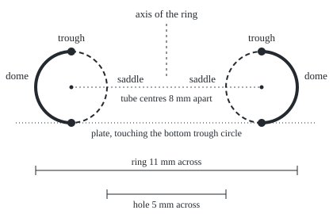
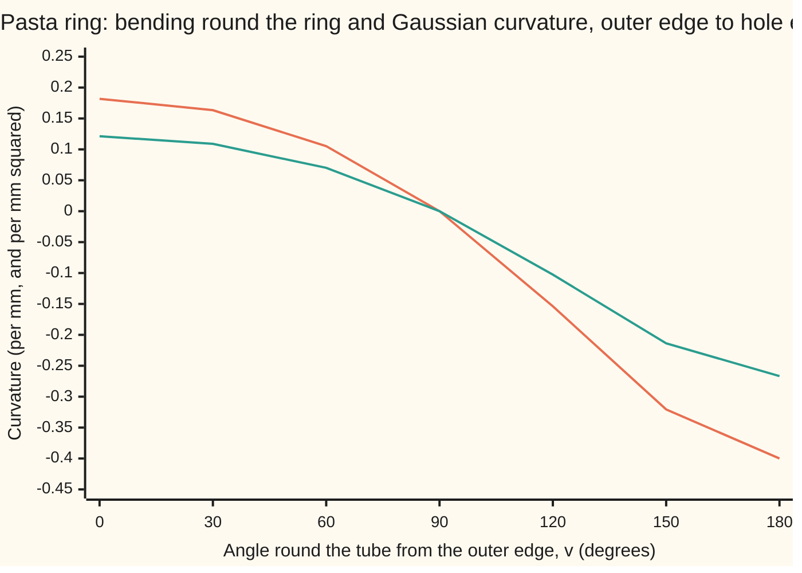
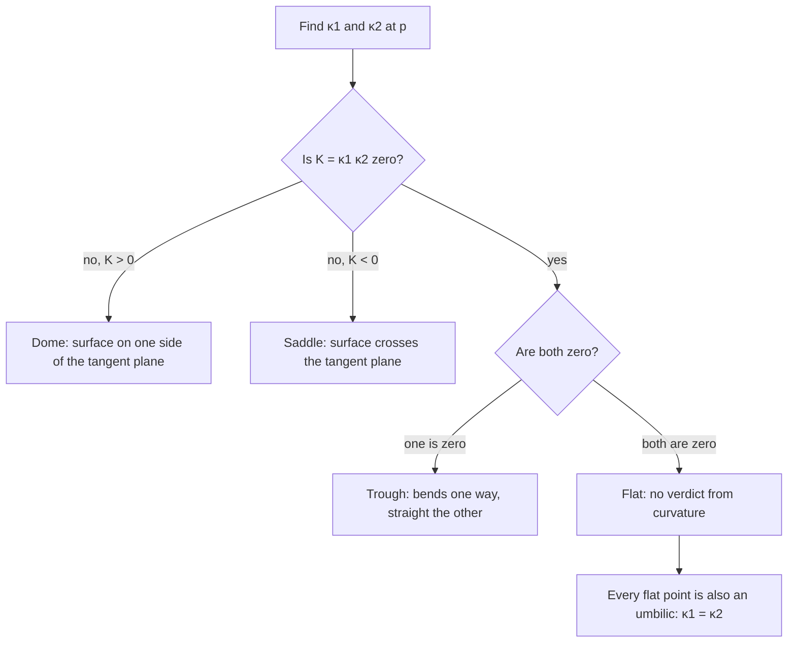

# Point types: dome, saddle, trough and flat

[Syllabus](../../../SYLLABUS.md) → [Differential geometry and Lie groups](../README.md) → [Surfaces](../README.md#s02) → Point types

---

## General Overview

Take one ring of pasta, modelled as a perfect torus (the shape of a ring doughnut). It is 11.0 mm across with a hole 5.0 mm across. The dough is a tube of radius 1.5 mm bent round a circle of radius 4 mm.

Put a fingertip on the outside edge. The dough curves away from the finger in every direction, like the top of a dome. Move the finger to the edge of the hole. Round the tube the dough still curves away, but round the hole it curves the other way, like a horse's saddle. Lay the ring on a plate: it touches along a whole circle, and there the dough is curved round the tube, but along that circle it does not lift off the plate.

So one small piece of pasta has three kinds of point. A fourth kind, flat, is every point of a lasagna sheet.

This card sorts any point of any smooth surface into those four types. It needs two numbers at the point, the two principal curvatures: the largest and smallest bending rates over all directions. Their signs name the shape.

**Both bending rates of one sign make a dome, opposite signs make a saddle, one zero makes a trough and both zero make a flat point; so the sign of their product, the Gaussian curvature, does most of the sorting.**

**What kind of fact this is:** a definition (the four names) plus a theorem, proved on this card in Why it works: near a dome point the surface stays on one side of its tangent plane (the flat plane that just touches it at the point), and near a saddle point it crosses it. Both are local facts. One global fact is also proved here: every closed surface has a dome point.

### The picture: the ring cut through its axis

<p align="center"></p>

The solid arcs face away from the hole: dome points. The dashed arcs face the hole: saddle points. The four dots are the top and bottom circles of the ring, seen end-on: trough points. The dotted line is a plate touching the bottom trough circle.

---

## The formula

Notation from earlier cards on this shelf, one line each:

- A patch $`\mathbf{r}(u, v)`$ turns two coordinates into a point of the surface ([Regular surface](01-regular-surfaces-and-tangent-planes.md)).
- $`E`$, $`F`$, $`G`$ measure lengths in the patch ([First fundamental form](02-first-fundamental-form.md)). $`L`$, $`M`$, $`N`$ measure how fast the surface leaves its tangent plane, along the unit normal $`\mathbf{n}`$ ([Gauss map and second fundamental form](04-gauss-map-and-second-fundamental-form.md)).
- The principal curvatures $`\kappa_1 \ge \kappa_2`$ are the largest and smallest bending rates at the point. Gaussian curvature is $`K = \kappa_1\kappa_2`$ and mean curvature is $`H = (\kappa_1 + \kappa_2)/2`$ ([Principal, mean and Gaussian curvature](05-principal-mean-and-gaussian-curvature.md)).

This card's sign convention: $`\mathbf{n}`$ points into the dough, and a bending rate is positive when the surface curves toward $`\mathbf{n}`$.

The sorting rule:

```math
\text{type of } p = \begin{cases} \text{dome (elliptic)} & \kappa_1\kappa_2 > 0 \\ \text{saddle (hyperbolic)} & \kappa_1\kappa_2 < 0 \\ \text{trough (parabolic)} & \text{exactly one of } \kappa_1, \kappa_2 \text{ is } 0 \\ \text{flat (planar)} & \kappa_1 = \kappa_2 = 0 \end{cases}
```

**Read it aloud:** if both bending rates have one sign the point is a dome, if they have opposite signs it is a saddle, if one is zero it is a trough, and if both are zero it is flat.

The names in brackets are the standard technical names. One more name cuts across the four: an **umbilic** is a point where $`\kappa_1 = \kappa_2`$, so every direction bends at the same rate. Every point of a ball and every point of a lasagna sheet is an umbilic.

The tool behind the rule is the **normal curvature** $`\kappa_n(\theta)`$. Stand a knife plane on the surface so that it contains the normal $`\mathbf{n}`$, and turn it to the angle $`\theta`$ from the direction of $`\kappa_1`$. The knife cuts a curve; $`\kappa_n(\theta)`$ is that curve's signed curvature at $`p`$. Euler's formula, proved on [Principal, mean and Gaussian curvature](05-principal-mean-and-gaussian-curvature.md), gives it from the two principal curvatures:

```math
\kappa_n(\theta) = \kappa_1 \cos^2\theta + \kappa_2 \sin^2\theta
```

For the pasta ring the two principal curvatures have a closed form. With $`a`$ the tube radius, $`b`$ the ring radius and $`v`$ the angle round the tube, measured from the outer edge:

```math
\kappa_1 = \frac{1}{a}, \qquad \kappa_2 = \frac{\cos v}{b + a\cos v}
```

The first is the bending round the tube. The second is the bending round the ring, and it changes sign as $`v`$ passes 90°.

| Symbol | Plain meaning | In our example | Push it up and the answer… |
| --- | --- | --- | --- |
| $`p`$, $`\mathbf{n}`$ | the point being sorted, and the unit arrow at $`p`$ perpendicular to the surface, pointing into the dough | outer edge, $`\mathbf{n}`$ toward the tube's centre | — |
| $`\mathbf{r}(u, v)`$, $`u`$, $`v`$ | the patch; $`u`$ is the angle round the ring, $`v`$ the angle round the tube, 0 at the outer edge | $`v`$ = 0°, 90°, 180° are the outer edge, top and hole edge | — |
| $`a`$ | the tube's radius, mm | 1.5 mm | a fatter tube: $`\kappa_1`$ falls, the dome share rises |
| $`b`$ | the ring's radius, axis to tube centre, mm | 4 mm | the ring bends less, $`\kappa_2`$ shrinks toward 0 |
| $`\kappa_1`$, $`\kappa_2`$ | the largest and smallest bending rates, per mm | 0.666667 and 0.181818 at the outer edge | — |
| $`K`$ | Gaussian curvature $`\kappa_1\kappa_2`$, per mm² | 0.121212 at the outer edge | above 0: dome; below 0: saddle |
| $`H`$ | mean curvature $`(\kappa_1 + \kappa_2)/2`$, per mm | 0.133333 at the hole edge | says nothing reliable about the type |
| $`\theta`$ | the knife plane's angle from the $`\kappa_1`$ direction | 52.24° gives a straight cut at the hole edge | — |
| $`\kappa_n(\theta)`$ | normal curvature: the bending of the knife's cut curve, per mm | runs from −0.4 to 0.666667 at the hole edge | — |
| $`E`$, $`F`$, $`G`$, $`L`$, $`M`$, $`N`$ | the first and second fundamental forms' entries | $`L N - M^2`$ has the sign of $`K`$ | — |
| $`x`$, $`y`$, $`f`$, $`t`$ | distances in the tangent plane along the principal directions, the surface's height above that plane, and the distance along one knife cut | $`f \approx \tfrac12(\kappa_1 x^2 + \kappa_2 y^2)`$ | — |
| $`q`$, $`d`$ | a closed surface's farthest point from a chosen centre, and that distance, mm | outer edge, 5.5 mm | a bigger $`d`$ allows gentler bending at $`q`$ |

### When it holds

- **The surface is smooth at $`p`$**, with continuous second derivatives. At the sharp rim of a cut pasta tube there is no tangent plane, and no type.
- **The patch is regular**: $`\mathbf{r}_u`$ and $`\mathbf{r}_v`$ are not parallel. Where they are, $`EG - F^2 = 0`$ and the formulas divide by zero.
- **The four types are local.** They describe the surface near $`p`$ only. The ring is dome on its outside and saddle round its hole.
- **A flat point gets no verdict.** Both curvatures are 0, so second-order bending is silent. Two flat points can have quite different shapes (What breaks, row 3).
- **Choosing $`\mathbf{n}`$ the other way flips both signs.** The type stays the same, because the product $`K`$ does not change.

---

## Why it works

### Step 0: near any point, a surface is a height over its tangent plane

Rest the tangent plane on $`p`$ like a sheet of glass. Measure distances $`x`$ and $`y`$ in the glass, and the height $`f(x, y)`$ of the surface above it, along $`\mathbf{n}`$.

At $`p`$ the height is 0 and both slopes are 0, because the glass touches there. So $`p`$ is a flat spot of the height function. The [Extrema in several variables](../../06-Calculus%20and%20analysis/07-Several%20Variables/06-multivariable-extrema.md) card already sorts a flat spot into pit, peak or saddle by the sign of the Hessian's determinant, and shows that a zero determinant gives no verdict. This card applies that test to the height over the tangent plane, at any point of any surface.

### Step 1: the Hessian of the height is the shape operator

In this glass-plate chart, at $`p`$, the first fundamental form is plain: $`E = G = 1`$, $`F = 0`$. The second fundamental form is the second derivatives of the height: $`L = f_{xx}`$, $`M = f_{xy}`$, $`N = f_{yy}`$.

So the shape operator, whose eigenvalues are $`\kappa_1`$ and $`\kappa_2`$, is the Hessian of $`f`$. Turn the $`x`$ and $`y`$ axes to its eigenvectors, the principal directions ([Quadratic forms](../../03-Algebra/07-Eigenvalues%20and%20Symmetric%20Matrices/05-quadratic-forms-and-positive-definite.md)). Then

```math
f(x, y) \approx \tfrac12\left(\kappa_1 x^2 + \kappa_2 y^2\right)
```

The Hessian's determinant is $`\kappa_1\kappa_2 = K`$. That is why the Gaussian curvature carries the sort.

### Step 2: read the four cases off the quadratic form

- **Dome, $`K > 0`$.** Both terms have one sign. The height has that sign in every direction, so the surface lies on one side of the glass near $`p`$.
- **Saddle, $`K < 0`$.** The terms have opposite signs. The height is positive in some directions and negative in others, so the surface crosses the glass.
- **Trough, one curvature 0.** Say $`\kappa_2 = 0`$. The height is $`\tfrac12\kappa_1 x^2`$ plus smaller terms: it bends one way, and is straight to second order along the $`y`$ direction.
- **Flat, both 0.** The quadratic form vanishes. The shape depends on cubic or higher terms, which the curvatures cannot see.

### Step 3: Euler's formula and the straight cuts

Cut along the direction at angle $`\theta`$: put $`x = t\cos\theta`$, $`y = t\sin\theta`$. The cut curve has slope 0 at $`p`$, so its curvature there is its second derivative in $`t`$. That gives Euler's formula, $`\kappa_n(\theta) = \kappa_1\cos^2\theta + \kappa_2\sin^2\theta`$, which [Principal, mean and Gaussian curvature](05-principal-mean-and-gaussian-curvature.md) proves from the shape operator; here it falls out of the height in one line.

At a saddle, $`\kappa_n`$ is 0 where $`\tan^2\theta = -\kappa_1/\kappa_2`$. These two **asymptotic directions** (directions where the knife cut is straight to second order) are where the surface crosses the glass. At the hole edge of the ring, $`\tan^2\theta = 0.666667/0.4`$, so $`\theta`$ = 52.24° either side of the tube direction.

<details>
<summary>Detailed proof: the height function and Euler's formula</summary>

Move $`p`$ to the origin and turn space so that $`\mathbf{n}`$ is the third axis. By the implicit function theorem (used, not proved, in this wing), the surface near $`p`$ is a graph $`z = f(x, y)`$ with $`f(0, 0) = 0`$ and $`f_x = f_y = 0`$ at the origin.

Use the patch $`\mathbf{r}(x, y) = (x, y, f(x, y))`$. Then $`\mathbf{r}_x = (1, 0, f_x)`$ and $`\mathbf{r}_y = (0, 1, f_y)`$, which at the origin give $`E = G = 1`$ and $`F = 0`$. Also $`\mathbf{r}_{xx} = (0, 0, f_{xx})`$, so $`L = \mathbf{r}_{xx}\cdot\mathbf{n} = f_{xx}`$; likewise $`M = f_{xy}`$ and $`N = f_{yy}`$.

The shape operator is the first form's inverse times the second. With the first form equal to the identity, it is the Hessian of $`f`$. The Hessian is symmetric, so the spectral theorem gives perpendicular eigenvectors with eigenvalues $`\kappa_1`$ and $`\kappa_2`$. In those axes, Taylor's theorem gives

$`\displaystyle f(x, y) = \tfrac12\left(\kappa_1 x^2 + \kappa_2 y^2\right) + o(x^2 + y^2).`$

Here $`o(x^2 + y^2)`$ means a remainder that shrinks faster than $`x^2 + y^2`$. If $`K > 0`$ with both curvatures positive, the quadratic part is at least $`\tfrac12\kappa_2(x^2 + y^2)`$, which beats the remainder near 0, so $`f > 0`$ there except at $`p`$. Negate $`f`$ for both negative. If $`K < 0`$, the axis directions give heights of opposite signs for small steps.

For Euler's formula, set $`g(t) = f(t\cos\theta, t\sin\theta)`$. A graph curve with slope 0 has curvature $`g''(0)/(1 + g'(0)^2)^{3/2} = g''(0)`$, and

$`\displaystyle g''(0) = \kappa_1\cos^2\theta + \kappa_2\sin^2\theta.`$

</details>

### Step 4: the sign of K needs only L, M and N

In any patch, $`K = (LN - M^2)/(EG - F^2)`$. The bottom is a squared area, always positive on a regular patch. So the sign of $`K`$ is the sign of $`LN - M^2`$. To tell dome from saddle, the second fundamental form alone is enough. The code checks this at every point it sorts.

### Step 5: a global fact, every closed surface has a dome point

Take a closed surface (finite, with no edge) and find its point $`q`$ farthest from some centre, at distance $`d`$. The surface lies inside the ball of radius $`d`$ and touches its sphere at $`q`$, so its normal at $`q`$ lies along the radius. Each knife cut at $`q`$ is then a plane curve inside a circle of radius $`d`$, touching it at $`q`$, and such a curve bends at least as much as the circle. So at $`q`$ both curvatures are at least $`1/d`$, toward the centre, and $`q`$ is a dome point.

For the ring, the farthest points from its centre are the outer edge, at $`d`$ = 5.5 mm. There $`\kappa_2`$ = 0.181818 per mm, exactly $`1/5.5`$, and $`\kappa_1`$ = 0.666667 is larger. No closed pasta shape is saddle everywhere.

---

## Worked numbers, by hand

The ring at three points, with $`a`$ = 1.5 mm and $`b`$ = 4 mm.

| Step | Arithmetic | Value |
| --- | --- | --- |
| Tube rate, every point | $`1/a = 1/1.5`$ | 0.666667 per mm |
| Ring rate, outer edge ($`v`$ = 0°) | $`\cos 0/(4 + 1.5) = 1/5.5`$ | 0.181818 per mm |
| $`K`$ at the outer edge | $`0.666667 \times 0.181818`$ | 0.121212 per mm², dome |
| Ring rate, top ($`v`$ = 90°) | $`\cos 90°/(4 + 0) = 0`$ | 0 per mm |
| $`K`$ at the top | $`0.666667 \times 0`$ | 0, trough |
| Ring rate, hole edge ($`v`$ = 180°) | $`\cos 180°/(4 - 1.5) = -1/2.5`$ | −0.4 per mm |
| $`K`$ at the hole edge | $`0.666667 \times (-0.4)`$ | −0.266667 per mm², saddle |
| Straight cuts at the hole edge | $`\tan^2\theta = 0.666667/0.4`$ | 52.24° from the tube direction |
| Dome share of the surface | $`\tfrac12 + a/(\pi b) = 0.5 + 1.5/(4\pi)`$ | **0.619366** |

So 61.9% of the ring's surface is dome and 38.1% is saddle, and the two meet along the top and bottom circles, which are trough.

The dome share comes from the area: a band of the ring at angle $`v`$ has area proportional to $`b + a\cos v`$, the distance from the axis. The outer half is farther out, so it has more surface.

### How the type changes round the tube



Orange is $`\kappa_2`$, the bending round the ring, in per mm. Green is $`K`$, in per mm². The tube rate $`\kappa_1`$ stays at 0.666667 and is not drawn. Both lines cross zero at 90°, the trough circle: dome before it, saddle after.

### The decision, as a chart



### What breaks if you drop a piece

| Mistake | Comes out at | What went wrong |
| --- | --- | --- |
| Sort by mean curvature $`H`$ | hole edge $`H`$ = 0.133333 per mm, positive, so called a dome | it is a saddle: $`K`$ = −0.266667. $`H`$ adds the rates and hides opposite signs |
| Flip $`\mathbf{n}`$, then read "both negative" as a hollow, not a dome | outer edge: tube rate −0.666667, ring rate −0.181818 per mm | $`K`$ is still 0.121212: still a dome, seen from the other side |
| Trust a flat point | $`x^4 + y^4`$ and $`x^3 - 3xy^2`$ both have curvatures 0, 0 at the origin; round a circle their heights change sign 0 and 6 times | the first stays on one side, like a dome; the second, the monkey saddle, goes up and down three times each. Curvature cannot tell them apart |

---

## Code, from first principles, and it actually runs

The code sorts the ring at seven points round the tube, from the outer edge to the hole edge. It takes three independent roads to $`\kappa_1`$ and $`\kappa_2`$. Road 1 is the closed form above. Road 2 differentiates the patch numerically, builds $`E`$, $`F`$, $`G`$, $`L`$, $`M`$, $`N`$ and takes the shape operator's eigenvalues. Road 3 never forms $`L`$, $`M`$ or $`N`$: it measures the height of nearby dough above the tangent plane in 360 directions, turns each height into a normal curvature, and takes the largest and smallest. Road 3 is stepped, so it prints its error against Euler's formula at two step sizes. Road 3 also locates, on its own, the four directions at the hole edge where the slice curvature changes sign, and the code checks them against the 52.24° from Euler's formula. A fourth check counts the dome share of the area by a sum and compares it with the formula, and adds up $`K`$ over the dome part, the saddle part and the whole ring. Rigatoni and lasagna are sorted by road 2 at one point each; every point of each is alike.

### Python

```python
# Point types -- the check behind the card.  Standard library only.
# A pasta ring modelled as a torus: the tube's centre line is a circle of
# radius b = 4 mm, the tube has radius a = 1.5 mm.  Each point is sorted by the
# signs of its two principal curvatures, found three ways: the closed form, the
# shape operator from finite differences, and slices in 360 directions.
import math

B, A = 4.0, 1.5                              # ring radius and tube radius (mm)
TOL = 1e-3                                   # a curvature under 0.001 per mm counts as zero

def sub(p, q): return (p[0] - q[0], p[1] - q[1], p[2] - q[2])
def dot(p, q): return p[0] * q[0] + p[1] * q[1] + p[2] * q[2]
def cross(p, q): return (p[1] * q[2] - p[2] * q[1], p[2] * q[0] - p[0] * q[2], p[0] * q[1] - p[1] * q[0])
def scale(p, s): return (p[0] * s, p[1] * s, p[2] * s)

def torus(u, v):                             # u: round the ring, v: round the tube, 0 = outer edge
    w = B + A * math.cos(v)
    return (w * math.cos(u), w * math.sin(u), A * math.sin(v))
def torus_in(u, v): return (B * math.cos(u), B * math.sin(u), 0.0)   # a point inside the dough
def rigatoni(u, v): return (7.5 * math.cos(u), 7.5 * math.sin(u), v)
def rigatoni_in(u, v): return (0.0, 0.0, v)
def lasagna(u, v): return (u, v, 0.0)
def lasagna_in(u, v): return (u, v, -1.0)

def kind(k1, k2):                            # the sorting rule of the card
    z1, z2 = abs(k1) < TOL, abs(k2) < TOL
    if z1 and z2: return "flat"
    if z1 or z2: return "trough"
    return "dome" if k1 * k2 > 0 else "saddle"

def frame(patch, inside, u, v, h=1e-4):      # finite-difference derivatives and the inward normal
    p = patch(u, v)
    ru = scale(sub(patch(u + h, v), patch(u - h, v)), 1 / (2 * h))
    rv = scale(sub(patch(u, v + h), patch(u, v - h)), 1 / (2 * h))
    ruu = scale(sub(sub(patch(u + h, v), p), sub(p, patch(u - h, v))), 1 / (h * h))
    rvv = scale(sub(sub(patch(u, v + h), p), sub(p, patch(u, v - h))), 1 / (h * h))
    ruv = scale(sub(sub(patch(u + h, v + h), patch(u + h, v - h)),
                    sub(patch(u - h, v + h), patch(u - h, v - h))), 1 / (4 * h * h))
    n = cross(ru, rv)
    n = scale(n, 1 / math.sqrt(dot(n, n)))
    if dot(n, sub(inside(u, v), p)) < 0: n = scale(n, -1)    # point n into the dough
    return p, ru, rv, ruu, ruv, rvv, n

def shape_operator(patch, inside, u, v):     # road 2: E, F, G and L, M, N, then the eigenvalues
    p, ru, rv, ruu, ruv, rvv, n = frame(patch, inside, u, v)
    E, F, G = dot(ru, ru), dot(ru, rv), dot(rv, rv)
    L, M, N = dot(ruu, n), dot(ruv, n), dot(rvv, n)
    K = (L * N - M * M) / (E * G - F * F)
    H = (E * N - 2 * F * M + G * L) / (2 * (E * G - F * F))
    s = math.sqrt(max(H * H - K, 0.0))
    return H + s, H - s, K, H, L * N - M * M

def slices(u, v, t):                         # road 3: height above the tangent plane in 360 directions
    p, ru, rv, _, _, _, n = frame(torus, torus_in, u, v)
    eu, ev = math.sqrt(dot(ru, ru)), math.sqrt(dot(rv, rv))
    kn = []
    for d in range(360):
        th = math.radians(d)                 # 0 degrees: round the ring; 90: round the tube
        q = torus(u + t * math.cos(th) / eu, v + t * math.sin(th) / ev)
        h = dot(sub(q, p), n)
        kn.append(2 * h / (dot(sub(q, p), sub(q, p)) - h * h))
    return kn

def closed(v):                               # road 1: tube 1/a, ring cos v / (B + a cos v)
    return 1 / A, math.cos(v) / (B + A * math.cos(v))

f6 = lambda x: f"{0.0 if abs(x) < 5e-7 else x:.6f}"
print("v (deg)  tube k1    ring k2    K (1/mm^2)  H (1/mm)   type")
for deg in (0, 30, 60, 90, 120, 150, 180):
    v = math.radians(deg)
    k1, k2 = closed(v)
    s1, s2, K, H, LNM = shape_operator(torus, torus_in, 0.0, v)
    assert abs(s1 - max(k1, k2)) < 1e-6 and abs(s2 - min(k1, k2)) < 1e-6   # road 2 against road 1
    assert abs(K - k1 * k2) < 1e-6 and kind(s1, s2) == kind(k1, k2)
    kn = slices(0.0, v, 1e-3)
    assert abs(max(kn) - max(k1, k2)) < 1e-3 and abs(min(kn) - min(k1, k2)) < 1e-3  # road 3
    assert (LNM > 1e-9) == (k1 * k2 > 1e-9)              # sign of K needs only L, M, N
    assert kind(s1, s2) == ("dome" if deg < 90 else "trough" if deg == 90 else "saddle")  # outer half dome
    print(f"{deg:>7}  {f6(k1):>9}  {f6(k2):>9}  {f6(k1 * k2):>10}  {f6((k1 + k2) / 2):>9}  {kind(k1, k2)}")

for deg in (0, 180, 90):                     # the three named points, slice by slice
    v = math.radians(deg)
    k1, k2 = closed(v)
    errs = []
    for t in (1e-2, 1e-3):
        kn = slices(0.0, v, t)
        euler = [k2 * math.cos(math.radians(d)) ** 2 + k1 * math.sin(math.radians(d)) ** 2 for d in range(360)]
        errs.append(max(abs(kn[d] - euler[d]) for d in range(360)))
    kn = slices(0.0, v, 1e-3)
    changes = sum(1 for d in range(360) if kn[d] * kn[(d + 1) % 360] < 0)
    print(f"v = {deg:>3}: slice curvature from {f6(min(kn))} to {f6(max(kn))} per mm, "
          f"{changes} sign changes, Euler error {errs[0]:.8f} at step 0.01, {errs[1]:.8f} at 0.001")
    assert errs[1] < errs[0] / 5                       # the slices converge as the step shrinks
    assert changes == {0: 0, 180: 4, 90: 0}[deg]

print(f"top of the ring, unrounded: ring k2 = {closed(math.pi / 2)[1]:.1e} per mm by the closed form, not exactly 0")
k1, k2 = closed(math.pi)                    # saddle: directions where the slice is straight
ang = math.degrees(math.atan(math.sqrt(-k1 / k2)))
kn = slices(0.0, math.pi, 1e-3)              # road 3 locates them on its own; 90 is the tube direction
cuts = [d + 0.5 for d in range(360) if kn[d] * kn[(d + 1) % 360] < 0]
print(f"inner edge: straight slices at {ang:.2f} degrees either side of the tube direction; slices change sign at",
      ", ".join(f"{c:.1f}" for c in cuts), "degrees")
assert len(cuts) == 4 and all(abs(c - w) < 1 for c, w in zip(cuts, (90 - ang, 90 + ang, 270 - ang, 270 + ang)))
gap = min(closed(math.radians(d))[0] - closed(math.radians(d))[1] for d in range(360))
print(f"no umbilic on the ring: k1 - k2 is at least {f6(gap)} per mm, at the outer edge")
assert gap > TOL and abs(gap - (1 / A - 1 / (B + A))) < 1e-12

share = 0.5 + A / (math.pi * B)              # dome share of the area, closed form
n, dome_area, area, dome_K, all_K = 3600, 0.0, 0.0, 0.0, 0.0   # against a midpoint sum round the tube
for i in range(n):
    v = (i + 0.5) * 2 * math.pi / n
    dA = 2 * math.pi * A * (B + A * math.cos(v)) * 2 * math.pi / n   # a whole band round the ring
    k1, k2 = closed(v)
    area += dA; all_K += k1 * k2 * dA
    if k1 * k2 > 0: dome_area += dA; dome_K += k1 * k2 * dA
print(f"dome share of the pasta's surface: {share:.6f} by formula, {dome_area / area:.6f} by sum")
print(f"total K by sum: dome part {dome_K:.5f}, saddle part {all_K - dome_K:.5f}, whole ring {f6(all_K)}; 4 pi = {4 * math.pi:.5f}")
assert abs(dome_area / area - share) < 1e-6 and abs(dome_K - 4 * math.pi) < 1e-5 and abs(all_K) < 1e-9
print(f"dome {100 * share:.1f}% and saddle {100 - 100 * share:.1f}% of the surface")
far = max(math.sqrt(dot(torus(0.0, math.radians(d)), torus(0.0, math.radians(d)))) for d in range(360))
print(f"farthest from the centre: {far:.1f} mm, and 1/{far:.1f} = {f6(1 / far)} per mm")
assert abs(1 / far - closed(0.0)[1]) < 1e-12 and closed(0.0)[0] > 1 / far

for name, patch, inside in (("rigatoni", rigatoni, rigatoni_in), ("lasagna", lasagna, lasagna_in)):
    s1, s2, K, H, _ = shape_operator(patch, inside, 0.3, 0.7)
    print(f"{name}{' (radius 7.5 mm)' if name == 'rigatoni' else ''}: k1 {f6(s1)}, k2 {f6(s2)} per mm, type {kind(s1, s2)}")
    assert kind(s1, s2) == ("trough" if name == "rigatoni" else "flat")

print(f"mistake, sort by H: inner edge H = {f6(sum(closed(math.pi)) / 2)} per mm, positive, yet a saddle")
k1, k2 = closed(0.0)
print(f"mistake, flip the normal: outer edge k1 = {f6(-k1)}, k2 = {f6(-k2)}, K still {f6(k1 * k2)}")
for name, f in (("x^4 + y^4", lambda x, y: x ** 4 + y ** 4), ("x^3 - 3xy^2", lambda x, y: x ** 3 - 3 * x * y * y)):
    hs = [f(0.5 * math.cos(math.radians(d + 0.5)), 0.5 * math.sin(math.radians(d + 0.5))) for d in range(360)]
    ch = sum(1 for d in range(360) if hs[d] * hs[(d + 1) % 360] < 0)
    hxx = (f(1e-3, 0) - 2 * f(0, 0) + f(-1e-3, 0)) / 1e-6
    print(f"mistake, trust a flat point: {name} has curvatures 0, 0 (f_xx {hxx:.4f}), {ch} sign changes")
    assert abs(hxx) < 1e-5 and ch == {"x^4 + y^4": 0, "x^3 - 3xy^2": 6}[name]
print(f"figure, tube centres at x = -{B:.3f} and {B:.3f} mm, tube radius {A:.3f} mm, troughs at z = +-{A:.3f} mm")
print(f"ring {2 * (B + A):.1f} mm across, hole {2 * (B - A):.1f} mm across")
print("ALL CHECKS PASS")
```

**Ran 2026-11-19 on macOS, Python 3.14.10, standard library only. All checks passed. Output, pasted from the run:**

```
v (deg)  tube k1    ring k2    K (1/mm^2)  H (1/mm)   type
      0   0.666667   0.181818    0.121212   0.424242  dome
     30   0.666667   0.163431    0.108954   0.415049  dome
     60   0.666667   0.105263    0.070175   0.385965  dome
     90   0.666667   0.000000    0.000000   0.333333  trough
    120   0.666667  -0.153846   -0.102564   0.256410  saddle
    150   0.666667  -0.320636   -0.213757   0.173015  saddle
    180   0.666667  -0.400000   -0.266667   0.133333  saddle
v =   0: slice curvature from 0.181818 to 0.666667 per mm, 0 sign changes, Euler error 0.00000741 at step 0.01, 0.00000007 at 0.001
v = 180: slice curvature from -0.400000 to 0.666667 per mm, 4 sign changes, Euler error 0.00000741 at step 0.01, 0.00000007 at 0.001
v =  90: slice curvature from 0.000000 to 0.666667 per mm, 0 sign changes, Euler error 0.00031136 at step 0.01, 0.00003100 at 0.001
top of the ring, unrounded: ring k2 = 1.5e-17 per mm by the closed form, not exactly 0
inner edge: straight slices at 52.24 degrees either side of the tube direction; slices change sign at 37.5, 142.5, 217.5, 322.5 degrees
no umbilic on the ring: k1 - k2 is at least 0.484848 per mm, at the outer edge
dome share of the pasta's surface: 0.619366 by formula, 0.619366 by sum
total K by sum: dome part 12.56637, saddle part -12.56637, whole ring 0.000000; 4 pi = 12.56637
dome 61.9% and saddle 38.1% of the surface
farthest from the centre: 5.5 mm, and 1/5.5 = 0.181818 per mm
rigatoni (radius 7.5 mm): k1 0.133333, k2 0.000000 per mm, type trough
lasagna: k1 0.000000, k2 0.000000 per mm, type flat
mistake, sort by H: inner edge H = 0.133333 per mm, positive, yet a saddle
mistake, flip the normal: outer edge k1 = -0.666667, k2 = -0.181818, K still 0.121212
mistake, trust a flat point: x^4 + y^4 has curvatures 0, 0 (f_xx 0.0000), 0 sign changes
mistake, trust a flat point: x^3 - 3xy^2 has curvatures 0, 0 (f_xx 0.0000), 6 sign changes
figure, tube centres at x = -4.000 and 4.000 mm, tube radius 1.500 mm, troughs at z = +-1.500 mm
ring 11.0 mm across, hole 5.0 mm across
ALL CHECKS PASS
```

### Rust

Same numbers, same labels, built with `rustc --edition 2021 -O`.

```rust
// Point types -- the same check as the Python, in Rust.  No crates.
// A pasta ring modelled as a torus: the tube's centre line is a circle of
// radius b = 4 mm, the tube has radius a = 1.5 mm.  Each point is sorted by the
// signs of its two principal curvatures, found three ways: the closed form, the
// shape operator from finite differences, and slices in 360 directions.
use std::f64::consts::PI;
type V3 = (f64, f64, f64);
type Patch = fn(f64, f64) -> V3;
const B: f64 = 4.0; // ring radius (mm)
const A: f64 = 1.5; // tube radius (mm)
const TOL: f64 = 1e-3; // a curvature under 0.001 per mm counts as zero

fn sub(p: V3, q: V3) -> V3 { (p.0 - q.0, p.1 - q.1, p.2 - q.2) }
fn dot(p: V3, q: V3) -> f64 { p.0 * q.0 + p.1 * q.1 + p.2 * q.2 }
fn cross(p: V3, q: V3) -> V3 { (p.1 * q.2 - p.2 * q.1, p.2 * q.0 - p.0 * q.2, p.0 * q.1 - p.1 * q.0) }
fn scale(p: V3, s: f64) -> V3 { (p.0 * s, p.1 * s, p.2 * s) }

fn torus(u: f64, v: f64) -> V3 { // u: round the ring, v: round the tube, 0 = outer edge
    let w = B + A * v.cos();
    (w * u.cos(), w * u.sin(), A * v.sin())
}
fn torus_in(u: f64, _v: f64) -> V3 { (B * u.cos(), B * u.sin(), 0.0) } // a point inside the dough
fn rigatoni(u: f64, v: f64) -> V3 { (7.5 * u.cos(), 7.5 * u.sin(), v) }
fn rigatoni_in(_u: f64, v: f64) -> V3 { (0.0, 0.0, v) }
fn lasagna(u: f64, v: f64) -> V3 { (u, v, 0.0) }
fn lasagna_in(u: f64, v: f64) -> V3 { (u, v, -1.0) }

fn kind(k1: f64, k2: f64) -> &'static str { // the sorting rule of the card
    let (z1, z2) = (k1.abs() < TOL, k2.abs() < TOL);
    if z1 && z2 { return "flat"; }
    if z1 || z2 { return "trough"; }
    if k1 * k2 > 0.0 { "dome" } else { "saddle" }
}

// finite-difference derivatives and the inward normal: p, ru, rv, ruu, ruv, rvv, n
fn frame(patch: Patch, inside: Patch, u: f64, v: f64) -> [V3; 7] {
    let h = 1e-4;
    let p = patch(u, v);
    let ru = scale(sub(patch(u + h, v), patch(u - h, v)), 1.0 / (2.0 * h));
    let rv = scale(sub(patch(u, v + h), patch(u, v - h)), 1.0 / (2.0 * h));
    let ruu = scale(sub(sub(patch(u + h, v), p), sub(p, patch(u - h, v))), 1.0 / (h * h));
    let rvv = scale(sub(sub(patch(u, v + h), p), sub(p, patch(u, v - h))), 1.0 / (h * h));
    let ruv = scale(sub(sub(patch(u + h, v + h), patch(u + h, v - h)),
                        sub(patch(u - h, v + h), patch(u - h, v - h))), 1.0 / (4.0 * h * h));
    let mut n = cross(ru, rv);
    n = scale(n, 1.0 / dot(n, n).sqrt());
    if dot(n, sub(inside(u, v), p)) < 0.0 { n = scale(n, -1.0); } // point n into the dough
    [p, ru, rv, ruu, ruv, rvv, n]
}

// road 2: E, F, G and L, M, N, then the eigenvalues; returns k1, k2, K, H, LN - M^2
fn shape_operator(patch: Patch, inside: Patch, u: f64, v: f64) -> (f64, f64, f64, f64, f64) {
    let [_, ru, rv, ruu, ruv, rvv, n] = frame(patch, inside, u, v);
    let (e, f, g) = (dot(ru, ru), dot(ru, rv), dot(rv, rv));
    let (l, m, nn) = (dot(ruu, n), dot(ruv, n), dot(rvv, n));
    let k = (l * nn - m * m) / (e * g - f * f);
    let h = (e * nn - 2.0 * f * m + g * l) / (2.0 * (e * g - f * f));
    let s = (h * h - k).max(0.0).sqrt();
    (h + s, h - s, k, h, l * nn - m * m)
}

fn slices(u: f64, v: f64, t: f64) -> Vec<f64> { // road 3: height above the tangent plane, 360 directions
    let [p, ru, rv, _, _, _, n] = frame(torus, torus_in, u, v);
    let (eu, ev) = (dot(ru, ru).sqrt(), dot(rv, rv).sqrt());
    (0..360).map(|d| {
        let th = (d as f64).to_radians(); // 0 degrees: round the ring; 90: round the tube
        let q = torus(u + t * th.cos() / eu, v + t * th.sin() / ev);
        let h = dot(sub(q, p), n);
        2.0 * h / (dot(sub(q, p), sub(q, p)) - h * h)
    }).collect()
}

fn closed(v: f64) -> (f64, f64) { (1.0 / A, v.cos() / (B + A * v.cos())) } // road 1
fn f6(x: f64) -> String { format!("{:.6}", if x.abs() < 5e-7 { 0.0 } else { x }) }
fn maxv(x: &[f64]) -> f64 { x.iter().cloned().fold(f64::MIN, f64::max) }
fn minv(x: &[f64]) -> f64 { x.iter().cloned().fold(f64::MAX, f64::min) }

fn main() {
    println!("v (deg)  tube k1    ring k2    K (1/mm^2)  H (1/mm)   type");
    for deg in [0, 30, 60, 90, 120, 150, 180] {
        let v = (deg as f64).to_radians();
        let (k1, k2) = closed(v);
        let (s1, s2, k, _, lnm) = shape_operator(torus, torus_in, 0.0, v);
        assert!((s1 - k1.max(k2)).abs() < 1e-6 && (s2 - k1.min(k2)).abs() < 1e-6); // road 2 against road 1
        assert!((k - k1 * k2).abs() < 1e-6 && kind(s1, s2) == kind(k1, k2));
        let kn = slices(0.0, v, 1e-3);
        assert!((maxv(&kn) - k1.max(k2)).abs() < 1e-3 && (minv(&kn) - k1.min(k2)).abs() < 1e-3); // road 3
        assert!((lnm > 1e-9) == (k1 * k2 > 1e-9)); // sign of K needs only L, M, N
        assert!(kind(s1, s2) == if deg < 90 { "dome" } else if deg == 90 { "trough" } else { "saddle" }); // outer half dome
        println!("{:>7}  {:>9}  {:>9}  {:>10}  {:>9}  {}", deg, f6(k1), f6(k2), f6(k1 * k2), f6((k1 + k2) / 2.0), kind(k1, k2));
    }
    for deg in [0, 180, 90] { // the three named points, slice by slice
        let v = (deg as f64).to_radians();
        let (k1, k2) = closed(v);
        let mut errs = vec![];
        for t in [1e-2, 1e-3] {
            let kn = slices(0.0, v, t);
            let e = (0..360).map(|d| {
                let th = (d as f64).to_radians();
                (kn[d] - (k2 * th.cos() * th.cos() + k1 * th.sin() * th.sin())).abs()
            }).fold(0.0, f64::max);
            errs.push(e);
        }
        let kn = slices(0.0, v, 1e-3);
        let changes = (0..360).filter(|&d| kn[d] * kn[(d + 1) % 360] < 0.0).count();
        println!("v = {:>3}: slice curvature from {} to {} per mm, {} sign changes, Euler error {:.8} at step 0.01, {:.8} at 0.001",
                 deg, f6(minv(&kn)), f6(maxv(&kn)), changes, errs[0], errs[1]);
        assert!(errs[1] < errs[0] / 5.0); // the slices converge as the step shrinks
        assert!(changes == match deg { 180 => 4, _ => 0 });
    }
    println!("top of the ring, unrounded: ring k2 = {:.1e} per mm by the closed form, not exactly 0", closed(PI / 2.0).1);
    let (k1, k2) = closed(PI); // saddle: directions where the slice is straight
    let ang = (-k1 / k2).sqrt().atan().to_degrees();
    let kn = slices(0.0, PI, 1e-3); // road 3 locates them on its own; 90 is the tube direction
    let cuts: Vec<f64> = (0..360).filter(|&d| kn[d] * kn[(d + 1) % 360] < 0.0).map(|d| d as f64 + 0.5).collect();
    println!("inner edge: straight slices at {:.2} degrees either side of the tube direction; slices change sign at {} degrees",
             ang, cuts.iter().map(|c| format!("{:.1}", c)).collect::<Vec<_>>().join(", "));
    assert!(cuts.len() == 4 && cuts.iter().zip([90.0 - ang, 90.0 + ang, 270.0 - ang, 270.0 + ang]).all(|(c, w)| (c - w).abs() < 1.0));
    let gap = (0..360).map(|d| { let (a, b) = closed((d as f64).to_radians()); a - b }).fold(f64::MAX, f64::min);
    println!("no umbilic on the ring: k1 - k2 is at least {} per mm, at the outer edge", f6(gap));
    assert!(gap > TOL && (gap - (1.0 / A - 1.0 / (B + A))).abs() < 1e-12);

    let share = 0.5 + A / (PI * B); // dome share of the area, closed form
    let n = 3600; // against a midpoint sum round the tube
    let (mut dome_area, mut area, mut dome_k, mut all_k) = (0.0, 0.0, 0.0, 0.0);
    for i in 0..n {
        let v = (i as f64 + 0.5) * 2.0 * PI / n as f64;
        let da = 2.0 * PI * A * (B + A * v.cos()) * 2.0 * PI / n as f64; // a whole band round the ring
        let (k1, k2) = closed(v);
        area += da; all_k += k1 * k2 * da;
        if k1 * k2 > 0.0 { dome_area += da; dome_k += k1 * k2 * da; }
    }
    println!("dome share of the pasta's surface: {:.6} by formula, {:.6} by sum", share, dome_area / area);
    println!("total K by sum: dome part {:.5}, saddle part {:.5}, whole ring {}; 4 pi = {:.5}", dome_k, all_k - dome_k, f6(all_k), 4.0 * PI);
    assert!((dome_area / area - share).abs() < 1e-6 && (dome_k - 4.0 * PI).abs() < 1e-5 && all_k.abs() < 1e-9);
    println!("dome {:.1}% and saddle {:.1}% of the surface", 100.0 * share, 100.0 - 100.0 * share);
    let far = (0..360).map(|d| { let q = torus(0.0, (d as f64).to_radians()); dot(q, q).sqrt() }).fold(0.0, f64::max);
    println!("farthest from the centre: {:.1} mm, and 1/{:.1} = {} per mm", far, far, f6(1.0 / far));
    assert!((1.0 / far - closed(0.0).1).abs() < 1e-12 && closed(0.0).0 > 1.0 / far);

    let pastas: [(&str, Patch, Patch); 2] = [("rigatoni", rigatoni, rigatoni_in), ("lasagna", lasagna, lasagna_in)];
    for (name, patch, inside) in pastas {
        let (s1, s2, _, _, _) = shape_operator(patch, inside, 0.3, 0.7);
        println!("{}{}: k1 {}, k2 {} per mm, type {}", name, if name == "rigatoni" { " (radius 7.5 mm)" } else { "" }, f6(s1), f6(s2), kind(s1, s2));
        assert!(kind(s1, s2) == if name == "rigatoni" { "trough" } else { "flat" });
    }

    println!("mistake, sort by H: inner edge H = {} per mm, positive, yet a saddle", f6((closed(PI).0 + closed(PI).1) / 2.0));
    let (k1, k2) = closed(0.0);
    println!("mistake, flip the normal: outer edge k1 = {}, k2 = {}, K still {}", f6(-k1), f6(-k2), f6(k1 * k2));
    fn quartic(x: f64, y: f64) -> f64 { x * x * x * x + y * y * y * y }
    fn monkey(x: f64, y: f64) -> f64 { x * x * x - 3.0 * x * y * y }
    let flats: [(&str, fn(f64, f64) -> f64, usize); 2] = [("x^4 + y^4", quartic, 0), ("x^3 - 3xy^2", monkey, 6)];
    for (name, f, want) in flats {
        let hs: Vec<f64> = (0..360).map(|d| {
            let th = (d as f64 + 0.5).to_radians();
            f(0.5 * th.cos(), 0.5 * th.sin())
        }).collect();
        let ch = (0..360).filter(|&d| hs[d] * hs[(d + 1) % 360] < 0.0).count();
        let hxx = (f(1e-3, 0.0) - 2.0 * f(0.0, 0.0) + f(-1e-3, 0.0)) / 1e-6;
        println!("mistake, trust a flat point: {} has curvatures 0, 0 (f_xx {:.4}), {} sign changes", name, hxx, ch);
        assert!(hxx.abs() < 1e-5 && ch == want);
    }
    println!("figure, tube centres at x = -{:.3} and {:.3} mm, tube radius {:.3} mm, troughs at z = +-{:.3} mm", B, B, A, A);
    println!("ring {:.1} mm across, hole {:.1} mm across", 2.0 * (B + A), 2.0 * (B - A));
    println!("ALL CHECKS PASS");
}
```

**Ran 2026-11-19 on macOS, rustc 1.98.1, no crates. All checks passed. Output, pasted from the run:**

```
v (deg)  tube k1    ring k2    K (1/mm^2)  H (1/mm)   type
      0   0.666667   0.181818    0.121212   0.424242  dome
     30   0.666667   0.163431    0.108954   0.415049  dome
     60   0.666667   0.105263    0.070175   0.385965  dome
     90   0.666667   0.000000    0.000000   0.333333  trough
    120   0.666667  -0.153846   -0.102564   0.256410  saddle
    150   0.666667  -0.320636   -0.213757   0.173015  saddle
    180   0.666667  -0.400000   -0.266667   0.133333  saddle
v =   0: slice curvature from 0.181818 to 0.666667 per mm, 0 sign changes, Euler error 0.00000741 at step 0.01, 0.00000007 at 0.001
v = 180: slice curvature from -0.400000 to 0.666667 per mm, 4 sign changes, Euler error 0.00000741 at step 0.01, 0.00000007 at 0.001
v =  90: slice curvature from 0.000000 to 0.666667 per mm, 0 sign changes, Euler error 0.00031136 at step 0.01, 0.00003100 at 0.001
top of the ring, unrounded: ring k2 = 1.5e-17 per mm by the closed form, not exactly 0
inner edge: straight slices at 52.24 degrees either side of the tube direction; slices change sign at 37.5, 142.5, 217.5, 322.5 degrees
no umbilic on the ring: k1 - k2 is at least 0.484848 per mm, at the outer edge
dome share of the pasta's surface: 0.619366 by formula, 0.619366 by sum
total K by sum: dome part 12.56637, saddle part -12.56637, whole ring 0.000000; 4 pi = 12.56637
dome 61.9% and saddle 38.1% of the surface
farthest from the centre: 5.5 mm, and 1/5.5 = 0.181818 per mm
rigatoni (radius 7.5 mm): k1 0.133333, k2 0.000000 per mm, type trough
lasagna: k1 0.000000, k2 0.000000 per mm, type flat
mistake, sort by H: inner edge H = 0.133333 per mm, positive, yet a saddle
mistake, flip the normal: outer edge k1 = -0.666667, k2 = -0.181818, K still 0.121212
mistake, trust a flat point: x^4 + y^4 has curvatures 0, 0 (f_xx 0.0000), 0 sign changes
mistake, trust a flat point: x^3 - 3xy^2 has curvatures 0, 0 (f_xx 0.0000), 6 sign changes
figure, tube centres at x = -4.000 and 4.000 mm, tube radius 1.500 mm, troughs at z = +-1.500 mm
ring 11.0 mm across, hole 5.0 mm across
ALL CHECKS PASS
```

The two outputs match line for line.

### Lean

Lean proves the dome and saddle facts and Euler's formula at any smooth point, using Step 0's height over the tangent plane.

- Suppose $`p`$ is a smooth point with $`\kappa_1\kappa_2 > 0`$. Then every nearby point other than $`p`$ lies strictly on one side of the tangent plane.
- Suppose $`p`$ is a smooth point with $`\kappa_1\kappa_2 < 0`$. Then arbitrarily close to $`p`$ there are points above the tangent plane and points below it.
- Take the knife cut at angle $`\theta`$ from the $`\kappa_1`$ direction, as in Step 3. Then its slope at $`p`$ is 0, and its second derivative there is $`\kappa_1\cos^2\theta + \kappa_2\sin^2\theta`$.
- Take the pasta ring, with $`a`$ = 1.5 mm and $`b`$ = 4 mm. Then the outer edge has exactly $`K = 4/33`$ per mm², and the hole edge $`K = -4/15`$.

Trough and flat points, Step 5's closed-surface fact, the dome share and the decimal outputs are left to the Python and Rust checks.

```lean
-- Point types: near a surface point whose two principal curvatures have one sign the surface stays strictly on one side of its tangent plane, near a point where they have opposite signs it crosses that plane, and every knife cut bends at Euler's rate κ₁ cos²θ + κ₂ sin²θ, with the pasta ring's exact curvatures checked.
import Mathlib.Analysis.Calculus.FDeriv.Basic
import Mathlib.Analysis.Calculus.Deriv.Basic
import Mathlib.Analysis.Calculus.ContDiff.Basic
import Mathlib.Analysis.SpecialFunctions.Trigonometric.Basic
import Mathlib.Order.Filter.Basic
import Mathlib.Tactic.NormNum
import Mathlib.Analysis.Calculus.FDeriv.Symmetric
import Mathlib.Analysis.Calculus.MeanValue
import Mathlib.Analysis.Calculus.Deriv.Mul

open Filter Topology

/-! The card's Step 0 sets up the chart used here: move the point `p` to the
origin, lay the tangent plane flat, and measure the surface as a height `f (x, y)`
along the normal `n`.  The glass touches at `p`, so `f 0 = 0` and the first
derivative of `f` at `0` is zero.  Turning the `x` and `y` axes to the principal
directions makes the second derivative (the shape operator) diagonal with entries
`κ₁` and `κ₂`, the two principal curvatures.  The surface being smooth at `p`
with continuous second derivatives is `ContDiffAt ℝ 2 f 0`; the graph patch
`(x, y) ↦ (x, y, f (x, y))` is always regular. -/

lemma surf_sq_norm_le (q : ℝ × ℝ) : ‖q‖ ^ 2 ≤ q.1 ^ 2 + q.2 ^ 2 := by
  rw [Prod.norm_def, Real.norm_eq_abs, Real.norm_eq_abs]
  rcases max_cases |q.1| |q.2| with ⟨h, _⟩ | ⟨h, _⟩ <;> rw [h, sq_abs] <;> nlinarith [sq_nonneg q.1, sq_nonneg q.2]

lemma surf_quad (L : (ℝ × ℝ) →L[ℝ] (ℝ × ℝ) →L[ℝ] ℝ) (κ₁ κ₂ : ℝ)
    (h11 : L (1, 0) (1, 0) = κ₁) (h12 : L (1, 0) (0, 1) = 0)
    (h21 : L (0, 1) (1, 0) = 0) (h22 : L (0, 1) (0, 1) = κ₂) (q : ℝ × ℝ) :
    L q q = κ₁ * q.1 ^ 2 + κ₂ * q.2 ^ 2 := by
  have hq : q = q.1 • ((1 : ℝ), (0 : ℝ)) + q.2 • ((0 : ℝ), (1 : ℝ)) := by
    ext <;> simp
  rw [hq]
  simp only [map_add, map_smul, add_apply, smul_apply,
    smul_eq_mul, h11, h12, h21, h22]
  simp only [Prod.fst_add, Prod.snd_add, Prod.smul_mk, smul_eq_mul]
  ring

lemma surf_symm (f : ℝ × ℝ → ℝ) (hf : ContDiffAt ℝ 2 f 0) (v w : ℝ × ℝ) :
    fderiv ℝ (fderiv ℝ f) 0 v w = fderiv ℝ (fderiv ℝ f) 0 w v :=
  hf.isSymmSndFDerivAt (by simp) v w

lemma surf_hasFDeriv2 (f : ℝ × ℝ → ℝ) (hf : ContDiffAt ℝ 2 f 0) :
    HasFDerivAt (fderiv ℝ f) (fderiv ℝ (fderiv ℝ f) 0) 0 :=
  ((hf.fderiv_right (m := 1) (by norm_num)).differentiableAt (by norm_num)).hasFDerivAt

lemma surf_eventually_diff (f : ℝ × ℝ → ℝ) (hf : ContDiffAt ℝ 2 f 0) :
    ∀ᶠ z in 𝓝 (0 : ℝ × ℝ), DifferentiableAt ℝ f z := by
  filter_upwards [hf.eventually (by simp)] with z hz
  exact hz.differentiableAt (by norm_num)

lemma surf_taylor (f : ℝ × ℝ → ℝ) (hf : ContDiffAt ℝ 2 f 0)
    (hflat : fderiv ℝ f 0 = 0) (c : ℝ) (hc : 0 < c) :
    ∀ᶠ q in 𝓝 (0 : ℝ × ℝ),
      |f q - f 0 - (1 / 2) * fderiv ℝ (fderiv ℝ f) 0 q q| ≤ c * ‖q‖ ^ 2 := by
  set L := fderiv ℝ (fderiv ℝ f) 0 with hLdef
  have hL := surf_hasFDeriv2 f hf
  rw [← hLdef] at hL
  have hsym : ∀ v w, L v w = L w v := surf_symm f hf
  have ho := (hasFDerivAt_iff_isLittleO_nhds_zero.mp hL)
  have ho' := ho.def hc
  simp only [zero_add, hflat, sub_zero] at ho'
  have hev := (surf_eventually_diff f hf).and ho'
  obtain ⟨δ, hδ, hball⟩ := Metric.eventually_nhds_iff_ball.mp hev
  filter_upwards [Metric.ball_mem_nhds (0 : ℝ × ℝ) hδ] with q hq
  set g : ℝ × ℝ → ℝ := fun z => f z - (1 / 2) * L z z with hg
  have hsub : Metric.closedBall (0 : ℝ × ℝ) ‖q‖ ⊆ Metric.ball 0 δ := by
    intro z hz
    rw [Metric.mem_closedBall, dist_zero_right] at hz
    rw [Metric.mem_ball, dist_zero_right] at hq ⊢
    linarith
  have hderiv : ∀ z ∈ Metric.closedBall (0 : ℝ × ℝ) ‖q‖,
      HasFDerivWithinAt g (fderiv ℝ f z - (1 / 2 : ℝ) • ((L z).comp (ContinuousLinearMap.id ℝ _)
        + L.flip z)) (Metric.closedBall 0 ‖q‖) z := by
    intro z hz
    have h1 := ((hball z (hsub hz)).1).hasFDerivAt
    have h2 : HasFDerivAt (fun y => L y y) ((L z).comp (ContinuousLinearMap.id ℝ _) + L.flip z) z :=
      L.hasFDerivAt.clm_apply (hasFDerivAt_id z)
    exact (h1.sub (h2.const_smul (1 / 2 : ℝ))).hasFDerivWithinAt
  have hbound : ∀ z ∈ Metric.closedBall (0 : ℝ × ℝ) ‖q‖,
      ‖fderiv ℝ f z - (1 / 2 : ℝ) • ((L z).comp (ContinuousLinearMap.id ℝ _) + L.flip z)‖
        ≤ c * ‖q‖ := by
    intro z hz
    have heq : (1 / 2 : ℝ) • ((L z).comp (ContinuousLinearMap.id ℝ _) + L.flip z) = L z := by
      refine ContinuousLinearMap.ext (fun w => ?_)
      simp [hsym w z]
      ring
    rw [heq]
    have := (hball z (hsub hz)).2
    rw [Metric.mem_closedBall, dist_zero_right] at hz
    calc _ ≤ c * ‖z‖ := this
      _ ≤ c * ‖q‖ := by gcongr
  have hmv := (convex_closedBall (0 : ℝ × ℝ) ‖q‖).norm_image_sub_le_of_norm_hasFDerivWithin_le
    (x := 0) (y := q) hderiv hbound (Metric.mem_closedBall_self (norm_nonneg q))
    (by rw [Metric.mem_closedBall, dist_zero_right])
  have hg0 : g 0 = f 0 := by simp [hg]
  rw [hg0, sub_zero, Real.norm_eq_abs] at hmv
  have : f q - f 0 - 1 / 2 * L q q = g q - f 0 := by simp [hg]; ring
  rw [this]
  calc _ ≤ c * ‖q‖ * ‖q‖ := hmv
    _ = c * ‖q‖ ^ 2 := by ring


lemma surf_norm_axis1 (t : ℝ) : ‖((t, 0) : ℝ × ℝ)‖ ^ 2 = t ^ 2 := by
  rw [Prod.norm_def]; simp

lemma surf_norm_axis2 (t : ℝ) : ‖((0, t) : ℝ × ℝ)‖ ^ 2 = t ^ 2 := by
  rw [Prod.norm_def]; simp

/-- Along an axis-type curve: if `f (γ t) ≈ (k/2) t²` with `k > 0`, then `f (γ t) > 0` for
small `t ≠ 0`. -/
lemma surf_axis_pos (f : ℝ × ℝ → ℝ) (hf : ContDiffAt ℝ 2 f 0) (h0 : f 0 = 0)
    (hflat : fderiv ℝ f 0 = 0) (γ : ℝ → ℝ × ℝ) (hγ : Continuous γ) (hγ0 : γ 0 = 0)
    (k : ℝ) (hk : 0 < k)
    (hq : ∀ t, fderiv ℝ (fderiv ℝ f) 0 (γ t) (γ t) = k * t ^ 2)
    (hn : ∀ t, ‖γ t‖ ^ 2 = t ^ 2) :
    ∃ᶠ q in 𝓝 (0 : ℝ × ℝ), 0 < f q := by
  have ht0 : Tendsto γ (𝓝 (0 : ℝ)) (𝓝 0) := hγ0 ▸ hγ.tendsto 0
  have ht : Tendsto γ (𝓝[≠] (0 : ℝ)) (𝓝 0) := ht0.mono_left nhdsWithin_le_nhds
  refine ht.frequently (Eventually.frequently ?_)
  have hT := ht0.eventually (surf_taylor f hf hflat (k / 4) (by linarith))
  filter_upwards [nhdsWithin_le_nhds hT, self_mem_nhdsWithin] with t h1 h2
  rw [h0, sub_zero, hq t, hn t] at h1
  have ht2 : 0 < t ^ 2 := by have : t ≠ 0 := h2; positivity
  have := (abs_le.mp h1).1
  nlinarith

lemma surf_axis_neg (f : ℝ × ℝ → ℝ) (hf : ContDiffAt ℝ 2 f 0) (h0 : f 0 = 0)
    (hflat : fderiv ℝ f 0 = 0) (γ : ℝ → ℝ × ℝ) (hγ : Continuous γ) (hγ0 : γ 0 = 0)
    (k : ℝ) (hk : k < 0)
    (hq : ∀ t, fderiv ℝ (fderiv ℝ f) 0 (γ t) (γ t) = k * t ^ 2)
    (hn : ∀ t, ‖γ t‖ ^ 2 = t ^ 2) :
    ∃ᶠ q in 𝓝 (0 : ℝ × ℝ), f q < 0 := by
  have ht0 : Tendsto γ (𝓝 (0 : ℝ)) (𝓝 0) := hγ0 ▸ hγ.tendsto 0
  have ht : Tendsto γ (𝓝[≠] (0 : ℝ)) (𝓝 0) := ht0.mono_left nhdsWithin_le_nhds
  refine ht.frequently (Eventually.frequently ?_)
  have hT := ht0.eventually (surf_taylor f hf hflat (-k / 4) (by linarith))
  filter_upwards [nhdsWithin_le_nhds hT, self_mem_nhdsWithin] with t h1 h2
  rw [h0, sub_zero, hq t, hn t] at h1
  have ht2 : 0 < t ^ 2 := by have : t ≠ 0 := h2; positivity
  have := (abs_le.mp h1).2
  nlinarith

#print axioms surf_sq_norm_le
#print axioms surf_quad
#print axioms surf_symm
#print axioms surf_hasFDeriv2
#print axioms surf_eventually_diff
#print axioms surf_taylor
#print axioms surf_norm_axis1
#print axioms surf_norm_axis2
#print axioms surf_axis_pos
#print axioms surf_axis_neg

/-- Dome point: if the two principal curvatures `κ₁`, `κ₂` at `p` have one sign
(`κ₁ κ₂ > 0`, Gaussian curvature positive), then near `p` the surface lies strictly on
one side of its tangent plane: the height is either positive at every nearby point
other than `p`, or negative at every such point. -/
theorem dome_point_lies_on_one_side_of_tangent_plane
    (f : ℝ × ℝ → ℝ) (κ₁ κ₂ : ℝ)
    (hf : ContDiffAt ℝ 2 f 0)
    (h0 : f 0 = 0) (hflat : fderiv ℝ f 0 = 0)
    (h11 : fderiv ℝ (fderiv ℝ f) 0 (1, 0) (1, 0) = κ₁)
    (h12 : fderiv ℝ (fderiv ℝ f) 0 (1, 0) (0, 1) = 0)
    (h22 : fderiv ℝ (fderiv ℝ f) 0 (0, 1) (0, 1) = κ₂)
    (hK : 0 < κ₁ * κ₂) :
    (∀ᶠ q in 𝓝[≠] (0 : ℝ × ℝ), 0 < f q) ∨ (∀ᶠ q in 𝓝[≠] (0 : ℝ × ℝ), f q < 0) := by
  have h21 : fderiv ℝ (fderiv ℝ f) 0 (0, 1) (1, 0) = 0 := by rw [surf_symm f hf]; exact h12
  have hQ := surf_quad _ κ₁ κ₂ h11 h12 h21 h22
  rcases lt_or_gt_of_ne (show κ₁ ≠ 0 by rintro rfl; simp at hK) with h1 | h1
  · have h2 : κ₂ < 0 := by nlinarith
    right
    set m := min (-κ₁) (-κ₂) with hm
    have hm0 : 0 < m := lt_min (by linarith) (by linarith)
    filter_upwards [nhdsWithin_le_nhds (surf_taylor f hf hflat (m / 4) (by linarith)),
      self_mem_nhdsWithin] with q hT hne
    rw [h0, sub_zero, hQ] at hT
    have hq0 : 0 < ‖q‖ := norm_pos_iff.mpr hne
    have hn := surf_sq_norm_le q
    have ha : m ≤ -κ₁ := min_le_left _ _
    have hb : m ≤ -κ₂ := min_le_right _ _
    have := (abs_le.mp hT).2
    nlinarith [sq_nonneg q.1, sq_nonneg q.2, pow_pos hq0 2,
      mul_le_mul_of_nonneg_right ha (sq_nonneg q.1), mul_le_mul_of_nonneg_right hb (sq_nonneg q.2)]
  · have h2 : 0 < κ₂ := by nlinarith
    left
    set m := min κ₁ κ₂ with hm
    have hm0 : 0 < m := lt_min h1 h2
    filter_upwards [nhdsWithin_le_nhds (surf_taylor f hf hflat (m / 4) (by linarith)),
      self_mem_nhdsWithin] with q hT hne
    rw [h0, sub_zero, hQ] at hT
    have hq0 : 0 < ‖q‖ := norm_pos_iff.mpr hne
    have hn := surf_sq_norm_le q
    have ha : m ≤ κ₁ := min_le_left _ _
    have hb : m ≤ κ₂ := min_le_right _ _
    have := (abs_le.mp hT).1
    nlinarith [sq_nonneg q.1, sq_nonneg q.2, pow_pos hq0 2,
      mul_le_mul_of_nonneg_right ha (sq_nonneg q.1), mul_le_mul_of_nonneg_right hb (sq_nonneg q.2)]

/-- Saddle point: if the two principal curvatures `κ₁`, `κ₂` at `p` have opposite signs
(`κ₁ κ₂ < 0`, Gaussian curvature negative), then the surface crosses its tangent plane
at `p`: arbitrarily close to `p` there are points of the surface above the plane and
points below it. -/
theorem saddle_point_crosses_tangent_plane
    (f : ℝ × ℝ → ℝ) (κ₁ κ₂ : ℝ)
    (hf : ContDiffAt ℝ 2 f 0)
    (h0 : f 0 = 0) (hflat : fderiv ℝ f 0 = 0)
    (h11 : fderiv ℝ (fderiv ℝ f) 0 (1, 0) (1, 0) = κ₁)
    (h12 : fderiv ℝ (fderiv ℝ f) 0 (1, 0) (0, 1) = 0)
    (h22 : fderiv ℝ (fderiv ℝ f) 0 (0, 1) (0, 1) = κ₂)
    (hK : κ₁ * κ₂ < 0) :
    (∃ᶠ q in 𝓝 (0 : ℝ × ℝ), 0 < f q) ∧ (∃ᶠ q in 𝓝 (0 : ℝ × ℝ), f q < 0) := by
  have h21 : fderiv ℝ (fderiv ℝ f) 0 (0, 1) (1, 0) = 0 := by rw [surf_symm f hf]; exact h12
  have hQ := surf_quad _ κ₁ κ₂ h11 h12 h21 h22
  have c1 : Continuous (fun t : ℝ => ((t, 0) : ℝ × ℝ)) := by fun_prop
  have c2 : Continuous (fun t : ℝ => ((0, t) : ℝ × ℝ)) := by fun_prop
  have q1 : ∀ t : ℝ, fderiv ℝ (fderiv ℝ f) 0 (t, 0) (t, 0) = κ₁ * t ^ 2 := by
    intro t; rw [hQ]; simp
  have q2 : ∀ t : ℝ, fderiv ℝ (fderiv ℝ f) 0 (0, t) (0, t) = κ₂ * t ^ 2 := by
    intro t; rw [hQ]; simp
  rcases lt_or_gt_of_ne (show κ₁ ≠ 0 by rintro rfl; simp at hK) with h1 | h1
  · have h2 : 0 < κ₂ := by nlinarith
    exact ⟨surf_axis_pos f hf h0 hflat _ c2 rfl κ₂ h2 q2 surf_norm_axis2,
      surf_axis_neg f hf h0 hflat _ c1 rfl κ₁ h1 q1 surf_norm_axis1⟩
  · have h2 : κ₂ < 0 := by nlinarith
    exact ⟨surf_axis_pos f hf h0 hflat _ c1 rfl κ₁ h1 q1 surf_norm_axis1,
      surf_axis_neg f hf h0 hflat _ c2 rfl κ₂ h2 q2 surf_norm_axis2⟩

/-- Euler's formula, as the card's Step 3 derives it from the height: the knife cut at
angle `θ` from the `κ₁` direction is the curve `t ↦ f (t cos θ, t sin θ)`, which has
slope 0 at `p`, so its curvature there is its second derivative, and that equals
`κ₁ cos² θ + κ₂ sin² θ`. -/
theorem euler_normal_curvature_formula
    (f : ℝ × ℝ → ℝ) (κ₁ κ₂ θ : ℝ)
    (hf : ContDiffAt ℝ 2 f 0)
    (h0 : f 0 = 0) (hflat : fderiv ℝ f 0 = 0)
    (h11 : fderiv ℝ (fderiv ℝ f) 0 (1, 0) (1, 0) = κ₁)
    (h12 : fderiv ℝ (fderiv ℝ f) 0 (1, 0) (0, 1) = 0)
    (h22 : fderiv ℝ (fderiv ℝ f) 0 (0, 1) (0, 1) = κ₂) :
    deriv (fun t : ℝ => f (t * Real.cos θ, t * Real.sin θ)) 0 = 0 ∧
    deriv (deriv (fun t : ℝ => f (t * Real.cos θ, t * Real.sin θ))) 0
      = κ₁ * Real.cos θ ^ 2 + κ₂ * Real.sin θ ^ 2 := by
  have h21 : fderiv ℝ (fderiv ℝ f) 0 (0, 1) (1, 0) = 0 := by rw [surf_symm f hf]; exact h12
  have hQ := surf_quad _ κ₁ κ₂ h11 h12 h21 h22
  set v : ℝ × ℝ := (Real.cos θ, Real.sin θ) with hv
  have hφ : (fun t : ℝ => f (t * Real.cos θ, t * Real.sin θ)) = fun t => f (t • v) := by
    funext t; simp [hv]
  rw [hφ]
  have hpath : ∀ t : ℝ, HasDerivAt (fun t : ℝ => t • v) v t := by
    intro t; simpa using (hasDerivAt_id t).smul_const v
  have hcont : Tendsto (fun t : ℝ => t • v) (𝓝 0) (𝓝 0) := by
    have : Continuous (fun t : ℝ => t • v) := by fun_prop
    simpa using this.tendsto 0
  have hd : ∀ᶠ t in 𝓝 (0 : ℝ), deriv (fun t => f (t • v)) t = fderiv ℝ f (t • v) v := by
    filter_upwards [hcont.eventually (surf_eventually_diff f hf)] with t ht
    exact (ht.hasFDerivAt.comp_hasDerivAt t (hpath t)).deriv
  refine ⟨?_, ?_⟩
  · rw [hd.self_of_nhds, zero_smul, hflat]; rfl
  · rw [Filter.EventuallyEq.deriv_eq hd]
    have hL := surf_hasFDeriv2 f hf
    have hL' : HasFDerivAt (fderiv ℝ f) (fderiv ℝ (fderiv ℝ f) 0) ((0 : ℝ) • v) := by
      simpa using hL
    have h1 := hL'.comp_hasDerivAt (0 : ℝ) (hpath 0)
    have h2 := h1.clm_apply (hasDerivAt_const (0 : ℝ) v)
    have h3 : deriv (fun x : ℝ => (fderiv ℝ f (x • v)) v) 0
        = fderiv ℝ (fderiv ℝ f) 0 v v := by
      simpa [Function.comp] using h2.deriv
    rw [h3, hQ]

/-! The card's worked numbers for the pasta ring, tube radius `a = 3/2` mm and ring
radius `b = 4` mm, as exact fractions: `κ₁ = 1/a`, `κ₂ = cos v / (b + a cos v)`. -/

-- Tube rate at every point: 1/1.5 = 2/3 per mm (0.666667).
example : (1 : ℚ) / (3 / 2) = 2 / 3 := by norm_num
-- Outer edge, v = 0: ring rate 1/(4 + 1.5) = 2/11 per mm (0.181818).
example : (1 : ℚ) / (4 + 3 / 2 * 1) = 2 / 11 := by norm_num
-- Outer edge: K = (2/3)(2/11) = 4/33 per mm² (0.121212), positive, so a dome.
example : (2 / 3 : ℚ) * (2 / 11) = 4 / 33 ∧ (0 : ℚ) < 4 / 33 := by norm_num
-- Top, v = 90°: ring rate 0/(4 + 0) = 0, so K = 0 and exactly one rate is 0: a trough.
example : (2 / 3 : ℚ) * (0 / (4 + 3 / 2 * 0)) = 0 ∧ (2 / 3 : ℚ) ≠ 0 := by norm_num
-- Hole edge, v = 180°: ring rate -1/(4 - 1.5) = -2/5 per mm (-0.4).
example : (-1 : ℚ) / (4 + 3 / 2 * (-1)) = -2 / 5 := by norm_num
-- Hole edge: K = (2/3)(-2/5) = -4/15 per mm² (-0.266667), negative, so a saddle.
example : (2 / 3 : ℚ) * (-2 / 5) = -4 / 15 ∧ (-4 / 15 : ℚ) < 0 := by norm_num
-- Hole edge: H = (2/3 - 2/5)/2 = 2/15 per mm (0.133333) is positive, yet the point is a saddle.
example : ((2 / 3 : ℚ) + (-2 / 5)) / 2 = 2 / 15 ∧ (0 : ℚ) < 2 / 15 := by norm_num
-- Straight cuts at the hole edge: tan² θ = (2/3)/(2/5) = 5/3.
example : (2 / 3 : ℚ) / (2 / 5) = 5 / 3 := by norm_num
-- Farthest point 5.5 mm from the centre: 1/5.5 = 2/11, exactly the outer-edge ring rate, and 2/3 > 2/11.
example : (1 : ℚ) / (11 / 2) = 2 / 11 ∧ (2 / 11 : ℚ) < 2 / 3 := by norm_num
-- Ring 2(4 + 1.5) = 11 mm across, hole 2(4 - 1.5) = 5 mm across.
example : 2 * ((4 : ℚ) + 3 / 2) = 11 ∧ 2 * ((4 : ℚ) - 3 / 2) = 5 := by norm_num

#print axioms dome_point_lies_on_one_side_of_tangent_plane
#print axioms saddle_point_crosses_tangent_plane
#print axioms euler_normal_curvature_formula
```

**Checked 2026-11-19 on macOS, Lean 4.36.0-rc2, Mathlib v4.36.0-rc2. Every proof is complete and uses only Lean's standard axioms. Output, pasted from the run:**

```
'surf_sq_norm_le' depends on axioms: [propext, Classical.choice, Quot.sound]
'surf_quad' depends on axioms: [propext, Classical.choice, Quot.sound]
'surf_symm' depends on axioms: [propext, Classical.choice, Quot.sound]
'surf_hasFDeriv2' depends on axioms: [propext, Classical.choice, Quot.sound]
'surf_eventually_diff' depends on axioms: [propext, Classical.choice, Quot.sound]
'surf_taylor' depends on axioms: [propext, Classical.choice, Quot.sound]
'surf_norm_axis1' depends on axioms: [propext, Classical.choice, Quot.sound]
'surf_norm_axis2' depends on axioms: [propext, Classical.choice, Quot.sound]
'surf_axis_pos' depends on axioms: [propext, Classical.choice, Quot.sound]
'surf_axis_neg' depends on axioms: [propext, Classical.choice, Quot.sound]
'dome_point_lies_on_one_side_of_tangent_plane' depends on axioms: [propext, Classical.choice, Quot.sound]
'saddle_point_crosses_tangent_plane' depends on axioms: [propext, Classical.choice, Quot.sound]
'euler_normal_curvature_formula' depends on axioms: [propext, Classical.choice, Quot.sound]
```

> [!TIP]
> **Try changing**
> Guess first, then run the Python.
> - **Fatten the tube.** Set `A` to `2.0`. Guess: does the dome share go up or down? It rises to 0.659155, and the ring becomes 12.0 mm across with a 4.0 mm hole. At the hole edge $`\kappa_1`$ = 0.5 and $`\kappa_2`$ = −0.5, so $`H`$ = 0: one point balanced like a soap film. Every assert still passes.
> - **Make the zero test exact.** Set `TOL` to `1e-20`. Guess: what happens to the top of the ring? Rounding leaves $`\kappa_2`$ near $`10^{-17}`$ instead of 0, so the trough is no longer recognised, and the second assert stops the run at $`v`$ = 90°.
> - **Point the normal out of the dough.** In `frame`, change `< 0` to `> 0`. Guess: does any type change? No type changes, but road 2's curvatures flip sign while road 1 keeps the inward convention, so the first assert stops the run.

---

## The usual mistake

> [!warning]
> **Sorting by one number that adds the bending rates.** Mean curvature $`H`$ is positive at the ring's hole edge, 0.133333 per mm, yet that point is a saddle. A strong positive rate (0.666667 round the tube) outweighs a weaker negative one (−0.4 round the ring). The type needs both signs, which their product $`K`$ = −0.266667 keeps and their sum loses.
>
> - Reading a sign without its normal. With $`\mathbf{n}`$ pointing out of the dough, the outer edge has rates −0.666667 and −0.181818. It is still a dome.
> - Calling a trough flat. The ring's top circle has $`\kappa_2`$ = 0, but $`\kappa_1`$ = 0.666667: it still bends round the tube.
> - Assuming an umbilic is a dome. Every point of a lasagna sheet is an umbilic with both rates 0.
> - Testing for zero with exact equality in code. The top of the ring comes out near $`10^{-17}`$, not 0; use a tolerance, here 0.001 per mm.

---

## Where you meet it in real life

- **Stadium roofs.** A roof domed over one end and saddle-shaped over the middle has dome points and saddle points. If the two were blended smoothly, a line of trough points would separate them; the shelf's roof meets at a ridge instead ([Principal, mean and Gaussian curvature](05-principal-mean-and-gaussian-curvature.md)). Saddle shells are common in roofs because the two opposite curvatures stiffen the shell against loads.
- **Pasta design.** Flat dough sheets pressed with grooves bend into chosen shapes as they cook. The design fixes which points become dome, saddle or trough (the 2021 pasta study in Sources).
- **Paper and sheet metal.** A sheet rolls into a tube without stretching, because a tube is all trough, like rigatoni. It cannot be pressed into a dome without stretching ([Theorema Egregium](08-theorema-egregium.md)).
- **Eyes and lenses.** An eye with astigmatism has a cornea that is not umbilic: its two principal curvatures differ. A toric contact lens matches the two rates.
- **Car bodies.** Design software colours a panel by the sign of $`K`$. A stray saddle patch on a bonnet that should be dome shows up at once.

> **Say it back**
> At every point of a smooth surface there are two principal bending rates, the largest and the smallest. Near the point the surface is a height over its tangent plane, about half of $`\kappa_1 x^2 + \kappa_2 y^2`$. Same signs make a dome, which stays on one side of the plane; opposite signs make a saddle, which crosses it along two curves leaving in the asymptotic directions. One zero makes a trough and two zeros a flat point, where curvature gives no verdict. The pasta ring is 61.9% dome and 38.1% saddle, joined along two trough circles.

---

## What this builds on

- [Principal, mean and Gaussian curvature](05-principal-mean-and-gaussian-curvature.md): the two bending rates $`\kappa_1`$ and $`\kappa_2`$ and the products $`K`$ and $`H`$ that this card sorts by.
- [Quadratic forms](../../03-Algebra/07-Eigenvalues%20and%20Symmetric%20Matrices/05-quadratic-forms-and-positive-definite.md): a quadratic form is positive definite, indefinite or degenerate by the signs of its eigenvalues; the height over the tangent plane is such a form.
- [Extrema in several variables](../../06-Calculus%20and%20analysis/07-Several%20Variables/06-multivariable-extrema.md): the pit, peak and saddle test by the Hessian's determinant, which this card applies to the height over the tangent plane.

## Where this goes next

- [Minimal surface](07-minimal-surfaces-and-soap-films.md): surfaces with $`H = 0`$ everywhere. Since $`\kappa_1 = -\kappa_2`$, every point is a saddle or flat.
- [Theorema Egregium](08-theorema-egregium.md): $`K`$, and so the dome-or-saddle verdict, can be measured from inside the surface.
- [Gauss-Bonnet](10-gauss-bonnet-theorem.md): the ring's dome part carries total $`K`$ of $`4\pi`$ and its saddle part $`-4\pi`$, so the whole ring totals 0; that total counts the hole.
- [Caratheodory's conjecture](../../25-Frontier/04-Geometry%20and%20Combinatorics/09-caratheodory-conjecture.md): does every smooth convex surface have two round points, and the competing 2026 claims.

Left open: the sign of $`K`$ is defined from the surface's bending in space, so can an inhabitant who never leaves the surface tell a dome point from a saddle point?

---

## Sources

Verified 2026-11-19: every link below resolves to the publisher's page.

- Pressley, Andrew. *Elementary Differential Geometry*, 2nd ed. Springer, 2010. [doi:10.1007/978-1-84882-891-9](https://doi.org/10.1007/978-1-84882-891-9). Principal curvatures, Euler's formula and the elliptic, hyperbolic, parabolic and planar points, at the level of this card.
- do Carmo, Manfredo P. *Differential Geometry of Curves and Surfaces*, revised and updated 2nd ed. Dover, 2016. [Publisher's page](https://store.doverpublications.com/products/9780486806990). Normal curvature, umbilics, and the proof that a compact surface has an elliptic point.
- Tao, Ye, Yi-Chin Lee, Haolin Liu, Xiaoxiao Zhang, and 13 others. "Morphing pasta and beyond." *Science Advances* 7, no. 19 (2021). [doi:10.1126/sciadv.abf4098](https://doi.org/10.1126/sciadv.abf4098). Flat pasta designed to cook into curved shapes.
