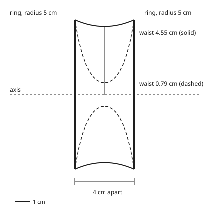
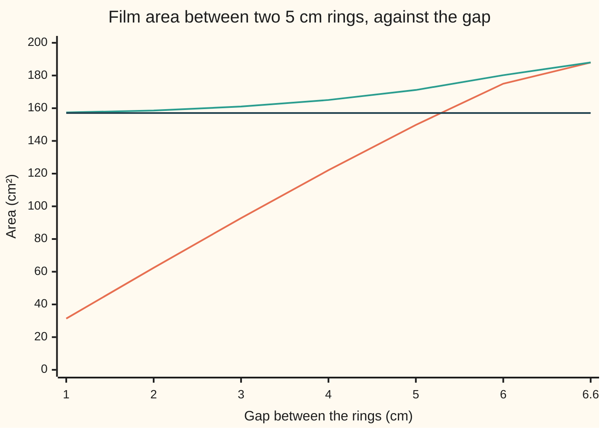

# Minimal surface: zero mean curvature and the shape a soap film takes

[Syllabus](../../../SYLLABUS.md) → [Differential geometry and Lie groups](../README.md) → [Surfaces](../README.md#s02) → Minimal surface

---

## General Overview

Bend two wire rings, each 5 cm in radius. Hold them on one axis, 4 cm apart, like the two ends of a drum. Dip them in soapy water and draw them out. A film now joins the rings: a tube with a narrow waist, like a cooling tower.

The film does not bulge out to a straight cylinder, and it does not close each ring with a flat disc. A cylinder would need 125.66 cm² of film. Two discs would need 157.08 cm². The waisted tube needs only 122.09 cm². Its waist has a radius of 4.55 cm.

Surface tension (energy per square metre of each face of the film) pulls the film tight, so it moves until no small change can lower its area. At every point it then bends toward the axis around the ring-shaped cross-section, and away from the axis along its length, by exactly the same amount.

The tube is a **catenoid**: the hanging-chain curve, spun round an axis. A surface where the two bends always cancel is a **minimal surface**.

**A soap film settles where no small push can lower its area, and that forces its mean curvature, the average of its two principal bends (its greatest and least bend at that point), to be zero at every point.**

**What kind of fact this is:** a theorem, proved on this card in Why it works: a surface whose area no small push changes has zero mean curvature, and the catenoid has it. The result is local: zero mean curvature does not guarantee least area. That a soap film obeys it is a physical model (equal pressure on both sides, no gravity). That a least-area film exists on every wire loop is a harder theorem (Douglas and Radó, 1930–31), stated here, not proved.

### The picture: the film between the rings

<p align="center"></p>

To scale, 30 px per cm, in an orthographic side view, so each ring shows as a bar. Solid: the film that forms, waist 4.55 cm. Dashed: a second catenoid on the same rings, waist 0.79 cm. It also has zero mean curvature, but it is unstable and the film never takes it.

---

## The formula

Notation first, in words.

- $`z`$ is the distance along the axis from the midpoint between the rings, in cm; $`\theta`$ (say "theta") is the angle round it.
- A **patch** $`\mathbf{r}(u, v)`$ names each surface point by two grid numbers ([Regular surface](01-regular-surfaces-and-tangent-planes.md)). Here $`(u, v) = (z, \theta)`$. Below, each choice of grid numbers is called a chart: chart 1 and chart 2.
- $`E`$, $`F`$, $`G`$, the **first fundamental form**, are the squared grid steps and their dot product ([First fundamental form](02-first-fundamental-form.md)). In wing 05, $`E`$ and $`F`$ count edges and faces; not here.
- $`\mathbf{n}`$ is the unit **normal**, at right angles to the surface. Here it points toward the axis.
- $`L`$, $`M`$, $`N`$, the **second fundamental form**, measure how fast the surface leaves its tangent plane, along $`\mathbf{n}`$ ([Gauss map and second fundamental form](04-gauss-map-and-second-fundamental-form.md)).
- $`\kappa_1`$, $`\kappa_2`$ (say "kappa") are the **principal curvatures**: the greatest and least bend at a point, $`\kappa_1 \ge \kappa_2`$, in 1/cm, positive toward $`\mathbf{n}`$. Their average is the **mean curvature** $`H`$; their product is the **Gaussian curvature** $`K`$ ([Principal, mean and Gaussian curvature](05-principal-mean-and-gaussian-curvature.md)). Elsewhere $`H`$ is a Hamiltonian (wing 08) and $`K`$ a triangle's area (wing 05); not here.

The area of a film, and the condition for it to be minimal:

```math
A = \iint_D \sqrt{EG - F^2}\; du\, dv, \qquad H = \frac{\kappa_1 + \kappa_2}{2} = \frac{EN - 2FM + GL}{2\,(EG - F^2)} = 0
```

**Read it aloud:** "The area adds up the surface's own stretch over the grid. A film with least area has zero mean curvature: at every point its two principal bends cancel."

The engine is the **first variation of area**. Push each point a distance $`\varepsilon\varphi`$ along $`\mathbf{n}`$, where $`\varphi`$ (say "phi") is a push profile that is zero on the wire and $`\varepsilon`$ (say "epsilon") is small:

```math
\frac{dA}{d\varepsilon}\Big|_{\varepsilon = 0} = -2 \iint H\,\varphi\; dA
```

**Read it aloud:** "The area falls, at first, at a rate equal to twice the mean curvature times the push, added over the surface."

Between two rings the film is a spun curve: radius $`\rho(z)`$ (say "rho") at distance $`z`$. Zero mean curvature picks out:

```math
\rho(z) = a\cosh\frac{z}{a}, \qquad a\cosh\frac{h}{a} = R
```

**Read it aloud:** "The radius is a hyperbolic cosine with waist radius $`a`$, chosen so that the film meets each ring at radius $`R`$."

| Symbol | Plain meaning | In our example | Push it up and the answer… |
| --- | --- | --- | --- |
| $`R`$, $`h`$ | ring radius; half the distance between the rings | 5 cm; 2 cm | larger $`h`$: thinner waist; past a 6.63 cm gap, no catenoid |
| $`z`$, $`\theta`$; $`s`$ | chart 1: distance along the axis, angle round it; chart 2 uses $`s`$, length along the film from the waist | $`z`$ from −2 to 2 cm; $`s`$ = 2.064923 cm at a ring | — |
| $`\rho`$, $`\rho'`$, $`a`$, $`t`$, $`\lambda`$ | film radius at $`z`$, its slope; waist radius; $`t = h/a`$; the hanging chain's multiplier (say "lambda") | $`\rho = a\cosh(z/a)`$; $`a`$ = 4.553690 cm; $`t`$ = 0.439204; $`\lambda = 0`$ | — |
| $`E`$, $`F`$, $`G`$; $`L`$, $`M`$, $`N`$ | first and second fundamental forms in a chart | at a ring, chart 1: $`E`$ = 1.205627, $`G`$ = 25; chart 2: $`E`$ = 1 | change with the chart |
| $`\mathbf{n}`$ | unit normal, here pointing toward the axis | — | flip it: $`\kappa_1`$, $`\kappa_2`$, $`H`$ change sign |
| $`\kappa_1`$, $`\kappa_2`$ | greatest and least bend, 1/cm, positive toward $`\mathbf{n}`$ | ±0.182148 at a ring, ±0.219602 at the waist | — |
| $`H`$ | mean curvature, $`(\kappa_1 + \kappa_2)/2`$, 1/cm | 0 everywhere on the film; 0.1 on the cylinder | above 0: pushing toward $`\mathbf{n}`$ saves area |
| $`K`$ | Gaussian curvature, $`\kappa_1\kappa_2`$, 1/cm² | −0.033178 at a ring, −0.048225 at the waist | — |
| $`A`$, $`\mathbf{r}(u, v)`$, $`D`$ | area in cm²; the point the patch names; the region its grid numbers $`(u, v)`$ fill | 122.094830 cm² | — |
| $`\varphi`$, $`\varepsilon`$ | push profile, a pure number, zero on the wire; push size, cm | $`\varphi = \cos^2(\pi z/4)`$, 1 at the waist; $`\varepsilon`$ = 0.05 cm in the stability test | — |
| $`f`$, $`f_x`$, $`f_{xy}`$, … | a film's height over the point ($`x`$ east, $`y`$ north); its slopes and bends | wing 19's saddle $`f = (x^2 - y^2)/25`$ cm | — |
| $`\gamma`$, $`\Delta p`$ | surface tension per face, N/m (say "gamma"); pressure difference across the film | 0.025 N/m, illustrative; 0 for an open film | more tension: more pressure for the same $`H`$ |

### When it holds

- **Equal pressure on both sides.** A closed bubble has higher pressure inside, so $`H \ne 0`$: $`\Delta p = 4\gamma H`$, each of the two faces adding $`2\gamma H`$. A cylinder film, $`H`$ = 10 1/m, at 0.025 N/m per face needs 1 Pa.
- **A smooth film.** Where three films meet along an edge, as in froth, they meet at 120° (Plateau's laws), and $`H = 0`$ says nothing about the edge.
- **Zero mean curvature is necessary, not enough.** The thin dashed catenoid has $`H = 0`$ and 165.03 cm², more than the discs. A push of size 0.05 cm lowers its area by 0.013832 cm².
- **Rings close enough.** A catenoid spans 5 cm rings only up to 6.63 cm apart, 1.325487 radii. Beyond that $`a\cosh(h/a) = R`$ has no solution, and the film snaps to two discs.
- **Gravity negligible.** A film's weight is tiny next to its tension on rings this size.

---

## Why it works

### Step 0: push the film, and watch the area

Test the film by pushing it. Pick a push profile $`\varphi`$ that is zero on the wire, and move every point $`\varepsilon\varphi`$ along the normal. If the area drops, the film was not settled.

Try a 5 cm cylinder on the same rings, pushed toward the axis with $`\varphi = \cos^2(\pi z/4)`$. The code finds its area falling at 12.566371 cm² per cm of push. The cylinder bends by 1/5 per cm round its circles and not at all along its length, so $`H`$ = 0.1 1/cm. The formula predicts $`-2 \times 0.1 \times 62.831853 = -12.566371`$, where 62.831853 cm² is the push added over the cylinder. The catenoid, pushed the same way, changes at rate 0.000000.

### Step 1: why the rate is −2H

Think of a ball. Push a patch of its surface inward and the patch shrinks, because it now sits on a smaller sphere. In general, a patch pushed $`\varepsilon`$ toward the side it bends to loses a fraction $`\kappa_1\varepsilon`$ of its width one way and $`\kappa_2\varepsilon`$ the other. Its area falls by the fraction $`(\kappa_1 + \kappa_2)\varepsilon = 2H\varepsilon`$. Weight by $`\varphi`$ and add the patches: that is the formula. The sideways tilt from $`\varphi`$ varying only enters at size $`\varepsilon^2`$.

<details>
<summary>Detailed proof: the first variation of area in a chart</summary>

Write the pushed surface as $`\mathbf{r}_\varepsilon = \mathbf{r} + \varepsilon\varphi\, \mathbf{n}`$. Its tangent arrows are

$`\displaystyle (\mathbf{r}_\varepsilon)_u = \mathbf{r}_u + \varepsilon\varphi\, \mathbf{n}_u + \varepsilon\varphi_u\, \mathbf{n}, \qquad (\mathbf{r}_\varepsilon)_v = \mathbf{r}_v + \varepsilon\varphi\, \mathbf{n}_v + \varepsilon\varphi_v\, \mathbf{n}.`$

The arrow $`\mathbf{n}`$ is at right angles to $`\mathbf{r}_u`$ and $`\mathbf{r}_v`$, so the terms in $`\varphi_u \mathbf{n}`$ and $`\varphi_v \mathbf{n}`$ meet $`\mathbf{r}_u`$, $`\mathbf{r}_v`$ with dot product zero and enter only at order $`\varepsilon^2`$. The second fundamental form satisfies $`\mathbf{r}_u \cdot \mathbf{n}_u = -L`$, $`\mathbf{r}_u \cdot \mathbf{n}_v = \mathbf{r}_v \cdot \mathbf{n}_u = -M`$ and $`\mathbf{r}_v \cdot \mathbf{n}_v = -N`$ (differentiate $`\mathbf{r}_u \cdot \mathbf{n} = 0`$). So, up to order $`\varepsilon^2`$:

$`\displaystyle E_\varepsilon = E - 2\varepsilon\varphi L, \qquad F_\varepsilon = F - 2\varepsilon\varphi M, \qquad G_\varepsilon = G - 2\varepsilon\varphi N.`$

Multiply out:

$`\displaystyle E_\varepsilon G_\varepsilon - F_\varepsilon^2 = (EG - F^2) - 2\varepsilon\varphi\,(EN - 2FM + GL) = (EG - F^2)\,(1 - 4\varepsilon\varphi H).`$

Take the square root: $`\sqrt{E_\varepsilon G_\varepsilon - F_\varepsilon^2} = \sqrt{EG - F^2}\,(1 - 2\varepsilon\varphi H)`$ to first order. Integrate over $`D`$:

$`\displaystyle A(\varepsilon) = A(0) - 2\varepsilon \iint_D H\varphi\,\sqrt{EG - F^2}\; du\, dv + O(\varepsilon^2).`$

That is the formula, since $`dA = \sqrt{EG - F^2}\, du\, dv`$.

</details>

### Step 2: no push helps, so H is zero everywhere

If the film has least area, no push lowers it, so the rate is zero for every $`\varphi`$. Suppose $`H > 0`$ at some point. $`H`$ varies continuously, so it stays positive on a small region around that point. Take $`\varphi`$ a bump on that region, zero elsewhere. Then $`\iint H\varphi\, dA > 0`$, the rate is negative, and the push lowers the area: a contradiction. If $`H < 0`$ somewhere, push with $`-\varphi`$ instead. So $`H = 0`$ everywhere.

This is the Euler-Lagrange equation of area ([The Euler-Lagrange equation](../../08-Differential%20equations%20and%20dynamics/12-Calculus%20of%20Variations%20and%20Optimal%20Control/01-functionals-and-the-euler-lagrange-equation.md)). Like that equation, it is a test, not a proof of least area.

### Step 3: the catenoid's profile comes from the hanging chain

For a film spun round the axis, the area is

```math
A = 2\pi \int_{-h}^{h} \rho\,\sqrt{1 + \rho'^2}\; dz
```

where $`\rho'`$ is the slope of the profile. This is the hanging chain's integrand $`(y - \lambda)\sqrt{1 + y'^2}`$ with the multiplier $`\lambda = 0`$, since the film has no length budget. [Paths with a budget](../../08-Differential%20equations%20and%20dynamics/12-Calculus%20of%20Variations%20and%20Optimal%20Control/03-constrained-paths-and-the-hanging-chain.md) solves it by the Beltrami identity: $`\rho/\sqrt{1 + \rho'^2} = a`$, a constant, and so $`\rho = a\cosh(z/a)`$. A chain hangs as a cosh; a film between rings is that cosh spun round the axis.

### Step 4: check the catenoid's two bends cancel

Take any point on the film, at radius $`\rho = a\cosh(z/a)`$. Use $`1 + \sinh^2 = \cosh^2`$, so $`\sqrt{1 + \rho'^2} = \cosh(z/a) = \rho/a`$.

- **Along the profile.** A curve's bend is its second derivative over the cube of its stretch: $`\rho''/(1 + \rho'^2)^{3/2} = (\cosh/a)/\cosh^3 = a/\rho^2`$. The profile curves away from the axis, against $`\mathbf{n}`$, so $`\kappa_2 = -a/\rho^2`$.
- **Around the circle.** The circle of radius $`\rho`$ bends by $`1/\rho`$ toward the axis. The film is tilted away from the circle's plane, so only the part of that bend along $`\mathbf{n}`$ counts (Meusnier's rule): $`1/\rho`$ times $`a/\rho`$. So $`\kappa_1 = +a/\rho^2`$.

The two are equal and opposite, so $`H = 0`$. And $`K = -a^2/\rho^4 < 0`$, so every point of a catenoid is a saddle point ([Point types](06-classification-of-surface-points.md)).

<details>
<summary>Detailed proof: E, F, G and L, M, N of the catenoid</summary>

Chart 1 is $`\mathbf{r}(z, \theta) = (\rho\cos\theta,\ \rho\sin\theta,\ z)`$ with $`\rho = a\cosh(z/a)`$. Write $`c = \cosh(z/a)`$ and $`w = \sinh(z/a)`$, so $`\rho' = w`$ and $`\rho'' = c/a`$.

$`\displaystyle \mathbf{r}_z = (w\cos\theta,\ w\sin\theta,\ 1), \qquad \mathbf{r}_\theta = (-\rho\sin\theta,\ \rho\cos\theta,\ 0).`$

So $`E = 1 + w^2 = c^2`$, $`F = 0`$ and $`G = \rho^2 = a^2c^2`$. The normal toward the axis is $`\mathbf{n} = (-\cos\theta,\ -\sin\theta,\ w)/c`$.

$`\displaystyle \mathbf{r}_{zz} = (\tfrac{c}{a}\cos\theta,\ \tfrac{c}{a}\sin\theta,\ 0), \quad \mathbf{r}_{z\theta} = (-w\sin\theta,\ w\cos\theta,\ 0), \quad \mathbf{r}_{\theta\theta} = (-\rho\cos\theta,\ -\rho\sin\theta,\ 0).`$

Dot each with $`\mathbf{n}`$: $`L = -1/a`$, $`M = 0`$, $`N = \rho/c = a`$. Then

$`\displaystyle H = \frac{EN + GL}{2EG} = \frac{c^2 a - a^2 c^2/a}{2 a^2 c^4} = 0, \qquad K = \frac{LN}{EG} = \frac{-1}{a^2 c^4} = -\frac{a^2}{\rho^4}.`$

</details>

### Step 5: two charts, one curvature

The curvatures must belong to the film, not to its grid. The code computes them from finite differences of each chart alone, through the general formulas for $`H`$ and $`K`$, never from the catenoid's closed form. Chart 2 measures length $`s`$ along the film from the waist.

| At a ring | Chart 1 $`(z, \theta)`$ | Chart 2 $`(s, \theta)`$ |
| --- | --- | --- |
| $`E`$ | 1.205627 | 1.000000 |
| $`G`$ | 25.000000 | 25.000000 |
| $`\kappa_1`$, $`\kappa_2`$ (1/cm) | 0.182148, −0.182148 | 0.182148, −0.182148 |
| $`H`$ | 0.000000 | 0.000000 |
| $`K`$ (1/cm²) | −0.033178 | −0.033178 |

$`E`$ changes with the chart. The curvatures do not.

### Step 6: small slopes give Laplace's equation

Now write a film as a height $`f(x, y)`$ above a flat plane. Subscripts mean slopes and bends: $`f_x`$ is the slope east, $`f_{xy}`$ how that slope changes going north. Zero mean curvature becomes the **minimal surface equation**:

```math
(1 + f_y^2)\,f_{xx} - 2 f_x f_y\, f_{xy} + (1 + f_x^2)\,f_{yy} = 0
```

When all slopes are small, the squared slopes are tiny next to 1, and the equation becomes Laplace's: $`f_{xx} + f_{yy} = 0`$. That is the nearly flat film of [Dirichlet's principle](../../19-Partial%20differential%20equations/04-Laplace%2C%20Poisson%20and%20Potentials/06-dirichlet-principle-and-variational-form.md), whose bent 5 cm loop holds the saddle $`f = (x^2 - y^2)/25`$ cm.

That saddle satisfies Laplace exactly but not the minimal surface equation. At its flat centre $`H = 0`$. At the rim point (5, 0), slope 0.4, $`H`$ = −0.005123 1/cm against principal bends of 0.064033 and −0.074278; at (3, 4), $`H`$ = 0.001434. The real film differs slightly from the Laplace film.

### Step 7: the soap-film problem

**Plateau's problem:** given a closed wire, find a surface of least area with that wire as its edge. It is named after Joseph Plateau, whose soap-film experiments in the mid-1800s made it famous. Radó (1930) and Douglas (1931) proved that any single closed loop bounds a disc-shaped surface of least area among all disc-shaped surfaces on it. The proof is long and is not given here. Two rings are not a single loop, and the answer depends on the gap, as the next section shows.

---

## Worked numbers, by hand

Rings of radius $`R = 5`$ cm, 4 cm apart, so $`h = 2`$ cm. The waist $`a`$ solves $`a\cosh(2/a) = 5`$; the code finds it by halving an interval.

| Step | Arithmetic | Value |
| --- | --- | --- |
| waist radius | solve $`a\cosh(2/a) = 5`$ | 4.553690 cm |
| check | $`h/a = 2/4.553690`$ | 0.439204 |
| | $`4.553690 \times \cosh 0.439204 = 4.553690 \times 1.098011`$ | 5.000000 cm |
| bend at a ring | $`a/R^2 = 4.553690/25`$ | $`\kappa = \pm 0.182148`$ 1/cm |
| mean curvature at a ring | $`(0.182148 - 0.182148)/2`$ | **0** |
| Gaussian curvature at a ring | $`-0.182148^2`$ | −0.033178 1/cm² |
| bend at the waist | $`1/a = 1/4.553690`$ | $`\kappa = \pm 0.219602`$ 1/cm |
| film area | $`\pi a\,(2h + a\sinh(2h/a)) = \pi \times 4.553690 \times (4 + 4.553690 \times 0.995811)`$ | **122.094830 cm²** |
| cylinder on the same rings | $`2\pi \times 5 \times 4`$ | 125.663706 cm² |
| two flat discs | $`2 \times \pi \times 5^2`$ | 157.079633 cm² |

The film saves 3.568876 cm² against the cylinder, and far more against the discs. Its bends cancel at every point: around each circle it curves toward the axis by exactly as much as it curves away along its length.

### What breaks if you drop a piece

| Mistake | Comes out at | What went wrong |
| --- | --- | --- |
| Take the other root of $`a\cosh(2/a) = 5`$ | waist 0.789812 cm, area 165.032588 cm² | $`H = 0`$ there too, but it is not stable: a push of size 0.05 cm lowers its area by 0.013832 cm² |
| Pull the rings 7 cm apart | no catenoid: the thinnest one reaches radius 5.281078 cm at the rings, not 5 | The rings are past 1.325487 radii apart; the film becomes two discs, 157.079633 cm² |
| Read "minimal" as "flat", $`K = 0`$ | the cylinder: $`K = 0`$ but $`H`$ = 0.1 1/cm, area 125.663706 cm² | A cylinder is curved one way only, so nothing cancels; pinching it in saves area |
| Use Laplace's equation as the exact film law | the saddle's $`H`$ = −0.005123 1/cm at the rim, not 0 | Laplace's equation drops the squared slopes, and the rim slope is 0.4 |

The code prints every number in this table.

---

## Pulling the rings apart

Draw the rings apart slowly. Up to 6.63 cm the film holds as a catenoid, then snaps to two discs. For a while it holds on with more area than the discs.

### One film, traced as the gap grows

Each gap has two catenoids: the fat one, which a film takes, and the thin one, which it never holds.

| Gap (cm) | Fat waist (cm) | Fat area (cm²) | Thin waist (cm) | Thin area (cm²) |
| --- | --- | --- | --- | --- |
| 1 | 4.974852 | 31.363382 | 0.111121 | 157.389933 |
| 2 | 4.897553 | 62.406908 | 0.279637 | 158.590788 |
| 3 | 4.761784 | 92.785872 | 0.501706 | 161.015332 |
| 4 | 4.553690 | 122.094830 | 0.789812 | 165.032588 |
| 5 | 4.241690 | 149.794924 | 1.175475 | 171.141385 |
| 6 | 3.725355 | 174.991064 | 1.759440 | 180.197812 |
| 6.6 | 2.970652 | 187.944963 | 2.552004 | 187.993089 |

Two thresholds:

- **5.276974 cm, 1.055395 radii.** Beyond this gap the discs, 157.079633 cm², have less area than the fat catenoid. The film stays put: it is a local minimum. The code tests one push, the bump, which raises the fat catenoid's area both ways at a 4 cm gap. That no small push at all lowers it is the stability theory of the second variation of area (Colding and Minicozzi, in Sources), stated here, not proved.
- **6.627434 cm, 1.325487 radii.** The fat and thin catenoids meet and vanish. Here $`t = h/a`$ = 1.199679, the root of $`t\tanh t = 1`$, where $`a\cosh(h/a)`$ is smallest. The code finds this gap a second way, by searching directly for the thinnest catenoid.



First line, rising from 31.36: the fat catenoid, the film that forms. Second line, from 157.39: the thin catenoid. Third line, flat at 157.08: the two discs. The first two meet near 6.63 cm, where both catenoids vanish.

---

## Code, from first principles, and it actually runs

The code builds every curvature from finite differences of a chart, never from the catenoid's closed-form curvature. It takes **five independent roads**: curvatures in two charts against $`\pm a/\rho^2`$; area by Simpson's rule in two charts against the closed form; the first variation by actually pushing the film, against $`-2\iint H\varphi\, dA`$; a polygon profile of 10 and 20 bands lowered step by step, against the waist $`a`$, its error falling by 3.996209 when the bands double; and the widest gap by two methods. It also tests the Laplace saddle and a helicoid.

### Python

```python
# Minimal surfaces and soap films -- the check behind the card.  Standard library only.
# A soap film spans two coaxial wire rings of radius 5 cm, 4 cm apart.  Mean curvature H
# comes from finite differences of any chart, not the catenoid's closed form; area by
# Simpson's rule; the first variation by pushing the film; a polygon profile minimised.
import math
RING, HALF = 5.0, 2.0                  # ring radius (cm); rings at z = -2 and z = +2 (cm)
def f6(v): return f"{0.0 if abs(v) < 5e-7 else v:.6f}"
def bisect(f, lo, hi):
    flo = f(lo)
    for _ in range(200):
        mid = (lo + hi) / 2
        if (f(mid) < 0) == (flo < 0): lo = mid
        else: hi = mid
    return (lo + hi) / 2
def asinh(x): return math.log(x + math.sqrt(x * x + 1))
def add(a, b, k=1.0): return tuple(a[i] + k * b[i] for i in range(3))
def dot(a, b): return a[0] * b[0] + a[1] * b[1] + a[2] * b[2]
def cross(a, b): return (a[1] * b[2] - a[2] * b[1], a[2] * b[0] - a[0] * b[2], a[0] * b[1] - a[1] * b[0])
def tangents(r, u, v, d=1e-5):         # 2d times r_u and r_v, by central differences
    return add(r(u + d, v), r(u - d, v), -1.0), add(r(u, v + d), r(u, v - d), -1.0), 2 * d
def shape(r, u, v, d=1e-4):            # E, F, G, H, K, k1, k2 from the chart alone
    p = r(u, v)
    ru = tuple(x / (2 * d) for x in add(r(u + d, v), r(u - d, v), -1.0))
    rv = tuple(x / (2 * d) for x in add(r(u, v + d), r(u, v - d), -1.0))
    ruu = tuple(x / (d * d) for x in add(add(r(u + d, v), r(u - d, v)), p, -2.0))
    rvv = tuple(x / (d * d) for x in add(add(r(u, v + d), r(u, v - d)), p, -2.0))
    ruv = tuple(x / (4 * d * d) for x in add(add(r(u + d, v + d), r(u - d, v - d)), add(r(u + d, v - d), r(u - d, v + d)), -1.0))
    c = cross(ru, rv); n = tuple(x / math.sqrt(dot(c, c)) for x in c)
    E, F, G, L, M, N = dot(ru, ru), dot(ru, rv), dot(rv, rv), dot(ruu, n), dot(ruv, n), dot(rvv, n)
    W = E * G - F * F; H = (E * N - 2 * F * M + G * L) / (2 * W); K = (L * N - M * M) / W
    s = math.sqrt(max(H * H - K, 0.0))
    return E, F, G, H, K, H + s, H - s
def area(r, u0, u1, v0, v1, n):        # Simpson's rule on sqrt(EG - F^2)
    hu, hv, tot = (u1 - u0) / n, (v1 - v0) / n, 0.0
    w = [1 if i in (0, n) else (4 if i % 2 else 2) for i in range(n + 1)]
    for i in range(n + 1):
        for j in range(n + 1):
            ru, rv, s = tangents(r, u0 + i * hu, v0 + j * hv)
            c = cross(ru, rv); tot += w[i] * w[j] * math.sqrt(dot(c, c)) / (s * s)
    return tot * hu * hv / 9
def simpson(f, a, b, n=400):
    h = (b - a) / n
    return h / 3 * sum((1 if i in (0, n) else (4 if i % 2 else 2)) * f(a + i * h) for i in range(n + 1))
def cat_area(a, h): return math.pi * a * (2 * h + a * math.sinh(2 * h / a))
T = bisect(lambda t: t * math.tanh(t) - 1, 0.5, 2.0)        # where a cosh(h/a) is least
def waists(h, R=RING):                 # the two catenoids a cosh(h/a) = R: fat, thin
    f = lambda a: a * math.cosh(h / a) - R
    return bisect(f, h / T, R), bisect(f, h / 30, h / T)
a, thin = waists(HALF)
print("rings: radius", f6(RING), "cm, separation", f6(2 * HALF), "cm")
print("catenoid waists a: fat", f6(a), "thin", f6(thin), "cm")
cat1 = lambda z, th: (a * math.cosh(z / a) * math.cos(th), a * math.cosh(z / a) * math.sin(th), z)
cat2 = lambda s, th: (math.sqrt(a * a + s * s) * math.cos(th), math.sqrt(a * a + s * s) * math.sin(th), a * asinh(s / a))
S = a * math.sinh(HALF / a)            # arc length from waist to ring along the profile
for name, r, u in (("chart 1 (z, theta) at ring ", cat1, HALF), ("chart 2 (s, theta) at ring ", cat2, S),
                   ("chart 1 (z, theta) at waist", cat1, 0.0), ("chart 2 (s, theta) at waist", cat2, 0.0)):
    E, F, G, H, K, k1, k2 = shape(r, u, 0.7)
    print(name, "E", f6(E), "G", f6(G), "k1", f6(k1), "k2", f6(k2), "H", f6(H), "K", f6(K))
    rho = a * math.cosh(u / a) if r is cat1 else math.sqrt(a * a + u * u)
    assert abs(k1 - a / rho ** 2) < 1e-5 and abs(H) < 1e-5     # closed form k1 = a / rho^2 = -k2
print("closed form a/rho^2: ring", f6(a / RING ** 2), "waist", f6(1 / a))
A1, A2, Ac = area(cat1, -HALF, HALF, 0, 2 * math.pi, 60), area(cat2, -S, S, 0, 2 * math.pi, 60), cat_area(a, HALF)
print("film area: chart 1", f6(A1), "chart 2", f6(A2), "closed form", f6(Ac))
assert abs(A1 - Ac) < 1e-4 and abs(A2 - Ac) < 1e-4
print("hand: h/a", f6(HALF / a), "cosh(h/a)", f6(math.cosh(HALF / a)), "a cosh(h/a)", f6(a * math.cosh(HALF / a)), "sinh(2h/a)", f6(math.sinh(2 * HALF / a)))
print("      s at ring", f6(S), "cylinder minus film", f6(2 * math.pi * RING * 2 * HALF - Ac), "cylinder int phi dA", f6(2 * math.pi * RING * HALF))
print("rivals: cylinder", f6(2 * math.pi * RING * 2 * HALF), "two discs", f6(2 * math.pi * RING ** 2), "thin catenoid", f6(cat_area(thin, HALF)))
def pushed(rho, drho, phi, eps):       # area after moving each point eps*phi along n (toward the axis)
    def pt(z):
        w = math.sqrt(1 + drho(z) ** 2)
        return rho(z) - eps * phi(z) / w, z + eps * phi(z) * drho(z) / w
    def band(z, d=1e-4):
        (r0, z0), (r1, z1) = pt(z - d), pt(z + d)
        return 2 * math.pi * pt(z)[0] * math.hypot(r1 - r0, z1 - z0) / (2 * d)
    return simpson(band, -HALF, HALF)
bump = lambda z: math.cos(math.pi * z / (2 * HALF)) ** 2      # 1 at the waist, 0 at both rings
for name, rho, drho, Hc in (("catenoid", lambda z: a * math.cosh(z / a), lambda z: math.sinh(z / a), lambda z: 0.0),
                            ("cylinder", lambda z: RING, lambda z: 0.0, lambda z: 1 / (2 * RING))):
    e = 1e-4
    slope = (pushed(rho, drho, bump, e) - pushed(rho, drho, bump, -e)) / (2 * e)
    pred = -2 * simpson(lambda z: Hc(z) * bump(z) * 2 * math.pi * rho(z) * math.sqrt(1 + drho(z) ** 2), -HALF, HALF)
    print("first variation,", name, "dA/d(eps)", f6(slope), "predicted -2 int H phi dA", f6(pred), "H", f6(Hc(0.0)))
    assert abs(slope - pred) < 1e-5
for name, w in (("fat", a), ("thin", thin)):
    rho, drho = (lambda z, w=w: w * math.cosh(z / w)), (lambda z, w=w: math.sinh(z / w))
    base = pushed(rho, drho, bump, 0.0)
    d = [pushed(rho, drho, bump, e) - base for e in (0.05, -0.05)]
    print("second variation,", name, "catenoid: change at eps +0.05", f6(d[0]), "at -0.05", f6(d[1]))
    assert (min(d) > 0) == (name == "fat")
def polygon(n, steps):                 # least-area polygon profile, ends pinned on the rings
    dz, rho = 2 * HALF / n, [RING] * (n + 1)
    for _ in range(steps):
        g = [0.0] * (n + 1)
        for i in range(n):
            l = math.hypot(dz, rho[i + 1] - rho[i]); q = (rho[i] + rho[i + 1]) * (rho[i + 1] - rho[i]) / l
            g[i] += math.pi * (l - q); g[i + 1] += math.pi * (l + q)
        for i in range(1, n): rho[i] -= 0.9 * dz / (4 * math.pi * RING) * g[i]
    return rho[n // 2], sum(math.pi * (rho[i] + rho[i + 1]) * math.hypot(dz, rho[i + 1] - rho[i]) for i in range(n))
for n in (10, 20):
    wst, ar = polygon(n, 8000)
    print("polygon,", n, "bands: waist", f6(wst), "error", f6(wst - a), "area", f6(ar))
e10, e20 = polygon(10, 8000)[0] - a, polygon(20, 8000)[0] - a
print("polygon waist error ratio", f6(e10 / e20))
assert 3.5 < e10 / e20 < 4.5
gmax = 2 * T / math.cosh(T)            # widest gap a catenoid spans, in ring radii
def least_radius(h):                   # min over a of a cosh(h/a), by golden-section search
    lo, hi = h / 5, 5 * h
    for _ in range(200):
        m1, m2 = lo + 0.382 * (hi - lo), hi - 0.382 * (hi - lo)
        if m1 * math.cosh(h / m1) < m2 * math.cosh(h / m2): hi = m2
        else: lo = m1
    return lo * math.cosh(h / lo)
gscan = 2 * bisect(lambda h: least_radius(h) - RING, 1.0, 5.0) / RING
print("widest gap / radius: t tanh t = 1 gives", f6(gmax), "t", f6(T), "; search gives", f6(gscan), "; gap", f6(gmax * RING), "cm")
assert abs(gmax - gscan) < 1e-6
print("rings 7 cm apart: thinnest catenoid end radius", f6(least_radius(3.5)), "> 5, so no film of that shape")
gdisc = 2 * bisect(lambda h: cat_area(waists(h)[0], h) - 2 * math.pi * RING ** 2, 1.0, 3.3)
print("discs beat the catenoid beyond separation", f6(gdisc), "cm =", f6(gdisc / RING), "radii")
for gap in (1.0, 2.0, 3.0, 4.0, 5.0, 6.0, 6.6):
    fa, ta = waists(gap / 2)
    print("separation", f6(gap), "fat a", f6(fa), "area", f6(cat_area(fa, gap / 2)), "thin a", f6(ta), "area", f6(cat_area(ta, gap / 2)))
c = 1.0 / 25                           # wing 19's saddle z = (x^2 - y^2)/25 cm on a 5 cm loop
sad = lambda x, y: (x, y, c * (x * x - y * y))
for x, y in ((0.0, 0.0), (5.0, 0.0), (3.0, 4.0)):
    fx, fy, fxx, fyy = 2 * c * x, -2 * c * y, 2 * c, -2 * c
    Hf = ((1 + fx * fx) * fyy + (1 + fy * fy) * fxx) / (2 * (1 + fx * fx + fy * fy) ** 1.5)
    E, F, G, H, K, k1, k2 = shape(sad, x, y)
    print("Laplace saddle at", f6(x), f6(y), "H", f6(H), "formula", f6(Hf), "k1", f6(k1), "k2", f6(k2), "Laplace fxx+fyy", f6(fxx + fyy))
    assert abs(H - Hf) < 1e-6
E, F, G, H, K, k1, k2 = shape(lambda u, v: (v * math.cos(u), v * math.sin(u), u), 0.7, 2.0)
print("helicoid, rise 1 cm per radian, 2 cm out: H", f6(H), "K", f6(K), "closed form K", f6(-1 / (1 + 4) ** 2))
assert abs(H) < 1e-6 and abs(K + 1 / (1 + 4) ** 2) < 1e-6
cyl = lambda z, th: (RING * math.cos(th), RING * math.sin(th), z)   # n toward the axis; swap the grid and n points away
Hin, Hout = shape(cyl, 0.5, 0.7)[3], shape(lambda th, z: cyl(z, th), 0.7, 0.5)[3]
print("cylinder by finite differences: H", f6(Hin), "with n toward the axis,", f6(Hout), "with n away from it")
assert abs(Hin - 1 / (2 * RING)) < 1e-6 and abs(Hout + 1 / (2 * RING)) < 1e-6
print("cylinder film, 0.025 N/m per face, H = 10 1/m: pressure 4 gamma H", f6(4 * 0.025 * 10), "Pa")
print("figure, z", " ".join(f"{210 + 30 * z:.1f},{190 - 30 * a * math.cosh(z / a):.1f}" for z in [k / 4 - 2 for k in range(17)]))
print("figure, thin", " ".join(f"{210 + 30 * z:.1f},{190 - 30 * thin * math.cosh(z / thin):.1f}" for z in [k / 4 - 2 for k in range(17)]))
print("ALL CHECKS PASS")
```

**Ran 2026-11-19 on macOS, Python 3.14.10, standard library only. All checks passed. Output, pasted from the run:**

```
rings: radius 5.000000 cm, separation 4.000000 cm
catenoid waists a: fat 4.553690 thin 0.789812 cm
chart 1 (z, theta) at ring  E 1.205627 G 25.000000 k1 0.182148 k2 -0.182148 H 0.000000 K -0.033178
chart 2 (s, theta) at ring  E 1.000000 G 25.000000 k1 0.182148 k2 -0.182148 H 0.000000 K -0.033178
chart 1 (z, theta) at waist E 1.000000 G 20.736092 k1 0.219602 k2 -0.219602 H 0.000000 K -0.048225
chart 2 (s, theta) at waist E 1.000000 G 20.736092 k1 0.219602 k2 -0.219602 H 0.000000 K -0.048225
closed form a/rho^2: ring 0.182148 waist 0.219602
film area: chart 1 122.094830 chart 2 122.094830 closed form 122.094830
hand: h/a 0.439204 cosh(h/a) 1.098011 a cosh(h/a) 5.000000 sinh(2h/a) 0.995811
      s at ring 2.064923 cylinder minus film 3.568876 cylinder int phi dA 62.831853
rivals: cylinder 125.663706 two discs 157.079633 thin catenoid 165.032588
first variation, catenoid dA/d(eps) 0.000000 predicted -2 int H phi dA 0.000000 H 0.000000
first variation, cylinder dA/d(eps) -12.566371 predicted -2 int H phi dA -12.566371 H 0.100000
second variation, fat catenoid: change at eps +0.05 0.038550 at -0.05 0.039484
second variation, thin catenoid: change at eps +0.05 -0.013832 at -0.05 -0.013410
polygon, 10 bands: waist 4.554014 error 0.000324 area 122.131613
polygon, 20 bands: waist 4.553771 error 0.000081 area 122.104028
polygon waist error ratio 3.996209
widest gap / radius: t tanh t = 1 gives 1.325487 t 1.199679 ; search gives 1.325487 ; gap 6.627434 cm
rings 7 cm apart: thinnest catenoid end radius 5.281078 > 5, so no film of that shape
discs beat the catenoid beyond separation 5.276974 cm = 1.055395 radii
separation 1.000000 fat a 4.974852 area 31.363382 thin a 0.111121 area 157.389933
separation 2.000000 fat a 4.897553 area 62.406908 thin a 0.279637 area 158.590788
separation 3.000000 fat a 4.761784 area 92.785872 thin a 0.501706 area 161.015332
separation 4.000000 fat a 4.553690 area 122.094830 thin a 0.789812 area 165.032588
separation 5.000000 fat a 4.241690 area 149.794924 thin a 1.175475 area 171.141385
separation 6.000000 fat a 3.725355 area 174.991064 thin a 1.759440 area 180.197812
separation 6.600000 fat a 2.970652 area 187.944963 thin a 2.552004 area 187.993089
Laplace saddle at 0.000000 0.000000 H 0.000000 formula 0.000000 k1 0.080000 k2 -0.080000 Laplace fxx+fyy 0.000000
Laplace saddle at 5.000000 0.000000 H -0.005123 formula -0.005123 k1 0.064033 k2 -0.074278 Laplace fxx+fyy 0.000000
Laplace saddle at 3.000000 4.000000 H 0.001434 formula 0.001434 k1 0.070415 k2 -0.067546 Laplace fxx+fyy 0.000000
helicoid, rise 1 cm per radian, 2 cm out: H 0.000000 K -0.040000 closed form K -0.040000
cylinder by finite differences: H 0.100000 with n toward the axis, -0.100000 with n away from it
cylinder film, 0.025 N/m per face, H = 10 1/m: pressure 4 gamma H 1.000000 Pa
figure, z 150.0,40.0 157.5,43.2 165.0,45.9 172.5,48.2 180.0,50.1 187.5,51.5 195.0,52.6 202.5,53.2 210.0,53.4 217.5,53.2 225.0,52.6 232.5,51.5 240.0,50.1 247.5,48.2 255.0,45.9 262.5,43.2 270.0,40.0
figure, thin 150.0,40.0 157.5,80.1 165.0,109.1 172.5,129.9 180.0,144.6 187.5,154.8 195.0,161.4 202.5,165.1 210.0,166.3 217.5,165.1 225.0,161.4 232.5,154.8 240.0,144.6 247.5,129.9 255.0,109.1 262.5,80.1 270.0,40.0
ALL CHECKS PASS
```

### Rust

Same roads, same numbers, printed in the same format. No crates.

```rust
// Minimal surfaces and soap films -- the check behind the card.  std only, no crates.
// A soap film spans two coaxial wire rings of radius 5 cm, 4 cm apart.  Mean curvature H
// comes from finite differences of any chart, not the catenoid's closed form; area by
// Simpson's rule; the first variation by pushing the film; a polygon profile minimised.
use std::f64::consts::PI;
type V = [f64; 3];
const RING: f64 = 5.0; // ring radius (cm)
const HALF: f64 = 2.0; // rings at z = -2 and z = +2 (cm)

fn f6(v: f64) -> String { format!("{:.6}", if v.abs() < 5e-7 { 0.0 } else { v }) }
fn bisect(f: &dyn Fn(f64) -> f64, mut lo: f64, mut hi: f64) -> f64 {
    let flo = f(lo);
    for _ in 0..200 { let mid = (lo + hi) / 2.0; if (f(mid) < 0.0) == (flo < 0.0) { lo = mid } else { hi = mid } }
    (lo + hi) / 2.0
}
fn asinh(x: f64) -> f64 { (x + (x * x + 1.0).sqrt()).ln() }
fn add(a: V, b: V, k: f64) -> V { [a[0] + k * b[0], a[1] + k * b[1], a[2] + k * b[2]] }
fn sc(a: V, k: f64) -> V { [a[0] * k, a[1] * k, a[2] * k] }
fn dot(a: V, b: V) -> f64 { a[0] * b[0] + a[1] * b[1] + a[2] * b[2] }
fn cross(a: V, b: V) -> V { [a[1] * b[2] - a[2] * b[1], a[2] * b[0] - a[0] * b[2], a[0] * b[1] - a[1] * b[0]] }
type Chart<'a> = &'a dyn Fn(f64, f64) -> V;
fn shape(r: Chart, u: f64, v: f64) -> [f64; 7] { // E, F, G, H, K, k1, k2 from the chart alone
    let (d, p) = (1e-4, r(u, v));
    let ru = sc(add(r(u + d, v), r(u - d, v), -1.0), 1.0 / (2.0 * d));
    let rv = sc(add(r(u, v + d), r(u, v - d), -1.0), 1.0 / (2.0 * d));
    let ruu = sc(add(add(r(u + d, v), r(u - d, v), 1.0), p, -2.0), 1.0 / (d * d));
    let rvv = sc(add(add(r(u, v + d), r(u, v - d), 1.0), p, -2.0), 1.0 / (d * d));
    let ruv = sc(add(add(r(u + d, v + d), r(u - d, v - d), 1.0), add(r(u + d, v - d), r(u - d, v + d), 1.0), -1.0), 1.0 / (4.0 * d * d));
    let c = cross(ru, rv); let n = sc(c, 1.0 / dot(c, c).sqrt());
    let (e, f, g, l, m, nn) = (dot(ru, ru), dot(ru, rv), dot(rv, rv), dot(ruu, n), dot(ruv, n), dot(rvv, n));
    let w = e * g - f * f;
    let (h, k) = ((e * nn - 2.0 * f * m + g * l) / (2.0 * w), (l * nn - m * m) / w);
    let s = (h * h - k).max(0.0).sqrt();
    [e, f, g, h, k, h + s, h - s]
}
fn wt(i: usize, n: usize) -> f64 { if i == 0 || i == n { 1.0 } else if i % 2 == 1 { 4.0 } else { 2.0 } }
fn area(r: Chart, u0: f64, u1: f64, v0: f64, v1: f64, n: usize) -> f64 { // Simpson's rule on sqrt(EG - F^2)
    let (hu, hv, d) = ((u1 - u0) / n as f64, (v1 - v0) / n as f64, 1e-5);
    let mut tot = 0.0;
    for i in 0..=n {
        for j in 0..=n {
            let (u, v) = (u0 + i as f64 * hu, v0 + j as f64 * hv);
            let c = cross(add(r(u + d, v), r(u - d, v), -1.0), add(r(u, v + d), r(u, v - d), -1.0));
            tot += wt(i, n) * wt(j, n) * dot(c, c).sqrt() / ((2.0 * d) * (2.0 * d));
        }
    }
    tot * hu * hv / 9.0
}
fn simpson(f: &dyn Fn(f64) -> f64, a: f64, b: f64) -> f64 {
    let (n, h) = (400, (b - a) / 400.0);
    h / 3.0 * (0..=n).map(|i| wt(i, n) * f(a + i as f64 * h)).sum::<f64>()
}
fn cat_area(a: f64, h: f64) -> f64 { PI * a * (2.0 * h + a * (2.0 * h / a).sinh()) }
fn waists(h: f64, t: f64) -> (f64, f64) { // the two catenoids a cosh(h/a) = R: fat, thin
    let f = |a: f64| a * (h / a).cosh() - RING;
    (bisect(&f, h / t, RING), bisect(&f, h / 30.0, h / t))
}
// area after moving each point eps*phi along n (toward the axis)
fn pushed(rho: &dyn Fn(f64) -> f64, drho: &dyn Fn(f64) -> f64, phi: &dyn Fn(f64) -> f64, eps: f64) -> f64 {
    let pt = |z: f64| { let w = (1.0 + drho(z).powi(2)).sqrt(); (rho(z) - eps * phi(z) / w, z + eps * phi(z) * drho(z) / w) };
    let band = |z: f64| { let ((r0, z0), (r1, z1)) = (pt(z - 1e-4), pt(z + 1e-4)); 2.0 * PI * pt(z).0 * (r1 - r0).hypot(z1 - z0) / 2e-4 };
    simpson(&band, -HALF, HALF)
}
fn polygon(n: usize, steps: usize) -> (f64, f64) { // least-area polygon profile, ends pinned on the rings
    let (dz, mut rho) = (2.0 * HALF / n as f64, vec![RING; n + 1]);
    for _ in 0..steps {
        let mut g = vec![0.0; n + 1];
        for i in 0..n {
            let l = dz.hypot(rho[i + 1] - rho[i]);
            let q = (rho[i] + rho[i + 1]) * (rho[i + 1] - rho[i]) / l;
            g[i] += PI * (l - q); g[i + 1] += PI * (l + q);
        }
        for i in 1..n { rho[i] -= 0.9 * dz / (4.0 * PI * RING) * g[i]; }
    }
    (rho[n / 2], (0..n).map(|i| PI * (rho[i] + rho[i + 1]) * dz.hypot(rho[i + 1] - rho[i])).sum())
}
fn least_radius(h: f64) -> f64 { // min over a of a cosh(h/a), by golden-section search
    let (mut lo, mut hi) = (h / 5.0, 5.0 * h);
    for _ in 0..200 {
        let (m1, m2) = (lo + 0.382 * (hi - lo), hi - 0.382 * (hi - lo));
        if m1 * (h / m1).cosh() < m2 * (h / m2).cosh() { hi = m2 } else { lo = m1 }
    }
    lo * (h / lo).cosh()
}
fn main() {
    let t = bisect(&|t: f64| t * t.tanh() - 1.0, 0.5, 2.0); // where a cosh(h/a) is least
    let (a, thin) = waists(HALF, t);
    println!("rings: radius {} cm, separation {} cm", f6(RING), f6(2.0 * HALF));
    println!("catenoid waists a: fat {} thin {} cm", f6(a), f6(thin));
    let cat1 = move |z: f64, th: f64| -> V { [a * (z / a).cosh() * th.cos(), a * (z / a).cosh() * th.sin(), z] };
    let cat2 = move |s: f64, th: f64| -> V { [(a * a + s * s).sqrt() * th.cos(), (a * a + s * s).sqrt() * th.sin(), a * asinh(s / a)] };
    let s_ring = a * (HALF / a).sinh(); // arc length from waist to ring along the profile
    let cases: [(&str, Chart, f64, f64); 4] = [
        ("chart 1 (z, theta) at ring ", &cat1, HALF, RING), ("chart 2 (s, theta) at ring ", &cat2, s_ring, RING),
        ("chart 1 (z, theta) at waist", &cat1, 0.0, a), ("chart 2 (s, theta) at waist", &cat2, 0.0, a)];
    for (name, r, u, rho) in cases {
        let [e, _f, g, h, k, k1, k2] = shape(r, u, 0.7);
        println!("{} E {} G {} k1 {} k2 {} H {} K {}", name, f6(e), f6(g), f6(k1), f6(k2), f6(h), f6(k));
        assert!((k1 - a / (rho * rho)).abs() < 1e-5 && h.abs() < 1e-5); // closed form k1 = a / rho^2 = -k2
    }
    println!("closed form a/rho^2: ring {} waist {}", f6(a / (RING * RING)), f6(1.0 / a));
    let (a1, a2, ac) = (area(&cat1, -HALF, HALF, 0.0, 2.0 * PI, 60), area(&cat2, -s_ring, s_ring, 0.0, 2.0 * PI, 60), cat_area(a, HALF));
    println!("film area: chart 1 {} chart 2 {} closed form {}", f6(a1), f6(a2), f6(ac));
    assert!((a1 - ac).abs() < 1e-4 && (a2 - ac).abs() < 1e-4);
    println!("hand: h/a {} cosh(h/a) {} a cosh(h/a) {} sinh(2h/a) {}", f6(HALF / a), f6((HALF / a).cosh()), f6(a * (HALF / a).cosh()), f6((2.0 * HALF / a).sinh()));
    println!("      s at ring {} cylinder minus film {} cylinder int phi dA {}", f6(s_ring), f6(2.0 * PI * RING * 2.0 * HALF - ac), f6(2.0 * PI * RING * HALF));
    println!("rivals: cylinder {} two discs {} thin catenoid {}", f6(2.0 * PI * RING * 2.0 * HALF), f6(2.0 * PI * RING * RING), f6(cat_area(thin, HALF)));
    let bump = |z: f64| (PI * z / (2.0 * HALF)).cos().powi(2); // 1 at the waist, 0 at both rings
    let (cat_rho, cat_d) = (move |z: f64| a * (z / a).cosh(), move |z: f64| (z / a).sinh());
    let (cyl_rho, cyl_d) = (|_z: f64| RING, |_z: f64| 0.0);
    let profiles: [(&str, &dyn Fn(f64) -> f64, &dyn Fn(f64) -> f64, f64); 2] =
        [("catenoid", &cat_rho, &cat_d, 0.0), ("cylinder", &cyl_rho, &cyl_d, 1.0 / (2.0 * RING))];
    for (name, rho, drho, hc) in profiles {
        let e = 1e-4;
        let slope = (pushed(rho, drho, &bump, e) - pushed(rho, drho, &bump, -e)) / (2.0 * e);
        let pred = -2.0 * simpson(&|z: f64| hc * bump(z) * 2.0 * PI * rho(z) * (1.0 + drho(z).powi(2)).sqrt(), -HALF, HALF);
        println!("first variation, {} dA/d(eps) {} predicted -2 int H phi dA {} H {}", name, f6(slope), f6(pred), f6(hc));
        assert!((slope - pred).abs() < 1e-5);
    }
    for (name, w) in [("fat", a), ("thin", thin)] {
        let (rho, drho) = (move |z: f64| w * (z / w).cosh(), move |z: f64| (z / w).sinh());
        let base = pushed(&rho, &drho, &bump, 0.0);
        let d = [pushed(&rho, &drho, &bump, 0.05) - base, pushed(&rho, &drho, &bump, -0.05) - base];
        println!("second variation, {} catenoid: change at eps +0.05 {} at -0.05 {}", name, f6(d[0]), f6(d[1]));
        assert!((d[0].min(d[1]) > 0.0) == (name == "fat"));
    }
    for n in [10, 20] {
        let (wst, ar) = polygon(n, 8000);
        println!("polygon, {} bands: waist {} error {} area {}", n, f6(wst), f6(wst - a), f6(ar));
    }
    let (e10, e20) = (polygon(10, 8000).0 - a, polygon(20, 8000).0 - a);
    println!("polygon waist error ratio {}", f6(e10 / e20));
    assert!(3.5 < e10 / e20 && e10 / e20 < 4.5);
    let gmax = 2.0 * t / t.cosh(); // widest gap a catenoid spans, in ring radii
    let gscan = 2.0 * bisect(&|h: f64| least_radius(h) - RING, 1.0, 5.0) / RING;
    println!("widest gap / radius: t tanh t = 1 gives {} t {} ; search gives {} ; gap {} cm", f6(gmax), f6(t), f6(gscan), f6(gmax * RING));
    assert!((gmax - gscan).abs() < 1e-6);
    println!("rings 7 cm apart: thinnest catenoid end radius {} > 5, so no film of that shape", f6(least_radius(3.5)));
    let gdisc = 2.0 * bisect(&|h: f64| cat_area(waists(h, t).0, h) - 2.0 * PI * RING * RING, 1.0, 3.3);
    println!("discs beat the catenoid beyond separation {} cm = {} radii", f6(gdisc), f6(gdisc / RING));
    for gap in [1.0, 2.0, 3.0, 4.0, 5.0, 6.0, 6.6] {
        let (fa, ta) = waists(gap / 2.0, t);
        println!("separation {} fat a {} area {} thin a {} area {}", f6(gap), f6(fa), f6(cat_area(fa, gap / 2.0)), f6(ta), f6(cat_area(ta, gap / 2.0)));
    }
    let c = 1.0 / 25.0; // wing 19's saddle z = (x^2 - y^2)/25 cm on a 5 cm loop
    let sad = move |x: f64, y: f64| -> V { [x, y, c * (x * x - y * y)] };
    for (x, y) in [(0.0, 0.0), (5.0, 0.0), (3.0, 4.0)] {
        let (fx, fy, fxx, fyy) = (2.0 * c * x, -2.0 * c * y, 2.0 * c, -2.0 * c);
        let hf = ((1.0 + fx * fx) * fyy + (1.0 + fy * fy) * fxx) / (2.0 * (1.0 + fx * fx + fy * fy).powf(1.5));
        let [_e, _f, _g, h, _k, k1, k2] = shape(&sad, x, y);
        println!("Laplace saddle at {} {} H {} formula {} k1 {} k2 {} Laplace fxx+fyy {}", f6(x), f6(y), f6(h), f6(hf), f6(k1), f6(k2), f6(fxx + fyy));
        assert!((h - hf).abs() < 1e-6);
    }
    let [_e, _f, _g, h, k, _k1, _k2] = shape(&|u: f64, v: f64| [v * u.cos(), v * u.sin(), u], 0.7, 2.0);
    println!("helicoid, rise 1 cm per radian, 2 cm out: H {} K {} closed form K {}", f6(h), f6(k), f6(-1.0 / 25.0));
    assert!(h.abs() < 1e-6 && (k + 1.0 / 25.0).abs() < 1e-6);
    let cyl = |z: f64, th: f64| -> V { [RING * th.cos(), RING * th.sin(), z] }; // n toward the axis; swap the grid and n points away
    let (h_in, h_out) = (shape(&cyl, 0.5, 0.7)[3], shape(&|th: f64, z: f64| cyl(z, th), 0.7, 0.5)[3]);
    println!("cylinder by finite differences: H {} with n toward the axis, {} with n away from it", f6(h_in), f6(h_out));
    assert!((h_in - 1.0 / (2.0 * RING)).abs() < 1e-6 && (h_out + 1.0 / (2.0 * RING)).abs() < 1e-6);
    println!("cylinder film, 0.025 N/m per face, H = 10 1/m: pressure 4 gamma H {} Pa", f6(4.0 * 0.025 * 10.0));
    let zs: Vec<f64> = (0..17).map(|k| k as f64 / 4.0 - 2.0).collect();
    for (label, w) in [("z", a), ("thin", thin)] {
        let pts: Vec<String> = zs.iter().map(|&z: &f64| format!("{:.1},{:.1}", 210.0 + 30.0 * z, 190.0 - 30.0 * w * (z / w).cosh())).collect();
        println!("figure, {} {}", label, pts.join(" "));
    }
    println!("ALL CHECKS PASS");
}
```

**Ran 2026-11-19 on macOS, rustc 1.98.1, no crates. All checks passed. Output, pasted from the run:**

```
rings: radius 5.000000 cm, separation 4.000000 cm
catenoid waists a: fat 4.553690 thin 0.789812 cm
chart 1 (z, theta) at ring  E 1.205627 G 25.000000 k1 0.182148 k2 -0.182148 H 0.000000 K -0.033178
chart 2 (s, theta) at ring  E 1.000000 G 25.000000 k1 0.182148 k2 -0.182148 H 0.000000 K -0.033178
chart 1 (z, theta) at waist E 1.000000 G 20.736092 k1 0.219602 k2 -0.219602 H 0.000000 K -0.048225
chart 2 (s, theta) at waist E 1.000000 G 20.736092 k1 0.219602 k2 -0.219602 H 0.000000 K -0.048225
closed form a/rho^2: ring 0.182148 waist 0.219602
film area: chart 1 122.094830 chart 2 122.094830 closed form 122.094830
hand: h/a 0.439204 cosh(h/a) 1.098011 a cosh(h/a) 5.000000 sinh(2h/a) 0.995811
      s at ring 2.064923 cylinder minus film 3.568876 cylinder int phi dA 62.831853
rivals: cylinder 125.663706 two discs 157.079633 thin catenoid 165.032588
first variation, catenoid dA/d(eps) 0.000000 predicted -2 int H phi dA 0.000000 H 0.000000
first variation, cylinder dA/d(eps) -12.566371 predicted -2 int H phi dA -12.566371 H 0.100000
second variation, fat catenoid: change at eps +0.05 0.038550 at -0.05 0.039484
second variation, thin catenoid: change at eps +0.05 -0.013832 at -0.05 -0.013410
polygon, 10 bands: waist 4.554014 error 0.000324 area 122.131613
polygon, 20 bands: waist 4.553771 error 0.000081 area 122.104028
polygon waist error ratio 3.996209
widest gap / radius: t tanh t = 1 gives 1.325487 t 1.199679 ; search gives 1.325487 ; gap 6.627434 cm
rings 7 cm apart: thinnest catenoid end radius 5.281078 > 5, so no film of that shape
discs beat the catenoid beyond separation 5.276974 cm = 1.055395 radii
separation 1.000000 fat a 4.974852 area 31.363382 thin a 0.111121 area 157.389933
separation 2.000000 fat a 4.897553 area 62.406908 thin a 0.279637 area 158.590788
separation 3.000000 fat a 4.761784 area 92.785872 thin a 0.501706 area 161.015332
separation 4.000000 fat a 4.553690 area 122.094830 thin a 0.789812 area 165.032588
separation 5.000000 fat a 4.241690 area 149.794924 thin a 1.175475 area 171.141385
separation 6.000000 fat a 3.725355 area 174.991064 thin a 1.759440 area 180.197812
separation 6.600000 fat a 2.970652 area 187.944963 thin a 2.552004 area 187.993089
Laplace saddle at 0.000000 0.000000 H 0.000000 formula 0.000000 k1 0.080000 k2 -0.080000 Laplace fxx+fyy 0.000000
Laplace saddle at 5.000000 0.000000 H -0.005123 formula -0.005123 k1 0.064033 k2 -0.074278 Laplace fxx+fyy 0.000000
Laplace saddle at 3.000000 4.000000 H 0.001434 formula 0.001434 k1 0.070415 k2 -0.067546 Laplace fxx+fyy 0.000000
helicoid, rise 1 cm per radian, 2 cm out: H 0.000000 K -0.040000 closed form K -0.040000
cylinder by finite differences: H 0.100000 with n toward the axis, -0.100000 with n away from it
cylinder film, 0.025 N/m per face, H = 10 1/m: pressure 4 gamma H 1.000000 Pa
figure, z 150.0,40.0 157.5,43.2 165.0,45.9 172.5,48.2 180.0,50.1 187.5,51.5 195.0,52.6 202.5,53.2 210.0,53.4 217.5,53.2 225.0,52.6 232.5,51.5 240.0,50.1 247.5,48.2 255.0,45.9 262.5,43.2 270.0,40.0
figure, thin 150.0,40.0 157.5,80.1 165.0,109.1 172.5,129.9 180.0,144.6 187.5,154.8 195.0,161.4 202.5,165.1 210.0,166.3 217.5,165.1 225.0,161.4 232.5,154.8 240.0,144.6 247.5,129.9 255.0,109.1 262.5,80.1 270.0,40.0
ALL CHECKS PASS
```

The two outputs agree line for line.

### Lean

Lean proves Step 4 for every catenoid, from chart 1's own derivatives, and Step 1's area rate at a single point.

- Take any waist radius $`a > 0`$ and any point $`(z, \theta)`$ in chart 1, with $`\mathbf{n}`$ pointing toward the axis. Then $`E = c^2`$, $`F = 0`$, $`G = a^2c^2`$, $`L = -1/a`$, $`M = 0`$ and $`N = a`$.
- Take the same catenoid and point. Then the general formula gives $`H = 0`$: the two bends cancel.
- Take the same catenoid and point. Then $`K = -a^2/\rho^4`$ with $`\rho = a\cosh(z/a)`$, negative everywhere, so every point is a saddle point.
- Take any values with $`EG - F^2 > 0`$, and push the forms by $`\varepsilon\varphi`$ as in Step 1's detailed proof. Then $`\sqrt{E_\varepsilon G_\varepsilon - F_\varepsilon^2}`$ starts changing at the rate $`-2\varphi H\sqrt{EG - F^2}`$.
- The cylinder on the rings, 125.66 cm², has less area than the two discs, 157.08 cm².
- The cylinder's $`H`$ is 0.1 1/cm. A cylinder film with $`H`$ = 10 1/m, at 0.025 N/m per face, needs 1 Pa.
- Wing 19's saddle passes Laplace's equation exactly. At the rim point (5, 0), the minimal surface equation's left side is −8/625, not 0.

The waist 4.553690 cm, the areas, chart 2, whole-film pushes and the widest gap are left to the Python and Rust checks.

```lean
-- Minimal surface: the catenoid, a hanging-chain curve a cosh(z/a) spun round an axis, has zero mean curvature and negative Gaussian curvature -a^2/rho^4 at every point, and pushing a film a distance eps*phi along its normal changes its area element at the rate -2 H phi.
import Mathlib.LinearAlgebra.CrossProduct
import Mathlib.Analysis.Calculus.Deriv.Pi
import Mathlib.Analysis.SpecialFunctions.Sqrt
import Mathlib.Analysis.SpecialFunctions.Trigonometric.Basic
import Mathlib.Analysis.SpecialFunctions.Trigonometric.Deriv
import Mathlib.Tactic.NormNum
import Mathlib.Tactic.Ring
import Mathlib.Analysis.Calculus.Deriv.Prod
import Mathlib.Analysis.SpecialFunctions.Trigonometric.DerivHyp
import Mathlib.Tactic.FieldSimp
import Mathlib.Tactic.FinCases

/-! A patch `r u v` names a surface point in space, `Fin 3 → ℝ`, by two grid numbers `u`, `v`.
`u ⨯₃ v` is Mathlib's cross product and `u ⬝ᵥ v` its dot product. Every quantity below is
computed from the patch alone, by Mathlib's derivative `deriv`, as the card's formulas say:
`r_u`, `r_v` and the second derivatives, the unit normal `n = (r_u × r_v)/|r_u × r_v|`, the
first fundamental form `E, F, G`, the second fundamental form `L, M, N`, and from them the
mean curvature `H` and the Gaussian curvature `K`. -/

open Real Matrix

/-- `r_u`: how the point moves per unit step of the first grid number. -/
noncomputable def partialU (r : ℝ → ℝ → Fin 3 → ℝ) (u v : ℝ) : Fin 3 → ℝ :=
  deriv (fun s => r s v) u

/-- `r_v`: how the point moves per unit step of the second grid number. -/
noncomputable def partialV (r : ℝ → ℝ → Fin 3 → ℝ) (u v : ℝ) : Fin 3 → ℝ :=
  deriv (fun t => r u t) v

/-- The unit normal `n = (r_u × r_v) / |r_u × r_v|`. -/
noncomputable def unitNormal (r : ℝ → ℝ → Fin 3 → ℝ) (u v : ℝ) : Fin 3 → ℝ :=
  (√((partialU r u v ⨯₃ partialV r u v) ⬝ᵥ (partialU r u v ⨯₃ partialV r u v)))⁻¹ •
    (partialU r u v ⨯₃ partialV r u v)

/-- First fundamental form: `E = r_u · r_u`. -/
noncomputable def formE (r : ℝ → ℝ → Fin 3 → ℝ) (u v : ℝ) : ℝ := partialU r u v ⬝ᵥ partialU r u v
/-- First fundamental form: `F = r_u · r_v`. -/
noncomputable def formF (r : ℝ → ℝ → Fin 3 → ℝ) (u v : ℝ) : ℝ := partialU r u v ⬝ᵥ partialV r u v
/-- First fundamental form: `G = r_v · r_v`. -/
noncomputable def formG (r : ℝ → ℝ → Fin 3 → ℝ) (u v : ℝ) : ℝ := partialV r u v ⬝ᵥ partialV r u v
/-- Second fundamental form: `L = r_uu · n`. -/
noncomputable def formL (r : ℝ → ℝ → Fin 3 → ℝ) (u v : ℝ) : ℝ :=
  partialU (partialU r) u v ⬝ᵥ unitNormal r u v
/-- Second fundamental form: `M = r_uv · n`. -/
noncomputable def formM (r : ℝ → ℝ → Fin 3 → ℝ) (u v : ℝ) : ℝ :=
  partialV (partialU r) u v ⬝ᵥ unitNormal r u v
/-- Second fundamental form: `N = r_vv · n`. -/
noncomputable def formN (r : ℝ → ℝ → Fin 3 → ℝ) (u v : ℝ) : ℝ :=
  partialV (partialV r) u v ⬝ᵥ unitNormal r u v

/-- The card's mean curvature `H = (EN − 2FM + GL) / (2(EG − F²))`, the average of the two
principal curvatures. -/
noncomputable def meanCurvature (r : ℝ → ℝ → Fin 3 → ℝ) (u v : ℝ) : ℝ :=
  (formE r u v * formN r u v - 2 * formF r u v * formM r u v + formG r u v * formL r u v) /
    (2 * (formE r u v * formG r u v - formF r u v ^ 2))

/-- The card's Gaussian curvature `K = (LN − M²) / (EG − F²)`, the product of the two
principal curvatures. -/
noncomputable def gaussCurvature (r : ℝ → ℝ → Fin 3 → ℝ) (u v : ℝ) : ℝ :=
  (formL r u v * formN r u v - formM r u v ^ 2) / (formE r u v * formG r u v - formF r u v ^ 2)

/-- The catenoid with waist radius `a`, in the card's chart 1:
`r(z, θ) = (ρ cos θ, ρ sin θ, z)` with `ρ = a cosh(z/a)`, the hanging-chain curve spun round
the axis. -/
noncomputable def catenoid (a : ℝ) (z θ : ℝ) : Fin 3 → ℝ :=
  ![a * cosh (z / a) * cos θ, a * cosh (z / a) * sin θ, z]


/-- Derivative of a three-component vector function, component by component. -/
theorem vec3_hasDerivAt {f g h : ℝ → ℝ} {f' g' h' x : ℝ} (hf : HasDerivAt f f' x)
    (hg : HasDerivAt g g' x) (hh : HasDerivAt h h' x) :
    HasDerivAt (fun s => ![f s, g s, h s]) ![f', g', h'] x := by
  rw [hasDerivAt_pi]
  intro i
  fin_cases i <;> simpa

/-- The catenoid's `r_z`. -/
theorem catenoid_partialU (a : ℝ) (ha : a ≠ 0) (z θ : ℝ) :
    partialU (catenoid a) z θ = ![sinh (z / a) * cos θ, sinh (z / a) * sin θ, 1] := by
  unfold partialU catenoid
  have hz : HasDerivAt (fun s : ℝ => s / a) (1 / a) z := (hasDerivAt_id z).div_const a
  have hc : HasDerivAt (fun s : ℝ => a * cosh (s / a)) (sinh (z / a)) z := by
    have := (hz.cosh).const_mul a
    convert this using 1
    field_simp
  refine (vec3_hasDerivAt (hc.mul_const (cos θ)) (hc.mul_const (sin θ)) (hasDerivAt_id z)).deriv

/-- The catenoid's `r_θ`. -/
theorem catenoid_partialV (a : ℝ) (z θ : ℝ) :
    partialV (catenoid a) z θ = ![-(a * cosh (z / a) * sin θ), a * cosh (z / a) * cos θ, 0] := by
  unfold partialV catenoid
  refine (vec3_hasDerivAt ((hasDerivAt_cos θ).const_mul (a * cosh (z / a)))
    ((hasDerivAt_sin θ).const_mul (a * cosh (z / a))) (hasDerivAt_const θ z)).deriv.trans ?_
  ext i; fin_cases i <;> simp

/-- The catenoid's `r_zz`. -/
theorem catenoid_partialUU (a : ℝ) (ha : a ≠ 0) (z θ : ℝ) :
    partialU (partialU (catenoid a)) z θ =
      ![cosh (z / a) / a * cos θ, cosh (z / a) / a * sin θ, 0] := by
  unfold partialU
  have e : (fun s => deriv (fun s' => catenoid a s' θ) s) =
      fun s => ![sinh (s / a) * cos θ, sinh (s / a) * sin θ, 1] := by
    funext s; exact catenoid_partialU a ha s θ
  rw [e]
  have hz : HasDerivAt (fun s : ℝ => s / a) (1 / a) z := (hasDerivAt_id z).div_const a
  have hs : HasDerivAt (fun s : ℝ => sinh (s / a)) (cosh (z / a) / a) z := by
    convert hz.sinh using 1; ring
  exact (vec3_hasDerivAt (hs.mul_const (cos θ)) (hs.mul_const (sin θ))
    (hasDerivAt_const z 1)).deriv

/-- The catenoid's `r_zθ`. -/
theorem catenoid_partialUV (a : ℝ) (ha : a ≠ 0) (z θ : ℝ) :
    partialV (partialU (catenoid a)) z θ =
      ![-(sinh (z / a) * sin θ), sinh (z / a) * cos θ, 0] := by
  unfold partialV
  have e : (fun t => partialU (catenoid a) z t) =
      fun t => ![sinh (z / a) * cos t, sinh (z / a) * sin t, 1] := by
    funext t; exact catenoid_partialU a ha z t
  rw [e]
  refine (vec3_hasDerivAt ((hasDerivAt_cos θ).const_mul (sinh (z / a)))
    ((hasDerivAt_sin θ).const_mul (sinh (z / a))) (hasDerivAt_const θ 1)).deriv.trans ?_
  ext i; fin_cases i <;> simp

/-- The catenoid's `r_θθ`. -/
theorem catenoid_partialVV (a : ℝ) (z θ : ℝ) :
    partialV (partialV (catenoid a)) z θ =
      ![-(a * cosh (z / a) * cos θ), -(a * cosh (z / a) * sin θ), 0] := by
  unfold partialV
  have e : (fun t => deriv (fun t' => catenoid a z t') t) =
      fun t => ![-(a * cosh (z / a) * sin t), a * cosh (z / a) * cos t, 0] := by
    funext t; exact catenoid_partialV a z t
  rw [e]
  refine (vec3_hasDerivAt ((hasDerivAt_sin θ).const_mul (a * cosh (z / a))).neg
    ((hasDerivAt_cos θ).const_mul (a * cosh (z / a))) (hasDerivAt_const θ 0)).deriv.trans ?_
  ext i; fin_cases i <;> simp

/-- The catenoid's unit normal. -/
theorem catenoid_unitNormal (a : ℝ) (ha : 0 < a) (z θ : ℝ) :
    unitNormal (catenoid a) z θ =
      ![-(cos θ / cosh (z / a)), -(sin θ / cosh (z / a)), sinh (z / a) / cosh (z / a)] := by
  have hc : 0 < cosh (z / a) := cosh_pos _
  have hcross : partialU (catenoid a) z θ ⨯₃ partialV (catenoid a) z θ =
      ![-(a * cosh (z / a) * cos θ), -(a * cosh (z / a) * sin θ),
        a * cosh (z / a) * sinh (z / a)] := by
    rw [catenoid_partialU a ha.ne', catenoid_partialV, cross_apply]
    ext i; fin_cases i
    · simp
    · simp
    · simp
      linear_combination (a * cosh (z / a) * sinh (z / a)) * sin_sq_add_cos_sq θ
  have hdot : (partialU (catenoid a) z θ ⨯₃ partialV (catenoid a) z θ) ⬝ᵥ
      (partialU (catenoid a) z θ ⨯₃ partialV (catenoid a) z θ) = (a * cosh (z / a) ^ 2) ^ 2 := by
    rw [hcross]
    simp [dotProduct, Fin.sum_univ_three]
    have h1 := sin_sq_add_cos_sq θ
    have h2 := cosh_sq (z / a)
    linear_combination (a * cosh (z / a)) ^ 2 * h1 - (a ^ 2 * cosh (z / a) ^ 2) * h2
  unfold unitNormal
  rw [hdot, sqrt_sq (by positivity), hcross]
  ext i; fin_cases i <;> simp <;> field_simp


/-- The catenoid's six form coefficients: `E = cosh²`, `F = 0`, `G = a² cosh²`,
`L = −1/a`, `M = 0`, `N = a`. -/
theorem catenoid_forms (a : ℝ) (ha : 0 < a) (z θ : ℝ) :
    formE (catenoid a) z θ = cosh (z / a) ^ 2 ∧ formF (catenoid a) z θ = 0 ∧
    formG (catenoid a) z θ = a ^ 2 * cosh (z / a) ^ 2 ∧ formL (catenoid a) z θ = -1 / a ∧
    formM (catenoid a) z θ = 0 ∧ formN (catenoid a) z θ = a := by
  have hc : cosh (z / a) ≠ 0 := (cosh_pos _).ne'
  have h1 := sin_sq_add_cos_sq θ
  have h2 := cosh_sq (z / a)
  unfold formE formF formG formL formM formN
  rw [catenoid_partialU a ha.ne', catenoid_partialV, catenoid_partialUU a ha.ne',
    catenoid_partialUV a ha.ne', catenoid_partialVV, catenoid_unitNormal a ha]
  simp only [dotProduct, Fin.sum_univ_three, Matrix.cons_val_zero, Matrix.cons_val_one,
    Matrix.cons_val_two, Matrix.head_cons, Matrix.tail_cons]
  refine ⟨?_, ?_, ?_, ?_, ?_, ?_⟩
  · linear_combination sinh (z / a) ^ 2 * h1 - h2
  · ring
  · linear_combination (a * cosh (z / a)) ^ 2 * h1
  · field_simp
    linear_combination (-cosh (z / a)) * h1
  · field_simp
    ring
  · field_simp
    linear_combination a * cosh (z / a) * h1

/-- **The catenoid is a minimal surface.** For every waist radius `a > 0`, at every point
`(z, θ)` of the catenoid `ρ = a cosh(z/a)`, the mean curvature computed from the patch's own
first and second fundamental forms is zero: the bend round the circle and the bend along the
profile cancel. -/
theorem catenoid_mean_curvature_eq_zero (a : ℝ) (ha : 0 < a) (z θ : ℝ) :
    meanCurvature (catenoid a) z θ = 0 := by
  obtain ⟨hE, hF, hG, hL, hM, hN⟩ := catenoid_forms a ha z θ
  unfold meanCurvature
  rw [hE, hF, hG, hL, hM, hN]
  have hc : cosh (z / a) ≠ 0 := (cosh_pos _).ne'
  field_simp
  ring

/-- **Every point of the catenoid is a saddle.** For every waist radius `a > 0`, the Gaussian
curvature of the catenoid at `(z, θ)` is `K = −a²/ρ⁴` with `ρ = a cosh(z/a)`, negative
everywhere. -/
theorem catenoid_gaussian_curvature (a : ℝ) (ha : 0 < a) (z θ : ℝ) :
    gaussCurvature (catenoid a) z θ = -a ^ 2 / (a * cosh (z / a)) ^ 4 := by
  obtain ⟨hE, hF, hG, hL, hM, hN⟩ := catenoid_forms a ha z θ
  unfold gaussCurvature
  rw [hE, hF, hG, hL, hM, hN]
  have hc : cosh (z / a) ≠ 0 := (cosh_pos _).ne'
  have ha' : a ≠ 0 := ha.ne'
  field_simp
  ring

/-- **The first variation of area, at one point.** Push the surface a distance `ε φ` along its
normal. To first order its forms become `E − 2εφL`, `F − 2εφM`, `G − 2εφN` (the card's
detailed proof). Where `EG − F² > 0`, the area element `√(E_ε G_ε − F_ε²)` then changes at
`ε = 0` at the rate `−2 φ H √(EG − F²)`, with `H = (EN − 2FM + GL)/(2(EG − F²))`. Added over
the surface, this is `dA/dε = −2 ∬ H φ dA`. -/
theorem area_element_first_variation (E F G L M N φ : ℝ) (hW : 0 < E * G - F ^ 2) :
    HasDerivAt
      (fun ε : ℝ => √((E - 2 * ε * φ * L) * (G - 2 * ε * φ * N) - (F - 2 * ε * φ * M) ^ 2))
      (-2 * φ * ((E * N - 2 * F * M + G * L) / (2 * (E * G - F ^ 2))) * √(E * G - F ^ 2)) 0 := by
  have hQ : HasDerivAt
      (fun ε : ℝ => (E - 2 * ε * φ * L) * (G - 2 * ε * φ * N) - (F - 2 * ε * φ * M) ^ 2)
      (-2 * φ * (E * N - 2 * F * M + G * L)) 0 := by
    have hl : ∀ c d : ℝ, HasDerivAt (fun ε : ℝ => c - 2 * ε * φ * d) (-2 * φ * d) 0 := by
      intro c d
      have := ((((hasDerivAt_id (0 : ℝ)).const_mul 2).mul_const φ).mul_const d).const_sub c
      convert this using 1 <;> simp
    have := ((hl E L).mul (hl G N)).sub ((hl F M).pow 2)
    convert this using 1
    simp
    ring
  have hW0 : ((E - 2 * 0 * φ * L) * (G - 2 * 0 * φ * N) - (F - 2 * 0 * φ * M) ^ 2) =
      E * G - F ^ 2 := by ring
  have := hQ.sqrt (by rw [hW0]; exact hW.ne')
  convert this using 1
  rw [hW0]
  have hs : 0 < √(E * G - F ^ 2) := sqrt_pos.mpr hW
  have hss : √(E * G - F ^ 2) * √(E * G - F ^ 2) = E * G - F ^ 2 := mul_self_sqrt hW.le
  field_simp
  rw [sq_sqrt hW.le]

/-! The card's exact worked numbers. -/

-- A 5 cm cylinder bends 1/5 per cm round its circles and 0 along its length: H = 0.1 1/cm.
example : ((1 / 5 + 0) / 2 : ℚ) = 1 / 10 := by norm_num
-- The cylinder on the rings, 2π · 5 · 4 = 125.66 cm², has less area than the two discs, 2π · 5² = 157.08 cm².
example : 2 * π * 5 * 4 < 2 * π * 5 ^ 2 := by
  have := Real.pi_pos; norm_num; linarith
-- Wing 19's saddle f = (x² − y²)/25 has f_xx + f_yy = 2/25 − 2/25 = 0: it satisfies Laplace's equation.
example : (2 / 25 : ℚ) + (-2 / 25) = 0 := by norm_num
-- At the rim point (5, 0), slope f_x = 2/5 and f_y = 0, the minimal surface equation's left side
-- (1 + f_y²) f_xx − 2 f_x f_y f_xy + (1 + f_x²) f_yy is −8/625, not 0, so H ≠ 0 there.
example : (1 + 0 ^ 2) * (2 / 25 : ℚ) - 2 * (2 / 5) * 0 * 0 + (1 + (2 / 5) ^ 2) * (-2 / 25) = -8 / 625 := by
  norm_num
-- A cylinder film with H = 10 1/m at 1/40 N/m per face needs Δp = 4γH = 1 Pa.
example : (4 * (1 / 40) * 10 : ℚ) = 1 := by norm_num
-- The helicoid rising 1 cm per radian has K = −1/(1 + 2²)² = −1/25 1/cm² at 2 cm out.
example : (-1 / (1 + 2 ^ 2) ^ 2 : ℚ) = -1 / 25 := by norm_num

#print axioms vec3_hasDerivAt
#print axioms catenoid_partialU
#print axioms catenoid_partialV
#print axioms catenoid_partialUU
#print axioms catenoid_partialUV
#print axioms catenoid_partialVV
#print axioms catenoid_unitNormal
#print axioms catenoid_forms
#print axioms catenoid_mean_curvature_eq_zero
#print axioms catenoid_gaussian_curvature
#print axioms area_element_first_variation
```

**Checked 2026-11-19 on macOS, Lean 4.36.0-rc2, Mathlib v4.36.0-rc2. Every proof is complete and uses only Lean's standard axioms. Output, pasted from the run:**

```
'vec3_hasDerivAt' depends on axioms: [propext, Classical.choice, Quot.sound]
'catenoid_partialU' depends on axioms: [propext, Classical.choice, Quot.sound]
'catenoid_partialV' depends on axioms: [propext, Classical.choice, Quot.sound]
'catenoid_partialUU' depends on axioms: [propext, Classical.choice, Quot.sound]
'catenoid_partialUV' depends on axioms: [propext, Classical.choice, Quot.sound]
'catenoid_partialVV' depends on axioms: [propext, Classical.choice, Quot.sound]
'catenoid_unitNormal' depends on axioms: [propext, Classical.choice, Quot.sound]
'catenoid_forms' depends on axioms: [propext, Classical.choice, Quot.sound]
'catenoid_mean_curvature_eq_zero' depends on axioms: [propext, Classical.choice, Quot.sound]
'catenoid_gaussian_curvature' depends on axioms: [propext, Classical.choice, Quot.sound]
'area_element_first_variation' depends on axioms: [propext, Classical.choice, Quot.sound]
```

> [!TIP]
> **Try changing**
> - Guess first: can rings 6 cm apart still hold a catenoid, and does it beat the discs? Read the `separation 6.000000` line, or set `HALF = 3.0`. The waist is **3.725355** cm and the area **174.991064** cm²: it exists, but has more area than the discs' 157.079633.
> - Guess first: can rings 7 cm apart hold one? `least_radius(3.5)` says the thinnest catenoid reaches **5.281078** cm at the rings. That is wider than 5 cm, so none fits.
> - Guess first: how far off is a 10-band polygon film? `polygon(10, 8000)` puts the waist at **4.554014** cm, 0.000324 too wide. With 20 bands the error is **0.000081**, a quarter of that.
> - Guess first: does pushing the thin catenoid raise its area or lower it? Both ways lower it: by **0.013832** cm² at +0.05 cm and **0.013410** cm² at −0.05 cm. The fat one rises both ways, by 0.038550 and 0.039484 cm².

---

## The usual mistake

> [!warning]
> **Reading "minimal surface" as "least area".** Zero mean curvature only means no small push changes the area at first order. The thin catenoid has $`H = 0`$ and 165.03 cm², more than the fat one's 122.09 and the discs' 157.08, and a push lowers it.
>
> Smaller traps:
> - **Zero mean curvature is not zero Gaussian curvature.** A cylinder has $`K = 0`$ but $`H`$ = 0.1 1/cm; pinching it in saves 3.57 cm². The catenoid has $`H = 0`$ and $`K`$ = −0.033178 1/cm² at a ring.
> - **Laplace's equation is not the exact law.** On wing 19's saddle at the rim, slope 0.4, $`H`$ = −0.005123 1/cm, not 0.
> - **Not every gap has a film.** At 7 cm the thinnest catenoid is 5.281078 cm wide at the rings, wider than they are.
> - **The normal's direction.** Pointing $`\mathbf{n}`$ away from the axis flips the signs of $`\kappa_1`$, $`\kappa_2`$ and $`H`$: the cylinder's $`H`$ becomes −0.1. The condition $`H = 0`$ does not care.

---

## Where you meet it in real life

- **Tensile roofs.** The 1972 Olympic Stadium roof in Munich was shaped with soap-film models. A cable net or fabric under even tension takes zero mean curvature, saddle-shaped like the middle of the shelf's stadium roof, though that roof is not exactly minimal: [Principal, mean and Gaussian curvature](05-principal-mean-and-gaussian-curvature.md) finds $`H \ne 0`$ away from its centre.
- **Soap froth.** Films with equal pressure on both sides are minimal surfaces, meeting in threes at 120°. Where pressures differ, $`\Delta p = 4\gamma H`$ sets the curvature.
- **The helicoid.** A spiral ramp rising 1 cm per radian is minimal too: the code finds $`H = 0`$ and $`K`$ = −0.040000 1/cm² at 2 cm out. A piece of catenoid bends onto a helicoid without stretching ([Theorema Egregium](08-theorema-egregium.md)).
- **Materials.** Some polymer blends and butterfly wing scales grow along the gyroid, a minimal surface that repeats in three directions.
- **Mesh smoothing.** Graphics software smooths a noisy surface by moving each vertex against its mean curvature, lowering the area step by step, as the code's polygon road does.

> **Say it back**
> A soap film settles where no small push can lower its area. A push along the normal changes area at the rate −2H, so a settled film has mean curvature zero: its two principal bends cancel. The hanging-chain curve spun round an axis, the catenoid, does this, and spans 5 cm rings 4 cm apart with 122.09 cm² of film. Zero mean curvature is a test, not a guarantee: a thin catenoid passes it and is unstable, and past 6.63 cm no catenoid exists. For a nearly flat film the law becomes Laplace's equation.

---

## What this builds on

- [Point types](06-classification-of-surface-points.md): a point's type from the signs of $`\kappa_1`$, $`\kappa_2`$; on a minimal surface every curved point is a saddle.
- [The Euler-Lagrange equation](../../08-Differential%20equations%20and%20dynamics/12-Calculus%20of%20Variations%20and%20Optimal%20Control/01-functionals-and-the-euler-lagrange-equation.md): at a best shape every small nudge changes the cost by nothing to first order; $`H = 0`$ is that equation for area.
- [Paths with a budget](../../08-Differential%20equations%20and%20dynamics/12-Calculus%20of%20Variations%20and%20Optimal%20Control/03-constrained-paths-and-the-hanging-chain.md): the Beltrami identity gives the hanging chain's cosh; with the multiplier zero it gives the catenoid's profile.
- [Dirichlet's principle](../../19-Partial%20differential%20equations/04-Laplace%2C%20Poisson%20and%20Potentials/06-dirichlet-principle-and-variational-form.md): the nearly flat film, ruled by Laplace's equation, which this card's exact law becomes at small slopes.
- [Surface area](03-surface-area-from-the-first-fundamental-form.md): the area $`\iint\sqrt{EG - F^2}\,du\,dv`$ that the film minimises.
- [Principal, mean and Gaussian curvature](05-principal-mean-and-gaussian-curvature.md): $`\kappa_1`$, $`\kappa_2`$, $`H`$ and $`K`$ from the shape operator.

## Where this goes next

- [Theorema Egregium](08-theorema-egregium.md): the next card: $`K`$ can be measured from inside the surface, which is why a catenoid bends onto a helicoid keeping $`K`$.
- [Gauss-Bonnet](10-gauss-bonnet-theorem.md): adds $`K`$ over a surface and ties the total to its edge and its number of holes; on a piece of minimal surface, where $`K \le 0`$, that total is never positive.
- [Geodesic on a surface](09-geodesics-on-surfaces.md): the shortest paths on a surface, the one-dimensional cousin of least area.

The question this card leaves open: zero mean curvature finds every candidate film, so what decides which candidates are stable, and how many films can one wire hold?

---

## Sources

Verified 2026-11-19: every link below resolves to the publisher's page.

- Douglas, Jesse. "Solution of the Problem of Plateau." *Transactions of the American Mathematical Society* 33, no. 1 (1931): 263–321. [doi:10.1090/S0002-9947-1931-1501590-9](https://doi.org/10.1090/S0002-9947-1931-1501590-9). Existence of a least-area disc spanning any closed wire loop.
- Radó, Tibor. "On Plateau's Problem." *Annals of Mathematics* 31, no. 3 (1930): 457–469. [doi:10.2307/1968237](https://doi.org/10.2307/1968237). The other existence proof, found at the same time.
- do Carmo, Manfredo P. *Differential Geometry of Curves and Surfaces*, revised and updated 2nd ed. Dover, 2016. [Publisher page](https://store.doverpublications.com/products/9780486806990). The first variation of area, minimal surfaces, and the catenoid and helicoid computed in charts.
- Pressley, Andrew. *Elementary Differential Geometry*, 2nd ed. Springer, 2010. [doi:10.1007/978-1-84882-891-9](https://doi.org/10.1007/978-1-84882-891-9). Minimal surfaces with worked examples, including the catenoid and the helicoid.
- Colding, Tobias H., and William P. Minicozzi II. *A Course in Minimal Surfaces*. American Mathematical Society, 2011. [doi:10.1090/gsm/121](https://doi.org/10.1090/gsm/121). Stability and the second variation of area, the test that separates the two catenoids.
