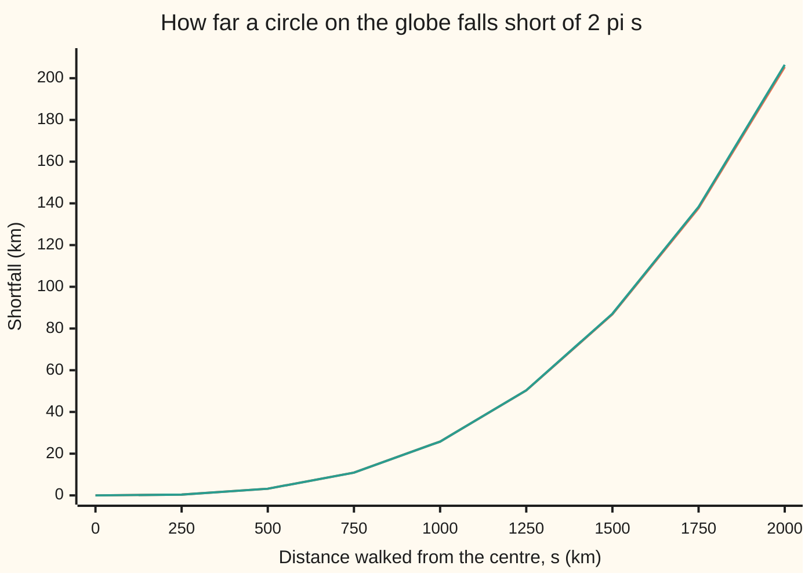
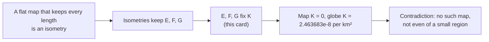

# Theorema Egregium: Gaussian curvature can be felt from inside

[Syllabus](../../../SYLLABUS.md) → [Differential geometry and Lie groups](../README.md) → [Surfaces](../README.md#s02) → Theorema Egregium

---

## General Overview

Take a sheet of A4 paper, 297 mm by 210 mm, and roll the long side round into a tube. Nothing stretches and nothing tears. A line drawn corner to corner on the flat sheet is 0.363743 m long. On the tube it becomes a spiral, and a tape laid along it still reads 0.363743 m.

The tube is bent hard: its radius is 47.27 mm, so it turns at 21.16 per metre around. Yet an ant that lives in the paper and owns only a tape measure cannot tell. Every length it can measure is unchanged.

Now try the same with copper over the half dome at the east end of the stadium roof, part of a sphere of radius 60 m. The sheet will not lie down without stretching. An ant on the dome can feel why. It stands at D, 20 m from the dome's axis on the plan ([Principal, mean and Gaussian curvature](05-principal-mean-and-gaussian-curvature.md)), walks 10 m in every direction, and tapes the circle it traced. Flat ground would give 62.83 m. The dome gives 62.54 m: 0.29 m short. The whole circle stays on the roof: measured along it, D is 12.08 m from the half dome's straight cut over the crown and 18.22 m from its rim.

The **Gaussian curvature** K is a number defined from outside the surface: it multiplies the surface's two bending rates in space. In 1827 Carl Friedrich Gauss proved that K can also be computed from lengths measured inside the surface. He called the result the Theorema Egregium, Latin for "remarkable theorem". The dome's 0.29 m shortfall is one such inside measurement, and Step 5 turns it into K.

**Gaussian curvature depends only on the first fundamental form, the table of lengths E, F and G, so bending without stretching never changes it, and no flat map of a globe can keep every length.**

**What kind of fact this is:** a theorem, proved on this card in Why it works, with the full algebra in a fold. It is local: it compares K at matching points and needs no global hypothesis.

### The picture: the circle shortfall on the globe

On the Earth, taken as a sphere of radius 6371 km (a model), walk a distance s from one point in every direction and measure the circle. Its shortfall below the flat answer 2πs grows like the cube of s.



Orange: the true shortfall on the sphere. Green: the cubic law πKs³/3 from this card's formula. They agree to 0.1 km out to 1000 km. A circle 1000 km out measures 6257.417 km, not 6283.185 km: 25.768 km short. A surveyor who never leaves the ground can read K from that.

---

## The formula

Notation first, in words. A surface is written as a patch r(u, v): a rule that turns two chart coordinates into a point in space ([Regular surface](01-regular-surfaces-and-tangent-planes.md)). Its first fundamental form is the table E, F, G of dot products of the tangent arrows, which turns coordinate steps into metres ([First fundamental form](02-first-fundamental-form.md)). A small letter after E, F or G means a derivative: $`E_v`$ is how fast E changes as v grows, and $`E_{vv}`$ is the rate of that rate.

From outside, the surface bends at each point by two principal curvatures $`\kappa_1`$ and $`\kappa_2`$, the largest and smallest bending rates over all directions. Their product is the Gaussian curvature K, and their average is the mean curvature H ([Principal, mean and Gaussian curvature](05-principal-mean-and-gaussian-curvature.md)). The outside formula uses L, M, N, the second fundamental form: how fast the surface leaves its tangent plane, measured along the unit normal ([Gauss map and second fundamental form](04-gauss-map-and-second-fundamental-form.md)).

On the triangles card K was a triangle's area; on this shelf K is Gaussian curvature, and H is mean curvature, not a Hamiltonian.

Gauss's theorem, in the form Francesco Brioschi wrote in 1852:

```math
K = \kappa_1\kappa_2 = \frac{LN - M^2}{EG - F^2} = \frac{1}{(EG - F^2)^2}\left(\det\begin{pmatrix} -\tfrac12 E_{vv} + F_{uv} - \tfrac12 G_{uu} & \tfrac12 E_u & F_u - \tfrac12 E_v \\ F_v - \tfrac12 G_u & E & F \\ \tfrac12 G_v & F & G \end{pmatrix} - \det\begin{pmatrix} 0 & \tfrac12 E_v & \tfrac12 G_u \\ \tfrac12 E_v & E & F \\ \tfrac12 G_u & F & G \end{pmatrix}\right)
```

**Read it aloud:** "the product of the two bending rates, which seems to need the normal in space, equals a fixed expression in E, F, G and their first and second derivatives."

Where the chart's grid is square on the surface (F = 0), it shortens to Gauss's own form:

```math
K = -\frac{1}{2\sqrt{EG}}\left[\frac{\partial}{\partial u}\left(\frac{G_u}{\sqrt{EG}}\right) + \frac{\partial}{\partial v}\left(\frac{E_v}{\sqrt{EG}}\right)\right]
```

**Read it aloud:** "K is minus one over twice the area factor, times how fast G's slope and E's slope, each scaled by the area factor, change across the grid."

Measured by walking, the theorem gives the circle test:

```math
C(s) = 2\pi s - \frac{\pi}{3}K s^3 + \dots, \qquad K \approx \frac{3\,(2\pi s - C(s))}{\pi s^3}
```

**Read it aloud:** "a circle of radius s walked on the surface falls short of 2πs by about π K s³ over 3, so three times the shortfall over π s³ is about K."

| Symbol | Plain meaning | In our example | Push it up and the answer… |
| --- | --- | --- | --- |
| $`u`$, $`v`$ (roof's seam chart: $`p`$, $`q`$) | chart coordinates; on a sphere, polar angle $`\varphi`$ down from the top and longitude $`\theta`$ | tube: metres round and metres along; roof's P: (30, 20), seam (25, 5) | — |
| $`\mathbf{r}`$, $`\mathbf{r}_u`$, $`\mathbf{r}_{uu}`$, $`\mathbf{n}`$ | the patch, its first and second derivative arrows, and the unit normal | tube normal points in, toward the axis | — |
| $`E`$, $`F`$, $`G`$ | the first fundamental form: squared lengths and slant of the grid | tube and flat sheet: 1, 0, 1 | lengths grow |
| $`E_u`$, $`E_{vv}`$, $`F_{uv}`$, … | rates of change of E, F, G across the chart | all 0 on the tube | — |
| $`L`$, $`M`$, $`N`$ | the second fundamental form: bending measured along the normal | tube: $`L = 1/a`$, $`M = N = 0`$ | bends more |
| $`\kappa_1`$, $`\kappa_2`$ | principal curvatures, in 1/m | tube: 21.155506 and 0 | — |
| $`K`$ | Gaussian curvature $`\kappa_1\kappa_2`$, in 1/m²; + on a dome, − on a saddle | tube 0; dome 0.000277778 | circles fall shorter |
| $`H`$ | mean curvature $`(\kappa_1 + \kappa_2)/2`$, in 1/m | tube 10.577753; sheet 0 | — |
| $`a`$ | the tube's radius | 0.047269 m | $`\kappa_1 = 1/a`$ falls |
| $`R`$ | a sphere's radius | dome 60 m; Earth 6371 km | $`K = 1/R^2`$ falls |
| $`s`$ | distance walked from the centre along the surface | 10 m from D on the dome; 1000 km on Earth | shortfall grows as $`s^3`$ |
| $`C(s)`$, $`g(s)`$ | length of the circle at distance s; its length per radian of bearing | dome: C = 62.541369 m, g = 9.953768 m; Earth: C = 6257.417 km | — |

Flipping the normal flips both $`\kappa`$'s, so K keeps its sign but H does not. This card points the tube's normal toward its axis.

A map between two surfaces that keeps the length of every curve is an **isometry**. In matching charts, two surfaces are isometric exactly when they have the same E, F and G.

### When it holds

- **The surface is smooth, with E, F, G twice differentiable.** At the tip of a paper cone (a quarter cut out of a disc, then closed) the circle test gives 150 per m² at 0.1 m and 15000 at 0.01 m. It never settles: the curvature sits in the tip as a point, the subject of [Gauss-Bonnet](10-gauss-bonnet-theorem.md).
- **The map keeps every length, not only angles.** [Conformal maps](../../07-Complex%20analysis/07-Conformal%20Maps%20and%20Harmonic%20Functions/01-conformal-maps.md) keep angles and may change K. Mercator's chart, built there, stretches lengths by 1/cos(latitude): 3.236068 at 72° north, so Greenland's area is drawn 10.472136 times too big.
- **The statement is local.** It compares K at matching points. The sheet and the tube are isometric piece by piece but not as wholes: a 297 mm walk round the tube comes back to its start, which no straight walk on the sheet does.
- **The circle test needs a small circle.** On the Earth with s = πR/2, the circle is the equator. The test then reads 2.176996 × 10⁻⁸ per km² instead of 2.463683 × 10⁻⁸, 11.64% low, because the dropped terms in $`s^5`$ and beyond are no longer small.
- **Gauss's short form needs F = 0.** The saddle over the middle of the roof is charted by plan metres east and north of its centre O ([First fundamental form](02-first-fundamental-form.md)). In this plan chart, F = −0.166667 at the lamp fixing P = (30, 20). The short form there gives K = 0. Brioschi's full form gives −0.000149938 per m².

---

## Why it works

### Step 0: the outside formula hides an inside one

K is defined from outside: L, M and N are second derivatives of the patch measured along the normal. The normal points off the surface, so an ant cannot see it.

Gauss's insight: LN − M² can be rewritten as determinants of dot products. Almost every one of those dot products is a derivative of E, F or G. The rest cancel. What is left is built from lengths alone.

### Step 1: dot products that lengths already know

E is $`\mathbf{r}_u \cdot \mathbf{r}_u`$. Differentiate it in u and the product rule gives $`E_u = 2\,\mathbf{r}_{uu}\cdot\mathbf{r}_u`$. So $`\mathbf{r}_{uu}\cdot\mathbf{r}_u = \tfrac12 E_u`$: a fact about the patch's second derivative that an ant can read from E.

The same trick gives five more:

- $`\mathbf{r}_{uv}\cdot\mathbf{r}_u = \tfrac12 E_v`$ and $`\mathbf{r}_{uv}\cdot\mathbf{r}_v = \tfrac12 G_u`$
- $`\mathbf{r}_{vv}\cdot\mathbf{r}_v = \tfrac12 G_v`$
- $`\mathbf{r}_{uu}\cdot\mathbf{r}_v = F_u - \tfrac12 E_v`$ and $`\mathbf{r}_{vv}\cdot\mathbf{r}_u = F_v - \tfrac12 G_u`$

### Step 2: the one hard term

Two dot products are not first derivatives of anything: $`\mathbf{r}_{uu}\cdot\mathbf{r}_{vv}`$ and $`\mathbf{r}_{uv}\cdot\mathbf{r}_{uv}`$. Each alone depends on how the surface sits in space. Their difference does not:

```math
\mathbf{r}_{uu}\cdot\mathbf{r}_{vv} - \mathbf{r}_{uv}\cdot\mathbf{r}_{uv} = -\tfrac12 E_{vv} + F_{uv} - \tfrac12 G_{uu}
```

It follows from differentiating the Step 1 facts once more; the third derivatives of the patch cancel. That difference is exactly the corner entry of Brioschi's first matrix.

### Step 3: assemble

Write the normal as $`\mathbf{n} = \mathbf{r}_u \times \mathbf{r}_v / \sqrt{EG - F^2}`$. Then L, N and M are determinants with $`\mathbf{r}_{uu}`$, $`\mathbf{r}_{vv}`$ or $`\mathbf{r}_{uv}`$ in the first row. Multiply them out, turn every dot product into E, F, G by Steps 1 and 2, and Brioschi's formula appears. The normal has gone.

<details>
<summary>Detailed proof: from LN − M² to Brioschi's formula</summary>

The cross product's length is the area factor: $`\lvert \mathbf{r}_u \times \mathbf{r}_v\rvert^2 = EG - F^2`$. So, writing $`[\mathbf{x}, \mathbf{y}, \mathbf{w}]`$ for the determinant with rows $`\mathbf{x}`$, $`\mathbf{y}`$, $`\mathbf{w}`$,

$`\displaystyle L = \frac{[\mathbf{r}_{uu}, \mathbf{r}_u, \mathbf{r}_v]}{\sqrt{EG - F^2}}, \quad M = \frac{[\mathbf{r}_{uv}, \mathbf{r}_u, \mathbf{r}_v]}{\sqrt{EG - F^2}}, \quad N = \frac{[\mathbf{r}_{vv}, \mathbf{r}_u, \mathbf{r}_v]}{\sqrt{EG - F^2}}.`$

For 3 × 3 matrices A and B, $`\det A \det B = \det(AB^{\mathsf T})`$, and the entries of $`AB^{\mathsf T}`$ are dot products of rows. Hence

$`\displaystyle (EG - F^2)(LN - M^2) = \det\begin{pmatrix} \mathbf{r}_{uu}\cdot\mathbf{r}_{vv} & \mathbf{r}_{uu}\cdot\mathbf{r}_u & \mathbf{r}_{uu}\cdot\mathbf{r}_v \\ \mathbf{r}_u\cdot\mathbf{r}_{vv} & E & F \\ \mathbf{r}_v\cdot\mathbf{r}_{vv} & F & G \end{pmatrix} - \det\begin{pmatrix} \mathbf{r}_{uv}\cdot\mathbf{r}_{uv} & \mathbf{r}_{uv}\cdot\mathbf{r}_u & \mathbf{r}_{uv}\cdot\mathbf{r}_v \\ \mathbf{r}_u\cdot\mathbf{r}_{uv} & E & F \\ \mathbf{r}_v\cdot\mathbf{r}_{uv} & F & G \end{pmatrix}.`$

Expand both along the first row. The two top-left entries multiply the same minor, $`EG - F^2`$. So only their difference matters, and it can sit in the first matrix while the second gets 0.

That difference comes from Step 1. Differentiate $`\mathbf{r}_{uu}\cdot\mathbf{r}_v = F_u - \tfrac12 E_v`$ in v, and $`\mathbf{r}_{uv}\cdot\mathbf{r}_v = \tfrac12 G_u`$ in u:

$`\displaystyle \mathbf{r}_{uuv}\cdot\mathbf{r}_v + \mathbf{r}_{uu}\cdot\mathbf{r}_{vv} = F_{uv} - \tfrac12 E_{vv}, \qquad \mathbf{r}_{uvu}\cdot\mathbf{r}_v + \mathbf{r}_{uv}\cdot\mathbf{r}_{uv} = \tfrac12 G_{uu}.`$

Since $`\mathbf{r}_{uuv} = \mathbf{r}_{uvu}`$, subtracting gives Step 2's identity. Every other entry is one of Step 1's six. Divide by $`EG - F^2`$ twice, once for the line above and once because $`K = (LN - M^2)/(EG - F^2)`$, and Brioschi's formula follows. With F = 0 and the determinants expanded, the same algebra gives Gauss's short form.

</details>

### Step 4: the tube, the dome and the roof, checked

**The tube.** Chart it by metres round and metres along. Rolling keeps lengths, so E = 1, F = 0, G = 1, the flat sheet's table. Every derivative is 0, both of Brioschi's determinants are 0, and K = 0. From outside, $`\kappa_1 = 1/a = 21.155506`$ per m and $`\kappa_2 = 0`$ along the tube: K = 0 again.

**A sphere.** With polar angle $`\varphi`$ and longitude $`\theta`$, E = R², F = 0, G = R² sin²$`\varphi`$. Then $`\sqrt{EG} = R^2\sin\varphi`$ and $`G_\varphi/\sqrt{EG} = 2\cos\varphi`$, whose $`\varphi`$-rate is $`-2\sin\varphi`$. Gauss's short form gives

```math
K = -\frac{1}{2R^2\sin\varphi}\,(-2\sin\varphi) = \frac{1}{R^2}.
```

For the dome that is 1/60² = 0.000277778 per m². For the Earth it is 2.463683 × 10⁻⁸ per km².

**The saddle of the roof.** Its plan chart, metres east and north of O, has E = 1 + u²/3600, F = −uv/3600, G = 1 + v²/3600 ([First fundamental form](02-first-fundamental-form.md)). At P = (30, 20) Brioschi's formula gives −0.000149938 per m².

The seam chart counts along the roof's two families of straight seams, with u = p + q and v = p − q, so P is (25, 5). With different E, F, G at the same point, it gives the same −0.000149938. A number that two charts agree on belongs to the roof.

### Step 5: why a circle falls short

Pick a centre and use a chart of distance s walked from it and bearing $`\theta`$. Walking straight out from the centre traces shortest paths ([Geodesic on a surface](09-geodesics-on-surfaces.md)), and in this chart E = 1, F = 0. Write G = g² for a function g(s), so the circle at distance s has length $`\int_0^{2\pi} g\,d\theta`$. Gauss's short form becomes

```math
K = -\frac{g_{ss}}{g}.
```

Near the centre g starts like s, as on a flat floor. Then $`g_{ss} \approx -Ks`$, so $`g \approx s - Ks^3/6`$. Going once round multiplies by 2π: that is the circle test. On the dome, g = 60 sin(s/60) exactly.

### Step 6: no flat map keeps lengths



The plane has K = 0 everywhere. The globe has K = 1/R² everywhere. A length-keeping map would carry one K onto the other. So every flat map of any patch of the globe stretches or shrinks something.

The size is measurable. A map that keeps true distances from a centre draws the 1000 km circle 6283.185 km long. The ground circle is 6257.417 km. The map's rim is stretched by a factor of 1.004118.

---

## Worked numbers, by hand

The paper tube, then the copper dome for contrast.

| Step | Arithmetic | Value |
| --- | --- | --- |
| tube radius a | 297 mm round, so 0.297 / 2π | 0.047269 m |
| E, F, G on the tube | measured from the patch | 1, 0, 1 |
| K from inside | Brioschi with all derivatives 0 | 0 |
| $`\kappa_1`$ from outside | 1 / 0.047269 | 21.155506 per m |
| K from outside | 21.155506 × 0 | 0 |
| H on the tube | (21.155506 + 0) / 2 | 10.577753 per m |
| corner-to-corner line | $`\sqrt{0.297^2 + 0.210^2}`$, flat and on the tube | 0.363743 m both |
| dome circle, flat answer | 2π × 10 | 62.831853 m |
| dome circle, true length | 2π × 60 × sin(10/60) = 2π × 60 × 0.165896 | 62.541369 m |
| shortfall | 62.831853 − 62.541369 | 0.290484 m |
| circle test | 3 × 0.290484 / (π × 10³) | 0.000277392 per m² |
| **dome K** | 1 / 60² | **0.000277778 per m²** |

Rolling bends the paper to 21.16 per metre but leaves K at 0, so the tube is made from flat sheet exactly. The dome's K is not 0, so its 10 m circle is 0.29 m short, and flat copper must stretch to fit.

### What breaks if you drop a piece

| Mistake | Comes out at | What went wrong |
| --- | --- | --- |
| Expect H to be felt from inside too | sheet 0, tube 10.577753 per m | the sheet and the tube are isometric, but H changes; only the product $`\kappa_1\kappa_2`$ survives |
| Assume a walked circle is 2πs on the dome | 62.831853 m, not 62.541369 m | that is flat ground; the 0.290484 m gap is the curvature |
| Use Gauss's short form in the roof's plan chart | K = 0 at P, not −0.000149938 | F = −0.166667 there; the short form needs F = 0 |
| Run the circle test on the equator, s = πR/2 | 2.176996 × 10⁻⁸ per km², not 2.463683 × 10⁻⁸ | the cubic law holds only for small circles |
| Run it round a cone's tip | 150 per m² at 0.1 m, 15000 at 0.01 m | the tip is not smooth; no K exists there |

Every number in that table is printed by the code below.

---

## Code, from first principles, and it actually runs

The code computes K by **three independent roads**. Road 1 is inside only: Brioschi's formula, fed nothing but the table E, F, G, with derivatives by central differences (two nearby values, subtracted). Road 2 is outside: it builds the normal from the patch in space and takes (LN − M²)/(EG − F²). Road 3 lays a tape of straight pieces round a walked circle and applies the circle test, at two circle sizes and two tape counts to show the error shrinking. A sphere has the same K at every point, so the code walks each circle out from the sphere's top: the circle round D has the same length. The roof is also checked chart against chart.

### Python

```python
# Theorema Egregium -- the check behind the card.  Standard library only.
# Gaussian curvature K, three independent roads:
#   1 inside:  Brioschi's formula, fed only the table E, F, G (derivatives by central differences)
#   2 outside: det of the shape operator, (LN - M^2)/(EG - F^2), which needs the normal in space
#   3 taped:   lay a tape round a circle walked out on the surface and compare it with 2 pi s
from math import sin, cos, asin, acos, sqrt, pi, radians

def d1(f, u, v, h): return (f(u + h, v) - f(u - h, v)) / (2 * h), (f(u, v + h) - f(u, v - h)) / (2 * h)
def det3(m): return (m[0][0] * (m[1][1] * m[2][2] - m[1][2] * m[2][1]) - m[0][1] * (m[1][0] * m[2][2] - m[1][2] * m[2][0])
                     + m[0][2] * (m[1][0] * m[2][1] - m[1][1] * m[2][0]))
def vec(a, b, s): return [(x - y) * s for x, y in zip(a, b)]
def total(xs):                            # plain left-to-right sum, as in the Rust check
    t = 0.0
    for x in xs: t += x
    return t
def dot(a, b): return total(x * y for x, y in zip(a, b))
def cross(a, b): return [a[1] * b[2] - a[2] * b[1], a[2] * b[0] - a[0] * b[2], a[0] * b[1] - a[1] * b[0]]

def brioschi(E, F, G, u, v, h):           # road 1: E, F, G and their derivatives, nothing else
    e, f, g = E(u, v), F(u, v), G(u, v)
    (Eu, Ev), (Fu, Fv), (Gu, Gv) = d1(E, u, v, h), d1(F, u, v, h), d1(G, u, v, h)
    Evv = (E(u, v + h) - 2 * e + E(u, v - h)) / h ** 2
    Guu = (G(u + h, v) - 2 * g + G(u - h, v)) / h ** 2
    Fuv = (F(u + h, v + h) - F(u + h, v - h) - F(u - h, v + h) + F(u - h, v - h)) / (4 * h * h)
    a = [[-Evv / 2 + Fuv - Guu / 2, Eu / 2, Fu - Ev / 2], [Fv - Gu / 2, e, f], [Gv / 2, f, g]]
    b = [[0.0, Ev / 2, Gu / 2], [Ev / 2, e, f], [Gu / 2, f, g]]
    return (det3(a) - det3(b)) / (e * g - f * f) ** 2

def gauss_orth(E, G, u, v, h):            # Gauss's shorter formula, valid only where F = 0
    w = lambda a, b: sqrt(E(a, b) * G(a, b))
    A = lambda a, b: d1(G, a, b, h)[0] / w(a, b)
    B = lambda a, b: d1(E, a, b, h)[1] / w(a, b)
    return -(d1(A, u, v, h)[0] + d1(B, u, v, h)[1]) / (2 * w(u, v))

def outside(r, u, v, h):                  # road 2: the patch in space, its normal, L, M, N
    p = lambda i, j: r(u + i * h, v + j * h)
    ru, rv = vec(p(1, 0), p(-1, 0), 0.5 / h), vec(p(0, 1), p(0, -1), 0.5 / h)
    ruu = [(x + y - 2 * z) / h ** 2 for x, y, z in zip(p(1, 0), p(-1, 0), p(0, 0))]
    rvv = [(x + y - 2 * z) / h ** 2 for x, y, z in zip(p(0, 1), p(0, -1), p(0, 0))]
    ruv = [(a - b - c + d) / (4 * h * h) for a, b, c, d in zip(p(1, 1), p(1, -1), p(-1, 1), p(-1, -1))]
    m = cross(ru, rv); n = [x / sqrt(dot(m, m)) for x in m]
    E, F, G, L, M, N = dot(ru, ru), dot(ru, rv), dot(rv, rv), dot(ruu, n), dot(ruv, n), dot(rvv, n)
    K, H = (L * N - M * M) / (E * G - F * F), (E * N - 2 * F * M + G * L) / (2 * (E * G - F * F))
    root = sqrt(max(H * H - K, 0.0))
    return K, H, H + root, H - root, (E, F, G)

def sphere(R): return lambda ph, th: (R * sin(ph) * cos(th), R * sin(ph) * sin(th), R * cos(ph))
def tape(R, s, n):                        # road 3: n straight tape pieces round the circle s from the pole
    pts = [sphere(R)(s / R, 2 * pi * k / n) for k in range(n + 1)]
    return total(sqrt(dot(vec(b, a, 1.0), vec(b, a, 1.0))) for a, b in zip(pts, pts[1:]))
def k_from_circle(s, C): return 3 * (2 * pi * s - C) / (pi * s ** 3)
def z(x): return 0.0 if abs(x) < 5e-13 else x   # print a rounding-level zero as 0

# ---- the paper: an A4 sheet, 297 mm side rolled round, 210 mm along the tube ----
a = 0.297 / (2 * pi)
sheet = lambda x, y: (x, y, 0.0)
tube = lambda x, y: (a * sin(x / a), a * cos(x / a), y)        # normal points in, toward the axis
helix = [tube(0.297 * k / 1000, 0.210 * k / 1000) for k in range(1001)]
helix_len = total(sqrt(dot(vec(q, p, 1.0), vec(q, p, 1.0))) for p, q in zip(helix, helix[1:]))
one, zero = (lambda x, y: 1.0), (lambda x, y: 0.0)
Kt, Ht, k1t, k2t, efg_t = outside(tube, 0.1, 0.05, 1e-5)
Ks, Hs, _, _, _ = outside(sheet, 0.1, 0.05, 1e-5)
# ---- the dome (sphere of radius 60 m) and the globe (6371 km), polar angle phi, longitude theta ----
Ed, Gd = (lambda ph, th: 3600.0), (lambda ph, th: 3600.0 * sin(ph) ** 2)
Rg = 6371.0
Eg, Gg = (lambda ph, th: Rg * Rg), (lambda ph, th: Rg * Rg * sin(ph) ** 2)
# ---- the saddle: plan chart (u east, v north) and seam chart (u = p + q, v = p - q) ----
seam = lambda p, q: (p + q, p - q, 30.0 + p * q / 30.0)       # the seam chart's patch in space
Ep, Fp, Gp = (lambda u, v: 1 + u * u / 3600), (lambda u, v: -u * v / 3600), (lambda u, v: 1 + v * v / 3600)
Es, Fs, Gs = (lambda p, q: 2 + q * q / 900), (lambda p, q: p * q / 900), (lambda p, q: 2 + p * p / 900)
K_P_hand = -(1 / 3600) / (1 + 0.25 + 1 / 9) ** 2
b = 0.210 / (2 * pi)                                            # try: roll the other side round
Kn, _, _, _, _ = outside(lambda x, y: (b * sin(x / b), b * cos(x / b), y), 0.1, 0.05, 1e-5)

rows = [
    ("tube radius a, m", f"{a:.6f}"),
    ("tube E, F, G from the patch", " ".join(f"{z(x):.6f}" for x in efg_t)),
    ("sheet diagonal, flat, m", f"{sqrt(0.297 ** 2 + 0.210 ** 2):.6f}"),
    ("same line on the tube, 1000 tape pieces, m", f"{helix_len:.6f}"),
    ("1 K tube, inside (E=1, F=0, G=1)", f"{z(brioschi(one, zero, one, 0.1, 0.05, 1e-3)):.9f}"),
    ("2 K tube, outside, 1/m^2", f"{z(Kt):.9f}"),
    ("  tube kappa1, kappa2, 1/m", f"{k1t:.6f} {z(k2t):.6f}"),
    ("  H tube, sheet, 1/m", f"{Ht:.6f} {z(Hs):.6f}"),
    ("1 K dome, inside, 1/m^2", f"{brioschi(Ed, zero, Gd, 0.3, 0.4, 1e-4):.9f}"),
    ("  Gauss F=0 formula", f"{gauss_orth(Ed, Gd, 0.3, 0.4, 1e-4):.9f}"),
    ("2 K dome, outside", f"{outside(sphere(60.0), 0.3, 0.4, 1e-4)[0]:.9f}"),
    ("  1/60^2", f"{1 / 3600:.9f}"),
    ("D (12 m E, 16 m N of crown): to cut, rim, m", f"{60 * asin(12 / 60):.6f} {60 * (acos(0.8) - asin(20 / 60)):.6f}"),
]
for s in (10.0, 5.0):
    C = 2 * pi * 60 * sin(s / 60)
    rows += [(f"dome circle s = {s:.0f} m: 2 pi s, closed C, m", f"{2 * pi * s:.6f} {C:.6f}"),
             ("  tape 360, 3600 pieces, m", f"{tape(60.0, s, 360):.6f} {tape(60.0, s, 3600):.6f}"),
             ("  sin(s/60); g, shortfall, m; 3 K: C, tape", f"{sin(s / 60):.6f} {60 * sin(s / 60):.6f} {2 * pi * s - C:.6f} {k_from_circle(s, C):.9f} {k_from_circle(s, tape(60.0, s, 3600)):.9f}")]
Kg = brioschi(Eg, zero, Gg, 0.9, 0.2, 1e-4)
Cg = 2 * pi * Rg * sin(1000 / Rg)
rows += [
    ("1 K globe, inside, x 1e8 per km^2", f"{Kg * 1e8:.6f}"),
    ("  1/sqrt(K), km", f"{1 / sqrt(Kg):.3f}"),
    ("2 K globe, outside, x 1e8", f"{outside(sphere(Rg), 0.9, 0.2, 1e-4)[0] * 1e8:.6f}"),
    ("globe circle s = 1000 km: 2 pi s, C, km", f"{2 * pi * 1000:.3f} {Cg:.3f}"),
    ("  tape 10000 pieces, km; shortfall, km", f"{tape(Rg, 1000.0, 10000):.3f} {2 * pi * 1000 - Cg:.3f}"),
    ("3 K from tape, x 1e8", f"{k_from_circle(1000.0, tape(Rg, 1000.0, 10000)) * 1e8:.6f}"),
    ("  rim kept 2 pi s on a flat map: stretch", f"{2 * pi * 1000 / Cg:.6f}"),
    ("Mercator at 72 deg: length, area stretch", f"{1 / cos(radians(72)):.6f} {1 / cos(radians(72)) ** 2:.6f}"),
    ("1 K roof at P, plan chart, 1/m^2", f"{brioschi(Ep, Fp, Gp, 30.0, 20.0, 1.0):.9f}"),
    ("1 K roof at P, seam chart", f"{brioschi(Es, Fs, Gs, 25.0, 5.0, 1.0):.9f}"),
    ("2 K roof at P, outside, seam patch", f"{outside(seam, 25.0, 5.0, 1.0)[0]:.9f}"),
    ("  hand: 1.361111^2, -(1/3600)/1.361111^2", f"{(1 + 0.25 + 1 / 9) ** 2:.6f} {K_P_hand:.9f}"),
    ("K roof at O, inside, 1/m^2", f"{brioschi(Ep, Fp, Gp, 0.0, 0.0, 1.0):.9f}"),
    ("wrong: F=0 formula on plan chart at P; F there", f"{z(gauss_orth(Ep, Gp, 30.0, 20.0, 1.0)):.9f} {Fp(30.0, 20.0):.6f}"),
    ("wrong: circle test at s = pi R/2, x 1e8; % low", f"{k_from_circle(pi * Rg / 2, 2 * pi * Rg) * 1e8:.6f} {100 * (1 - k_from_circle(pi * Rg / 2, 2 * pi * Rg) * Rg * Rg):.2f}"),
    ("breaks: cone tip, quarter cut, K at 0.1, 0.01 m", f"{k_from_circle(0.1, 1.5 * pi * 0.1):.3f} {k_from_circle(0.01, 1.5 * pi * 0.01):.3f}"),
    ("try: roll the 210 mm side: kappa1 = 1/b, K", f"{1 / b:.6f} {z(Kn):.9f}"),
    ("try: 10 m circle on a 120 m dome, shortfall", f"{2 * pi * 10 - 2 * pi * 120 * sin(10 / 120):.6f}"),
    ("try: K roof at the corner (30, 36)", f"{brioschi(Ep, Fp, Gp, 30.0, 36.0, 1.0):.9f}"),
]
for name, v in rows:
    print(f"{name:<48} {v}")
ss = [250.0 * k for k in range(9)]
print("figure, s km", " ".join(f"{s:.0f}" for s in ss))
print("figure, shortfall km", " ".join(f"{2 * pi * s - 2 * pi * Rg * sin(s / Rg):.1f}" for s in ss))
print("figure, pi K s^3/3 km", " ".join(f"{pi * s ** 3 / (3 * Rg * Rg):.1f}" for s in ss))

assert abs(helix_len - sqrt(0.297 ** 2 + 0.210 ** 2)) < 1e-6, "rolling keeps the diagonal's length"
assert abs(brioschi(Ed, zero, Gd, 0.3, 0.4, 1e-4) * 3600 - 1) < 1e-6, "dome: inside K = 1/60^2"
assert abs(outside(sphere(60.0), 0.3, 0.4, 1e-4)[0] * 3600 - 1) < 1e-6, "dome: outside K = 1/60^2"
assert abs(gauss_orth(Ed, Gd, 0.3, 0.4, 1e-4) * 3600 - 1) < 1e-6, "dome: Gauss's F = 0 form gives 1/60^2"
assert abs(Kg * Rg * Rg - 1) < 1e-6, "globe: inside K = 1/R^2"
assert abs(brioschi(Ep, Fp, Gp, 30, 20, 1.0) / K_P_hand - 1) < 1e-9, "roof, plan chart, against the hand value"
assert abs(brioschi(Es, Fs, Gs, 25, 5, 1.0) / K_P_hand - 1) < 1e-9, "roof, seam chart: K is not chart-made"
assert abs(outside(seam, 25.0, 5.0, 1.0)[0] / K_P_hand - 1) < 1e-9, "roof: outside agrees with inside"
assert abs(Kt) < 1e-6, "tube: outside K = 0, as the inside table says"
assert abs(Ht - 1 / (2 * a)) < 1e-4, "tube: H = 1/(2a), not 0: H is not felt from inside"
assert abs(k_from_circle(5.0, tape(60.0, 5.0, 3600)) * 3600 - 1) < abs(k_from_circle(10.0, tape(60.0, 10.0, 3600)) * 3600 - 1) < 0.01, "circle test closes in"
assert abs(k_from_circle(1000.0, tape(Rg, 1000.0, 10000)) * Rg * Rg - 1) < 0.002, "globe felt by a tape"
print("ALL CHECKS PASS")
```

**Ran 2026-11-19 on macOS, Python 3.14.10, standard library only. All checks passed. Output, pasted from the run:**

```
tube radius a, m                                 0.047269
tube E, F, G from the patch                      1.000000 0.000000 1.000000
sheet diagonal, flat, m                          0.363743
same line on the tube, 1000 tape pieces, m       0.363743
1 K tube, inside (E=1, F=0, G=1)                 0.000000000
2 K tube, outside, 1/m^2                         0.000000000
  tube kappa1, kappa2, 1/m                       21.155506 0.000000
  H tube, sheet, 1/m                             10.577753 0.000000
1 K dome, inside, 1/m^2                          0.000277778
  Gauss F=0 formula                              0.000277778
2 K dome, outside                                0.000277778
  1/60^2                                         0.000277778
D (12 m E, 16 m N of crown): to cut, rim, m      12.081475 18.219852
dome circle s = 10 m: 2 pi s, closed C, m        62.831853 62.541369
  tape 360, 3600 pieces, m                       62.540575 62.541361
  sin(s/60); g, shortfall, m; 3 K: C, tape       0.165896 9.953768 0.290484 0.000277392 0.000277400
dome circle s = 5 m: 2 pi s, closed C, m         31.415927 31.379578
  tape 360, 3600 pieces, m                       31.379180 31.379574
  sin(s/60); g, shortfall, m; 3 K: C, tape       0.083237 4.994215 0.036348 0.000277681 0.000277712
1 K globe, inside, x 1e8 per km^2                2.463683
  1/sqrt(K), km                                  6371.000
2 K globe, outside, x 1e8                        2.463683
globe circle s = 1000 km: 2 pi s, C, km          6283.185 6257.417
  tape 10000 pieces, km; shortfall, km           6257.417 25.768
3 K from tape, x 1e8                             2.460660
  rim kept 2 pi s on a flat map: stretch         1.004118
Mercator at 72 deg: length, area stretch         3.236068 10.472136
1 K roof at P, plan chart, 1/m^2                 -0.000149938
1 K roof at P, seam chart                        -0.000149938
2 K roof at P, outside, seam patch               -0.000149938
  hand: 1.361111^2, -(1/3600)/1.361111^2         1.852623 -0.000149938
K roof at O, inside, 1/m^2                       -0.000277778
wrong: F=0 formula on plan chart at P; F there   0.000000000 -0.166667
wrong: circle test at s = pi R/2, x 1e8; % low   2.176996 11.64
breaks: cone tip, quarter cut, K at 0.1, 0.01 m  150.000 15000.000
try: roll the 210 mm side: kappa1 = 1/b, K       29.919930 0.000000000
try: 10 m circle on a 120 m dome, shortfall      0.072697
try: K roof at the corner (30, 36)               -0.000107163
figure, s km 0 250 500 750 1000 1250 1500 1750 2000
figure, shortfall km 0.0 0.4 3.2 10.9 25.8 50.3 86.8 137.7 205.4
figure, pi K s^3/3 km 0.0 0.4 3.2 10.9 25.8 50.4 87.1 138.3 206.4
ALL CHECKS PASS
```

Every K agrees across roads. The circle test closes in as the circle shrinks: 0.000277400 at 10 m, 0.000277712 at 5 m, against 0.000277778.

### Rust

```rust
// Theorema Egregium -- the check behind the card.  std only, no crates.
// Gaussian curvature K, three independent roads:
//   1 inside:  Brioschi's formula, fed only the table E, F, G (derivatives by central differences)
//   2 outside: det of the shape operator, (LN - M^2)/(EG - F^2), which needs the normal in space
//   3 taped:   lay a tape round a circle walked out on the surface and compare it with 2 pi s
use std::f64::consts::PI;
type V3 = [f64; 3];

fn d1(f: &dyn Fn(f64, f64) -> f64, u: f64, v: f64, h: f64) -> (f64, f64) {
    ((f(u + h, v) - f(u - h, v)) / (2.0 * h), (f(u, v + h) - f(u, v - h)) / (2.0 * h))
}
fn det3(m: [[f64; 3]; 3]) -> f64 {
    m[0][0] * (m[1][1] * m[2][2] - m[1][2] * m[2][1]) - m[0][1] * (m[1][0] * m[2][2] - m[1][2] * m[2][0])
        + m[0][2] * (m[1][0] * m[2][1] - m[1][1] * m[2][0])
}
fn vec(a: V3, b: V3, s: f64) -> V3 { [(a[0] - b[0]) * s, (a[1] - b[1]) * s, (a[2] - b[2]) * s] }
fn dot(a: V3, b: V3) -> f64 { a[0] * b[0] + a[1] * b[1] + a[2] * b[2] }
fn cross(a: V3, b: V3) -> V3 { [a[1] * b[2] - a[2] * b[1], a[2] * b[0] - a[0] * b[2], a[0] * b[1] - a[1] * b[0]] }

fn brioschi(e_: &dyn Fn(f64, f64) -> f64, f_: &dyn Fn(f64, f64) -> f64, g_: &dyn Fn(f64, f64) -> f64,
            u: f64, v: f64, h: f64) -> f64 {
    // road 1: E, F, G and their derivatives, nothing else
    let (e, f, g) = (e_(u, v), f_(u, v), g_(u, v));
    let ((eu, ev), (fu, fv), (gu, gv)) = (d1(e_, u, v, h), d1(f_, u, v, h), d1(g_, u, v, h));
    let evv = (e_(u, v + h) - 2.0 * e + e_(u, v - h)) / h.powf(2.0);
    let guu = (g_(u + h, v) - 2.0 * g + g_(u - h, v)) / h.powf(2.0);
    let fuv = (f_(u + h, v + h) - f_(u + h, v - h) - f_(u - h, v + h) + f_(u - h, v - h)) / (4.0 * h * h);
    let a = [[-evv / 2.0 + fuv - guu / 2.0, eu / 2.0, fu - ev / 2.0], [fv - gu / 2.0, e, f], [gv / 2.0, f, g]];
    let b = [[0.0, ev / 2.0, gu / 2.0], [ev / 2.0, e, f], [gu / 2.0, f, g]];
    (det3(a) - det3(b)) / (e * g - f * f).powf(2.0)
}

fn gauss_orth(e_: &dyn Fn(f64, f64) -> f64, g_: &dyn Fn(f64, f64) -> f64, u: f64, v: f64, h: f64) -> f64 {
    // Gauss's shorter formula, valid only where F = 0
    let w = |a: f64, b: f64| (e_(a, b) * g_(a, b)).sqrt();
    let a_ = |a: f64, b: f64| d1(g_, a, b, h).0 / w(a, b);
    let b_ = |a: f64, b: f64| d1(e_, a, b, h).1 / w(a, b);
    -(d1(&a_, u, v, h).0 + d1(&b_, u, v, h).1) / (2.0 * w(u, v))
}

fn outside(r: &dyn Fn(f64, f64) -> V3, u: f64, v: f64, h: f64) -> (f64, f64, f64, f64, [f64; 3]) {
    // road 2: the patch in space, its normal, L, M, N
    let p = |i: f64, j: f64| r(u + i * h, v + j * h);
    let (ru, rv) = (vec(p(1.0, 0.0), p(-1.0, 0.0), 0.5 / h), vec(p(0.0, 1.0), p(0.0, -1.0), 0.5 / h));
    let (c, pu, mu, pv, mv) = (p(0.0, 0.0), p(1.0, 0.0), p(-1.0, 0.0), p(0.0, 1.0), p(0.0, -1.0));
    let (pp, pm, mp, mm) = (p(1.0, 1.0), p(1.0, -1.0), p(-1.0, 1.0), p(-1.0, -1.0));
    let mut ruu = [0.0; 3]; let mut rvv = [0.0; 3]; let mut ruv = [0.0; 3];
    for k in 0..3 {
        ruu[k] = (pu[k] + mu[k] - 2.0 * c[k]) / h.powf(2.0);
        rvv[k] = (pv[k] + mv[k] - 2.0 * c[k]) / h.powf(2.0);
        ruv[k] = (pp[k] - pm[k] - mp[k] + mm[k]) / (4.0 * h * h);
    }
    let m = cross(ru, rv);
    let len = dot(m, m).sqrt();
    let n = [m[0] / len, m[1] / len, m[2] / len];
    let (e, f, g) = (dot(ru, ru), dot(ru, rv), dot(rv, rv));
    let (l, mm_, nn) = (dot(ruu, n), dot(ruv, n), dot(rvv, n));
    let k = (l * nn - mm_ * mm_) / (e * g - f * f);
    let hm = (e * nn - 2.0 * f * mm_ + g * l) / (2.0 * (e * g - f * f));
    let root = (hm * hm - k).max(0.0).sqrt();
    (k, hm, hm + root, hm - root, [e, f, g])
}

fn sphere(rr: f64) -> impl Fn(f64, f64) -> V3 {
    move |ph: f64, th: f64| [rr * ph.sin() * th.cos(), rr * ph.sin() * th.sin(), rr * ph.cos()]
}
fn tape(rr: f64, s: f64, n: usize) -> f64 {
    // road 3: n straight tape pieces round the circle s from the pole
    let sp = sphere(rr);
    let pts: Vec<V3> = (0..=n).map(|k| sp(s / rr, 2.0 * PI * k as f64 / n as f64)).collect();
    let mut t = 0.0;
    for w in pts.windows(2) { let d = vec(w[1], w[0], 1.0); t += dot(d, d).sqrt(); }
    t
}
fn k_from_circle(s: f64, c: f64) -> f64 { 3.0 * (2.0 * PI * s - c) / (PI * s.powf(3.0)) }
fn z(x: f64) -> f64 { if x.abs() < 5e-13 { 0.0 } else { x } }   // print a rounding-level zero as 0

fn main() {
    // ---- the paper: an A4 sheet, 297 mm side rolled round, 210 mm along the tube ----
    let a = 0.297 / (2.0 * PI);
    let sheet = |x: f64, y: f64| [x, y, 0.0];
    let tube = move |x: f64, y: f64| [a * (x / a).sin(), a * (x / a).cos(), y];   // normal points in
    let helix: Vec<V3> = (0..=1000).map(|k| tube(0.297 * k as f64 / 1000.0, 0.210 * k as f64 / 1000.0)).collect();
    let mut helix_len = 0.0;
    for w in helix.windows(2) { let d = vec(w[1], w[0], 1.0); helix_len += dot(d, d).sqrt(); }
    let (one, zero) = (|_: f64, _: f64| 1.0, |_: f64, _: f64| 0.0);
    let (kt, ht, k1t, k2t, efg_t) = outside(&tube, 0.1, 0.05, 1e-5);
    let (_, hs, _, _, _) = outside(&sheet, 0.1, 0.05, 1e-5);
    // ---- the dome (sphere of radius 60 m) and the globe (6371 km), polar angle phi, longitude theta ----
    let (ed, gd) = (|_: f64, _: f64| 3600.0, |ph: f64, _: f64| 3600.0 * ph.sin().powf(2.0));
    let rg = 6371.0_f64;
    let (eg, gg) = (move |_: f64, _: f64| rg * rg, move |ph: f64, _: f64| rg * rg * ph.sin().powf(2.0));
    // ---- the saddle: plan chart (u east, v north) and seam chart (u = p + q, v = p - q) ----
    let seam = |p: f64, q: f64| [p + q, p - q, 30.0 + p * q / 30.0];       // the seam chart's patch in space
    let (ep, fp, gp) = (|u: f64, _: f64| 1.0 + u * u / 3600.0, |u: f64, v: f64| -u * v / 3600.0, |_: f64, v: f64| 1.0 + v * v / 3600.0);
    let (es, fs, gs) = (|_: f64, q: f64| 2.0 + q * q / 900.0, |p: f64, q: f64| p * q / 900.0, |p: f64, _: f64| 2.0 + p * p / 900.0);
    let k_p_hand = -(1.0 / 3600.0) / (1.0_f64 + 0.25 + 1.0 / 9.0).powf(2.0);
    let b = 0.210 / (2.0 * PI);                                         // try: roll the other side round
    let (kn, _, _, _, _) = outside(&move |x: f64, y: f64| [b * (x / b).sin(), b * (x / b).cos(), y], 0.1, 0.05, 1e-5);
    let diag = (0.297f64.powf(2.0) + 0.210f64.powf(2.0)).sqrt();
    let mut rows: Vec<(String, String)> = vec![
        ("tube radius a, m".into(), format!("{:.6}", a)),
        ("tube E, F, G from the patch".into(), format!("{:.6} {:.6} {:.6}", z(efg_t[0]), z(efg_t[1]), z(efg_t[2]))),
        ("sheet diagonal, flat, m".into(), format!("{:.6}", diag)),
        ("same line on the tube, 1000 tape pieces, m".into(), format!("{:.6}", helix_len)),
        ("1 K tube, inside (E=1, F=0, G=1)".into(), format!("{:.9}", z(brioschi(&one, &zero, &one, 0.1, 0.05, 1e-3)))),
        ("2 K tube, outside, 1/m^2".into(), format!("{:.9}", z(kt))),
        ("  tube kappa1, kappa2, 1/m".into(), format!("{:.6} {:.6}", k1t, z(k2t))),
        ("  H tube, sheet, 1/m".into(), format!("{:.6} {:.6}", ht, z(hs))),
        ("1 K dome, inside, 1/m^2".into(), format!("{:.9}", brioschi(&ed, &zero, &gd, 0.3, 0.4, 1e-4))),
        ("  Gauss F=0 formula".into(), format!("{:.9}", gauss_orth(&ed, &gd, 0.3, 0.4, 1e-4))),
        ("2 K dome, outside".into(), format!("{:.9}", outside(&sphere(60.0), 0.3, 0.4, 1e-4).0)),
        ("  1/60^2".into(), format!("{:.9}", 1.0 / 3600.0)),
        ("D (12 m E, 16 m N of crown): to cut, rim, m".into(), format!("{:.6} {:.6}", 60.0 * (12.0f64 / 60.0).asin(), 60.0 * (0.8f64.acos() - (20.0f64 / 60.0).asin()))),
    ];
    for s in [10.0_f64, 5.0] {
        let c = 2.0 * PI * 60.0 * (s / 60.0).sin();
        rows.push((format!("dome circle s = {:.0} m: 2 pi s, closed C, m", s), format!("{:.6} {:.6}", 2.0 * PI * s, c)));
        rows.push(("  tape 360, 3600 pieces, m".into(), format!("{:.6} {:.6}", tape(60.0, s, 360), tape(60.0, s, 3600))));
        rows.push(("  sin(s/60); g, shortfall, m; 3 K: C, tape".into(), format!("{:.6} {:.6} {:.6} {:.9} {:.9}",
                   (s / 60.0).sin(), 60.0 * (s / 60.0).sin(), 2.0 * PI * s - c, k_from_circle(s, c), k_from_circle(s, tape(60.0, s, 3600)))));
    }
    let kg = brioschi(&eg, &zero, &gg, 0.9, 0.2, 1e-4);
    let cg = 2.0 * PI * rg * (1000.0 / rg).sin();
    let r72 = 72.0_f64.to_radians();
    let more: Vec<(&str, String)> = vec![
        ("1 K globe, inside, x 1e8 per km^2", format!("{:.6}", kg * 1e8)),
        ("  1/sqrt(K), km", format!("{:.3}", 1.0 / kg.sqrt())),
        ("2 K globe, outside, x 1e8", format!("{:.6}", outside(&sphere(rg), 0.9, 0.2, 1e-4).0 * 1e8)),
        ("globe circle s = 1000 km: 2 pi s, C, km", format!("{:.3} {:.3}", 2.0 * PI * 1000.0, cg)),
        ("  tape 10000 pieces, km; shortfall, km", format!("{:.3} {:.3}", tape(rg, 1000.0, 10000), 2.0 * PI * 1000.0 - cg)),
        ("3 K from tape, x 1e8", format!("{:.6}", k_from_circle(1000.0, tape(rg, 1000.0, 10000)) * 1e8)),
        ("  rim kept 2 pi s on a flat map: stretch", format!("{:.6}", 2.0 * PI * 1000.0 / cg)),
        ("Mercator at 72 deg: length, area stretch", format!("{:.6} {:.6}", 1.0 / r72.cos(), 1.0 / r72.cos().powf(2.0))),
        ("1 K roof at P, plan chart, 1/m^2", format!("{:.9}", brioschi(&ep, &fp, &gp, 30.0, 20.0, 1.0))),
        ("1 K roof at P, seam chart", format!("{:.9}", brioschi(&es, &fs, &gs, 25.0, 5.0, 1.0))),
        ("2 K roof at P, outside, seam patch", format!("{:.9}", outside(&seam, 25.0, 5.0, 1.0).0)),
        ("  hand: 1.361111^2, -(1/3600)/1.361111^2", format!("{:.6} {:.9}", (1.0_f64 + 0.25 + 1.0 / 9.0).powf(2.0), k_p_hand)),
        ("K roof at O, inside, 1/m^2", format!("{:.9}", brioschi(&ep, &fp, &gp, 0.0, 0.0, 1.0))),
        ("wrong: F=0 formula on plan chart at P; F there", format!("{:.9} {:.6}", z(gauss_orth(&ep, &gp, 30.0, 20.0, 1.0)), fp(30.0, 20.0))),
        ("wrong: circle test at s = pi R/2, x 1e8; % low", format!("{:.6} {:.2}", k_from_circle(PI * rg / 2.0, 2.0 * PI * rg) * 1e8, 100.0 * (1.0 - k_from_circle(PI * rg / 2.0, 2.0 * PI * rg) * rg * rg))),
        ("breaks: cone tip, quarter cut, K at 0.1, 0.01 m", format!("{:.3} {:.3}", k_from_circle(0.1, 1.5 * PI * 0.1), k_from_circle(0.01, 1.5 * PI * 0.01))),
        ("try: roll the 210 mm side: kappa1 = 1/b, K", format!("{:.6} {:.9}", 1.0 / b, z(kn))),
        ("try: 10 m circle on a 120 m dome, shortfall", format!("{:.6}", 2.0 * PI * 10.0 - 2.0 * PI * 120.0 * (10.0_f64 / 120.0).sin())),
        ("try: K roof at the corner (30, 36)", format!("{:.9}", brioschi(&ep, &fp, &gp, 30.0, 36.0, 1.0))),
    ];
    for (n, v) in more { rows.push((n.to_string(), v)); }
    for (name, v) in &rows { println!("{:<48} {}", name, v); }
    let ss: Vec<f64> = (0..9).map(|k| 250.0 * k as f64).collect();
    let line = |f: &dyn Fn(f64) -> String| ss.iter().map(|&s| f(s)).collect::<Vec<_>>().join(" ");
    println!("figure, s km {}", line(&|s| format!("{:.0}", s)));
    println!("figure, shortfall km {}", line(&|s| format!("{:.1}", 2.0 * PI * s - 2.0 * PI * rg * (s / rg).sin())));
    println!("figure, pi K s^3/3 km {}", line(&|s| format!("{:.1}", PI * s.powf(3.0) / (3.0 * rg * rg))));

    assert!((helix_len - diag).abs() < 1e-6, "rolling keeps the diagonal's length");
    assert!((brioschi(&ed, &zero, &gd, 0.3, 0.4, 1e-4) * 3600.0 - 1.0).abs() < 1e-6, "dome: inside K = 1/60^2");
    assert!((outside(&sphere(60.0), 0.3, 0.4, 1e-4).0 * 3600.0 - 1.0).abs() < 1e-6, "dome: outside K = 1/60^2");
    assert!((gauss_orth(&ed, &gd, 0.3, 0.4, 1e-4) * 3600.0 - 1.0).abs() < 1e-6, "dome: Gauss's F = 0 form gives 1/60^2");
    assert!((kg * rg * rg - 1.0).abs() < 1e-6, "globe: inside K = 1/R^2");
    assert!((brioschi(&ep, &fp, &gp, 30.0, 20.0, 1.0) / k_p_hand - 1.0).abs() < 1e-9, "roof, plan chart, against the hand value");
    assert!((brioschi(&es, &fs, &gs, 25.0, 5.0, 1.0) / k_p_hand - 1.0).abs() < 1e-9, "roof, seam chart: K is not chart-made");
    assert!((outside(&seam, 25.0, 5.0, 1.0).0 / k_p_hand - 1.0).abs() < 1e-9, "roof: outside agrees with inside");
    assert!(kt.abs() < 1e-6, "tube: outside K = 0, as the inside table says");
    assert!((ht - 1.0 / (2.0 * a)).abs() < 1e-4, "tube: H = 1/(2a), not 0: H is not felt from inside");
    let (e5, e10) = ((k_from_circle(5.0, tape(60.0, 5.0, 3600)) * 3600.0 - 1.0).abs(), (k_from_circle(10.0, tape(60.0, 10.0, 3600)) * 3600.0 - 1.0).abs());
    assert!(e5 < e10 && e10 < 0.01, "circle test closes in");
    assert!((k_from_circle(1000.0, tape(rg, 1000.0, 10000)) * rg * rg - 1.0).abs() < 0.002, "globe felt by a tape");
    println!("ALL CHECKS PASS");
}
```

**Ran 2026-11-19 on macOS, rustc 1.98.1, no crates. All checks passed. Output, pasted from the run:**

```
tube radius a, m                                 0.047269
tube E, F, G from the patch                      1.000000 0.000000 1.000000
sheet diagonal, flat, m                          0.363743
same line on the tube, 1000 tape pieces, m       0.363743
1 K tube, inside (E=1, F=0, G=1)                 0.000000000
2 K tube, outside, 1/m^2                         0.000000000
  tube kappa1, kappa2, 1/m                       21.155506 0.000000
  H tube, sheet, 1/m                             10.577753 0.000000
1 K dome, inside, 1/m^2                          0.000277778
  Gauss F=0 formula                              0.000277778
2 K dome, outside                                0.000277778
  1/60^2                                         0.000277778
D (12 m E, 16 m N of crown): to cut, rim, m      12.081475 18.219852
dome circle s = 10 m: 2 pi s, closed C, m        62.831853 62.541369
  tape 360, 3600 pieces, m                       62.540575 62.541361
  sin(s/60); g, shortfall, m; 3 K: C, tape       0.165896 9.953768 0.290484 0.000277392 0.000277400
dome circle s = 5 m: 2 pi s, closed C, m         31.415927 31.379578
  tape 360, 3600 pieces, m                       31.379180 31.379574
  sin(s/60); g, shortfall, m; 3 K: C, tape       0.083237 4.994215 0.036348 0.000277681 0.000277712
1 K globe, inside, x 1e8 per km^2                2.463683
  1/sqrt(K), km                                  6371.000
2 K globe, outside, x 1e8                        2.463683
globe circle s = 1000 km: 2 pi s, C, km          6283.185 6257.417
  tape 10000 pieces, km; shortfall, km           6257.417 25.768
3 K from tape, x 1e8                             2.460660
  rim kept 2 pi s on a flat map: stretch         1.004118
Mercator at 72 deg: length, area stretch         3.236068 10.472136
1 K roof at P, plan chart, 1/m^2                 -0.000149938
1 K roof at P, seam chart                        -0.000149938
2 K roof at P, outside, seam patch               -0.000149938
  hand: 1.361111^2, -(1/3600)/1.361111^2         1.852623 -0.000149938
K roof at O, inside, 1/m^2                       -0.000277778
wrong: F=0 formula on plan chart at P; F there   0.000000000 -0.166667
wrong: circle test at s = pi R/2, x 1e8; % low   2.176996 11.64
breaks: cone tip, quarter cut, K at 0.1, 0.01 m  150.000 15000.000
try: roll the 210 mm side: kappa1 = 1/b, K       29.919930 0.000000000
try: 10 m circle on a 120 m dome, shortfall      0.072697
try: K roof at the corner (30, 36)               -0.000107163
figure, s km 0 250 500 750 1000 1250 1500 1750 2000
figure, shortfall km 0.0 0.4 3.2 10.9 25.8 50.3 86.8 137.7 205.4
figure, pi K s^3/3 km 0.0 0.4 3.2 10.9 25.8 50.4 87.1 138.3 206.4
ALL CHECKS PASS
```

The two outputs are identical line for line.

### Lean

Lean proves Brioschi's formula for every smooth patch, the Theorema Egregium, and that no flat map keeps a globe's lengths.

- Suppose a patch $`\mathbf{r}(u, v)`$ is smooth on a region of the chart. Then at every point, $`(LN - M^2)/(EG - F^2)`$ equals Brioschi's expression in E, F, G and their derivatives.
- Take two smooth regular patches on one region of the chart, with the same E, F and G there. Then they have the same K at every point of that region.
- Take a globe of radius $`R`$, charted by polar angle $`\varphi`$ and longitude $`\theta`$. Then no smooth flat map of any piece of it, however small, has the globe's E, F and G.
- Take the roof's plan chart at P = (30, 20), where E = 5/4, F = −1/6 and G = 10/9. Then the arithmetic of Brioschi's formula there gives K = −9/60025 per m², the card's −0.000149938.

The circle test, Gauss's short form, the tube, and the dome and globe numbers are left to the Python and Rust checks.

```lean
-- Theorema Egregium: the Gaussian curvature of a smooth surface patch is fixed by its first fundamental form E, F, G alone, by Brioschi's formula, so patches with the same E, F, G have the same K and no flat map of any piece of a globe keeps every length.
import Mathlib.Analysis.Calculus.ContDiff.Basic
import Mathlib.Analysis.Calculus.FDeriv.Basic
import Mathlib.Analysis.Calculus.FDeriv.Symmetric
import Mathlib.Analysis.Calculus.Deriv.Prod
import Mathlib.Analysis.SpecialFunctions.Trigonometric.Basic
import Mathlib.Analysis.SpecialFunctions.Trigonometric.Deriv
import Mathlib.Analysis.SpecialFunctions.Sqrt
import Mathlib.LinearAlgebra.CrossProduct
import Mathlib.LinearAlgebra.Matrix.Determinant.Basic
import Mathlib.Tactic

open scoped ContDiff Matrix

namespace TheoremaEgregium

/-! A patch `r(u, v)` sends a chart point `q = (u, v)` to a point of space `Fin 3 → ℝ`.
`du f q` and `dv f q` are the partial derivatives of `f` in `u` and in `v` at `q`. -/

/-- The partial derivative in `u`: how fast `f` changes as `u` grows. -/
noncomputable def du {V : Type*} [NormedAddCommGroup V] [NormedSpace ℝ V]
    (f : ℝ × ℝ → V) (q : ℝ × ℝ) : V :=
  fderiv ℝ f q (1, 0)

/-- The partial derivative in `v`: how fast `f` changes as `v` grows. -/
noncomputable def dv {V : Type*} [NormedAddCommGroup V] [NormedSpace ℝ V]
    (f : ℝ × ℝ → V) (q : ℝ × ℝ) : V :=
  fderiv ℝ f q (0, 1)

/-- First fundamental form: `E = r_u · r_u`. -/
noncomputable def E (r : ℝ × ℝ → Fin 3 → ℝ) (q : ℝ × ℝ) : ℝ := du r q ⬝ᵥ du r q

/-- First fundamental form: `F = r_u · r_v`. -/
noncomputable def F (r : ℝ × ℝ → Fin 3 → ℝ) (q : ℝ × ℝ) : ℝ := du r q ⬝ᵥ dv r q

/-- First fundamental form: `G = r_v · r_v`. -/
noncomputable def G (r : ℝ × ℝ → Fin 3 → ℝ) (q : ℝ × ℝ) : ℝ := dv r q ⬝ᵥ dv r q

/-- The unit normal `n = (r_u × r_v) / |r_u × r_v|`, with the Euclidean length. -/
noncomputable def unitNormal (r : ℝ × ℝ → Fin 3 → ℝ) (q : ℝ × ℝ) : Fin 3 → ℝ :=
  (Real.sqrt ((du r q ⨯₃ dv r q) ⬝ᵥ (du r q ⨯₃ dv r q)))⁻¹ • (du r q ⨯₃ dv r q)

/-- Second fundamental form: `L = r_uu · n`. -/
noncomputable def L (r : ℝ × ℝ → Fin 3 → ℝ) (q : ℝ × ℝ) : ℝ :=
  du (du r) q ⬝ᵥ unitNormal r q

/-- Second fundamental form: `M = r_uv · n`. -/
noncomputable def M (r : ℝ × ℝ → Fin 3 → ℝ) (q : ℝ × ℝ) : ℝ :=
  dv (du r) q ⬝ᵥ unitNormal r q

/-- Second fundamental form: `N = r_vv · n`. -/
noncomputable def N (r : ℝ × ℝ → Fin 3 → ℝ) (q : ℝ × ℝ) : ℝ :=
  dv (dv r) q ⬝ᵥ unitNormal r q

/-- Gaussian curvature from outside: `K = κ₁ κ₂ = (LN - M²) / (EG - F²)`. -/
noncomputable def gaussCurvature (r : ℝ × ℝ → Fin 3 → ℝ) (q : ℝ × ℝ) : ℝ :=
  (L r q * N r q - M r q ^ 2) / (E r q * G r q - F r q ^ 2)

/-- Brioschi's expression: built from three functions `e, f, g` (standing for E, F, G) and their
first and second partial derivatives only, with no normal and no patch in space. -/
noncomputable def brioschi (e f g : ℝ × ℝ → ℝ) (q : ℝ × ℝ) : ℝ :=
  (!![-(1 / 2) * dv (dv e) q + dv (du f) q - (1 / 2) * du (du g) q,
        (1 / 2) * du e q, du f q - (1 / 2) * dv e q;
      dv f q - (1 / 2) * du g q, e q, f q;
      (1 / 2) * dv g q, f q, g q].det -
    !![0, (1 / 2) * dv e q, (1 / 2) * du g q;
      (1 / 2) * dv e q, e q, f q;
      (1 / 2) * du g q, f q, g q].det) /
    (e q * g q - f q ^ 2) ^ 2

/-! Helper lemmas: smoothness of partial derivatives, symmetry of mixed partials,
the product rule for the dot product, and Brioschi's formula with no regularity hypothesis. -/

theorem smooth_fderiv_apply {V : Type*} [NormedAddCommGroup V] [NormedSpace ℝ V]
    {g : ℝ × ℝ → V} {U : Set (ℝ × ℝ)} (hU : IsOpen U)
    (hg : ContDiffOn ℝ ∞ g U) (w : ℝ × ℝ) : ContDiffOn ℝ ∞ (fun q => fderiv ℝ g q w) U :=
  (hg.fderiv_of_isOpen hU (m := ∞) (by simp)).clm_apply contDiffOn_const

theorem du_smooth {V : Type*} [NormedAddCommGroup V] [NormedSpace ℝ V]
    {g : ℝ × ℝ → V} {U : Set (ℝ × ℝ)} (hU : IsOpen U)
    (hg : ContDiffOn ℝ ∞ g U) : ContDiffOn ℝ ∞ (du g) U :=
  smooth_fderiv_apply hU hg (1, 0)

theorem dv_smooth {V : Type*} [NormedAddCommGroup V] [NormedSpace ℝ V]
    {g : ℝ × ℝ → V} {U : Set (ℝ × ℝ)} (hU : IsOpen U)
    (hg : ContDiffOn ℝ ∞ g U) : ContDiffOn ℝ ∞ (dv g) U :=
  smooth_fderiv_apply hU hg (0, 1)

theorem diffAt_of_smooth {V : Type*} [NormedAddCommGroup V] [NormedSpace ℝ V]
    {g : ℝ × ℝ → V} {U : Set (ℝ × ℝ)} (hU : IsOpen U)
    (hg : ContDiffOn ℝ ∞ g U) {x : ℝ × ℝ} (hx : x ∈ U) : DifferentiableAt ℝ g x :=
  (hg.contDiffAt (hU.mem_nhds hx)).differentiableAt (by simp)

theorem fderiv_apply_const {V : Type*} [NormedAddCommGroup V] [NormedSpace ℝ V]
    {c : ℝ × ℝ → (ℝ × ℝ →L[ℝ] V)} {x : ℝ × ℝ} (hc : DifferentiableAt ℝ c x)
    (v w : ℝ × ℝ) : fderiv ℝ (fun y => c y v) x w = fderiv ℝ c x w v := by
  rw [fderiv_clm_apply hc (differentiableAt_const v)]
  simp

theorem du_dv_comm {V : Type*} [NormedAddCommGroup V] [NormedSpace ℝ V]
    {g : ℝ × ℝ → V} {U : Set (ℝ × ℝ)} (hU : IsOpen U)
    (hg : ContDiffOn ℝ ∞ g U) {x : ℝ × ℝ} (hx : x ∈ U) : du (dv g) x = dv (du g) x := by
  have hc : DifferentiableAt ℝ (fderiv ℝ g) x :=
    diffAt_of_smooth hU (hg.fderiv_of_isOpen hU (m := ∞) (by simp)) hx
  have hs := ContDiffAt.isSymmSndFDerivAt (hg.contDiffAt (hU.mem_nhds hx)) (by simp)
  show fderiv ℝ (fun y => fderiv ℝ g y (0, 1)) x (1, 0) =
    fderiv ℝ (fun y => fderiv ℝ g y (1, 0)) x (0, 1)
  rw [fderiv_apply_const hc, fderiv_apply_const hc]
  exact hs _ _

theorem du_ev {V : Type*} [NormedAddCommGroup V] [NormedSpace ℝ V]
    {f g : ℝ × ℝ → V} {x : ℝ × ℝ} (h : f =ᶠ[nhds x] g) : du f =ᶠ[nhds x] du g :=
  (h.fderiv (𝕜 := ℝ)).mono fun y hy => by
    show fderiv ℝ f y (1, 0) = fderiv ℝ g y (1, 0)
    rw [hy]

theorem dv_ev {V : Type*} [NormedAddCommGroup V] [NormedSpace ℝ V]
    {f g : ℝ × ℝ → V} {x : ℝ × ℝ} (h : f =ᶠ[nhds x] g) : dv f =ᶠ[nhds x] dv g :=
  (h.fderiv (𝕜 := ℝ)).mono fun y hy => by
    show fderiv ℝ f y (0, 1) = fderiv ℝ g y (0, 1)
    rw [hy]

theorem hasFDerivAt_dot {g h : ℝ × ℝ → Fin 3 → ℝ} {x : ℝ × ℝ}
    (hg : DifferentiableAt ℝ g x) (hh : DifferentiableAt ℝ h x) :
    ∃ D : ℝ × ℝ →L[ℝ] ℝ, HasFDerivAt (fun y => g y ⬝ᵥ h y) D x ∧
      ∀ w, D w = fderiv ℝ g x w ⬝ᵥ h x + g x ⬝ᵥ fderiv ℝ h x w := by
  have hsum := HasFDerivAt.sum (u := Finset.univ) (x := x) fun i _ =>
    (hasFDerivAt_pi'.1 hg.hasFDerivAt i).mul (hasFDerivAt_pi'.1 hh.hasFDerivAt i)
  refine ⟨_, hsum, fun w => ?_⟩
  simp [dotProduct, Fin.sum_univ_three]
  ring

theorem diff_dot {g h : ℝ × ℝ → Fin 3 → ℝ} {x : ℝ × ℝ}
    (hg : DifferentiableAt ℝ g x) (hh : DifferentiableAt ℝ h x) :
    DifferentiableAt ℝ (fun y => g y ⬝ᵥ h y) x := by
  obtain ⟨D, hD, -⟩ := hasFDerivAt_dot hg hh
  exact hD.differentiableAt

theorem fderiv_dot {g h : ℝ × ℝ → Fin 3 → ℝ} {x : ℝ × ℝ}
    (hg : DifferentiableAt ℝ g x) (hh : DifferentiableAt ℝ h x) (w : ℝ × ℝ) :
    fderiv ℝ (fun y => g y ⬝ᵥ h y) x w = fderiv ℝ g x w ⬝ᵥ h x + g x ⬝ᵥ fderiv ℝ h x w := by
  obtain ⟨D, hD, hw⟩ := hasFDerivAt_dot hg hh
  rw [hD.fderiv, hw]

theorem fderiv_dot2 {g₁ g₂ g₃ g₄ : ℝ × ℝ → Fin 3 → ℝ} {x : ℝ × ℝ}
    (h₁ : DifferentiableAt ℝ g₁ x) (h₂ : DifferentiableAt ℝ g₂ x)
    (h₃ : DifferentiableAt ℝ g₃ x) (h₄ : DifferentiableAt ℝ g₄ x) (w : ℝ × ℝ) :
    fderiv ℝ (fun y => g₁ y ⬝ᵥ g₂ y + g₃ y ⬝ᵥ g₄ y) x w =
      (fderiv ℝ g₁ x w ⬝ᵥ g₂ x + g₁ x ⬝ᵥ fderiv ℝ g₂ x w) +
        (fderiv ℝ g₃ x w ⬝ᵥ g₄ x + g₃ x ⬝ᵥ fderiv ℝ g₄ x w) := by
  rw [fderiv_fun_add (f := fun y => g₁ y ⬝ᵥ g₂ y) (g := fun y => g₃ y ⬝ᵥ g₄ y)
    (diff_dot h₁ h₂) (diff_dot h₃ h₄), add_apply,
    fderiv_dot h₁ h₂, fderiv_dot h₃ h₄]

/-- Brioschi's formula at one point, for a patch smooth on an open set; it needs no regularity. -/
theorem brioschi_aux (r : ℝ × ℝ → Fin 3 → ℝ) (U : Set (ℝ × ℝ)) (hU : IsOpen U)
    (hr : ContDiffOn ℝ ∞ r U) (q : ℝ × ℝ) (hq : q ∈ U) :
    gaussCurvature r q = brioschi (E r) (F r) (G r) q := by
  have hU' : U ∈ nhds q := hU.mem_nhds hq
  have s1 := du_smooth hU hr
  have s2 := dv_smooth hU hr
  have s11 := du_smooth hU s1
  have s12 := dv_smooth hU s1
  have s21 := du_smooth hU s2
  have s22 := dv_smooth hU s2
  have D : ∀ {g : ℝ × ℝ → Fin 3 → ℝ}, ContDiffOn ℝ ∞ g U → ∀ x ∈ U, DifferentiableAt ℝ g x :=
    fun hg x hx => diffAt_of_smooth hU hg hx
  have sym1 : du (dv r) =ᶠ[nhds q] dv (du r) := by
    filter_upwards [hU'] with x hx using du_dv_comm hU hr hx
  have hs' : du (dv r) q = dv (du r) q := sym1.eq_of_nhds
  have hZ : dv (du (dv r)) q = dv (dv (du r)) q := (dv_ev sym1).eq_of_nhds
  have hW : du (du (dv r)) q = dv (du (du r)) q :=
    (du_ev sym1).eq_of_nhds.trans (du_dv_comm hU s1 hq)
  have Eu : du (E r) q = du (du r) q ⬝ᵥ du r q + du r q ⬝ᵥ du (du r) q :=
    fderiv_dot (D s1 q hq) (D s1 q hq) _
  have Ev : dv (E r) q = dv (du r) q ⬝ᵥ du r q + du r q ⬝ᵥ dv (du r) q :=
    fderiv_dot (D s1 q hq) (D s1 q hq) _
  have Fu : du (F r) q = du (du r) q ⬝ᵥ dv r q + du r q ⬝ᵥ du (dv r) q :=
    fderiv_dot (D s1 q hq) (D s2 q hq) _
  have Fv : dv (F r) q = dv (du r) q ⬝ᵥ dv r q + du r q ⬝ᵥ dv (dv r) q :=
    fderiv_dot (D s1 q hq) (D s2 q hq) _
  have Gu : du (G r) q = du (dv r) q ⬝ᵥ dv r q + dv r q ⬝ᵥ du (dv r) q :=
    fderiv_dot (D s2 q hq) (D s2 q hq) _
  have Gv : dv (G r) q = dv (dv r) q ⬝ᵥ dv r q + dv r q ⬝ᵥ dv (dv r) q :=
    fderiv_dot (D s2 q hq) (D s2 q hq) _
  have Evv : dv (dv (E r)) q =
      (dv (dv (du r)) q ⬝ᵥ du r q + dv (du r) q ⬝ᵥ dv (du r) q) +
        (dv (du r) q ⬝ᵥ dv (du r) q + du r q ⬝ᵥ dv (dv (du r)) q) := by
    have h : dv (E r) =ᶠ[nhds q] fun x => dv (du r) x ⬝ᵥ du r x + du r x ⬝ᵥ dv (du r) x := by
      filter_upwards [hU'] with x hx using fderiv_dot (D s1 x hx) (D s1 x hx) _
    show fderiv ℝ _ q _ = _
    rw [h.fderiv_eq]
    exact fderiv_dot2 (D s12 q hq) (D s1 q hq) (D s1 q hq) (D s12 q hq) _
  have Fuv : dv (du (F r)) q =
      (dv (du (du r)) q ⬝ᵥ dv r q + du (du r) q ⬝ᵥ dv (dv r) q) +
        (dv (du r) q ⬝ᵥ du (dv r) q + du r q ⬝ᵥ dv (du (dv r)) q) := by
    have h : du (F r) =ᶠ[nhds q] fun x => du (du r) x ⬝ᵥ dv r x + du r x ⬝ᵥ du (dv r) x := by
      filter_upwards [hU'] with x hx using fderiv_dot (D s1 x hx) (D s2 x hx) _
    show fderiv ℝ _ q _ = _
    rw [h.fderiv_eq]
    exact fderiv_dot2 (D s11 q hq) (D s2 q hq) (D s1 q hq) (D s21 q hq) _
  have Guu : du (du (G r)) q =
      (du (du (dv r)) q ⬝ᵥ dv r q + du (dv r) q ⬝ᵥ du (dv r) q) +
        (du (dv r) q ⬝ᵥ du (dv r) q + dv r q ⬝ᵥ du (du (dv r)) q) := by
    have h : du (G r) =ᶠ[nhds q] fun x => du (dv r) x ⬝ᵥ dv r x + dv r x ⬝ᵥ du (dv r) x := by
      filter_upwards [hU'] with x hx using fderiv_dot (D s2 x hx) (D s2 x hx) _
    show fderiv ℝ _ q _ = _
    rw [h.fderiv_eq]
    exact fderiv_dot2 (D s21 q hq) (D s2 q hq) (D s2 q hq) (D s21 q hq) _
  unfold brioschi
  rw [Eu, Ev, Fu, Fv, Gu, Gv, Evv, Fuv, Guu, hZ, hW, hs']
  unfold gaussCurvature L M N unitNormal E F G
  generalize du r q = a, dv r q = b, du (du r) q = p, dv (du r) q = s, dv (dv r) q = t,
    dv (dv (du r)) q = X, dv (du (du r)) q = Y
  simp only [dotProduct_smul, smul_eq_mul]
  have hm : (a ⨯₃ b) ⬝ᵥ (a ⨯₃ b) = a ⬝ᵥ a * (b ⬝ᵥ b) - (a ⬝ᵥ b) ^ 2 := by
    rw [cross_dot_cross, dotProduct_comm b a]; ring
  have hnn : 0 ≤ (a ⨯₃ b) ⬝ᵥ (a ⨯₃ b) := by
    simp only [dotProduct, Fin.sum_univ_three]
    exact add_nonneg (add_nonneg (mul_self_nonneg _) (mul_self_nonneg _)) (mul_self_nonneg _)
  have hc : ((Real.sqrt ((a ⨯₃ b) ⬝ᵥ (a ⨯₃ b)))⁻¹) ^ 2 = ((a ⨯₃ b) ⬝ᵥ (a ⨯₃ b))⁻¹ := by
    rw [inv_pow, Real.sq_sqrt hnn]
  generalize Real.sqrt ((a ⨯₃ b) ⬝ᵥ (a ⨯₃ b)) = w at hc ⊢
  rw [show w⁻¹ * (p ⬝ᵥ a ⨯₃ b) * (w⁻¹ * (t ⬝ᵥ a ⨯₃ b)) - (w⁻¹ * (s ⬝ᵥ a ⨯₃ b)) ^ 2 =
      w⁻¹ ^ 2 * ((p ⬝ᵥ a ⨯₃ b) * (t ⬝ᵥ a ⨯₃ b) - (s ⬝ᵥ a ⨯₃ b) ^ 2) by ring, hc, hm]
  rw [show ∀ K W : ℝ, W⁻¹ * K / W = K / W ^ 2 from fun K W => by ring]
  congr 1
  simp only [dotProduct, Fin.sum_univ_three, cross_apply, Matrix.det_fin_three, Matrix.of_apply,
    Matrix.cons_val', Matrix.cons_val_zero, Matrix.cons_val_one, Matrix.cons_val_two,
    Matrix.empty_val', Matrix.cons_val_fin_one, Matrix.head_cons, Matrix.tail_cons,
    Matrix.head_fin_const]
  ring

/-- Brioschi's expression at `q` sees `e, f, g` only near `q`. -/
theorem brioschi_congr {e₁ f₁ g₁ e₂ f₂ g₂ : ℝ × ℝ → ℝ} {q : ℝ × ℝ}
    (he : e₁ =ᶠ[nhds q] e₂) (hf : f₁ =ᶠ[nhds q] f₂) (hg : g₁ =ᶠ[nhds q] g₂) :
    brioschi e₁ f₁ g₁ q = brioschi e₂ f₂ g₂ q := by
  unfold brioschi
  rw [he.eq_of_nhds, hf.eq_of_nhds, hg.eq_of_nhds, (du_ev he).eq_of_nhds, (dv_ev he).eq_of_nhds,
    (dv_ev (dv_ev he)).eq_of_nhds, (du_ev hf).eq_of_nhds, (dv_ev hf).eq_of_nhds,
    (dv_ev (du_ev hf)).eq_of_nhds, (du_ev hg).eq_of_nhds, (dv_ev hg).eq_of_nhds,
    (du_ev (du_ev hg)).eq_of_nhds]

theorem fderiv_component {g : ℝ × ℝ → Fin 3 → ℝ} {x : ℝ × ℝ} (hg : DifferentiableAt ℝ g x)
    (i : Fin 3) (w : ℝ × ℝ) : fderiv ℝ g x w i = fderiv ℝ (fun y => g y i) x w := by
  rw [(hasFDerivAt_pi'.1 hg.hasFDerivAt i).fderiv]
  rfl

theorem du_of_hasDerivAt {V : Type*} [NormedAddCommGroup V] [NormedSpace ℝ V]
    {g : ℝ × ℝ → V} {u v : ℝ} {w : V} (hg : DifferentiableAt ℝ g (u, v))
    (h : HasDerivAt (fun u' => g (u', v)) w u) : du g (u, v) = w := by
  have h2 : HasDerivAt (fun u' : ℝ => ((u', v) : ℝ × ℝ)) ((1 : ℝ), (0 : ℝ)) u :=
    (hasDerivAt_id u).prodMk (hasDerivAt_const u v)
  exact (hg.hasFDerivAt.comp_hasDerivAt u h2).unique h

theorem dv_of_hasDerivAt {V : Type*} [NormedAddCommGroup V] [NormedSpace ℝ V]
    {g : ℝ × ℝ → V} {u v : ℝ} {w : V} (hg : DifferentiableAt ℝ g (u, v))
    (h : HasDerivAt (fun v' => g (u, v')) w v) : dv g (u, v) = w := by
  have h2 : HasDerivAt (fun v' : ℝ => ((u, v') : ℝ × ℝ)) ((0 : ℝ), (1 : ℝ)) v :=
    (hasDerivAt_const v u).prodMk (hasDerivAt_id v)
  exact (hg.hasFDerivAt.comp_hasDerivAt v h2).unique h

theorem du_const' (c : ℝ) : du (fun _ : ℝ × ℝ => c) = fun _ => 0 := by
  funext x; simp [du]

theorem dv_const' (c : ℝ) : dv (fun _ : ℝ × ℝ => c) = fun _ => 0 := by
  funext x; simp [dv]

theorem du_fst {h h' : ℝ → ℝ} (hh : ∀ u, HasDerivAt h (h' u) u) :
    du (fun x : ℝ × ℝ => h x.1) = fun x => h' x.1 := by
  funext x
  obtain ⟨u, v⟩ := x
  exact du_of_hasDerivAt ((hh u).differentiableAt.comp _ differentiableAt_fst) (hh u)

theorem dv_fst {h : ℝ → ℝ} (hh : Differentiable ℝ h) :
    dv (fun x : ℝ × ℝ => h x.1) = fun _ => 0 := by
  funext x
  obtain ⟨u, v⟩ := x
  exact dv_of_hasDerivAt ((hh u).comp _ differentiableAt_fst) (hasDerivAt_const v (h u))

/-- Brioschi's expression for the globe's `E = R²`, `F = 0`, `G = R² sin² φ` gives `1/R²`. -/
theorem sphere_brioschi (R : ℝ) (hR : R ≠ 0) (q : ℝ × ℝ) (hs : Real.sin q.1 ≠ 0) :
    brioschi (fun _ => R ^ 2) (fun _ => 0) (fun x => R ^ 2 * Real.sin x.1 ^ 2) q = 1 / R ^ 2 := by
  have hGu : du (fun x : ℝ × ℝ => R ^ 2 * Real.sin x.1 ^ 2) =
      fun x => 2 * R ^ 2 * (Real.sin x.1 * Real.cos x.1) :=
    du_fst (h := fun u => R ^ 2 * Real.sin u ^ 2)
      (h' := fun u => 2 * R ^ 2 * (Real.sin u * Real.cos u)) fun u => by
      have := ((Real.hasDerivAt_sin u).pow 2).const_mul (R ^ 2)
      convert this using 1
      simp; ring
  have hGuu : du (fun x : ℝ × ℝ => 2 * R ^ 2 * (Real.sin x.1 * Real.cos x.1)) =
      fun x => 2 * R ^ 2 * (Real.cos x.1 ^ 2 - Real.sin x.1 ^ 2) :=
    du_fst (h := fun u => 2 * R ^ 2 * (Real.sin u * Real.cos u))
      (h' := fun u => 2 * R ^ 2 * (Real.cos u ^ 2 - Real.sin u ^ 2)) fun u => by
      have := ((Real.hasDerivAt_sin u).mul (Real.hasDerivAt_cos u)).const_mul (2 * R ^ 2)
      convert this using 1
      ring
  have hGv : dv (fun x : ℝ × ℝ => R ^ 2 * Real.sin x.1 ^ 2) = fun _ => 0 :=
    dv_fst (h := fun u => R ^ 2 * Real.sin u ^ 2) (by fun_prop)
  unfold brioschi
  simp only [du_const', dv_const', hGu, hGuu, hGv]
  simp [Matrix.det_fin_three]
  field_simp
  ring

theorem exists_sin_ne_zero {U : Set (ℝ × ℝ)} (hU : IsOpen U) (hne : U.Nonempty) :
    ∃ q ∈ U, Real.sin q.1 ≠ 0 := by
  obtain ⟨q₀, hq₀⟩ := hne
  by_cases h : Real.sin q₀.1 = 0
  · obtain ⟨ε, hε, hball⟩ := Metric.isOpen_iff.1 hU q₀ hq₀
    have ht0 : 0 < min (ε / 2) 1 := lt_min (half_pos hε) one_pos
    have htε : min (ε / 2) 1 < ε := lt_of_le_of_lt (min_le_left _ _) (half_lt_self hε)
    have ht1 : min (ε / 2) 1 ≤ 1 := min_le_right _ _
    refine ⟨(q₀.1 + min (ε / 2) 1, q₀.2), hball ?_, ?_⟩
    · rw [Metric.mem_ball, Prod.dist_eq]
      simp [abs_of_pos ht0, htε, hε]
    · show Real.sin (q₀.1 + min (ε / 2) 1) ≠ 0
      rw [Real.sin_add, h, zero_mul, zero_add]
      have hc : Real.cos q₀.1 ≠ 0 := by
        intro hc
        have := Real.sin_sq_add_cos_sq q₀.1
        rw [h, hc] at this
        norm_num at this
      exact mul_ne_zero hc (Real.sin_pos_of_pos_of_lt_pi ht0 (by linarith [Real.two_le_pi])).ne'
  · exact ⟨q₀, hq₀, h⟩

/-- **Theorema Egregium.** Take two smooth regular surface patches `r₁` and `r₂` on the same
open set `U` of chart points (regular: the tangent arrows `r_u`, `r_v` have non-zero cross
product). If they have the same first fundamental form there, `E₁ = E₂`, `F₁ = F₂`, `G₁ = G₂`
(the same lengths, so one is the other bent without stretching), then they have the same
Gaussian curvature `K` at every point of `U`. Gaussian curvature can be felt from inside. -/
theorem theorema_egregium
    (r₁ r₂ : ℝ × ℝ → Fin 3 → ℝ) (U : Set (ℝ × ℝ)) (hU : IsOpen U)
    (h₁ : ContDiffOn ℝ ∞ r₁ U) (h₂ : ContDiffOn ℝ ∞ r₂ U)
    (hreg₁ : ∀ q ∈ U, du r₁ q ⨯₃ dv r₁ q ≠ 0)
    (hreg₂ : ∀ q ∈ U, du r₂ q ⨯₃ dv r₂ q ≠ 0)
    (hE : ∀ q ∈ U, E r₁ q = E r₂ q) (hF : ∀ q ∈ U, F r₁ q = F r₂ q)
    (hG : ∀ q ∈ U, G r₁ q = G r₂ q) :
    ∀ q ∈ U, gaussCurvature r₁ q = gaussCurvature r₂ q := by
  intro q hq
  rw [brioschi_aux r₁ U hU h₁ q hq, brioschi_aux r₂ U hU h₂ q hq]
  have hn := hU.mem_nhds hq
  exact brioschi_congr (Filter.mem_of_superset hn fun x hx => hE x hx)
    (Filter.mem_of_superset hn fun x hx => hF x hx) (Filter.mem_of_superset hn fun x hx => hG x hx)

/-- **Brioschi's formula.** For a smooth regular patch `r` on an open set `U`, at every point of
`U` the Gaussian curvature `(LN - M²)/(EG - F²)` equals Brioschi's expression in `E`, `F`, `G`
and their first and second derivatives:
`K = (det A - det B) / (EG - F²)²`, with `A` and `B` the card's two 3 × 3 matrices. -/
theorem brioschi_formula
    (r : ℝ × ℝ → Fin 3 → ℝ) (U : Set (ℝ × ℝ)) (hU : IsOpen U)
    (hr : ContDiffOn ℝ ∞ r U) (hreg : ∀ q ∈ U, du r q ⨯₃ dv r q ≠ 0) :
    ∀ q ∈ U, gaussCurvature r q = brioschi (E r) (F r) (G r) q := by
  intro q hq
  exact brioschi_aux r U hU hr q hq

/-- The globe of radius `R` in the chart of polar angle `φ` down from the North Pole and
longitude `θ`: `r(φ, θ) = (R sin φ cos θ, R sin φ sin θ, R cos φ)`. -/
noncomputable def spherePatch (R : ℝ) (q : ℝ × ℝ) : Fin 3 → ℝ :=
  ![R * Real.sin q.1 * Real.cos q.2, R * Real.sin q.1 * Real.sin q.2, R * Real.cos q.1]

/-- A flat map: the chart point `q` is drawn at the point `f q` of the plane `z = 0`. -/
def flatPatch (f : ℝ × ℝ → ℝ × ℝ) (q : ℝ × ℝ) : Fin 3 → ℝ :=
  ![(f q).1, (f q).2, 0]

theorem flat_smooth {f : ℝ × ℝ → ℝ × ℝ} {U : Set (ℝ × ℝ)} (hf : ContDiffOn ℝ ∞ f U) :
    ContDiffOn ℝ ∞ (flatPatch f) U := by
  rw [contDiffOn_pi]
  intro i
  fin_cases i
  · simpa [flatPatch] using hf.fst
  · simpa [flatPatch] using hf.snd
  · simpa [flatPatch] using (contDiffOn_const : ContDiffOn ℝ ∞ (fun _ : ℝ × ℝ => (0 : ℝ)) U)

/-- A flat drawing has Gaussian curvature `0`: its second derivatives and its tangent arrows
all lie in the plane `z = 0`, so `L = M = N = 0`. -/
theorem flat_gauss_zero {f : ℝ × ℝ → ℝ × ℝ} {U : Set (ℝ × ℝ)} (hU : IsOpen U)
    (hf : ContDiffOn ℝ ∞ f U) (q : ℝ × ℝ) (hq : q ∈ U) :
    gaussCurvature (flatPatch f) q = 0 := by
  have hr := flat_smooth hf
  have s1 := du_smooth hU hr
  have s2 := dv_smooth hU hr
  have hz : (fun y => flatPatch f y 2) = fun _ => 0 := by
    funext y; simp [flatPatch]
  have z1 : ∀ x ∈ U, du (flatPatch f) x 2 = 0 := by
    intro x hx
    rw [show du (flatPatch f) x 2 = fderiv ℝ (fun y => flatPatch f y 2) x (1, 0) from
      fderiv_component (diffAt_of_smooth hU hr hx) 2 _, hz]
    simp
  have z2 : ∀ x ∈ U, dv (flatPatch f) x 2 = 0 := by
    intro x hx
    rw [show dv (flatPatch f) x 2 = fderiv ℝ (fun y => flatPatch f y 2) x (0, 1) from
      fderiv_component (diffAt_of_smooth hU hr hx) 2 _, hz]
    simp
  have zz : ∀ {g : ℝ × ℝ → Fin 3 → ℝ}, ContDiffOn ℝ ∞ g U → (∀ x ∈ U, g x 2 = 0) →
      ∀ w, fderiv ℝ g q w 2 = 0 := by
    intro g hg h0 w
    have he : (fun y => g y 2) =ᶠ[nhds q] fun _ => 0 := by
      filter_upwards [hU.mem_nhds hq] with y hy using h0 y hy
    rw [fderiv_component (diffAt_of_smooth hU hg hq) 2 w, he.fderiv_eq]
    simp
  have z11 : du (du (flatPatch f)) q 2 = 0 := zz s1 z1 _
  have z12 : dv (du (flatPatch f)) q 2 = 0 := zz s1 z1 _
  have z22 : dv (dv (flatPatch f)) q 2 = 0 := zz s2 z2 _
  have a2 := z1 q hq
  have b2 := z2 q hq
  simp [gaussCurvature, L, M, N, unitNormal, dotProduct, Fin.sum_univ_three,
    cross_apply, a2, b2, z11, z12, z22]

theorem sphere_diff (R : ℝ) : Differentiable ℝ (spherePatch R) := by
  rw [differentiable_pi]
  intro i
  fin_cases i <;> simp [spherePatch] <;> fun_prop

theorem sphere_du (R u v : ℝ) : du (spherePatch R) (u, v) =
    ![R * Real.cos u * Real.cos v, R * Real.cos u * Real.sin v, -(R * Real.sin u)] := by
  apply du_of_hasDerivAt (sphere_diff R _)
  rw [hasDerivAt_pi]
  intro i
  fin_cases i <;> simp [spherePatch]
  · exact ((Real.hasDerivAt_sin u).const_mul R).mul_const _
  · exact ((Real.hasDerivAt_sin u).const_mul R).mul_const _
  · simpa using (Real.hasDerivAt_cos u).const_mul R

theorem sphere_dv (R u v : ℝ) : dv (spherePatch R) (u, v) =
    ![-(R * Real.sin u * Real.sin v), R * Real.sin u * Real.cos v, 0] := by
  apply dv_of_hasDerivAt (sphere_diff R _)
  rw [hasDerivAt_pi]
  intro i
  fin_cases i <;> simp [spherePatch]
  · simpa using (Real.hasDerivAt_cos v).const_mul (R * Real.sin u)
  · exact (Real.hasDerivAt_sin v).const_mul (R * Real.sin u)
  · exact hasDerivAt_const v _

theorem sphere_E (R : ℝ) : E (spherePatch R) = fun _ => R ^ 2 := by
  funext q
  obtain ⟨u, v⟩ := q
  simp only [E, sphere_du]
  simp [dotProduct, Fin.sum_univ_three]
  linear_combination (R ^ 2 * Real.cos u ^ 2) * Real.sin_sq_add_cos_sq v +
    R ^ 2 * Real.sin_sq_add_cos_sq u

theorem sphere_F (R : ℝ) : F (spherePatch R) = fun _ => 0 := by
  funext q
  obtain ⟨u, v⟩ := q
  simp only [F, sphere_du, sphere_dv]
  simp [dotProduct, Fin.sum_univ_three]
  ring

theorem sphere_G (R : ℝ) : G (spherePatch R) = fun q => R ^ 2 * Real.sin q.1 ^ 2 := by
  funext q
  obtain ⟨u, v⟩ := q
  simp only [G, sphere_dv]
  simp [dotProduct, Fin.sum_univ_three]
  linear_combination (R ^ 2 * Real.sin u ^ 2) * Real.sin_sq_add_cos_sq v

/-- **No flat map of a globe keeps lengths.** For a globe of radius `R > 0` and any non-empty
open set `U` of chart points (however small a piece of the globe), there is no smooth flat map
`f` that keeps every length, that is, whose drawing in the plane has the same `E`, `F`, `G` as
the globe on `U`. -/
theorem no_flat_map_keeps_lengths (R : ℝ) (hR : 0 < R) (U : Set (ℝ × ℝ)) (hU : IsOpen U)
    (hne : U.Nonempty) :
    ¬ ∃ f : ℝ × ℝ → ℝ × ℝ, ContDiffOn ℝ ∞ f U ∧
      ∀ q ∈ U, E (flatPatch f) q = E (spherePatch R) q ∧
        F (flatPatch f) q = F (spherePatch R) q ∧
        G (flatPatch f) q = G (spherePatch R) q := by
  rintro ⟨f, hf, hEFG⟩
  obtain ⟨q, hq, hs⟩ := exists_sin_ne_zero hU hne
  have h0 := flat_gauss_zero hU hf q hq
  rw [brioschi_aux _ U hU (flat_smooth hf) q hq] at h0
  have hn := hU.mem_nhds hq
  rw [brioschi_congr (Filter.mem_of_superset hn fun x hx => (hEFG x hx).1)
    (Filter.mem_of_superset hn fun x hx => (hEFG x hx).2.1)
    (Filter.mem_of_superset hn fun x hx => (hEFG x hx).2.2),
    sphere_E, sphere_F, sphere_G, sphere_brioschi R hR.ne' q hs] at h0
  have : 0 < 1 / R ^ 2 := by positivity
  linarith

end TheoremaEgregium

open TheoremaEgregium

-- The roof's saddle, plan chart E = 1 + u²/3600, F = -uv/3600, G = 1 + v²/3600,
-- at the lamp fixing P = (30, 20): E = 5/4, F = -1/6 (-0.166667), G = 10/9.
example : (1 : ℚ) + 30 ^ 2 / 3600 = 5 / 4 := by norm_num
example : -((30 : ℚ) * 20) / 3600 = -1 / 6 := by norm_num
example : (1 : ℚ) + 20 ^ 2 / 3600 = 10 / 9 := by norm_num
-- EG - F² = 49/36 = 1 + 1/4 + 1/9 (the card's 1.361111).
example : (5 / 4 : ℚ) * (10 / 9) - (-1 / 6) ^ 2 = 49 / 36 := by norm_num
example : (1 : ℚ) + 1 / 4 + 1 / 9 = 49 / 36 := by norm_num
-- Brioschi at P, with E_u = 1/60, E_v = 0, E_vv = 0, F_u = -1/180, F_v = -1/120,
-- F_uv = -1/3600, G_u = 0, G_v = 1/90, G_uu = 0: det A = -1/3600 and det B = 0,
-- so K = (-1/3600)/(49/36)² = -9/60025 (-0.000149938 per m²).
example : !![(-1 / 3600 : ℚ), 1 / 120, -1 / 180;
    -1 / 120, 5 / 4, -1 / 6;
    1 / 180, -1 / 6, 10 / 9].det = -1 / 3600 := by
  simp [Matrix.det_fin_three]; norm_num
example : !![(0 : ℚ), 0, 0;
    0, 5 / 4, -1 / 6;
    0, -1 / 6, 10 / 9].det = 0 := by
  simp [Matrix.det_fin_three]
example : ((-1 / 3600 : ℚ) - 0) / (49 / 36) ^ 2 = -9 / 60025 := by norm_num
-- The dome, a sphere of radius 60 m: K = 1/60² = 1/3600 per m².
example : (1 : ℚ) / 60 ^ 2 = 1 / 3600 := by norm_num

#print axioms theorema_egregium
#print axioms brioschi_formula
#print axioms no_flat_map_keeps_lengths
#print axioms smooth_fderiv_apply
#print axioms du_smooth
#print axioms dv_smooth
#print axioms diffAt_of_smooth
#print axioms fderiv_apply_const
#print axioms du_dv_comm
#print axioms du_ev
#print axioms dv_ev
#print axioms hasFDerivAt_dot
#print axioms diff_dot
#print axioms fderiv_dot
#print axioms fderiv_dot2
#print axioms brioschi_aux
#print axioms brioschi_congr
#print axioms fderiv_component
#print axioms du_of_hasDerivAt
#print axioms dv_of_hasDerivAt
#print axioms du_const'
#print axioms dv_const'
#print axioms du_fst
#print axioms dv_fst
#print axioms sphere_brioschi
#print axioms exists_sin_ne_zero
#print axioms flat_smooth
#print axioms flat_gauss_zero
#print axioms sphere_diff
#print axioms sphere_du
#print axioms sphere_dv
#print axioms sphere_E
#print axioms sphere_F
#print axioms sphere_G
```

**Checked 2026-11-19 on macOS, Lean 4.36.0-rc2, Mathlib v4.36.0-rc2. Every proof is complete and uses only Lean's standard axioms. Output, pasted from the run:**

```
'TheoremaEgregium.theorema_egregium' depends on axioms: [propext, Classical.choice, Quot.sound]
'TheoremaEgregium.brioschi_formula' depends on axioms: [propext, Classical.choice, Quot.sound]
'TheoremaEgregium.no_flat_map_keeps_lengths' depends on axioms: [propext, Classical.choice, Quot.sound]
'TheoremaEgregium.smooth_fderiv_apply' depends on axioms: [propext, Classical.choice, Quot.sound]
'TheoremaEgregium.du_smooth' depends on axioms: [propext, Classical.choice, Quot.sound]
'TheoremaEgregium.dv_smooth' depends on axioms: [propext, Classical.choice, Quot.sound]
'TheoremaEgregium.diffAt_of_smooth' depends on axioms: [propext, Classical.choice, Quot.sound]
'TheoremaEgregium.fderiv_apply_const' depends on axioms: [propext, Classical.choice, Quot.sound]
'TheoremaEgregium.du_dv_comm' depends on axioms: [propext, Classical.choice, Quot.sound]
'TheoremaEgregium.du_ev' depends on axioms: [propext, Classical.choice, Quot.sound]
'TheoremaEgregium.dv_ev' depends on axioms: [propext, Classical.choice, Quot.sound]
'TheoremaEgregium.hasFDerivAt_dot' depends on axioms: [propext, Classical.choice, Quot.sound]
'TheoremaEgregium.diff_dot' depends on axioms: [propext, Classical.choice, Quot.sound]
'TheoremaEgregium.fderiv_dot' depends on axioms: [propext, Classical.choice, Quot.sound]
'TheoremaEgregium.fderiv_dot2' depends on axioms: [propext, Classical.choice, Quot.sound]
'TheoremaEgregium.brioschi_aux' depends on axioms: [propext, Classical.choice, Quot.sound]
'TheoremaEgregium.brioschi_congr' depends on axioms: [propext, Classical.choice, Quot.sound]
'TheoremaEgregium.fderiv_component' depends on axioms: [propext, Classical.choice, Quot.sound]
'TheoremaEgregium.du_of_hasDerivAt' depends on axioms: [propext, Classical.choice, Quot.sound]
'TheoremaEgregium.dv_of_hasDerivAt' depends on axioms: [propext, Classical.choice, Quot.sound]
'TheoremaEgregium.du_const'' depends on axioms: [propext, Classical.choice, Quot.sound]
'TheoremaEgregium.dv_const'' depends on axioms: [propext, Classical.choice, Quot.sound]
'TheoremaEgregium.du_fst' depends on axioms: [propext, Classical.choice, Quot.sound]
'TheoremaEgregium.dv_fst' depends on axioms: [propext, Classical.choice, Quot.sound]
'TheoremaEgregium.sphere_brioschi' depends on axioms: [propext, Classical.choice, Quot.sound]
'TheoremaEgregium.exists_sin_ne_zero' depends on axioms: [propext, Classical.choice, Quot.sound]
'TheoremaEgregium.flat_smooth' depends on axioms: [propext, Classical.choice, Quot.sound]
'TheoremaEgregium.flat_gauss_zero' depends on axioms: [propext, Classical.choice, Quot.sound]
'TheoremaEgregium.sphere_diff' depends on axioms: [propext, Classical.choice, Quot.sound]
'TheoremaEgregium.sphere_du' depends on axioms: [propext, Classical.choice, Quot.sound]
'TheoremaEgregium.sphere_dv' depends on axioms: [propext, Classical.choice, Quot.sound]
'TheoremaEgregium.sphere_E' depends on axioms: [propext, Classical.choice, Quot.sound]
'TheoremaEgregium.sphere_F' depends on axioms: [propext, Classical.choice, Quot.sound]
'TheoremaEgregium.sphere_G' depends on axioms: [propext, Classical.choice, Quot.sound]
```

> [!TIP]
> **Try changing**
> - **Roll the other way.** Guess first: does rolling the 210 mm side round change K? Setting: the `try: roll the 210 mm side` row. Answer: $`\kappa_1`$, one over the new radius, rises to 2π/0.210 = 29.919930 per m, and K stays 0.
> - **Flatten the dome.** Guess first: double the dome's radius to 120 m. How short is the 10 m circle now? Setting: the `try: 10 m circle on a 120 m dome` row. Answer: 0.072697 m, a quarter of 0.290484 m, because K = 1/R² is a quarter.
> - **Move along the saddle.** Guess first: is K at the roof's corner (30, 36) more or less negative than at P? Setting: the `try: K roof at the corner` row. Answer: −0.000107163 per m², less negative: the roof is steeper there and its bending is spread over more surface.
> - **Starve the tape.** Guess first: how far off is a 360-piece tape round the 10 m dome circle? Setting: `tape(60.0, s, 360)`. Answer: 62.540575 m against 62.541369 m; with 3600 pieces, 62.541361 m.

---

## The usual mistake

> [!warning]
> **Thinking "curved" means one thing.** A tube is bent at 21.16 per metre, yet its K is 0, the same as a flat sheet's. Bending in one direction only is invisible from inside. K measures bending in two directions at once, and only that can be felt with a tape.
>
> Smaller traps, each with its wrong number:
> - **Calling mean curvature intrinsic.** H is 0 on the sheet and 10.577753 per m on the tube, the same surface to an ant.
> - **Using Gauss's short form on a slanted grid.** At the roof's P it returns 0, not −0.000149938 per m².
> - **Trusting the circle test on a big circle.** At s = πR/2 on the Earth it is 11.64% low.
> - **Hoping a clever projection saves lengths.** Keeping distances from one centre still draws the 1000 km circle 6283.185 km long, not 6257.417 km.

---

## Where you meet it in real life

- **World maps.** Every flat map of the Earth gives something up. Mercator keeps bearings and stretches lengths by 1/cos(latitude); equal-area maps keep areas and bend shapes. None keeps lengths, by this theorem.
- **A slice of pizza.** Fold the crust along the slice and the tip stops drooping. The crust barely stretches, so K stays 0, and with one curvature forced up the other must be 0.
- **Sheet roofing and ship plating.** Cylinders and cones (K = 0) are rolled from flat plate exactly, so their area can be ordered flat ([Surface area](03-surface-area-from-the-first-fundamental-form.md)). Domes and saddles need plate that is stretched, pressed or cut in tapered strips.
- **Surveying.** Over a large country, triangles and circles measured on the ground do not close as flat geometry predicts. Gauss's survey of Hanover in the 1820s was the practical work behind his study of surfaces.

> **Say it back**
> Gaussian curvature K is the product of the two principal curvatures, so it seems to need the surface's position in space. Gauss proved it is a fixed expression in E, F, G and their derivatives, so bending without stretching never changes it. A rolled paper tube has the flat sheet's table and K = 0, though its mean curvature is 10.58 per metre. On a dome of radius 60 m, a circle walked 10 m out is 0.29 m short of 2πs, which gives K = 1/60². Because the globe's K is not 0, no flat map can keep every length.

---

## What this builds on

- [First fundamental form](02-first-fundamental-form.md): the table E, F, G that turns coordinate steps into metres. This card shows K is built from it.
- [Principal, mean and Gaussian curvature](05-principal-mean-and-gaussian-curvature.md): the outside definitions of $`\kappa_1`$, $`\kappa_2`$, H and K = (LN − M²)/(EG − F²) that this card starts from.
- [Triangles on a sphere](../../05-Geometry%20and%20trig/06-Beyond%20Euclid/01-triangles-on-a-sphere.md): on the globe a triangle's angles overshoot 180° in proportion to its area, a first sign that the sphere's curvature is felt from inside.
- [Conformal maps](../../07-Complex%20analysis/07-Conformal%20Maps%20and%20Harmonic%20Functions/01-conformal-maps.md): Mercator's chart, which keeps angles but gives up lengths, the example this card explains.

## Where this goes next

- [Geodesic on a surface](09-geodesics-on-surfaces.md): the next card. Shortest paths depend only on E, F and G too, and they are the straight walks that the circle test uses.
- [Gauss-Bonnet](10-gauss-bonnet-theorem.md): adding K over a whole surface gives a number fixed by its shape as a whole, which also explains the curvature hidden in a cone's tip.

The question this card leaves open: if K can be felt from inside, what does the "straight line" of a curved surface look like to the ant that walks it?

---

## Sources

Verified 2026-11-19: every link below resolves to the publisher's page or a library scan.

- Gauss, Carl Friedrich. *General Investigations of Curved Surfaces of 1827 and 1825*. Translated by James Caddall Morehead and Adam Miller Hiltebeitel. Princeton University Library, 1902. [Library scan](https://archive.org/details/cu31924001557226). The original theorem, its proof, and the short form of K for a square grid.
- Pressley, Andrew. *Elementary Differential Geometry*, 2nd ed. Springer, 2010. [doi:10.1007/978-1-84882-891-9](https://doi.org/10.1007/978-1-84882-891-9). The Theorema Egregium and isometries of surfaces at the level of this card.
- do Carmo, Manfredo P. *Differential Geometry of Curves and Surfaces*, revised and updated 2nd ed. Dover, 2016. [Publisher page](https://store.doverpublications.com/products/9780486806990). The Gauss formula, isometries, and charts of distance and bearing from a point used in Step 5.
- Gray, Alfred, Elsa Abbena, and Simon Salamon. *Modern Differential Geometry of Curves and Surfaces with Mathematica*, 3rd ed. Chapman and Hall/CRC, 2006 (reissued 2017). [doi:10.1201/9781315276038](https://doi.org/10.1201/9781315276038). Intrinsic formulas for K, including Brioschi's, with worked computations.
