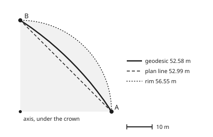

# Geodesic on a surface: the straightest path an inhabitant can walk

[Syllabus](../../../SYLLABUS.md) → [Differential geometry and Lie groups](../README.md) → [Surfaces](../README.md#s02) → Geodesic on a surface

---

## General Overview

A stadium roof is domed over its east end. The dome is half of a cap cut from a sphere of radius 60 m. It rises 12 m above its rim, a level semicircle of radius 36 m; its other edge is a straight cut running north to south over the crown. A rigger carries a safety line from fixing A on the rim, due east of the dome's axis, to fixing B, due north of it, where the rim meets the cut: a quarter turn round the rim.

Three walks suggest themselves:

- **Follow the rim.** It stays level, and it is 56.55 m long.
- **Follow the straight line on the architect's plan.** On the plan it is 50.91 m. Lifted onto the curved roof it is 52.99 m, and it climbs 6.33 m above the rim.
- **Walk the geodesic.** It is 52.58 m long, the shortest of the three, and it climbs only 5.01 m.

The geodesic is the walk a rigger makes by never steering. Each step goes straight ahead along the roof, turning neither left nor right. The path still curves in space, because the walker must stay on the roof. But all of that curving is forced by the roof. None of it is chosen.

Steering has a size, the **geodesic curvature** $`\kappa_g`$ (kappa g): how fast the walker turns left along the roof, in radians per metre walked. To stay on the rim the rigger must keep turning left, toward the crown, at $`\kappa_g = 1/45`$ per metre. The geodesic needs $`\kappa_g = 0`$ all the way.

**A geodesic is a path on a surface with zero geodesic curvature: it never turns sideways within the surface, so all its bending belongs to the surface, and over short stretches it is the shortest path.**

**What kind of fact this is:** a definition, plus three theorems proved on this card in Why it works: the split of a path's curvature into a steering part and a forced part, the geodesic equations on a surface of revolution, and Clairaut's relation. All three are local. That a geodesic is the shortest path over short stretches is stated, not proved here; Pressley proves it in chapter 9 (Sources). That it can fail over long stretches is shown with numbers in What breaks.

### The picture: three walks from A to B, seen from above

<p align="center"></p>

Scale: 5 drawing units per metre. A plan point $`x`$ metres east and $`y`$ metres north of the dome's axis sits at $`40 + 5x`$ across and $`220 - 5y`$ down.

The geodesic bows outward from the plan line. At its middle it passes 28.11 m from the axis; the plan line passes 25.46 m from it. Staying farther out means less climbing, and the geodesic saves 0.41 m on the plan line and 3.97 m on the rim.

---

## The formula

A path on the roof is walked at unit speed: $`s`$ is the distance walked, in metres, and a prime means the rate of change per metre walked, as on the curves shelf. $`\mathbf{T}`$ is the unit tangent, the direction of travel. $`\mathbf{n}`$ is the roof's unit normal, the arrow of length 1 standing straight out of the roof ([Regular surface](01-regular-surfaces-and-tangent-planes.md)).

The rate $`\mathbf{T}'`$ is how fast the direction changes. It has two parts:

```math
\mathbf{T}' = \kappa_g\,(\mathbf{n} \times \mathbf{T}) + \kappa_n\,\mathbf{n}, \qquad \kappa^2 = \kappa_g^2 + \kappa_n^2 .
```

**Read it aloud:** "the turning of a path splits into a sideways part along the roof, the geodesic curvature, and an up-or-down part along the normal, the normal curvature; their squares add to the square of the total curvature."

Here $`\mathbf{n} \times \mathbf{T}`$ points to the walker's left, along the roof. The normal curvature $`\kappa_n`$ is the bending the roof forces in that direction ([Point types](06-classification-of-surface-points.md)). A **geodesic** is a path with $`\kappa_g = 0`$ at every point.

On a **surface of revolution** (a profile curve spun round an axis, like the dome) use two coordinates. $`\sigma`$ (sigma) is the distance from the crown, measured down the slope along a meridian, the line of steepest slope. $`\theta`$ is the turn about the axis, from A toward B. The distance from the axis is $`r(\sigma)`$. The first fundamental form is $`ds^2 = d\sigma^2 + r^2\,d\theta^2`$ ([First fundamental form](02-first-fundamental-form.md)). The geodesic equations are

```math
\sigma'' = r\,r_\sigma\,\theta'^2, \qquad \left(r^2\,\theta'\right)' = 0, \qquad \text{so} \qquad r \sin\psi = c .
```

**Read it aloud:** "the walk accelerates down the slope in proportion to how fast it circles the axis; the distance from the axis squared times the turn rate never changes; so the distance from the axis times the sine of the angle from straight uphill is a constant."

Here $`\psi`$ (psi) is the walk's angle from straight uphill, and $`c`$ is a constant fixed by where and how the walk starts.

The last form is **Clairaut's relation**. On the dome, $`\sigma = R\varphi`$ and $`r = R\sin\varphi`$, so $`r_\sigma = \cos\varphi`$, and the equations become

```math
\varphi'' = \sin\varphi\cos\varphi\;\theta'^2, \qquad \theta'' = -2\cot\varphi\;\varphi'\,\theta' .
```

| Symbol | Plain meaning | In our example | Push it up and the answer… |
| --- | --- | --- | --- |
| $`R`$, $`\varphi_0`$ | the sphere's radius; the rim's angle down from the crown | 60 m; 36.869898°, or 0.643501 rad | flatter dome; wider rim |
| $`\varphi`$, $`\theta`$ | the dome chart: angle down from the crown, as on the globe; turn about the axis from A | A is (36.87°, 0°), B is (36.87°, 90°) | — |
| $`s`$, prime | metres walked; rate per metre walked | 0 to 52.58 m | — |
| $`\mathbf{T}`$, $`\mathbf{n}`$ | unit direction of travel; unit normal, out of the roof | — | — |
| $`\kappa_g`$ | geodesic curvature: sideways turning along the roof, radians per metre, positive to the left | rim 0.022222 = 1/45; plan line −0.007809 at its middle; geodesic 0 | the walker steers harder |
| $`\kappa_n`$, $`K`$ | normal curvature: bending along $`\mathbf{n}`$, radians per metre; the roof's Gaussian curvature, per m² | −0.016667 = −1/60 for every path on the dome; $`K = 1/R^2`$ = 1/3600 | — |
| $`\kappa`$ | total curvature of the path in space | rim 0.027778 = 1/36 | — |
| $`\sigma`$, $`r`$, $`r_\sigma`$ | distance from the crown down a meridian; distance from the axis; its rate down the meridian | at the rim: $`r`$ = 36 m, $`r_\sigma`$ = 0.8 | — |
| $`\psi`$ | the walk's angle from straight uphill (psi) | geodesic leaves A at 51.340192°; plan line at 38.6598°; rim 90° | the walk circles more, climbs less |
| $`c`$ | Clairaut's constant, the closest the geodesic comes to the axis | 28.111277 m | the geodesic stays lower |
| $`h`$ | Euler's step, in metres walked | 0.5 m and 0.05 m; 0.005 m and 0.0005 m in What breaks | bigger error |
| $`L`$, $`\mathcal{L}`$ | the walk's length; its energy, half the squared speed added up along the walk | geodesic 52.577884 m | — |

### When it holds

- **The surface is smooth along the path.** Where the dome meets the saddle in a crease, $`\mathbf{n}`$ jumps and $`\kappa_g`$ has no value at the crease. Solve on each side and join the pieces there.
- **The path is walked at constant speed.** The equations above use metres walked as the clock. With a clock that speeds up, the same route satisfies equations with extra terms.
- **Shortest holds only over short stretches.** The great circle from A the long way round the full sphere to B is also a geodesic, 324.41 m long, and far from shortest.
- **Clairaut's relation needs a surface of revolution and $`\cos\psi \neq 0`$.** On the rim, $`\psi = 90°`$ and $`r\sin\psi = 36`$ m stays constant, yet the rim is no geodesic. On the saddle there is no axis, so no such constant: its geodesic equations need the Christoffel symbols of [Levi-Civita connection](../05-Riemannian%20Geometry/02-levi-civita-connection-and-christoffel-symbols.md).

---

## Why it works

### Step 0: straight means no sideways turning

A walker on a roof cannot help curving up and down with it. That bending is the roof's. What the walker controls is the sideways turn, felt underfoot. A path is as straight as the roof allows when its sideways turn is zero. Everything below measures that sideways turn and sets it to zero.

### Step 1: split the turning into steering and forcing

At unit speed, $`\mathbf{T}\cdot\mathbf{T} = 1`$. Its rate is $`2\,\mathbf{T}\cdot\mathbf{T}' = 0`$, so $`\mathbf{T}'`$ is perpendicular to $`\mathbf{T}`$. Two unit arrows are perpendicular to $`\mathbf{T}`$ and to each other: $`\mathbf{n}`$, out of the roof, and $`\mathbf{n}\times\mathbf{T}`$, to the left along it. So $`\mathbf{T}'`$ is a sum of those two, with sizes

```math
\kappa_g = \mathbf{T}'\cdot(\mathbf{n}\times\mathbf{T}), \qquad \kappa_n = \mathbf{T}'\cdot\mathbf{n} .
```

The total curvature $`\kappa = |\mathbf{T}'|`$ then obeys Pythagoras: $`\kappa^2 = \kappa_g^2 + \kappa_n^2`$.

On the dome the forced part is the same for every path. A point $`\mathbf{X}`$ on the sphere has $`\mathbf{X}\cdot\mathbf{X} = R^2`$. One rate gives $`\mathbf{X}\cdot\mathbf{T} = 0`$; a second gives $`1 + \mathbf{X}\cdot\mathbf{T}' = 0`$. With $`\mathbf{n} = \mathbf{X}/R`$, that is $`\kappa_n = -1/R = -1/60`$ per metre. The minus sign says the path bends down, away from $`\mathbf{n}`$.

The rim is a circle of radius 36 m, so $`\kappa = 1/36`$. Then $`\kappa_g^2 = 1/36^2 - 1/60^2 = 1/45^2`$. Walking from A to B, the rim bends left, toward the crown, so $`\kappa_g = +1/45`$ per metre.

### Step 2: a great circle never steers

A **great circle** is the circle a plane through the sphere's centre cuts from the sphere. Its radius is $`R`$ and its centre is the sphere's centre. So its $`\mathbf{T}'`$ points straight at the centre, along $`-\mathbf{n}`$, with no sideways part: $`\kappa_g = 0`$. Great circles are the dome's geodesics.

The plane through the centre, A and B cuts the great circle

```math
\tan\varphi = \frac{0.75}{\cos\theta + \sin\theta}, \qquad L = R\,\arccos\!\left(\frac{\mathbf{A}\cdot\mathbf{B}}{R^2}\right),
```

where $`L`$ is the walk's length, $`R`$ times the angle at the sphere's centre between A and B.

The first formula is that plane written in the dome chart. Measure from the sphere's centre, with $`x`$ east, $`y`$ north and $`z`$ up. The plane passes through the centre and through (0.6, 0, 0.8) and (0, 0.6, 0.8), the tips of the unit arrows to A and B, so it is $`z = (x + y)/0.75`$. On the sphere $`x = R\sin\varphi\cos\theta`$, $`y = R\sin\varphi\sin\theta`$ and $`z = R\cos\varphi`$, so $`0.75\cos\varphi = \sin\varphi\,(\cos\theta + \sin\theta)`$, which rearranges to the formula.

### Step 3: the equations come from the Euler-Lagrange test

[The Euler-Lagrange equation](../../08-Differential%20equations%20and%20dynamics/12-Calculus%20of%20Variations%20and%20Optimal%20Control/01-functionals-and-the-euler-lagrange-equation.md) finds the cheapest cable route by demanding that every small nudge leave the cost unchanged. Here the cost is the walker's energy, half the squared speed added up along the walk:

```math
\mathcal{L} = \tfrac12\left(\sigma'^2 + r(\sigma)^2\,\theta'^2\right).
```

Minimising energy picks the same routes as minimising length, walked at constant speed, and avoids square roots. The Euler-Lagrange test for $`\sigma`$ gives $`\sigma'' - r\,r_\sigma\,\theta'^2 = 0`$. The energy has no $`\theta`$ in it, only $`\theta'`$, so the test for $`\theta`$ says $`r^2\theta'`$ never changes. These are the geodesic equations. For the dome, put $`\sigma = R\varphi`$ and $`r = R\sin\varphi`$.

### Step 4: Clairaut's relation is the steering test in disguise

At unit speed the walk's velocity has a part up the meridian, $`\cos\psi`$, and a part round the axis, $`r\theta' = \sin\psi`$. So the constant $`r^2\theta'`$ is $`r\sin\psi`$: Clairaut's relation.

A direct computation, in the fold, gives the steering of any walk on a surface of revolution:

```math
\kappa_g = -\psi' + \frac{r_\sigma}{r}\,\sin\psi, \qquad \left(r\sin\psi\right)' = -\,r\cos\psi\;\kappa_g .
```

So $`r\sin\psi`$ stays constant exactly when $`\kappa_g = 0`$, wherever $`\cos\psi \neq 0`$. On the rim, $`\psi`$ stays at 90°, and the formula gives $`\kappa_g = r_\sigma/r = 0.8/36 = 1/45`$, as in Step 1.

An inhabitant can measure that last number with a tape alone, never leaving the sphere the dome is cut from. A full level ring at distance $`r`$ from the axis has circumference $`C = 2\pi r`$, so $`r_\sigma / r`$ is the rate the circumference grows per metre down the slope, divided by the circumference. Taping two full rings on the sphere, 1 m either side of the rim along the slope, gives 0.022221 per metre. Rings 0.1 m either side give 0.022222.

<details>
<summary>Detailed proof: the steering formula on a surface of revolution</summary>

Write the surface as $`\mathbf{X}(\sigma, \theta) = (r\cos\theta,\ r\sin\theta,\ z(\sigma))`$ with $`r_\sigma^2 + z_\sigma^2 = 1`$, so $`\sigma`$ is distance along the meridian. Take the unit arrows $`\mathbf{e}_\sigma = \mathbf{X}_\sigma`$ (down the slope), $`\mathbf{e}_\theta = (-\sin\theta, \cos\theta, 0)`$ (round the axis), $`\mathbf{u} = -\mathbf{e}_\sigma`$ (uphill), and $`\mathbf{n} = \mathbf{e}_\sigma \times \mathbf{e}_\theta`$.

A walk at angle $`\psi`$ from uphill has

$`\displaystyle \mathbf{T} = \cos\psi\,\mathbf{u} + \sin\psi\,\mathbf{e}_\theta, \qquad \mathbf{n}\times\mathbf{T} = \sin\psi\,\mathbf{u} - \cos\psi\,\mathbf{e}_\theta .`$

Differentiate $`\mathbf{T}`$ along the walk and dot with $`\mathbf{n}\times\mathbf{T}`$. Three facts do the work:

- The $`\psi'`$ terms give $`-\psi'`$.
- $`\partial_\sigma \mathbf{e}_\sigma`$ is perpendicular to $`\mathbf{e}_\sigma`$ (unit length) and to $`\mathbf{e}_\theta`$ (it has no $`\mathbf{e}_\theta`$ part), and $`\partial_\theta \mathbf{e}_\sigma = r_\sigma\,\mathbf{e}_\theta`$. So $`\mathbf{u}'\cdot(\mathbf{n}\times\mathbf{T}) = r_\sigma\,\theta'\cos\psi`$.
- $`\mathbf{e}_\theta' = \theta'(-\cos\theta, -\sin\theta, 0)`$, whose dot with $`\mathbf{u}`$ is $`r_\sigma\,\theta'`$. So $`\mathbf{e}_\theta'\cdot(\mathbf{n}\times\mathbf{T}) = r_\sigma\,\theta'\sin\psi`$.

Adding, with weights $`\cos\psi`$ and $`\sin\psi`$:

$`\displaystyle \kappa_g = -\psi' + r_\sigma\,\theta'\,(\cos^2\psi + \sin^2\psi) = -\psi' + \frac{r_\sigma}{r}\sin\psi .`$

For Clairaut, use $`\sigma' = -\cos\psi`$ (the walk climbs at rate $`\cos\psi`$):

$`\displaystyle (r\sin\psi)' = r_\sigma\,\sigma'\sin\psi + r\cos\psi\,\psi' = -r\cos\psi\left(\frac{r_\sigma}{r}\sin\psi - \psi'\right) = -r\cos\psi\;\kappa_g .`$

</details>

### Step 5: solve the equations by stepping

The equations need a start: the point A and a start angle $`\psi`$. The angle is not known in advance. **Shooting** finds it: guess an angle, step the equations until the walk has turned 90° about the axis, and see whether it lands on the rim. Too uphill, and it lands above B; too flat, and it lands below. Halving the gap between the two guesses 60 times pins the angle.

Each step is [Euler's method](../../08-Differential%20equations%20and%20dynamics/05-Numerical%20Evolution/01-eulers-method.md) on four numbers, $`\varphi`$, $`\theta`$, $`\varphi'`$ and $`\theta'`$: move each along its current rate for $`h`$ metres. Steps of 0.5 m give a start angle of 51.834592°, which is 0.494400° above Clairaut's exact 51.340192° (Worked numbers). Steps of 0.05 m give 51.389538°, 0.049347° above it. A step ten times smaller gives an error 10.02 times smaller, as Euler's method promises.

Euler's steps let the speed drift slightly above 1, so each step covers a little more than $`h`$ metres. The code therefore measures each step along the sphere. The two stepped walks come to 52.577981 m and 52.577886 m, a hair over the closed form's 52.577884 m.

---

## Worked numbers, by hand

Measure from the sphere's centre, with $`x`$ east, $`y`$ north and $`z`$ up. The unit arrows to A and B are $`\mathbf{A}/R = (0.6, 0, 0.8)`$ and $`\mathbf{B}/R = (0, 0.6, 0.8)`$, because $`\sin\varphi_0 = 0.6`$ and $`\cos\varphi_0 = 0.8`$:

| Step | Arithmetic | Value |
| --- | --- | --- |
| rim radius | $`60 \times 0.6`$ | 36 m |
| cosine of the angle at the centre | $`0.6 \times 0 + 0 \times 0.6 + 0.8 \times 0.8`$ | 0.640000 |
| angle at the centre | $`\arccos 0.64`$ | 0.876298 rad |
| geodesic length | $`60 \times 0.876298`$ | **52.577884 m** |
| top of the walk, halfway round | $`\tan\varphi = 0.75/\sqrt2`$ | 0.530330 |
| distance from axis there | $`\sin\varphi = 0.468521`$, times 60 | $`c`$ = 28.111277 m |
| start angle at A | $`\sin\psi = 28.111277/36 = 0.780869`$ | 51.340192° |
| top above the rim | $`60\cos\varphi - 48`$ | 5.007133 m |
| rim's steering | $`\cot\varphi_0 / R = 1.333333/60`$ | 0.022222 per metre |
| check by Pythagoras | $`\sqrt{(1/45)^2 + (1/60)^2}`$ | 0.027778 = 1/36 |

The rigger walks 52.58 m by leaving A at 51.34° from straight uphill and never steering. The walk tops out 5.01 m above the rim, 28.11 m from the axis, and meets the rim again exactly at B.

### What breaks if you drop a piece

Same roof, correct answer 52.58 m.

| Mistake | Comes out at | What went wrong |
| --- | --- | --- |
| Walk the straight plan line | 52.986635 m, climbing 6.33 m | it steers: $`\kappa_g = -0.007809`$ per metre at its middle |
| Follow the level rim | 56.548668 m | it steers left at 1/45 per metre the whole way |
| Leave A at the plan line's angle, 38.66°, and never steer | lands 11.76 m uphill of B | a wrong start angle gives a different geodesic, another great circle |
| Leave A at the right angle, 51.34°, but drop the term $`-2\cot\varphi\,\varphi'\theta'`$ | lands 15.32 m uphill of B (Euler steps of 0.005 m and 0.0005 m give 15.326093 m and 15.324328 m) | the turn rate must rise near the top; this is the term that keeps $`r^2\theta'`$ fixed |
| Go the long way round the full sphere | 324.413235 m | still a geodesic, but shortest only over short stretches |

Every number in that table is printed by the code below.

---

## Code, from first principles, and it actually runs

The code takes **three independent roads** to the geodesic. Road 1 is the closed form: the great circle through A and B. Road 2 steps the geodesic equations by Euler's method, shooting for the start angle at two step sizes and measuring each stepped walk along the sphere. Road 3 never uses an equation: a string of 16, then 64, straight pieces is pulled tight on the dome, each joint moved to the midpoint of its neighbours and pushed back onto the sphere. The steering $`\kappa_g`$ is measured two ways: from the path in space by central differences (two nearby points, subtracted), and by an inhabitant taping two rings. In What breaks, the walk from the wrong start angle is another great circle, so its landing comes in closed form; the walk without the cross term is stepped at two step sizes. A last check previews the next card: steering, corners and curvature on the patch between rim and geodesic add to 360°.

### Python

```python
# Geodesics on surfaces -- the check behind the card.  Standard library only.
# Dome: part of a sphere, radius R = 60 m, rising 12 m above a rim of radius 36 m.
# Walk: from A (rim, due east of the axis) to B (rim, due north), a quarter turn apart.
# Chart: phi = angle down from the crown, theta = turn about the axis from A toward B.
from math import sin, cos, tan, atan, acos, asin, sqrt, pi, degrees, radians
R, PHI0 = 60.0, acos(0.8)                     # rim at phi0: radius 36 m, 48 m above the centre

def X(phi, th):                               # chart to space; heights from the sphere's centre
    return (R * sin(phi) * cos(th), R * sin(phi) * sin(th), R * cos(phi))
def add(a, b, k=1.0): return tuple(x + k * y for x, y in zip(a, b))
def dot(a, b): return sum(x * y for x, y in zip(a, b))
def cross(a, b): return (a[1] * b[2] - a[2] * b[1], a[2] * b[0] - a[0] * b[2], a[0] * b[1] - a[1] * b[0])
def norm(a): return sqrt(dot(a, a))
def lift(x, y): return (x, y, sqrt(R * R - x * x - y * y))   # plan chart to space

def geo(th):                                   # road 1: closed form, great circle through A and B
    return atan(0.75 / (cos(th) + sin(th)))    # phi on the geodesic at turn th
def closed_len(): return R * acos(dot(X(PHI0, 0), X(PHI0, pi / 2)) / R ** 2)

def euler(psi, h, cross_term=True):            # road 2: geodesic equations, Euler steps of h metres
    p, t = PHI0, 0.0                           # psi = start angle from straight uphill
    dp, dt = -cos(psi) / R, sin(psi) / (R * sin(PHI0))
    s = 0.0                                    # length walked, each step measured along the sphere
    while t < pi / 2:
        ddp = sin(p) * cos(p) * dt * dt
        ddt = -2 * cos(p) / sin(p) * dp * dt if cross_term else 0.0
        p0, t0 = p, t
        p, t, dp, dt = p + h * dp, t + h * dt, dp + h * ddp, dt + h * ddt
        step = 2 * R * asin(norm(add(X(p, t), X(p0, t0), -1)) / (2 * R)); s += step
    f = (pi / 2 - t0) / (t - t0)               # interpolate to theta = 90 degrees
    return s - step + f * step, p0 + f * (p - p0)

def gc_land(psi):                              # closed form for a wrong start: the great circle leaving A at psi
    sg = atan(tan(PHI0) / cos(psi))            # angle at the centre walked to reach theta = 90 degrees
    return acos(cos(PHI0) * cos(sg) + cos(psi) * sin(PHI0) * sin(sg))

def shoot(h):                                  # find the start angle that lands on the rim at B
    lo, hi = radians(30), radians(80)
    for _ in range(60):
        mid = (lo + hi) / 2
        lo, hi = (mid, hi) if euler(mid, h)[1] < PHI0 else (lo, mid)
    return mid, euler(mid, h)[0]

def taut(n, sweeps):                           # road 3: a string of n pieces pulled tight on the dome
    pts = [lift(36 * (1 - k / n), 36 * k / n) for k in range(n + 1)]
    for _ in range(sweeps):
        for i in range(1, n):
            m = add(pts[i - 1], pts[i + 1])
            pts[i] = tuple(R * x / norm(m) for x in m)
    return sum(norm(add(b, a, -1)) for a, b in zip(pts, pts[1:])), pts[n // 2][2] - 48

def chord_len(curve, n=40000):
    pts = [curve(k / n) for k in range(n + 1)]
    return sum(norm(add(b, a, -1)) for a, b in zip(pts, pts[1:]))

def curv(curve, t, d=1e-4):                    # kappa_g and kappa_n of a space curve at t
    a, b, c = curve(t - d), curve(t), curve(t + d)
    v, acc = add(c, a, -1), add(add(c, b, -2), a)
    v, acc = tuple(x / (2 * d) for x in v), tuple(x / (d * d) for x in acc)
    n = tuple(x / R for x in b)                # outward unit normal of the sphere
    return dot(n, cross(v, acc)) / norm(v) ** 3, dot(n, acc) / dot(v, v)

rim = lambda t: X(PHI0, t * pi / 2)
plan = lambda t: lift(36 * (1 - t), 36 * t)
gpath = lambda t: X(geo(t * pi / 2), t * pi / 2)
L = closed_len()
c = R * sin(geo(pi / 4))                       # Clairaut constant: r sin(psi), r at the top
psi_c = asin(c / 36)
(ps1, L1), (ps2, L2) = shoot(0.5), shoot(0.05)
T16, T64 = taut(16, 400), taut(64, 6000)
kg_rim, kn_rim = curv(rim, 0.5)
kg_geo, kn_geo = curv(gpath, 0.3)
kg_pl, kn_pl = curv(plan, 0.5)
def ring(dist):                                # inhabitant's road: tape two rings dist m up and down
    C = lambda ph: 2 * pi * R * sin(ph)
    return (C(PHI0 + dist / R) - C(PHI0 - dist / R)) / (2 * dist) / C(PHI0)
nS = 200                                       # Gauss-Bonnet preview: area between rim and geodesic
area = R * R * sum((1 if k in (0, nS) else 4 if k % 2 else 2) * (cos(geo(k * pi / 2 / nS)) - 0.8)
                   for k in range(nS + 1)) * (pi / 2 / nS) / 3
alpha = pi / 2 - psi_c                         # corner angle between rim and geodesic at A and B
v0 = add(plan(1e-6), plan(-1e-6), -1)         # the plan line's start angle on the dome,
up = add(X(PHI0 - 1e-6, 0), X(PHI0 + 1e-6, 0), -1)  # measured from straight uphill
wrong_psi = acos(dot(v0, up) / (norm(v0) * norm(up)))
miss = lambda ph: R * (PHI0 - ph)              # metres uphill of B

rows = [
    ("rim radius, crown above rim, m", f"{R * sin(PHI0):.6f} {R - R * cos(PHI0):.6f}"),
    ("rim angle phi0 from the crown, deg, rad", f"{degrees(PHI0):.6f} {PHI0:.6f}"),
    ("hand: cos AOB, angle AOB rad, cot phi0", f"{dot(X(PHI0, 0), X(PHI0, pi / 2)) / R ** 2:.6f} {L / R:.6f} {cos(PHI0) / sin(PHI0):.6f}"),
    ("hand: tan, sin of phi at top; sin psi", f"{tan(geo(pi / 4)):.6f} {sin(geo(pi / 4)):.6f} {c / 36:.6f}"),
    ("1 geodesic length, closed form, m", f"{L:.6f}"),
    ("2 Euler h = 0.5 m: start angle deg, length", f"{degrees(ps1):.6f} {L1:.6f}"),
    ("  Euler h = 0.05 m: start angle deg, length", f"{degrees(ps2):.6f} {L2:.6f}"),
    ("  start angle errors, deg; ratio", f"{degrees(ps1 - psi_c):.6f} {degrees(ps2 - psi_c):.6f} {(ps1 - psi_c) / (ps2 - psi_c):.2f}"),
    ("3 taut string 16 pieces: length, top", f"{T16[0]:.6f} {T16[1]:.6f}"),
    ("  taut string 64 pieces: length, top", f"{T64[0]:.6f} {T64[1]:.6f}"),
    ("  closed-form curve taped in 40000 pieces", f"{chord_len(gpath):.6f}"),
    ("Clairaut constant c, m", f"{c:.6f}"),
    ("start angle from Clairaut, deg; tan", f"{degrees(psi_c):.6f} {tan(psi_c):.6f}"),
    ("geodesic top above rim, m", f"{R * cos(geo(pi / 4)) - 48:.6f}"),
    ("rim walk, m", f"{chord_len(rim):.6f}"),
    ("plan-straight walk, m; top above rim", f"{chord_len(plan):.6f} {plan(0.5)[2] - 48:.6f}"),
    ("plan line on the plan, m; nearest axis", f"{36 * sqrt(2):.6f} {18 * sqrt(2):.6f}"),
    ("geodesic saves vs rim, vs plan line, m", f"{chord_len(rim) - L:.6f} {chord_len(plan) - L:.6f}"),
    ("kappa_g, kappa_n on rim, 1/m", f"{kg_rim:.6f} {kn_rim:.6f}"),
    ("  1/45, -1/60, 1/36", f"{1 / 45:.6f} {-1 / 60:.6f} {1 / 36:.6f}"),
    ("  sqrt(kg^2 + kn^2) on rim", f"{sqrt(kg_rim ** 2 + kn_rim ** 2):.6f}"),
    ("  rings 1 m and 0.1 m apart, 1/m", f"{ring(1.0):.6f} {ring(0.1):.6f}"),
    ("|kappa_g|, kappa_n on geodesic, 1/m", f"{abs(kg_geo):.6f} {kn_geo:.6f}"),
    ("kappa_g, kappa_n mid plan line, 1/m", f"{kg_pl:.6f} {kn_pl:.6f}"),
    ("plan line start angle, deg", f"{degrees(wrong_psi):.4f}"),
    ("wrong: plan line start, uphill of B, m", f"{miss(gc_land(wrong_psi)):.6f}"),
    ("wrong: drop cross term, h = 0.005, 0.0005 m", f"{miss(euler(psi_c, 0.005, False)[1]):.6f} {miss(euler(psi_c, 0.0005, False)[1]):.6f}"),
    ("breaks: long way round, m", f"{2 * pi * R - L:.6f}"),
    ("rim turning, integral kappa_g ds, deg", f"{degrees(kg_rim * 18 * pi):.6f}"),
    ("corner angle at A and B; turn there, deg", f"{degrees(alpha):.6f} {180 - degrees(alpha):.6f}"),
    ("K times area, deg", f"{degrees(area / R ** 2):.6f}"),
    ("area rim to geodesic, Simpson, m^2", f"{area:.6f}"),
    ("  R^2 (2 alpha - turning), m^2", f"{R * R * (2 * alpha - kg_rim * 18 * pi):.6f}"),
    ("try: B 120 deg round: geodesic, rim, m", f"{R * acos(0.36 * cos(2 * pi / 3) + 0.64):.6f} {24 * pi:.6f}"),
    ("try: B opposite A: geodesic, rim, m", f"{2 * R * PHI0:.6f} {36 * pi:.6f}"),
    ("try: R = 100 m dome, rim kappa_g, 1/m", f"{sqrt(100 ** 2 - 36 ** 2) / (100 * 36):.6f}"),
]
for name, v in rows:
    print(f"{name:<44} {v}")
fig = [(40 + 5 * R * sin(geo(t)) * cos(t), 220 - 5 * R * sin(geo(t)) * sin(t))
       for t in (k * pi / 24 for k in range(13))]
print("figure, geodesic", " ".join(f"{x:.1f},{y:.1f}" for x, y in fig))

assert 9 < (ps1 - psi_c) / (ps2 - psi_c) < 11 and 0 < L2 - L < 1e-5, "Euler closes in: first order in h, length just over L"
assert abs(ps2 - psi_c) < radians(0.2) and abs(gc_land(psi_c) - PHI0) < 1e-12, "shooting and the great circle find Clairaut's angle"
assert 0 < L - T64[0] < (L - T16[0]) / 10, "the taut string tightens onto the geodesic"
assert abs(kg_rim - 1 / 45) < 1e-6 and abs(ring(0.1) - 1 / 45) < 1e-5, "rim turns at 1/45 per metre"
assert abs(kg_rim ** 2 + kn_rim ** 2 - 1 / 36 ** 2) < 1e-8 and abs(kn_geo + 1 / R) < 1e-6, "kappa^2 = kg^2 + kn^2"
assert abs(kg_geo) < 1e-6 < abs(kg_pl), "the geodesic does not steer; the plan line does"
assert L < chord_len(plan) < chord_len(rim), "the geodesic is the shortest of the three"
assert abs(area - R * R * (2 * alpha - kg_rim * 18 * pi)) < 1e-3, "Gauss-Bonnet preview"
print("ALL CHECKS PASS")
```

**Ran 2026-11-19 on macOS, Python 3.14.10, standard library only. All checks passed. Output, pasted from the run:**

```
rim radius, crown above rim, m               36.000000 12.000000
rim angle phi0 from the crown, deg, rad      36.869898 0.643501
hand: cos AOB, angle AOB rad, cot phi0       0.640000 0.876298 1.333333
hand: tan, sin of phi at top; sin psi        0.530330 0.468521 0.780869
1 geodesic length, closed form, m            52.577884
2 Euler h = 0.5 m: start angle deg, length   51.834592 52.577981
  Euler h = 0.05 m: start angle deg, length  51.389538 52.577886
  start angle errors, deg; ratio             0.494400 0.049347 10.02
3 taut string 16 pieces: length, top         52.571313 5.007133
  taut string 64 pieces: length, top         52.577473 5.007135
  closed-form curve taped in 40000 pieces    52.577884
Clairaut constant c, m                       28.111277
start angle from Clairaut, deg; tan          51.340192 1.250000
geodesic top above rim, m                    5.007133
rim walk, m                                  56.548668
plan-straight walk, m; top above rim         52.986635 6.332311
plan line on the plan, m; nearest axis       50.911688 25.455844
geodesic saves vs rim, vs plan line, m       3.970784 0.408751
kappa_g, kappa_n on rim, 1/m                 0.022222 -0.016667
  1/45, -1/60, 1/36                          0.022222 -0.016667 0.027778
  sqrt(kg^2 + kn^2) on rim                   0.027778
  rings 1 m and 0.1 m apart, 1/m             0.022221 0.022222
|kappa_g|, kappa_n on geodesic, 1/m          0.000000 -0.016667
kappa_g, kappa_n mid plan line, 1/m          -0.007809 -0.016667
plan line start angle, deg                   38.6598
wrong: plan line start, uphill of B, m       11.758868
wrong: drop cross term, h = 0.005, 0.0005 m  15.326093 15.324328
breaks: long way round, m                    324.413235
rim turning, integral kappa_g ds, deg        72.000000
corner angle at A and B; turn there, deg     38.659808 141.340192
K times area, deg                            5.319617
area rim to geodesic, Simpson, m^2           334.241362
  R^2 (2 alpha - turning), m^2               334.241349
try: B 120 deg round: geodesic, rim, m       65.568068 75.398224
try: B opposite A: geodesic, rim, m          77.220133 113.097336
try: R = 100 m dome, rim kappa_g, 1/m        0.025915
figure, geodesic 220.0,220.0 205.3,198.2 191.3,179.5 178.0,162.8 165.0,147.8 152.3,133.9 139.4,120.6 126.1,107.7 112.2,95.0 97.2,82.0 80.5,68.7 61.8,54.7 40.0,40.0
ALL CHECKS PASS
```

### Rust

```rust
// Geodesics on surfaces -- the check behind the card.  std only, no crates.
// Dome: part of a sphere, radius R = 60 m, rising 12 m above a rim of radius 36 m.
// Walk: from A (rim, due east of the axis) to B (rim, due north), a quarter turn apart.
// Chart: phi = angle down from the crown, theta = turn about the axis from A toward B.
use std::f64::consts::PI;
type V3 = [f64; 3];
const R: f64 = 60.0;

fn phi0() -> f64 { 0.8f64.acos() } // rim at phi0: radius 36 m, 48 m above the centre
fn x(phi: f64, th: f64) -> V3 { [R * phi.sin() * th.cos(), R * phi.sin() * th.sin(), R * phi.cos()] }
fn add(a: V3, b: V3, k: f64) -> V3 { [a[0] + k * b[0], a[1] + k * b[1], a[2] + k * b[2]] }
fn dot(a: V3, b: V3) -> f64 { a[0] * b[0] + a[1] * b[1] + a[2] * b[2] }
fn cross(a: V3, b: V3) -> V3 {
    [a[1] * b[2] - a[2] * b[1], a[2] * b[0] - a[0] * b[2], a[0] * b[1] - a[1] * b[0]]
}
fn norm(a: V3) -> f64 { dot(a, a).sqrt() }
fn lift(x: f64, y: f64) -> V3 { [x, y, (R * R - x * x - y * y).sqrt()] } // plan chart to space

// road 1: closed form, great circle through A and B; phi on the geodesic at turn th
fn geo(th: f64) -> f64 { (0.75 / (th.cos() + th.sin())).atan() }
fn closed_len() -> f64 { R * (dot(x(phi0(), 0.0), x(phi0(), PI / 2.0)) / (R * R)).acos() }

// road 2: geodesic equations, Euler steps of h metres; psi = start angle from straight uphill
fn euler(psi: f64, h: f64, cross_term: bool) -> (f64, f64) {
    let (mut p, mut t) = (phi0(), 0.0);
    let (mut dp, mut dt) = (-psi.cos() / R, psi.sin() / (R * phi0().sin()));
    let (mut s, mut p0, mut t0, mut step) = (0.0, p, t, 0.0); // s: length walked, each step measured along the sphere
    while t < PI / 2.0 {
        let ddp = p.sin() * p.cos() * dt * dt;
        let ddt = if cross_term { -2.0 * p.cos() / p.sin() * dp * dt } else { 0.0 };
        p0 = p; t0 = t;
        p += h * dp; t += h * dt; dp += h * ddp; dt += h * ddt;
        step = 2.0 * R * (norm(add(x(p, t), x(p0, t0), -1.0)) / (2.0 * R)).asin(); s += step;
    }
    let f = (PI / 2.0 - t0) / (t - t0); // interpolate to theta = 90 degrees
    (s - step + f * step, p0 + f * (p - p0))
}
// closed form for a wrong start: the great circle leaving A at psi meets theta = 90 degrees at this phi
fn gc_land(psi: f64) -> f64 { let sg = (phi0().tan() / psi.cos()).atan(); (phi0().cos() * sg.cos() + psi.cos() * phi0().sin() * sg.sin()).acos() }

fn shoot(h: f64) -> (f64, f64) {
    // find the start angle that lands on the rim at B
    let (mut lo, mut hi, mut mid) = (30f64.to_radians(), 80f64.to_radians(), 0.0);
    for _ in 0..60 {
        mid = (lo + hi) / 2.0;
        if euler(mid, h, true).1 < phi0() { lo = mid } else { hi = mid }
    }
    (mid, euler(mid, h, true).0)
}

fn taut(n: usize, sweeps: usize) -> (f64, f64) {
    // road 3: a string of n pieces pulled tight on the dome
    let mut pts: Vec<V3> = (0..=n).map(|k| lift(36.0 * (1.0 - k as f64 / n as f64), 36.0 * k as f64 / n as f64)).collect();
    for _ in 0..sweeps {
        for i in 1..n {
            let m = add(pts[i - 1], pts[i + 1], 1.0);
            let l = norm(m);
            pts[i] = [R * m[0] / l, R * m[1] / l, R * m[2] / l];
        }
    }
    let len: f64 = pts.windows(2).map(|w| norm(add(w[1], w[0], -1.0))).sum();
    (len, pts[n / 2][2] - 48.0)
}

fn chord_len(curve: &dyn Fn(f64) -> V3) -> f64 {
    let n = 40000;
    let pts: Vec<V3> = (0..=n).map(|k| curve(k as f64 / n as f64)).collect();
    pts.windows(2).map(|w| norm(add(w[1], w[0], -1.0))).sum()
}

fn curv(curve: &dyn Fn(f64) -> V3, t: f64) -> (f64, f64) {
    // kappa_g and kappa_n of a space curve at t
    let d = 1e-4;
    let (a, b, c) = (curve(t - d), curve(t), curve(t + d));
    let (v, acc) = (add(c, a, -1.0), add(add(c, b, -2.0), a, 1.0));
    let v = [v[0] / (2.0 * d), v[1] / (2.0 * d), v[2] / (2.0 * d)];
    let acc = [acc[0] / (d * d), acc[1] / (d * d), acc[2] / (d * d)];
    let n = [b[0] / R, b[1] / R, b[2] / R]; // outward unit normal of the sphere
    (dot(n, cross(v, acc)) / norm(v).powi(3), dot(n, acc) / dot(v, v))
}

fn ring(dist: f64) -> f64 {
    // inhabitant's road: tape two rings dist m up and down
    let c = |ph: f64| 2.0 * PI * R * ph.sin();
    (c(phi0() + dist / R) - c(phi0() - dist / R)) / (2.0 * dist) / c(phi0())
}

fn main() {
    let p0 = phi0();
    let rim = |t: f64| x(p0, t * PI / 2.0);
    let plan = |t: f64| lift(36.0 * (1.0 - t), 36.0 * t);
    let gpath = |t: f64| x(geo(t * PI / 2.0), t * PI / 2.0);
    let l = closed_len();
    let c = R * geo(PI / 4.0).sin(); // Clairaut constant: r sin(psi), r at the top
    let psi_c = (c / 36.0).asin();
    let ((ps1, l1), (ps2, l2)) = (shoot(0.5), shoot(0.05));
    let (t16, t64) = (taut(16, 400), taut(64, 6000));
    let (kg_rim, kn_rim) = curv(&rim, 0.5);
    let (kg_geo, kn_geo) = curv(&gpath, 0.3);
    let (kg_pl, kn_pl) = curv(&plan, 0.5);
    let ns = 200; // Gauss-Bonnet preview: area between rim and geodesic
    let mut sm = 0.0;
    for k in 0..=ns {
        let w = if k == 0 || k == ns { 1.0 } else if k % 2 == 1 { 4.0 } else { 2.0 };
        sm += w * (geo(k as f64 * PI / 2.0 / ns as f64).cos() - 0.8);
    }
    let area = R * R * sm * (PI / 2.0 / ns as f64) / 3.0;
    let alpha = PI / 2.0 - psi_c; // corner angle between rim and geodesic at A and B
    let v0 = add(plan(1e-6), plan(-1e-6), -1.0); // the plan line's start angle on the dome,
    let up = add(x(p0 - 1e-6, 0.0), x(p0 + 1e-6, 0.0), -1.0); // measured from straight uphill
    let wrong_psi = (dot(v0, up) / (norm(v0) * norm(up))).acos();
    let miss = |ph: f64| R * (p0 - ph); // metres uphill of B
    let turning = kg_rim * 18.0 * PI;
    let rows: Vec<(&str, String)> = vec![
        ("rim radius, crown above rim, m", format!("{:.6} {:.6}", R * p0.sin(), R - R * p0.cos())),
        ("rim angle phi0 from the crown, deg, rad", format!("{:.6} {:.6}", p0.to_degrees(), p0)),
        ("hand: cos AOB, angle AOB rad, cot phi0", format!("{:.6} {:.6} {:.6}", dot(x(p0, 0.0), x(p0, PI / 2.0)) / (R * R), l / R, p0.cos() / p0.sin())),
        ("hand: tan, sin of phi at top; sin psi", format!("{:.6} {:.6} {:.6}", geo(PI / 4.0).tan(), geo(PI / 4.0).sin(), c / 36.0)),
        ("1 geodesic length, closed form, m", format!("{:.6}", l)),
        ("2 Euler h = 0.5 m: start angle deg, length", format!("{:.6} {:.6}", ps1.to_degrees(), l1)),
        ("  Euler h = 0.05 m: start angle deg, length", format!("{:.6} {:.6}", ps2.to_degrees(), l2)),
        ("  start angle errors, deg; ratio", format!("{:.6} {:.6} {:.2}", (ps1 - psi_c).to_degrees(), (ps2 - psi_c).to_degrees(), (ps1 - psi_c) / (ps2 - psi_c))),
        ("3 taut string 16 pieces: length, top", format!("{:.6} {:.6}", t16.0, t16.1)),
        ("  taut string 64 pieces: length, top", format!("{:.6} {:.6}", t64.0, t64.1)),
        ("  closed-form curve taped in 40000 pieces", format!("{:.6}", chord_len(&gpath))),
        ("Clairaut constant c, m", format!("{:.6}", c)),
        ("start angle from Clairaut, deg; tan", format!("{:.6} {:.6}", psi_c.to_degrees(), psi_c.tan())),
        ("geodesic top above rim, m", format!("{:.6}", R * geo(PI / 4.0).cos() - 48.0)),
        ("rim walk, m", format!("{:.6}", chord_len(&rim))),
        ("plan-straight walk, m; top above rim", format!("{:.6} {:.6}", chord_len(&plan), plan(0.5)[2] - 48.0)),
        ("plan line on the plan, m; nearest axis", format!("{:.6} {:.6}", 36.0 * 2f64.sqrt(), 18.0 * 2f64.sqrt())),
        ("geodesic saves vs rim, vs plan line, m", format!("{:.6} {:.6}", chord_len(&rim) - l, chord_len(&plan) - l)),
        ("kappa_g, kappa_n on rim, 1/m", format!("{:.6} {:.6}", kg_rim, kn_rim)),
        ("  1/45, -1/60, 1/36", format!("{:.6} {:.6} {:.6}", 1.0 / 45.0, -1.0 / 60.0, 1.0 / 36.0)),
        ("  sqrt(kg^2 + kn^2) on rim", format!("{:.6}", (kg_rim * kg_rim + kn_rim * kn_rim).sqrt())),
        ("  rings 1 m and 0.1 m apart, 1/m", format!("{:.6} {:.6}", ring(1.0), ring(0.1))),
        ("|kappa_g|, kappa_n on geodesic, 1/m", format!("{:.6} {:.6}", kg_geo.abs(), kn_geo)),
        ("kappa_g, kappa_n mid plan line, 1/m", format!("{:.6} {:.6}", kg_pl, kn_pl)),
        ("plan line start angle, deg", format!("{:.4}", wrong_psi.to_degrees())),
        ("wrong: plan line start, uphill of B, m", format!("{:.6}", miss(gc_land(wrong_psi)))),
        ("wrong: drop cross term, h = 0.005, 0.0005 m", format!("{:.6} {:.6}", miss(euler(psi_c, 0.005, false).1), miss(euler(psi_c, 0.0005, false).1))),
        ("breaks: long way round, m", format!("{:.6}", 2.0 * PI * R - l)),
        ("rim turning, integral kappa_g ds, deg", format!("{:.6}", turning.to_degrees())),
        ("corner angle at A and B; turn there, deg", format!("{:.6} {:.6}", alpha.to_degrees(), 180.0 - alpha.to_degrees())),
        ("K times area, deg", format!("{:.6}", (area / (R * R)).to_degrees())),
        ("area rim to geodesic, Simpson, m^2", format!("{:.6}", area)),
        ("  R^2 (2 alpha - turning), m^2", format!("{:.6}", R * R * (2.0 * alpha - turning))),
        ("try: B 120 deg round: geodesic, rim, m", format!("{:.6} {:.6}", R * (0.36 * (2.0 * PI / 3.0).cos() + 0.64).acos(), 24.0 * PI)),
        ("try: B opposite A: geodesic, rim, m", format!("{:.6} {:.6}", 2.0 * R * p0, 36.0 * PI)),
        ("try: R = 100 m dome, rim kappa_g, 1/m", format!("{:.6}", (100f64 * 100.0 - 36.0 * 36.0).sqrt() / (100.0 * 36.0))),
    ];
    for (name, v) in &rows { println!("{:<44} {}", name, v); }
    let fig: Vec<String> = (0..13).map(|k| {
        let t = k as f64 * PI / 24.0;
        let r = R * geo(t).sin();
        format!("{:.1},{:.1}", 40.0 + 5.0 * r * t.cos(), 220.0 - 5.0 * r * t.sin())
    }).collect();
    println!("figure, geodesic {}", fig.join(" "));

    assert!(9.0 < (ps1 - psi_c) / (ps2 - psi_c) && (ps1 - psi_c) / (ps2 - psi_c) < 11.0 && 0.0 < l2 - l && l2 - l < 1e-5, "Euler closes in: first order in h, length just over L");
    assert!((ps2 - psi_c).abs() < 0.2f64.to_radians() && (gc_land(psi_c) - p0).abs() < 1e-12, "shooting and the great circle find Clairaut's angle");
    assert!(0.0 < l - t64.0 && l - t64.0 < (l - t16.0) / 10.0, "the taut string tightens onto the geodesic");
    assert!((kg_rim - 1.0 / 45.0).abs() < 1e-6 && (ring(0.1) - 1.0 / 45.0).abs() < 1e-5, "rim turns at 1/45 per metre");
    assert!((kg_rim * kg_rim + kn_rim * kn_rim - 1.0 / (36.0f64 * 36.0)).abs() < 1e-8 && (kn_geo + 1.0 / R).abs() < 1e-6, "kappa^2 = kg^2 + kn^2");
    assert!(kg_geo.abs() < 1e-6 && 1e-6 < kg_pl.abs(), "the geodesic does not steer; the plan line does");
    assert!(l < chord_len(&plan) && chord_len(&plan) < chord_len(&rim), "the geodesic is the shortest of the three");
    assert!((area - R * R * (2.0 * alpha - turning)).abs() < 1e-3, "Gauss-Bonnet preview");
    println!("ALL CHECKS PASS");
}
```

**Ran 2026-11-19 on macOS, rustc 1.98.1, no crates. All checks passed. Output, pasted from the run:**

```
rim radius, crown above rim, m               36.000000 12.000000
rim angle phi0 from the crown, deg, rad      36.869898 0.643501
hand: cos AOB, angle AOB rad, cot phi0       0.640000 0.876298 1.333333
hand: tan, sin of phi at top; sin psi        0.530330 0.468521 0.780869
1 geodesic length, closed form, m            52.577884
2 Euler h = 0.5 m: start angle deg, length   51.834592 52.577981
  Euler h = 0.05 m: start angle deg, length  51.389538 52.577886
  start angle errors, deg; ratio             0.494400 0.049347 10.02
3 taut string 16 pieces: length, top         52.571313 5.007133
  taut string 64 pieces: length, top         52.577473 5.007135
  closed-form curve taped in 40000 pieces    52.577884
Clairaut constant c, m                       28.111277
start angle from Clairaut, deg; tan          51.340192 1.250000
geodesic top above rim, m                    5.007133
rim walk, m                                  56.548668
plan-straight walk, m; top above rim         52.986635 6.332311
plan line on the plan, m; nearest axis       50.911688 25.455844
geodesic saves vs rim, vs plan line, m       3.970784 0.408751
kappa_g, kappa_n on rim, 1/m                 0.022222 -0.016667
  1/45, -1/60, 1/36                          0.022222 -0.016667 0.027778
  sqrt(kg^2 + kn^2) on rim                   0.027778
  rings 1 m and 0.1 m apart, 1/m             0.022221 0.022222
|kappa_g|, kappa_n on geodesic, 1/m          0.000000 -0.016667
kappa_g, kappa_n mid plan line, 1/m          -0.007809 -0.016667
plan line start angle, deg                   38.6598
wrong: plan line start, uphill of B, m       11.758868
wrong: drop cross term, h = 0.005, 0.0005 m  15.326093 15.324328
breaks: long way round, m                    324.413235
rim turning, integral kappa_g ds, deg        72.000000
corner angle at A and B; turn there, deg     38.659808 141.340192
K times area, deg                            5.319617
area rim to geodesic, Simpson, m^2           334.241362
  R^2 (2 alpha - turning), m^2               334.241349
try: B 120 deg round: geodesic, rim, m       65.568068 75.398224
try: B opposite A: geodesic, rim, m          77.220133 113.097336
try: R = 100 m dome, rim kappa_g, 1/m        0.025915
figure, geodesic 220.0,220.0 205.3,198.2 191.3,179.5 178.0,162.8 165.0,147.8 152.3,133.9 139.4,120.6 126.1,107.7 112.2,95.0 97.2,82.0 80.5,68.7 61.8,54.7 40.0,40.0
ALL CHECKS PASS
```

### Lean

Lean proves the split of Step 1, the great circle of Step 2 and Clairaut's test of Step 4, for every smooth path.

- Take a smooth walk at unit speed, and a unit $`\mathbf{n}`$ perpendicular to $`\mathbf{T}`$. Then $`\mathbf{T}' = \kappa_g\,(\mathbf{n}\times\mathbf{T}) + \kappa_n\,\mathbf{n}`$ and $`\kappa^2 = \kappa_g^2 + \kappa_n^2`$.
- Take the same walk. Then $`\kappa_g = 0`$ exactly when $`\mathbf{T}'`$ points along $`\mathbf{n}`$.
- Take a surface of revolution with $`r > 0`$, walked smoothly at unit speed. Then $`(r\sin\psi)' = -\,r\cos\psi\;\kappa_g`$ along the walk.
- Take such a walk at a point where $`\cos\psi \neq 0`$. Then the rate of $`r\sin\psi`$ there is zero exactly when $`\kappa_g = 0`$.
- Take a geodesic on such a surface. Then $`r\sin\psi = c`$ along it, for one constant $`c`$: Clairaut's relation.
- Take a sphere of radius $`R > 0`$ and a great circle on it, walked at unit speed. Then $`\kappa_g = 0`$ and $`\kappa_n = -1/R`$ at every point.
- Exact arithmetic confirms the hand numbers: the 36 m rim, the cosine 0.64, the rim's steering 1/45, and the start angle's tangent 1.25.

The geodesic equations of Step 3, the stepping of Step 5, and the walk lengths are left to the Python and Rust checks.

```lean
-- Geodesic on a surface: a unit-speed path's turning splits into a sideways part along the surface and a part along the normal whose squares add to the total, on a surface of revolution r sin ψ changes at rate −r cos ψ κ_g so it stays constant exactly along a geodesic, and a great circle on a sphere never steers, with the card's dome numbers checked exactly.
import Mathlib.LinearAlgebra.CrossProduct
import Mathlib.Analysis.Calculus.Deriv.Basic
import Mathlib.Analysis.Calculus.ContDiff.Basic
import Mathlib.Analysis.Calculus.ContDiff.Deriv
import Mathlib.Analysis.Calculus.Deriv.Prod
import Mathlib.Analysis.Calculus.MeanValue
import Mathlib.Analysis.SpecialFunctions.Trigonometric.Deriv
import Mathlib.Data.Fin.VecNotation
import Mathlib.Tactic.NormNum
import Mathlib.Tactic.LinearCombination

/-! A point or arrow in space is a list of three real numbers, `v : Fin 3 → ℝ`, and
`![a, b, c]` is the arrow `(a, b, c)`. Mathlib's `u ⨯₃ v` (`crossProduct`) is the cross
product and `u ⬝ᵥ v` the dot product. A path is `γ : ℝ → (Fin 3 → ℝ)`, with `s` the metres
walked; `deriv γ s` is its velocity, the unit tangent `T` when the walk has unit speed, and
`deriv (deriv γ) s` is `T'`. The card's geodesic curvature is `κ_g = T' · (n × T)` and its
normal curvature is `κ_n = T' · n`, where `n` is the surface's unit normal. A geodesic is a
path with `κ_g = 0` at every point. -/

open Matrix Real

theorem diff_two_of_contDiff {f : ℝ → Fin 3 → ℝ} (h : ContDiff ℝ 2 f) :
    Differentiable ℝ f ∧ Differentiable ℝ (deriv f) := by
  have h' := contDiff_succ_iff_deriv.1 (show ContDiff ℝ (1 + 1) f from h)
  exact ⟨h'.1, h'.2.2.differentiable (by norm_num)⟩

#print axioms diff_two_of_contDiff

theorem diff_two_of_contDiff_real {f : ℝ → ℝ} (h : ContDiff ℝ 2 f) :
    Differentiable ℝ f ∧ Differentiable ℝ (deriv f) := by
  have h' := contDiff_succ_iff_deriv.1 (show ContDiff ℝ (1 + 1) f from h)
  exact ⟨h'.1, h'.2.2.differentiable (by norm_num)⟩

#print axioms diff_two_of_contDiff_real

theorem deriv_dot_self_of_unit (T : ℝ → Fin 3 → ℝ) (hT : Differentiable ℝ T)
    (h : ∀ s, T s ⬝ᵥ T s = 1) (s : ℝ) : deriv T s ⬝ᵥ T s = 0 := by
  have hi := hasDerivAt_pi.1 (hT s).hasDerivAt
  have H : HasDerivAt (fun u => T u ⬝ᵥ T u) (2 * (deriv T s ⬝ᵥ T s)) s := by
    have := ((hi 0).mul (hi 0)).add (((hi 1).mul (hi 1)).add ((hi 2).mul (hi 2)))
    convert this using 1
    · funext u; simp [dotProduct, Fin.sum_univ_three]; ring
    · simp [dotProduct, Fin.sum_univ_three]; ring
  have H0 : HasDerivAt (fun u => T u ⬝ᵥ T u) 0 s := by
    simp only [h]; exact hasDerivAt_const s 1
  have := H.unique H0
  linarith

#print axioms deriv_dot_self_of_unit

theorem orthonormal_split (v T n : Fin 3 → ℝ) (hT : T ⬝ᵥ T = 1) (hn : n ⬝ᵥ n = 1)
    (hnT : n ⬝ᵥ T = 0) (hvT : v ⬝ᵥ T = 0) :
    v = (v ⬝ᵥ (n ⨯₃ T)) • (n ⨯₃ T) + (v ⬝ᵥ n) • n := by
  simp only [dotProduct, Fin.sum_univ_three] at *
  ext i
  fin_cases i <;> simp [cross_apply]
  · linear_combination
      ((n 0 * T 0 + n 1 * T 1 + n 2 * T 2) * v 0 - (v 0 * n 0 + v 1 * n 1 + v 2 * n 2) * T 0
        - (v 0 * T 0 + v 1 * T 1 + v 2 * T 2) * n 0) * hnT + (-v 0) * hn
      + (-(n 0 * n 0 + n 1 * n 1 + n 2 * n 2) * v 0 + (v 0 * n 0 + v 1 * n 1 + v 2 * n 2) * n 0) * hT
      + ((n 0 * n 0 + n 1 * n 1 + n 2 * n 2) * T 0) * hvT
  · linear_combination
      ((n 0 * T 0 + n 1 * T 1 + n 2 * T 2) * v 1 - (v 0 * n 0 + v 1 * n 1 + v 2 * n 2) * T 1
        - (v 0 * T 0 + v 1 * T 1 + v 2 * T 2) * n 1) * hnT + (-v 1) * hn
      + (-(n 0 * n 0 + n 1 * n 1 + n 2 * n 2) * v 1 + (v 0 * n 0 + v 1 * n 1 + v 2 * n 2) * n 1) * hT
      + ((n 0 * n 0 + n 1 * n 1 + n 2 * n 2) * T 1) * hvT
  · linear_combination
      ((n 0 * T 0 + n 1 * T 1 + n 2 * T 2) * v 2 - (v 0 * n 0 + v 1 * n 1 + v 2 * n 2) * T 2
        - (v 0 * T 0 + v 1 * T 1 + v 2 * T 2) * n 2) * hnT + (-v 2) * hn
      + (-(n 0 * n 0 + n 1 * n 1 + n 2 * n 2) * v 2 + (v 0 * n 0 + v 1 * n 1 + v 2 * n 2) * n 2) * hT
      + ((n 0 * n 0 + n 1 * n 1 + n 2 * n 2) * T 2) * hvT

#print axioms orthonormal_split

theorem clairaut_algebra (R0 R1 R2 Z1 Z2 S1 S2 H1 H2 c sn : ℝ) (Tv Tpv es et : Fin 3 → ℝ)
    (hT : Tv = ![R1 * S1 * c - R0 * sn * H1, R1 * S1 * sn + R0 * c * H1, Z1 * S1])
    (hTp : Tpv = ![R2 * S1 * S1 * c + R1 * S2 * c - R1 * S1 * sn * H1
          - (R1 * S1 * sn * H1 + R0 * c * H1 * H1 + R0 * sn * H2),
        R2 * S1 * S1 * sn + R1 * S2 * sn + R1 * S1 * c * H1
          + (R1 * S1 * c * H1 - R0 * sn * H1 * H1 + R0 * c * H2),
        Z2 * S1 * S1 + Z1 * S2])
    (hes : es = ![R1 * c, R1 * sn, Z1]) (het : et = ![-sn, c, 0])
    (h1 : c ^ 2 + sn ^ 2 = 1) (h2 : R1 ^ 2 + Z1 ^ 2 = 1) (h3 : R1 * R2 + Z1 * Z2 = 0)
    (hTT : Tv ⬝ᵥ Tv = 1) (hTpT : Tpv ⬝ᵥ Tv = 0) :
    Tv ⬝ᵥ (-es) = -S1 ∧ Tv ⬝ᵥ et = R0 * H1 ∧
    2 * R0 * R1 * S1 * H1 + R0 ^ 2 * H2 = -(R0 * (Tv ⬝ᵥ (-es)) * (Tpv ⬝ᵥ ((es ⨯₃ et) ⨯₃ Tv))) := by
  subst hT hTp hes het
  have hcos : ![R1 * S1 * c - R0 * sn * H1, R1 * S1 * sn + R0 * c * H1, Z1 * S1] ⬝ᵥ
      (-![R1 * c, R1 * sn, Z1]) = -S1 := by
    simp only [dotProduct, Fin.sum_univ_three, Pi.neg_apply, cons_val_zero, cons_val_one,
      cons_val_two, head_cons, tail_cons]
    linear_combination (-R1 ^ 2 * S1) * h1 + (-S1) * h2
  refine ⟨hcos, ?_, ?_⟩
  · simp only [dotProduct, Fin.sum_univ_three, cons_val_zero, cons_val_one,
      cons_val_two, head_cons, tail_cons]
    linear_combination (H1 * R0) * h1
  · rw [hcos]
    simp only [dotProduct, Fin.sum_univ_three, cons_val_zero, cons_val_one,
      cons_val_two, head_cons, tail_cons] at hTT hTpT
    have g4 : S1 ^ 2 + R0 ^ 2 * H1 ^ 2 = 1 := by
      linear_combination hTT - (H1 ^ 2 * R0 ^ 2 + R1 ^ 2 * S1 ^ 2) * h1 - S1 ^ 2 * h2
    have g5 : S1 * S2 + R0 * R1 * S1 * H1 ^ 2 + R0 ^ 2 * H1 * H2 = 0 := by
      linear_combination hTpT
        - (H1 ^ 2 * R0 * R1 * S1 + H1 * H2 * R0 ^ 2 + R1 ^ 2 * S1 * S2 + R1 * R2 * S1 ^ 3) * h1
        - (S1 * S2) * h2 - S1 ^ 3 * h3
    simp only [cross_apply, dotProduct, Fin.sum_univ_three, cons_val_zero, cons_val_one,
      cons_val_two, head_cons, tail_cons]
    linear_combination
      (-H1^3*R0^3*R1*S1*c^2 - H1^3*R0^3*R1*S1*sn^2 - H1^3*R0^3*R1*S1 + H1*R0^2*R1^2*S1*S2*c^2
        + H1*R0^2*R1^2*S1*S2*sn^2 + H1*R0^2*R1^2*S1*S2 + H1*R0^2*R1*R2*S1^3*c^2
        + H1*R0^2*R1*R2*S1^3*sn^2 + H1*R0^2*R1*R2*S1^3 + H1*R0^2*S1^3*Z1*Z2 + H1*R0^2*S1*S2*Z1^2
        - 2*H1*R0*R1^3*S1^3*c^2 - 2*H1*R0*R1^3*S1^3*sn^2 - 2*H1*R0*R1^3*S1^3
        - 2*H1*R0*R1*S1^3*Z1^2 - H2*R0^2*R1^2*S1^2*c^2 - H2*R0^2*R1^2*S1^2*sn^2
        - H2*R0^2*R1^2*S1^2 - H2*R0^2*S1^2*Z1^2) * h1
      + (H1*R0^2*S1*S2 - 2*H1*R0*R1*S1^3 - H2*R0^2*S1^2) * h2
      + (H1*R0^2*S1^3) * h3
      + (-2*H1*R0*R1*S1 - H2*R0^2) * g4
      + (H1*R0^2) * g5

#print axioms clairaut_algebra

/-- The split of a path's turning. Walk a smooth path at unit speed, and let `n` be a unit
arrow square to the direction of travel `T` (the surface's normal). Then the rate `T'` is
`κ_g (n × T) + κ_n n`, with `κ_g = T' · (n × T)` the sideways turning along the surface and
`κ_n = T' · n` the forced bending along the normal; their squares add to the square of the
total curvature, `κ² = |T'|² = κ_g² + κ_n²`. So a path has `κ_g = 0` (it is a geodesic at
that point) exactly when all its turning points along the normal. -/
theorem turning_splits_into_geodesic_and_normal_curvature
    (γ n : ℝ → Fin 3 → ℝ) (hγ : ContDiff ℝ 2 γ)
    (hunit : ∀ s, deriv γ s ⬝ᵥ deriv γ s = 1)
    (hn : ∀ s, n s ⬝ᵥ n s = 1) (hnT : ∀ s, n s ⬝ᵥ deriv γ s = 0) (s : ℝ) :
    let T := deriv γ
    let κg := deriv T s ⬝ᵥ (n s ⨯₃ T s)
    let κn := deriv T s ⬝ᵥ n s
    deriv T s = κg • (n s ⨯₃ T s) + κn • n s ∧
    deriv T s ⬝ᵥ deriv T s = κg ^ 2 + κn ^ 2 ∧
    (κg = 0 ↔ ∃ k : ℝ, deriv T s = k • n s) := by
  intro T κg κn
  simp only [T, κg, κn]
  have h0 : deriv (deriv γ) s ⬝ᵥ deriv γ s = 0 :=
    deriv_dot_self_of_unit _ (diff_two_of_contDiff hγ).2 hunit s
  have hdec := orthonormal_split _ _ _ (hunit s) (hn s) (hnT s) h0
  refine ⟨hdec, ?_, ?_⟩
  · nth_rewrite 1 [hdec]
    simp only [add_dotProduct, smul_dotProduct, smul_eq_mul,
      dotProduct_comm (n s ⨯₃ deriv γ s), dotProduct_comm (n s)]
    ring
  · constructor
    · intro h
      refine ⟨deriv (deriv γ) s ⬝ᵥ n s, ?_⟩
      exact hdec.trans (by rw [h, zero_smul, zero_add])
    · rintro ⟨k, hk⟩
      rw [hk, smul_dotProduct, dot_self_cross, smul_zero]

/-- Clairaut's relation, from the steering formula. On a surface of revolution
`X(σ, θ) = (r(σ) cos θ, r(σ) sin θ, z(σ))`, with `σ` the distance down a meridian (so
`r_σ² + z_σ² = 1`) and `r > 0` the distance from the axis, walk a smooth path
`(σ(s), θ(s))` at unit speed. Let `e_σ = X_σ` (down the slope), `e_θ` (round the axis),
`n = e_σ × e_θ`, and write `cos ψ = T · (−e_σ)` and `sin ψ = T · e_θ` for the parts of the
direction of travel up the meridian and round the axis. Then `(r sin ψ)' = −r cos ψ κ_g`
along the walk; so, wherever `cos ψ ≠ 0`, `r sin ψ` is momentarily constant exactly when
`κ_g = 0`, and along a geodesic `r sin ψ = c` for one constant `c`. -/
theorem clairaut_relation_on_surface_of_revolution
    (r z σ θ : ℝ → ℝ) (hr : ContDiff ℝ 2 r) (hz : ContDiff ℝ 2 z)
    (hprofile : ∀ t, deriv r t ^ 2 + deriv z t ^ 2 = 1) (hpos : ∀ t, 0 < r t)
    (hσ : ContDiff ℝ 2 σ) (hθ : ContDiff ℝ 2 θ) :
    let γ : ℝ → Fin 3 → ℝ := fun s => ![r (σ s) * cos (θ s), r (σ s) * sin (θ s), z (σ s)]
    let eσ : ℝ → Fin 3 → ℝ := fun s =>
      ![deriv r (σ s) * cos (θ s), deriv r (σ s) * sin (θ s), deriv z (σ s)]
    let eθ : ℝ → Fin 3 → ℝ := fun s => ![-sin (θ s), cos (θ s), 0]
    let n : ℝ → Fin 3 → ℝ := fun s => eσ s ⨯₃ eθ s
    let T := deriv γ
    let κg : ℝ → ℝ := fun s => deriv T s ⬝ᵥ (n s ⨯₃ T s)
    let cosψ : ℝ → ℝ := fun s => T s ⬝ᵥ (-eσ s)
    let sinψ : ℝ → ℝ := fun s => T s ⬝ᵥ eθ s
    (∀ s, T s ⬝ᵥ T s = 1) →
    (∀ s, HasDerivAt (fun u => r (σ u) * sinψ u) (-(r (σ s) * cosψ s * κg s)) s) ∧
    (∀ s, cosψ s ≠ 0 → (deriv (fun u => r (σ u) * sinψ u) s = 0 ↔ κg s = 0)) ∧
    ((∀ s, κg s = 0) → ∃ c : ℝ, ∀ s, r (σ s) * sinψ s = c) := by
  intro γ eσ eθ n T κg cosψ sinψ hunit
  obtain ⟨hr1, hr2⟩ := diff_two_of_contDiff_real hr
  obtain ⟨hz1, hz2⟩ := diff_two_of_contDiff_real hz
  obtain ⟨hσ1, hσ2⟩ := diff_two_of_contDiff_real hσ
  obtain ⟨hθ1, hθ2⟩ := diff_two_of_contDiff_real hθ
  have hprof' : ∀ t, deriv r t * deriv (deriv r) t + deriv z t * deriv (deriv z) t = 0 := by
    intro t
    have H := ((hr2 t).hasDerivAt.mul (hr2 t).hasDerivAt).add
      ((hz2 t).hasDerivAt.mul (hz2 t).hasDerivAt)
    have H0 : HasDerivAt (fun u => deriv r u * deriv r u + deriv z u * deriv z u) 0 t := by
      have hc : (fun u => deriv r u * deriv r u + deriv z u * deriv z u) = fun _ => 1 :=
        funext fun u => by rw [← hprofile u]; ring
      rw [hc]; exact hasDerivAt_const t 1
    have := H.unique H0
    linarith
  have hR0 : ∀ s, HasDerivAt (fun u => r (σ u)) (deriv r (σ s) * deriv σ s) s :=
    fun s => (hr1 (σ s)).hasDerivAt.comp s (hσ1 s).hasDerivAt
  have hR1 : ∀ s, HasDerivAt (fun u => deriv r (σ u)) (deriv (deriv r) (σ s) * deriv σ s) s :=
    fun s => (hr2 (σ s)).hasDerivAt.comp s (hσ1 s).hasDerivAt
  have hZ0 : ∀ s, HasDerivAt (fun u => z (σ u)) (deriv z (σ s) * deriv σ s) s :=
    fun s => (hz1 (σ s)).hasDerivAt.comp s (hσ1 s).hasDerivAt
  have hZ1 : ∀ s, HasDerivAt (fun u => deriv z (σ u)) (deriv (deriv z) (σ s) * deriv σ s) s :=
    fun s => (hz2 (σ s)).hasDerivAt.comp s (hσ1 s).hasDerivAt
  have hS1 : ∀ s, HasDerivAt (deriv σ) (deriv (deriv σ) s) s := fun s => (hσ2 s).hasDerivAt
  have hH1 : ∀ s, HasDerivAt (deriv θ) (deriv (deriv θ) s) s := fun s => (hθ2 s).hasDerivAt
  have hc : ∀ s, HasDerivAt (fun u => cos (θ u)) (-sin (θ s) * deriv θ s) s :=
    fun s => (hθ1 s).hasDerivAt.cos
  have hsn : ∀ s, HasDerivAt (fun u => sin (θ u)) (cos (θ s) * deriv θ s) s :=
    fun s => (hθ1 s).hasDerivAt.sin
  have hTform : ∀ s, HasDerivAt γ
      ![deriv r (σ s) * deriv σ s * cos (θ s) - r (σ s) * sin (θ s) * deriv θ s,
        deriv r (σ s) * deriv σ s * sin (θ s) + r (σ s) * cos (θ s) * deriv θ s,
        deriv z (σ s) * deriv σ s] s := by
    intro s
    apply hasDerivAt_pi.2
    intro i
    fin_cases i
    · show HasDerivAt (fun u => r (σ u) * cos (θ u))
        (deriv r (σ s) * deriv σ s * cos (θ s) - r (σ s) * sin (θ s) * deriv θ s) s
      convert (hR0 s).mul (hc s) using 1; ring
    · show HasDerivAt (fun u => r (σ u) * sin (θ u))
        (deriv r (σ s) * deriv σ s * sin (θ s) + r (σ s) * cos (θ s) * deriv θ s) s
      convert (hR0 s).mul (hsn s) using 1; ring
    · exact hZ0 s
  have hTs : ∀ s, T s =
      ![deriv r (σ s) * deriv σ s * cos (θ s) - r (σ s) * sin (θ s) * deriv θ s,
        deriv r (σ s) * deriv σ s * sin (θ s) + r (σ s) * cos (θ s) * deriv θ s,
        deriv z (σ s) * deriv σ s] := fun s => (hTform s).deriv
  have hTfun : T = fun s =>
      ![deriv r (σ s) * deriv σ s * cos (θ s) - r (σ s) * sin (θ s) * deriv θ s,
        deriv r (σ s) * deriv σ s * sin (θ s) + r (σ s) * cos (θ s) * deriv θ s,
        deriv z (σ s) * deriv σ s] := funext hTs
  have hT'form : ∀ s, HasDerivAt T
      ![deriv (deriv r) (σ s) * deriv σ s * deriv σ s * cos (θ s)
          + deriv r (σ s) * deriv (deriv σ) s * cos (θ s)
          - deriv r (σ s) * deriv σ s * sin (θ s) * deriv θ s
          - (deriv r (σ s) * deriv σ s * sin (θ s) * deriv θ s
            + r (σ s) * cos (θ s) * deriv θ s * deriv θ s + r (σ s) * sin (θ s) * deriv (deriv θ) s),
        deriv (deriv r) (σ s) * deriv σ s * deriv σ s * sin (θ s)
          + deriv r (σ s) * deriv (deriv σ) s * sin (θ s)
          + deriv r (σ s) * deriv σ s * cos (θ s) * deriv θ s
          + (deriv r (σ s) * deriv σ s * cos (θ s) * deriv θ s
            - r (σ s) * sin (θ s) * deriv θ s * deriv θ s + r (σ s) * cos (θ s) * deriv (deriv θ) s),
        deriv (deriv z) (σ s) * deriv σ s * deriv σ s + deriv z (σ s) * deriv (deriv σ) s] s := by
    intro s
    rw [hTfun]
    apply hasDerivAt_pi.2
    intro i
    fin_cases i
    · show HasDerivAt
        (fun u => deriv r (σ u) * deriv σ u * cos (θ u) - r (σ u) * sin (θ u) * deriv θ u)
        (deriv (deriv r) (σ s) * deriv σ s * deriv σ s * cos (θ s)
          + deriv r (σ s) * deriv (deriv σ) s * cos (θ s)
          - deriv r (σ s) * deriv σ s * sin (θ s) * deriv θ s
          - (deriv r (σ s) * deriv σ s * sin (θ s) * deriv θ s
            + r (σ s) * cos (θ s) * deriv θ s * deriv θ s
            + r (σ s) * sin (θ s) * deriv (deriv θ) s)) s
      exact ((((hR1 s).mul (hS1 s)).mul (hc s)).sub
        (((hR0 s).mul (hsn s)).mul (hH1 s))).congr_deriv (by simp only [Pi.mul_apply]; ring)
    · show HasDerivAt
        (fun u => deriv r (σ u) * deriv σ u * sin (θ u) + r (σ u) * cos (θ u) * deriv θ u)
        (deriv (deriv r) (σ s) * deriv σ s * deriv σ s * sin (θ s)
          + deriv r (σ s) * deriv (deriv σ) s * sin (θ s)
          + deriv r (σ s) * deriv σ s * cos (θ s) * deriv θ s
          + (deriv r (σ s) * deriv σ s * cos (θ s) * deriv θ s
            - r (σ s) * sin (θ s) * deriv θ s * deriv θ s
            + r (σ s) * cos (θ s) * deriv (deriv θ) s)) s
      exact ((((hR1 s).mul (hS1 s)).mul (hsn s)).add
        (((hR0 s).mul (hc s)).mul (hH1 s))).congr_deriv (by simp only [Pi.mul_apply]; ring)
    · show HasDerivAt (fun u => deriv z (σ u) * deriv σ u)
        (deriv (deriv z) (σ s) * deriv σ s * deriv σ s + deriv z (σ s) * deriv (deriv σ) s) s
      exact ((hZ1 s).mul (hS1 s)).congr_deriv (by ring)
  have hTdiff : Differentiable ℝ T := fun s => (hT'form s).differentiableAt
  have hTpT : ∀ s, deriv T s ⬝ᵥ T s = 0 := deriv_dot_self_of_unit T hTdiff hunit
  have core : ∀ s, _ := fun s => clairaut_algebra (r (σ s)) (deriv r (σ s))
    (deriv (deriv r) (σ s)) (deriv z (σ s)) (deriv (deriv z) (σ s)) (deriv σ s)
    (deriv (deriv σ) s) (deriv θ s) (deriv (deriv θ) s) (cos (θ s)) (sin (θ s))
    (T s) (deriv T s) (eσ s) (eθ s) (hTs s) (hT'form s).deriv rfl rfl
    (cos_sq_add_sin_sq _) (hprofile _) (hprof' _) (hunit s) (hTpT s)
  have hsin : ∀ u, sinψ u = r (σ u) * deriv θ u := fun u => (core u).2.1
  have hcos : ∀ u, cosψ u = -deriv σ u := fun u => (core u).1
  have hkey : ∀ s, 2 * r (σ s) * deriv r (σ s) * deriv σ s * deriv θ s
      + r (σ s) ^ 2 * deriv (deriv θ) s = -(r (σ s) * cosψ s * κg s) := fun s => (core s).2.2
  have part1 : ∀ s, HasDerivAt (fun u => r (σ u) * sinψ u) (-(r (σ s) * cosψ s * κg s)) s := by
    intro s
    have hfun : (fun u => r (σ u) * sinψ u) = fun u => r (σ u) * (r (σ u) * deriv θ u) :=
      funext fun u => by rw [hsin u]
    rw [hfun, ← hkey s]
    exact ((hR0 s).mul ((hR0 s).mul (hH1 s))).congr_deriv (by simp only [Pi.mul_apply]; ring)
  refine ⟨part1, ?_, ?_⟩
  · intro s hcs
    rw [(part1 s).deriv]
    have hne := mul_ne_zero (hpos (σ s)).ne' hcs
    constructor
    · intro h
      rw [neg_eq_zero] at h
      exact (mul_eq_zero.1 h).resolve_left hne
    · intro h
      rw [h]; ring
  · intro hk
    have hd : ∀ x, HasDerivAt (fun u => r (σ u) * sinψ u) 0 x := fun x => by
      have := part1 x
      rwa [hk x, mul_zero, neg_zero] at this
    exact ⟨r (σ 0) * sinψ 0, fun s =>
      is_const_of_deriv_eq_zero (fun x => (hd x).differentiableAt) (fun x => (hd x).deriv) s 0⟩

/-- A great circle never steers. On the sphere of radius `R > 0` about the origin, the great
circle `γ(s) = R (cos(s/R) a + sin(s/R) b)` through two square unit arrows `a` and `b` lies
on the sphere and is walked at unit speed; with the sphere's outward normal `n = γ / R`, its
geodesic curvature is `κ_g = 0` at every point, so it is a geodesic, and its normal
curvature is `κ_n = −1/R`. -/
theorem great_circle_is_geodesic
    (R : ℝ) (hR : 0 < R) (a b : Fin 3 → ℝ)
    (ha : a ⬝ᵥ a = 1) (hb : b ⬝ᵥ b = 1) (hab : a ⬝ᵥ b = 0) (s : ℝ) :
    let γ : ℝ → Fin 3 → ℝ := fun t => R • (cos (t / R) • a + sin (t / R) • b)
    let n : Fin 3 → ℝ := R⁻¹ • γ s
    γ s ⬝ᵥ γ s = R ^ 2 ∧
    deriv γ s ⬝ᵥ deriv γ s = 1 ∧
    deriv (deriv γ) s ⬝ᵥ (n ⨯₃ deriv γ s) = 0 ∧
    deriv (deriv γ) s ⬝ᵥ n = -1 / R := by
  intro γ n
  have hR0 : R ≠ 0 := hR.ne'
  have hba : b ⬝ᵥ a = 0 := by rw [dotProduct_comm]; exact hab
  have h1 : ∀ t, HasDerivAt γ ((-sin (t / R)) • a + cos (t / R) • b) t := by
    intro t
    have hc : HasDerivAt (fun t => cos (t / R)) (-sin (t / R) * R⁻¹) t := by
      simpa [div_eq_mul_inv] using ((hasDerivAt_id t).mul_const R⁻¹).cos
    have hs : HasDerivAt (fun t => sin (t / R)) (cos (t / R) * R⁻¹) t := by
      simpa [div_eq_mul_inv] using ((hasDerivAt_id t).mul_const R⁻¹).sin
    have := ((hc.smul_const a).add (hs.smul_const b)).const_smul R
    convert this using 1
    simp only [smul_add, smul_smul]
    congr 2 <;> field_simp
  have hd1 : deriv γ = fun t => (-sin (t / R)) • a + cos (t / R) • b :=
    funext fun t => (h1 t).deriv
  have h2 : HasDerivAt (deriv γ) ((-R⁻¹) • (cos (s / R) • a + sin (s / R) • b)) s := by
    rw [hd1]
    have hc : HasDerivAt (fun t => cos (t / R)) (-sin (s / R) * R⁻¹) s := by
      simpa [div_eq_mul_inv] using ((hasDerivAt_id s).mul_const R⁻¹).cos
    have hs : HasDerivAt (fun t => sin (t / R)) (cos (s / R) * R⁻¹) s := by
      simpa [div_eq_mul_inv] using ((hasDerivAt_id s).mul_const R⁻¹).sin
    have := (hs.neg.smul_const a).add (hc.smul_const b)
    convert this using 1
    ext i; simp; ring
  have hn : n = cos (s / R) • a + sin (s / R) • b := by
    simp only [n, γ, smul_smul, inv_mul_cancel₀ hR0, one_smul]
  have hcs := sin_sq_add_cos_sq (s / R)
  have huu : (cos (s / R) • a + sin (s / R) • b) ⬝ᵥ (cos (s / R) • a + sin (s / R) • b) = 1 := by
    simp only [add_dotProduct, dotProduct_add, smul_dotProduct, dotProduct_smul, ha, hb, hab, hba,
      smul_eq_mul]
    linear_combination hcs
  refine ⟨?_, ?_, ?_, ?_⟩
  · simp only [γ, smul_dotProduct, dotProduct_smul, huu, smul_eq_mul]; ring
  · rw [hd1]
    simp only [add_dotProduct, dotProduct_add, smul_dotProduct, dotProduct_smul, ha, hb, hab, hba,
      smul_eq_mul]
    linear_combination hcs
  · rw [h2.deriv, hn, smul_dotProduct, dot_self_cross, smul_zero]
  · rw [h2.deriv, hn, smul_dotProduct, huu, smul_eq_mul]; field_simp

/-! The card's dome, by hand: sphere radius 60 m, rim at `sin φ₀ = 3/5`, `cos φ₀ = 4/5`. -/

-- Rim radius 60 × 3/5 = 36 m, and the crown stands 60 − 60 × 4/5 = 12 m above the rim.
example : (60 : ℚ) * (3 / 5) = 36 ∧ (60 : ℚ) - 60 * (4 / 5) = 12 := by norm_num

-- The unit arrows to A and B, (3/5, 0, 4/5) and (0, 3/5, 4/5), have dot product 16/25 = 0.64.
example : ![(3 : ℚ) / 5, 0, 4 / 5] ⬝ᵥ ![0, 3 / 5, 4 / 5] = 16 / 25 := by
  simp [dotProduct, Fin.sum_univ_three]; norm_num

-- On the rim: κ² − κ_n² = (1/36)² − (1/60)² = (1/45)², so κ_g = 1/45 per metre.
example : ((1 : ℚ) / 36) ^ 2 - (1 / 60) ^ 2 = (1 / 45) ^ 2 := by norm_num

-- The steering formula on the rim: r_σ / r = (4/5) / 36 = 1/45, and cot φ₀ / R = (4/3) / 60 = 1/45.
example : ((4 : ℚ) / 5) / 36 = 1 / 45 ∧ ((4 : ℚ) / 5) / (3 / 5) / 60 = 1 / 45 := by norm_num

-- Halfway round, tan² φ = (3/4)² / 2 = 9/32, so sin² φ = 9/41; then sin² ψ = 60² × (9/41) / 36²
-- = 25/41 at A, and tan² ψ = (25/41) / (1 − 25/41) = (5/4)², the card's tan ψ = 1.25.
example : ((3 : ℚ) / 4) ^ 2 / 2 = 9 / 32 ∧ ((9 : ℚ) / 32) / (1 + 9 / 32) = 9 / 41 ∧
    (60 : ℚ) ^ 2 * (9 / 41) / 36 ^ 2 = 25 / 41 ∧
    ((25 : ℚ) / 41) / (1 - 25 / 41) = (5 / 4) ^ 2 := by norm_num

#print axioms turning_splits_into_geodesic_and_normal_curvature
#print axioms clairaut_relation_on_surface_of_revolution
#print axioms great_circle_is_geodesic
```

**Checked 2026-11-19 on macOS, Lean 4.36.0-rc2, Mathlib v4.36.0-rc2. Every proof is complete and uses only Lean's standard axioms. Output, pasted from the run:**

```
'diff_two_of_contDiff' depends on axioms: [propext, Classical.choice, Quot.sound]
'diff_two_of_contDiff_real' depends on axioms: [propext, Classical.choice, Quot.sound]
'deriv_dot_self_of_unit' depends on axioms: [propext, Classical.choice, Quot.sound]
'orthonormal_split' depends on axioms: [propext, Classical.choice, Quot.sound]
'clairaut_algebra' depends on axioms: [propext, Classical.choice, Quot.sound]
'turning_splits_into_geodesic_and_normal_curvature' depends on axioms: [propext, Classical.choice, Quot.sound]
'clairaut_relation_on_surface_of_revolution' depends on axioms: [propext, Classical.choice, Quot.sound]
'great_circle_is_geodesic' depends on axioms: [propext, Classical.choice, Quot.sound]
```

> [!TIP]
> **Try changing**
> - **Spread A and B a third of the way round.** Guess first: does the geodesic's lead over the rim grow? Setting: slide A south round the rim until B is 120° round from it, in the `try:` row. Answer: yes; the geodesic is 65.568068 m and the rim 75.398224 m.
> - **Put B opposite A.** Guess first: which way does the geodesic go? Setting: A at the rim's south end and B at its north end, 180° apart. Answer: straight over the crown along the cut, a meridian, 77.220133 m, against 113.097336 m round the rim. A meridian has $`\psi = 0`$, so Clairaut's constant is 0.
> - **Flatten the dome.** Guess first: with a sphere of radius 100 m and the same 36 m rim, does the rim steer more or less? Setting: `R = 100`. Answer: more, 0.025915 per metre, closer to the plan circle's 1/36. A flatter dome is closer to a flat plan.
> - **Loosen the string.** Guess first: is the taut string of 16 pieces longer or shorter than the geodesic? Setting: `taut(16, 400)`. Answer: shorter, 52.571313 m, because straight pieces cut inside the curve. With 64 pieces it is 52.577473 m.

The `try:` and taut-string lines of the output print each answer.

---

## The usual mistake

> [!warning]
> **Taking the straight line on the plan as the shortest walk on the roof.** A plan is a chart, and a straight line in a chart is not straight on the surface. The plan line steers, with $`\kappa_g = -0.007809`$ per metre at its middle, climbs 6.33 m instead of 5.01 m, and walks 52.99 m instead of 52.58 m.
>
> Smaller traps, each with its wrong number:
> - **Calling the level rim straight.** It looks straight to a spirit level, but it steers left at 1/45 per metre. It is 56.55 m long.
> - **Reading Clairaut's relation as the test on the rim.** There $`r\sin\psi = 36`$ m stays constant, but $`\cos\psi = 0`$, so the test says nothing; the rim's $`\kappa_g`$ is 1/45.
> - **Confusing total and geodesic curvature.** The rim curves at 1/36 per metre in space; only 1/45 of that is steering.
> - **Aiming at B's bearing on the plan.** Leaving A at 38.66° from uphill and walking straight lands 11.76 m uphill of B.

---

## Where you meet it in real life

- **Filament winding.** Pressure vessels and pipes are wound from fibre under tension. A fibre under tension on a smooth mandrel (the form it is wound on) stays put only if it lies on a geodesic, so winding machines follow Clairaut's relation.
- **Air and sea routes.** A great circle on the globe is a geodesic. Survey and navigation software solves the geodesic equations on the Earth's ellipsoid of revolution, using Clairaut's relation.
- **Ropes and safety lines on roofs.** A line pulled tight over a smooth dome slides until it has no sideways bend: it settles on a geodesic, the taut string of road 3.
- **Tape on a curved surface.** Masking tape laid flat cannot bend sideways within its own width, so it runs along a geodesic. Tape laid round a dome's rim wrinkles on one edge.

> **Say it back**
> A path on a surface turns in two ways: a forced part along the normal, and a steering part along the surface, the geodesic curvature. A geodesic is a path that never steers. On a surface of revolution the geodesic equations come from the Euler-Lagrange test, and they say that the distance from the axis times the sine of the angle from uphill stays constant. On the dome, the walk from A to B that never steers is a great circle of 52.58 m, shorter than the plan line's 52.99 m and the rim's 56.55 m. The rim steers at 1/45 per metre.

---

## What this builds on

- [Theorema Egregium](08-theorema-egregium.md): curvature can be measured from inside a surface. Geodesic curvature is another such number: the ring tape measures it without leaving the roof.
- [Euler's method](../../08-Differential%20equations%20and%20dynamics/05-Numerical%20Evolution/01-eulers-method.md): stepping a rate equation along its current slope, with error proportional to the step. It solves the geodesic equations here.
- [The Euler-Lagrange equation](../../08-Differential%20equations%20and%20dynamics/12-Calculus%20of%20Variations%20and%20Optimal%20Control/01-functionals-and-the-euler-lagrange-equation.md): the test every best curve passes. Applied to the walker's energy, it gives the geodesic equations.

## Where this goes next

- [Gauss-Bonnet](10-gauss-bonnet-theorem.md): around a closed loop, steering, corner turns and curvature inside add to 360°. On the patch between the rim and the geodesic: the rim steers 72°, each corner turns 141.340192°, and the curvature inside, $`K`$ = 1/3600 per m² over 334.24 m², gives 5.319617°. These add to 360°.
- [Geodesic and exponential map](../05-Riemannian%20Geometry/04-geodesics-and-the-exponential-map.md): geodesics on any curved space, shot from a point in a direction, with the globe's routes worked through.

The question this card leaves open: does that 360° balance hold for every loop on every surface, including loops on the saddle, where the curvature is negative?

---

## Sources

Verified 2026-11-19: every link below resolves to the publisher's page.

- Pressley, Andrew. *Elementary Differential Geometry*, 2nd ed. Springer, 2010. [doi:10.1007/978-1-84882-891-9](https://doi.org/10.1007/978-1-84882-891-9). Geodesic and normal curvature, the geodesic equations, and Clairaut's relation on surfaces of revolution, at the level of this card; chapter 9 also proves that geodesics are shortest over short stretches.
- Karney, Charles F. F. "Algorithms for geodesics." *Journal of Geodesy* 87, no. 1 (2013): 43–55. [doi:10.1007/s00190-012-0578-z](https://doi.org/10.1007/s00190-012-0578-z). Geodesics on the Earth's ellipsoid of revolution, solved through Clairaut's relation, as used in survey and navigation software.
- Marketos, James D. "Optimum toroidal pressure vessel filament wound along geodesic lines." *AIAA Journal* 1, no. 8 (1963): 1942–1945. [doi:10.2514/3.1970](https://doi.org/10.2514/3.1970). Fibre laid along geodesics of a surface of revolution so it cannot slip, the filament-winding use above.
