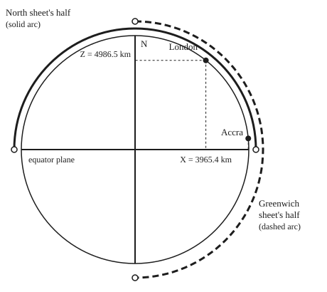

# Smooth manifold: coordinate patches that agree where they overlap

[Syllabus](../../../SYLLABUS.md) → [Differential geometry and Lie groups](../README.md) → [Manifolds](../README.md#s03) → Smooth manifold

---

## General Overview

Two map sheets cover London. The **North sheet** looks straight down on the northern half of the Earth from far above the North Pole. The **Greenwich sheet** looks straight in at the Earth from far out over the point where the equator meets the Greenwich meridian (longitude 0°). Each sheet is flat paper, and each gives London two numbers in kilometres.

On the North sheet London sits at (3965.4, −8.8). On the Greenwich sheet it sits at (−8.8, 4986.5). A navigator who crosses the border of one sheet needs a rule to convert one pair into the other. That rule is the **change of coordinates**, also called the **transition map**.

The [Topological manifold](../../17-Topology/03-Surfaces%20and%20Manifolds/01-topological-manifolds.md) card asked only that each sheet match its patch without tearing. This card asks more: that every change of coordinates be **smooth**, meaning it has derivatives of every order. Then calculus done on one sheet gives the same verdict on the other. A walker heading due north from London rises 0.622414 km above the equator plane per km walked, and both sheets compute that same 0.622414, although their own numbers for the walker's motion differ.

**A smooth manifold is a space covered by coordinate sheets whose changes of coordinates, wherever two sheets overlap, can be differentiated as often as wanted in both directions; that is exactly what lets derivatives on the space mean the same thing on every sheet.**

**What kind of fact this is:** a definition (smooth atlas and smooth manifold), plus theorems proved on this card in Why it works: the six-sheet atlas of the sphere is smooth, a function's smoothness does not depend on the sheet, and the stereographic charts fit the same structure. That some spheres carry more than one smooth structure is stated with its source, not proved.

<p align="center"></p>

The figure is drawn to scale, as a slice through the globe along the Greenwich meridian, seen from above 90° W. The North sheet keeps a point's horizontal distance X; the Greenwich sheet keeps its height Z. London's Y coordinate, −8.8 km, is too small to show. Accra, at 5.6037° N, sits near the North sheet's rim, where that sheet squeezes the ground almost flat.

---

## The formula

Notation first, in words. A **chart** is one sheet: a patch of the space and a two-way, tear-free match of it with an open region of flat space ([Topological manifold](../../17-Topology/03-Surfaces%20and%20Manifolds/01-topological-manifolds.md)). A chart is named by one letter, here $`x`$, and its coordinates are $`x = (x^1, x^2)`$. The raised 1 and 2 are labels, not powers, so the square of the first coordinate is written $`(x^1)^2`$. A second chart is $`y = (y^1, y^2)`$. The **transition** $`y \circ x^{-1}`$ reads a point's coordinates on sheet $`x`$, finds the point, and writes its coordinates on sheet $`y`$ ([Functions](../../01-Foundations/08-Relations%20and%20Functions/02-functions.md) gives the inverse and the composite). A map is $`C^\infty`$, or **smooth**, when it has continuous partial derivatives of every order.

Two charts are **smoothly compatible** when, on their overlap,

```math
y \circ x^{-1} \ \text{ and } \ x \circ y^{-1} \ \text{ are both } C^\infty
```

**Read it aloud:** converting from either sheet to the other, wherever both apply, can be differentiated as many times as wanted.

A **smooth atlas** is a set of charts covering the space, every two of them compatible. A **smooth manifold** is a [Topological manifold](../../17-Topology/03-Surfaces%20and%20Manifolds/01-topological-manifolds.md) together with a smooth atlas; atlases that are compatible with each other count as one **smooth structure**.

For the Earth as a sphere of radius $`R`$, the North sheet is $`x = (X, Y)`$ and the Greenwich sheet is $`y = (Y, Z)`$: each keeps two of the point's three coordinates in space. Their transition and its derivative matrix $`J`$ are

```math
y \circ x^{-1}(x^1, x^2) = \left(x^2,\ \sqrt{R^2 - (x^1)^2 - (x^2)^2}\right), \qquad J = \begin{pmatrix} 0 & 1 \\ -x^1/Z & -x^2/Z \end{pmatrix}, \qquad \det J = \frac{X}{Z}
```

**Read it aloud:** the Greenwich sheet's first number is the North sheet's second; its second number is the height Z, rebuilt from the sphere's equation; and the matrix of rates has determinant X over Z, which is not zero anywhere both sheets apply.

At London, $`\det J = 3965.4 / 4986.5 = 0.7952`$.

| Symbol | Plain meaning | In our example | Push it up and the answer… |
| --- | --- | --- | --- |
| $`t`$ | the one coordinate of a chart on the real line | the charts $`t`$ and $`t^3`$ | — |
| $`k`$, $`m`$ | which coordinate (X, Y or Z) the old and the new sheet drop | North to Greenwich: Z, then X | — |
| $`r`$; $`u`$, $`\rho`$ | distance from the North sheet's centre; a point on the stereographic map and its distance from that map's centre | London: $`r`$ = 3965.4 km, $`\rho`$ = 2224.4 km | further out on one map, further out on the other |
| $`x = (x^1, x^2)`$ | the first chart; raised numbers are labels | North sheet: London at (3965.4, −8.8) km | — |
| $`y = (y^1, y^2)`$ | the second chart | Greenwich sheet: London at (−8.8, 4986.5) km | — |
| $`y \circ x^{-1}`$ | the transition: sheet $`x`$ to sheet $`y`$ | (3965.4, −8.8) goes to (−8.8, 4986.5) | — |
| $`C^\infty`$ | smooth: derivatives of every order exist and are continuous | every transition of the six sheets | — |
| $`J`$, $`\det J`$ | the transition's matrix of first derivatives, and its determinant | $`\det J`$ = 0.7952 at London | near 0 or huge: the sheets disagree sharply on scale |
| $`R`$; $`q`$ | the Earth's radius, a sphere model; in the detailed proof, $`q = R^2 - (x^1)^2 - (x^2)^2`$, the number under the square root | 6371 km; on the overlap $`q = Z^2 > 0`$ | every sheet coordinate grows in proportion |
| $`(X, Y, Z)`$ | a point in space; Z is height above the equator plane | London at (3965.4, −8.8, 4986.5) km | — |
| $`f`$ | a function on the globe, read through a sheet | $`f = Z`$, height above the equator plane | — |
| $`s`$ | kilometres walked on the ground | the walk due north from London | — |

### When it holds

- **Both directions must be smooth.** The line with the charts $`t`$ and $`t^3`$ fails: $`t \mapsto t^3`$ is smooth, but its inverse, the cube root, has slope 100.0 at 0 measured over a step of 0.001, and 10000.0 over a step of 0.000001.
- **Every sheet must be open, stopping short of its rim.** The North sheet's transition has slope $`-X/Z`$: −10.19 at Accra, −5729.58 at 0.01° N, and no value on the equator, where Z = 0.
- **Every pair of charts must agree, not just neighbours.** Add the chart $`t^3`$ to the ordinary chart $`t`$ of the line and the atlas stops being smooth, though each chart alone is fine.
- **The topological tests still apply.** A smooth atlas does not replace the two background tests on the topological card: Hausdorff (any two different points sit in separate open patches) and second countable (countably many basic open sets build every open set). The line with two origins has smooth transitions yet a sequence with two limits.

---

## Why it works

### Step 0: calculus on the globe is always calculus on a sheet

A function $`f`$ on the globe, such as height above the equator plane, has no derivative of its own. It gets one through a sheet: differentiate $`f \circ x^{-1}`$, which is an ordinary function of two numbers. Call $`f`$ **smooth** when $`f \circ x^{-1}`$ is smooth.

The danger is that another sheet gives another verdict. It cannot, when transitions are smooth. The chain rule ([Chain rule in several variables](../../06-Calculus%20and%20analysis/07-Several%20Variables/04-multivariable-chain-rule-and-jacobians.md)) gives

```math
f \circ y^{-1} = (f \circ x^{-1}) \circ (x \circ y^{-1})
```

**Read it aloud:** reading $`f`$ through sheet $`y`$ is the same as converting to sheet $`x`$ and reading it there. A composite of smooth maps is smooth, so the verdict is the same on both sheets. That is the whole reason for the definition.

### Step 1: six sheets cover the globe

Give each half of the globe one sheet, looking straight down at it (an **orthographic projection**). The six halves are $`Z > 0`$ (North), $`Z < 0`$ (South), $`X > 0`$ (Greenwich), $`X < 0`$ (Date line), $`Y > 0`$ (East) and $`Y < 0`$ (West). Each sheet drops one coordinate and keeps the other two.

- **Each sheet is a chart.** Dropping a coordinate is continuous. The inverse puts it back: on the North sheet, $`Z = \sqrt{R^2 - X^2 - Y^2}`$, continuous on the open disc of radius $`R`$.
- **The sheets cover everything.** Since $`X^2 + Y^2 + Z^2 = R^2 > 0`$, at least one coordinate is not 0, so every point lies on some sheet.

On a grid every 5° of latitude and longitude, 2664 grid entries (each pole repeats once per longitude), each point lies on 1 to 3 sheets. The North Pole lies only on the North sheet. Of the 15 pairs of sheets, 12 overlap; the 3 pairs of opposite halves never meet.

### Step 2: every change of sheet is smooth

Go from a sheet that dropped coordinate $`k`$ to one that drops coordinate $`m`$. The new sheet keeps one coordinate the old sheet already had, copied straight across. Its other coordinate is the one the old sheet dropped, rebuilt as $`\pm\sqrt{R^2 - \text{(sum of the two old squares)}}`$.

Copying is smooth. The square root is smooth wherever its input is positive. On the overlap the rebuilt coordinate is not 0, because the point lies on the old sheet's open half, where that coordinate has a fixed sign; so the input is positive. The transition is smooth, and the reverse direction is the same argument with the roles swapped.

The determinant of $`J`$ comes out as plus or minus (coordinate $`m`$) over (coordinate $`k`$). Neither is 0 on the overlap, so $`\det J`$ is never 0. It could not be: by the chain rule, the matrix back times the matrix forward is the identity. The [Inverse and implicit function theorems](../../06-Calculus%20and%20analysis/07-Several%20Variables/07-inverse-and-implicit-function-theorems.md) give the converse: a smooth map with $`\det J \ne 0`$ has a smooth inverse near each point.

<details>
<summary>Detailed proof: the North-to-Greenwich transition has derivatives of every order</summary>

On the overlap, $`X > 0`$ and $`Z > 0`$. In North-sheet coordinates the overlap is the half disc where $`x^1 > 0`$ and $`(x^1)^2 + (x^2)^2 < R^2`$. Write $`q = R^2 - (x^1)^2 - (x^2)^2`$, a polynomial, positive on the overlap.

The transition is $`(x^2, \sqrt{q})`$. The first part is a coordinate, smooth. For the second, the derivative of $`\sqrt{q}`$ with respect to $`x^i`$ is

$`\displaystyle \frac{\partial \sqrt{q}}{\partial x^i} = \frac{-x^i}{\sqrt{q}}`$

Each further derivative is again a polynomial divided by a power of $`\sqrt{q}`$, by the quotient rule. Since $`q > 0`$, no denominator is 0, so every derivative of every order exists and is continuous.

The reverse map, Greenwich to North, is $`(y^1, y^2) \mapsto (\sqrt{R^2 - (y^1)^2 - (y^2)^2},\ y^1)`$, smooth by the same argument where $`X > 0`$. The other transitions differ only in which coordinates are kept and in sign.

</details>

### Step 3: the numbers at London

London is at 51.5074° N, 0.1278° W, so its point in space is (3965.4, −8.8, 4986.5) km. Feed the North sheet's (3965.4, −8.8) into the transition: the output is (−8.8, 4986.5), the Greenwich sheet's own reading.

The matrix by formula is `[[0.0000, 1.0000], [-0.7952, 0.0018]]`. A second road, difference quotients (change one input a little, divide the change in output by it), misses it by 0.0000000261 with a 1 km step and by 0.0000000003 with a 0.1 km step. A tenfold smaller step makes the miss about a hundredfold smaller, as a central difference should.

The matrix back, Greenwich to North, times the matrix forward is the identity to 1e-12 (twelve decimal places).

### Step 4: a rate belongs to the globe, its components to the sheet

Walk due north from London. On the North sheet the walker's coordinates change at (−0.7827, 0.0017) per km walked; on the Greenwich sheet, at (0.0017, 0.6224). These **components** (the per-sheet numbers) differ, and neither has length 1, although the walker covers 1 km per km.

Now take $`f = Z`$, height above the equator plane. On the North sheet, $`f \circ x^{-1} = \sqrt{R^2 - (x^1)^2 - (x^2)^2}`$; on the Greenwich sheet, $`f \circ y^{-1} = y^2`$. Each sheet multiplies its own gradient by its own components (the chain rule), and both give 0.622414 km of height per km walked. The exact value is $`\cos(51.5074°) = 0.622414`$.

So the rate is a fact about the globe; the components are facts about the sheets. Turning per-sheet components into a length on the ground needs a [Riemannian metric](../05-Riemannian%20Geometry/01-riemannian-metrics.md).

### Step 5: one smooth structure, many atlases

The [Topological manifold](../../17-Topology/03-Surfaces%20and%20Manifolds/01-topological-manifolds.md) card covered the globe with two stereographic charts instead, whose transition $`R^2 u / \lvert u\rvert^2`$ is smooth wherever $`u \ne 0`$. Those charts also fit with the six sheets.

From the North sheet, a point at distance $`r`$ from the centre lands on the stereographic north map at $`R r / (R + \sqrt{R^2 - r^2})`$, smooth for $`r < R`$. The way back is $`2R^2 \rho / (R^2 + \rho^2)`$, smooth for every $`\rho`$, the distance on the stereographic map. London: 3965.4 km out on the North sheet, 2224.4 km on the stereographic map (the topological card's number), and back to 3965.4 km.

Throw all eight charts together and the atlas is still smooth. The set of every chart compatible with them is the **maximal atlas**: the globe's smooth structure. Any atlas inside it gives the same smooth functions.

### Step 6: the same space can carry different smooth structures

On the real line, take the chart $`t`$ and, separately, the chart $`t^3`$. Each is a two-way continuous match with the line, so each alone is a smooth atlas. Together they are not: the transition from $`t^3`$ back to $`t`$ is the cube root, whose slope at 0 grows without limit (100.0, then 10000.0 as the step shrinks).

So "smooth" is extra structure chosen on top of the topology, not a property the topology decides. On the line the two choices still give interchangeable smooth lines, matched by a smooth map with a smooth inverse ([Diffeomorphism, immersion, submersion](04-diffeomorphisms-immersions-and-embeddings.md)). In dimension 7 that fails: Milnor showed in 1956 that some spaces matching the 7-dimensional sphere continuously cannot be matched with it smoothly (Sources). This card states that result and does not prove it.

---

## Worked numbers, by hand

| Step | Arithmetic | Value |
| --- | --- | --- |
| London in space | $`R \cos(\text{lat}) \cos(\text{lon})`$, $`R \cos(\text{lat}) \sin(\text{lon})`$, $`R \sin(\text{lat})`$ | (3965.4, −8.8, 4986.5) km |
| North sheet | keep X and Y | (3965.4, −8.8) |
| Rebuild Z | $`\sqrt{6371^2 - 3965.4^2 - 8.8^2}`$ | 4986.5 km |
| Greenwich sheet, by the transition | $`(x^2, Z)`$ | (−8.8, 4986.5) |
| Matrix entry $`-X/Z`$ | −3965.4 / 4986.5 | −0.7952 |
| Determinant | 0 × 0.0018 − 1 × (−0.7952) | 0.7952 |
| Height gained per km walked north | $`\cos(51.5074°)`$, from either sheet | **0.622414** |

Heading north from London, the walker rises 0.622414 km above the equator plane for every kilometre of ground, and the two sheets agree on that number to six decimals.

### What breaks if you drop a piece

| Mistake | Comes out at | What went wrong |
| --- | --- | --- |
| Charts $`t`$ and $`t^3`$ on one line, checked one way only | $`t^3`$ has slope 0.000001 at 0 over a step of 0.001; the cube root has slope 100.0 over that step, then 10000.0 over a step of 0.000001 | the inverse transition is not smooth at 0 |
| Closing the North sheet at the equator | slope −10.19 at Accra, −5729.58 at 0.01° N, none at Z = 0 | the transition's derivative blows up at the rim; sheets must be open |
| Sheet speed read as ground speed | 0.7827 on the North sheet, 0.6224 on the Greenwich sheet, true value 1 | components belong to the sheet; a length needs a metric |

The code prints all three.

---

## Code, from first principles, and it actually runs

The code builds the six-sheet atlas, counts which sheets each grid point lies on, and finds the 12 overlapping pairs. It takes **two independent roads** to every one of the 24 transitions' derivative matrices: the formula, and difference quotients that only ever call the transition itself. A second pair of roads reaches the walker's rate: the North sheet and the Greenwich sheet, each by its own chain rule, against the exact $`\cos(\text{latitude})`$. It then checks the stereographic chart against the topological card's 2224.4 km and prints the three mistakes.

### Python

```python
# Smooth manifold -- the check behind the card.  Standard library only.
# The Earth is a sphere of radius 6371 km.  Six map sheets each look straight
# down on one half of it (orthographic projection): a sheet keeps two of the
# point's coordinates (X, Y, Z) and drops the third.  The card's claim is that
# every change of sheet is smooth.  Road 1: derivative matrices by formula.
# Road 2: difference quotients at two step sizes.  A rate measured on the
# ground is then computed in two sheets, which must agree.
import math
R = 6371.0
SHEETS = [("North", 2, 1), ("South", 2, -1), ("Greenwich", 0, 1),
          ("Date line", 0, -1), ("East", 1, 1), ("West", 1, -1)]

def point(lat, lon):                     # degrees to (X, Y, Z) in km
    a, b = math.radians(lat), math.radians(lon)
    return (R * math.cos(a) * math.cos(b), R * math.cos(a) * math.sin(b), R * math.sin(a))

def on_sheet(p, s): return s[2] * p[s[1]] > 0        # open half: the rim is left out
def chart(p, s): return tuple(p[i] for i in range(3) if i != s[1])
def lift(u, s):                          # inverse chart: put back the dropped coordinate
    p = list(u)
    p.insert(s[1], s[2] * math.sqrt(R * R - u[0] ** 2 - u[1] ** 2))
    return p
def change(u, s, t): return chart(lift(u, s), t)    # the transition, sheet s to sheet t

def jac_formula(u, s, t):                # road 1: row = output, column = input
    p, k = lift(u, s), s[1]
    ins = [i for i in range(3) if i != k]
    return [[-p[i] / p[k] if o == k else float(o == i) for i in ins]
            for o in range(3) if o != t[1]]

def jac_steps(u, s, t, h):               # road 2: central difference quotients
    cols = []
    for j in range(2):
        up, dn = list(u), list(u)
        up[j] += h; dn[j] -= h
        a, b = change(up, s, t), change(dn, s, t)
        cols.append([(a[i] - b[i]) / (2 * h) for i in range(2)])
    return [[cols[0][0], cols[1][0]], [cols[0][1], cols[1][1]]]

def gap(A, B): return max(abs(A[i][j] - B[i][j]) for i in range(2) for j in range(2))
def det(J): return J[0][0] * J[1][1] - J[0][1] * J[1][0]
def mul(A, B): return [[sum(A[i][k] * B[k][j] for k in range(2)) for j in range(2)] for i in range(2)]
def yn(c): return "yes" if c else "no"

# The atlas: every grid point lies on at least one sheet; which pairs overlap.
grid = [point(la, lo) for la in range(-90, 91, 5) for lo in range(-180, 180, 5)]
counts = [sum(on_sheet(p, s) for s in SHEETS) for p in grid]
pairs = [(s, t) for i, s in enumerate(SHEETS) for t in SHEETS[i + 1:]
         if any(on_sheet(p, s) and on_sheet(p, t) for p in grid)]
worst, smallest = 0.0, 1e9
for s, t in pairs:                       # both directions, at a point inside the overlap
    for a, b in ((s, t), (t, s)):
        p = [R * 3 / 7, R * 2 / 7, R * 6 / 7]
        p[a[1]] *= a[2]; p[b[1]] *= b[2]
        u = chart(p, a)
        worst = max(worst, gap(jac_formula(u, a, b), jac_steps(u, a, b, 0.01)))
        smallest = min(smallest, abs(det(jac_formula(u, a, b))))
print(f"grid points {len(grid)}; sheets per point: fewest {min(counts)}, most {max(counts)}")
print(f"pairs of sheets that overlap: {len(pairs)} of 15; transitions checked both ways: {2 * len(pairs)}")
print(f"formula and difference quotients agree to 1e-6 on all {2 * len(pairs)}: {yn(worst < 1e-6)}")
print(f"smallest |det J| among them: {smallest:.4f}")

N, G = SHEETS[0], SHEETS[2]
lat, lon = 51.5074, -0.1278
P = point(lat, lon)
u, v = chart(P, N), chart(P, G)
J, K = jac_formula(u, N, G), jac_formula(v, G, N)
print(f"London {lat:.4f} N, {-lon:.4f} W: (X, Y, Z) = ({P[0]:.1f}, {P[1]:.1f}, {P[2]:.1f}) km")
print(f"North sheet ({u[0]:.1f}, {u[1]:.1f}); Greenwich sheet ({v[0]:.1f}, {v[1]:.1f})")
w = change(u, N, G)
print(f"North to Greenwich by the transition: ({w[0]:.1f}, {w[1]:.1f})")
print(f"J at London: [[{J[0][0]:.4f}, {J[0][1]:.4f}], [{J[1][0]:.4f}, {J[1][1]:.4f}]]; det J = X/Z = {det(J):.4f}")
for h in (1.0, 0.1):
    print(f"step {h:.1f} km: difference quotients miss J by {gap(J, jac_steps(u, N, G, h)):.10f}")
IJ = mul(K, J)
one = abs(IJ[0][0] - 1) < 1e-12 and abs(IJ[0][1]) < 1e-12 and abs(IJ[1][0]) < 1e-12 and abs(IJ[1][1] - 1) < 1e-12
print(f"J back times J forward is the identity to 1e-12: {yn(one)}")
A = point(5.6037, -0.1870)
print(f"Accra {5.6037:.4f} N, near the North sheet's rim: slope -X/Z = {-A[0] / A[2]:.2f}")
E = point(0.01, 0.0)
print(f"0.01 deg north of the equator: slope -X/Z = {-E[0] / E[2]:.2f}; on the equator Z = 0")

exact = math.cos(math.radians(lat))
def rate(s, h):                          # walk north from London: Z gained per km walked
    a, b = chart(point(lat + math.degrees(h / R), lon), s), chart(point(lat - math.degrees(h / R), lon), s)
    vel = [(a[i] - b[i]) / (2 * h) for i in range(2)]
    q = lift(chart(P, s), s)             # gradient of Z in this sheet, chain rule
    grad = [-c / q[2] for c in chart(P, s)] if s[1] == 2 else [0.0, 1.0]
    return vel, grad[0] * vel[0] + grad[1] * vel[1]
for s in (N, G):
    for h in (1.0, 0.1):
        vel, r = rate(s, h)
        print(f"{s[0]} sheet, step {h:.1f} km: velocity ({vel[0]:.4f}, {vel[1]:.4f}), "
              f"sheet speed {math.hypot(*vel):.4f}, dZ/ds {r:.6f}, off by {abs(r - exact):.10f}")
print(f"exact dZ/ds = cos(latitude) = {exact:.6f}; ground speed 1")

rho = math.hypot(*u)                     # the stereographic north map, same structure
st = R * rho / (R + math.sqrt(R * R - rho * rho))
back = 2 * R * R * st / (R * R + st * st)
print(f"North sheet {rho:.1f} km out -> stereographic {st:.1f} km -> back {back:.1f} km")
for h in (0.001, 0.000001):              # charts t and t^3 on the line
    print(f"line, step {h:.6f}: slope of t^3 at 0 = {h ** 3 / h:.12f}, of cube root = {h ** (1 / 3) / h:.1f}")
cx, cy, sc = 190.0, 210.0, 160.0 / R
print(f"figure, London ({cx + sc * P[0]:.2f}, {cy - sc * P[2]:.2f}), Accra ({cx + sc * A[0]:.2f}, {cy - sc * A[2]:.2f})")

v1, r1 = rate(N, 0.1)
v2, r2 = rate(G, 0.1)
assert min(counts) == 1 and max(counts) == 3 and len(pairs) == 12        # an atlas, 12 overlaps
assert worst < 1e-6 and smallest > 0.1                                   # road 1 against road 2
assert abs(w[0] - v[0]) < 1e-9 and abs(w[1] - v[1]) < 1e-9               # transition lands right
assert one                                                                 # J back undoes J
assert abs(r1 - exact) < 1e-6 and abs(r2 - exact) < 1e-6                 # one rate, two sheets
assert abs(math.hypot(*v1) - math.hypot(*v2)) > 0.1                      # components differ
assert abs(back - rho) < 1e-6 and abs(st - 2224.4) < 0.05                # matches the topology card
print("ALL CHECKS PASS")
```

**Ran 2026-11-19 on macOS, Python 3.14.10, standard library only. All checks passed. Output, pasted from the run:**

```
grid points 2664; sheets per point: fewest 1, most 3
pairs of sheets that overlap: 12 of 15; transitions checked both ways: 24
formula and difference quotients agree to 1e-6 on all 24: yes
smallest |det J| among them: 0.3333
London 51.5074 N, 0.1278 W: (X, Y, Z) = (3965.4, -8.8, 4986.5) km
North sheet (3965.4, -8.8); Greenwich sheet (-8.8, 4986.5)
North to Greenwich by the transition: (-8.8, 4986.5)
J at London: [[0.0000, 1.0000], [-0.7952, 0.0018]]; det J = X/Z = 0.7952
step 1.0 km: difference quotients miss J by 0.0000000261
step 0.1 km: difference quotients miss J by 0.0000000003
J back times J forward is the identity to 1e-12: yes
Accra 5.6037 N, near the North sheet's rim: slope -X/Z = -10.19
0.01 deg north of the equator: slope -X/Z = -5729.58; on the equator Z = 0
North sheet, step 1.0 km: velocity (-0.7827, 0.0017), sheet speed 0.7827, dZ/ds 0.622414, off by 0.0000000026
North sheet, step 0.1 km: velocity (-0.7827, 0.0017), sheet speed 0.7827, dZ/ds 0.622414, off by 0.0000000000
Greenwich sheet, step 1.0 km: velocity (0.0017, 0.6224), sheet speed 0.6224, dZ/ds 0.622414, off by 0.0000000026
Greenwich sheet, step 0.1 km: velocity (0.0017, 0.6224), sheet speed 0.6224, dZ/ds 0.622414, off by 0.0000000000
exact dZ/ds = cos(latitude) = 0.622414; ground speed 1
North sheet 3965.4 km out -> stereographic 2224.4 km -> back 3965.4 km
line, step 0.001000: slope of t^3 at 0 = 0.000001000000, of cube root = 100.0
line, step 0.000001: slope of t^3 at 0 = 0.000000000001, of cube root = 10000.0
figure, London (289.59, 84.77), Accra (349.23, 194.38)
ALL CHECKS PASS
```

### Rust

Same numbers, same labels, built with `rustc --edition 2021 -O`.

```rust
// Smooth manifold -- the same check as the Python, in Rust.  No crates.
// The Earth is a sphere of radius 6371 km.  Six map sheets each look straight
// down on one half of it (orthographic projection): a sheet keeps two of the
// point's coordinates (X, Y, Z) and drops the third.  The card's claim is that
// every change of sheet is smooth.  Road 1: derivative matrices by formula.
// Road 2: difference quotients at two step sizes.  A rate measured on the
// ground is then computed in two sheets, which must agree.
const R: f64 = 6371.0;
type Sheet = (&'static str, usize, f64);
type M2 = [[f64; 2]; 2];
const SHEETS: [Sheet; 6] = [("North", 2, 1.0), ("South", 2, -1.0), ("Greenwich", 0, 1.0),
    ("Date line", 0, -1.0), ("East", 1, 1.0), ("West", 1, -1.0)];

fn point(lat: f64, lon: f64) -> [f64; 3] {          // degrees to (X, Y, Z) in km
    let (a, b) = (lat.to_radians(), lon.to_radians());
    [R * a.cos() * b.cos(), R * a.cos() * b.sin(), R * a.sin()]
}
fn on_sheet(p: &[f64; 3], s: Sheet) -> bool { s.2 * p[s.1] > 0.0 } // open half: rim left out
fn chart(p: &[f64; 3], s: Sheet) -> [f64; 2] {
    let k: Vec<f64> = (0..3).filter(|&i| i != s.1).map(|i| p[i]).collect();
    [k[0], k[1]]
}
fn lift(u: [f64; 2], s: Sheet) -> [f64; 3] {       // inverse chart: put back the dropped coordinate
    let mut p = vec![u[0], u[1]];
    p.insert(s.1, s.2 * (R * R - u[0].powf(2.0) - u[1].powf(2.0)).sqrt());
    [p[0], p[1], p[2]]
}
fn change(u: [f64; 2], s: Sheet, t: Sheet) -> [f64; 2] { chart(&lift(u, s), t) }

fn jac_formula(u: [f64; 2], s: Sheet, t: Sheet) -> M2 {   // road 1: row = output, column = input
    let (p, k) = (lift(u, s), s.1);
    let ins: Vec<usize> = (0..3).filter(|&i| i != k).collect();
    let outs: Vec<usize> = (0..3).filter(|&o| o != t.1).collect();
    let mut j = [[0.0; 2]; 2];
    for (r, &o) in outs.iter().enumerate() {
        for (c, &i) in ins.iter().enumerate() {
            j[r][c] = if o == k { -p[i] / p[k] } else if o == i { 1.0 } else { 0.0 };
        }
    }
    j
}
fn jac_steps(u: [f64; 2], s: Sheet, t: Sheet, h: f64) -> M2 {  // road 2: central differences
    let mut j = [[0.0; 2]; 2];
    for c in 0..2 {
        let (mut up, mut dn) = (u, u);
        up[c] += h;
        dn[c] -= h;
        let (a, b) = (change(up, s, t), change(dn, s, t));
        for r in 0..2 { j[r][c] = (a[r] - b[r]) / (2.0 * h) }
    }
    j
}
fn gap(a: &M2, b: &M2) -> f64 {
    let mut g: f64 = 0.0;
    for i in 0..2 { for j in 0..2 { g = g.max((a[i][j] - b[i][j]).abs()) } }
    g
}
fn det(j: &M2) -> f64 { j[0][0] * j[1][1] - j[0][1] * j[1][0] }
fn mul(a: &M2, b: &M2) -> M2 {
    let mut m = [[0.0; 2]; 2];
    for i in 0..2 { for j in 0..2 { m[i][j] = 0.0 + a[i][0] * b[0][j] + a[i][1] * b[1][j] } }
    m
}
fn yn(c: bool) -> &'static str { if c { "yes" } else { "no" } }

fn rate(s: Sheet, h: f64, lat: f64, lon: f64, p: &[f64; 3]) -> ([f64; 2], f64) {
    let a = chart(&point(lat + (h / R).to_degrees(), lon), s);   // walk north from London
    let b = chart(&point(lat - (h / R).to_degrees(), lon), s);
    let vel = [(a[0] - b[0]) / (2.0 * h), (a[1] - b[1]) / (2.0 * h)];
    let c = chart(p, s);
    let q = lift(c, s);                                          // gradient of Z, chain rule
    let grad = if s.1 == 2 { [-c[0] / q[2], -c[1] / q[2]] } else { [0.0, 1.0] };
    (vel, grad[0] * vel[0] + grad[1] * vel[1])
}

fn main() {
    let mut grid = Vec::new();
    for la in (-90..=90).step_by(5) { for lo in (-180..180).step_by(5) { grid.push(point(la as f64, lo as f64)) } }
    let counts: Vec<usize> = grid.iter().map(|p| SHEETS.iter().filter(|&&s| on_sheet(p, s)).count()).collect();
    let mut pairs = Vec::new();
    for i in 0..6 { for j in i + 1..6 {
        let (s, t) = (SHEETS[i], SHEETS[j]);
        if grid.iter().any(|p| on_sheet(p, s) && on_sheet(p, t)) { pairs.push((s, t)) }
    } }
    let (mut worst, mut smallest): (f64, f64) = (0.0, 1e9);
    for &(s, t) in &pairs {
        for (a, b) in [(s, t), (t, s)] {
            let mut p = [R * 3.0 / 7.0, R * 2.0 / 7.0, R * 6.0 / 7.0];
            p[a.1] *= a.2;
            p[b.1] *= b.2;
            let u = chart(&p, a);
            worst = worst.max(gap(&jac_formula(u, a, b), &jac_steps(u, a, b, 0.01)));
            smallest = smallest.min(det(&jac_formula(u, a, b)).abs());
        }
    }
    let (fewest, most) = (*counts.iter().min().unwrap(), *counts.iter().max().unwrap());
    println!("grid points {}; sheets per point: fewest {}, most {}", grid.len(), fewest, most);
    println!("pairs of sheets that overlap: {} of 15; transitions checked both ways: {}", pairs.len(), 2 * pairs.len());
    println!("formula and difference quotients agree to 1e-6 on all {}: {}", 2 * pairs.len(), yn(worst < 1e-6));
    println!("smallest |det J| among them: {:.4}", smallest);

    let (n, g) = (SHEETS[0], SHEETS[2]);
    let (lat, lon) = (51.5074, -0.1278);
    let p = point(lat, lon);
    let (u, v) = (chart(&p, n), chart(&p, g));
    let (j, k) = (jac_formula(u, n, g), jac_formula(v, g, n));
    println!("London {:.4} N, {:.4} W: (X, Y, Z) = ({:.1}, {:.1}, {:.1}) km", lat, -lon, p[0], p[1], p[2]);
    println!("North sheet ({:.1}, {:.1}); Greenwich sheet ({:.1}, {:.1})", u[0], u[1], v[0], v[1]);
    let w = change(u, n, g);
    println!("North to Greenwich by the transition: ({:.1}, {:.1})", w[0], w[1]);
    println!("J at London: [[{:.4}, {:.4}], [{:.4}, {:.4}]]; det J = X/Z = {:.4}", j[0][0], j[0][1], j[1][0], j[1][1], det(&j));
    for h in [1.0, 0.1] {
        println!("step {:.1} km: difference quotients miss J by {:.10}", h, gap(&j, &jac_steps(u, n, g, h)));
    }
    let ij = mul(&k, &j);
    let one = (ij[0][0] - 1.0).abs() < 1e-12 && ij[0][1].abs() < 1e-12 && ij[1][0].abs() < 1e-12 && (ij[1][1] - 1.0).abs() < 1e-12;
    println!("J back times J forward is the identity to 1e-12: {}", yn(one));
    let a = point(5.6037, -0.1870);
    println!("Accra {:.4} N, near the North sheet's rim: slope -X/Z = {:.2}", 5.6037, -a[0] / a[2]);
    let e = point(0.01, 0.0);
    println!("0.01 deg north of the equator: slope -X/Z = {:.2}; on the equator Z = 0", -e[0] / e[2]);
    let exact = lat.to_radians().cos();
    for s in [n, g] {
        for h in [1.0, 0.1] {
            let (vel, r) = rate(s, h, lat, lon, &p);
            println!("{} sheet, step {:.1} km: velocity ({:.4}, {:.4}), sheet speed {:.4}, dZ/ds {:.6}, off by {:.10}",
                     s.0, h, vel[0], vel[1], vel[0].hypot(vel[1]), r, (r - exact).abs());
        }
    }
    println!("exact dZ/ds = cos(latitude) = {:.6}; ground speed 1", exact);

    let rho = u[0].hypot(u[1]);                              // the stereographic north map
    let st = R * rho / (R + (R * R - rho * rho).sqrt());
    let back = 2.0 * R * R * st / (R * R + st * st);
    println!("North sheet {:.1} km out -> stereographic {:.1} km -> back {:.1} km", rho, st, back);
    for h in [0.001f64, 0.000001] {                          // charts t and t^3 on the line
        println!("line, step {:.6}: slope of t^3 at 0 = {:.12}, of cube root = {:.1}", h, h.powf(3.0) / h, h.powf(1.0 / 3.0) / h);
    }
    let (cx, cy, sc) = (190.0, 210.0, 160.0 / R);
    println!("figure, London ({:.2}, {:.2}), Accra ({:.2}, {:.2})", cx + sc * p[0], cy - sc * p[2], cx + sc * a[0], cy - sc * a[2]);

    let (v1, r1) = rate(n, 0.1, lat, lon, &p);
    let (v2, r2) = rate(g, 0.1, lat, lon, &p);
    assert!(fewest == 1 && most == 3 && pairs.len() == 12);              // an atlas, 12 overlaps
    assert!(worst < 1e-6 && smallest > 0.1);                             // road 1 against road 2
    assert!((w[0] - v[0]).abs() < 1e-9 && (w[1] - v[1]).abs() < 1e-9);   // transition lands right
    assert!(one);                                                        // J back undoes J
    assert!((r1 - exact).abs() < 1e-6 && (r2 - exact).abs() < 1e-6);     // one rate, two sheets
    assert!((v1[0].hypot(v1[1]) - v2[0].hypot(v2[1])).abs() > 0.1);      // components differ
    assert!((back - rho).abs() < 1e-6 && (st - 2224.4).abs() < 0.05);    // matches the topology card
    println!("ALL CHECKS PASS");
}
```

**Ran 2026-11-19 on macOS, rustc 1.98.1, no crates. All checks passed. Output, pasted from the run:**

```
grid points 2664; sheets per point: fewest 1, most 3
pairs of sheets that overlap: 12 of 15; transitions checked both ways: 24
formula and difference quotients agree to 1e-6 on all 24: yes
smallest |det J| among them: 0.3333
London 51.5074 N, 0.1278 W: (X, Y, Z) = (3965.4, -8.8, 4986.5) km
North sheet (3965.4, -8.8); Greenwich sheet (-8.8, 4986.5)
North to Greenwich by the transition: (-8.8, 4986.5)
J at London: [[0.0000, 1.0000], [-0.7952, 0.0018]]; det J = X/Z = 0.7952
step 1.0 km: difference quotients miss J by 0.0000000261
step 0.1 km: difference quotients miss J by 0.0000000003
J back times J forward is the identity to 1e-12: yes
Accra 5.6037 N, near the North sheet's rim: slope -X/Z = -10.19
0.01 deg north of the equator: slope -X/Z = -5729.58; on the equator Z = 0
North sheet, step 1.0 km: velocity (-0.7827, 0.0017), sheet speed 0.7827, dZ/ds 0.622414, off by 0.0000000026
North sheet, step 0.1 km: velocity (-0.7827, 0.0017), sheet speed 0.7827, dZ/ds 0.622414, off by 0.0000000000
Greenwich sheet, step 1.0 km: velocity (0.0017, 0.6224), sheet speed 0.6224, dZ/ds 0.622414, off by 0.0000000026
Greenwich sheet, step 0.1 km: velocity (0.0017, 0.6224), sheet speed 0.6224, dZ/ds 0.622414, off by 0.0000000000
exact dZ/ds = cos(latitude) = 0.622414; ground speed 1
North sheet 3965.4 km out -> stereographic 2224.4 km -> back 3965.4 km
line, step 0.001000: slope of t^3 at 0 = 0.000001000000, of cube root = 100.0
line, step 0.000001: slope of t^3 at 0 = 0.000000000001, of cube root = 10000.0
figure, London (289.59, 84.77), Accra (349.23, 194.38)
ALL CHECKS PASS
```

The two outputs match line for line.

### Lean

Lean proves the globe's claims for a sphere of any radius $`R > 0`$, and the line's claim about $`t`$ and $`t^3`$.

- Every point of the sphere lies on at least one of the six sheets.
- Each sheet matches its open half one to one with the open disc of radius $`R`$. Putting the dropped coordinate back is its inverse.
- Take any two sheets $`x`$ and $`y`$, in either order. Then the transition $`y \circ x^{-1}`$ is $`C^\infty`$ on their overlap.
- Take a function $`f`$ with $`f \circ x^{-1}`$ smooth on the overlap of sheets $`x`$ and $`y`$. Then $`f \circ y^{-1}`$ is smooth there too.
- Take the charts $`t`$ and $`t^3`$ on the line. Then $`t \mapsto t^3`$ is smooth, but its inverse, the cube root, has no derivative at 0.
- Counting gives 2664 grid entries (37 latitudes times 72 longitudes), 15 pairs of sheets, and 12 pairs that drop different coordinates.

London's numbers, the derivative matrices, the walker's rate, the stereographic charts and the rim slopes are left to the Python and Rust checks.

```lean
-- Smooth manifold: the six map sheets that look straight down on the halves of a sphere form a smooth atlas, so a function's smoothness does not depend on the sheet, while the charts t and t³ on the line are not smoothly compatible.
import Mathlib.Analysis.SpecialFunctions.Sqrt
import Mathlib.Data.Fin.Tuple.Basic

open scoped ContDiff

namespace SmoothManifoldsAndCharts

/-- The sphere of radius `R` in space: the points `(X, Y, Z)` with `X² + Y² + Z² = R²`. -/
def sphere (R : ℝ) : Set (Fin 3 → ℝ) :=
  {p | p 0 ^ 2 + p 1 ^ 2 + p 2 ^ 2 = R ^ 2}

/-- The open half of the sphere seen by sheet `(k, σ)`: the points whose coordinate `k`
has sign `σ` (`σ = 1` or `σ = -1`). The rim, where coordinate `k` is `0`, is left out. -/
def half (R : ℝ) (k : Fin 3) (σ : ℤˣ) : Set (Fin 3 → ℝ) :=
  {p | p ∈ sphere R ∧ 0 < ((σ : ℤ) : ℝ) * p k}

/-- The sheet that drops coordinate `k`: it keeps the point's other two coordinates. -/
def chart (k : Fin 3) (p : Fin 3 → ℝ) : Fin 2 → ℝ :=
  fun i => p (k.succAbove i)

/-- The inverse of sheet `(k, σ)`: put back the dropped coordinate as `σ √(R² - u₁² - u₂²)`. -/
noncomputable def lift (R : ℝ) (k : Fin 3) (σ : ℤˣ) (u : Fin 2 → ℝ) : Fin 3 → ℝ :=
  Fin.insertNth k (((σ : ℤ) : ℝ) * √(R ^ 2 - u 0 ^ 2 - u 1 ^ 2)) u

/-- The change of coordinates from sheet `(k, σ)` to the sheet that drops coordinate `m`. -/
noncomputable def transition (R : ℝ) (k : Fin 3) (σ : ℤˣ) (m : Fin 3) (u : Fin 2 → ℝ) :
    Fin 2 → ℝ :=
  chart m (lift R k σ u)

lemma sq_sum_succAbove (p : Fin 3 → ℝ) (k : Fin 3) :
    p 0 ^ 2 + p 1 ^ 2 + p 2 ^ 2 =
      p k ^ 2 + p (k.succAbove 0) ^ 2 + p (k.succAbove 1) ^ 2 := by
  fin_cases k <;> simp [Fin.succAbove] <;> ring

lemma units_mul_self (σ : ℤˣ) : ((σ : ℤ) : ℝ) * ((σ : ℤ) : ℝ) = 1 := by
  rcases Int.units_eq_one_or σ with h | h <;> simp [h]

lemma chart_mem_disc (R : ℝ) (k : Fin 3) (σ : ℤˣ) (p : Fin 3 → ℝ) (hp : p ∈ half R k σ) :
    chart k p 0 ^ 2 + chart k p 1 ^ 2 < R ^ 2 ∧ lift R k σ (chart k p) = p := by
  obtain ⟨hs, hpos⟩ := hp
  have hsum : p k ^ 2 + p (k.succAbove 0) ^ 2 + p (k.succAbove 1) ^ 2 = R ^ 2 := by
    rw [← sq_sum_succAbove]; exact hs
  have hne : p k ≠ 0 := by
    rintro h; rw [h, mul_zero] at hpos; exact lt_irrefl _ hpos
  have hk2 : 0 < p k ^ 2 := by positivity
  refine ⟨?_, ?_⟩
  · simp only [chart]; linarith
  · have hD : R ^ 2 - chart k p 0 ^ 2 - chart k p 1 ^ 2 = p k ^ 2 := by
      simp only [chart]; linarith
    have hval : ((σ : ℤ) : ℝ) * √(R ^ 2 - chart k p 0 ^ 2 - chart k p 1 ^ 2) = p k := by
      rw [hD, Real.sqrt_sq_eq_abs]
      rcases Int.units_eq_one_or σ with h | h
      · subst h; simp at hpos ⊢; exact hpos.le
      · subst h; simp at hpos ⊢; rw [abs_of_neg (by linarith)]; ring
    unfold lift
    rw [hval]
    exact Fin.insertNth_self_removeNth k p

lemma lift_mem_half (R : ℝ) (k : Fin 3) (σ : ℤˣ) (u : Fin 2 → ℝ)
    (hu : u 0 ^ 2 + u 1 ^ 2 < R ^ 2) :
    lift R k σ u ∈ half R k σ ∧ chart k (lift R k σ u) = u := by
  have hD : 0 < R ^ 2 - u 0 ^ 2 - u 1 ^ 2 := by linarith
  have hσ := units_mul_self σ
  refine ⟨⟨?_, ?_⟩, ?_⟩
  · show _ = _
    rw [sq_sum_succAbove _ k]
    simp only [lift, Fin.insertNth_apply_same, Fin.insertNth_apply_succAbove]
    have hs := Real.sq_sqrt hD.le
    have : (((σ : ℤ) : ℝ) * √(R ^ 2 - u 0 ^ 2 - u 1 ^ 2)) ^ 2 =
        R ^ 2 - u 0 ^ 2 - u 1 ^ 2 := by
      rw [mul_pow, sq ((σ : ℤ) : ℝ), hσ, one_mul, hs]
    rw [this]; ring
  · simp only [lift, Fin.insertNth_apply_same]
    rw [← mul_assoc, hσ, one_mul]
    exact Real.sqrt_pos.mpr hD
  · funext i
    simp [chart, lift]

lemma insertNth_contDiffOn (k : Fin 3) (a : (Fin 2 → ℝ) → ℝ) (s : Set (Fin 2 → ℝ))
    (ha : ContDiffOn ℝ ∞ a s) (j : Fin 3) :
    ContDiffOn ℝ ∞ (fun u => Fin.insertNth (α := fun _ => ℝ) k (a u) u j) s := by
  induction j using Fin.succAboveCases k with
  | x => simpa using ha
  | p j => simpa using (contDiff_apply ℝ (fun _ : Fin 2 => ℝ) j : ContDiff ℝ ∞ fun u : Fin 2 → ℝ => u j).contDiffOn

lemma transition_contDiffOn (R : ℝ) (k : Fin 3) (σ : ℤˣ) (m : Fin 3) (τ : ℤˣ) :
    ContDiffOn ℝ ∞ (transition R k σ m) (chart k '' (half R k σ ∩ half R m τ)) := by
  have ha : ContDiffOn ℝ ∞ (fun u : Fin 2 → ℝ => ((σ : ℤ) : ℝ) * √(R ^ 2 - u 0 ^ 2 - u 1 ^ 2))
      (chart k '' (half R k σ ∩ half R m τ)) := by
    apply contDiffOn_const.mul
    apply ContDiffOn.sqrt
    · have h0 : ContDiff ℝ ∞ fun u : Fin 2 → ℝ => u 0 := contDiff_apply ℝ (fun _ : Fin 2 => ℝ) 0
      have h1 : ContDiff ℝ ∞ fun u : Fin 2 → ℝ => u 1 := contDiff_apply ℝ (fun _ : Fin 2 => ℝ) 1
      exact ((contDiff_const.sub (h0.pow 2)).sub (h1.pow 2)).contDiffOn
    · rintro _ ⟨p, ⟨hp, -⟩, rfl⟩
      have := (chart_mem_disc R k σ p hp).1
      intro h; linarith
  refine contDiffOn_pi.mpr fun i => ?_
  exact insertNth_contDiffOn k _ _ ha (m.succAbove i)

#print axioms sq_sum_succAbove
#print axioms units_mul_self
#print axioms chart_mem_disc
#print axioms lift_mem_half
#print axioms insertNth_contDiffOn
#print axioms transition_contDiffOn

/-- The six orthographic sheets form a smooth atlas of the sphere of radius `R`:
every point lies on some sheet; each sheet matches its open half one to one with the
open disc of radius `R`, with `lift` as its inverse; and for every two sheets, the change
of coordinates from one to the other is smooth (`C^∞`) on their overlap. Taking every
ordered pair covers both directions. -/
theorem six_sheet_atlas_is_smooth (R : ℝ) (hR : 0 < R) :
    (∀ p ∈ sphere R, ∃ (k : Fin 3) (σ : ℤˣ), p ∈ half R k σ) ∧
    (∀ (k : Fin 3) (σ : ℤˣ),
      (∀ p ∈ half R k σ, chart k p 0 ^ 2 + chart k p 1 ^ 2 < R ^ 2 ∧
          lift R k σ (chart k p) = p) ∧
      (∀ u : Fin 2 → ℝ, u 0 ^ 2 + u 1 ^ 2 < R ^ 2 →
          lift R k σ u ∈ half R k σ ∧ chart k (lift R k σ u) = u)) ∧
    (∀ (k m : Fin 3) (σ τ : ℤˣ),
      ContDiffOn ℝ ∞ (transition R k σ m) (chart k '' (half R k σ ∩ half R m τ))) := by
  refine ⟨?_, fun k σ => ⟨fun p hp => chart_mem_disc R k σ p hp,
    fun u hu => lift_mem_half R k σ u hu⟩, fun k m σ τ => transition_contDiffOn R k σ m τ⟩
  intro p hp
  have : ∃ k, p k ≠ 0 := by
    by_contra h
    push Not at h
    have h' : p 0 ^ 2 + p 1 ^ 2 + p 2 ^ 2 = R ^ 2 := hp
    rw [h 0, h 1, h 2] at h'
    have : 0 < R ^ 2 := by positivity
    linarith
  obtain ⟨k, hk⟩ := this
  rcases hk.lt_or_gt with hneg | hpos
  · exact ⟨k, -1, hp, by simpa using hneg⟩
  · exact ⟨k, 1, hp, by simpa using hpos⟩

/-- A function's smoothness does not depend on the sheet: if `f` read through sheet
`(k, σ)` is smooth on the overlap with sheet `(m, τ)`, then `f` read through sheet `(m, τ)`
is smooth there too. -/
theorem smoothness_does_not_depend_on_sheet (R : ℝ) (hR : 0 < R)
    (k m : Fin 3) (σ τ : ℤˣ) (f : (Fin 3 → ℝ) → ℝ)
    (hf : ContDiffOn ℝ ∞ (f ∘ lift R k σ) (chart k '' (half R k σ ∩ half R m τ))) :
    ContDiffOn ℝ ∞ (f ∘ lift R m τ) (chart m '' (half R k σ ∩ half R m τ)) := by
  have hT := transition_contDiffOn R m τ k σ
  rw [Set.inter_comm] at hT
  refine (hf.comp hT ?_).congr ?_
  · rintro _ ⟨p, hp, rfl⟩
    refine ⟨p, hp, ?_⟩
    simp only [transition, (chart_mem_disc R m τ p hp.2).2]
  · rintro _ ⟨p, hp, rfl⟩
    simp only [Function.comp, transition, (chart_mem_disc R m τ p hp.2).2,
      (chart_mem_disc R k σ p hp.1).2]

/-- What breaks: on the real line the chart `t ↦ t³` is smooth, but the change of
coordinates back to the chart `t`, the cube root, is not even differentiable at `0`;
so the charts `t` and `t³` are not smoothly compatible. -/
theorem cube_chart_not_compatible :
    ContDiff ℝ ∞ (fun t : ℝ => t ^ 3) ∧
    ¬ ∃ g : ℝ → ℝ, DifferentiableAt ℝ g 0 ∧ ∀ t : ℝ, g (t ^ 3) = t := by
  refine ⟨contDiff_id.pow 3, ?_⟩
  rintro ⟨g, hg, hgt⟩
  have h1 : HasDerivAt (fun t : ℝ => g (t ^ 3)) (deriv g 0 * (3 * (0:ℝ) ^ 2)) 0 := by
    have hc : HasDerivAt (fun t : ℝ => t ^ 3) (3 * (0:ℝ) ^ 2) 0 := by
      simpa using hasDerivAt_pow 3 (0:ℝ)
    have hg' : HasDerivAt g (deriv g 0) ((fun t : ℝ => t ^ 3) 0) := by
      simpa using hg.hasDerivAt
    exact HasDerivAt.comp (h := fun t : ℝ => t ^ 3) (0:ℝ) hg' hc
  have h2 : HasDerivAt (fun t : ℝ => g (t ^ 3)) 1 0 := by
    simp only [hgt]; exact hasDerivAt_id 0
  have := h1.unique h2
  norm_num at this

-- The card's whole-number counts.
-- A grid every 5° of latitude (37 rows) and longitude (72 columns) has 2664 entries.
example : 37 * 72 = 2664 := by norm_num
-- Six sheets make 15 pairs.
example : Nat.choose 6 2 = 15 := by decide
-- Sheets are (dropped coordinate, sign); two different sheets overlap exactly when they drop
-- different coordinates: 24 ordered pairs, so 12 pairs, checked both ways.
example : ((Finset.univ : Finset (Fin 3 × Bool)).offDiag.filter
    (fun a => a.1.1 ≠ a.2.1)).card = 24 := by decide
example : 15 - 3 = 12 ∧ 2 * 12 = 24 := by norm_num

#print axioms six_sheet_atlas_is_smooth
#print axioms smoothness_does_not_depend_on_sheet
#print axioms cube_chart_not_compatible

end SmoothManifoldsAndCharts
```

**Checked 2026-11-19 on macOS, Lean 4.36.0-rc2, Mathlib v4.36.0-rc2. Every proof is complete and uses only Lean's standard axioms. Output, pasted from the run:**

```
'SmoothManifoldsAndCharts.sq_sum_succAbove' depends on axioms: [propext, Classical.choice, Quot.sound]
'SmoothManifoldsAndCharts.units_mul_self' depends on axioms: [propext, Classical.choice, Quot.sound]
'SmoothManifoldsAndCharts.chart_mem_disc' depends on axioms: [propext, Classical.choice, Quot.sound]
'SmoothManifoldsAndCharts.lift_mem_half' depends on axioms: [propext, Classical.choice, Quot.sound]
'SmoothManifoldsAndCharts.insertNth_contDiffOn' depends on axioms: [propext, Classical.choice, Quot.sound]
'SmoothManifoldsAndCharts.transition_contDiffOn' depends on axioms: [propext, Classical.choice, Quot.sound]
'SmoothManifoldsAndCharts.six_sheet_atlas_is_smooth' depends on axioms: [propext, Classical.choice, Quot.sound]
'SmoothManifoldsAndCharts.smoothness_does_not_depend_on_sheet' depends on axioms: [propext, Classical.choice, Quot.sound]
'SmoothManifoldsAndCharts.cube_chart_not_compatible' depends on axioms: [propext, Classical.choice, Quot.sound]
```

> [!TIP]
> **Try changing**
> Guess first, then run it.
> - **Close the sheets.** In `on_sheet`, change `> 0` to `>= 0`. Guess how many sheets now hold the North Pole. Answer: 5, since its X and Y are both 0; the grid's count runs from 3 to 5 and the first assert stops it.
> - **Coarser steps.** Change the steps `(1.0, 0.1)` to `(10.0, 1.0)`. Guess how the miss grows. Answer: about a hundredfold, to 0.0000026103 for the matrix and 0.0000002556 for the rate.
> - **Walk from Accra.** Set `lat, lon` to `5.6037, -0.1870`. Answer: the North sheet speed drops to 0.0976 and the Greenwich speed rises to 0.9952, yet both sheets give the rate 0.995221. The last assert stops it, being pinned to London.
> - **Shrink the line's step.** Change `0.000001` to `0.000000001`. Answer: the cube root's slope reaches 1000000.0.

---

## The usual mistake

> [!warning]
> **Thinking that good charts make a smooth manifold.** Each chart only has to be a tear-free match; smoothness lives entirely in the transitions between charts. The charts $`t`$ and $`t^3`$ are each fine on the line, yet together their transition has slope 100.0 at 0 over a step of 0.001, so they are not one smooth atlas.
>
> - **Checking one direction.** $`t \mapsto t^3`$ is smooth, with slope 0.000001 over the same step; only the way back fails.
> - **Letting a sheet reach its rim.** The North sheet's slope is −10.19 at Accra and −5729.58 at 0.01° N; on the equator itself it has no value.
> - **Treating components as facts about the globe.** The walker's speed reads 0.7827 on one sheet and 0.6224 on the other; the ground speed is 1, and only the rate 0.622414 agrees.
> - **Reading $`x^2`$ as a square.** On a chart the raised 2 labels the second coordinate; London's $`x^2`$ on the North sheet is −8.8, not 3965.4 squared.

---

## Where you meet it in real life

- **Map conversion software.** Mapping systems store the Earth on many projected sheets, such as polar stereographic and zoned transverse Mercator. Converting a position from one sheet to the next is a transition map. Because the conversion is smooth, a derivative such as a velocity or a local scale converts across the border without a jump.
- **Robot and spacecraft attitude.** Three angles (roll, pitch, yaw) form one chart on the set of orientations. With the nose pointing straight up or down, its derivative matrix stops being invertible, so it is not a chart there (gimbal lock), and control software switches to another chart or to quaternions.
- **Black holes in general relativity.** The usual coordinates round a black hole fail at the horizon, which looked at first like a breakdown of space-time. A second chart passes smoothly through the horizon, and its smooth transition with the first shows the failure belonged to the sheet, not the space.
- **Optimisation on curved spaces.** Methods that minimise over rotations or over directions take a step in one chart and continue in another; smooth transitions are why the gradient keeps its meaning across that switch.

> **Say it back**
> A smooth manifold is a space covered by coordinate sheets, where every change from one sheet to another can be differentiated as often as wanted, both ways. The six orthographic sheets of the globe do this, since each change only copies a coordinate or takes a square root of a positive number. Smooth changes make a function's smoothness, and any rate along a path, the same on every sheet, while the per-sheet components still differ. Charts that are only tear-free, such as $`t`$ and $`t^3`$ on a line, need not fit into one smooth atlas.

---

## What this builds on

- [Topological manifold](../../17-Topology/03-Surfaces%20and%20Manifolds/01-topological-manifolds.md): charts, atlases, transition maps, the two background tests, and the stereographic charts of the globe.
- [Functions](../../01-Foundations/08-Relations%20and%20Functions/02-functions.md): inverse and composite, the language of $`y \circ x^{-1}`$.
- [Chain rule in several variables](../../06-Calculus%20and%20analysis/07-Several%20Variables/04-multivariable-chain-rule-and-jacobians.md): derivative matrices multiply, which makes smoothness independent of the sheet.
- [Inverse and implicit function theorems](../../06-Calculus%20and%20analysis/07-Several%20Variables/07-inverse-and-implicit-function-theorems.md): a smooth map with nonzero $`\det J`$ has a smooth inverse near each point.
- [Regular surface](../02-Surfaces/01-regular-surfaces-and-tangent-planes.md): smooth patches on a surface already inside space; this card drops the surrounding space.

## Where this goes next

- [Sphere, torus and projective plane](02-example-manifolds-sphere-torus-and-projective-space.md): more smooth atlases, including a space that sits naturally in no ordinary 3D picture.
- [Tangent space and differential](03-tangent-spaces-and-differentials.md): the walker's velocity as one object whose components change by $`J`$ from sheet to sheet.
- [Partition of unity](09-partitions-of-unity-and-whitney-embedding.md): gluing work done sheet by sheet into one object on the whole manifold.
- [Riemannian metric](../05-Riemannian%20Geometry/01-riemannian-metrics.md): lengths and angles, which turn the sheet speeds 0.7827 and 0.6224 back into the ground speed 1.

Smooth sheets fix what a derivative means at each point, but not how a velocity at London compares with one at Accra: what single object, the same on every sheet, is a velocity on a manifold?

---

## Sources

Verified 2026-11-19: every link below resolves to the publisher's page.

- Lee, John M. *Introduction to Smooth Manifolds*, 2nd edition. Springer, Graduate Texts in Mathematics 218, 2012. [DOI 10.1007/978-1-4419-9982-5](https://doi.org/10.1007/978-1-4419-9982-5). Smooth atlases, maximal atlases, smooth functions through charts, and the charts $`t`$ and $`t^3`$ on the line.
- Whitney, Hassler. "Differentiable manifolds." *Annals of Mathematics* 37 (1936), 645–680. [DOI 10.2307/1968482](https://doi.org/10.2307/1968482). The general definition of a manifold by overlapping smooth coordinate systems.
- Milnor, John. "On manifolds homeomorphic to the 7-sphere." *Annals of Mathematics* 64 (1956), 399–405. [DOI 10.2307/1969983](https://doi.org/10.2307/1969983). Spaces that match the 7-sphere continuously but not smoothly.
- Snyder, John P. *Map Projections: A Working Manual*. U.S. Geological Survey Professional Paper 1395, 1987. [DOI 10.3133/pp1395](https://doi.org/10.3133/pp1395). Formulas for the orthographic and stereographic projections used here as sheets.
