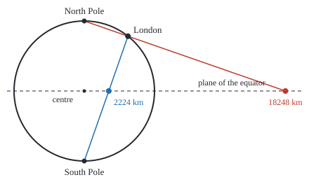

# Sphere, torus and projective plane: the shapes every definition is tested on

[Syllabus](../../../SYLLABUS.md) → [Differential geometry and Lie groups](../README.md) → [Manifolds](../README.md#s03) → Sphere, torus and projective plane

---

## General Overview

No single flat map shows the whole Earth well. A world map either tears along a line or stretches the poles until Greenland looks as big as Africa. A good atlas uses many overlapping sheets instead, each one accurate near its own middle. A **smooth manifold** turns that habit into a definition: a space covered by **charts**, flat coordinate sheets whose changes of coordinates on each overlap are smooth ([Smooth manifold](01-smooth-manifolds-and-charts.md)).

Three shapes test every rule built on that definition.

- **A globe**, the sphere. Two sheets cover it; one cannot.
- **A doughnut**, the torus. Four sheets of angles cover it, and on every overlap two sheets differ by a plain shift.
- **A one-sided sheet**, the real projective plane. Take the globe and treat each point and its **antipode**, the point straight through the centre, as one point. London and a spot in the sea near New Zealand's Antipodes Islands become one place. Three sheets cover it, and one of their overlaps keeps clockwise in one part and reverses it in another.

Flat paper teaches three habits. A mapmaker meets them in this order:

| Flat habit | Globe | Doughnut | One-sided sheet |
| --- | --- | --- | --- |
| 1. One sheet covers everything | fails: 2 sheets needed | fails: 4 sheets here | fails: 3 sheets here |
| 2. Sheets meet without stretching: overlaps differ by a slide or a turn | fails | **holds** | fails |
| 3. Clockwise on one sheet is clockwise on every sheet | holds | holds | **fails** |

All three fail habit 1, because each is closed and bounded. The globe is the first shape to break the habit that matters up close: no atlas of it avoids stretching. The doughnut looks curved in space, yet it passes. The one-sided sheet breaks everything the globe breaks, and clockwise as well.

**Every closed surface needs more than one chart; the torus can be charted with pure shifts, the sphere cannot be charted without stretching, and the projective plane cannot even keep clockwise.**

**What kind of fact this is:** the three atlases are constructions, and the card proves each change of chart is smooth. That one chart never covers a closed surface, and that the projective plane's atlas cannot keep clockwise, are theorems proved here. That the sphere has no stretch-free atlas uses the Gauss–Bonnet theorem for any ruler: [Gauss-Bonnet](../02-Surfaces/10-gauss-bonnet-theorem.md) proves it for surfaces in space, and this card states the general form with its source (Lee, *Introduction to Riemannian Manifolds*), without proof. The Earth as a sphere of radius 6371 km is a model.

### The picture: one point of the globe on two sheets

<p align="center"></p>

The slice runs through the poles and London, to scale at 100 units per Earth radius; the `figure,` line of both runs gives the coordinates. The red ray from the North Pole carries London to its place on the first sheet, 18247.53 km from the centre. The blue ray from the South Pole carries it to the second sheet, 2224.39 km out. The two distances multiply to $`R^2`$.

---

## The formula

Notation first, in words. [Smooth manifold](01-smooth-manifolds-and-charts.md) writes a chart as $`x`$ and a change of chart as $`y \circ x^{-1}`$. On this card $`x, y, z`$ are coordinates in space, so charts get Greek names: $`\sigma`$ (sigma) for the globe's sheets and $`\mu`$ (mu) for the one-sided sheet's. Space has $`z`$ pointing to the North Pole and $`x`$ to longitude 0°.

**The globe** $`S^2`$, radius $`R`$. **Stereographic projection** draws a ray from one pole through the point and marks where it meets the plane of the equator:

```math
\sigma_N(x, y, z) = \frac{R\,(x, y)}{R - z}, \qquad \sigma_S(x, y, z) = \frac{R\,(x, y)}{R + z}, \qquad \sigma_S \circ \sigma_N^{-1}(u) = \frac{R^2\, u}{\lvert u\rvert^2}
```

**Read it aloud:** project from the North Pole or from the South Pole; to move from the first sheet to the second, keep the direction of $`u`$ and replace its distance from the centre by $`R^2`$ over that distance.

The names here follow the pole projected from. [Topological manifold](../../17-Topology/03-Surfaces%20and%20Manifolds/01-topological-manifolds.md) and [Smooth manifold](01-smooth-manifolds-and-charts.md) name a map by the pole at its centre instead, so their "north map", with London 2224.39 km out, is $`\sigma_S`$ here.

**The doughnut** $`T^2`$, with centre-circle radius $`a`$ and tube radius $`b`$. A point is fixed by two angles, $`\theta`$ round the hole and $`\psi`$ (psi) round the tube:

```math
r(\theta, \psi) = \big((a + b\cos\psi)\cos\theta,\ (a + b\cos\psi)\sin\theta,\ b\sin\psi\big), \qquad (\theta, \psi) \longmapsto (\theta + 2\pi m,\ \psi + 2\pi n)
```

**Read it aloud:** the angles place the point in space; each chart reads both angles from an open window of width $`2\pi`$, and two windows differ by whole turns $`m`$ and $`n`$.

**The one-sided sheet** $`\mathbb{RP}^2`$: the lines through the Earth's centre, written $`[x : y : z]`$. **Gnomonic projection** draws the line through the centre and marks where it meets a plane touching the globe:

```math
\mu_z[x : y : z] = R\Big(\frac{x}{z}, \frac{y}{z}\Big), \qquad \mu_x[x : y : z] = R\Big(\frac{y}{x}, \frac{z}{x}\Big), \qquad \mu_x \circ \mu_z^{-1}(U, V) = \Big(\frac{R\,V}{U},\ \frac{R^2}{U}\Big)
```

**Read it aloud:** the sheet touching the North Pole reads a line by its ratios to $`z`$; the sheet touching longitude 0° on the equator reads it by ratios to $`x`$; moving between them divides by the first coordinate $`U`$. A third sheet, $`\mu_y`$, touches the equator at 90° E.

Each change of chart has a **Jacobian determinant**, $`\det J`$: the factor by which it scales small areas, negative when it reverses clockwise.

```math
\det J = -\frac{R^4}{\lvert u\rvert^4}\ \text{(globe)}, \qquad \det J = 1\ \text{(doughnut)}, \qquad \det J = \frac{R^3}{U^3}\ \text{(one-sided sheet)}
```

**Read it aloud:** the globe's change always reverses clockwise; the doughnut's never stretches; the one-sided sheet's reverses clockwise exactly where $`U`$ is negative.

| Symbol | Plain meaning | In our example | Push it up and the answer… |
| --- | --- | --- | --- |
| $`R`$ | the globe's radius | 6371 km | every chart reading grows in step; $`\det J`$ does not change |
| $`x, y, z`$ | a point in space, km | London (3965.39, −8.84, 4986.51) | — |
| $`\varphi`$, $`\theta`$ | the angle down from the North Pole; longitude east, or on the doughnut the angle round the hole | London 38.4926°, −0.1278° | — |
| $`\sigma_N`$, $`\sigma_S`$ | stereographic sheets from the North and the South Pole | London at (18247.48, −40.70) and (2224.39, −4.96) km | a point nearer the North Pole lands further out on $`\sigma_N`$ |
| $`u`$, $`\lvert u\rvert`$ | a point of a sheet, km; its distance from the sheet's centre | 18247.53 km and 2224.39 km | — |
| $`a`$, $`b`$; $`r`$ | the doughnut's centre-circle radius and tube radius; its point in space, cm | 3 cm and 1.5 cm | $`b`$ up to $`a`$: the hole closes |
| $`\psi`$; $`m`$, $`n`$ | the angle round the tube; whole turns between two windows | a sprinkle at $`\psi`$ = 300°; $`m = n = 1`$ | — |
| $`S^2`$, $`T^2`$, $`\mathbb{RP}^2`$, $`[x : y : z]`$ | sphere, torus, real projective plane; the line through $`(x, y, z)`$ and the centre | London and its antipode are one point of $`\mathbb{RP}^2`$ | — |
| $`\mu_z`$, $`\mu_x`$, $`\mu_y`$; $`U`$, $`V`$ | gnomonic sheets touching the North Pole, 0° N 0° E and 0° N 90° E; readings on the pole sheet, km | London at $`(U, V)`$ = (5066.37, −11.30) | — |
| $`J`$, $`\det J`$ | the Jacobian table of rates of a change of chart; its determinant | −0.014860 at London on the globe | — |
| $`\chi`$; $`V`$, $`E`$, $`F`$ | the Euler characteristic, vertices minus edges plus faces | 2, 0 and 1 | — |
| $`K`$, $`dA`$ | Gaussian curvature, in 1/cm² or 1/km²; a small piece of area | doughnut: +0.148148 outside, −0.444444 inside | — |

$`J`$ is wing 06's Jacobian; $`V`$, $`E`$, $`F`$ are counts, not shelf 02's surface quantities. $`V`$ has a second meaning on this card, said once here: the second reading on the pole sheet. The two meanings never share a formula. $`K`$ is the product of a surface's two principal bending rates: positive on a dome, negative on a saddle.

### When it holds

- **Each chart covers an open set, one to one.** Put the North Pole into $`\sigma_N`$ and it has nowhere to go. A point 1 km from the pole already lands 81179282 km out.
- **Angle windows are open.** Read the doughnut's angles from $`[0, 2\pi]`$ and the seam's points get two readings each. Counting the square without its gluing gives $`\chi`$ = 1, a disc, not the torus's 0.
- **Every piece of an overlap is checked.** The one-sided sheet's pole sheet and 0° E sheet overlap in two pieces, where $`U > 0`$ and where $`U < 0`$. London alone says clockwise is kept; Tokyo says it is not.
- **The doughnut needs $`b < a`$.** At $`b = a`$ the inner equator collapses onto the axis, and the angles no longer name each point once.
- **A gnomonic sheet sees an open hemisphere.** Points on its edge circle, 90° from where it touches, run off to infinity. Two sheets miss the antipodal pair where their edge circles cross, one point of $`\mathbb{RP}^2`$, so the one-sided sheet needs three.

---

## Why it works

### Step 0: a change of chart is smooth when it is built from smooth pieces

Every change of chart on this card adds, multiplies and divides coordinates. Such a formula has derivatives of every order wherever no denominator is zero. So for each shape: write the change down, then check its denominator on the overlap.

### Step 1: the globe takes two sheets, and never one

On the North Pole's sheet, a point at angle $`\varphi`$ from the pole lands at distance $`R / \tan(\varphi/2)`$ from the centre. On the South Pole's sheet it lands at $`R \tan(\varphi/2)`$, in the same direction. The product is $`R^2`$ whatever the point. That is the change of chart: keep the direction, swap the distance for $`R^2`$ over the distance.

[Smooth manifold](01-smooth-manifolds-and-charts.md) already fits these sheets to its six-sheet atlas; here they form an atlas of two. For London, $`\varphi`$ = 38.4926°. Its distances are 18247.53 km and 2224.39 km, and their product is 40589641.0 km², which is $`R^2`$. Applying $`R^2 u / \lvert u\rvert^2`$ to (18247.48, −40.70) gives (2224.39, −4.96), the South Pole sheet's own reading.

The denominator $`\lvert u\rvert^2`$ is zero only at $`u = 0`$, the South Pole, which the South Pole's sheet does not contain. So the change is smooth on the whole overlap: the globe minus its two poles.

One sheet is never enough. This holds for the doughnut and the one-sided sheet too.

<details>
<summary>Detailed proof: a closed surface does not fit on one chart</summary>

A chart is a continuous one-to-one map from an open set of the surface onto an open set of the plane, with a continuous inverse. Suppose one chart covered the whole surface.

The surface is compact: closed and bounded in space, or a quotient of such a space. A continuous image of a compact set is compact, so the chart's image is closed and bounded in the plane. It is also open and not empty.

The plane is connected, so its only sets that are both open and closed are the empty set and the whole plane. The image would be the whole plane, which is not bounded. That is a contradiction.

</details>

### Step 2: the doughnut takes four windows, joined by shifts

A point on the doughnut gives its angles back by two inverse tangents. One window reads both angles from $`(-\pi, \pi)`$; another reads them from $`(0, 2\pi)`$. Mixing the two choices gives four windows. A point is missing from a window only when one of its angles sits on that window's edge, and some window always avoids both edges.

A sprinkle at $`\theta`$ = 200°, $`\psi`$ = 300° reads (−160°, −60°) in the first window and (200°, 300°) in the last. The change of chart adds $`2\pi`$ to each angle. Its Jacobian is the identity table, with determinant 1.

A shift keeps lengths and angles of the angle grid. So the four windows fit together like flat paper: the doughnut is the square with opposite edges glued, already built as a product of two circles on [Subspace, product and quotient](../../17-Topology/02-Topological%20Spaces/04-subspace-product-and-quotient-topologies.md). Habit 2 holds.

The doughnut in space is still curved: $`K`$ = +0.148148 per cm² on its outer equator and −0.444444 per cm² on its inner one. A manifold carries no ruler of its own: no rule for lengths at each point, which is called a [Riemannian metric](../05-Riemannian%20Geometry/01-riemannian-metrics.md). The flat square and the doughnut in space give two different rulers on one manifold.

### Step 3: the one-sided sheet takes three gnomonic sheets

A line through the Earth's centre that is not horizontal meets the plane touching the North Pole once. London and its antipode, the line's two ends on the globe, mark the same spot: (5066.37, −11.30) km. Navigators use this projection because it draws every great circle, a shortest route on the globe, as a straight line.

Points of $`\mathbb{RP}^2`$ as ratios that rescaling leaves alone, and the standard charts where one coordinate is not zero, come from [Projective space](../../22-Algebraic%20geometry/02-Affine%20and%20Projective%20Varieties/03-projective-space-and-homogeneous-coordinates.md). The three gnomonic sheets are those charts, measured in kilometres. They cover everything, because every line has some coordinate that is not zero.

What is new is smoothness. From the pole sheet to the 0° E sheet the change is $`(U, V) \mapsto (RV/U, R^2/U)`$. Its denominator $`U`$ is zero exactly where $`x`$ is zero, which is outside the overlap. London goes to (−14.21, 8011.59) km, and $`\mu_x`$ reads the same pair directly from London's position.

### Step 4: clockwise, counted

The sign of $`\det J`$ says whether a change of chart keeps clockwise. A **mirror** on one chart, swapping the sign of its second coordinate, flips the sign of every change into or out of that chart. An atlas can keep clockwise when some choice of mirrors makes every determinant positive. [Orientability](../../17-Topology/03-Surfaces%20and%20Manifolds/03-orientability-mobius-strip-and-klein-bottle.md) gives the same test with paper panels, and shows the projective plane is one-sided.

- **Globe.** $`\det J`$ = −0.014860 at London, and it is negative on all of the overlap, which is one connected piece. Mirroring one sheet makes it positive everywhere: 2 of the 4 mirror choices work.
- **Doughnut.** $`\det J`$ = 1 everywhere, so the choices that work are "mirror nothing" and "mirror everything": 2 of 16.
- **One-sided sheet.** $`\det J = R^3/U^3`$ is +1.9885 at London and −0.8360 at Tokyo, two points of one overlap. A mirror flips both signs together, so no choice repairs both: 0 of 8.

That proves this atlas cannot keep clockwise. No other atlas can either, since the surface contains a Möbius strip. Walk from London to its antipode and the path closes up in $`\mathbb{RP}^2`$. Sending each point to its antipode reverses clockwise on the globe, so a clockwise arrow carried round that loop comes back anticlockwise.

### Step 5: stretching, counted by curvature

Habit 2 asks for an atlas whose changes are all slides and turns, the distance-keeping moves of [Symmetry](../../05-Geometry%20and%20trig/06-Beyond%20Euclid/04-symmetry-and-tilings.md). Then the flat ruler of each sheet agrees with its neighbours on every overlap. The sheets together give the whole surface one ruler with $`K = 0`$ everywhere.

The **Gauss–Bonnet theorem** says that for every ruler on a closed surface

```math
\int K\, dA = 2\pi \chi
```

**Read it aloud:** the curvature added over the whole surface is $`2\pi`$ times the Euler characteristic, whatever the ruler. [Gauss-Bonnet](../02-Surfaces/10-gauss-bonnet-theorem.md) proves it for surfaces in space, from lengths and angles measured within the surface. A stretch-free atlas gives the surface a ruler of its own, not one taken from a shape in space, so this card needs the form for any ruler. It is stated here, not proved; Lee's *Introduction to Riemannian Manifolds*, chapter 9, proves it (Sources).

A flat ruler gives 0, so it needs $`\chi = 0`$. Counting from [Euler characteristic](../../17-Topology/03-Surfaces%20and%20Manifolds/04-euler-characteristic-and-triangulations.md) settles it:

- the globe as an octahedron: 6 − 12 + 8 = 2;
- the one-sided sheet as an octahedron with opposite points glued: 3 − 6 + 4 = 1;
- the doughnut as a 4 × 4 grid with opposite edges glued: 0.

Only the doughnut can have flat sheets, and Step 2 built them. The code checks the theorem by adding $`K\,dA`$: the round globe gives 2.000082 times $`2\pi`$, the doughnut 0.000000, and the round one-sided sheet, half a globe, 1.000010. The doughnut's outer half carries 12.566887 and its inner half −12.566887, each near $`4\pi`$ = 12.566371. The globe's sum is off by 0.002067 with 50 steps and 0.000517 with 100; doubling the steps quarters the error.

One triangle shows the same break. Join the North Pole, 0° N 0° E and 0° N 90° E by great circles. Its angles add to 270.0000°, not 180°, and the 90° excess times $`R^2`$ is 63758059 km², one eighth of the globe's area, as on [Triangles on a sphere](../../05-Geometry%20and%20trig/06-Beyond%20Euclid/01-triangles-on-a-sphere.md). No stretch-free sheet can show that triangle.

---

## Worked numbers, by hand

| Step | Arithmetic | Value |
| --- | --- | --- |
| London from the pole | 90° − 51.5074° | $`\varphi`$ = 38.4926° |
| distance on the North Pole sheet | $`R / \tan(\varphi/2)`$ | 18247.53 km |
| distance on the South Pole sheet | $`R \tan(\varphi/2)`$ | 2224.39 km |
| their product | 18247.53 × 2224.39 | 40589641.0 km² = $`R^2`$ |
| how the change scales lengths | $`R^2 / \lvert u\rvert^2`$ | 0.121901 |
| its determinant | −0.121901² | −0.014860 |
| sprinkle, first window | 200° − 360°, 300° − 360° | (−160°, −60°) |
| London on the pole's gnomonic sheet | $`R\,(x/z, y/z)`$ | (5066.37, −11.30) km |
| London on the 0° E sheet | (6371 × −11.30 / 5066.37, 6371² / 5066.37) | (−14.21, 8011.59) km |
| determinant at London | (6371 / 5066.37)³ | 1.9885 |
| determinant at Tokyo | (6371 / −6762.91)³ | −0.8360 |
| mirror choices keeping clockwise | London needs the two sheets mirrored alike, Tokyo needs them mirrored differently | **0 of 8** |

No choice of mirrors lets the one-sided sheet's atlas keep clockwise, while the globe has 2 of 4 and the doughnut 2 of 16.

### What breaks if you drop a piece

| Mistake | Comes out at | What went wrong |
| --- | --- | --- |
| One chart for the whole globe | a point 1 km from the North Pole lands 81179282 km out; the pole has no place | a closed surface does not fit on one chart |
| The doughnut's square left unglued | $`\chi`$ = 1, not 0 | without its gluing the square is a disc |
| A stretch-free sheet for the globe | angles of the octant triangle add to 180°, not 270.0000° | the globe has curvature, so 63758059 km² of excess is lost |
| Checking the one-sided sheet's overlap at London only | $`\det J`$ = +1.9885: "clockwise is kept" | the overlap has two pieces; at Tokyo it is −0.8360 |

The code prints all four.

---

## Code, from first principles, and it actually runs

The code builds the three atlases and checks them by independent roads. Each change of chart is computed from its closed form and again as one chart applied to the other's inverse. Each determinant comes from its closed form and from central differences, small steps either side of the point. Clockwise is settled by trying every mirror choice. The Euler characteristic is counted on glued meshes and again by adding $`K\,dA`$, with $`K`$ found from second differences of the surface. The octant triangle's excess is checked against one eighth of the globe's area.

### Python

```python
# Sphere, torus and projective plane -- the check behind the card.  Standard library only.
# Changes of chart: closed form against chart-of-inverse-chart; determinants: closed form
# against central differences; clockwise: count the mirror choices that keep it; Euler
# characteristic: glued meshes counted against curvature summed over the surface.
from math import sin, cos, atan2, acos, sqrt, radians, degrees, pi
from itertools import product
R, A, B = 6371.0, 3.0, 1.5             # globe radius, km; doughnut: centre-circle and tube radius, cm
def sph(lat, lon):                     # latitude N, longitude E in degrees -> point in space, km
    p, t = radians(90 - lat), radians(lon)
    return (R * sin(p) * cos(t), R * sin(p) * sin(t), R * cos(p))
CITY = {"London": (51.5074, -0.1278), "Tokyo": (35.6762, 139.6503),
        "Delhi": (28.6139, 77.2090), "Sydney": (-33.8688, 151.2093)}
PTS = [sph(*v) for v in CITY.values()]
LON = PTS[0]
def det2(f, u):                        # Jacobian determinant of a map of the plane, central differences
    c = []
    for i in range(2):
        h = 1e-6 * max(1.0, abs(u[i]))
        up, dn = [x + h * (k == i) for k, x in enumerate(u)], [x - h * (k == i) for k, x in enumerate(u)]
        c.append([(a - b) / (2 * h) for a, b in zip(f(up), f(dn))])
    return c[0][0] * c[1][1] - c[0][1] * c[1][0]
def orientations(charts, samples):     # mirror choices (one sign per chart) keeping every det > 0
    dets = [(i, j, det2(lambda u, i=i, j=j: charts[j][0](charts[i][1](u)), charts[i][0](p)))
            for p in samples for i in range(len(charts)) for j in range(len(charts)) if i != j]
    return sum(all(s[i] * s[j] * d > 0 for i, j, d in dets)
               for s in product((1, -1), repeat=len(charts)))
f2 = lambda u: f"({u[0]:.2f}, {u[1]:.2f})"
# The globe: stereographic charts from the North Pole and from the South Pole
def sN(p): return (R * p[0] / (R - p[2]), R * p[1] / (R - p[2]))
def sS(p): return (R * p[0] / (R + p[2]), R * p[1] / (R + p[2]))
def back(u, sgn):
    s = u[0] ** 2 + u[1] ** 2
    return (2 * R * R * u[0] / (s + R * R), 2 * R * R * u[1] / (s + R * R), sgn * R * (s - R * R) / (s + R * R))
SPH = [(sN, lambda u: back(u, 1)), (sS, lambda u: back(u, -1))]
uN, uS = sN(LON), sS(LON)
n2 = uN[0] ** 2 + uN[1] ** 2
T = (R * R * uN[0] / n2, R * R * uN[1] / n2)
dS, dF = -(R * R / n2) ** 2, det2(lambda u: sS(back(u, 1)), uN)
print(f"globe: R = {R:.0f} km; London at latitude 51.5074 N, longitude 0.1278 W")
print(f"London in space: ({LON[0]:.2f}, {LON[1]:.2f}, {LON[2]:.2f}) km")
print(f"chart from North Pole: {f2(uN)} km; from South Pole: {f2(sS(LON))} km")
print(f"|u_N| = {sqrt(n2):.2f} km, |u_S| = {sqrt(uS[0]**2 + uS[1]**2):.2f} km; product {sqrt(n2) * sqrt(uS[0]**2 + uS[1]**2):.1f} = R^2 = {R*R:.1f} km^2")
print(f"change of chart R^2 u/|u|^2 applied to u_N: {f2(T)} km")
print(f"det of change, closed form -R^4/|u|^4: {dS:.6f}; differences: {dF:.6f}; length factor {R*R/n2:.6f}")
pole = sph(90 - degrees(1 / R), 0.0)
print(f"a point 1 km from the North Pole, chart from North Pole: {sN(pole)[0]:.0f} km out")
# The doughnut: angle charts on four windows; theta round the hole, psi round the tube
def tor(u): w = A + B * cos(u[1]); return (w * cos(u[0]), w * sin(u[0]), B * sin(u[1]))
def win(lt, ls):
    def f(p):
        t, s = atan2(p[1], p[0]), atan2(p[2], sqrt(p[0] ** 2 + p[1] ** 2) - A)
        return ((t - lt) % (2 * pi) + lt, (s - ls) % (2 * pi) + ls)
    return f
TOR = [(win(lt, ls), tor) for lt in (-pi, 0.0) for ls in (-pi, 0.0)]
spr = tor((radians(200), radians(300)))
print(f"doughnut: a = {A:.1f} cm, b = {B:.1f} cm; sprinkle at theta 200 deg, psi 300 deg")
print("sprinkle in windows (-pi,pi)^2 and (0,2pi)^2, deg: " +
      "; ".join("({:.1f}, {:.1f})".format(*map(degrees, TOR[k][0](spr))) for k in (0, 3)))
dT = det2(lambda u: TOR[3][0](tor(u)), TOR[0][0](spr))
print(f"det of change, closed form 1; differences: {dT:.6f}")
TS = [tor((radians(a), radians(b))) for a, b in ((200, 300), (30, 60), (120, 210), (290, 100))]
# The one-sided sheet: lines through the Earth's centre, gnomonic charts tangent at three points
mz = (lambda p: (R * p[0] / p[2], R * p[1] / p[2]), lambda u: (u[0], u[1], R))
mx = (lambda p: (R * p[1] / p[0], R * p[2] / p[0]), lambda u: (R, u[0], u[1]))
my = (lambda p: (R * p[0] / p[1], R * p[2] / p[1]), lambda u: (u[0], R, u[1]))
RP = [mz, mx, my]
anti = tuple(-c for c in LON)
print(f"gnomonic sheet at the North Pole: London {f2(mz[0](LON))}, its antipode {f2(mz[0](anti))} km")
for name, p in zip(CITY, PTS):
    U, V = mz[0](p)
    print(f"{name}: sheet at pole {f2((U, V))}, at 0E {f2(mx[0](p))}; formula (RV/U, R^2/U) {f2((R * V / U, R * R / U))};"
          f" det R^3/U^3 {(R / U) ** 3:.4f}, differences {det2(lambda u: mx[0](mz[1](u)), (U, V)):.4f}")
# Clockwise: count mirror choices that make every change of chart keep it
nS, nT, nP = orientations(SPH, PTS), orientations(TOR, TS), orientations(RP, PTS)
print(f"mirror choices keeping clockwise: globe {nS} of 4, doughnut {nT} of 16, one-sided sheet {nP} of 8")
# Euler characteristic, counted on glued meshes
E3 = [tuple(s * (i == k) for k in range(3)) for i in range(3) for s in (1, -1)]
oV = set(E3)
oE = {frozenset((v, w)) for v in E3 for w in E3 if sum(a * b for a, b in zip(v, w)) == 0}
oF = {frozenset(((x, 0, 0), (0, y, 0), (0, 0, z))) for x, y, z in product((1, -1), repeat=3)}
neg = lambda v: tuple(-c for c in v)
glue = lambda S, f: {frozenset((x, f(x))) for x in S}
negset = lambda s: frozenset(neg(v) for v in s)
chi = lambda V, E, F: len(V) - len(E) + len(F)
def grid(n, glued):
    w = (lambda i: i % n) if glued else (lambda i: i)
    sq = [[(w(i + a), w(j + b)) for a, b in ((0, 0), (1, 0), (1, 1), (0, 1))] for i in range(n) for j in range(n)]
    V = {c for s in sq for c in s}
    E = {frozenset((s[k], s[(k + 1) % 4])) for s in sq for k in range(4)}
    return V, E, {frozenset(s) for s in sq}
cS, cP = chi(oV, oE, oF), chi(glue(oV, neg), glue(oE, negset), glue(oF, negset))
cT, cQ = chi(*grid(4, True)), chi(*grid(4, False))
print(f"Euler count V - E + F: octahedron {len(oV)} - {len(oE)} + {len(oF)} = {cS}; "
      f"glued opposite: {len(glue(oV, neg))} - {len(glue(oE, negset))} + {len(glue(oF, negset))} = {cP}")
print(f"Euler count: 4 x 4 grid glued {cT}; same grid unglued {cQ}")
# Euler characteristic again, from curvature: K from E, F, G, L, M, N by differences, then sum K dA
def Kint(r, s0, s1, t0, t1, n, h=1e-4):
    tot, ds, dt = 0.0, (s1 - s0) / n, (t1 - t0) / n
    for i, j in product(range(n), repeat=2):
        s, t = s0 + (i + 0.5) * ds, t0 + (j + 0.5) * dt
        q = lambda a, b: r((s + a * h, t + b * h))
        c, rs, rt = q(0, 0), [(x - y) / (2 * h) for x, y in zip(q(1, 0), q(-1, 0))], [(x - y) / (2 * h) for x, y in zip(q(0, 1), q(0, -1))]
        rss = [(x - 2 * y + z) / h / h for x, y, z in zip(q(1, 0), c, q(-1, 0))]
        rtt = [(x - 2 * y + z) / h / h for x, y, z in zip(q(0, 1), c, q(0, -1))]
        rst = [(w - x - y + z) / (4 * h * h) for w, x, y, z in zip(q(1, 1), q(1, -1), q(-1, 1), q(-1, -1))]
        nv = (rs[1] * rt[2] - rs[2] * rt[1], rs[2] * rt[0] - rs[0] * rt[2], rs[0] * rt[1] - rs[1] * rt[0])
        dA = sqrt(sum(x * x for x in nv))
        d = lambda u, v: sum(x * y for x, y in zip(u, v))
        L, M, N = (d(x, nv) / dA for x in (rss, rst, rtt))
        tot += (L * N - M * M) / (d(rs, rs) * d(rt, rt) - d(rs, rt) ** 2) * dA * ds * dt
    return tot, (L * N - M * M) / dA ** 2
glb = lambda u: (R * sin(u[0]) * cos(u[1]), R * sin(u[0]) * sin(u[1]), R * cos(u[0]))
gS, gS50, gP = Kint(glb, 0, pi, 0, 2 * pi, 100)[0], Kint(glb, 0, pi, 0, 2 * pi, 50)[0], Kint(glb, 0, pi / 2, 0, 2 * pi, 100)[0]
gT, gO, gI = (Kint(tor, -pi, pi, a, b, 100)[0] for a, b in ((-pi, pi), (-pi / 2, pi / 2), (pi / 2, 3 * pi / 2)))
kO, kI = Kint(tor, -1e-3, 1e-3, -1e-3, 1e-3, 1)[1], Kint(tor, -1e-3, 1e-3, pi - 1e-3, pi + 1e-3, 1)[1]
print(f"doughnut K: outer equator {kO:.6f} (closed form {1/(B*(A+B)):.6f}), inner {kI:.6f} ({-1/(B*(A-B)):.6f}) per cm^2")
z6 = lambda x: round(x, 6) + 0.0          # prints -0.000000 as 0.000000
print(f"integral of K dA / 2pi: globe {gS / (2*pi):.6f}, doughnut {z6(gT / (2*pi)):.6f}, one-sided sheet {gP / (2*pi):.6f}")
print(f"doughnut: outer half {gO:.6f}, inner half {gI:.6f}, 4pi = {4*pi:.6f}; globe error 50 steps {abs(gS50 - 4*pi):.6f}, 100 steps {abs(gS - 4*pi):.6f}")
# What breaks: a flat sheet asked to keep the octant triangle exact
tri = [sph(90, 0), sph(0, 0), sph(0, 90)]
def ang(a, b, c):                      # angle at a between great-circle arcs to b and c
    tb, tc = ([y - sum(p * q for p, q in zip(a, x)) / R / R * z for y, z in zip(x, a)] for x in (b, c))
    return acos(sum(p * q for p, q in zip(tb, tc)) / sqrt(sum(p * p for p in tb) * sum(q * q for q in tc)))
tot = sum(ang(tri[k], tri[(k + 1) % 3], tri[(k + 2) % 3]) for k in range(3))
print(f"octant triangle: angles add to {degrees(tot):.4f} deg (a flat sheet gives 180); "
      f"excess x R^2 = {(tot - pi) * R * R:.0f} km^2, one eighth of 4 pi R^2 = {pi * R * R / 2:.0f} km^2")
print(f"figure, 100 units = R; N (120, 30), S (120, 230), London ({120 + 100 * sin(radians(38.4926)):.2f}, {130 - 100 * cos(radians(38.4926)):.2f}),"
      f" u_N ({120 + 100 * uN[0] / R:.2f}, 130), u_S ({120 + 100 * uS[0] / R:.2f}, 130)")
assert all(abs(x - y) < 1e-6 for x, y in zip(T, uS))          # change of chart: formula = chart of inverse
assert abs(dF - dS) < 1e-6 and abs(dT - 1) < 1e-6              # determinants: closed form = differences
assert all(abs(x - y - 2 * pi) < 1e-12 for x, y in zip(TOR[3][0](spr), TOR[0][0](spr)))   # torus: a shift by 2 pi
assert all(abs(mx[0](p)[0] - R * mz[0](p)[1] / mz[0](p)[0]) + abs(mx[0](p)[1] - R * R / mz[0](p)[0]) < 1e-6 for p in PTS)
assert (nS, nT, nP) == (2, 2, 0)                                # clockwise: kept, kept, impossible
assert (cS, cT, cP) == (round(gS / (2 * pi)), round(gT / (2 * pi)), round(gP / (2 * pi))) == (2, 0, 1)
assert abs(kO - 1 / (B * (A + B))) < 1e-5 and abs(kI + 1 / (B * (A - B))) < 1e-5
assert abs((tot - pi) * R * R - pi * R * R / 2) < 1e-3 * R * R
print("ALL CHECKS PASS")
```

**Ran 2026-11-19 on macOS, Python 3.14.10, standard library only. All checks passed. Output, pasted from the run:**

```
globe: R = 6371 km; London at latitude 51.5074 N, longitude 0.1278 W
London in space: (3965.39, -8.84, 4986.51) km
chart from North Pole: (18247.48, -40.70) km; from South Pole: (2224.39, -4.96) km
|u_N| = 18247.53 km, |u_S| = 2224.39 km; product 40589641.0 = R^2 = 40589641.0 km^2
change of chart R^2 u/|u|^2 applied to u_N: (2224.39, -4.96) km
det of change, closed form -R^4/|u|^4: -0.014860; differences: -0.014860; length factor 0.121901
a point 1 km from the North Pole, chart from North Pole: 81179282 km out
doughnut: a = 3.0 cm, b = 1.5 cm; sprinkle at theta 200 deg, psi 300 deg
sprinkle in windows (-pi,pi)^2 and (0,2pi)^2, deg: (-160.0, -60.0); (200.0, 300.0)
det of change, closed form 1; differences: 1.000000
gnomonic sheet at the North Pole: London (5066.37, -11.30), its antipode (5066.37, -11.30) km
London: sheet at pole (5066.37, -11.30), at 0E (-14.21, 8011.59); formula (RV/U, R^2/U) (-14.21, 8011.59); det R^3/U^3 1.9885, differences 1.9885
Tokyo: sheet at pole (-6762.91, 5745.46), at 0E (-5412.51, -6001.80); formula (RV/U, R^2/U) (-5412.51, -6001.80); det R^3/U^3 -0.8360, differences -0.8360
Delhi: sheet at pole (2585.56, 11388.69), at 0E (28062.46, 15698.56); formula (RV/U, R^2/U) (28062.46, 15698.56); det R^3/U^3 14.9609, differences 14.9609
Sydney: sheet at pole (8318.83, -4571.56), at 0E (-3501.14, 4879.25); formula (RV/U, R^2/U) (-3501.14, 4879.25); det R^3/U^3 0.4492, differences 0.4492
mirror choices keeping clockwise: globe 2 of 4, doughnut 2 of 16, one-sided sheet 0 of 8
Euler count V - E + F: octahedron 6 - 12 + 8 = 2; glued opposite: 3 - 6 + 4 = 1
Euler count: 4 x 4 grid glued 0; same grid unglued 1
doughnut K: outer equator 0.148148 (closed form 0.148148), inner -0.444444 (-0.444444) per cm^2
integral of K dA / 2pi: globe 2.000082, doughnut 0.000000, one-sided sheet 1.000010
doughnut: outer half 12.566887, inner half -12.566887, 4pi = 12.566371; globe error 50 steps 0.002067, 100 steps 0.000517
octant triangle: angles add to 270.0000 deg (a flat sheet gives 180); excess x R^2 = 63758059 km^2, one eighth of 4 pi R^2 = 63758059 km^2
figure, 100 units = R; N (120, 30), S (120, 230), London (182.24, 51.73), u_N (406.41, 130), u_S (154.91, 130)
ALL CHECKS PASS
```

### Rust

Same numbers, same labels, built with `rustc --edition 2021 -O`.

```rust
// Sphere, torus and projective plane -- the same check as the Python, in Rust.  No crates.
// Changes of chart: closed form against chart-of-inverse-chart; determinants: closed form
// against central differences; clockwise: count the mirror choices that keep it; Euler
// characteristic: glued meshes counted against curvature summed over the surface.
use std::collections::BTreeSet;
use std::f64::consts::PI;
const R: f64 = 6371.0; // globe radius, km
const A: f64 = 3.0; const B: f64 = 1.5; // doughnut: centre-circle and tube radius, cm
type V3 = [f64; 3];
type P2 = [f64; 2];
type Chart = (Box<dyn Fn(V3) -> P2>, Box<dyn Fn(P2) -> V3>);

fn sph(lat: f64, lon: f64) -> V3 { // latitude N, longitude E in degrees -> point in space, km
    let (p, t) = ((90.0 - lat).to_radians(), lon.to_radians());
    [R * p.sin() * t.cos(), R * p.sin() * t.sin(), R * p.cos()]
}
fn det2(f: &dyn Fn(P2) -> P2, u: P2) -> f64 { // Jacobian determinant, central differences
    let mut c = [[0.0; 2]; 2];
    for i in 0..2 {
        let h = 1e-6 * u[i].abs().max(1.0);
        let (mut up, mut dn) = (u, u); up[i] += h; dn[i] -= h;
        let (a, b) = (f(up), f(dn));
        c[i] = [(a[0] - b[0]) / (2.0 * h), (a[1] - b[1]) / (2.0 * h)];
    }
    c[0][0] * c[1][1] - c[0][1] * c[1][0]
}
fn orientations(ch: &[Chart], samples: &[V3]) -> usize { // mirror choices keeping every det > 0
    let mut dets = vec![];
    for p in samples { for i in 0..ch.len() { for j in 0..ch.len() { if i != j {
        dets.push((i, j, det2(&|u| ch[j].0(ch[i].1(u)), ch[i].0(*p))));
    } } } }
    (0..1usize << ch.len()).filter(|m| {
        let s = |k: usize| if m >> k & 1 == 0 { 1.0 } else { -1.0 };
        dets.iter().all(|&(i, j, d)| s(i) * s(j) * d > 0.0)
    }).count()
}
fn f2(u: P2) -> String { format!("({:.2}, {:.2})", u[0], u[1]) }
fn sn(p: V3) -> P2 { [R * p[0] / (R - p[2]), R * p[1] / (R - p[2])] }
fn ss(p: V3) -> P2 { [R * p[0] / (R + p[2]), R * p[1] / (R + p[2])] }
fn back(u: P2, sgn: f64) -> V3 {
    let s = u[0] * u[0] + u[1] * u[1];
    [2.0 * R * R * u[0] / (s + R * R), 2.0 * R * R * u[1] / (s + R * R), sgn * R * (s - R * R) / (s + R * R)]
}
fn tor(u: P2) -> V3 { let w = A + B * u[1].cos(); [w * u[0].cos(), w * u[0].sin(), B * u[1].sin()] }
fn win(lt: f64, ls: f64, p: V3) -> P2 {
    let (t, s) = (p[1].atan2(p[0]), p[2].atan2((p[0] * p[0] + p[1] * p[1]).sqrt() - A));
    [(t - lt).rem_euclid(2.0 * PI) + lt, (s - ls).rem_euclid(2.0 * PI) + ls]
}
fn mz(p: V3) -> P2 { [R * p[0] / p[2], R * p[1] / p[2]] }
fn mx(p: V3) -> P2 { [R * p[1] / p[0], R * p[2] / p[0]] }
fn my(p: V3) -> P2 { [R * p[0] / p[1], R * p[2] / p[1]] }
type I3 = (i32, i32, i32);
fn neg(v: I3) -> I3 { (-v.0, -v.1, -v.2) }
fn glue<T: Ord + Clone>(s: &BTreeSet<T>, f: &dyn Fn(&T) -> T) -> usize {
    s.iter().map(|x| { let y = f(x); if *x < y { (x.clone(), y) } else { (y, x.clone()) } }).collect::<BTreeSet<_>>().len()
}
fn negset(s: &BTreeSet<I3>) -> BTreeSet<I3> { s.iter().map(|&v| neg(v)).collect() }
fn grid(n: i32, glued: bool) -> (usize, usize, usize) {
    let w = |i: i32| if glued { i % n } else { i };
    let (mut v, mut e, mut f) = (BTreeSet::new(), BTreeSet::new(), BTreeSet::new());
    for i in 0..n { for j in 0..n {
        let sq: Vec<(i32, i32)> = [(0, 0), (1, 0), (1, 1), (0, 1)].iter().map(|&(a, b)| (w(i + a), w(j + b))).collect();
        for k in 0..4 { v.insert(sq[k]); let (x, y) = (sq[k], sq[(k + 1) % 4]); e.insert(if x < y { (x, y) } else { (y, x) }); }
        f.insert(sq.iter().cloned().collect::<BTreeSet<_>>());
    } }
    (v.len(), e.len(), f.len())
}
fn d3(u: &V3, v: &V3) -> f64 { u[0] * v[0] + u[1] * v[1] + u[2] * v[2] }
fn kint(r: &dyn Fn(P2) -> V3, s0: f64, s1: f64, t0: f64, t1: f64, n: usize) -> (f64, f64) {
    let (h, ds, dt) = (1e-4, (s1 - s0) / n as f64, (t1 - t0) / n as f64);
    let (mut tot, mut k) = (0.0, 0.0);
    for i in 0..n { for j in 0..n {
        let (s, t) = (s0 + (i as f64 + 0.5) * ds, t0 + (j as f64 + 0.5) * dt);
        let q = |a: f64, b: f64| r([s + a * h, t + b * h]);
        let c = q(0.0, 0.0);
        let m = |f: &dyn Fn(usize) -> f64| [f(0), f(1), f(2)];
        let rs = m(&|x| (q(1.0, 0.0)[x] - q(-1.0, 0.0)[x]) / (2.0 * h));
        let rt = m(&|x| (q(0.0, 1.0)[x] - q(0.0, -1.0)[x]) / (2.0 * h));
        let rss = m(&|x| (q(1.0, 0.0)[x] - 2.0 * c[x] + q(-1.0, 0.0)[x]) / h / h);
        let rtt = m(&|x| (q(0.0, 1.0)[x] - 2.0 * c[x] + q(0.0, -1.0)[x]) / h / h);
        let rst = m(&|x| (q(1.0, 1.0)[x] - q(1.0, -1.0)[x] - q(-1.0, 1.0)[x] + q(-1.0, -1.0)[x]) / (4.0 * h * h));
        let nv = [rs[1] * rt[2] - rs[2] * rt[1], rs[2] * rt[0] - rs[0] * rt[2], rs[0] * rt[1] - rs[1] * rt[0]];
        let da = d3(&nv, &nv).sqrt();
        let (l, mm, nn) = (d3(&rss, &nv) / da, d3(&rst, &nv) / da, d3(&rtt, &nv) / da);
        tot += (l * nn - mm * mm) / (d3(&rs, &rs) * d3(&rt, &rt) - d3(&rs, &rt).powi(2)) * da * ds * dt;
        k = (l * nn - mm * mm) / (da * da);
    } }
    (tot, k)
}
fn ang(a: V3, b: V3, c: V3) -> f64 { // angle at a between great-circle arcs to b and c
    let tg = |x: V3| { let k = d3(&a, &x) / R / R; [x[0] - k * a[0], x[1] - k * a[1], x[2] - k * a[2]] };
    let (tb, tc) = (tg(b), tg(c));
    (d3(&tb, &tc) / (d3(&tb, &tb) * d3(&tc, &tc)).sqrt()).acos()
}
fn main() {
    let city = [("London", 51.5074, -0.1278), ("Tokyo", 35.6762, 139.6503), ("Delhi", 28.6139, 77.2090), ("Sydney", -33.8688, 151.2093)];
    let pts: Vec<V3> = city.iter().map(|c| sph(c.1, c.2)).collect();
    let lon = pts[0];
    let sphc: Vec<Chart> = vec![(Box::new(sn), Box::new(|u| back(u, 1.0))), (Box::new(ss), Box::new(|u| back(u, -1.0)))];
    let (un, us) = (sn(lon), ss(lon));
    let (n2, nus) = (un[0] * un[0] + un[1] * un[1], (us[0] * us[0] + us[1] * us[1]).sqrt());
    let tt = [R * R * un[0] / n2, R * R * un[1] / n2];
    let (dsx, dfx) = (-(R * R / n2).powi(2), det2(&|u| ss(back(u, 1.0)), un));
    println!("globe: R = {:.0} km; London at latitude 51.5074 N, longitude 0.1278 W", R);
    println!("London in space: ({:.2}, {:.2}, {:.2}) km", lon[0], lon[1], lon[2]);
    println!("chart from North Pole: {} km; from South Pole: {} km", f2(un), f2(ss(lon)));
    println!("|u_N| = {:.2} km, |u_S| = {:.2} km; product {:.1} = R^2 = {:.1} km^2", n2.sqrt(), nus, n2.sqrt() * nus, R * R);
    println!("change of chart R^2 u/|u|^2 applied to u_N: {} km", f2(tt));
    println!("det of change, closed form -R^4/|u|^4: {:.6}; differences: {:.6}; length factor {:.6}", dsx, dfx, R * R / n2);
    println!("a point 1 km from the North Pole, chart from North Pole: {:.0} km out", sn(sph(90.0 - (1.0 / R).to_degrees(), 0.0))[0]);
    let mut torc: Vec<Chart> = vec![];
    for lt in [-PI, 0.0] { for ls in [-PI, 0.0] { torc.push((Box::new(move |p| win(lt, ls, p)), Box::new(tor))); } }
    let spr = tor([200f64.to_radians(), 300f64.to_radians()]);
    println!("doughnut: a = {:.1} cm, b = {:.1} cm; sprinkle at theta 200 deg, psi 300 deg", A, B);
    let wd = |k: usize| { let w = torc[k].0(spr); format!("({:.1}, {:.1})", w[0].to_degrees(), w[1].to_degrees()) };
    println!("sprinkle in windows (-pi,pi)^2 and (0,2pi)^2, deg: {}; {}", wd(0), wd(3));
    let dt = det2(&|u| torc[3].0(tor(u)), torc[0].0(spr));
    println!("det of change, closed form 1; differences: {:.6}", dt);
    let ts: Vec<V3> = [(200.0, 300.0), (30.0, 60.0), (120.0, 210.0), (290.0, 100.0)].iter()
        .map(|&(a, b): &(f64, f64)| tor([a.to_radians(), b.to_radians()])).collect();
    let rp: Vec<Chart> = vec![(Box::new(mz), Box::new(|u| [u[0], u[1], R])), (Box::new(mx), Box::new(|u| [R, u[0], u[1]])),
                              (Box::new(my), Box::new(|u| [u[0], R, u[1]]))];
    println!("gnomonic sheet at the North Pole: London {}, its antipode {} km", f2(mz(lon)), f2(mz([-lon[0], -lon[1], -lon[2]])));
    for (c, p) in city.iter().zip(&pts) {
        let [u, v] = mz(*p);
        println!("{}: sheet at pole {}, at 0E {}; formula (RV/U, R^2/U) {}; det R^3/U^3 {:.4}, differences {:.4}", c.0, f2([u, v]), f2(mx(*p)),
                 f2([R * v / u, R * R / u]), (R / u).powi(3), det2(&|w| mx([w[0], w[1], R]), [u, v]));
    }
    let (ns, nt, np) = (orientations(&sphc, &pts), orientations(&torc, &ts), orientations(&rp, &pts));
    println!("mirror choices keeping clockwise: globe {} of 4, doughnut {} of 16, one-sided sheet {} of 8", ns, nt, np);
    let e3: Vec<I3> = vec![(1, 0, 0), (-1, 0, 0), (0, 1, 0), (0, -1, 0), (0, 0, 1), (0, 0, -1)];
    let ov: BTreeSet<I3> = e3.iter().cloned().collect();
    let mut oe: BTreeSet<BTreeSet<I3>> = BTreeSet::new();
    for v in &e3 { for w in &e3 { if v.0 * w.0 + v.1 * w.1 + v.2 * w.2 == 0 { oe.insert([*v, *w].into_iter().collect()); } } }
    let mut of: BTreeSet<BTreeSet<I3>> = BTreeSet::new();
    for x in [1, -1] { for y in [1, -1] { for z in [1, -1] { of.insert([(x, 0, 0), (0, y, 0), (0, 0, z)].into_iter().collect()); } } }
    let (gv, ge, gf) = (glue(&ov, &|v| neg(*v)), glue(&oe, &negset), glue(&of, &negset));
    let (cs, cp) = (ov.len() as i64 - oe.len() as i64 + of.len() as i64, gv as i64 - ge as i64 + gf as i64);
    let chi = |g: (usize, usize, usize)| g.0 as i64 - g.1 as i64 + g.2 as i64;
    let (ct, cq) = (chi(grid(4, true)), chi(grid(4, false)));
    println!("Euler count V - E + F: octahedron {} - {} + {} = {}; glued opposite: {} - {} + {} = {}", ov.len(), oe.len(), of.len(), cs, gv, ge, gf, cp);
    println!("Euler count: 4 x 4 grid glued {}; same grid unglued {}", ct, cq);
    let glb = |u: P2| [R * u[0].sin() * u[1].cos(), R * u[0].sin() * u[1].sin(), R * u[0].cos()];
    let (gs, gs50, gp) = (kint(&glb, 0.0, PI, 0.0, 2.0 * PI, 100).0, kint(&glb, 0.0, PI, 0.0, 2.0 * PI, 50).0, kint(&glb, 0.0, PI / 2.0, 0.0, 2.0 * PI, 100).0);
    let g = |a: f64, b: f64| kint(&tor, -PI, PI, a, b, 100).0;
    let (gt, go, gi) = (g(-PI, PI), g(-PI / 2.0, PI / 2.0), g(PI / 2.0, 3.0 * PI / 2.0));
    let (ko, ki) = (kint(&tor, -1e-3, 1e-3, -1e-3, 1e-3, 1).1, kint(&tor, -1e-3, 1e-3, PI - 1e-3, PI + 1e-3, 1).1);
    println!("doughnut K: outer equator {:.6} (closed form {:.6}), inner {:.6} ({:.6}) per cm^2", ko, 1.0 / (B * (A + B)), ki, -1.0 / (B * (A - B)));
    let z6 = |x: f64| (x * 1e6).round() / 1e6 + 0.0; // prints -0.000000 as 0.000000
    println!("integral of K dA / 2pi: globe {:.6}, doughnut {:.6}, one-sided sheet {:.6}", gs / (2.0 * PI), z6(gt / (2.0 * PI)), gp / (2.0 * PI));
    println!("doughnut: outer half {:.6}, inner half {:.6}, 4pi = {:.6}; globe error 50 steps {:.6}, 100 steps {:.6}", go, gi, 4.0 * PI,
             (gs50 - 4.0 * PI).abs(), (gs - 4.0 * PI).abs());
    let tri = [sph(90.0, 0.0), sph(0.0, 0.0), sph(0.0, 90.0)];
    let tot: f64 = (0..3).map(|k| ang(tri[k], tri[(k + 1) % 3], tri[(k + 2) % 3])).sum();
    println!("octant triangle: angles add to {:.4} deg (a flat sheet gives 180); excess x R^2 = {:.0} km^2, one eighth of 4 pi R^2 = {:.0} km^2",
             tot.to_degrees(), (tot - PI) * R * R, PI * R * R / 2.0);
    let ph = 38.4926f64.to_radians();
    println!("figure, 100 units = R; N (120, 30), S (120, 230), London ({:.2}, {:.2}), u_N ({:.2}, 130), u_S ({:.2}, 130)", 120.0 + 100.0 * ph.sin(), 130.0 - 100.0 * ph.cos(), 120.0 + 100.0 * un[0] / R, 120.0 + 100.0 * us[0] / R);

    assert!((tt[0] - us[0]).abs() < 1e-6 && (tt[1] - us[1]).abs() < 1e-6); // formula = chart of inverse
    assert!((dfx - dsx).abs() < 1e-6 && (dt - 1.0).abs() < 1e-6); // determinants: closed form = differences
    assert!((0..2).all(|k| (torc[3].0(spr)[k] - torc[0].0(spr)[k] - 2.0 * PI).abs() < 1e-12)); // torus: a shift by 2 pi
    assert!(pts.iter().all(|p| (mx(*p)[0] - R * mz(*p)[1] / mz(*p)[0]).abs() + (mx(*p)[1] - R * R / mz(*p)[0]).abs() < 1e-6));
    assert!((ns, nt, np) == (2, 2, 0)); // clockwise: kept, kept, impossible
    let rd = |x: f64| (x / (2.0 * PI)).round() as i64;
    assert!((cs, ct, cp) == (rd(gs), rd(gt), rd(gp)) && (cs, ct, cp) == (2, 0, 1));
    assert!((ko - 1.0 / (B * (A + B))).abs() < 1e-5 && (ki + 1.0 / (B * (A - B))).abs() < 1e-5);
    assert!(((tot - PI) * R * R - PI * R * R / 2.0).abs() < 1e-3 * R * R);
    println!("ALL CHECKS PASS");
}
```

**Ran 2026-11-19 on macOS, rustc 1.98.1, no crates. All checks passed. Output, pasted from the run:**

```
globe: R = 6371 km; London at latitude 51.5074 N, longitude 0.1278 W
London in space: (3965.39, -8.84, 4986.51) km
chart from North Pole: (18247.48, -40.70) km; from South Pole: (2224.39, -4.96) km
|u_N| = 18247.53 km, |u_S| = 2224.39 km; product 40589641.0 = R^2 = 40589641.0 km^2
change of chart R^2 u/|u|^2 applied to u_N: (2224.39, -4.96) km
det of change, closed form -R^4/|u|^4: -0.014860; differences: -0.014860; length factor 0.121901
a point 1 km from the North Pole, chart from North Pole: 81179282 km out
doughnut: a = 3.0 cm, b = 1.5 cm; sprinkle at theta 200 deg, psi 300 deg
sprinkle in windows (-pi,pi)^2 and (0,2pi)^2, deg: (-160.0, -60.0); (200.0, 300.0)
det of change, closed form 1; differences: 1.000000
gnomonic sheet at the North Pole: London (5066.37, -11.30), its antipode (5066.37, -11.30) km
London: sheet at pole (5066.37, -11.30), at 0E (-14.21, 8011.59); formula (RV/U, R^2/U) (-14.21, 8011.59); det R^3/U^3 1.9885, differences 1.9885
Tokyo: sheet at pole (-6762.91, 5745.46), at 0E (-5412.51, -6001.80); formula (RV/U, R^2/U) (-5412.51, -6001.80); det R^3/U^3 -0.8360, differences -0.8360
Delhi: sheet at pole (2585.56, 11388.69), at 0E (28062.46, 15698.56); formula (RV/U, R^2/U) (28062.46, 15698.56); det R^3/U^3 14.9609, differences 14.9609
Sydney: sheet at pole (8318.83, -4571.56), at 0E (-3501.14, 4879.25); formula (RV/U, R^2/U) (-3501.14, 4879.25); det R^3/U^3 0.4492, differences 0.4492
mirror choices keeping clockwise: globe 2 of 4, doughnut 2 of 16, one-sided sheet 0 of 8
Euler count V - E + F: octahedron 6 - 12 + 8 = 2; glued opposite: 3 - 6 + 4 = 1
Euler count: 4 x 4 grid glued 0; same grid unglued 1
doughnut K: outer equator 0.148148 (closed form 0.148148), inner -0.444444 (-0.444444) per cm^2
integral of K dA / 2pi: globe 2.000082, doughnut 0.000000, one-sided sheet 1.000010
doughnut: outer half 12.566887, inner half -12.566887, 4pi = 12.566371; globe error 50 steps 0.002067, 100 steps 0.000517
octant triangle: angles add to 270.0000 deg (a flat sheet gives 180); excess x R^2 = 63758059 km^2, one eighth of 4 pi R^2 = 63758059 km^2
figure, 100 units = R; N (120, 30), S (120, 230), London (182.24, 51.73), u_N (406.41, 130), u_S (154.91, 130)
ALL CHECKS PASS
```

The two outputs match line for line.

### Lean

Lean proves the card's three changes of chart for any radius $`R > 0`$, and that one chart never covers a closed surface.

- Take a point of the globe that is neither pole. Then $`\sigma_S`$ reads $`R^2 u / \lvert u\rvert^2`$ where $`\sigma_N`$ reads $`u`$.
- Take $`u \ne 0`$. Then the globe's change of chart is smooth there, with $`\det J = -R^4/\lvert u\rvert^4`$.
- Take a doughnut with $`0 < b < a`$. Then the window $`(-\pi, \pi)^2`$ names each point once.
- Take whole turns $`m`$ and $`n`$. Then adding $`(2\pi m, 2\pi n)`$ to the angles gives the same point, and this shift has $`\det J = 1`$.
- Take a point and rescale it. Then its readings on $`\mu_z`$ and on $`\mu_x`$ do not change.
- Take a point with $`z \ne 0`$. Then $`\mu_z^{-1}`$ of its $`\mu_z`$ reading lies on its line through the centre.
- Take $`U \ne 0`$. Then $`\mu_x \circ \mu_z^{-1}(U, V) = (RV/U, R^2/U)`$, smooth there, with $`\det J = R^3/U^3`$.
- Take any mirrors on $`\mu_z`$ and $`\mu_x`$. Then $`\det J`$ fails to be positive somewhere on their overlap, so this atlas cannot keep clockwise.
- Take any compact space that is not empty, such as the three shapes. Then no chart onto an open set of the plane covers all of it.
- Lean also checks the arithmetic 6371 × 6371 = 40589641, the sprinkle's (−160°, −60°) and the octant triangle's 90° excess.
- It checks the Euler counts 2, 1, 0 and 1, and the mirror counts 2 of 4 and 2 of 16.

London's and Tokyo's readings, the curvature sums and the step-size errors are left to the Python and Rust checks.

```lean
-- Sphere, torus and projective plane: the projective plane's three gnomonic sheets change smoothly but cannot keep clockwise, the globe's stereographic change reverses it and the doughnut's angle windows differ by shifts, and no closed surface fits on one chart.
import Mathlib.Analysis.Calculus.ContDiff.Operations
import Mathlib.Analysis.Calculus.Deriv.Basic
import Mathlib.Analysis.Calculus.Deriv.Add
import Mathlib.Analysis.Calculus.Deriv.Mul
import Mathlib.Analysis.Calculus.Deriv.Inv
import Mathlib.Analysis.Calculus.Deriv.Pow
import Mathlib.Analysis.InnerProductSpace.PiL2
import Mathlib.Analysis.SpecialFunctions.Trigonometric.Basic
import Mathlib.Topology.OpenPartialHomeomorph.Defs
import Mathlib.Data.Fintype.Pi
import Mathlib.Tactic.NormNum

open scoped ContDiff

/-- The Jacobian determinant of a map of the plane at `p`, from its table of partial rates:
`∂f₁/∂u₁ · ∂f₂/∂u₂ - ∂f₁/∂u₂ · ∂f₂/∂u₁`. Negative means the map reverses clockwise. -/
noncomputable def jacDet (f : ℝ × ℝ → ℝ × ℝ) (p : ℝ × ℝ) : ℝ :=
  deriv (fun a => (f (a, p.2)).1) p.1 * deriv (fun b => (f (p.1, b)).2) p.2 -
    deriv (fun b => (f (p.1, b)).1) p.2 * deriv (fun a => (f (a, p.2)).2) p.1

/-- A mirror on a chart: `s = 1` leaves it alone, `s = -1` swaps the sign of its second
coordinate. -/
def mirror (s : ℝ) (u : ℝ × ℝ) : ℝ × ℝ := (u.1, s * u.2)

/-- The gnomonic sheet `μ_z` touching the North Pole of the globe of radius `R`: the line
through the centre and `(x, y, z)` meets the plane `z = R` at `R (x/z, y/z)`. -/
noncomputable def gnomZ (R : ℝ) (p : ℝ × ℝ × ℝ) : ℝ × ℝ := (R * p.1 / p.2.2, R * p.2.1 / p.2.2)

/-- The gnomonic sheet `μ_x` touching the equator at longitude 0°: `R (y/x, z/x)`. -/
noncomputable def gnomX (R : ℝ) (p : ℝ × ℝ × ℝ) : ℝ × ℝ := (R * p.2.1 / p.1, R * p.2.2 / p.1)

/-- The inverse of `μ_z`: the reading `(U, V)` is the line through the point `(U, V, R)`. -/
def gnomZInv (R : ℝ) (u : ℝ × ℝ) : ℝ × ℝ × ℝ := (u.1, u.2, R)

/-- Stereographic projection `σ_N` of the globe of radius `R` from the North Pole. -/
noncomputable def stereoN (R : ℝ) (p : ℝ × ℝ × ℝ) : ℝ × ℝ :=
  (R * p.1 / (R - p.2.2), R * p.2.1 / (R - p.2.2))

/-- Stereographic projection `σ_S` of the globe of radius `R` from the South Pole. -/
noncomputable def stereoS (R : ℝ) (p : ℝ × ℝ × ℝ) : ℝ × ℝ :=
  (R * p.1 / (R + p.2.2), R * p.2.1 / (R + p.2.2))

/-- The globe's change of chart `u ↦ R² u / |u|²`. -/
noncomputable def invertSheet (R : ℝ) (u : ℝ × ℝ) : ℝ × ℝ :=
  (R ^ 2 * u.1 / (u.1 ^ 2 + u.2 ^ 2), R ^ 2 * u.2 / (u.1 ^ 2 + u.2 ^ 2))

/-- The doughnut with centre-circle radius `a` and tube radius `b`, at angle `θ = u.1` round the
hole and `ψ = u.2` round the tube. -/
noncomputable def torusPoint (a b : ℝ) (u : ℝ × ℝ) : ℝ × ℝ × ℝ :=
  ((a + b * Real.cos u.2) * Real.cos u.1, (a + b * Real.cos u.2) * Real.sin u.1, b * Real.sin u.2)

/-- The projective change of chart with mirrors, written out. -/
theorem mirrored_change_eq (R sZ sX : ℝ) (v : ℝ × ℝ) :
    mirror sX (gnomX R (gnomZInv R (mirror sZ v))) = (R * (sZ * v.2) / v.1, sX * (R * R / v.1)) := by
  simp [mirror, gnomX, gnomZInv]

/-- Jacobian determinant of the mirrored projective change of chart. -/
theorem jacDet_mirrored (R sZ sX : ℝ) (u : ℝ × ℝ) (hu : u.1 ≠ 0) :
    jacDet (fun v => mirror sX (gnomX R (gnomZInv R (mirror sZ v)))) u =
      sZ * sX * R ^ 3 / u.1 ^ 3 := by
  simp only [jacDet, mirrored_change_eq]
  have h1 : HasDerivAt (fun a : ℝ => R * (sZ * u.2) / a) (-(R * (sZ * u.2)) / u.1 ^ 2) u.1 := by
    have := (hasDerivAt_inv hu).const_mul (R * (sZ * u.2))
    convert this using 1
    · ext a; simp [div_eq_mul_inv]
    · field_simp
  have h2 : HasDerivAt (fun b : ℝ => sX * (R * R / u.1)) 0 u.2 := hasDerivAt_const _ _
  have h3 : HasDerivAt (fun b : ℝ => R * (sZ * b) / u.1) (R * sZ / u.1) u.2 := by
    have := ((hasDerivAt_id u.2).const_mul (R * sZ)).div_const u.1
    convert this using 1
    · ext b; simp; ring
    · simp
  have h4 : HasDerivAt (fun a : ℝ => sX * (R * R / a)) (-(sX * (R * R)) / u.1 ^ 2) u.1 := by
    have := (hasDerivAt_inv hu).const_mul (sX * (R * R))
    convert this using 1
    · ext a; simp [div_eq_mul_inv]; ring
    · field_simp
  rw [h1.deriv, h2.deriv, h3.deriv, h4.deriv]
  field_simp
  ring

/-- Jacobian determinant of the globe's change of chart. -/
theorem jacDet_invertSheet (R : ℝ) (u : ℝ × ℝ) (hu : u.1 ^ 2 + u.2 ^ 2 ≠ 0) :
    jacDet (invertSheet R) u = -R ^ 4 / (u.1 ^ 2 + u.2 ^ 2) ^ 2 := by
  obtain ⟨x, y⟩ := u
  simp only at hu ⊢
  simp only [jacDet, invertSheet]
  have d1 : HasDerivAt (fun a : ℝ => R ^ 2 * a / (a ^ 2 + y ^ 2))
      ((R ^ 2 * 1 * (x ^ 2 + y ^ 2) - R ^ 2 * x * (2 * x)) / (x ^ 2 + y ^ 2) ^ 2) x := by
    have hn : HasDerivAt (fun t : ℝ => R ^ 2 * t) (R ^ 2 * 1) x := (hasDerivAt_id' x).const_mul _
    have hd : HasDerivAt (fun a : ℝ => a ^ 2 + y ^ 2) (2 * x) x := by
      simpa using (hasDerivAt_pow 2 x).add_const (y ^ 2)
    exact hn.div hd hu
  have d2 : HasDerivAt (fun b : ℝ => R ^ 2 * b / (x ^ 2 + b ^ 2))
      ((R ^ 2 * 1 * (x ^ 2 + y ^ 2) - R ^ 2 * y * (2 * y)) / (x ^ 2 + y ^ 2) ^ 2) y := by
    have hn : HasDerivAt (fun t : ℝ => R ^ 2 * t) (R ^ 2 * 1) y := (hasDerivAt_id' y).const_mul _
    have hd : HasDerivAt (fun b : ℝ => x ^ 2 + b ^ 2) (2 * y) y := by
      simpa using (hasDerivAt_pow 2 y).const_add (x ^ 2)
    exact hn.div hd hu
  have d3 : HasDerivAt (fun b : ℝ => R ^ 2 * x / (x ^ 2 + b ^ 2))
      ((0 * (x ^ 2 + y ^ 2) - R ^ 2 * x * (2 * y)) / (x ^ 2 + y ^ 2) ^ 2) y := by
    have hn := hasDerivAt_const y (R ^ 2 * x)
    have hd : HasDerivAt (fun b : ℝ => x ^ 2 + b ^ 2) (2 * y) y := by
      simpa using (hasDerivAt_pow 2 y).const_add (x ^ 2)
    exact hn.div hd hu
  have d4 : HasDerivAt (fun a : ℝ => R ^ 2 * y / (a ^ 2 + y ^ 2))
      ((0 * (x ^ 2 + y ^ 2) - R ^ 2 * y * (2 * x)) / (x ^ 2 + y ^ 2) ^ 2) x := by
    have hn := hasDerivAt_const x (R ^ 2 * y)
    have hd : HasDerivAt (fun a : ℝ => a ^ 2 + y ^ 2) (2 * x) x := by
      simpa using (hasDerivAt_pow 2 x).add_const (y ^ 2)
    exact hn.div hd hu
  rw [d1.deriv, d2.deriv, d3.deriv, d4.deriv]
  field_simp
  ring

/-- On the open window `(-π, π)`, cosine and sine together name each angle once. -/
theorem angle_eq_of_cos_sin_eq {θ θ' : ℝ} (h : θ ∈ Set.Ioo (-Real.pi) Real.pi)
    (h' : θ' ∈ Set.Ioo (-Real.pi) Real.pi) (hc : Real.cos θ = Real.cos θ')
    (hs : Real.sin θ = Real.sin θ') : θ = θ' := by
  have hcos : Real.cos (θ - θ') = 1 := by
    rw [Real.cos_sub, ← hc, ← hs]
    nlinarith [Real.sin_sq_add_cos_sq θ]
  have := (Real.cos_eq_one_iff_of_lt_of_lt (x := θ - θ') (by linarith [h.1, h'.2])
    (by linarith [h.2, h'.1])).1 hcos
  linarith

#print axioms mirrored_change_eq
#print axioms jacDet_mirrored
#print axioms jacDet_invertSheet
#print axioms angle_eq_of_cos_sin_eq

/-- The one-sided sheet's atlas cannot keep clockwise. On the globe of radius `R > 0`, the
gnomonic sheets `μ_z` and `μ_x` read lines through the centre: rescaling a point does not
change its reading, and `μ_z⁻¹(U, V) = (U, V, R)` lies on the line `μ_z` read. Their change of
chart `μ_x ∘ μ_z⁻¹` is `(U, V) ↦ (RV/U, R²/U)`, smooth on the whole overlap `U ≠ 0`, with
Jacobian determinant `R³/U³`. That determinant is positive where `U > 0` and negative where
`U < 0`, so no choice of mirrors on the two sheets makes the change keep clockwise on the
whole overlap. -/
theorem projective_plane_atlas_cannot_keep_clockwise (R : ℝ) (hR : 0 < R) :
    (∀ (c : ℝ) (p : ℝ × ℝ × ℝ), c ≠ 0 → gnomZ R (c • p) = gnomZ R p ∧ gnomX R (c • p) = gnomX R p) ∧
    (∀ p : ℝ × ℝ × ℝ, p.2.2 ≠ 0 → gnomZInv R (gnomZ R p) = (R / p.2.2) • p) ∧
    (∀ u : ℝ × ℝ, gnomX R (gnomZInv R u) = (R * u.2 / u.1, R ^ 2 / u.1)) ∧
    ContDiffOn ℝ ∞ (fun u => gnomX R (gnomZInv R u)) {u | u.1 ≠ 0} ∧
    (∀ u : ℝ × ℝ, u.1 ≠ 0 → jacDet (fun v => gnomX R (gnomZInv R v)) u = R ^ 3 / u.1 ^ 3) ∧
    ¬ ∃ sZ sX : ℝ, (sZ = 1 ∨ sZ = -1) ∧ (sX = 1 ∨ sX = -1) ∧
      ∀ u : ℝ × ℝ, u.1 ≠ 0 →
        0 < jacDet (fun v => mirror sX (gnomX R (gnomZInv R (mirror sZ v)))) u := by
  refine ⟨?_, ?_, ?_, ?_, ?_, ?_⟩
  · intro c p hc
    obtain ⟨x, y, z⟩ := p
    simp only [gnomZ, gnomX, Prod.smul_mk, smul_eq_mul]
    refine ⟨Prod.ext ?_ ?_, Prod.ext ?_ ?_⟩ <;> simp only <;>
      rw [mul_left_comm, mul_div_mul_left _ _ hc]
  · intro p hp
    obtain ⟨x, y, z⟩ := p
    simp only at hp
    simp only [gnomZ, gnomZInv, Prod.smul_mk, smul_eq_mul]
    refine Prod.ext ?_ (Prod.ext ?_ ?_) <;> simp only <;> field_simp
  · intro u
    simp [gnomX, gnomZInv, pow_two]
  · have hf : (fun u : ℝ × ℝ => gnomX R (gnomZInv R u)) =
        fun u => (R * u.2 / u.1, R * R / u.1) := by
      funext u; simp [gnomX, gnomZInv]
    rw [hf]
    apply ContDiffOn.prodMk
    · exact (contDiffOn_const.mul contDiff_snd.contDiffOn).div contDiff_fst.contDiffOn
        (fun u hu => hu)
    · exact contDiffOn_const.div contDiff_fst.contDiffOn (fun u hu => hu)
  · intro u hu
    have hf : (fun v : ℝ × ℝ => gnomX R (gnomZInv R v)) =
        fun v => mirror 1 (gnomX R (gnomZInv R (mirror 1 v))) := by
      funext v; simp [mirror]
    rw [hf, jacDet_mirrored R 1 1 u hu]
    ring
  · rintro ⟨sZ, sX, hZ, hX, h⟩
    have hp := h (1, 0) one_ne_zero
    have hn := h (-1, 0) (by norm_num)
    rw [jacDet_mirrored R sZ sX _ one_ne_zero] at hp
    rw [jacDet_mirrored R sZ sX _ (by norm_num)] at hn
    simp only at hp hn
    have hR3 : 0 < R ^ 3 := by positivity
    rcases hZ with rfl | rfl <;> rcases hX with rfl | rfl <;> norm_num at hp hn <;> linarith

/-- The globe and the doughnut. On the globe of radius `R > 0`, a point that is neither pole
reads `σ_S = R² u / |u|²` where `σ_N` reads `u`; that change of chart is smooth on the whole
overlap `u ≠ 0`, and its Jacobian determinant is `-R⁴/|u|⁴`, negative everywhere, so it
reverses clockwise and mirroring one sheet fixes it. On the doughnut with `0 < b < a`, the
angles name each point once in the open window `(-π, π)²`, two windows differ by whole turns
`(2πm, 2πn)`, and that shift has Jacobian determinant 1. -/
theorem globe_and_doughnut_changes_of_chart (R : ℝ) (hR : 0 < R) (a b : ℝ) (hb : 0 < b)
    (hab : b < a) :
    (∀ p : ℝ × ℝ × ℝ, p.1 ^ 2 + p.2.1 ^ 2 + p.2.2 ^ 2 = R ^ 2 → p.2.2 ≠ R → p.2.2 ≠ -R →
      stereoS R p = invertSheet R (stereoN R p)) ∧
    ContDiffOn ℝ ∞ (invertSheet R) {u | u ≠ 0} ∧
    (∀ u : ℝ × ℝ, u ≠ 0 → jacDet (invertSheet R) u = -R ^ 4 / (u.1 ^ 2 + u.2 ^ 2) ^ 2) ∧
    Set.InjOn (torusPoint a b) (Set.Ioo (-Real.pi) Real.pi ×ˢ Set.Ioo (-Real.pi) Real.pi) ∧
    (∀ (m n : ℤ) (u : ℝ × ℝ),
      torusPoint a b (u.1 + 2 * Real.pi * m, u.2 + 2 * Real.pi * n) = torusPoint a b u ∧
      jacDet (fun v => (v.1 + 2 * Real.pi * m, v.2 + 2 * Real.pi * n)) u = 1) := by
  have hR0 : R ≠ 0 := hR.ne'
  have hsq : ∀ u : ℝ × ℝ, u ≠ 0 → u.1 ^ 2 + u.2 ^ 2 ≠ 0 := by
    rintro ⟨x, y⟩ hu h
    apply hu
    have hx : x = 0 := by nlinarith [sq_nonneg x, sq_nonneg y]
    have hy : y = 0 := by nlinarith [sq_nonneg x, sq_nonneg y]
    simp [hx, hy]
  have hpos : ∀ ψ : ℝ, 0 < a + b * Real.cos ψ := by
    intro ψ; nlinarith [Real.neg_one_le_cos ψ]
  refine ⟨?_, ?_, ?_, ?_, ?_⟩
  · rintro ⟨x, y, z⟩ hs h1 h2
    simp only at hs h1 h2
    have hm : R - z ≠ 0 := sub_ne_zero.mpr (Ne.symm h1)
    have hp : R + z ≠ 0 := by
      intro h; apply h2; linarith
    have hxy : x ^ 2 + y ^ 2 = (R - z) * (R + z) := by linear_combination hs
    have hden : (R * x / (R - z)) ^ 2 + (R * y / (R - z)) ^ 2 = R ^ 2 * (R + z) / (R - z) := by
      rw [div_pow, div_pow, ← add_div, mul_pow, mul_pow, ← mul_add, hxy]
      field_simp
    simp only [stereoS, stereoN, invertSheet]
    rw [hden]
    refine Prod.ext ?_ ?_ <;> simp only <;> field_simp
  · apply ContDiffOn.prodMk
    · exact (contDiffOn_const.mul contDiff_fst.contDiffOn).div
        ((contDiff_fst.pow 2).add (contDiff_snd.pow 2)).contDiffOn (fun u hu => hsq u hu)
    · exact (contDiffOn_const.mul contDiff_snd.contDiffOn).div
        ((contDiff_fst.pow 2).add (contDiff_snd.pow 2)).contDiffOn (fun u hu => hsq u hu)
  · intro u hu
    exact jacDet_invertSheet R u (hsq u hu)
  · rintro ⟨θ, ψ⟩ ⟨hθ, hψ⟩ ⟨θ', ψ'⟩ ⟨hθ', hψ'⟩ heq
    simp only [torusPoint, Prod.mk.injEq] at heq hθ hψ hθ' hψ'
    obtain ⟨e1, e2, e3⟩ := heq
    have r1 := hpos ψ
    have r2 := hpos ψ'
    have hr : a + b * Real.cos ψ = a + b * Real.cos ψ' := by
      have hsq2 : (a + b * Real.cos ψ) ^ 2 = (a + b * Real.cos ψ') ^ 2 := by
        have t1 := Real.sin_sq_add_cos_sq θ
        have t2 := Real.sin_sq_add_cos_sq θ'
        linear_combination ((a + b * Real.cos ψ) * Real.cos θ + (a + b * Real.cos ψ') * Real.cos θ') * e1 +
          ((a + b * Real.cos ψ) * Real.sin θ + (a + b * Real.cos ψ') * Real.sin θ') * e2 -
          (a + b * Real.cos ψ) ^ 2 * t1 + (a + b * Real.cos ψ') ^ 2 * t2
      nlinarith [sq_nonneg (a + b * Real.cos ψ - (a + b * Real.cos ψ'))]
    have hcθ : Real.cos θ = Real.cos θ' := by
      rw [hr] at e1; exact mul_left_cancel₀ r2.ne' e1
    have hsθ : Real.sin θ = Real.sin θ' := by
      rw [hr] at e2; exact mul_left_cancel₀ r2.ne' e2
    have hcψ : Real.cos ψ = Real.cos ψ' := by
      have := hr; have hb0 : b ≠ 0 := hb.ne'
      have : b * Real.cos ψ = b * Real.cos ψ' := by linarith
      exact mul_left_cancel₀ hb0 this
    have hsψ : Real.sin ψ = Real.sin ψ' := mul_left_cancel₀ hb.ne' e3
    rw [angle_eq_of_cos_sin_eq hθ hθ' hcθ hsθ, angle_eq_of_cos_sin_eq hψ hψ' hcψ hsψ]
  · intro m n u
    constructor
    · have h1 : u.1 + 2 * Real.pi * m = u.1 + (m : ℤ) * (2 * Real.pi) := by ring
      have h2 : u.2 + 2 * Real.pi * n = u.2 + (n : ℤ) * (2 * Real.pi) := by ring
      simp only [torusPoint, h1, h2, Real.cos_add_int_mul_two_pi, Real.sin_add_int_mul_two_pi]
    · simp [jacDet]

/-- A closed surface does not fit on one chart. If a space is compact and not empty, no chart
onto an open set of the plane has the whole space as its patch. -/
theorem closed_surface_not_on_one_chart {X : Type*} [TopologicalSpace X] [CompactSpace X]
    [Nonempty X] (φ : OpenPartialHomeomorph X (EuclideanSpace ℝ (Fin 2))) :
    φ.source ≠ Set.univ := by
  intro h
  have hc : IsCompact φ.target := by
    rw [← φ.image_source_eq_target, h]
    exact isCompact_univ.image_of_continuousOn (h ▸ φ.continuousOn)
  have hne : φ.target.Nonempty := by
    obtain ⟨x⟩ := ‹Nonempty X›
    exact ⟨φ x, φ.map_source (h ▸ Set.mem_univ x)⟩
  have huniv : φ.target = Set.univ := IsClopen.eq_univ ⟨hc.isClosed, φ.open_target⟩ hne
  have : CompactSpace (EuclideanSpace ℝ (Fin 2)) := ⟨huniv ▸ hc⟩
  exact not_compactSpace_iff.mpr inferInstance this

-- London on the two stereographic sheets: the distances multiply to R² = 6371 × 6371 km².
example : (6371 : ℕ) * 6371 = 40589641 := by norm_num
-- The sprinkle at θ = 200°, ψ = 300° reads (-160°, -60°) in the first window: one whole turn off.
example : (200 : ℤ) - 360 = -160 ∧ (300 : ℤ) - 360 = -60 := by norm_num
-- Euler counts: octahedron 6 - 12 + 8 = 2; opposite points glued 3 - 6 + 4 = 1;
-- 4 × 4 grid glued 16 - 32 + 16 = 0; the same grid unglued 25 - 40 + 16 = 1.
example : (6 : ℤ) - 12 + 8 = 2 ∧ (3 : ℤ) - 6 + 4 = 1 ∧ (16 : ℤ) - 32 + 16 = 0 ∧
    (25 : ℤ) - 40 + 16 = 1 := by norm_num
-- Mirror choices keeping clockwise: the globe's one change reverses it, so the two sheets must be
-- mirrored differently, 2 of 4; the doughnut's changes all keep it, so all four windows must be
-- mirrored alike, 2 of 16.
example : (Finset.univ.filter fun s : Fin 2 → Bool => s 0 ≠ s 1).card = 2 := by decide
example : (Finset.univ.filter fun s : Fin 4 → Bool => ∀ i j, s i = s j).card = 2 := by decide
-- The octant triangle: angles 90° + 90° + 90° exceed 180° by 90°, one eighth of the globe's 720°.
example : (3 * 90 : ℤ) - 180 = 90 ∧ (720 : ℤ) / 8 = 90 := by norm_num

#print axioms projective_plane_atlas_cannot_keep_clockwise
#print axioms globe_and_doughnut_changes_of_chart
#print axioms closed_surface_not_on_one_chart
```

**Checked 2026-11-19 on macOS, Lean 4.36.0-rc2, Mathlib v4.36.0-rc2. Every proof is complete and uses only Lean's standard axioms. Output, pasted from the run:**

```
'mirrored_change_eq' depends on axioms: [propext, Classical.choice, Quot.sound]
'jacDet_mirrored' depends on axioms: [propext, Classical.choice, Quot.sound]
'jacDet_invertSheet' depends on axioms: [propext, Classical.choice, Quot.sound]
'angle_eq_of_cos_sin_eq' depends on axioms: [propext, Classical.choice, Quot.sound]
'projective_plane_atlas_cannot_keep_clockwise' depends on axioms: [propext, Classical.choice, Quot.sound]
'globe_and_doughnut_changes_of_chart' depends on axioms: [propext, Classical.choice, Quot.sound]
'closed_surface_not_on_one_chart' depends on axioms: [propext, Classical.choice, Quot.sound]
```

> [!TIP]
> **Try changing**
> Guess first, then run it.
> - **A fatter tube.** Set `B = 2.5`. Guess first: does the doughnut's total curvature change? It does not. The outer equator flattens to 0.072727 per cm² and the inner one sharpens to −0.800000, and the total stays 0.000000. All checks pass.
> - **A doughnut with no hole.** Set `B = 3.0`, equal to `A`. Guess first: what happens at the inner equator? It sits on the axis, where every $`\theta`$ names one point. The Python stops with a division by zero there.
> - **The Moon.** Set `R = 1737.4`, the Moon's radius in km. Guess first: which numbers change? Every reading scales: London sits at (4976.17, −11.10) km on the North Pole sheet. The determinants do not: still −0.014860 and 1.9885. All checks pass.
> - **Drop Tokyo.** Replace `"Tokyo": (35.6762, 139.6503)` by `"Paris": (48.8566, 2.3522)`. Guess first: can clockwise now be kept? Still 0 of 8: the other overlaps, between the 90° E sheet and the rest, still contradict each other.

---

## The usual mistake

> [!warning]
> **Checking a change of chart at one point, or on one piece of the overlap.** The one-sided sheet's pole sheet and 0° E sheet overlap in two pieces. At London $`\det J`$ is +1.9885, and it looks as if clockwise is kept. At Tokyo it is −0.8360. Only the whole overlap decides.
>
> - **One chart for a closed shape.** A point 1 km from the North Pole lands 81179282 km out on $`\sigma_N`$, and the pole itself has no place.
> - **Closed windows on the doughnut.** Reading angles from $`[0, 2\pi]`$ gives seam points two readings, and the unglued square counts $`\chi`$ = 1.
> - **Taking the shape in space for the manifold.** The doughnut in space has $`K`$ from −0.444444 to +0.148148 per cm², yet as a manifold it carries flat sheets with shifts between them.
> - **Treating chart readings as properties of the place.** London is 18247.53 km out on one sheet and 2224.39 km on the other. Only what both sheets agree on belongs to the globe.

---

## Where you meet it in real life

- **Polar maps.** Maps of the Arctic and the Antarctic use polar stereographic projection, the two sheets of Step 1; Snyder (Sources) gives the working formulas.
- **Great-circle navigation.** On a gnomonic chart every great circle is a straight line. A navigator draws the straight line, then reads off the route.
- **Video games and simulations.** A screen whose left edge continues on the right, and whose top continues at the bottom, is a flat torus: the shifts of Step 2.
- **Exotic spheres.** Smoothness is extra structure. John Milnor found 7-dimensional spheres that are the same as the round one for topology but carry different smooth atlases, and Michel Kervaire and Milnor counted 28 such smooth spheres in dimension 7, the standard one included, with a sphere and its mirror image counted separately (Sources).

> **Say it back**
> A manifold is checked by writing its charts and the changes between them. The globe takes two stereographic sheets, joined by $`u \mapsto R^2 u / \lvert u\rvert^2`$. The doughnut takes four windows of angles, joined by shifts of $`2\pi`$, so it can be covered by flat sheets. The one-sided sheet takes three gnomonic sheets, and one overlap keeps clockwise at London and reverses it at Tokyo, so no mirror choice fixes it. No closed surface fits on one sheet; the sphere is the first to need stretching, and the projective plane also loses clockwise.

---

## What this builds on

- [Smooth manifold](01-smooth-manifolds-and-charts.md): charts, atlases and smooth changes of chart, the definition these three shapes test.
- [Symmetry](../../05-Geometry%20and%20trig/06-Beyond%20Euclid/04-symmetry-and-tilings.md): slides and turns, the distance-keeping moves that a stretch-free atlas would need between its sheets.
- [Subspace, product and quotient](../../17-Topology/02-Topological%20Spaces/04-subspace-product-and-quotient-topologies.md): the circle and the torus built by gluing and as a product, which this card gives smooth charts.
- [Orientability](../../17-Topology/03-Surfaces%20and%20Manifolds/03-orientability-mobius-strip-and-klein-bottle.md): one-sided surfaces and the projective plane, here tested through determinants.
- [Projective space](../../22-Algebraic%20geometry/02-Affine%20and%20Projective%20Varieties/03-projective-space-and-homogeneous-coordinates.md): points as ratios and the standard charts, here measured in kilometres and shown smooth.

## Where this goes next

- [Tangent space and differential](03-tangent-spaces-and-differentials.md): the next card puts a plane of velocities at each point of these shapes, and turns the Jacobian $`J`$ into the differential of a map.
- [The six-sphere](../../25-Frontier/04-Geometry%20and%20Combinatorics/08-complex-structures-on-the-six-sphere.md): does S^6 carry a true complex structure, and the 2026 claims that it does.

The atlases say which shapes are manifolds, but not yet how to move on them: what a velocity is at a point that every chart describes differently.

---

## Sources

Verified 2026-11-19: every link below resolves to the publisher's page.

- Lee, John M. *Introduction to Smooth Manifolds*, 2nd ed. Springer, Graduate Texts in Mathematics 218, 2012. [doi:10.1007/978-1-4419-9982-5](https://doi.org/10.1007/978-1-4419-9982-5). Spheres, tori and projective spaces as smooth manifolds, with stereographic and standard charts.
- Lee, John M. *Introduction to Riemannian Manifolds*. Springer, Graduate Texts in Mathematics, 2018. [doi:10.1007/978-3-319-91755-9](https://doi.org/10.1007/978-3-319-91755-9). Chapter 9 proves the Gauss–Bonnet theorem for any ruler (Riemannian metric) on a closed surface, not only for surfaces in space.
- Snyder, John P. *Map Projections: A Working Manual*. U.S. Geological Survey Professional Paper 1395, 1987. [doi:10.3133/pp1395](https://doi.org/10.3133/pp1395). Stereographic and gnomonic projection formulas, and the polar stereographic grid.
- Milnor, John. "On Manifolds Homeomorphic to the 7-Sphere." *Annals of Mathematics* 64 (1956), 399–405. [doi:10.2307/1969983](https://doi.org/10.2307/1969983). The first spheres with an exotic smooth structure.
- Kervaire, Michel A., and John W. Milnor. "Groups of Homotopy Spheres: I." *Annals of Mathematics* 77 (1963), 504–537. [doi:10.2307/1970128](https://doi.org/10.2307/1970128). The count of smooth structures on spheres, 28 in dimension 7.
