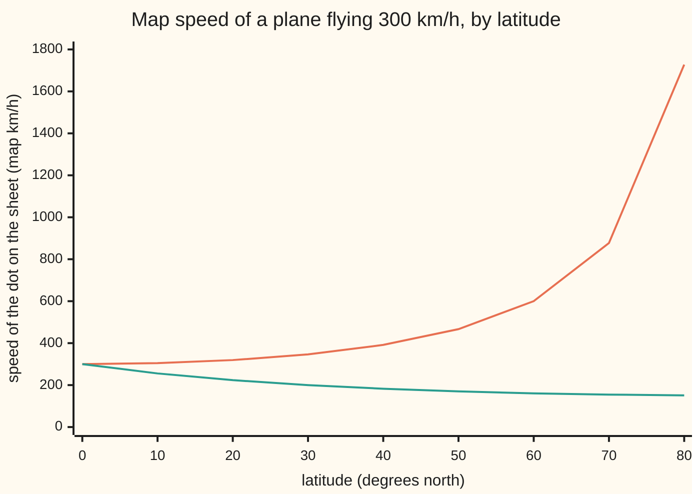
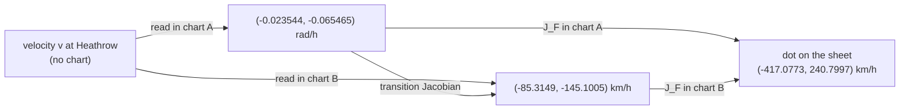

# Tangent space and differential: velocities, and how a map carries them

[Syllabus](../../../SYLLABUS.md) → [Differential geometry and Lie groups](../README.md) → [Manifolds](../README.md#s03) → Tangent space and differential

---

## General Overview

A plane has just left the runway at London Heathrow, at about 51.47° N, 0.4543° W. It is climbing out at a ground speed of 300 km/h on a track of 300°, a little north of west. The Earth's surface is a curved shape, covered here by overlapping map sheets. Air traffic control watches the plane's dot move across one of those sheets.

On a Mercator chart, the map most sea charts use, the dot does not move at 300 km/h. It moves at 481.60 km/h of map distance, in exactly the same direction, 300°. On a polar map centred on the North Pole, drawn true to scale on the equator, the same plane crawls at 168.32 km/h. One velocity, three different readings.

The plane's velocity lives on the globe, in the flat plane of all possible velocities at Heathrow: the **tangent space**. A smooth map from the globe to a sheet carries it to a velocity on the sheet: the **differential** of the map. In coordinates the differential is a Jacobian matrix (the table of a map's partial derivatives) times the velocity's components.

**The tangent space at a point of a manifold is the set of velocities of smooth paths through that point, a vector space that no chart owns; the differential of a smooth map sends each such velocity to the velocity of the image path, and in any pair of charts it is the Jacobian matrix of the map read in those charts.**

**What kind of fact this is:** three definitions (tangent space, differential, tangent bundle) and three theorems proved on this card in Why it works: the tangent space does not depend on the chart, the differential does not depend on the path or the chart, and differentials obey the chain rule. All of it is local: it needs only a neighbourhood of the point.

### The picture: one velocity, read on two map sheets



Orange: the dot's speed on a Mercator sheet, growing without limit toward the pole. Green: its speed on a polar stereographic sheet, falling toward half the true speed. Heathrow, at 51.47°, reads 481.60 and 168.32. Each map's differential stretches the true 300 km/h by a factor that depends only on where the plane is.

---

## The formula

Notation first, in words. A **manifold** $`M`$ of dimension $`n`$ is a shape that charts cover, each chart labelling the points near it by $`n`$ numbers ([Smooth manifold](01-smooth-manifolds-and-charts.md)). A chart is written $`x = (x^1, \dots, x^n)`$; the raised numbers are labels, not powers.

The globe is a manifold of dimension 2. This card uses two charts on it:

- **Chart A**, $`(\varphi, \theta)`$: $`\varphi`$ (phi) is the angle down from the North Pole, 90° minus the latitude, and $`\theta`$ (theta) is the longitude east. Both are in radians in formulas.
- **Chart B**, $`(\xi, \eta)`$ (xi, eta): the polar stereographic chart, $`(\xi, \eta) = R\tan(\varphi/2)\,(\cos\theta, \sin\theta)`$ in km, scaled true on the equator, so it shows the pole at half scale. It projects the globe from the South Pole onto the equator's plane, one of the two charts that cover a sphere in [Sphere, torus and projective plane](02-example-manifolds-sphere-torus-and-projective-space.md).

New notation, each in words first:

- The **tangent space** $`T_pM`$ is the set of velocities $`\gamma'(0)`$ of smooth paths $`\gamma(t)`$ on $`M`$ with $`\gamma(0) = p`$. Two paths give the same velocity when their chart readings have the same rate of change at $`t = 0`$.
- The **coordinate arrows** $`\partial_i`$ ("del i") at $`p`$ are the velocities of the chart's grid lines: move $`x^i`$ at unit rate and hold the other numbers still. Every velocity is $`v = v^1\partial_1 + \dots + v^n\partial_n`$, and the numbers $`v^i`$ are its **components** in that chart.
- The **differential** $`dF_p`$ of a smooth map $`F`$ from $`M`$ to another manifold $`N`$ sends a velocity at $`p`$ to a velocity at $`F(p)`$: $`dF_p(\gamma'(0)) = (F \circ \gamma)'(0)`$.
- The **tangent bundle** $`TM`$ is the collection of all tangent spaces of $`M`$, one for each point. A point of it is a pair: a place $`p`$ and a velocity at $`p`$.

Take a chart $`x`$ near $`p`$ and a chart $`y`$ near $`F(p)`$. Write $`F^a`$ for the $`a`$-th number of $`F`$ read in these charts: $`F^a = y^a \circ F \circ x^{-1}`$. Then

```math
\big(dF_p\, v\big)^a = \sum_{i=1}^{n} \frac{\partial F^a}{\partial x^i}\,v^i, \qquad a = 1, \dots, \dim N
```

**Read it aloud:** each component of the carried velocity sums, over the input directions, the rate of $`F^a`$ per unit of that input times the plane's rate in it: the Jacobian matrix times the column of components, as in [Chain rule in several variables](../../06-Calculus%20and%20analysis/07-Several%20Variables/04-multivariable-chain-rule-and-jacobians.md).

The map on this card is Mercator's, from the globe to a flat sheet: $`F(\varphi, \theta) = (X, Y) = \big(R\,\theta,\ R \ln\cot(\varphi/2)\big)`$ in km. Its Jacobian in chart A is

```math
J_F = \begin{pmatrix} \partial X/\partial\varphi & \partial X/\partial\theta \\ \partial Y/\partial\varphi & \partial Y/\partial\theta \end{pmatrix} = \begin{pmatrix} 0 & R \\ -R/\sin\varphi & 0 \end{pmatrix}
```

**Read it aloud:** a radian of longitude moves the dot $`R`$ km east on the sheet; a radian of $`\varphi`$ moves it $`R/\sin\varphi`$ km south, more and more as the pole nears.

A chart change is the special case where $`F`$ is the identity map. Then the formula turns chart A components into chart B components:

```math
\tilde v^{\,j} = \sum_i \frac{\partial \tilde x^j}{\partial x^i}\, v^i
```

**Read it aloud:** new components are the transition's Jacobian times the old ones; the arrow itself does not change.

| Symbol | Plain meaning | In our example | Push it up and the answer… |
| --- | --- | --- | --- |
| $`M`$, $`n`$, $`p`$ | the manifold, its dimension, a point on it | the globe, 2, Heathrow | — |
| $`x = (x^1, x^2)`$; $`\varphi`$, $`\theta`$ | chart A: angle from the North Pole, longitude east | (0.672475, −0.007929) rad | higher $`\varphi`$ (further south) shrinks the Mercator stretch |
| $`\tilde x`$; $`\xi`$, $`\eta`$; $`T`$, $`J_T`$ | chart B, polar stereographic, km; the A-to-B transition $`T = \tilde x \circ x^{-1}`$ and its Jacobian | (2226.6543, −17.6556) km; rows (3574.5182, 17.6556), (−28.3431, 2226.6543) | — |
| $`R`$ | the globe's radius | 6371 km | every map velocity grows in step |
| $`y`$; $`F^a`$, $`a`$ | a chart near $`F(p)`$; the $`a`$-th number of $`F`$ in charts | $`(X, Y)`$ on the sheet | — |
| $`\gamma(t)`$, $`\sigma(t)`$; $`v = \gamma'(0)`$ | a path through $`p`$, and in the proof a second one; its velocity | the climb-out | — |
| $`T_pM`$, $`\partial_i`$ | tangent space; coordinate arrows | all ground velocities at Heathrow; $`\lvert\partial_\varphi\rvert`$ = 6371, $`\lvert\partial_\theta\rvert`$ = 3968.6509 km per rad | — |
| $`v^i`$, $`\tilde v^j`$; $`c`$ | components in chart A; in chart B; in the proof, any column of $`n`$ numbers | (−0.023544, −0.065465) rad/h; (−85.3149, −145.1005) km/h | — |
| $`F`$, $`N`$, $`G`$; $`X`$, $`Y`$ | the map; its target; in the proof, a second map out of $`N`$; Mercator's sheet coordinates | globe to sheet; $`F(p)`$ = (−50.5159, 6697.3536) km | — |
| $`dF_p`$, $`J_F`$ | the differential; its matrix in a chart | rows (0, 6371), (−10227.5666, 0) | — |
| $`TM`$ | the tangent bundle: all (place, velocity) pairs | (0.672475, −0.007929, −0.023544, −0.065465) | — |
| $`F \circ \gamma`$ | the path of the dot on the sheet | moving at (−417.0773, 240.7997) km/h | — |

$`J`$ is the Jacobian here, as in wing 06; elsewhere in this wing $`J`$ is a Jacobi field.

### When it holds

- **$`F`$ is smooth at $`p`$.** Mercator's map is undefined at the poles: its stretch is 57.30 at 89° N and 572.96 at 89.9° N, and no matrix exists at 90°.
- **The chart is good at $`p`$.** Chart A breaks at the North Pole itself. A plane flying over the pole reads $`\varphi'`$ = −0.047088 then +0.047088 rad/h, and its $`\theta`$ jumps from 0° to 180°. The velocity did not jump: chart B reads $`\xi'`$ = −150.0000 km/h smoothly through the pole. The fault is the chart's, not the globe's.
- **Components and Jacobian come from the same chart.** Chart A's Jacobian applied to chart B's components gives (−924435.6, 872564.2) km/h, which is nonsense.
- **The Jacobian is read at the plane's own point.** Read at the equator, it turns the plane's own components into 443.2308 km/h on a track of 289.78°, not 481.5994 km/h on 300°.
- **The velocity lies in the manifold.** The plane's climb points off the surface; only its ground velocity is a tangent vector of the globe. The globe is a sphere of radius 6371 km, a model; the real Earth's flattening shifts these numbers by a fraction of a percent.

---

## Why it works

### Step 0: up close, a smooth map is a matrix

Zoom in on Heathrow until the globe looks flat. A smooth map then looks like a linear map: it sends small steps to small steps, by a fixed matrix. Velocities are what such a matrix acts on, since a velocity is a small step divided by a small time.

A path on the globe is chart-free; its readings in a chart are not. So the definition uses paths, and charts only to compare them.



### Step 1: the tangent space is a plane no chart owns

Read a path $`\gamma`$ in chart A as $`(\varphi(t), \theta(t))`$. Its velocity has components $`(\varphi'(0), \theta'(0))`$. For the plane, the ground velocity splits into 150 km/h north and −259.8076 km/h east.

- Going north lowers $`\varphi`$: $`\varphi' = -150/6371 = -0.023544`$ rad/h.
- Going east raises $`\theta`$, along a circle of latitude of radius $`R\sin\varphi`$ = 3968.6509 km: $`\theta' = -259.8076/3968.6509 = -0.065465`$ rad/h.

So components are rates of chart numbers, not distances: $`\partial_\varphi`$ is 6371 km long per radian, $`\partial_\theta`$ 3968.6509 km.

In chart B, the same path reads $`(\xi(t), \eta(t))`$. By the chain rule its components are the transition's Jacobian times chart A's. The code gets chart B's components a second way, from the plane's velocity in space, without chart A: both give (−85.3149, −145.1005) km/h.

So "same velocity" means the same thing in every chart. And components add and scale, so velocities do too: $`T_pM`$ is a vector space of dimension $`n`$, with the coordinate arrows as a basis.

### Step 2: the differential does not depend on the path

Define $`dF_p(v)`$ as the velocity of the dot $`F \circ \gamma`$, for any path $`\gamma`$ with velocity $`v`$. By the chain rule, that velocity is $`J_F`$ times $`v`$'s components. Only the components enter, so any path with the same velocity gives the same answer.

The code tests this with no Jacobian at all. It flies two different paths through Heathrow with the same velocity:

- the great circle that starts in the plane's direction, the shortest route on the globe;
- a straight line in chart B, which curves on the globe.

It maps each path onto the Mercator sheet and divides the change in position by the time, a central difference. With 60-second steps both paths land within 0.0003 km/h of (−417.0773, 240.7997). With 6-second steps the gap falls about a hundredfold. The paths differ; their velocity, and its image, do not.

### Step 3: the differential does not depend on the chart

Chart A gives $`J_F`$ rows (0, 6371) and (−10227.5666, 0). Chart B gives a different matrix, rows (0.022686, 2.861064) and (−2.861064, 0.022686). The components differ too. Each matrix times its own chart's components gives (−417.0773, 240.7997) km/h.

By the chain rule, chart B's matrix is chart A's times the inverse of the transition's Jacobian, while chart B's components are the transition's Jacobian times chart A's. The two factors cancel. So $`dF_p`$ is one linear map, written as a different matrix in each chart pair.

<details>
<summary>Detailed proof: tangent vectors and the differential are well defined</summary>

Let $`x`$ and $`\tilde x`$ be two charts near $`p`$, with smooth transition $`T = \tilde x \circ x^{-1}`$ ([Smooth manifold](01-smooth-manifolds-and-charts.md)). Let $`\gamma`$ and $`\sigma`$ be smooth paths with $`\gamma(0) = \sigma(0) = p`$.

Suppose $`(x \circ \gamma)'(0) = (x \circ \sigma)'(0)`$. Since $`\tilde x \circ \gamma = T \circ (x \circ \gamma)`$, the chain rule gives

$`\displaystyle (\tilde x \circ \gamma)'(0) = J_T(x(p))\,(x \circ \gamma)'(0) = J_T(x(p))\,(x \circ \sigma)'(0) = (\tilde x \circ \sigma)'(0).`$

So "same velocity" does not depend on the chart. Every column of $`n`$ numbers is the velocity of the straight path $`x^{-1}(x(p) + t\,c)`$, so the velocities at $`p`$ match the columns one to one. Define addition and scaling through the columns; the display shows that a change of chart multiplies every column by the same invertible matrix $`J_T`$, which keeps sums and multiples. This makes $`T_pM`$ a vector space of dimension $`n`$.

Now let $`F`$ be smooth from $`M`$ to $`N`$ and $`y`$ a chart near $`F(p)`$. Then $`y \circ F \circ \gamma = (y \circ F \circ x^{-1}) \circ (x \circ \gamma)`$, and the chain rule gives

$`\displaystyle (y \circ F \circ \gamma)'(0) = J_{F}(x(p))\,(x \circ \gamma)'(0).`$

The right side depends on $`\gamma`$ only through its velocity, so $`dF_p`$ is well defined, and it is linear because a matrix is. In chart $`\tilde x`$ the matrix is $`J_F\,J_T^{-1}`$, and the components are $`J_T`$ times the old ones; the product is unchanged.

Finally, for a second smooth map $`G`$ from $`N`$, $`(G \circ F \circ \gamma)'(0) = dG_{F(p)}\big((F \circ \gamma)'(0)\big)`$ by the same chain rule, so $`d(G \circ F)_p = dG_{F(p)} \circ dF_p`$.

</details>

### Step 4: what the matrix says about the map

Read Mercator's matrix one direction at a time. East: 6371 km of sheet per radian, against 3968.6509 km of ground, a stretch of 1.605331. North: 10227.5666 km of sheet per radian, against 6371 km of ground, the same 1.605331. Equal stretch in every direction means angles survive: the map track is 300.0000°, the true track. That is why sailors and pilots plot courses on Mercator sheets.

The stretch is $`1/\cos(\text{latitude})`$. The polar stereographic sheet also stretches equally in all directions, by $`1/(1 + \sin(\text{latitude}))`$ = 0.561078 at Heathrow.

### Step 5: all the tangent spaces together form a manifold

The tangent bundle $`TM`$ collects a place and a velocity there. Chart A gives it four numbers: $`(\varphi, \theta, \varphi', \theta')`$ = (0.672475, −0.007929, −0.023544, −0.065465) for the plane. Chart B gives (2226.6543, −17.6556, −85.3149, −145.1005).

The first two numbers change by the chart transition, the last two by its Jacobian, both smooth. So $`TM`$ is itself a manifold, of dimension $`2n`$ = 4 for the globe, and the differentials at all points form one smooth map $`dF`$ from $`TM`$ to $`TN`$. [Vector field and its flow](07-vector-fields-and-flows.md) picks one velocity at every point.

The algebraic version, for shapes cut out by polynomials, is [Dimension and tangent space](../../22-Algebraic%20geometry/02-Affine%20and%20Projective%20Varieties/07-dimension-and-tangent-spaces.md): there the tangent space comes from first-order parts of equations. This card is the smooth-manifold version, built from paths.

---

## Worked numbers, by hand

The plane at Heathrow, in chart A, carried to the Mercator sheet.

| Step | Arithmetic | Value |
| --- | --- | --- |
| angle from the pole | 90° − 51.47° | $`\varphi`$ = 38.5300° = 0.672475 rad |
| ground velocity north | 300 × cos 300° | 150.0000 km/h |
| ground velocity east | 300 × sin 300° | −259.8076 km/h |
| radius of the latitude circle | 6371 × sin 38.53° | 3968.6509 km |
| $`\varphi'`$ | −150 / 6371 | −0.023544 rad/h |
| $`\theta'`$ | −259.8076 / 3968.6509 | −0.065465 rad/h |
| $`X'`$ | 6371 × (−0.065465) | −417.0773 km/h |
| $`Y'`$ | (−6371 / sin 38.53°) × (−0.023544) = 10227.5666 × 0.023544 | 240.7997 km/h |
| map speed | $`\sqrt{417.0773^2 + 240.7997^2}`$ | **481.5994 km/h** |
| stretch | 481.5994 / 300 | **1.605331** |

On the Mercator sheet the plane's dot moves at 481.60 km/h, 1.605 times its true speed, on the true track of 300°. A controller who timed the dot against the sheet's scale bar at Heathrow's latitude would read the true 300 km/h.

### What breaks if you drop a piece

| Mistake | Comes out at | What went wrong |
| --- | --- | --- |
| $`\theta'`$ in degrees per hour | $`X'`$ = −23896.8 km/h | the Jacobian's entry $`R`$ is km per radian |
| east speed ÷ $`R`$, no $`\sin\varphi`$ | 354.2379 km/h on track 312.8255° | the latitude circle is shorter than a great circle, so the map track is 312.83°, not 300° |
| chart A's Jacobian on chart B's components | (−924435.6, 872564.2) km/h | a matrix and a column from different charts |
| Jacobian read at the equator | 443.2308 km/h on track 289.7809° | the matrix belongs to the point: at the equator the north entry is $`-R`$, not $`-R/\sin\varphi`$ |
| chart A over the North Pole | $`\varphi'`$ from −0.047088 to +0.047088 rad/h, $`\theta`$ from 0° to 180° | the chart fails at the pole; chart B reads $`\xi'`$ = −150.0000 km/h throughout |

---

## Code, from first principles, and it actually runs

The code computes the plane's velocity on the Mercator sheet by three independent roads. Road 1 multiplies chart A's Jacobian by chart A's components. Road 2 takes chart B's components from the velocity in space, never from chart A, and multiplies by chart B's Jacobian. Road 3 uses no Jacobian: it maps two different paths through Heathrow onto the sheet and takes central differences at two step sizes. The asserts check that the roads agree, that the basis lengths give the true 300 km/h, that the stretch equals the map's known scale factor, and that chart A really breaks at the pole while chart B does not.

### Python

```python
# Tangent space and differential -- the check behind the card.  Standard library only.
# The Earth is a sphere of radius R = 6371 km.  A plane has just left the runway at
# London Heathrow: ground speed 300 km/h on a track of 300 deg, clockwise from north.
# Chart A is (phi, theta): phi down from the North Pole, theta longitude east, radians.
# Chart B is polar stereographic: (xi, eta) = R tan(phi/2) (cos theta, sin theta), km.
# The map F sends the globe to a Mercator sheet: X = R theta, Y = R ln cot(phi/2), km.
# Road 1: dF_p as a Jacobian in chart A.  Road 2: dF_p as a Jacobian in chart B, with
# the velocity's chart-B components taken from space, not from chart A.  Road 3: no
# Jacobian at all: central differences of F along two different paths through p.
from math import sin, cos, tan, atan, atan2, log, sqrt, radians, degrees, pi
R, LAT, LON, SPEED, TRACK = 6371.0, 51.47, -0.4543, 300.0, 300.0
def pos(a):                                    # chart A -> space, km
    return (R * sin(a[0]) * cos(a[1]), R * sin(a[0]) * sin(a[1]), R * cos(a[0]))
def chart_a(P): return (atan2(sqrt(P[0] ** 2 + P[1] ** 2), P[2]), atan2(P[1], P[0]))
def chart_b(P): return (R * P[0] / (R + P[2]), R * P[1] / (R + P[2]))
def b_to_a(b): return (2 * atan(sqrt(b[0] ** 2 + b[1] ** 2) / R), atan2(b[1], b[0]))
def F(a): return (R * a[1], R * log(1 / tan(a[0] / 2)))          # the Mercator sheet
def mv(J, v): return tuple(sum(J[i][j] * v[j] for j in range(len(v))) for i in range(len(J)))
def norm(v): return sqrt(sum(c * c for c in v))
def lin(*terms): return tuple(sum(k * v[i] for k, v in terms) for i in range(len(terms[0][1])))
def vec(v, d=4): return "(" + ", ".join(f"{c:.{d}f}" for c in v) + ")"
def mat(J, d=4): return "[" + "; ".join(vec(r, d)[1:-1] for r in J) + "]"
def basis_a(a):                                # d_phi and d_theta as arrows in space
    return ((R * cos(a[0]) * cos(a[1]), R * cos(a[0]) * sin(a[1]), -R * sin(a[0])),
            (-R * sin(a[0]) * sin(a[1]), R * sin(a[0]) * cos(a[1]), 0.0))
def JF_a(a): return ((0.0, R), (-R / sin(a[0]), 0.0))             # rows X, Y; columns phi, theta
def JF_b(b):
    r2 = b[0] ** 2 + b[1] ** 2
    return ((-R * b[1] / r2, R * b[0] / r2), (-R * b[0] / r2, -R * b[1] / r2))
def JB_space(P):                               # chart B differentiated in space, 2 x 3
    d = R + P[2]
    return ((R / d, 0.0, -R * P[0] / d / d), (0.0, R / d, -R * P[1] / d / d))
def JT(a):                                     # transition A -> B
    k, t = R / (2 * cos(a[0] / 2) ** 2), R * tan(a[0] / 2)
    return ((k * cos(a[1]), -t * sin(a[1])), (k * sin(a[1]), t * cos(a[1])))
def track(v): return degrees(atan2(v[0], v[1])) % 360            # map heading from (X', Y')
p = (radians(90 - LAT), radians(LON))
P = pos(p)
north, east = SPEED * cos(radians(TRACK)), SPEED * sin(radians(TRACK))
va = (-north / R, east / (R * sin(p[0])))                         # chart A components, rad/h
ephi, eth = basis_a(p)
print(f"Heathrow: phi = {degrees(p[0]):.4f} deg = {p[0]:.6f} rad, theta = {p[1]:.6f} rad")
print(f"ground velocity: north {north:.4f} km/h, east {east:.4f} km/h")
print(f"basis lengths: |d_phi| = {norm(ephi):.4f} km/rad, |d_theta| = {norm(eth):.4f} km/rad")
print(f"chart A components: v = {vec(va, 6)} rad/h")
NH = (-cos(p[0]) * cos(p[1]), -cos(p[0]) * sin(p[1]), sin(p[0]))
EH = (-sin(p[1]), cos(p[1]), 0.0)
v3 = lin((va[0], ephi), (va[1], eth))                             # the same arrow, in space
v3h = lin((north, NH), (east, EH))
print(f"in space from chart A: {vec(v3)} km/h, speed {norm(v3):.4f}, |v.p| = {abs(sum(x * y for x, y in zip(v3, P))):.4f}")
print(f"in space from heading: {vec(v3h)} km/h")
b = chart_b(P)
vb = mv(JB_space(P), v3)                                          # chart B components, from space
print(f"chart B point (xi, eta) = {vec(b)} km, components v = {vec(vb)} km/h")
print(f"transition Jacobian A -> B: {mat(JT(p))}; times chart A components: {vec(mv(JT(p), va))}")
print(f"TM point, chart A: {vec(p + va, 6)}; chart B: {vec(b + vb)}")
print(f"Mercator sheet: F(p) = (X, Y) = {vec(F(p))} km")
print(f"dF_p in chart A: {mat(JF_a(p))}")
print(f"dF_p in chart B: {mat(JF_b(b), 6)}")
r1, r2 = mv(JF_a(p), va), mv(JF_b(b), vb)
print(f"road 1, chart A: dF_p(v) = {vec(r1)} km/h")
print(f"road 2, chart B: dF_p(v) = {vec(r2)} km/h")
u, w = tuple(c / SPEED for c in v3), SPEED / R
def great(t): return chart_a(lin((cos(w * t), P), (R * sin(w * t), u)))
def straight_b(t): return b_to_a((b[0] + vb[0] * t, b[1] + vb[1] * t))
errs = []
for name, path in (("great circle", great), ("straight line in chart B", straight_b)):
    for secs in (60, 6):
        h = secs / 3600
        d = tuple((x - y) / (2 * h) for x, y in zip(F(path(h)), F(path(-h))))
        errs.append(norm(tuple(x - y for x, y in zip(d, r1))))
        print(f"road 3, {name}, step {secs:2d} s: {vec(d)} km/h, off by {errs[-1]:.7f}")
print(f"map speed {norm(r1):.4f} km/h, stretch {norm(r1) / SPEED:.6f} = 1/cos(lat) {1 / cos(radians(LAT)):.6f}, map track {track(r1):.4f} deg")
k = 1 / (1 + sin(radians(LAT)))
print(f"stereographic sheet: map speed {norm(vb):.4f} km/h, stretch {norm(vb) / SPEED:.6f} = 1/(1 + sin lat) {k:.6f}")
print("chart Mercator speed, lat 0..80: " + ", ".join(f"{SPEED / cos(radians(L)):.1f}" for L in range(0, 81, 10)))
print("chart stereo speed, lat 0..80: " + ", ".join(f"{SPEED / (1 + sin(radians(L))):.1f}" for L in range(0, 81, 10)))
deg = (va[0], degrees(va[1]))
print(f"mistake, theta' in deg/h: X' = {mv(JF_a(p), deg)[0]:.1f} km/h")
nosin = mv(JF_a(p), (va[0], east / R))
print(f"mistake, no sin phi: {vec(nosin)} km/h, speed {norm(nosin):.4f}, map track {track(nosin):.4f} deg")
mix = mv(JF_a(p), vb)
print(f"mistake, chart A Jacobian on chart B components: {vec(mix, 1)} km/h")
eq = mv(JF_a((pi / 2, p[1])), va)                              # Heathrow's components
print(f"mistake, Jacobian read at the equator: {vec(eq)} km/h, speed {norm(eq):.4f}, map track {track(eq):.4f} deg")
h = 1 / 3600                                   # over the pole along theta = 0, 1 s each side
before, after = chart_a(pos((SPEED * h / R, 0.0))), chart_a(pos((-SPEED * h / R, 0.0)))
print(f"pole crossing, chart A: phi' = {-SPEED / R:.6f} then {SPEED / R:.6f} rad/h, theta {abs(degrees(before[1])):.1f} then {abs(degrees(after[1])):.1f} deg")
xb = tuple((x - y) / (2 * h) for x, y in zip(chart_b(pos((-SPEED * h / R, 0.0))), chart_b(pos((SPEED * h / R, 0.0)))))
print(f"pole crossing, chart B: xi' = {xb[0]:.4f}, |eta'| = {abs(xb[1]):.4f} km/h, smooth through the pole")
print(f"Mercator stretch at lat 89 and 89.9: {1 / cos(radians(89)):.2f}, {1 / cos(radians(89.9)):.2f}")
assert abs(norm(v3) - SPEED) < 1e-9 and norm(lin((1, v3), (-1, v3h))) < 1e-9   # basis lengths right
assert norm(lin((1, vb), (-1, mv(JT(p), va)))) < 1e-9          # chart B parts from space = transition
assert norm(lin((1, r1), (-1, r2))) < 1e-9                       # one differential, two charts
assert errs[1] < errs[0] / 50 and errs[3] < errs[2] / 50 and max(errs[1], errs[3]) < 1e-4 * norm(r1)   # differences close in
assert abs(norm(r1) / SPEED - 1 / cos(radians(LAT))) < 1e-9      # Mercator stretch = sec(lat)
assert abs(norm(vb) / SPEED - k) < 1e-9 and abs(track(r1) - TRACK) < 1e-9   # stereo stretch; conformal
assert abs(after[1] - before[1]) > 3 and abs(xb[0] + SPEED / 2) < 1e-3     # chart A jumps, B does not
print("ALL CHECKS PASS")
```

**Ran 2026-11-19 on macOS, Python 3.14.10, standard library only. All checks passed. Output, pasted from the run:**

```
Heathrow: phi = 38.5300 deg = 0.672475 rad, theta = -0.007929 rad
ground velocity: north 150.0000 km/h, east -259.8076 km/h
basis lengths: |d_phi| = 6371.0000 km/rad, |d_theta| = 3968.6509 km/rad
chart A components: v = (-0.023544, -0.065465) rad/h
in space from chart A: (-119.3986, -258.8691, 93.4386) km/h, speed 300.0000, |v.p| = 0.0000
in space from heading: (-119.3986, -258.8691, 93.4386) km/h
chart B point (xi, eta) = (2226.6543, -17.6556) km, components v = (-85.3149, -145.1005) km/h
transition Jacobian A -> B: [3574.5182, 17.6556; -28.3431, 2226.6543]; times chart A components: (-85.3149, -145.1005)
TM point, chart A: (0.672475, -0.007929, -0.023544, -0.065465); chart B: (2226.6543, -17.6556, -85.3149, -145.1005)
Mercator sheet: F(p) = (X, Y) = (-50.5159, 6697.3536) km
dF_p in chart A: [0.0000, 6371.0000; -10227.5666, 0.0000]
dF_p in chart B: [0.022686, 2.861064; -2.861064, 0.022686]
road 1, chart A: dF_p(v) = (-417.0773, 240.7997) km/h
road 2, chart B: dF_p(v) = (-417.0773, 240.7997) km/h
road 3, great circle, step 60 s: (-417.0774, 240.7995) km/h, off by 0.0001697
road 3, great circle, step  6 s: (-417.0773, 240.7997) km/h, off by 0.0000017
road 3, straight line in chart B, step 60 s: (-417.0773, 240.7995) km/h, off by 0.0002548
road 3, straight line in chart B, step  6 s: (-417.0773, 240.7997) km/h, off by 0.0000025
map speed 481.5994 km/h, stretch 1.605331 = 1/cos(lat) 1.605331, map track 300.0000 deg
stereographic sheet: map speed 168.3235 km/h, stretch 0.561078 = 1/(1 + sin lat) 0.561078
chart Mercator speed, lat 0..80: 300.0, 304.6, 319.3, 346.4, 391.6, 466.7, 600.0, 877.1, 1727.6
chart stereo speed, lat 0..80: 300.0, 255.6, 223.5, 200.0, 182.6, 169.9, 160.8, 154.7, 151.1
mistake, theta' in deg/h: X' = -23896.8 km/h
mistake, no sin phi: (-259.8076, 240.7997) km/h, speed 354.2379, map track 312.8255 deg
mistake, chart A Jacobian on chart B components: (-924435.6, 872564.2) km/h
mistake, Jacobian read at the equator: (-417.0773, 150.0000) km/h, speed 443.2308, map track 289.7809 deg
pole crossing, chart A: phi' = -0.047088 then 0.047088 rad/h, theta 0.0 then 180.0 deg
pole crossing, chart B: xi' = -150.0000, |eta'| = 0.0000 km/h, smooth through the pole
Mercator stretch at lat 89 and 89.9: 57.30, 572.96
ALL CHECKS PASS
```

### Rust

```rust
// Tangent space and differential -- the check behind the card.  std only.
// The Earth is a sphere of radius R = 6371 km.  A plane has just left the runway at
// London Heathrow: ground speed 300 km/h on a track of 300 deg, clockwise from north.
// Chart A is (phi, theta): phi down from the North Pole, theta longitude east, radians.
// Chart B is polar stereographic: (xi, eta) = R tan(phi/2) (cos theta, sin theta), km.
// The map F sends the globe to a Mercator sheet: X = R theta, Y = R ln cot(phi/2), km.
// Road 1: dF_p as a Jacobian in chart A.  Road 2: dF_p as a Jacobian in chart B, with
// the velocity's chart-B components taken from space, not from chart A.  Road 3: no
// Jacobian at all: central differences of F along two different paths through p.
const R: f64 = 6371.0;
const LAT: f64 = 51.47;
const LON: f64 = -0.4543;
const SPEED: f64 = 300.0;
const TRACK: f64 = 300.0;
type V2 = [f64; 2];
type V3 = [f64; 3];
type M2 = [[f64; 2]; 2];

fn pos(a: V2) -> V3 { [R * a[0].sin() * a[1].cos(), R * a[0].sin() * a[1].sin(), R * a[0].cos()] }
fn chart_a(p: V3) -> V2 { [(p[0] * p[0] + p[1] * p[1]).sqrt().atan2(p[2]), p[1].atan2(p[0])] }
fn chart_b(p: V3) -> V2 { [R * p[0] / (R + p[2]), R * p[1] / (R + p[2])] }
fn b_to_a(b: V2) -> V2 { [2.0 * ((b[0] * b[0] + b[1] * b[1]).sqrt() / R).atan(), b[1].atan2(b[0])] }
fn f_map(a: V2) -> V2 { [R * a[1], R * (1.0 / (a[0] / 2.0).tan()).ln()] }
fn mv(j: &M2, v: V2) -> V2 { [j[0][0] * v[0] + j[0][1] * v[1], j[1][0] * v[0] + j[1][1] * v[1]] }
fn norm(v: &[f64]) -> f64 { v.iter().map(|c| c * c).sum::<f64>().sqrt() }
fn lin3(k1: f64, a: V3, k2: f64, b: V3) -> V3 { [k1 * a[0] + k2 * b[0], k1 * a[1] + k2 * b[1], k1 * a[2] + k2 * b[2]] }
fn sub2(a: V2, b: V2) -> V2 { [a[0] - b[0], a[1] - b[1]] }
fn vec(v: &[f64], d: usize) -> String {
    let parts: Vec<String> = v.iter().map(|c| format!("{:.*}", d, c)).collect();
    format!("({})", parts.join(", "))
}
fn mat(j: &M2, d: usize) -> String {
    format!("[{:.*}, {:.*}; {:.*}, {:.*}]", d, j[0][0], d, j[0][1], d, j[1][0], d, j[1][1])
}
fn basis_a(a: V2) -> (V3, V3) {
    ([R * a[0].cos() * a[1].cos(), R * a[0].cos() * a[1].sin(), -R * a[0].sin()],
     [-R * a[0].sin() * a[1].sin(), R * a[0].sin() * a[1].cos(), 0.0])
}
fn jf_a(a: V2) -> M2 { [[0.0, R], [-R / a[0].sin(), 0.0]] }
fn jf_b(b: V2) -> M2 {
    let r2 = b[0] * b[0] + b[1] * b[1];
    [[-R * b[1] / r2, R * b[0] / r2], [-R * b[0] / r2, -R * b[1] / r2]]
}
fn jb_space(p: V3, v: V3) -> V2 {
    let d = R + p[2];
    [R / d * v[0] - R * p[0] / d / d * v[2], R / d * v[1] - R * p[1] / d / d * v[2]]
}
fn jt(a: V2) -> M2 {
    let (k, t) = (R / (2.0 * (a[0] / 2.0).cos().powi(2)), R * (a[0] / 2.0).tan());
    [[k * a[1].cos(), -t * a[1].sin()], [k * a[1].sin(), t * a[1].cos()]]
}
fn track(v: V2) -> f64 { v[0].atan2(v[1]).to_degrees().rem_euclid(360.0) }
fn speeds(f: impl Fn(f64) -> f64) -> String {
    let parts: Vec<String> = (0..9).map(|i| format!("{:.1}", f((10 * i) as f64))).collect();
    parts.join(", ")
}

fn main() {
    let p: V2 = [(90.0 - LAT).to_radians(), LON.to_radians()];
    let pp = pos(p);
    let (north, east) = (SPEED * TRACK.to_radians().cos(), SPEED * TRACK.to_radians().sin());
    let va: V2 = [-north / R, east / (R * p[0].sin())];
    let (ephi, eth) = basis_a(p);
    println!("Heathrow: phi = {:.4} deg = {:.6} rad, theta = {:.6} rad", p[0].to_degrees(), p[0], p[1]);
    println!("ground velocity: north {:.4} km/h, east {:.4} km/h", north, east);
    println!("basis lengths: |d_phi| = {:.4} km/rad, |d_theta| = {:.4} km/rad", norm(&ephi), norm(&eth));
    println!("chart A components: v = {} rad/h", vec(&va, 6));
    let nh = [-p[0].cos() * p[1].cos(), -p[0].cos() * p[1].sin(), p[0].sin()];
    let eh = [-p[1].sin(), p[1].cos(), 0.0];
    let v3 = lin3(va[0], ephi, va[1], eth);
    let v3h = lin3(north, nh, east, eh);
    let vdotp: f64 = (0..3).map(|i| v3[i] * pp[i]).sum();
    println!("in space from chart A: {} km/h, speed {:.4}, |v.p| = {:.4}", vec(&v3, 4), norm(&v3), vdotp.abs());
    println!("in space from heading: {} km/h", vec(&v3h, 4));
    let b = chart_b(pp);
    let vb = jb_space(pp, v3);
    println!("chart B point (xi, eta) = {} km, components v = {} km/h", vec(&b, 4), vec(&vb, 4));
    println!("transition Jacobian A -> B: {}; times chart A components: {}", mat(&jt(p), 4), vec(&mv(&jt(p), va), 4));
    println!("TM point, chart A: {}; chart B: {}", vec(&[p[0], p[1], va[0], va[1]], 6), vec(&[b[0], b[1], vb[0], vb[1]], 4));
    println!("Mercator sheet: F(p) = (X, Y) = {} km", vec(&f_map(p), 4));
    println!("dF_p in chart A: {}", mat(&jf_a(p), 4));
    println!("dF_p in chart B: {}", mat(&jf_b(b), 6));
    let (r1, r2) = (mv(&jf_a(p), va), mv(&jf_b(b), vb));
    println!("road 1, chart A: dF_p(v) = {} km/h", vec(&r1, 4));
    println!("road 2, chart B: dF_p(v) = {} km/h", vec(&r2, 4));
    let u = [v3[0] / SPEED, v3[1] / SPEED, v3[2] / SPEED];
    let w = SPEED / R;
    let great = |t: f64| chart_a(lin3((w * t).cos(), pp, R * (w * t).sin(), u));
    let straight_b = |t: f64| b_to_a([b[0] + vb[0] * t, b[1] + vb[1] * t]);
    let paths: [(&str, &dyn Fn(f64) -> V2); 2] = [("great circle", &great), ("straight line in chart B", &straight_b)];
    let mut errs = Vec::new();
    for (name, path) in paths.iter() {
        for secs in [60.0_f64, 6.0] {
            let h = secs / 3600.0;
            let df = sub2(f_map(path(h)), f_map(path(-h)));
            let d = [df[0] / (2.0 * h), df[1] / (2.0 * h)];
            errs.push(norm(&sub2(d, r1)));
            println!("road 3, {}, step {:2} s: {} km/h, off by {:.7}", name, secs as i32, vec(&d, 4), errs[errs.len() - 1]);
        }
    }
    let lat = LAT.to_radians();
    println!("map speed {:.4} km/h, stretch {:.6} = 1/cos(lat) {:.6}, map track {:.4} deg", norm(&r1), norm(&r1) / SPEED, 1.0 / lat.cos(), track(r1));
    let k = 1.0 / (1.0 + lat.sin());
    println!("stereographic sheet: map speed {:.4} km/h, stretch {:.6} = 1/(1 + sin lat) {:.6}", norm(&vb), norm(&vb) / SPEED, k);
    println!("chart Mercator speed, lat 0..80: {}", speeds(|l| SPEED / l.to_radians().cos()));
    println!("chart stereo speed, lat 0..80: {}", speeds(|l| SPEED / (1.0 + l.to_radians().sin())));
    let deg = [va[0], va[1].to_degrees()];
    println!("mistake, theta' in deg/h: X' = {:.1} km/h", mv(&jf_a(p), deg)[0]);
    let nosin = mv(&jf_a(p), [va[0], east / R]);
    println!("mistake, no sin phi: {} km/h, speed {:.4}, map track {:.4} deg", vec(&nosin, 4), norm(&nosin), track(nosin));
    let mix = mv(&jf_a(p), vb);
    println!("mistake, chart A Jacobian on chart B components: {} km/h", vec(&mix, 1));
    let eq = mv(&jf_a([std::f64::consts::PI / 2.0, p[1]]), va);
    println!("mistake, Jacobian read at the equator: {} km/h, speed {:.4}, map track {:.4} deg", vec(&eq, 4), norm(&eq), track(eq));
    let h = 1.0 / 3600.0;
    let (before, after) = (chart_a(pos([SPEED * h / R, 0.0])), chart_a(pos([-SPEED * h / R, 0.0])));
    println!("pole crossing, chart A: phi' = {:.6} then {:.6} rad/h, theta {:.1} then {:.1} deg", -SPEED / R, SPEED / R, before[1].to_degrees().abs(), after[1].to_degrees().abs());
    let db = sub2(chart_b(pos([-SPEED * h / R, 0.0])), chart_b(pos([SPEED * h / R, 0.0])));
    let xb = [db[0] / (2.0 * h), db[1] / (2.0 * h)];
    println!("pole crossing, chart B: xi' = {:.4}, |eta'| = {:.4} km/h, smooth through the pole", xb[0], xb[1].abs());
    println!("Mercator stretch at lat 89 and 89.9: {:.2}, {:.2}", 1.0 / 89.0_f64.to_radians().cos(), 1.0 / 89.9_f64.to_radians().cos());
    assert!((norm(&v3) - SPEED).abs() < 1e-9 && norm(&lin3(1.0, v3, -1.0, v3h)) < 1e-9);
    assert!(norm(&sub2(vb, mv(&jt(p), va))) < 1e-9);
    assert!(norm(&sub2(r1, r2)) < 1e-9);
    assert!(errs[1] < errs[0] / 50.0 && errs[3] < errs[2] / 50.0 && errs[1].max(errs[3]) < 1e-4 * norm(&r1));
    assert!((norm(&r1) / SPEED - 1.0 / lat.cos()).abs() < 1e-9);
    assert!((norm(&vb) / SPEED - k).abs() < 1e-9 && (track(r1) - TRACK).abs() < 1e-9);
    assert!((after[1] - before[1]).abs() > 3.0 && (xb[0] + SPEED / 2.0).abs() < 1e-3);
    println!("ALL CHECKS PASS");
}
```

**Ran 2026-11-19 on macOS, rustc 1.98.1, no crates. All checks passed. Output, pasted from the run:**

```
Heathrow: phi = 38.5300 deg = 0.672475 rad, theta = -0.007929 rad
ground velocity: north 150.0000 km/h, east -259.8076 km/h
basis lengths: |d_phi| = 6371.0000 km/rad, |d_theta| = 3968.6509 km/rad
chart A components: v = (-0.023544, -0.065465) rad/h
in space from chart A: (-119.3986, -258.8691, 93.4386) km/h, speed 300.0000, |v.p| = 0.0000
in space from heading: (-119.3986, -258.8691, 93.4386) km/h
chart B point (xi, eta) = (2226.6543, -17.6556) km, components v = (-85.3149, -145.1005) km/h
transition Jacobian A -> B: [3574.5182, 17.6556; -28.3431, 2226.6543]; times chart A components: (-85.3149, -145.1005)
TM point, chart A: (0.672475, -0.007929, -0.023544, -0.065465); chart B: (2226.6543, -17.6556, -85.3149, -145.1005)
Mercator sheet: F(p) = (X, Y) = (-50.5159, 6697.3536) km
dF_p in chart A: [0.0000, 6371.0000; -10227.5666, 0.0000]
dF_p in chart B: [0.022686, 2.861064; -2.861064, 0.022686]
road 1, chart A: dF_p(v) = (-417.0773, 240.7997) km/h
road 2, chart B: dF_p(v) = (-417.0773, 240.7997) km/h
road 3, great circle, step 60 s: (-417.0774, 240.7995) km/h, off by 0.0001697
road 3, great circle, step  6 s: (-417.0773, 240.7997) km/h, off by 0.0000017
road 3, straight line in chart B, step 60 s: (-417.0773, 240.7995) km/h, off by 0.0002548
road 3, straight line in chart B, step  6 s: (-417.0773, 240.7997) km/h, off by 0.0000025
map speed 481.5994 km/h, stretch 1.605331 = 1/cos(lat) 1.605331, map track 300.0000 deg
stereographic sheet: map speed 168.3235 km/h, stretch 0.561078 = 1/(1 + sin lat) 0.561078
chart Mercator speed, lat 0..80: 300.0, 304.6, 319.3, 346.4, 391.6, 466.7, 600.0, 877.1, 1727.6
chart stereo speed, lat 0..80: 300.0, 255.6, 223.5, 200.0, 182.6, 169.9, 160.8, 154.7, 151.1
mistake, theta' in deg/h: X' = -23896.8 km/h
mistake, no sin phi: (-259.8076, 240.7997) km/h, speed 354.2379, map track 312.8255 deg
mistake, chart A Jacobian on chart B components: (-924435.6, 872564.2) km/h
mistake, Jacobian read at the equator: (-417.0773, 150.0000) km/h, speed 443.2308, map track 289.7809 deg
pole crossing, chart A: phi' = -0.047088 then 0.047088 rad/h, theta 0.0 then 180.0 deg
pole crossing, chart B: xi' = -150.0000, |eta'| = 0.0000 km/h, smooth through the pole
Mercator stretch at lat 89 and 89.9: 57.30, 572.96
ALL CHECKS PASS
```

### Lean

Lean proves the card's three facts about the differential, for smooth maps between manifolds of any dimension.

- Suppose $`F`$ is smooth at $`p`$, $`x`$ is a chart near $`p`$, and $`y`$ is a chart near $`F(p)`$. Then each component $`(dF_p\,v)^a`$ in $`y`$ is $`\sum_i (\partial F^a/\partial x^i)\,v^i`$.
- Suppose $`F`$ is smooth at $`p`$ and $`\gamma`$ is a smooth path with $`\gamma(0) = p`$. Then $`dF_p`$ sends the path's velocity $`\gamma'(0)`$ to the velocity of the image path $`F \circ \gamma`$.
- Suppose $`F`$ is smooth at $`p`$ and a second map $`G`$ out of $`N`$ is smooth at $`F(p)`$. Then $`d(G \circ F)_p = dG_{F(p)} \circ dF_p`$, the chain rule.

The plane's numbers on both sheets, the two test paths and the What breaks cases are left to the Python and Rust checks.

```lean
-- Tangent space and differential: the differential of a smooth map between manifolds sends the velocity of each path to the velocity of its image path, in any pair of charts it is the Jacobian matrix times the velocity's components, and differentials obey the chain rule.
import Mathlib.Geometry.Manifold.MFDeriv.Atlas
import Mathlib.Geometry.Manifold.MFDeriv.FDeriv
import Mathlib.Geometry.Manifold.ContMDiff.Atlas
import Mathlib.Analysis.InnerProductSpace.PiL2

open scoped Manifold ContDiff

namespace TangentSpacesAndDifferentials

/-
Setting. `M` is a smooth manifold of dimension `n` and `N` one of dimension `m`, both
without boundary: each is covered by charts with values in `ℝⁿ` (resp. `ℝᵐ`), written
`EuclideanSpace ℝ (Fin n)`. Mathlib's tangent space `TangentSpace 𝓘(ℝ, ℝⁿ) p` is the
space of velocities at `p`, and `mfderiv` is the differential `dF_p`.

A chart `x` of the smooth structure is a member of the maximal smooth atlas. The
components `vⁱ` of a velocity `v` at `p` in the chart `x` are `d(x)_p v`: the chart's own
differential reads off the rates of change of the chart's numbers. A path is a map
`γ : ℝ → M`, and its velocity at `t = 0` is `dγ_0 1`.
-/

variable {n m k : ℕ}
  {M : Type*} [TopologicalSpace M] [ChartedSpace (EuclideanSpace ℝ (Fin n)) M]
  [IsManifold 𝓘(ℝ, EuclideanSpace ℝ (Fin n)) ∞ M]
  {N : Type*} [TopologicalSpace N] [ChartedSpace (EuclideanSpace ℝ (Fin m)) N]
  [IsManifold 𝓘(ℝ, EuclideanSpace ℝ (Fin m)) ∞ N]
  {P : Type*} [TopologicalSpace P] [ChartedSpace (EuclideanSpace ℝ (Fin k)) P]
  [IsManifold 𝓘(ℝ, EuclideanSpace ℝ (Fin k)) ∞ P]

/-- The card's formula. Let `F : M → N` be smooth at `p`. Take any chart `x` of `M` whose
domain contains `p` and any chart `y` of `N` whose domain contains `F p`. Then for every
velocity `v` at `p`, the components of `dF_p v` in the chart `y` are the Jacobian matrix
of `F` read in these charts, `y ∘ F ∘ x⁻¹`, taken at the point `x p`, times the components
of `v` in the chart `x`: `(dF_p v)ᵃ = ∑ᵢ (∂Fᵃ/∂xⁱ) vⁱ`. -/
theorem differential_in_charts_is_jacobian
    {F : M → N} {p : M} (hF : ContMDiffAt 𝓘(ℝ, EuclideanSpace ℝ (Fin n))
      𝓘(ℝ, EuclideanSpace ℝ (Fin m)) ∞ F p)
    {x : OpenPartialHomeomorph M (EuclideanSpace ℝ (Fin n))}
    (hx : x ∈ IsManifold.maximalAtlas 𝓘(ℝ, EuclideanSpace ℝ (Fin n)) ∞ M)
    (hpx : p ∈ x.source)
    {y : OpenPartialHomeomorph N (EuclideanSpace ℝ (Fin m))}
    (hy : y ∈ IsManifold.maximalAtlas 𝓘(ℝ, EuclideanSpace ℝ (Fin m)) ∞ N)
    (hpy : F p ∈ y.source)
    (v : TangentSpace 𝓘(ℝ, EuclideanSpace ℝ (Fin n)) p) :
    mfderiv 𝓘(ℝ, EuclideanSpace ℝ (Fin m)) 𝓘(ℝ, EuclideanSpace ℝ (Fin m)) y (F p)
        (mfderiv 𝓘(ℝ, EuclideanSpace ℝ (Fin n)) 𝓘(ℝ, EuclideanSpace ℝ (Fin m)) F p v) =
      fderiv ℝ (y ∘ F ∘ x.symm) (x p)
        (mfderiv 𝓘(ℝ, EuclideanSpace ℝ (Fin n)) 𝓘(ℝ, EuclideanSpace ℝ (Fin n)) x p v) := by
  have hn : (∞ : WithTop ℕ∞) ≠ 0 := by decide
  have hxp : x p ∈ x.target := x.map_source hpx
  have hxs : ContMDiffAt 𝓘(ℝ, EuclideanSpace ℝ (Fin n)) 𝓘(ℝ, EuclideanSpace ℝ (Fin n)) ∞
      x.symm (x p) := contMDiffAt_symm_of_mem_maximalAtlas hx hxp
  have hxx : ContMDiffAt 𝓘(ℝ, EuclideanSpace ℝ (Fin n)) 𝓘(ℝ, EuclideanSpace ℝ (Fin n)) ∞
      x p := contMDiffAt_of_mem_maximalAtlas hx hpx
  have hyy : ContMDiffAt 𝓘(ℝ, EuclideanSpace ℝ (Fin m)) 𝓘(ℝ, EuclideanSpace ℝ (Fin m)) ∞
      y (F p) := contMDiffAt_of_mem_maximalAtlas hy hpy
  have hsp : x.symm (x p) = p := x.left_inv hpx
  have hF' : ContMDiffAt 𝓘(ℝ, EuclideanSpace ℝ (Fin n)) 𝓘(ℝ, EuclideanSpace ℝ (Fin m)) ∞
      F (x.symm (x p)) := by rw [hsp]; exact hF
  have hy' : ContMDiffAt 𝓘(ℝ, EuclideanSpace ℝ (Fin m)) 𝓘(ℝ, EuclideanSpace ℝ (Fin m)) ∞
      y (F (x.symm (x p))) := by rw [hsp]; exact hyy
  have hG : ContMDiffAt 𝓘(ℝ, EuclideanSpace ℝ (Fin n)) 𝓘(ℝ, EuclideanSpace ℝ (Fin m)) ∞
      (y ∘ F ∘ x.symm) (x p) := hy'.comp (x p) (hF'.comp (x p) hxs)
  have heq : (y ∘ F) =ᶠ[nhds p] ((y ∘ F ∘ x.symm) ∘ x) := by
    filter_upwards [x.open_source.mem_nhds hpx] with q hq
    simp [Function.comp, x.left_inv hq]
  rw [← mfderiv_comp_apply p (hyy.mdifferentiableAt hn) (hF.mdifferentiableAt hn)]
  rw [heq.mfderiv_eq]
  have hfd : mfderiv 𝓘(ℝ, EuclideanSpace ℝ (Fin n)) 𝓘(ℝ, EuclideanSpace ℝ (Fin m))
      (y ∘ F ∘ x.symm) (x p) = fderiv ℝ (y ∘ F ∘ x.symm) (x p) :=
    (hG.mdifferentiableAt hn).differentiableAt.hasFDerivAt.hasMFDerivAt.mfderiv
  rw [mfderiv_comp p (hG.mdifferentiableAt hn) (hxx.mdifferentiableAt hn), hfd]
  rfl

/-- The differential carries velocities to velocities: if `γ` is a smooth path with
`γ 0 = p` and `F` is smooth at `p`, then `dF_p (γ'(0)) = (F ∘ γ)'(0)`. So any two paths
through `p` with the same velocity give the same velocity on the image. -/
theorem differential_sends_velocity_to_velocity
    {F : M → N} {p : M} (hF : ContMDiffAt 𝓘(ℝ, EuclideanSpace ℝ (Fin n))
      𝓘(ℝ, EuclideanSpace ℝ (Fin m)) ∞ F p)
    {γ : ℝ → M} (hγ : ContMDiffAt 𝓘(ℝ, ℝ) 𝓘(ℝ, EuclideanSpace ℝ (Fin n)) ∞ γ 0)
    (hγp : γ 0 = p) :
    mfderiv 𝓘(ℝ, EuclideanSpace ℝ (Fin n)) 𝓘(ℝ, EuclideanSpace ℝ (Fin m)) F p
        (mfderiv 𝓘(ℝ, ℝ) 𝓘(ℝ, EuclideanSpace ℝ (Fin n)) γ 0 (1 : ℝ)) =
      mfderiv 𝓘(ℝ, ℝ) 𝓘(ℝ, EuclideanSpace ℝ (Fin m)) (F ∘ γ) 0 (1 : ℝ) := by
  have hn : (∞ : WithTop ℕ∞) ≠ 0 := by decide
  subst hγp
  exact (mfderiv_comp_apply 0 (hF.mdifferentiableAt hn) (hγ.mdifferentiableAt hn) (1 : ℝ)).symm

/-- The chain rule for differentials: if `F : M → N` is smooth at `p` and `G : N → P` is
smooth at `F p`, then `d(G ∘ F)_p = dG_{F p} ∘ dF_p`. -/
theorem differential_chain_rule
    {F : M → N} {G : N → P} {p : M}
    (hF : ContMDiffAt 𝓘(ℝ, EuclideanSpace ℝ (Fin n)) 𝓘(ℝ, EuclideanSpace ℝ (Fin m)) ∞ F p)
    (hG : ContMDiffAt 𝓘(ℝ, EuclideanSpace ℝ (Fin m)) 𝓘(ℝ, EuclideanSpace ℝ (Fin k)) ∞ G (F p)) :
    mfderiv 𝓘(ℝ, EuclideanSpace ℝ (Fin n)) 𝓘(ℝ, EuclideanSpace ℝ (Fin k)) (G ∘ F) p =
      (mfderiv 𝓘(ℝ, EuclideanSpace ℝ (Fin m)) 𝓘(ℝ, EuclideanSpace ℝ (Fin k)) G (F p)).comp
        (mfderiv 𝓘(ℝ, EuclideanSpace ℝ (Fin n)) 𝓘(ℝ, EuclideanSpace ℝ (Fin m)) F p) := by
  have hn : (∞ : WithTop ℕ∞) ≠ 0 := by decide
  exact mfderiv_comp p (hG.mdifferentiableAt hn) (hF.mdifferentiableAt hn)

#print axioms differential_in_charts_is_jacobian
#print axioms differential_sends_velocity_to_velocity
#print axioms differential_chain_rule

end TangentSpacesAndDifferentials
```

**Checked 2026-11-19 on macOS, Lean 4.36.0-rc2, Mathlib v4.36.0-rc2. Every proof is complete and uses only Lean's standard axioms. Output, pasted from the run:**

```
'TangentSpacesAndDifferentials.differential_in_charts_is_jacobian' depends on axioms: [propext, Classical.choice, Quot.sound]
'TangentSpacesAndDifferentials.differential_sends_velocity_to_velocity' depends on axioms: [propext, Classical.choice, Quot.sound]
'TangentSpacesAndDifferentials.differential_chain_rule' depends on axioms: [propext, Classical.choice, Quot.sound]
```

> [!TIP]
> **Try changing**
> - **Fly due north, `TRACK = 300.0` → `0.0`.** Guess first: what happens to $`\theta'`$, $`X'`$ and the map speed? $`\theta'`$ and $`X'`$ become 0, and the map speed stays 481.5994 km/h, because Mercator stretches every direction equally.
> - **Move the airport to the equator, `LAT = 51.47` → `0.0`.** Guess first: what are the two stretches there? Both become 1, and the dot moves at the true 300 km/h on both sheets.
> - **Double the speed, `SPEED = 300.0` → `600.0`.** Guess first: which numbers change? Every velocity doubles and every stretch stays put, because a differential is linear.
> - **Move the airport close to the pole, `LAT = 51.47` → `89.0`.** Guess first: what happens to the two stretches? The Mercator stretch jumps to 57.30, the value the pole line already prints, and the stereographic stretch falls to just over 0.5.

---

## The usual mistake

> [!warning]
> **Treating components as the velocity.** The plane's velocity is (−0.023544, −0.065465) in chart A and (−85.3149, −145.1005) in chart B. Neither list is the velocity; each is its description in one chart. Feed chart B's list into chart A's Jacobian and the dot "moves" at (−924435.6, 872564.2) km/h. Match every matrix to its own chart, and every chart pair gives (−417.0773, 240.7997) km/h.
>
> - **Reading a component as a speed.** $`\theta'`$ = −0.065465 rad/h is not km/h; dividing the east speed by $`R`$ alone gives 354.2379 km/h on the sheet on a track of 312.83°.
> - **Degrees in a radian formula.** $`\theta'`$ in degrees per hour sends the dot west at 23896.8 km/h.
> - **Reading the Jacobian at the wrong place.** The equator's matrix times Heathrow's components gives 443.2308 km/h on track 289.78°, not 481.5994 km/h on 300°.
> - **Blaming the globe for a chart.** Over the North Pole chart A's components jump from −0.047088 to +0.047088 rad/h, but the velocity is smooth: chart B reads −150.0000 km/h throughout.

---

## Where you meet it in real life

- **Flight and sea charts.** Mercator and stereographic sheets are used because their differentials stretch every direction equally, so a track on the sheet is the true track. The stretch is printed as the latitude scale on the chart's edge.
- **Robot arms.** The joint angles of an arm form a manifold, and the map to the gripper's position has a differential, the arm's Jacobian. Joint speeds times it give the gripper's velocity.
- **Satellite navigation.** Receivers convert velocities from Earth-centred coordinates to local east-north-up ones by the Jacobian of the conversion, at the receiver's position.
- **Computer graphics.** A texture wrapped on a curved surface is a map from image to surface; its differential sets how much each pixel stretches.

> **Say it back**
> A tangent vector at a point is the velocity of a path through it, defined by comparing paths in a chart. Different charts give different components but agree on which paths have the same velocity, so the tangent space belongs to the manifold. A smooth map carries each velocity to the velocity of the image path; in charts that is the Jacobian times the components. A plane leaving Heathrow at 300 km/h on track 300° has components (−0.023544, −0.065465) rad/h in latitude-longitude angles. Mercator's Jacobian carries that to 481.60 km/h on the sheet, the same 300° track, whichever chart or path is used.

---

## What this builds on

- [Sphere, torus and projective plane](02-example-manifolds-sphere-torus-and-projective-space.md): the sphere as a manifold, with the stereographic charts used here as chart B.
- [Chain rule in several variables](../../06-Calculus%20and%20analysis/07-Several%20Variables/04-multivariable-chain-rule-and-jacobians.md): the Jacobian matrix and the rule that Jacobians of a chain multiply, which does every step of the proof.
- [Dimension and tangent space](../../22-Algebraic%20geometry/02-Affine%20and%20Projective%20Varieties/07-dimension-and-tangent-spaces.md): the tangent space of a variety, from first-order parts of polynomials; this card is the smooth version, from paths.

## Where this goes next

- [Diffeomorphism, immersion, submersion](04-diffeomorphisms-immersions-and-embeddings.md): sorts maps by their differentials, which are invertible, one-to-one or onto.
- [Covectors and tensor fields](05-covectors-and-tensor-fields.md): the dual objects, which take a velocity and return a number, written $`dx^i`$ and $`df`$.
- [Partition of unity](09-partitions-of-unity-and-whitney-embedding.md): glues chart-by-chart constructions into global ones, and embeds any manifold in a flat space with a one-to-one differential.

A differential is a linear map at each point; when it is invertible, is the map itself invertible near that point, and when it is one-to-one, does the image look like a smooth piece of the target? That is the question this card leaves open.

---

## Sources

Verified 2026-11-19: every link below resolves to the publisher's page.

- Lee, John M. *Introduction to Smooth Manifolds*, 2nd ed. Springer, 2012. [doi:10.1007/978-1-4419-9982-5](https://doi.org/10.1007/978-1-4419-9982-5). Chapter 3: tangent vectors, the differential, computations in coordinates and the tangent bundle.
- Tu, Loring W. *An Introduction to Manifolds*, 2nd ed. Springer, 2011. [doi:10.1007/978-1-4419-7400-6](https://doi.org/10.1007/978-1-4419-7400-6). Sections 8 and 12: the tangent space, the differential as a Jacobian, and the tangent bundle as a manifold.
- Snyder, John P. *Map Projections: A Working Manual*. U.S. Geological Survey Professional Paper 1395, 1987. [doi:10.3133/pp1395](https://doi.org/10.3133/pp1395). The Mercator and polar stereographic formulas and their scale factors on the sphere.
