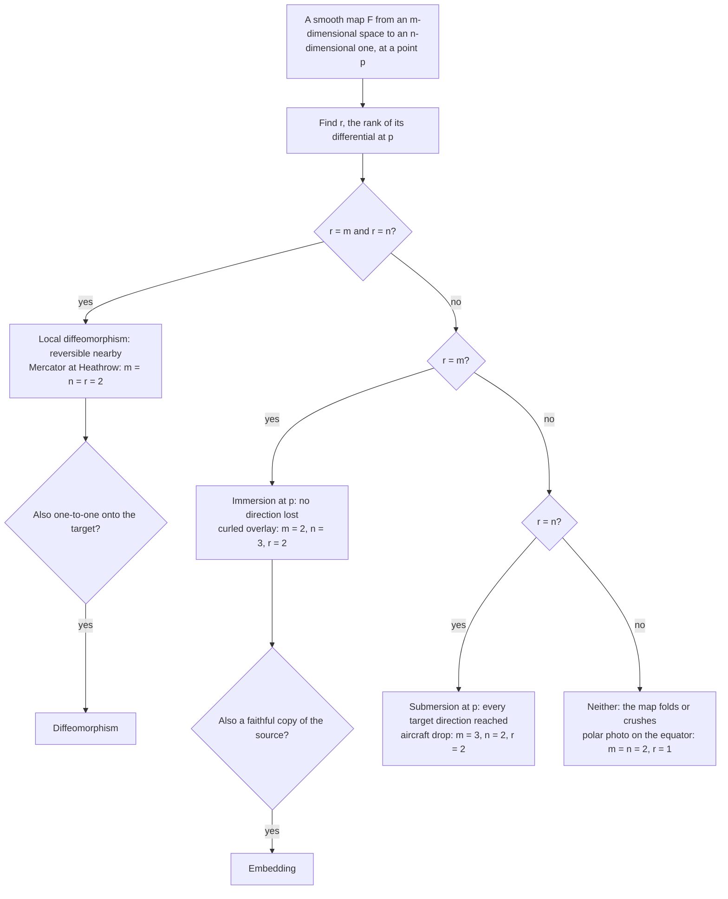

# Diffeomorphism, immersion, submersion: the ways one manifold maps into another

[Syllabus](../../../SYLLABUS.md) → [Differential geometry and Lie groups](../README.md) → [Manifolds](../README.md#s03) → Diffeomorphism, immersion, submersion

---

## General Overview

A Mercator wall map lies on a table. London Heathrow airport (51.4700° N, 0.4543° W) sits 6697.354 km above the map's equator line and 50.516 km left of its centre line, in map kilometres (the map is true to scale on the equator). Every point of the globe except the two poles has exactly one place on this map, and every place on the map comes from exactly one point. Near Heathrow the map stretches every direction by the same factor, 1.605331.

Beside it lies a clear plastic overlay printed with the same grid. Crumple it: curl it into a loose roll, crease it, press it flat. Now two different grid points can land on the same spot, and near a crease a small patch of overlay no longer shows a small patch of grid. A photo of the globe taken from far above the North Pole folds the same way, but smoothly: on the equator it squashes north and south together.

Both are **maps** between **manifolds** (spaces that look flat up close; [Smooth manifold](01-smooth-manifolds-and-charts.md)). The question is the same for both: near a point, does the map lose a direction, and can it be run backwards? One number decides it: the **rank** of the map's differential (the number of independent directions that survive the map).

- **Diffeomorphism:** a smooth one-to-one map onto its target whose undo is also smooth. The Mercator map is one, from the globe minus its poles and the 180° meridian onto an open strip. The meridian is cut because it would land on both edges of the strip.
- **Immersion:** a smooth map that kills no direction. The curled overlay is one, even where it overlaps itself.
- **Submersion:** a smooth map that reaches every direction of its target. Dropping an aircraft's position to the ground point under it is one.
- **Embedding:** an immersion that is also a faithful copy, with no overlaps and no near-touching. The overlay cut short enough to close no loop is one.

**Count how many directions the differential keeps at a point: all of the source's makes an immersion, all of the target's makes a submersion, both at once makes the map reversible nearby, and fewer than either means the map folds or crushes there.**

**What kind of fact this is:** definitions, plus two theorems: the inverse function theorem, proved on its own card and used here, and the constant rank theorem, proved in a fold in Why it works for immersions and submersions and cited from Lee in general. Every rank is a local fact; one-to-one and "embedding" are global facts about the whole map.

### The picture: one rank, four verdicts



The rank question is answered at one point. The two questions at the bottom are about the whole map at once.

---

## The formula

Reminders. A **chart** gives each point coordinates $`x^1, \dots, x^m`$, where the upper index is a label, not a power ([Smooth manifold](01-smooth-manifolds-and-charts.md)). The **differential** $`dF_p`$ is the linear map that carries velocities at $`p`$ to velocities at $`F(p)`$; in charts it is the Jacobian matrix of partial derivatives ([Tangent space and differential](03-tangent-spaces-and-differentials.md)). Its **rank** is the number of independent columns ([Rank and nullity](../../03-Algebra/05-Solving%20Systems/05-rank-nullity.md)).

```math
r = \mathrm{rank}\, dF_p \le \min(m, n), \qquad \text{immersion: } r = m, \qquad \text{submersion: } r = n, \qquad \text{local diffeomorphism: } r = m = n
```

**Read it aloud:** the differential keeps r directions, never more than either dimension; keeping all m inputs is an immersion, filling all n outputs is a submersion, and both is reversible nearby.

When the rank stays at the same $`r`$ all around $`p`$, the **constant rank theorem** says a choice of charts makes the map plain:

```math
F(x^1, \dots, x^m) = (x^1, \dots, x^r, 0, \dots, 0)
```

**Read it aloud:** in good coordinates the map keeps the first r numbers, drops the rest, and pads with zeros.

The four maps on this card, with R = 6371 km for the globe's radius (the Earth as a sphere, a model). The globe chart is the house one: $`\varphi`$ is the angle down from the North Pole ($`\varphi = 90° - \text{latitude}`$) and $`\theta`$ is longitude east, both in radians in formulas.

```math
\text{Mercator: } (X, Y) = \big(R\theta,\; R \ln \cot(\varphi/2)\big), \qquad \text{photo: } \big(R\sin\varphi\cos\theta,\; R\sin\varphi\sin\theta\big)
```

```math
\text{curled overlay: } C(u, v) = \big(\rho\sin(u/\rho),\; \rho\,(1 - \cos(u/\rho)),\; v\big), \qquad \text{aircraft drop: } G(q) = R\, q / \lvert q\rvert
```

The photo is the globe seen from far above the North Pole: each point drops straight onto the equator's plane.

| Symbol | Plain meaning | In our example | Push it up and the answer… |
| --- | --- | --- | --- |
| $`M`$, $`N`$; $`m`$, $`n`$ | the source and target manifolds; their dimensions | globe and map sheet; 2 and 2 (Mercator), 2 and 3 (overlay) | larger m: harder to immerse in a fixed n |
| $`x^1, \dots, x^m`$ | chart coordinates; the upper index is a label, not a power | φ and θ on the globe | — |
| $`F`$, $`p`$ | a smooth map, and the point where it is tested | Mercator, at Heathrow | — |
| $`dF_p`$ | the differential: F's best linear copy at p | the 2 by 2 Jacobian `[[0, R], [-R/sin(phi), 0]]` | — |
| $`r`$ | rank of $`dF_p`$: directions that survive | 2 at Heathrow; 1 for the photo on the equator | reaching min(m, n) unlocks immersion or submersion |
| $`R`$ | the globe's radius | 6371 km | every map length scales with it |
| $`\varphi`$, $`\theta`$ | angle down from the North Pole; longitude east | 38.53°, −0.4543° at Heathrow | φ near 0 or 180°: Mercator's Y runs off to infinity |
| $`X`$, $`Y`$ | Mercator map coordinates in km, capitals so they differ from the chart's $`x^i`$ | −50.516, 6697.354 | — |
| $`C`$, $`u`$, $`v`$ | the curled-overlay map; position on the sheet, across and up, m | u from 0 to 1.00, v from 0 to 0.70 | longer sheet: the roll overlaps more |
| $`\rho`$ | radius of the curled overlay, its circumference over 2π | 0.80 / 2π = 0.127324 m | wider roll: less overlap |
| $`q`$, $`G`$ | an aircraft's position in space; the drop to the ground point below | 11 km above Heathrow | higher aircraft: ground point moves less per km flown |
| $`\Phi`$, $`\Psi`$, $`w_j`$, $`t_j`$ | in the folded proof: a helper map, its local undo, padding vectors and their amounts | — | — |

### When it holds

- **The map is smooth (continuous partial derivatives of every order).** Without derivatives there is no differential and no rank. A sharp crease in the overlay is not smooth; the smooth fold of the photo is the honest version.
- **The rank is read in a chart that works at that point.** The latitude-longitude chart breaks at the poles, so it reports rank 1 for the photo at the North Pole, where the true rank is 2.
- **Rank decides local behaviour only.** Mercator has rank 2 everywhere and is also one-to-one; the curled overlay has rank 2 everywhere and is not. One-to-one is a separate, global check.
- **Constant rank needs the rank to stay put nearby.** At an immersion or submersion it does automatically (Step 3). On the photo's equator it jumps from 2 to 1, and no chart makes the map a plain "keep and drop".
- **Dimensions cap the options.** An immersion needs m ≤ n and a submersion needs m ≥ n, since r is at most both.

---

## Why it works

### Step 0: close up, a smooth map is its differential

Zoom in on a smooth map and it looks more and more like its differential, a linear map ([Tangent space and differential](03-tangent-spaces-and-differentials.md)). A linear map from m dimensions to n is decided by its rank: it is one-to-one exactly when the rank is m, and onto exactly when the rank is n. Rank and nullity add to m ([Rank and nullity](../../03-Algebra/05-Solving%20Systems/05-rank-nullity.md)). The theorems below say the smooth map inherits these properties near the point.

### Step 1: the rank belongs to the map, not to the chart

Change the chart on either side and, by the chain rule, the new Jacobian is the old one multiplied on each side by the Jacobian of a chart change ([Chain rule in several variables](../../06-Calculus%20and%20analysis/07-Several%20Variables/04-multivariable-chain-rule-and-jacobians.md)). Chart changes can be undone, so those Jacobians are invertible, and multiplying by an invertible matrix never changes a rank.

The code tests this the hard way. It reads each rank once from the latitude-longitude Jacobian, and once with no chart at all: it takes two unit directions along the globe built from a cross product, pushes each through the map in 3D space by small differences, and counts independent results.

The two roads agree at Heathrow and on the equator. They disagree at the North Pole: the chart says 1, the chart-free road says 2. At the pole every longitude names the same point, so the chart's own Jacobian collapses there. Nothing happens to the map.

Values such as the Jacobian's determinant do change with the chart. The photo's determinant in the latitude-longitude chart is $`R^2 \sin\varphi \cos\varphi`$: 19779435.5 km² per radian² at Heathrow, 0.0 on the equator and 0.0 at the pole. The equator's zero belongs to the map; the pole's zero belongs to the chart.

### Step 2: full rank with equal dimensions means reversible nearby

When m = n = r, the Jacobian is square and invertible. The inverse function theorem then gives a smooth undo near the point ([Inverse and implicit function theorems](../../06-Calculus%20and%20analysis/07-Several%20Variables/07-inverse-and-implicit-function-theorems.md)).

Mercator at Heathrow: the Jacobian `[[0, R], [-R/sin(phi), 0]]` has determinant $`R^2/\sin\varphi`$ = 65159826.7 km² per radian², not zero. So the map can be undone near Heathrow. The undo also exists in closed form, latitude = 2 atan(e^(Y/R)) − 90°. A second road, Newton's method with the inverse Jacobian, starts at 50° N, 2° E and lands on 51.470000° N, 0.454300° W in 4 steps.

### Step 3: full rank survives nearby, a rank drop does not

A rank of r means some r by r block of the Jacobian has a nonzero determinant. That determinant moves continuously, so it stays nonzero a little way off. The rank can therefore only rise or stay the same near a point, never fall.

So an immersion or submersion at p is one on a whole neighbourhood of p, with constant rank. A rank drop is the fragile case. The photo has rank 2 at 10° N and at 10° S but rank 1 on the equator between them, and the two land on the same image point, (6274.21, 0.00) km. Near the equator no undo exists: each image point has two sources. The map folds the southern hemisphere back under the northern one, the standard **fold** of maps between surfaces.

### Step 4: constant rank gives the plain form

Where the rank is constant, the inverse function theorem straightens the map in both charts at once. An immersion becomes "add zeros", $`(x^1, x^2) \mapsto (x^1, x^2, 0)`$. A submersion becomes "forget the last coordinates", $`(x^1, x^2, x^3) \mapsto (x^1, x^2)`$.

<details>
<summary>Detailed proof: the immersion and submersion cases of the constant rank theorem</summary>

Work in charts, so $`F`$ runs from an open set of m-space to n-space, with $`F(0) = 0`$ for short.

**Immersion, r = m ≤ n.** The m columns of $`dF_0`$ are independent. Add n − m fixed vectors $`w_1, \dots, w_{n-m}`$ to make a basis of n-space, and define a map of n variables:

$`\displaystyle \Phi(x, t) = F(x) + t_1 w_1 + \dots + t_{n-m} w_{n-m}.`$

Its Jacobian at 0 has the columns of $`dF_0`$ followed by the $`w_j`$: a basis, so it is invertible. The inverse function theorem gives a smooth undo $`\Psi`$ near 0. Then $`\Psi(F(x)) = \Psi(\Phi(x, 0)) = (x, 0)`$. In the target chart $`\Psi`$, the map is "add zeros".

**Submersion, r = n ≤ m.** Some n columns of $`dF_0`$ are independent; renumber so they come first. Define a map of m variables to m variables:

$`\displaystyle \Phi(x) = \big(F(x),\; x^{n+1}, \dots, x^m\big).`$

Its Jacobian at 0 is a block matrix with an invertible n by n corner and the identity below, so it is invertible. Let $`\Psi`$ be its smooth local undo. Then $`F(\Psi(y, z)) = y`$. In the source chart $`\Psi`$, the map is "forget the last coordinates".

The general constant-rank case runs the same two moves one after the other; Lee proves it as Theorem 4.12.

</details>

The submersion form shows what a submersion's level sets look like: in good coordinates, fixing the output fixes the first n coordinates and leaves the others free. That is the [Regular value theorem](06-submanifolds-and-the-regular-value-theorem.md).

### Step 5: from local to global

Rank speaks about one point and its neighbourhood. Two global facts finish the classification.

- **Diffeomorphism = local diffeomorphism everywhere + one-to-one and onto.** The local undos from Step 2 then fit together into one smooth undo. Mercator is continuous and one-to-one, with an open image, once the 180° meridian is cut away, so it is a diffeomorphism from the globe minus its poles and that meridian onto an open strip 40030.17 km wide that runs up and down forever; 85° N already sits at Y = 19949.5 km.
- **Embedding = immersion + a faithful copy.** "Faithful" means a homeomorphism onto the image: one-to-one, and points close in the image are close in the source. The overlay curled with circumference 0.80 m has rank 2 everywhere, but a 1.00 m sheet overlaps itself by 0.20 m, so u = 0.10 m and u = 0.90 m land on the same point. Cut it to 0.75 m and the two ends stay 0.049679 m apart: an embedding.

A one-to-one immersion can still fail to be faithful: a ribbon whose loose end runs back toward its own middle, coming as close as you like without touching. For a compact source (closed and bounded, like a whole sphere), one-to-one is enough.

The topology wing uses the same two words without derivatives: there an embedding is a copy with no crossings, and an immersion is one locally, as with the glass Klein bottle passing through its own wall ([Orientability](../../17-Topology/03-Surfaces%20and%20Manifolds/03-orientability-mobius-strip-and-klein-bottle.md)). This card's versions add the rank condition.

---

## Worked numbers, by hand

| Step | Arithmetic | Value |
| --- | --- | --- |
| Heathrow in the chart | φ = 90° − 51.47° | 38.53°, θ = −0.4543° |
| Mercator X | R θ = 6371 × (−0.4543 × π/180) | −50.516 km |
| Mercator Y | R ln cot(19.265°) | 6697.354 km |
| Mercator determinant | R² / sin 38.53° | 65159826.7 km² per rad², not 0 |
| Mercator rank | 2 by 2, determinant not 0 | **2 = m = n: reversible nearby** |
| Mercator stretch | 1 / cos 51.47° | 1.605331 in every direction |
| Photo on the equator | φ = 90°: R² sin φ cos φ = 6371² × 1 × 0 | 0.0, rank **1: neither** |
| Photo of 10° N and 10° S | R cos 10° for both | 6274.21 km: two sources |
| Overlay roll radius | 0.80 / 2π | 0.127324 m |
| Overlay rank | columns (cos(u/ρ), sin(u/ρ), 0) and (0, 0, 1), each length 1 | **2 = m: immersion** |
| Overlap of a 1.00 m sheet | 1.00 − 0.80 | 0.20 m: not an embedding |
| Gap left by a 0.75 m sheet | 2ρ sin(0.05 / 2ρ) | 0.049679 m: an embedding |
| Aircraft drop | climb direction killed, 3 − 1 | rank **2 = n: submersion**, nullity 1 |
| Aircraft sideways step | 1 km × R / (R + 11) = 6371 / 6382 | 0.998276 km on the ground |

The Mercator map can be run backwards anywhere off the poles; the photo cannot be near its equator; the overlay keeps every direction but can overlap itself; and the drop keeps every ground direction but forgets height.

### What breaks if you drop a piece

| Mistake | Comes out at | What went wrong |
| --- | --- | --- |
| Reading the photo's rank at the North Pole from the latitude-longitude chart | rank 1 (true rank 2) | The chart, not the map, collapses at the pole |
| Taking rank 2 everywhere to mean one-to-one | the 1.00 m roll's u = 0.10 m and u = 0.90 m meet at distance 0.000000 m | Rank is local; overlaps are global |
| Undoing the photo near the equator | 6274.21 km comes from 10° N and from 10° S | Rank 1 on the equator: the hypothesis of the inverse function theorem fails |
| Calling the aircraft drop an immersion | an 11 km climb moves the ground point 0.000000 km | r = 2 < m = 3: the vertical direction is killed |

The code prints all four.

---

## Code, from first principles, and it actually runs

The code classifies all four maps by rank, and every rank is found by two independent roads. One road differentiates the formula in a chart. The other uses no chart: it builds two directions along the globe from a cross product, pushes them through the map by central differences in 3D space, and counts independent columns by Gaussian elimination. Three more pairs of roads back the numbers: the Mercator stretch against 1/cos(latitude) and against the entries of the chart's Jacobian, the closed-form undo against Newton's method, and a brute-force search for the overlay's nearest meeting against the chord formula.

### Python

```python
# Diffeomorphism, immersion, submersion -- the check behind the card.  Standard
# library only.  Four maps from the house example are classified by the rank of
# their differential.  Each rank is found by two roads: the Jacobian written out
# in the latitude-longitude chart, and a chart-free road that pushes two tangent
# directions through the map in 3D space by central differences.
from math import sin, cos, atan, atan2, exp, log, sqrt, pi, radians, degrees

R = 6371.0                                     # the globe's radius in km (a sphere: a model)

def rank(A, tol=1e-7):                         # Gaussian elimination, tolerance relative to the largest entry
    A, r = [row[:] for row in A], 0
    big = max(abs(x) for row in A for x in row) or 1.0
    for c in range(len(A[0])):
        rows = [i for i in range(r, len(A)) if abs(A[i][c]) > tol * big]
        if not rows:
            continue
        p = max(rows, key=lambda i: abs(A[i][c]))
        A[r], A[p] = A[p], A[r]
        for i in range(r + 1, len(A)):
            f = A[i][c] / A[r][c]
            A[i] = [a - f * b for a, b in zip(A[i], A[r])]
        r += 1
    return r

def add(a, b, s=1.0): return [x + s * y for x, y in zip(a, b)]
def norm(a): return sqrt(sum(x * x for x in a))
def cross(a, b): return [a[1]*b[2] - a[2]*b[1], a[2]*b[0] - a[0]*b[2], a[0]*b[1] - a[1]*b[0]]
def ball(lat, lon):                            # degrees north and east to a point on the globe, km
    f, t = radians(90 - lat), radians(lon)     # phi measured down from the North Pole
    return [R * sin(f) * cos(t), R * sin(f) * sin(t), R * cos(f)]

def tangent_pair(q):                           # two unit directions along the globe at q, no chart used
    u = [x / norm(q) for x in q]
    a = [0.0, 0.0, 0.0]
    a[min(range(3), key=lambda i: abs(u[i]))] = 1.0
    e1 = cross(a, u)
    e1 = [x / norm(e1) for x in e1]
    return [e1, cross(u, e1)]

def push(F, q, dirs, h=1e-3):                  # columns dF(v) by central differences, as a matrix
    cols = [[(a - b) / (2 * h) for a, b in zip(F(add(q, v, h)), F(add(q, v, -h)))] for v in dirs]
    return [list(row) for row in zip(*cols)]

def mercator(q):                               # X = R theta, Y = R ln cot(phi/2), from a 3D point
    s = q[2] / norm(q)
    return [R * atan2(q[1], q[0]), R * 0.5 * log((1 + s) / (1 - s))]
def photo(q): return [q[0], q[1]]              # the globe seen from far above the North Pole
def J_mercator(f): return [[0.0, R], [-R / sin(f), 0.0]]          # columns: d/dphi, d/dtheta
def J_photo(f, t): return [[R * cos(f) * cos(t), -R * sin(f) * sin(t)],
                           [R * cos(f) * sin(t), R * sin(f) * cos(t)]]

# 1. Mercator at Heathrow: a diffeomorphism from the globe minus its poles onto a strip.
lat, lon = 51.47, -0.4543
f, t = radians(90 - lat), radians(lon)
L = ball(lat, lon)
x, y = mercator(L)
JM = push(mercator, L, tangent_pair(L))
st = [norm([JM[0][k], JM[1][k]]) for k in range(2)]
print(f"Heathrow {lat:.4f} N {-lon:.4f} W on Mercator: X = {x:.3f} km, Y = {y:.3f} km")
print(f"Mercator rank at Heathrow: chart {rank(J_mercator(f))}, chart-free {rank(JM)}; "
      f"chart det = {R * R / sin(f):.1f} km^2 per rad^2")
print(f"Mercator stretch at Heathrow, two chart-free directions: {st[0]:.6f}, {st[1]:.6f}; "
      f"1/cos(latitude) = {1 / cos(radians(lat)):.6f}")
back = (90 - degrees(2 * atan(exp(-y / R))), degrees(x / R))       # road one: the closed-form undo
g, k = radians(40.0), radians(2.0)                               # road two: Newton from 50 N, 2 E
for n in range(1, 30):
    J = J_mercator(g)
    d = [R * k - x, R * 0.5 * log((1 + cos(g)) / (1 - cos(g))) - y]
    g, k = g - d[1] / J[1][0], k - d[0] / J[0][1]                # inverse of an anti-diagonal matrix
    if abs(d[0]) + abs(d[1]) < 1e-9:
        break
print(f"undo by formula: {back[0]:.6f} N {-back[1]:.6f} W; by Newton ({n} steps): "
      f"{90 - degrees(g):.6f} N {-degrees(k):.6f} W")
print(f"Mercator strip width 2 pi R = {2 * pi * R:.2f} km; Y at 85 N = {mercator(ball(85, 0))[1]:.1f} km")
# 2. The photo from above the North Pole: rank 2 at Heathrow, rank 1 on the equator.
rP = [(rank(J_photo(radians(90 - a), radians(b))), rank(push(photo, ball(a, b), tangent_pair(ball(a, b)))))
      for a, b in [(lat, lon), (0, 0), (90, 0)]]
print(f"photo rank (chart, chart-free): Heathrow {rP[0]}, equator {rP[1]}, North Pole {rP[2]}")
print(f"photo chart det R^2 sin(phi) cos(phi): Heathrow {R*R*sin(f)*cos(f):.1f}, equator "
      f"{abs(R*R*sin(pi/2)*cos(pi/2)):.1f}, North Pole {R*R*sin(0.0)*cos(0.0):.1f} km^2 per rad^2")
p10n, p10s = photo(ball(10, 0)), photo(ball(-10, 0))
print(f"photo of 10 N 0 E: ({p10n[0]:.2f}, {p10n[1]:.2f}) km; of 10 S 0 E: ({p10s[0]:.2f}, {abs(p10s[1]):.2f}) km")
# 3. The overlay: a 1.00 m clear sheet curled into a roll 0.80 m round.
def roll(c):
    rho = c / (2 * pi)
    return lambda q: [rho * sin(q[0] / rho), rho * (1 - cos(q[0] / rho)), q[1]]
C = roll(0.80)
JC = push(C, [0.10, 0.35], [[1.0, 0.0], [0.0, 1.0]], 1e-5)
JCa = [[cos(0.10 / (0.8 / (2 * pi))), 0.0], [sin(0.10 / (0.8 / (2 * pi))), 0.0], [0.0, 1.0]]
a, b = C([0.10, 0.35]), C([0.90, 0.35])
print(f"roll rank at u = 0.10 m: formula {rank(JCa)}, differences {rank(JC)}; column lengths "
      f"{norm([r[0] for r in JC]):.6f}, {norm([r[1] for r in JC]):.6f}")
print(f"u = 0.10 m lands at ({a[0]:.6f}, {a[1]:.6f}, {a[2]:.2f}); u = 0.90 m at ({b[0]:.6f}, {b[1]:.6f}, {b[2]:.2f})")
def closest(width, c=0.80, step=0.005, apart=0.40):   # brute force: nearest meeting of far-apart points
    F, us = roll(c), [i * step for i in range(round(width / step) + 1)]
    return min(norm(add(F([u, 0.0]), F([w, 0.0]), -1.0)) for u in us for w in us if w - u >= apart - 1e-12)
rho = 0.80 / (2 * pi)
gap = 2 * rho * sin(0.05 / (2 * rho))                            # chord across the 0.05 m left uncovered
print(f"closest approach of points 0.40 m apart on the sheet: 1.00 m sheet {closest(1.00):.6f} m, "
      f"0.75 m sheet {closest(0.75):.6f} m; chord formula {gap:.6f} m")
print(f"roll radius 0.80 m / 2 pi = {rho:.6f} m; a 1.00 m sheet overlaps itself by {1.00 - 0.80:.2f} m")
# 4. The drop from an aircraft 11 km above Heathrow to the ground point below it.
u = [c / R for c in L]
q = [(R + 11.0) * c for c in u]
G = lambda p: [R * c / norm(p) for c in p]
JG = push(G, q, [[1.0, 0, 0], [0, 1.0, 0], [0, 0, 1.0]])
JGa = [[R / norm(q) * ((i == j) - u[i] * u[j]) for j in range(3)] for i in range(3)]
up = [sum(JG[i][j] * u[j] for j in range(3)) for i in range(3)]
side = tangent_pair(q)[0]
print(f"drop rank: formula {rank(JGa)}, differences {rank(JG)}; nullity {3 - rank(JG)}")
print(f"an 11 km climb moves the ground point {11 * norm(up):.6f} km; a 1 km sideways step moves it "
      f"{norm([sum(JG[i][j] * side[j] for j in range(3)) for i in range(3)]):.6f} km = R/(R + 11)")
assert rank(J_mercator(f)) == rank(JM) == 2 and abs(st[0] - 1 / cos(radians(lat))) < 1e-6
assert abs(back[0] - lat) < 1e-9 and abs(90 - degrees(g) - lat) < 1e-9 and abs(degrees(k) - lon) < 1e-9
assert rP == [(2, 2), (1, 1), (1, 2)] and abs(p10n[0] - p10s[0]) < 1e-9
assert rank(JC) == rank(JCa) == 2 and norm(add(a, b, -1.0)) < 1e-12
assert closest(1.00) < 1e-9 and abs(closest(0.75) - gap) < 1e-9
assert rank(JG) == rank(JGa) == 2 and 11 * norm(up) < 1e-6 and abs(norm(JG[0]) - norm(JGa[0])) < 1e-6
assert abs(J_mercator(f)[0][1] / (R * sin(f)) - st[0]) < 1e-6 and abs(-J_mercator(f)[1][0] / R - st[1]) < 1e-6
print("ALL CHECKS PASS")
```

**Ran 2026-11-19 on macOS, Python 3.14.10, standard library only. All checks passed. Output, pasted from the run:**

```
Heathrow 51.4700 N 0.4543 W on Mercator: X = -50.516 km, Y = 6697.354 km
Mercator rank at Heathrow: chart 2, chart-free 2; chart det = 65159826.7 km^2 per rad^2
Mercator stretch at Heathrow, two chart-free directions: 1.605331, 1.605331; 1/cos(latitude) = 1.605331
undo by formula: 51.470000 N 0.454300 W; by Newton (4 steps): 51.470000 N 0.454300 W
Mercator strip width 2 pi R = 40030.17 km; Y at 85 N = 19949.5 km
photo rank (chart, chart-free): Heathrow (2, 2), equator (1, 1), North Pole (1, 2)
photo chart det R^2 sin(phi) cos(phi): Heathrow 19779435.5, equator 0.0, North Pole 0.0 km^2 per rad^2
photo of 10 N 0 E: (6274.21, 0.00) km; of 10 S 0 E: (6274.21, 0.00) km
roll rank at u = 0.10 m: formula 2, differences 2; column lengths 1.000000, 1.000000
u = 0.10 m lands at (0.090032, 0.037292, 0.35); u = 0.90 m at (0.090032, 0.037292, 0.35)
closest approach of points 0.40 m apart on the sheet: 1.00 m sheet 0.000000 m, 0.75 m sheet 0.049679 m; chord formula 0.049679 m
roll radius 0.80 m / 2 pi = 0.127324 m; a 1.00 m sheet overlaps itself by 0.20 m
drop rank: formula 2, differences 2; nullity 1
an 11 km climb moves the ground point 0.000000 km; a 1 km sideways step moves it 0.998276 km = R/(R + 11)
ALL CHECKS PASS
```

### Rust

Same numbers, same labels, built with `rustc --edition 2021 -O`.

```rust
// Diffeomorphism, immersion, submersion -- the same check as the Python, in Rust.
// No crates.  Four maps from the house example are classified by the rank of
// their differential.  Each rank is found by two roads: the Jacobian written out
// in the latitude-longitude chart, and a chart-free road that pushes two tangent
// directions through the map in 3D space by central differences.
use std::f64::consts::PI;

const R: f64 = 6371.0; // the globe's radius in km (a sphere: a model)
type M = Vec<Vec<f64>>;

fn rank(a: &M, tol: f64) -> usize { // Gaussian elimination, tolerance relative to the largest entry
    let mut a = a.clone();
    let mut r = 0;
    let big = a.iter().flatten().fold(0.0_f64, |m, x| m.max(x.abs()));
    let big = if big == 0.0 { 1.0 } else { big };
    for c in 0..a[0].len() {
        let rows: Vec<usize> = (r..a.len()).filter(|&i| a[i][c].abs() > tol * big).collect();
        if rows.is_empty() { continue; }
        let mut p = rows[0];
        for &i in &rows { if a[i][c].abs() > a[p][c].abs() { p = i; } }
        a.swap(r, p);
        for i in r + 1..a.len() {
            let f = a[i][c] / a[r][c];
            let top = a[r].clone();
            for (x, y) in a[i].iter_mut().zip(top.iter()) { *x -= f * y; }
        }
        r += 1;
    }
    r
}
fn rk(a: &M) -> usize { rank(a, 1e-7) }
fn add(a: &[f64], b: &[f64], s: f64) -> Vec<f64> { a.iter().zip(b).map(|(x, y)| x + s * y).collect() }
fn norm(a: &[f64]) -> f64 { a.iter().map(|x| x * x).sum::<f64>().sqrt() }
fn cross(a: &[f64], b: &[f64]) -> Vec<f64> {
    vec![a[1] * b[2] - a[2] * b[1], a[2] * b[0] - a[0] * b[2], a[0] * b[1] - a[1] * b[0]]
}
fn ball(lat: f64, lon: f64) -> Vec<f64> { // degrees north and east to a point on the globe, km
    let (f, t) = ((90.0 - lat).to_radians(), lon.to_radians()); // phi measured down from the North Pole
    vec![R * f.sin() * t.cos(), R * f.sin() * t.sin(), R * f.cos()]
}
fn tangent_pair(q: &[f64]) -> Vec<Vec<f64>> { // two unit directions along the globe at q, no chart used
    let u: Vec<f64> = q.iter().map(|x| x / norm(q)).collect();
    let mut a = vec![0.0; 3];
    let mut i = 0;
    for j in 1..3 { if u[j].abs() < u[i].abs() { i = j; } }
    a[i] = 1.0;
    let e1 = cross(&a, &u);
    let e1: Vec<f64> = e1.iter().map(|x| x / norm(&e1)).collect();
    let e2 = cross(&u, &e1);
    vec![e1, e2]
}
fn push(f: &dyn Fn(&[f64]) -> Vec<f64>, q: &[f64], dirs: &M, h: f64) -> M { // columns dF(v), as a matrix
    let cols: M = dirs.iter().map(|v| {
        let (a, b) = (f(&add(q, v, h)), f(&add(q, v, -h)));
        a.iter().zip(&b).map(|(x, y)| (x - y) / (2.0 * h)).collect()
    }).collect();
    (0..cols[0].len()).map(|i| cols.iter().map(|c| c[i]).collect()).collect()
}
fn mercator(q: &[f64]) -> Vec<f64> { // X = R theta, Y = R ln cot(phi/2), from a 3D point
    let s = q[2] / norm(q);
    vec![R * q[1].atan2(q[0]), R * 0.5 * ((1.0 + s) / (1.0 - s)).ln()]
}
fn photo(q: &[f64]) -> Vec<f64> { vec![q[0], q[1]] } // the globe seen from far above the North Pole
fn j_mercator(f: f64) -> M { vec![vec![0.0, R], vec![-R / f.sin(), 0.0]] } // columns: d/dphi, d/dtheta
fn j_photo(f: f64, t: f64) -> M {
    vec![vec![R * f.cos() * t.cos(), -R * f.sin() * t.sin()], vec![R * f.cos() * t.sin(), R * f.sin() * t.cos()]]
}
fn roll(c: f64) -> impl Fn(&[f64]) -> Vec<f64> {
    let rho = c / (2.0 * PI);
    move |q: &[f64]| vec![rho * (q[0] / rho).sin(), rho * (1.0 - (q[0] / rho).cos()), q[1]]
}
fn closest(width: f64) -> f64 { // brute force: nearest meeting of far-apart points
    let (f, step, apart) = (roll(0.80), 0.005, 0.40);
    let us: Vec<f64> = (0..=((width / step).round() as usize)).map(|i| i as f64 * step).collect();
    let mut best = f64::INFINITY;
    for &u in &us { for &w in &us {
        if w - u >= apart - 1e-12 { best = best.min(norm(&add(&f(&[u, 0.0]), &f(&[w, 0.0]), -1.0))); }
    } }
    best
}

fn main() {
    // 1. Mercator at Heathrow: a diffeomorphism from the globe minus its poles onto a strip.
    let (lat, lon) = (51.47_f64, -0.4543_f64);
    let (f, _t) = ((90.0 - lat).to_radians(), lon.to_radians());
    let l = ball(lat, lon);
    let xy = mercator(&l);
    let (x, y) = (xy[0], xy[1]);
    let jm = push(&mercator, &l, &tangent_pair(&l), 1e-3);
    let st: Vec<f64> = (0..2).map(|k| norm(&[jm[0][k], jm[1][k]])).collect();
    println!("Heathrow {:.4} N {:.4} W on Mercator: X = {:.3} km, Y = {:.3} km", lat, -lon, x, y);
    println!("Mercator rank at Heathrow: chart {}, chart-free {}; chart det = {:.1} km^2 per rad^2",
             rk(&j_mercator(f)), rk(&jm), R * R / f.sin());
    println!("Mercator stretch at Heathrow, two chart-free directions: {:.6}, {:.6}; 1/cos(latitude) = {:.6}",
             st[0], st[1], 1.0 / lat.to_radians().cos());
    let back = (90.0 - (2.0 * (-y / R).exp().atan()).to_degrees(), (x / R).to_degrees()); // road one
    let (mut g, mut k) = (40.0_f64.to_radians(), 2.0_f64.to_radians()); // road two: Newton from 50 N, 2 E
    let mut n = 0;
    for step in 1..30 {
        n = step;
        let j = j_mercator(g);
        let d = [R * k - x, R * 0.5 * ((1.0 + g.cos()) / (1.0 - g.cos())).ln() - y];
        g -= d[1] / j[1][0];
        k -= d[0] / j[0][1]; // inverse of an anti-diagonal matrix
        if d[0].abs() + d[1].abs() < 1e-9 { break; }
    }
    println!("undo by formula: {:.6} N {:.6} W; by Newton ({} steps): {:.6} N {:.6} W",
             back.0, -back.1, n, 90.0 - g.to_degrees(), -k.to_degrees());
    println!("Mercator strip width 2 pi R = {:.2} km; Y at 85 N = {:.1} km", 2.0 * PI * R, mercator(&ball(85.0, 0.0))[1]);
    // 2. The photo from above the North Pole: rank 2 at Heathrow, rank 1 on the equator.
    let rp: Vec<(usize, usize)> = [(lat, lon), (0.0, 0.0), (90.0, 0.0)].iter().map(|&(a, b)| {
        let p = ball(a, b);
        (rk(&j_photo((90.0 - a).to_radians(), b.to_radians())), rk(&push(&photo, &p, &tangent_pair(&p), 1e-3)))
    }).collect();
    println!("photo rank (chart, chart-free): Heathrow ({}, {}), equator ({}, {}), North Pole ({}, {})",
             rp[0].0, rp[0].1, rp[1].0, rp[1].1, rp[2].0, rp[2].1);
    println!("photo chart det R^2 sin(phi) cos(phi): Heathrow {:.1}, equator {:.1}, North Pole {:.1} km^2 per rad^2",
             R * R * f.sin() * f.cos(), (R * R * (PI / 2.0).sin() * (PI / 2.0).cos()).abs(), R * R * 0.0_f64.sin() * 0.0_f64.cos());
    let (p10n, p10s) = (photo(&ball(10.0, 0.0)), photo(&ball(-10.0, 0.0)));
    println!("photo of 10 N 0 E: ({:.2}, {:.2}) km; of 10 S 0 E: ({:.2}, {:.2}) km", p10n[0], p10n[1], p10s[0], p10s[1].abs());
    // 3. The overlay: a 1.00 m clear sheet curled into a roll 0.80 m round.
    let c = roll(0.80);
    let jc = push(&c, &[0.10, 0.35], &vec![vec![1.0, 0.0], vec![0.0, 1.0]], 1e-5);
    let w = 0.10 / (0.8 / (2.0 * PI));
    let jca: M = vec![vec![w.cos(), 0.0], vec![w.sin(), 0.0], vec![0.0, 1.0]];
    let (a, b) = (c(&[0.10, 0.35]), c(&[0.90, 0.35]));
    let col = |m: &M, j: usize| -> Vec<f64> { m.iter().map(|r| r[j]).collect() };
    println!("roll rank at u = 0.10 m: formula {}, differences {}; column lengths {:.6}, {:.6}",
             rk(&jca), rk(&jc), norm(&col(&jc, 0)), norm(&col(&jc, 1)));
    println!("u = 0.10 m lands at ({:.6}, {:.6}, {:.2}); u = 0.90 m at ({:.6}, {:.6}, {:.2})", a[0], a[1], a[2], b[0], b[1], b[2]);
    let rho = 0.80 / (2.0 * PI);
    let gap = 2.0 * rho * (0.05 / (2.0 * rho)).sin(); // chord across the 0.05 m left uncovered
    let (c100, c75) = (closest(1.00), closest(0.75));
    println!("closest approach of points 0.40 m apart on the sheet: 1.00 m sheet {:.6} m, 0.75 m sheet {:.6} m; chord formula {:.6} m",
             c100, c75, gap);
    println!("roll radius 0.80 m / 2 pi = {:.6} m; a 1.00 m sheet overlaps itself by {:.2} m", rho, 1.00 - 0.80);
    // 4. The drop from an aircraft 11 km above Heathrow to the ground point below it.
    let u: Vec<f64> = l.iter().map(|v| v / R).collect();
    let q: Vec<f64> = u.iter().map(|v| (R + 11.0) * v).collect();
    let gmap = |p: &[f64]| -> Vec<f64> { p.iter().map(|v| R * v / norm(p)).collect() };
    let eye: M = vec![vec![1.0, 0.0, 0.0], vec![0.0, 1.0, 0.0], vec![0.0, 0.0, 1.0]];
    let jg = push(&gmap, &q, &eye, 1e-3);
    let jga: M = (0..3).map(|i| (0..3).map(|j| R / norm(&q) * (eye[i][j] - u[i] * u[j])).collect()).collect();
    let apply = |m: &M, v: &[f64]| -> Vec<f64> { m.iter().map(|r| r.iter().zip(v).map(|(p, s)| p * s).sum()).collect() };
    let up = apply(&jg, &u);
    let side = tangent_pair(&q)[0].clone();
    println!("drop rank: formula {}, differences {}; nullity {}", rk(&jga), rk(&jg), 3 - rk(&jg));
    println!("an 11 km climb moves the ground point {:.6} km; a 1 km sideways step moves it {:.6} km = R/(R + 11)",
             11.0 * norm(&up), norm(&apply(&jg, &side)));
    assert!(rk(&j_mercator(f)) == 2 && rk(&jm) == 2 && (st[0] - 1.0 / lat.to_radians().cos()).abs() < 1e-6);
    assert!((back.0 - lat).abs() < 1e-9 && (90.0 - g.to_degrees() - lat).abs() < 1e-9 && (k.to_degrees() - lon).abs() < 1e-9);
    assert!(rp == vec![(2, 2), (1, 1), (1, 2)] && (p10n[0] - p10s[0]).abs() < 1e-9);
    assert!(rk(&jc) == 2 && rk(&jca) == 2 && norm(&add(&a, &b, -1.0)) < 1e-12);
    assert!(c100 < 1e-9 && (c75 - gap).abs() < 1e-9);
    assert!(rk(&jg) == 2 && rk(&jga) == 2 && 11.0 * norm(&up) < 1e-6 && (norm(&jg[0]) - norm(&jga[0])).abs() < 1e-6);
    assert!((j_mercator(f)[0][1] / (R * f.sin()) - st[0]).abs() < 1e-6 && (-j_mercator(f)[1][0] / R - st[1]).abs() < 1e-6);
    println!("ALL CHECKS PASS");
}
```

**Ran 2026-11-19 on macOS, rustc 1.98.1, no crates. All checks passed. Output, pasted from the run:**

```
Heathrow 51.4700 N 0.4543 W on Mercator: X = -50.516 km, Y = 6697.354 km
Mercator rank at Heathrow: chart 2, chart-free 2; chart det = 65159826.7 km^2 per rad^2
Mercator stretch at Heathrow, two chart-free directions: 1.605331, 1.605331; 1/cos(latitude) = 1.605331
undo by formula: 51.470000 N 0.454300 W; by Newton (4 steps): 51.470000 N 0.454300 W
Mercator strip width 2 pi R = 40030.17 km; Y at 85 N = 19949.5 km
photo rank (chart, chart-free): Heathrow (2, 2), equator (1, 1), North Pole (1, 2)
photo chart det R^2 sin(phi) cos(phi): Heathrow 19779435.5, equator 0.0, North Pole 0.0 km^2 per rad^2
photo of 10 N 0 E: (6274.21, 0.00) km; of 10 S 0 E: (6274.21, 0.00) km
roll rank at u = 0.10 m: formula 2, differences 2; column lengths 1.000000, 1.000000
u = 0.10 m lands at (0.090032, 0.037292, 0.35); u = 0.90 m at (0.090032, 0.037292, 0.35)
closest approach of points 0.40 m apart on the sheet: 1.00 m sheet 0.000000 m, 0.75 m sheet 0.049679 m; chord formula 0.049679 m
roll radius 0.80 m / 2 pi = 0.127324 m; a 1.00 m sheet overlaps itself by 0.20 m
drop rank: formula 2, differences 2; nullity 1
an 11 km climb moves the ground point 0.000000 km; a 1 km sideways step moves it 0.998276 km = R/(R + 11)
ALL CHECKS PASS
```

The two outputs match line for line.

### Lean

Lean proves Steps 2 and 4 in charts, for any smooth map from all of m-space to n-space, at any point $`p`$.

- Suppose the rank at $`p`$ is $`r = m = n`$. Then the map is reversible nearby: near $`p`$ it has a smooth undo.
- Suppose the rank at $`p`$ is $`r = m`$. Then some target chart $`\Psi`$, smooth with a smooth undo, gives $`\Psi(F(x)) = (x, 0)`$ for every $`x`$ near $`p`$.
- Suppose the rank at $`p`$ is $`r = n`$. Then some source chart $`\Psi`$, smooth with a smooth undo, reaches $`p`$ and gives $`F(\Psi(y, z)) = y`$ wherever it is defined.

The four maps, their ranks, the fold, the overlay's overlap and every printed number are left to the Python and Rust checks.

```lean
-- Diffeomorphism, immersion, submersion: in charts, a smooth map whose differential keeps all source directions straightens to "add zeros", one that reaches all target directions straightens to "forget the last coordinates", and one that does both is reversible nearby with a smooth undo.
import Mathlib.Geometry.Manifold.LocalDiffeomorph
import Mathlib.Analysis.InnerProductSpace.PiL2
import Mathlib.Analysis.Calculus.InverseFunctionTheorem.ContDiff

open scoped ContDiff Manifold Topology

/-- Inverse function theorem packaged as a `PartialDiffeomorph` whose forward map is `g`. -/
theorem exists_partialDiffeomorph_of_hasFDerivAt_injective
    {E F : Type*} [NormedAddCommGroup E] [NormedSpace ℝ E] [FiniteDimensional ℝ E]
    [NormedAddCommGroup F] [NormedSpace ℝ F] [FiniteDimensional ℝ F]
    (g : E → F) (a : E) (hg : ContDiff ℝ ∞ g) (D : E →L[ℝ] F) (hD : HasFDerivAt g D a)
    (hinj : Function.Injective D) (hdim : Module.finrank ℝ E = Module.finrank ℝ F) :
    ∃ Φ : PartialDiffeomorph 𝓘(ℝ, E) 𝓘(ℝ, F) E F ∞, a ∈ Φ.source ∧ ∀ x, Φ x = g x := by
  have hsurj : Function.Surjective (D : E →ₗ[ℝ] F) :=
    (LinearMap.injective_iff_surjective_of_finrank_eq_finrank hdim).1 hinj
  let e : E ≃L[ℝ] F :=
    (LinearEquiv.ofBijective (D : E →ₗ[ℝ] F) ⟨hinj, hsurj⟩).toContinuousLinearEquiv
  have he : (e : E →L[ℝ] F) = D := by ext x; rfl
  have hd : HasFDerivAt g (e : E →L[ℝ] F) a := he ▸ hD
  have hga : ContDiffAt ℝ ∞ g a := hg.contDiffAt
  let h0 := hga.toOpenPartialHomeomorph g hd (by simp)
  let s : Set E := fderiv ℝ g ⁻¹' Set.range ((↑) : (E ≃L[ℝ] F) → E →L[ℝ] F)
  have hs : IsOpen s :=
    ContinuousLinearEquiv.isOpen.preimage (hg.continuous_fderiv (by simp))
  have has : a ∈ s := ⟨e, hd.fderiv.symm⟩
  let h := h0.restrOpen s hs
  have hcoe : (h : E → F) = g := rfl
  refine ⟨{ toPartialEquiv := h.toPartialEquiv
            open_source := h.open_source
            open_target := h.open_target
            contMDiffOn_toFun := ?_
            contMDiffOn_invFun := ?_ }, ?_, fun x => rfl⟩
  · rw [contMDiffOn_iff_contDiffOn]
    exact hg.contDiffOn
  · rw [contMDiffOn_iff_contDiffOn]
    intro y hy
    have hy' : h.symm y ∈ h.source := h.map_target hy
    have hys : h.symm y ∈ s := by
      have := hy'
      rw [OpenPartialHomeomorph.restrOpen_source] at this
      exact this.2
    obtain ⟨e', he'⟩ := hys
    have hd' : HasFDerivAt h (e' : E →L[ℝ] F) (h.symm y) := by
      rw [hcoe, he']
      exact (hg.differentiable (by simp) _).hasFDerivAt
    exact (h.contDiffAt_symm hy hd' (hcoe ▸ (hg.contDiffAt : ContDiffAt ℝ ∞ g (h.symm y)))).contDiffWithinAt
  · show a ∈ h.source
    rw [OpenPartialHomeomorph.restrOpen_source]
    exact ⟨hga.mem_toOpenPartialHomeomorph_source hd (by simp), has⟩

#print axioms exists_partialDiffeomorph_of_hasFDerivAt_injective

/-- Reversible nearby: a smooth map from m-space to n-space whose differential at `p` has
rank `r` with `r = m` and `r = n` is a local diffeomorphism at `p`: near `p` it has a
smooth undo. -/
theorem full_rank_both_ways_is_local_diffeomorphism {m n : ℕ}
    (f : EuclideanSpace ℝ (Fin m) → EuclideanSpace ℝ (Fin n)) (p : EuclideanSpace ℝ (Fin m))
    (hf : ContDiff ℝ ∞ f)
    (hm : Module.finrank ℝ (LinearMap.range (fderiv ℝ f p : EuclideanSpace ℝ (Fin m) →ₗ[ℝ] EuclideanSpace ℝ (Fin n))) = m)
    (hn : Module.finrank ℝ (LinearMap.range (fderiv ℝ f p : EuclideanSpace ℝ (Fin m) →ₗ[ℝ] EuclideanSpace ℝ (Fin n))) = n) :
    IsLocalDiffeomorphAt 𝓘(ℝ, EuclideanSpace ℝ (Fin m)) 𝓘(ℝ, EuclideanSpace ℝ (Fin n)) ∞ f p := by
  have hD : HasFDerivAt f (fderiv ℝ f p) p := (hf.differentiable (by simp) p).hasFDerivAt
  have hinj : Function.Injective (fderiv ℝ f p) := by
    have h := LinearMap.finrank_range_add_finrank_ker
      (fderiv ℝ f p : EuclideanSpace ℝ (Fin m) →ₗ[ℝ] EuclideanSpace ℝ (Fin n))
    rw [hm, finrank_euclideanSpace_fin] at h
    have hk : LinearMap.ker
        (fderiv ℝ f p : EuclideanSpace ℝ (Fin m) →ₗ[ℝ] EuclideanSpace ℝ (Fin n)) = ⊥ :=
      Submodule.finrank_eq_zero.1 (by omega)
    exact LinearMap.ker_eq_bot.1 hk
  have hdim : Module.finrank ℝ (EuclideanSpace ℝ (Fin m)) =
      Module.finrank ℝ (EuclideanSpace ℝ (Fin n)) := by
    rw [finrank_euclideanSpace_fin, finrank_euclideanSpace_fin, ← hm, hn]
  obtain ⟨Φ, ha, hΦ⟩ :=
    exists_partialDiffeomorph_of_hasFDerivAt_injective f p hf _ hD hinj hdim
  exact ⟨Φ, ha, fun x _ => (hΦ x).symm⟩

/-- Immersion, "add zeros": if a smooth map from m-space to n-space has differential of
rank `m` at `p`, then a smooth change of coordinates `Ψ` on the target, defined near `f p`
and smooth with a smooth undo, turns the map into `x ↦ (x, 0)` near `p`. -/
theorem immersion_local_form_add_zeros {m n : ℕ}
    (f : EuclideanSpace ℝ (Fin m) → EuclideanSpace ℝ (Fin n)) (p : EuclideanSpace ℝ (Fin m))
    (hf : ContDiff ℝ ∞ f)
    (hr : Module.finrank ℝ (LinearMap.range (fderiv ℝ f p : EuclideanSpace ℝ (Fin m) →ₗ[ℝ] EuclideanSpace ℝ (Fin n))) = m) :
    ∃ Ψ : PartialDiffeomorph 𝓘(ℝ, EuclideanSpace ℝ (Fin n))
        𝓘(ℝ, EuclideanSpace ℝ (Fin m) × EuclideanSpace ℝ (Fin (n - m)))
        (EuclideanSpace ℝ (Fin n)) (EuclideanSpace ℝ (Fin m) × EuclideanSpace ℝ (Fin (n - m))) ∞,
      ∀ᶠ x in 𝓝 p, f x ∈ Ψ.source ∧ Ψ (f x) = (x, 0) := by
  set D := fderiv ℝ f p with hDdef
  have hD : HasFDerivAt f D p := (hf.differentiable (by simp) p).hasFDerivAt
  have hinj : Function.Injective D := by
    have h := LinearMap.finrank_range_add_finrank_ker
      (D : EuclideanSpace ℝ (Fin m) →ₗ[ℝ] EuclideanSpace ℝ (Fin n))
    rw [hr, finrank_euclideanSpace_fin] at h
    have hk : LinearMap.ker
        (D : EuclideanSpace ℝ (Fin m) →ₗ[ℝ] EuclideanSpace ℝ (Fin n)) = ⊥ :=
      Submodule.finrank_eq_zero.1 (by omega)
    exact LinearMap.ker_eq_bot.1 hk
  set W := LinearMap.range (D : EuclideanSpace ℝ (Fin m) →ₗ[ℝ] EuclideanSpace ℝ (Fin n))
    with hW
  have hmn : m ≤ n := by
    have := Submodule.finrank_le W
    rw [hr, finrank_euclideanSpace_fin] at this
    exact this
  obtain ⟨C, hC⟩ := W.exists_isCompl
  have hCdim : Module.finrank ℝ C = n - m := by
    have := Submodule.finrank_add_eq_of_isCompl hC
    rw [hr, finrank_euclideanSpace_fin] at this
    omega
  let j : EuclideanSpace ℝ (Fin (n - m)) ≃ₗ[ℝ] C :=
    LinearEquiv.ofFinrankEq _ _ (by rw [hCdim, finrank_euclideanSpace_fin])
  let J : EuclideanSpace ℝ (Fin (n - m)) →L[ℝ] EuclideanSpace ℝ (Fin n) :=
    LinearMap.toContinuousLinearMap (C.subtype ∘ₗ j.toLinearMap)
  let G : EuclideanSpace ℝ (Fin m) × EuclideanSpace ℝ (Fin (n - m)) →
      EuclideanSpace ℝ (Fin n) := fun q => f q.1 + J q.2
  have hG : ContDiff ℝ ∞ G := (hf.comp contDiff_fst).add (J.contDiff.comp contDiff_snd)
  let DG : (EuclideanSpace ℝ (Fin m) × EuclideanSpace ℝ (Fin (n - m))) →L[ℝ]
      EuclideanSpace ℝ (Fin n) :=
    D.comp (ContinuousLinearMap.fst ℝ _ _) + J.comp (ContinuousLinearMap.snd ℝ _ _)
  have hDG : HasFDerivAt G DG (p, 0) :=
    (hD.comp (p, 0) hasFDerivAt_fst).add (J.hasFDerivAt.comp (p, 0) hasFDerivAt_snd)
  have hDGinj : Function.Injective DG := by
    rw [injective_iff_map_eq_zero]
    rintro ⟨x, z⟩ hxz
    have hsum : D x + J z = 0 := hxz
    have hJz : J z ∈ C := (j z).2
    have hDx : D x ∈ W := ⟨x, rfl⟩
    have hDxC : D x ∈ C := by
      rw [eq_neg_of_add_eq_zero_left hsum]
      exact C.neg_mem hJz
    have hDx0 : D x = 0 := (Submodule.disjoint_def.1 hC.disjoint) _ hDx hDxC
    have hx0 : x = 0 := hinj (by rw [hDx0, map_zero])
    have hJz0 : J z = 0 := by rw [hDx0, zero_add] at hsum; exact hsum
    have hjz : j z = 0 := Subtype.ext hJz0
    have hz0 : z = 0 := by
      have := congrArg j.symm hjz
      simpa using this
    simp [hx0, hz0]
  have hdim : Module.finrank ℝ (EuclideanSpace ℝ (Fin m) × EuclideanSpace ℝ (Fin (n - m))) =
      Module.finrank ℝ (EuclideanSpace ℝ (Fin n)) := by
    rw [Module.finrank_prod, finrank_euclideanSpace_fin, finrank_euclideanSpace_fin,
      finrank_euclideanSpace_fin]
    omega
  obtain ⟨Φ, ha, hΦ⟩ :=
    exists_partialDiffeomorph_of_hasFDerivAt_injective G (p, 0) hG DG hDG hDGinj hdim
  refine ⟨Φ.symm, ?_⟩
  have hcont : Continuous (fun x : EuclideanSpace ℝ (Fin m) =>
      (x, (0 : EuclideanSpace ℝ (Fin (n - m))))) :=
    continuous_id.prodMk continuous_const
  have hmem : ∀ᶠ x in 𝓝 p, (x, (0 : EuclideanSpace ℝ (Fin (n - m)))) ∈ Φ.source :=
    hcont.continuousAt.preimage_mem_nhds (Φ.open_source.mem_nhds ha)
  filter_upwards [hmem] with x hx
  have hfx : f x = Φ (x, 0) := by rw [hΦ]; simp [G]
  rw [hfx]
  exact ⟨Φ.map_source hx, Φ.left_inv hx⟩

/-- Submersion, "forget the last coordinates": if a smooth map from m-space to n-space has
differential of rank `n` at `p`, then a smooth change of coordinates `Φ` on the source,
whose image contains `p` and which is smooth with a smooth undo, turns the map into
`(y, z) ↦ y`. -/
theorem submersion_local_form_forget_coordinates {m n : ℕ}
    (f : EuclideanSpace ℝ (Fin m) → EuclideanSpace ℝ (Fin n)) (p : EuclideanSpace ℝ (Fin m))
    (hf : ContDiff ℝ ∞ f)
    (hr : Module.finrank ℝ (LinearMap.range (fderiv ℝ f p : EuclideanSpace ℝ (Fin m) →ₗ[ℝ] EuclideanSpace ℝ (Fin n))) = n) :
    ∃ Φ : PartialDiffeomorph 𝓘(ℝ, EuclideanSpace ℝ (Fin n) × EuclideanSpace ℝ (Fin (m - n)))
        𝓘(ℝ, EuclideanSpace ℝ (Fin m))
        (EuclideanSpace ℝ (Fin n) × EuclideanSpace ℝ (Fin (m - n))) (EuclideanSpace ℝ (Fin m)) ∞,
      p ∈ Φ.target ∧ ∀ q ∈ Φ.source, f (Φ q) = q.1 := by
  set D := fderiv ℝ f p with hDdef
  have hD : HasFDerivAt f D p := (hf.differentiable (by simp) p).hasFDerivAt
  set K := LinearMap.ker (D : EuclideanSpace ℝ (Fin m) →ₗ[ℝ] EuclideanSpace ℝ (Fin n))
    with hKdef
  have hrk := LinearMap.finrank_range_add_finrank_ker
    (D : EuclideanSpace ℝ (Fin m) →ₗ[ℝ] EuclideanSpace ℝ (Fin n))
  rw [hr, finrank_euclideanSpace_fin] at hrk
  have hK' : n + Module.finrank ℝ K = m := hrk
  have hKdim : Module.finrank ℝ K = m - n := by omega
  obtain ⟨P, hP⟩ := K.subtype.exists_leftInverse_of_injective K.ker_subtype
  let j : K ≃ₗ[ℝ] EuclideanSpace ℝ (Fin (m - n)) :=
    LinearEquiv.ofFinrankEq _ _ (by rw [hKdim, finrank_euclideanSpace_fin])
  let Q : EuclideanSpace ℝ (Fin m) →L[ℝ] EuclideanSpace ℝ (Fin (m - n)) :=
    LinearMap.toContinuousLinearMap (j.toLinearMap ∘ₗ P)
  let G : EuclideanSpace ℝ (Fin m) →
      EuclideanSpace ℝ (Fin n) × EuclideanSpace ℝ (Fin (m - n)) := fun x => (f x, Q x)
  have hG : ContDiff ℝ ∞ G := hf.prodMk Q.contDiff
  have hDG : HasFDerivAt G (D.prod Q) p := hD.prodMk Q.hasFDerivAt
  have hDGinj : Function.Injective (D.prod Q) := by
    rw [injective_iff_map_eq_zero]
    intro x hx
    have h1 : D x = 0 := congrArg Prod.fst hx
    have h2 : Q x = 0 := congrArg Prod.snd hx
    have hxK : x ∈ K := h1
    have hPx : P x = 0 := by
      have : j (P x) = 0 := h2
      simpa using congrArg j.symm this
    have hPx' : P x = ⟨x, hxK⟩ := by
      have := congrArg (fun L => L ⟨x, hxK⟩) hP
      simpa using this
    have : (⟨x, hxK⟩ : K) = 0 := hPx'.symm.trans hPx
    exact congrArg Subtype.val this
  have hdim : Module.finrank ℝ (EuclideanSpace ℝ (Fin m)) =
      Module.finrank ℝ (EuclideanSpace ℝ (Fin n) × EuclideanSpace ℝ (Fin (m - n))) := by
    rw [Module.finrank_prod, finrank_euclideanSpace_fin, finrank_euclideanSpace_fin,
      finrank_euclideanSpace_fin]
    omega
  obtain ⟨Φ, ha, hΦ⟩ :=
    exists_partialDiffeomorph_of_hasFDerivAt_injective G p hG (D.prod Q) hDG hDGinj hdim
  refine ⟨Φ.symm, ha, ?_⟩
  intro q hq
  have h := Φ.right_inv hq
  have h' : G (Φ.symm q) = q := by rw [← hΦ]; exact h
  exact congrArg Prod.fst h'

#print axioms full_rank_both_ways_is_local_diffeomorphism
#print axioms immersion_local_form_add_zeros
#print axioms submersion_local_form_forget_coordinates
```

**Checked 2026-11-19 on macOS, Lean 4.36.0-rc2, Mathlib v4.36.0-rc2. Every proof is complete and uses only Lean's standard axioms. Output, pasted from the run:**

```
'exists_partialDiffeomorph_of_hasFDerivAt_injective' depends on axioms: [propext, Classical.choice, Quot.sound]
'full_rank_both_ways_is_local_diffeomorphism' depends on axioms: [propext, Classical.choice, Quot.sound]
'immersion_local_form_add_zeros' depends on axioms: [propext, Classical.choice, Quot.sound]
'submersion_local_form_forget_coordinates' depends on axioms: [propext, Classical.choice, Quot.sound]
```

> [!TIP]
> **Try changing**
> - **Guess first: does a narrower roll still embed a 0.75 m sheet?** In `closest`, change `c=0.80` to `c=0.70` (in Rust, `roll(0.80)` inside `closest`). The sheet now overlaps itself by 0.05 m, the closest approach reads 0.000000 m, and the fifth assert stops the run.
> - **Guess first: what is the Mercator stretch on the equator?** Set `lat` to `0.0`. The stretch reads 1.000000, the one line Mercator draws at true scale, and Newton lands in 5 steps. The third assert then stops the run, because the photo is now tested at a point of rank 1.
> - **Guess first: what rank does the photo have 1° north of the equator?** In the photo's list, change `(0, 0)` to `(1, 0)`. Both roads report rank 2, as Step 3 predicts, and the third assert stops the run because it expects rank 1 there.
> - **Guess first: does height change the drop's rank?** Change `R + 11.0` to `R + 400.0`, about the space station's height. The rank stays 2 and a 1 km sideways step moves the ground point 0.940925 km (the labels still say 11).

---

## The usual mistake

> [!warning]
> **Treating rank as a global property.** Rank is measured at one point and controls only a small neighbourhood. The curled overlay has full rank 2 everywhere, yet u = 0.10 m and u = 0.90 m land on the same point (0.090032, 0.037292, 0.35). An immersion everywhere is not an embedding, and a local diffeomorphism everywhere is not a diffeomorphism, until one-to-one is checked over the whole map.
>
> - **Blaming the map for the chart.** The latitude-longitude chart gives the photo rank 1 at the North Pole; a chart that works there gives 2.
> - **Mixing up the two conditions.** Immersion keeps every source direction (r = m); submersion reaches every target direction (r = n). The aircraft drop has r = 2 with m = 3: a submersion, not an immersion, because an 11 km climb moves the ground point 0.000000 km.
> - **Reading a zero determinant as "not reversible anywhere".** The photo's determinant is 0.0 on the equator, yet at Heathrow it is 19779435.5 km² per radian² and the map can be undone there.

---

## Where you meet it in real life

- **Map projections.** A projection used for navigation must be a diffeomorphism on the area it shows, so every chart point has one ground point and directions can be read back. Mercator keeps angles, so its stretch is the same in every direction, 1.605331 at Heathrow.
- **Pictures of the Earth from space.** A photo is the orthographic projection. It is reversible on the visible side and folds at the rim, where the rank drops to 1 and features are squashed into a line.
- **Robot arms and camera gimbals.** The map from joint angles to the tool's position and pointing direction loses rank at singular poses, such as gimbal lock: one direction of motion can no longer be produced, and control software must avoid those poses.
- **Satellite and aircraft tracking.** Dropping a position to the ground point beneath it is a submersion. Its level sets, all positions over one ground point, are straight lines up from the globe.

> **Say it back**
> The rank of a map's differential counts the directions that survive the map at a point. If it equals the source dimension the map is an immersion; if it equals the target dimension it is a submersion; if both, the inverse function theorem makes it reversible nearby. Rank belongs to the map, not the chart, and full rank persists nearby while a rank drop marks a fold. Diffeomorphism and embedding need a global check as well: one-to-one, and a faithful copy.

---

## What this builds on

- [Tangent space and differential](03-tangent-spaces-and-differentials.md): the differential $`dF_p`$ whose rank this card reads.
- [Inverse and implicit function theorems](../../06-Calculus%20and%20analysis/07-Several%20Variables/07-inverse-and-implicit-function-theorems.md): an invertible Jacobian gives a smooth local undo, which Step 2 and the constant rank proof use.
- [Rank and nullity](../../03-Algebra/05-Solving%20Systems/05-rank-nullity.md): kept directions plus killed directions equal the input dimension, as in the aircraft drop's 2 + 1 = 3.

## Where this goes next

- [Regular value theorem](06-submanifolds-and-the-regular-value-theorem.md): where a map is a submersion, the points with one output form a smooth manifold, as the submersion form in Step 4 suggests.
- [Partition of unity](09-partitions-of-unity-and-whitney-embedding.md): glues local work together, and gives Whitney's theorem that every manifold embeds in some flat space.
- [Sard's theorem and degree](10-sards-theorem-and-degree.md): the points where the rank drops below the target dimension have images of measure zero.

The open question this card leaves: given a manifold, what is the smallest flat space it embeds or immerses in? The Klein bottle immerses in 3D space but embeds only in 4.

---

## Sources

Verified 2026-11-19: every link below resolves to the publisher's page.

- Lee, John M. *Introduction to Smooth Manifolds*, 2nd ed. Springer, Graduate Texts in Mathematics 218, 2012. [DOI 10.1007/978-1-4419-9982-5](https://doi.org/10.1007/978-1-4419-9982-5). Chapter 4: immersions, submersions, embeddings, and the constant rank theorem (Theorem 4.12).
- Snyder, John P. *Map Projections: A Working Manual*. U.S. Geological Survey Professional Paper 1395, 1987. [DOI 10.3133/pp1395](https://doi.org/10.3133/pp1395). The Mercator and orthographic projection formulas and Mercator's scale factor.
- Whitney, Hassler. "On Singularities of Mappings of Euclidean Spaces. I. Mappings of the Plane into the Plane." *Annals of Mathematics* 62 (1955), 374–410. [DOI 10.2307/1970070](https://doi.org/10.2307/1970070). The fold, the typical rank drop of a map between surfaces, as in the photo's equator.
