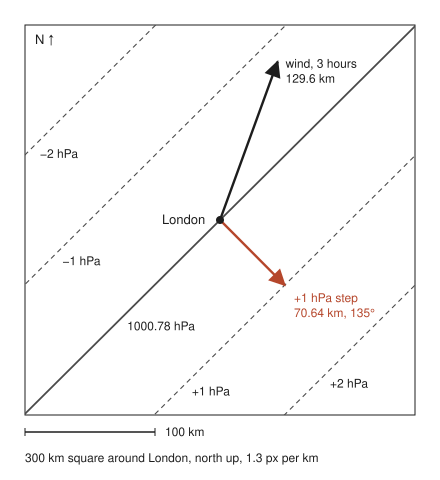
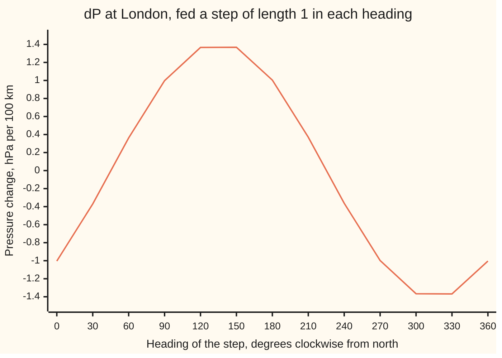

# Covectors and tensor fields: gadgets that eat directions and return numbers

[Syllabus](../../../SYLLABUS.md) → [Differential geometry and Lie groups](../README.md) → [Manifolds](../README.md#s03) → Covectors and tensor fields

---

## General Overview

A weather chart shows a deep low of 982 hPa south of Iceland, at 60° N, 20° W. Over London the barometer reads 1000.78 hPa. The wind arrow at London points toward a heading of 20°, clockwise from north, at 12 m/s, which is 43.2 km/h.

A weather balloon drifts with that wind. How fast does its barometer fall? The answer is 0.2601 hPa per hour. It comes from two pieces of data: how fast pressure changes along each of the map's two grid directions, and the wind's two components on the same grid. Multiply matching pieces and add. No ruler is needed, and no angle.

The first piece is a **covector**: a gadget that eats a direction of travel and returns a number. Write the pressure as $`P`$. Its covector is its **differential**, written $`dP`$. It is not an arrow.

The **gradient**, the arrow up the steepest rise, needs a ruler. With the globe's ruler it points to 135.17° at 1.4157 hPa per 100 km. Use the differential's two numbers as the components of an arrow on a latitude-longitude sheet, and on the ground that arrow heads 158.94° instead.

A ruler at every point is itself a gadget, one that eats two arrows. Such gadgets, laid down smoothly at every point, are **tensor fields**.

**A covector is a linear rule that turns a direction into a number, and a function's differential is the covector that gives its rate of change in every direction; a gradient is an arrow, and it needs a metric, a tensor field that eats two arrows, to be made from the differential.**

**What kind of fact this is:** the covector, the differential, the gradient and the tensor field are definitions. Two theorems are proved on this card in Why it works: a covector's reading does not depend on the chart, and a metric turns each covector into exactly one arrow. The Earth as a sphere of radius 6371 km and the smooth pressure low are models.

### The picture: the differential at London, drawn as isobars

<p align="center"></p>

To scale: a 300 km square around London, north up, 1.3 px per km. The straight lines are the isobars straightened at London, 70.64 km apart for each 1 hPa. They are the differential $`dP`$ drawn as a stack of lines: its value on an arrow is the number of lines the arrow crosses. The black wind arrow covers 129.6 km in 3 hours and crosses 0.78 of a gap toward lower pressure, so the reading falls 0.78 hPa. The red arrow is the shortest step that gains 1 hPa. It stands at right angles to the lines only because the globe's metric says what "right angles" means.

---

## The formula

Notation first, in words. A **chart** labels points with numbers $`x = (x^1, x^2)`$; the raised 1 and 2 are labels, not powers ([Smooth manifold](01-smooth-manifolds-and-charts.md)). Sheet A is the latitude-longitude chart $`(\varphi, \theta)`$: $`\varphi`$ (phi) is the angle down from the North Pole and $`\theta`$ (theta) is the longitude east, both in radians. Sheet B is Mercator's chart $`(\tilde x^1, \tilde x^2)`$: $`\tilde x^1 = \theta`$, and $`\tilde x^2`$ is Mercator's height, $`\mathrm{asinh}(\tan(\text{latitude}))`$. Here asinh is the inverse hyperbolic sine; cosh, used below, is the hyperbolic cosine.

The **tangent space** $`T_pM`$ is the set of all velocities at a point $`p`$ of a manifold $`M`$; in a chart a velocity $`v`$ has components $`v^i`$, written with upper indices ([Tangent space and differential](03-tangent-spaces-and-differentials.md)). The chart's basis arrows are $`\partial_i`$, so $`v = v^i \partial_i`$.

A **covector** at $`p`$ is a linear map $`\alpha`$ (alpha) from $`T_pM`$ to the real numbers. All covectors at $`p`$ form the **cotangent space** $`T^*_pM`$. A covector's components carry lower indices, $`\alpha_i = \alpha(\partial_i)`$. A repeated index, once up and once down, means "add over every value": $`\alpha_i v^i = \alpha_1 v^1 + \alpha_2 v^2`$.

```math
\alpha(v) = \alpha_i\, v^i, \qquad dx^i(\partial_j) = \delta^i_j, \qquad df = \frac{\partial f}{\partial x^i}\, dx^i
```

**Read it aloud:** a covector eats a velocity by multiplying matching components and adding; the coordinate covector $`dx^i`$ reads off the i-th component; the differential of a function $`f`$ is its partial derivatives used as covector components.

Here $`\delta^i_j`$ is 1 when $`i = j`$ and 0 otherwise. For the pressure at London, $`dP(v)`$ is the balloon's rate, −0.2601 hPa per hour.

A **metric** $`g`$ eats two velocities and returns a number, with components $`g_{ij}`$ in a chart ([Riemannian metric](../05-Riemannian%20Geometry/01-riemannian-metrics.md)). The **gradient** is the one arrow whose metric pairing with every velocity reproduces the differential:

```math
g(\mathrm{grad}\, f,\ v) = df(v) \ \text{ for every } v, \qquad \text{so} \qquad [\mathrm{grad}\, f] = [g]^{-1}\, [df]
```

**Read it aloud:** the gradient is the arrow that, measured against any velocity with the metric, gives the same number as the differential does; in components, it is the inverse of the metric's table times the differential's components.

The square brackets mean the components stacked in a column, and $`[g]`$ the 2 × 2 table. On sheet A the table is diagonal, so the gradient's components are $`\partial f/\partial x^i`$ divided by $`g_{ii}`$.

A **tensor field** eats several velocities, is linear in each, and is given at every point, varying smoothly. The metric is one, built from products of covectors:

```math
g = g_{ij}\, dx^i \otimes dx^j, \qquad g_{\text{globe}} = R^2\, d\varphi \otimes d\varphi + R^2 \sin^2\!\varphi\; d\theta \otimes d\theta
```

**Read it aloud:** the metric is a weighted sum of products of coordinate covectors; on the globe the north-south product has weight radius squared, and the east-west product has weight radius squared times sine of phi squared.

The product $`\alpha \otimes \beta`$ (tensor product) of two covectors eats two velocities: $`(\alpha \otimes \beta)(u, v) = \alpha(u)\, \beta(v)`$.

When a second chart $`\tilde x`$ is used, each kind of component changes by its own rule:

```math
\tilde\alpha_j = \frac{\partial x^i}{\partial \tilde x^j}\, \alpha_i, \qquad \tilde v^j = \frac{\partial \tilde x^j}{\partial x^i}\, v^i, \qquad \tilde g_{kl} = \frac{\partial x^i}{\partial \tilde x^k}\, \frac{\partial x^j}{\partial \tilde x^l}\, g_{ij}
```

**Read it aloud:** covector components change with the rates of the old coordinates against the new; velocity components change with the opposite rates; the metric takes one factor of the covector rule for each slot.

| Symbol | Plain meaning | In our example | Push it up and the answer… |
| --- | --- | --- | --- |
| $`P`$; $`f`$; $`p`$ | air pressure, hPa, a capital to keep $`p`$ free; any smooth function; the point where things are measured | 1000.78 hPa; $`p`$ is London | — |
| $`R`$; $`d`$ | the globe's radius; the angle at the Earth's centre between a place and the low's centre | 6371 km; $`d`$ = 13.95° at London | metric entries grow as its square; pressure rises toward 1012 hPa |
| $`x^i`$; $`\varphi`$, $`\theta`$; $`\tilde x^i`$ | chart coordinates; sheet A's angle from the North Pole and longitude; sheet B's Mercator coordinates, a tilde marking anything on sheet B | London: φ = 38.4926° | — |
| $`v`$, $`v^i`$; $`u`$ | a velocity and its components; a second velocity, of length 1 in Step 3 | wind on sheet A: (−0.006372, 0.003726) rad/h | faster wind, larger rate |
| $`M`$, $`T_pM`$, $`T^*_pM`$ | the manifold, here the globe; velocities at $`p`$; covectors at $`p`$ | both 2-dimensional on the globe | — |
| $`\partial_i`$, $`dx^i`$ | the chart's basis arrows; the covectors that read off components | $`d\varphi`$, $`d\theta`$ | — |
| $`\alpha`$, $`\beta`$, $`\alpha_i`$ | covectors; a covector's components | any linear rule on velocities | — |
| $`dP`$, $`\partial P/\partial x^i`$ | the differential of pressure; its components | (63.9666, 39.5754) hPa per radian | steeper pressure, faster change |
| $`g`$, $`g_{ij}`$, $`[g]`$ | the metric tensor field; its components; their table | 40589641.0 and 15724371.4 km² at London | steps in that direction cost more |
| $`\mathrm{grad}\, P`$; $`\nabla f`$ | the gradient: the arrow up the steepest rise; its flat-plane form from wing 06 | 1.4157 hPa per 100 km toward 135.17° | stronger winds |
| $`\partial x^i / \partial \tilde x^j`$ | rate of an old coordinate against a new one: the Jacobian table $`J`$; $`K`$ is its inverse | $`\partial\varphi/\partial\tilde x^2`$ = −1/cosh of Mercator's height | — |
| $`\otimes`$, $`\delta^i_j`$; $`i, j, k, l`$ | the tensor product; 1 when the indices match, else 0; index labels, each 1 or 2 | $`d\varphi \otimes d\varphi`$ | — |

Five new pieces of notation: $`T^*_pM`$, $`dx^i`$, $`df`$ against $`\mathrm{grad}\, f`$, a tensor field with $`\otimes`$, and $`g_{ij}`$ with the summing rule for a repeated index. Later cards on this wing use them freely. Here $`J`$ is wing 06's Jacobian table, not a Jacobi field.

### When it holds

- **The function must be smooth at the point.** A weather front is a kink in pressure. Across it the rates in different directions do not combine linearly, so there is no differential there.
- **The differential and the wind must be written on the same sheet.** Pairing sheet A's $`dP`$ with sheet B's wind gives 0.6435 instead of −0.2601: the barometer would seem to rise.
- **The gradient needs a metric that can be inverted.** At the North Pole, sheet A's table has $`g_{22} = R^2 \sin^2 0 = 0`$. The table has no inverse, so sheet A gives no gradient there. A different sheet, one that covers the pole, does.
- **Each kind of component moves by its own rule.** Moving the differential to sheet B with the velocity rule gives −0.9046 hPa per hour instead of −0.2601.
- **The reading is local.** A covector lives at one point. The rate −0.2601 hPa per hour holds for the balloon's first moments; over hours the wind and the pressure field change.

---

## Why it works

### Step 0: close up, pressure is a tilted plane

Zoom in on London until the curved isobars look straight. In that small patch the pressure is a tilted plane: a step changes the reading in proportion to the step, and two steps in a row change it by the sum of their changes. A rule with those two properties is linear. A linear rule on velocities is a covector. Drawn on the map, it is a stack of equally spaced straight lines, the straightened isobars, and its value on an arrow is the number of lines the arrow crosses.

Counting crossings needs no ruler, which is why the differential exists on any manifold, with or without a metric.

### Step 1: a covector is fixed by its value on the basis arrows

A velocity is a sum of basis arrows, $`v = v^i \partial_i`$. A linear rule turns that sum into the same sum of its values: $`\alpha(v) = v^i\, \alpha(\partial_i) = \alpha_i v^i`$. So two numbers, $`\alpha_1`$ and $`\alpha_2`$, settle a covector on the globe, and $`T^*_pM`$ has the same dimension as $`T_pM`$.

The coordinate covectors $`dx^i`$ satisfy $`dx^i(\partial_j) = \delta^i_j`$, so any covector is $`\alpha = \alpha_i\, dx^i`$. For a function $`f`$, the value of $`df`$ on $`\partial_i`$ is the rate of $`f`$ along the i-th grid direction, the partial derivative. Along any path through $`p`$ with velocity $`v`$, the chain rule gives the rate of $`f`$ as $`(\partial f/\partial x^i)\, v^i = df(v)`$.

At London, sheet A gives $`dP`$ = (63.9666, 39.5754) hPa per radian. The wind is $`v`$ = (−0.006372, 0.003726) radians per hour: φ falls as the balloon goes north. The two products are −0.4076 and 0.1475, and their sum is −0.2601 hPa per hour. The code checks this against a balloon flown along a great circle with the wind's velocity, in 3D space, and gets −0.2601 again.

### Step 2: two rules that cancel, so the reading belongs to the globe

Units show the idea. A covector component is in hPa per unit of coordinate. A velocity component is in units of coordinate per hour. Change the coordinate's unit from radians to degrees. The first is divided by the number of degrees in a radian, and the second is multiplied by it. The product, hPa per hour, does not move.

Sheet B makes the same point with a chart that bends. There $`dP`$ = (39.5754, −39.8137) and the wind is (0.003726, 0.010237), both with new numbers. Their pairing is −0.2601 hPa per hour again. The components belong to the sheet; the reading belongs to the globe.

<details>
<summary>Detailed proof: the covector rule and the velocity rule cancel</summary>

Write $`J`$ for the table of rates $`J^i_{\ j} = \partial x^i/\partial \tilde x^j`$ and $`K`$ for the table $`K^j_{\ i} = \partial \tilde x^j/\partial x^i`$. By the chain rule, $`K`$ and $`J`$ are inverse tables: $`K^j_{\ i}\, J^i_{\ k} = \delta^j_k`$.

A velocity is the same arrow in both charts, so its components change as $`\tilde v^j = K^j_{\ i} v^i`$. A covector's new components are its values on the new basis arrows, and $`\tilde\partial_j = J^i_{\ j}\, \partial_i`$ by the chain rule, so $`\tilde\alpha_j = J^i_{\ j}\, \alpha_i`$. Then

$`\displaystyle \tilde\alpha_j\, \tilde v^j = J^i_{\ j}\, \alpha_i\, K^j_{\ k}\, v^k = \alpha_i\, \delta^i_k\, v^k = \alpha_i\, v^i`$

The same argument, one factor of $`J`$ per slot, shows that $`\tilde g_{kl}\, \tilde u^k \tilde v^l = g_{ij}\, u^i v^j`$.

</details>

On the globe, sheet B's only nonzero rates are $`\partial\theta/\partial\tilde x^1 = 1`$ and $`\partial\varphi/\partial\tilde x^2 = -1/\cosh(\tilde x^2)`$. The code computes $`dP`$ on sheet B twice: by the covector rule, and by slopes of pressure measured directly on sheet B. Both give (39.5754, −39.8137).

### Step 3: the gradient needs a ruler

"Steepest" means the largest rate per kilometre. A kilometre north and a kilometre east are lengths, so the question needs the metric. Without it, the differential tells how many isobars an arrow crosses, but not which arrows are the same length.

With the metric, define $`\mathrm{grad}\, P`$ as the arrow with $`g(\mathrm{grad}\, P, v) = dP(v)`$ for every $`v`$. The table $`[g]`$ is positive definite, so it has an inverse, and $`[\mathrm{grad}\, P] = [g]^{-1}[dP]`$ is the one solution. For a direction $`u`$ of length 1, the Cauchy–Schwarz inequality gives $`dP(u) = g(\mathrm{grad}\, P, u) \le \lvert \mathrm{grad}\, P \rvert`$, with equality only when $`u`$ points along the gradient. So the gradient points up the steepest rise, and its length is that rise per unit length.

At London, sheet A gives the gradient's components 63.9666 / 40589641.0 and 39.5754 / 15724371.4, that is 1.5759 and 2.5168 millionths. Turned into kilometres, it is 0.009980 hPa/km east and 0.010040 hPa/km south: 1.4157 hPa per 100 km toward 135.17°. Sheet B, and a calculation in 3D space, give the same arrow. A brute-force search over 3600 headings finds the steepest rate at 135.2°, also 1.4157 hPa per 100 km.

The isobars are 100 / 1.4157 = 70.64 km apart, the red arrow in the picture. The wind meets the gradient at 115.17°, more than a right angle, so the balloon drifts toward lower pressure: $`g(\mathrm{grad}\, P, v)`$ = −0.2601 hPa per hour, the same as $`dP(v)`$.

The rate in every direction is a cosine of the heading, peaking at the gradient:



The line is $`dP(u)`$ for a step $`u`$ of length 1 in each heading. It peaks near 135°, where the gradient points, and is zero at right angles to it, along the isobars.

### Step 4: a tensor field eats several arrows at every point

A covector eats one velocity. The metric eats two, and is linear in each: double one velocity and $`g(u, v)`$ doubles. Such a multilinear gadget at one point is a **tensor**. One given at every point, varying smoothly, is a **tensor field**. Its type counts its slots for velocities and for covectors:

| Kind | Eats | Weather example |
| --- | --- | --- |
| function | nothing | pressure $`P`$ |
| vector field | one covector | the wind |
| covector field | one velocity | the differential $`dP`$ |
| metric, a symmetric tensor field | two velocities | the globe's $`g`$ |

A vector field eats a covector because $`v(\alpha) = \alpha(v)`$. On the globe, a tensor with two velocity slots has 2 × 2 = 4 components in a chart, and the metric, being symmetric, has 3 independent ones.

At London the metric's table is 40589641.0 and 15724371.4 km² on sheet A, and 15724371.4 twice on sheet B. The components differ. The wind's squared speed does not: $`g(v, v)`$ is 1647.9314 + 218.3086 = 1866.2400 km²/h² on sheet A and 1866.2400 on sheet B. That is 43.2², the wind speed squared, as it must be.

---

## Worked numbers, by hand

The model low is $`P = 1012 - 30\, e^{-(1 - \cos d)/0.03}`$ hPa, where $`d`$ is the angle at the Earth's centre between the place and the low's centre. It reads 982 hPa at the centre and 1000.78 hPa at London, where $`d`$ = 13.95°. The two slopes of $`dP`$ are this formula's rates along the two grid lines; the code works them out exactly and checks them against measured slopes.

| Step | Arithmetic | Value |
| --- | --- | --- |
| London's φ | 90 − 51.5074 | 38.4926° |
| its sine; R sin φ | 6371 × 0.622414 | 0.622414; 3965.40 km |
| wind, north and east parts | 43.2 cos 20°, 43.2 sin 20° | 40.5947, 14.7753 km/h |
| wind on sheet A | −40.5947 / 6371, 14.7753 / 3965.40 | (−0.006372, 0.003726) rad/h |
| $`dP`$ on sheet A | slopes of the model along each grid line | (63.9666, 39.5754) hPa/rad |
| $`dP(v)`$ | 63.9666 × (−0.006372) + 39.5754 × 0.003726 = −0.4076 + 0.1475 | **−0.2601 hPa/h** |
| metric table | 6371², (3965.40)² | 40589641.0, 15724371.4 km² |
| gradient on sheet A, millionths | 63.9666 / 40589641.0, 39.5754 / 15724371.4 | 1.5759, 2.5168 |
| gradient east and north | 3965.40 × 2.5168, −6371 × 1.5759, in millionths | 0.009980, −0.010040 hPa/km |
| its length and heading | square root of the sum of squares; compass bearing | 1.4157 hPa per 100 km, 135.17° |
| isobar spacing | 100 / 1.4157 | 70.64 km |

A balloon riding the wind over London sees its barometer fall 0.2601 hPa each hour, because the wind crosses the isobars at 115.17° to the gradient, drifting toward the low.

### What breaks if you drop a piece

| Mistake | Comes out at | What went wrong |
| --- | --- | --- |
| $`dP`$'s two numbers used as an arrow's components on sheet A | ground heading 158.94°, not 135.17° | A covector is not an arrow; sheet A's grid is not square in kilometres |
| $`dP`$ moved to sheet B by the velocity rule | −0.9046 hPa/h, not −0.2601 | Covector components move by the opposite rule |
| Gradient and wind multiplied and added, without $`g`$ | −0.000000000664, in mixed units that are not hPa/h | Two arrows need the metric to give a number |
| Wind multiplied with itself without $`g`$ | 0.000054, not 1866.2400 km²/h² | Radians per hour squared are not km² per hour squared |
| Sheet A at the North Pole | $`g_{22}`$ = 0.0: no inverse | The chart fails at the pole, so it gives no gradient there |

The code prints all five.

---

## Code, from first principles, and it actually runs

The code puts a smooth model low on a sphere of radius 6371 km. It finds the balloon's rate $`dP(v)`$ by three independent roads: components on sheet A, a balloon flown along a great circle in 3D space, and the metric pairing $`g(\mathrm{grad}\, P, v)`$ done in space, where the metric is the plain dot product of the gradient in hPa per km with the wind in km/h. Components on sheet B give the same rate, but only because the two change rules cancel, so that line checks the rules rather than adding a road. It finds the gradient by three roads: sheet A, sheet B, and a projection in space; a brute-force search over 3600 headings finds the steepest direction a fourth way. The exact components on each sheet are checked against measured slopes.

### Python

```python
# Covectors and tensor fields -- the check behind the card.  Standard library only.
# The Earth is a sphere of radius R = 6371 km.  A low of 982 hPa sits at 60 N, 20 W:
# pressure P = 1012 - 30 exp(-(1 - n.c)/W) hPa, n the unit arrow to a place, c to the low.
# At London the wind blows 12 m/s toward heading 20 deg, clockwise from north.
# Sheet A is (phi, theta): phi down from the North Pole, theta longitude east, radians.
# Sheet B is Mercator: x = theta, y = asinh(tan latitude).
# dP(wind) by three roads: sheet A, along the drifting path, and g(grad P, wind) in
# space; sheet B checks the two change rules.  grad P by three roads: sheet A, sheet B,
# and from space; the steepest direction is also found by brute force over 3600 headings.
from math import sin, cos, tan, atan, asinh, cosh, sinh, exp, acos, atan2, sqrt, radians, degrees, pi
R, DEPTH, W, SPEED, HEAD = 6371.0, 30.0, 0.03, 12.0 * 3.6, 20.0   # km, hPa, width, km/h, deg
def unit(lat, lon): return (cos(radians(lat)) * cos(radians(lon)), cos(radians(lat)) * sin(radians(lon)), sin(radians(lat)))
C = unit(60.0, -20.0)
def dot(u, v): return sum(a * b for a, b in zip(u, v))
def n_a(a): return (sin(a[0]) * cos(a[1]), sin(a[0]) * sin(a[1]), cos(a[0]))
def p_space(n): return 1012.0 - DEPTH * exp(-(1.0 - dot(n, C)) / W)
def p_a(a): return p_space(n_a(a))
def a_of_b(b): return (pi / 2 - atan(sinh(b[1])), b[0])
def p_b(b): return p_a(a_of_b(b))
LON = (radians(90 - 51.5074), radians(-0.1278))         # London in sheet A
LONB = (LON[1], asinh(1 / tan(LON[0])))                  # London in sheet B
ph, ch = LON[0], cosh(LONB[1])
E = exp(-(1.0 - dot(n_a(LON), C)) / W)
r_ph = (cos(ph) * cos(LON[1]), cos(ph) * sin(LON[1]), -sin(ph))   # d n / d phi
r_th = (-sin(ph) * sin(LON[1]), sin(ph) * cos(LON[1]), 0.0)      # d n / d theta
dpA = (-DEPTH * E / W * dot(r_ph, C), -DEPTH * E / W * dot(r_th, C))     # hPa per radian, exact
def fd(f, x, i, h=1e-6):
    up, dn = list(x), list(x); up[i] += h; dn[i] -= h
    return (f(up) - f(dn)) / (2 * h)
dpA_fd = (fd(p_a, LON, 0), fd(p_a, LON, 1))
dpB = (dpA[1], -dpA[0] / ch)                            # covector rule: d phi/d y = -1/cosh y
dpB_fd = (fd(p_b, LONB, 0), fd(p_b, LONB, 1))
north, east = SPEED * cos(radians(HEAD)), SPEED * sin(radians(HEAD))
vA = (-north / R, east / (R * sin(ph)))                   # radians per hour
vB = (vA[1], -ch * vA[0])                                  # vector rule: d y/d phi = -cosh y
def pair(a, v): return a[0] * v[0] + a[1] * v[1]
gA, gB = (R * R, R * R * sin(ph) ** 2), (R * R / ch ** 2, R * R / ch ** 2)   # diagonal tables
nE = (-sin(LON[1]), cos(LON[1]), 0.0); nN = tuple(-x for x in r_ph)     # east, north unit arrows
def path(t):                                               # great circle leaving London at the wind
    n0, k = n_a(LON), SPEED * t / R
    d = tuple((north * a + east * b) / SPEED for a, b in zip(nN, nE))
    return tuple(cos(k) * a + sin(k) * b for a, b in zip(n0, d))
along = (p_space(path(1e-4)) - p_space(path(-1e-4))) / 2e-4
gradA = (dpA[0] / gA[0], dpA[1] / gA[1])                    # g^-1 times dP, sheet A
gradB = (dpB[0] / gB[0], dpB[1] / gB[1])
enA = (R * sin(ph) * gradA[1], -R * gradA[0])                # (east, north) hPa per km
enB = (R / ch * gradB[0], R / ch * gradB[1])
s3 = tuple(-DEPTH * E / W / R * (c - dot(n_a(LON), C) * x) for c, x in zip(C, n_a(LON)))
enS = (dot(s3, nE), dot(s3, nN))
def mag(v): return sqrt(v[0] ** 2 + v[1] ** 2)
def hdg(v): return degrees(atan2(v[0], v[1])) % 360
best = max((pair(dpA, (-cos(radians(k / 10)) / R, sin(radians(k / 10)) / (R * sin(ph)))), k / 10) for k in range(3600))
gv = east * enS[0] + north * enS[1]                         # g(grad P, wind) in space: a plain dot product
print(f"pressure at London: {p_a(LON):.2f} hPa; at the low: {p_space(C):.2f} hPa")
print(f"angle at the centre from London to the low: d = {degrees(acos(dot(n_a(LON), C))):.2f} deg")
print(f"wind: {SPEED:.1f} km/h toward {HEAD:.0f} deg = north {north:.4f}, east {east:.4f} km/h")
print("dP, sheet A, exact:  ({:.4f}, {:.4f}) hPa/rad".format(*dpA))
print("dP, sheet A, slopes: ({:.4f}, {:.4f}) hPa/rad".format(*dpA_fd))
print("dP, sheet B, rule:   ({:.4f}, {:.4f}) hPa per unit".format(*dpB))
print("dP, sheet B, slopes: ({:.4f}, {:.4f}) hPa per unit".format(*dpB_fd))
print("wind, sheet A: ({:.6f}, {:.6f}) rad/h; sheet B: ({:.6f}, {:.6f}) per hour".format(*vA, *vB))
road = [pair(dpA, vA), pair(dpB, vB), along, gv]
print(f"sheet A by hand: phi = {degrees(ph):.4f} deg, sin(phi) = {sin(ph):.6f}, R sin(phi) = {R * sin(ph):.2f} km; terms {dpA[0] * vA[0]:.4f} + {dpA[1] * vA[1]:.4f}; g terms {gA[0] * vA[0] ** 2:.4f} + {gA[1] * vA[1] ** 2:.4f}")
print("dP(wind): sheet A {:.4f}, sheet B {:.4f}, along the path {:.4f}, g(grad P, wind) {:.4f} hPa/h".format(*road))
print("g at London, sheet A: g11 = {:.1f}, g22 = {:.1f}; sheet B: {:.1f}, {:.1f} km^2".format(*gA, *gB))
print(f"speed^2 from g: sheet A {gA[0] * vA[0] ** 2 + gA[1] * vA[1] ** 2:.4f}, sheet B {gB[0] * vB[0] ** 2 + gB[1] * vB[1] ** 2:.4f} km^2/h^2")
print("grad P in millionths, sheet A: ({:.4f}, {:.4f}); sheet B: ({:.4f}, {:.4f})".format(*(1e6 * x for x in gradA + gradB)))
for name, v in (("sheet A", enA), ("sheet B", enB), ("space", enS)):
    print(f"grad P from {name}: east {v[0]:.6f}, north {v[1]:.6f} hPa/km, {100 * mag(v):.4f} hPa per 100 km, heading {hdg(v):.2f} deg")
print(f"brute force over 3600 headings: steepest {best[1]:.1f} deg, rising {100 * best[0]:.4f} hPa per 100 km")
print("chart, heading:", ", ".join(str(30 * k) for k in range(13)))
print("chart, dP(u) hPa per 100 km:", ", ".join(f"{100 * pair(dpA, (-cos(radians(30 * k)) / R, sin(radians(30 * k)) / (R * sin(ph)))):.4f}" for k in range(13)))
ang = degrees(acos(dot(enA, (east, north)) / (mag(enA) * SPEED)))
print(f"angle between grad P and the wind: {ang:.2f} deg; 1 hPa isobars {1 / mag(enA):.2f} km apart")
naiveA = (R * sin(ph) * dpA[1], -R * dpA[0]); naiveB = (dpB[0], dpB[1])
print(f"mistake, dP read as an arrow in sheet A: heading {hdg(naiveA):.2f} deg")
print(f"mistake, dP read as an arrow in sheet B: heading {hdg(naiveB):.2f} deg, length off by {gB[0]:.1f}")
bad = (dpA[1], -ch * dpA[0])                                # covector moved by the vector rule
print(f"mistake, dP moved to sheet B by the vector rule: dP(wind) = {pair(bad, vB):.4f} hPa/h")
print(f"mistake, sheet A's dP paired with sheet B's wind: {pair(dpA, vB):.4f}, not {road[0]:.4f}")
print(f"mistake, grad P dotted with the wind without g: {pair(gradA, vA):.12f}, mixed units, not hPa/h")
print(f"mistake, wind dotted with itself without g: {vA[0] ** 2 + vA[1] ** 2:.6f} instead of {SPEED ** 2:.4f}")
print(f"at the North Pole, sheet A: g22 = R^2 sin^2(0) = {R * R * sin(0.0) ** 2:.1f}: no inverse, no grad P there")
rho, f = 1.225, 2 * 7.2921e-5 * sin(radians(51.5074))
print(f"geostrophic wind: |grad P| {mag(enA) * 0.1:.6f} Pa/m, f {f:.7f} 1/s, speed {mag(enA) * 0.1 / (rho * f):.2f} m/s")
s = 1 / mag(enA); u = (enA[0] / mag(enA), enA[1] / mag(enA))
print(f"figure, wind 3 h {3 * SPEED:.1f} km, tip ({3 * east:.2f}, {3 * north:.2f}) km; 1 hPa step tip ({s * u[0]:.2f}, {s * u[1]:.2f}) km; spacing {s:.2f} km; in 3 h {3 * road[0]:.2f} hPa")
assert all(abs(x - road[0]) < 1e-6 for x in road)                  # three roads and sheet B, one rate
assert all(abs(a - b) < 1e-4 for a, b in zip(dpA + dpB, dpA_fd + dpB_fd))   # rule against slopes
assert all(abs(a - b) < 1e-9 for v in (enB, enS) for a, b in zip(enA, v))   # three roads to grad P
assert abs(best[1] - hdg(enA)) < 0.1 and abs(best[0] - mag(enA)) < 1e-6 # brute force agrees
assert abs(hdg(naiveA) - hdg(enA)) > 5 and abs(pair(bad, vB) - road[0]) > 0.01
print("ALL CHECKS PASS")
```

**Ran 2026-11-19 on macOS, Python 3.14.10, standard library only. All checks passed. Output, pasted from the run:**

```
pressure at London: 1000.78 hPa; at the low: 982.00 hPa
angle at the centre from London to the low: d = 13.95 deg
wind: 43.2 km/h toward 20 deg = north 40.5947, east 14.7753 km/h
dP, sheet A, exact:  (63.9666, 39.5754) hPa/rad
dP, sheet A, slopes: (63.9666, 39.5754) hPa/rad
dP, sheet B, rule:   (39.5754, -39.8137) hPa per unit
dP, sheet B, slopes: (39.5754, -39.8137) hPa per unit
wind, sheet A: (-0.006372, 0.003726) rad/h; sheet B: (0.003726, 0.010237) per hour
sheet A by hand: phi = 38.4926 deg, sin(phi) = 0.622414, R sin(phi) = 3965.40 km; terms -0.4076 + 0.1475; g terms 1647.9314 + 218.3086
dP(wind): sheet A -0.2601, sheet B -0.2601, along the path -0.2601, g(grad P, wind) -0.2601 hPa/h
g at London, sheet A: g11 = 40589641.0, g22 = 15724371.4; sheet B: 15724371.4, 15724371.4 km^2
speed^2 from g: sheet A 1866.2400, sheet B 1866.2400 km^2/h^2
grad P in millionths, sheet A: (1.5759, 2.5168); sheet B: (2.5168, -2.5320)
grad P from sheet A: east 0.009980, north -0.010040 hPa/km, 1.4157 hPa per 100 km, heading 135.17 deg
grad P from sheet B: east 0.009980, north -0.010040 hPa/km, 1.4157 hPa per 100 km, heading 135.17 deg
grad P from space: east 0.009980, north -0.010040 hPa/km, 1.4157 hPa per 100 km, heading 135.17 deg
brute force over 3600 headings: steepest 135.2 deg, rising 1.4157 hPa per 100 km
chart, heading: 0, 30, 60, 90, 120, 150, 180, 210, 240, 270, 300, 330, 360
chart, dP(u) hPa per 100 km: -1.0040, -0.3705, 0.3623, 0.9980, 1.3663, 1.3685, 1.0040, 0.3705, -0.3623, -0.9980, -1.3663, -1.3685, -1.0040
angle between grad P and the wind: 115.17 deg; 1 hPa isobars 70.64 km apart
mistake, dP read as an arrow in sheet A: heading 158.94 deg
mistake, dP read as an arrow in sheet B: heading 135.17 deg, length off by 15724371.4
mistake, dP moved to sheet B by the vector rule: dP(wind) = -0.9046 hPa/h
mistake, sheet A's dP paired with sheet B's wind: 0.6435, not -0.2601
mistake, grad P dotted with the wind without g: -0.000000000664, mixed units, not hPa/h
mistake, wind dotted with itself without g: 0.000054 instead of 1866.2400
at the North Pole, sheet A: g22 = R^2 sin^2(0) = 0.0: no inverse, no grad P there
geostrophic wind: |grad P| 0.001416 Pa/m, f 0.0001141 1/s, speed 10.12 m/s
figure, wind 3 h 129.6 km, tip (44.33, 121.78) km; 1 hPa step tip (49.80, -50.10) km; spacing 70.64 km; in 3 h -0.78 hPa
ALL CHECKS PASS
```

### Rust

Same numbers, same labels, built with `rustc --edition 2021 -O`.

```rust
// Covectors and tensor fields -- the same check as the Python, in Rust.  No crates.
// The Earth is a sphere of radius R = 6371 km.  A low of 982 hPa sits at 60 N, 20 W:
// pressure P = 1012 - 30 exp(-(1 - n.c)/W) hPa, n the unit arrow to a place, c to the low.
// At London the wind blows 12 m/s toward heading 20 deg, clockwise from north.
// Sheet A is (phi, theta): phi down from the North Pole, theta longitude east, radians.
// Sheet B is Mercator: x = theta, y = asinh(tan latitude).
// dP(wind) by three roads: sheet A, along the drifting path, and g(grad P, wind) in
// space; sheet B checks the two change rules.  grad P by three roads: sheet A, sheet B,
// and from space; the steepest direction is also found by brute force over 3600 headings.
use std::f64::consts::PI;
const R: f64 = 6371.0;
const DEPTH: f64 = 30.0;
const W: f64 = 0.03;
type V3 = [f64; 3];
type P = (f64, f64);
fn unit(lat: f64, lon: f64) -> V3 {
    let (a, b) = (lat.to_radians(), lon.to_radians());
    [a.cos() * b.cos(), a.cos() * b.sin(), a.sin()]
}
fn dot(u: &V3, v: &V3) -> f64 { u[0] * v[0] + u[1] * v[1] + u[2] * v[2] }
fn n_a(a: P) -> V3 { [a.0.sin() * a.1.cos(), a.0.sin() * a.1.sin(), a.0.cos()] }
fn p_space(n: &V3) -> f64 { 1012.0 - DEPTH * (-(1.0 - dot(n, &unit(60.0, -20.0))) / W).exp() }
fn p_a(a: P) -> f64 { p_space(&n_a(a)) }
fn a_of_b(b: P) -> P { (PI / 2.0 - b.1.sinh().atan(), b.0) }
fn p_b(b: P) -> f64 { p_a(a_of_b(b)) }
fn fd(f: fn(P) -> f64, x: P, i: usize) -> f64 {
    let h = 1e-6;
    if i == 0 { (f((x.0 + h, x.1)) - f((x.0 - h, x.1))) / (2.0 * h) } else { (f((x.0, x.1 + h)) - f((x.0, x.1 - h))) / (2.0 * h) }
}
fn pair(a: P, v: P) -> f64 { a.0 * v.0 + a.1 * v.1 }
fn mag(v: P) -> f64 { (v.0 * v.0 + v.1 * v.1).sqrt() }
fn hdg(v: P) -> f64 { v.0.atan2(v.1).to_degrees().rem_euclid(360.0) }
fn main() {
    let c = unit(60.0, -20.0);
    let (speed, head) = (12.0 * 3.6, 20.0f64);
    let lon = ((90.0f64 - 51.5074).to_radians(), (-0.1278f64).to_radians());
    let lonb = (lon.1, (1.0 / lon.0.tan()).asinh());
    let (ph, ch) = (lon.0, lonb.1.cosh());
    let n0 = n_a(lon);
    let e = (-(1.0 - dot(&n0, &c)) / W).exp();
    let r_ph = [ph.cos() * lon.1.cos(), ph.cos() * lon.1.sin(), -ph.sin()];
    let r_th = [-ph.sin() * lon.1.sin(), ph.sin() * lon.1.cos(), 0.0];
    let dpa = (-DEPTH * e / W * dot(&r_ph, &c), -DEPTH * e / W * dot(&r_th, &c));
    let dpa_fd = (fd(p_a, lon, 0), fd(p_a, lon, 1));
    let dpb = (dpa.1, -dpa.0 / ch);
    let dpb_fd = (fd(p_b, lonb, 0), fd(p_b, lonb, 1));
    let (north, east) = (speed * head.to_radians().cos(), speed * head.to_radians().sin());
    let va = (-north / R, east / (R * ph.sin()));
    let vb = (va.1, -ch * va.0);
    let (ga, gb) = ((R * R, R * R * ph.sin().powi(2)), (R * R / (ch * ch), R * R / (ch * ch)));
    let ne = [-lon.1.sin(), lon.1.cos(), 0.0];
    let nn = [-r_ph[0], -r_ph[1], -r_ph[2]];
    let path = |t: f64| -> V3 {
        let k = speed * t / R;
        let mut out = [0.0; 3];
        for i in 0..3 { out[i] = k.cos() * n0[i] + k.sin() * (north * nn[i] + east * ne[i]) / speed; }
        out
    };
    let along = (p_space(&path(1e-4)) - p_space(&path(-1e-4))) / 2e-4;
    let grada = (dpa.0 / ga.0, dpa.1 / ga.1);
    let gradb = (dpb.0 / gb.0, dpb.1 / gb.1);
    let ena = (R * ph.sin() * grada.1, -R * grada.0);
    let enb = (R / ch * gradb.0, R / ch * gradb.1);
    let nc = dot(&n0, &c);
    let mut s3 = [0.0; 3];
    for i in 0..3 { s3[i] = -DEPTH * e / W / R * (c[i] - nc * n0[i]); }
    let ens = (dot(&s3, &ne), dot(&s3, &nn));
    let rate = |deg: f64| pair(dpa, (-deg.to_radians().cos() / R, deg.to_radians().sin() / (R * ph.sin())));
    let mut best = (f64::MIN, 0.0);
    for k in 0..3600 { let r = rate(k as f64 / 10.0); if r > best.0 { best = (r, k as f64 / 10.0); } }
    let gv = east * ens.0 + north * ens.1;                   // g(grad P, wind) in space: a plain dot product
    println!("pressure at London: {:.2} hPa; at the low: {:.2} hPa", p_a(lon), p_space(&c));
    println!("angle at the centre from London to the low: d = {:.2} deg", dot(&n0, &c).acos().to_degrees());
    println!("wind: {:.1} km/h toward {:.0} deg = north {:.4}, east {:.4} km/h", speed, head, north, east);
    println!("dP, sheet A, exact:  ({:.4}, {:.4}) hPa/rad", dpa.0, dpa.1);
    println!("dP, sheet A, slopes: ({:.4}, {:.4}) hPa/rad", dpa_fd.0, dpa_fd.1);
    println!("dP, sheet B, rule:   ({:.4}, {:.4}) hPa per unit", dpb.0, dpb.1);
    println!("dP, sheet B, slopes: ({:.4}, {:.4}) hPa per unit", dpb_fd.0, dpb_fd.1);
    println!("wind, sheet A: ({:.6}, {:.6}) rad/h; sheet B: ({:.6}, {:.6}) per hour", va.0, va.1, vb.0, vb.1);
    let road = [pair(dpa, va), pair(dpb, vb), along, gv];
    println!("sheet A by hand: phi = {:.4} deg, sin(phi) = {:.6}, R sin(phi) = {:.2} km; terms {:.4} + {:.4}; g terms {:.4} + {:.4}",
             ph.to_degrees(), ph.sin(), R * ph.sin(),
             dpa.0 * va.0, dpa.1 * va.1, ga.0 * va.0 * va.0, ga.1 * va.1 * va.1);
    println!("dP(wind): sheet A {:.4}, sheet B {:.4}, along the path {:.4}, g(grad P, wind) {:.4} hPa/h", road[0], road[1], road[2], road[3]);
    println!("g at London, sheet A: g11 = {:.1}, g22 = {:.1}; sheet B: {:.1}, {:.1} km^2", ga.0, ga.1, gb.0, gb.1);
    println!("speed^2 from g: sheet A {:.4}, sheet B {:.4} km^2/h^2", ga.0 * va.0 * va.0 + ga.1 * va.1 * va.1, gb.0 * vb.0 * vb.0 + gb.1 * vb.1 * vb.1);
    println!("grad P in millionths, sheet A: ({:.4}, {:.4}); sheet B: ({:.4}, {:.4})", 1e6 * grada.0, 1e6 * grada.1, 1e6 * gradb.0, 1e6 * gradb.1);
    for (name, v) in [("sheet A", ena), ("sheet B", enb), ("space", ens)] {
        println!("grad P from {}: east {:.6}, north {:.6} hPa/km, {:.4} hPa per 100 km, heading {:.2} deg", name, v.0, v.1, 100.0 * mag(v), hdg(v));
    }
    println!("brute force over 3600 headings: steepest {:.1} deg, rising {:.4} hPa per 100 km", best.1, 100.0 * best.0);
    let hs: Vec<String> = (0..13).map(|k| format!("{}", 30 * k)).collect();
    let rs: Vec<String> = (0..13).map(|k| format!("{:.4}", 100.0 * rate(30.0 * k as f64))).collect();
    println!("chart, heading: {}", hs.join(", "));
    println!("chart, dP(u) hPa per 100 km: {}", rs.join(", "));
    let ang = ((ena.0 * east + ena.1 * north) / (mag(ena) * speed)).acos().to_degrees();
    println!("angle between grad P and the wind: {:.2} deg; 1 hPa isobars {:.2} km apart", ang, 1.0 / mag(ena));
    let naive_a = (R * ph.sin() * dpa.1, -R * dpa.0);
    println!("mistake, dP read as an arrow in sheet A: heading {:.2} deg", hdg(naive_a));
    println!("mistake, dP read as an arrow in sheet B: heading {:.2} deg, length off by {:.1}", hdg(dpb), gb.0);
    let bad = (dpa.1, -ch * dpa.0);
    println!("mistake, dP moved to sheet B by the vector rule: dP(wind) = {:.4} hPa/h", pair(bad, vb));
    println!("mistake, sheet A's dP paired with sheet B's wind: {:.4}, not {:.4}", pair(dpa, vb), road[0]);
    println!("mistake, grad P dotted with the wind without g: {:.12}, mixed units, not hPa/h", pair(grada, va));
    println!("mistake, wind dotted with itself without g: {:.6} instead of {:.4}", va.0 * va.0 + va.1 * va.1, speed * speed);
    println!("at the North Pole, sheet A: g22 = R^2 sin^2(0) = {:.1}: no inverse, no grad P there", R * R * 0.0f64.sin().powi(2));
    let (rho, f) = (1.225, 2.0 * 7.2921e-5 * 51.5074f64.to_radians().sin());
    println!("geostrophic wind: |grad P| {:.6} Pa/m, f {:.7} 1/s, speed {:.2} m/s", mag(ena) * 0.1, f, mag(ena) * 0.1 / (rho * f));
    let s = 1.0 / mag(ena);
    let u = (ena.0 / mag(ena), ena.1 / mag(ena));
    println!("figure, wind 3 h {:.1} km, tip ({:.2}, {:.2}) km; 1 hPa step tip ({:.2}, {:.2}) km; spacing {:.2} km; in 3 h {:.2} hPa", 3.0 * speed, 3.0 * east, 3.0 * north, s * u.0, s * u.1, s, 3.0 * road[0]);
    assert!(road.iter().all(|x| (x - road[0]).abs() < 1e-6));                       // three roads and sheet B, one rate
    let pairs = [(dpa.0, dpa_fd.0), (dpa.1, dpa_fd.1), (dpb.0, dpb_fd.0), (dpb.1, dpb_fd.1)];
    assert!(pairs.iter().all(|(a, b)| (a - b).abs() < 1e-4));                       // rule against slopes
    for v in [enb, ens] { assert!((v.0 - ena.0).abs() < 1e-9 && (v.1 - ena.1).abs() < 1e-9); }
    assert!((best.1 - hdg(ena)).abs() < 0.1 && (best.0 - mag(ena)).abs() < 1e-6);    // brute force agrees
    assert!((hdg(naive_a) - hdg(ena)).abs() > 5.0 && (pair(bad, vb) - road[0]).abs() > 0.01);
    println!("ALL CHECKS PASS");
}
```

**Ran 2026-11-19 on macOS, rustc 1.98.1, no crates. All checks passed. Output, pasted from the run:**

```
pressure at London: 1000.78 hPa; at the low: 982.00 hPa
angle at the centre from London to the low: d = 13.95 deg
wind: 43.2 km/h toward 20 deg = north 40.5947, east 14.7753 km/h
dP, sheet A, exact:  (63.9666, 39.5754) hPa/rad
dP, sheet A, slopes: (63.9666, 39.5754) hPa/rad
dP, sheet B, rule:   (39.5754, -39.8137) hPa per unit
dP, sheet B, slopes: (39.5754, -39.8137) hPa per unit
wind, sheet A: (-0.006372, 0.003726) rad/h; sheet B: (0.003726, 0.010237) per hour
sheet A by hand: phi = 38.4926 deg, sin(phi) = 0.622414, R sin(phi) = 3965.40 km; terms -0.4076 + 0.1475; g terms 1647.9314 + 218.3086
dP(wind): sheet A -0.2601, sheet B -0.2601, along the path -0.2601, g(grad P, wind) -0.2601 hPa/h
g at London, sheet A: g11 = 40589641.0, g22 = 15724371.4; sheet B: 15724371.4, 15724371.4 km^2
speed^2 from g: sheet A 1866.2400, sheet B 1866.2400 km^2/h^2
grad P in millionths, sheet A: (1.5759, 2.5168); sheet B: (2.5168, -2.5320)
grad P from sheet A: east 0.009980, north -0.010040 hPa/km, 1.4157 hPa per 100 km, heading 135.17 deg
grad P from sheet B: east 0.009980, north -0.010040 hPa/km, 1.4157 hPa per 100 km, heading 135.17 deg
grad P from space: east 0.009980, north -0.010040 hPa/km, 1.4157 hPa per 100 km, heading 135.17 deg
brute force over 3600 headings: steepest 135.2 deg, rising 1.4157 hPa per 100 km
chart, heading: 0, 30, 60, 90, 120, 150, 180, 210, 240, 270, 300, 330, 360
chart, dP(u) hPa per 100 km: -1.0040, -0.3705, 0.3623, 0.9980, 1.3663, 1.3685, 1.0040, 0.3705, -0.3623, -0.9980, -1.3663, -1.3685, -1.0040
angle between grad P and the wind: 115.17 deg; 1 hPa isobars 70.64 km apart
mistake, dP read as an arrow in sheet A: heading 158.94 deg
mistake, dP read as an arrow in sheet B: heading 135.17 deg, length off by 15724371.4
mistake, dP moved to sheet B by the vector rule: dP(wind) = -0.9046 hPa/h
mistake, sheet A's dP paired with sheet B's wind: 0.6435, not -0.2601
mistake, grad P dotted with the wind without g: -0.000000000664, mixed units, not hPa/h
mistake, wind dotted with itself without g: 0.000054 instead of 1866.2400
at the North Pole, sheet A: g22 = R^2 sin^2(0) = 0.0: no inverse, no grad P there
geostrophic wind: |grad P| 0.001416 Pa/m, f 0.0001141 1/s, speed 10.12 m/s
figure, wind 3 h 129.6 km, tip (44.33, 121.78) km; 1 hPa step tip (49.80, -50.10) km; spacing 70.64 km; in 3 h -0.78 hPa
ALL CHECKS PASS
```

### Lean

Lean proves the gradient rule of Step 3 and the change-of-chart rules of Step 2, for charts with any number of coordinates.

- Suppose the metric's table $`[g]`$ is symmetric and can be inverted. Then an arrow $`v`$ has $`g(v, w) = \alpha(w)`$ for every velocity $`w`$ exactly when $`[v] = [g]^{-1} [\alpha]`$.
- Take a change of chart with Jacobian table $`J`$ and its inverse $`K`$. Then a covector's reading is unchanged: $`\tilde\alpha_j\, \tilde v^j = \alpha_i\, v^i`$.
- Take the same change of chart and any metric table. Then the metric's reading is unchanged: $`\tilde g_{kl}\, \tilde u^k \tilde v^l = g_{ij}\, u^i v^j`$.
- On the globe, a tensor with two velocity slots has 4 components in a chart, and the metric, being symmetric, has 3 independent ones.

The pressure model, the wind, every number at London and the five mistakes are left to the Python and Rust checks.

```lean
-- Covectors and tensor fields: an invertible symmetric metric turns each covector into exactly one arrow, the gradient [g]⁻¹[df], and covector and metric readings do not depend on the chart.
import Mathlib.LinearAlgebra.Matrix.NonsingularInverse
import Mathlib.LinearAlgebra.Matrix.Symmetric
import Mathlib.Data.Sym.Card
import Mathlib.Basic.Real.Basic

open Matrix

/-- A metric that can be inverted turns each covector into exactly one arrow.
In a chart, let the metric have the symmetric table `g`, with `g(u, v) = u ⬝ᵥ (g *ᵥ v)`,
and let the table be invertible. For a covector with components `α`, an arrow `v`
satisfies `g(v, w) = α(w)` for every velocity `w` exactly when `v = g⁻¹ α`.
So the gradient exists, is unique, and is `[grad f] = [g]⁻¹ [df]`. -/
theorem gradient_from_metric_unique {n : ℕ} (g : Matrix (Fin n) (Fin n) ℝ)
    (hsymm : g.IsSymm) (hinv : IsUnit g.det) (α v : Fin n → ℝ) :
    (∀ w : Fin n → ℝ, v ⬝ᵥ (g *ᵥ w) = α ⬝ᵥ w) ↔ v = g⁻¹ *ᵥ α := by
  have key : ∀ w : Fin n → ℝ, v ⬝ᵥ (g *ᵥ w) = (g *ᵥ v) ⬝ᵥ w := by
    intro w
    rw [Matrix.dotProduct_mulVec, ← Matrix.mulVec_transpose, hsymm.eq]
  constructor
  · intro h
    have hv : g *ᵥ v = α := by
      funext i
      have := h (Pi.single i 1)
      rw [key] at this
      simpa [dotProduct_single] using this
    rw [← hv, Matrix.mulVec_mulVec, Matrix.nonsing_inv_mul g hinv, Matrix.one_mulVec]
  · rintro rfl w
    rw [key, Matrix.mulVec_mulVec, Matrix.mul_nonsing_inv g hinv, Matrix.one_mulVec]

/-- A covector's reading does not depend on the chart.
Let `J` be the table of rates of the old coordinates against the new and `K` the table of
the new against the old, inverse tables in the sense `K J = 1`. Covector components move by
`α̃ = Jᵀ α` and velocity components by `ṽ = K v`; then `α̃(ṽ) = α(v)`. -/
theorem covector_reading_chart_independent {n : ℕ} (J K : Matrix (Fin n) (Fin n) ℝ)
    (hKJ : K * J = 1) (α v : Fin n → ℝ) :
    (Jᵀ *ᵥ α) ⬝ᵥ (K *ᵥ v) = α ⬝ᵥ v := by
  have hJK : J * K = 1 := mul_eq_one_comm.mp hKJ
  rw [Matrix.mulVec_transpose, ← Matrix.dotProduct_mulVec, Matrix.mulVec_mulVec, hJK,
    Matrix.one_mulVec]

/-- A metric's reading does not depend on the chart.
With the same inverse tables `J` and `K` (`K J = 1`), the metric's table moves by
`g̃ = Jᵀ g J`, one factor of `J` per slot, and velocities by `ũ = K u`, `ṽ = K v`;
then `g̃(ũ, ṽ) = g(u, v)`. -/
theorem metric_reading_chart_independent {n : ℕ} (J K g : Matrix (Fin n) (Fin n) ℝ)
    (hKJ : K * J = 1) (u v : Fin n → ℝ) :
    (K *ᵥ u) ⬝ᵥ ((Jᵀ * g * J) *ᵥ (K *ᵥ v)) = u ⬝ᵥ (g *ᵥ v) := by
  have hJK : J * K = 1 := mul_eq_one_comm.mp hKJ
  rw [Matrix.mulVec_mulVec, Matrix.mul_assoc (Jᵀ * g) J K, hJK, Matrix.mul_one,
    ← Matrix.mulVec_mulVec, Matrix.dotProduct_mulVec, Matrix.vecMul_transpose,
    Matrix.mulVec_mulVec, hJK, Matrix.one_mulVec]

-- On the globe a tensor with two velocity slots has 2 × 2 = 4 components in a chart.
example : Fintype.card (Fin 2 × Fin 2) = 4 := by decide

-- The metric, being symmetric, has 3 independent components on the globe.
example : Fintype.card (Sym2 (Fin 2)) = 3 := by
  rw [Sym2.card, Fintype.card_fin]; rfl

#print axioms gradient_from_metric_unique
#print axioms covector_reading_chart_independent
#print axioms metric_reading_chart_independent
```

**Checked 2026-11-19 on macOS, Lean 4.36.0-rc2, Mathlib v4.36.0-rc2. Every proof is complete and uses only Lean's standard axioms. Output, pasted from the run:**

```
'gradient_from_metric_unique' depends on axioms: [propext, Classical.choice, Quot.sound]
'covector_reading_chart_independent' depends on axioms: [propext, Classical.choice, Quot.sound]
'metric_reading_chart_independent' depends on axioms: [propext, Classical.choice, Quot.sound]
```

> [!TIP]
> **Try changing**
> Guess first, then run it.
> - **Wind along the isobars.** Set `HEAD` to `45.17`. Guess first: does the balloon's barometer still fall? It prints −0.0000 by every road: the wind meets the gradient at 90.00°, so it crosses no isobars. All checks pass.
> - **A deeper low.** Set `DEPTH` to `45.0`. Guess first: does the gradient turn? It does not. London reads 995.17 hPa, the gradient grows to 2.1235 hPa per 100 km at the same 135.17°, and the balloon's rate becomes −0.3902 hPa per hour. All checks pass.
> - **Move the low due west of London.** Set `C = unit(51.5074, -20.0)`. Guess first: which way does the gradient point now? It points to 97.81°, nearly east, and the balloon's barometer rises 0.1418 hPa per hour. All checks pass.
> - **Use the wrong rule.** Change `-dpA[0] / ch` to `-dpA[0] * ch` in the line for `dpB`. Guess first: which road disagrees? Sheet B now says −0.9046 hPa per hour, and the first assert stops the program.

---

## The usual mistake

> [!warning]
> **Treating the differential as an arrow.** The numbers $`\partial P/\partial x^i`$ are rates per unit of coordinate, not lengths. Used as an arrow's components on the latitude-longitude sheet, they point the "gradient" to 158.94° on the ground when the steepest rise is at 135.17°. An arrow needs a metric; the differential does not.
>
> - **Trusting a sheet because the direction came out right.** On Mercator's sheet, the differential read as an arrow points the right way, 135.17°, because that sheet keeps angles. Its length is still off, by a factor of 15724371.4.
> - **Moving components with the wrong rule.** The velocity rule applied to the differential gives −0.9046 hPa per hour instead of −0.2601.
> - **Multiplying two arrows without the metric.** The gradient and the wind give −0.000000000664, in mixed units that are not hPa per hour, a meaningless number.
> - **Calling components a property of the globe.** At London $`g_{11}`$ is 40589641.0 on sheet A and 15724371.4 on sheet B. Only readings, such as −0.2601 hPa per hour and 43.2 km/h, are the globe's.

---

## Where you meet it in real life

- **Weather forecasting.** The push of pressure on air is an arrow, so models turn $`dP`$ into a gradient with the globe's metric. At London the gradient is 0.001416 Pa/m. The Earth's spin enters as the factor 0.0001141 per second at London's latitude, and air density is 1.225 kg/m³. Balancing the push against the spin gives a geostrophic wind, the steady wind along the isobars, of 10.12 m/s. That is the same size as the 12 m/s wind on this card.
- **Training neural networks.** [Reverse mode](../../16-Numerical%20analysis/08-Derivatives%20by%20Machine/07-reverse-mode-automatic-differentiation.md) automatic differentiation returns the differential of the loss: one rate per parameter. Gradient descent then treats it as an arrow, which silently assumes every parameter is measured in the same units.
- **Natural gradient.** Statistics supplies a better ruler for a model's parameters, the [Fisher information](../../09-Probability%20and%20statistics/07-Sampling%20and%20Estimation/07-fisher-information-and-cramer-rao.md). The natural gradient is that metric's inverse times the differential, exactly the rule of Step 3.
- **General relativity.** Spacetime's metric is a tensor field with two velocity slots. Its sign pattern is not positive, but the rules of this card, covectors and change of chart, carry over unchanged.
- **Engineering stress.** The stress inside a beam is a tensor field: it eats a surface's direction and a push's direction and returns a force per area.

> **Say it back**
> A covector is a linear rule that eats a velocity and returns a number. A function's differential is the covector that gives its rate in every direction, and it needs no metric. The gradient is an arrow, and the metric is what turns the differential into it. Covector and velocity components move between charts by opposite rules, so readings such as the balloon's −0.2601 hPa per hour belong to the globe. A tensor field is a multilinear gadget at every point, and the metric $`g = g_{ij}\, dx^i \otimes dx^j`$ is the first one.

---

## What this builds on

- [Tangent space and differential](03-tangent-spaces-and-differentials.md) gives the velocities that covectors eat, the basis arrows $`\partial_i`$, and the chain rule for maps.
- [The dot product](../../03-Algebra/06-Dot%20Products%20and%20Best%20Fits/01-dot-product.md) gives "multiply matching entries and add", which is how a covector eats a velocity; here the two lists are of different kinds.
- [Gradient](../../06-Calculus%20and%20analysis/07-Several%20Variables/03-gradient-and-directional-derivatives.md) gives the steepest-rise arrow in a flat plane, where the metric is the plain dot product and the difference between $`df`$ and $`\nabla f`$ stays hidden.

---

## Where this goes next

- [Vector field and its flow](07-vector-fields-and-flows.md) gives a velocity at every point, like the wind across the whole chart, and follows it; a vector field acting on a function is $`df`$ applied to the field.
- [Riemannian metric](../05-Riemannian%20Geometry/01-riemannian-metrics.md) uses the metric tensor field of this card to measure lengths of paths and distances.
- [Riemann curvature tensor](../05-Riemannian%20Geometry/06-riemann-curvature-tensor.md) is a tensor field with four slots, built from the metric.
- [Differential form](../04-Differential%20Forms/01-forms-and-the-wedge-product.md) is a tensor field of covector slots that changes sign when two velocities swap; $`dP`$ is the first example.

A covector field like $`dP`$ is the differential of a function. Not every covector field is: which ones are, and how to tell, is the question this card leaves open.

---

## Sources

Verified 2026-11-19: every link below resolves to the publisher's page.

- Lee, John M. *Introduction to Smooth Manifolds*, 2nd ed. Graduate Texts in Mathematics 218. Springer, 2012. [doi:10.1007/978-1-4419-9982-5](https://doi.org/10.1007/978-1-4419-9982-5). Covectors, the differential of a function, tensor fields and the change-of-chart rules, with proofs.
- Ricci-Curbastro, Gregorio, and Tullio Levi-Civita. "Méthodes de calcul différentiel absolu et leurs applications." *Mathematische Annalen* 54 (1900): 125–201. [doi:10.1007/BF01454201](https://doi.org/10.1007/BF01454201). The paper that set out tensor calculus, with its two kinds of components and their rules.
- Holton, James R., and Gregory J. Hakim. *An Introduction to Dynamic Meteorology*, 5th ed. Academic Press, 2013. [doi:10.1016/C2009-0-63394-8](https://doi.org/10.1016/C2009-0-63394-8). The pressure-gradient force and the geostrophic wind used in Where you meet it.
- Amari, Shun-ichi. "Natural Gradient Works Efficiently in Learning." *Neural Computation* 10, no. 2 (1998): 251–276. [doi:10.1162/089976698300017746](https://doi.org/10.1162/089976698300017746). The gradient taken with a metric on a model's parameters, instead of the plain dot product.
- Baydin, Atılım Güneş, Barak A. Pearlmutter, Alexey Andreyevich Radul, and Jeffrey Mark Siskind. "Automatic Differentiation in Machine Learning: a Survey." *Journal of Machine Learning Research* 18 (2018): 1–43. [JMLR page](https://jmlr.org/papers/v18/17-468.html). Reverse mode as the computation of a differential, one rate per input.
