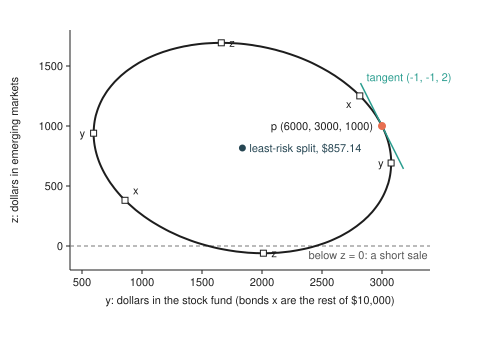

# Regular value theorem: solution sets come out smooth for free

[Syllabus](../../../SYLLABUS.md) → [Differential geometry and Lie groups](../README.md) → [Manifolds](../README.md#s03) → Regular value theorem

---

## General Overview

A household puts exactly $10,000 into three funds. A bond fund swings by about 10% in a typical year, a stock fund by 20%, and an emerging-markets fund by 30%. Treat the three as independent (a model, not a law). Then the typical swing of the whole pot, its **risk**, is the square root of the sum of the squared swings of the three parts.

The household wants two things at once: the total is exactly $10,000, and the risk is exactly $900. One split that works is $6,000 in bonds, $3,000 in stocks and $1,000 in emerging markets. The swings of the parts are $600, $600 and $300, and the square root of 600² + 600² + 300² is 900.

What does the set of *all* such splits look like? Two equations in three unknowns leave one free dial. So we expect a curve. But a curve can have corners, crossings or isolated points, and then "move a little along it" makes no sense.

The **regular value theorem** settles this with one **rank test** on the derivative: a check that the derivative reaches every direction of change in the equations. Here the set passes, so it is a smooth closed loop. At the split above, moving $1 out of bonds and $1 out of stocks into $2 of emerging markets keeps the total and the risk fixed, to first order.

**If every point of a solution set passes the rank test (the derivative of the equations is onto), the set is a smooth submanifold whose dimension is the number of unknowns minus the number of equations, and its tangent directions are the directions the derivative sends to zero.**

**What kind of fact this is:** a theorem, proved on this card in Why it works. It uses the inverse and implicit function theorems, proved in wing 06. The test is checked point by point, and the conclusion holds for the whole set.

### The picture: every split with risk exactly $900

<p align="center"></p>

Drawn to scale in y (stocks, across) and z (emerging markets, up). Bonds x are the rest of $10,000. The loop is smooth all the way round. Each pair of squares marks where one amount peaks or bottoms out; there it cannot serve as the loop's dial. A short arc dips below z = 0, down to −$60.27: a short sale (borrowing a fund's units and selling them). The theorem does not care about signs; a household that cannot sell short keeps the rest of the loop.

---

## The formula

Notation first, in words. A **level set** of a map $`F`$ is the set of points where $`F`$ takes one fixed value $`c`$, written $`F^{-1}(c)`$. The **differential** $`dF_p`$ is the map's best linear approximation at the point $`p`$; in coordinates it is the Jacobian matrix, one row per equation ([Tangent space and differential](03-tangent-spaces-and-differentials.md)). It is **onto** when every target direction is reached, which for a $`k`$-row matrix means rank $`k`$.

A value $`c`$ is a **regular value** of $`F`$ when $`dF_p`$ is onto at every point $`p`$ of $`F^{-1}(c)`$.

An **embedded submanifold** of dimension $`m`$ is a subset that, near each of its points, looks like a flat $`m`$-dimensional slice in some smooth coordinates of the surrounding space. Each such coordinate patch is a **chart**, as on the shelf's map sheets of the Earth ([Smooth manifold](01-smooth-manifolds-and-charts.md)).

The theorem, for a smooth $`F`$ from $`\mathbb{R}^n`$ (or an $`n`$-dimensional manifold) to $`\mathbb{R}^k`$:

```math
c \text{ regular} \;\Longrightarrow\; M = F^{-1}(c) \text{ is an embedded submanifold}, \quad \dim M = n - k, \quad T_pM = \ker dF_p
```

**Read it aloud:** if the derivative is onto everywhere on the solution set, the solution set is a smooth shape of dimension "unknowns minus equations", and its tangent space at each point is the set of directions the derivative kills.

Here $`T_pM`$ is the **tangent space**: the velocities of curves in $`M`$ through $`p`$. And $`\ker dF_p`$, the **kernel**, is the set of directions that $`dF_p`$ sends to zero.

For the budget, $`n = 3`$ unknowns $`x, y, z`$ (dollars in bonds, stocks, emerging markets) and $`k = 2`$ equations:

```math
F(x, y, z) = \big(x + y + z,\; (0.1x)^2 + (0.2y)^2 + (0.3z)^2\big), \qquad c = (10000,\; 810000)
```

**Read it aloud:** the first entry is the total; the second is the risk squared, in square dollars; the target is $10,000 and $900 squared.

```math
dF_{(x,y,z)} = \begin{pmatrix} 1 & 1 & 1 \\ 2(0.01)x & 2(0.04)y & 2(0.09)z \end{pmatrix}
```

**Read it aloud:** the total grows by one per dollar in any fund; the risk squared grows by twice the squared swing times the amount.

The rank test reads off the three **minors**, the 2 × 2 determinants from two columns. Rank 2 means at least one minor is non-zero.

| Symbol | Plain meaning | In our example | Push it up and the answer… |
| --- | --- | --- | --- |
| $`x`$, $`y`$, $`z`$ | dollars in bonds, stocks, emerging markets | 6000, 3000, 1000 at p | — |
| $`F`$, $`c`$ | the equations as one map; the target value | (total, risk²); (10000, 810000) | larger risk target: a bigger loop |
| $`n`$, $`k`$; $`m`$ | number of unknowns; number of equations; a submanifold's dimension | 3; 2; 1 = 3 − 2 | each extra independent equation cuts a dimension |
| $`M`$, $`p`$ | the level set; one point of it | the loop; (6000, 3000, 1000) | — |
| $`dF_p`$ | the differential, the Jacobian matrix at p | rows (1, 1, 1), (120, 240, 180) | — |
| minors | 2 × 2 determinants of dF_p, columns (x,y), (x,z), (y,z) | 120, 60, −60 | all three zero at a point: the test fails there |
| $`T_pM`$, $`\ker dF_p`$ | tangent space; directions dF_p sends to 0 | multiples of (−1, −1, 2) | — |
| $`u`$, $`v`$, $`w`$ | risk coordinates: 0.1x, 0.2y, 0.3z | 600, 600, 300 at p | — |
| $`d`$ | distance from the origin to the budget plane, in risk coordinates | 857.142857 = 6000/7 | the least risk any split can have |
| $`r`$ | radius of the loop in risk coordinates | 274.42 | zero when the risk target equals d |
| $`\Phi`$ | the straightening map in the proof | (free amount, F − c) | — |

### When it holds

- **F is smooth near the level set.** The proof runs on the implicit function theorem, which needs continuous partial derivatives. A kink in F can put a kink in the level set.
- **The differential is onto at every point of the set, not just most.** At a risk target of $857.14 the set shrinks to one split, where both rows of dF are parallel. One point has dimension 0, not 1.
- **The equations are independent.** State the total twice, in dollars and in cents, and the rank is 1, not 2. The set is a whole plane, of dimension 2 rather than 3 − 2 = 1.
- **The test is sufficient, not necessary.** The equation (x + y + z − 10000)² = 0 describes a smooth plane, yet its differential is zero everywhere on it. The theorem says nothing there.
- **An empty set passes for free.** A risk target of $850 has no splits at all. Its value is regular, since no point fails the test, and the empty set counts as a submanifold.

---

## Why it works

### Step 0: up close, F is its linear part

Near p, F behaves almost like its differential. The solution set of a linear map from $`\mathbb{R}^n`$ onto $`\mathbb{R}^k`$ is a flat slice of dimension n − k: the kernel, shifted. Rank-nullity (dimension of the input = rank + dimension of the kernel) gives the count.

The curved solution set is a slightly bent copy of that slice, and the implicit function theorem does the bending, chart by chart.

### Step 1: onto means some block can be solved for

If $`dF_p`$ has rank k, some k of its columns form an invertible k × k block. At p every minor is non-zero, so any pair works. Pick the columns for x and y and leave z free.

The [Inverse and implicit function theorems](../../06-Calculus%20and%20analysis/07-Several%20Variables/07-inverse-and-implicit-function-theorems.md) card proves the needed fact: when the block of rates in the unknowns is invertible, the equations solve for those unknowns as smooth functions of the rest, near the point. So near p the loop is a graph, x(z) and y(z), and z is a chart.

The slopes come out without solving anything:

```math
\begin{pmatrix} dx/dz \\ dy/dz \end{pmatrix} = -\begin{pmatrix} 1 & 1 \\ 120 & 240 \end{pmatrix}^{-1}\begin{pmatrix} 1 \\ 180 \end{pmatrix} = \begin{pmatrix} -0.5 \\ -0.5 \end{pmatrix}
```

**Read it aloud:** for each extra dollar in emerging markets, take half a dollar from bonds and half from stocks.

The check solves the chart by Newton's method (repeated linear correction) and by the quadratic formula. At z = 1100 both give x = 5958.79 and y = 2941.21. The straight-line trade (5950, 2950, 1100) has risk 900.57: the tangent drifts off the loop at second order, and the chart corrects it.

### Step 2: a graph is a flat slice in new coordinates

A graph is already a submanifold. Use the **straightening map** $`\Phi(x, y, z) = (z,\; F(x, y, z) - c)`$: keep the free amount and record how far each equation misses.

Its Jacobian has the invertible block in it, so by the inverse function theorem $`\Phi`$ is a smooth change of coordinates near p. In the new coordinates the loop is exactly the slice where the last two coordinates are zero. That is the definition of an embedded submanifold of dimension 3 − 2 = 1.

<details>
<summary>Detailed proof: a regular level set is an embedded submanifold of dimension n − k</summary>

Let $`F: U \to \mathbb{R}^k`$ be smooth on an open set $`U`$ of $`\mathbb{R}^n`$, and let $`c`$ be a regular value. Take $`p`$ in $`M = F^{-1}(c)`$.

Since $`dF_p`$ has rank $`k`$, reorder the coordinates as $`(a, b)`$, with $`a`$ in $`\mathbb{R}^{n-k}`$ and $`b`$ in $`\mathbb{R}^k`$, so that the block $`\partial F/\partial b`$ is invertible at $`p`$. Define

$`\displaystyle \Phi(a, b) = \big(a,\; F(a, b) - c\big).`$

Its Jacobian at $`p`$ is block lower-triangular, with the identity in the top-left corner and $`\partial F/\partial b`$ in the bottom-right. Its determinant is $`\det(\partial F/\partial b) \neq 0`$.

By the inverse function theorem there are open sets $`V \ni p`$ and $`W`$ with $`\Phi: V \to W`$ a diffeomorphism, a smooth map with a smooth inverse ([Diffeomorphism, immersion, submersion](04-diffeomorphisms-immersions-and-embeddings.md)). For $`q`$ in $`V`$, $`q \in M`$ exactly when the last $`k`$ entries of $`\Phi(q)`$ are zero. So $`\Phi`$ carries $`M \cap V`$ onto the slice $`W \cap (\mathbb{R}^{n-k} \times \{0\})`$.

The first $`n - k`$ entries of $`\Phi`$, restricted to $`M \cap V`$, form a chart of $`M`$. Two such charts differ by a restriction of smooth maps between open sets of $`\mathbb{R}^n`$, so their transition is smooth. That makes $`M`$ a smooth manifold of dimension $`n - k`$, sitting in $`\mathbb{R}^n`$ as a slice in local coordinates.

On a manifold $`N`$ in place of $`\mathbb{R}^n`$, run the same argument inside a chart of $`N`$.

For the tangent space: a curve $`\gamma`$ in $`M`$ has $`F(\gamma(t)) = c`$, so by the chain rule $`dF_p(\gamma'(0)) = 0`$. Hence $`T_pM \subseteq \ker dF_p`$. Both have dimension $`n - k`$, the kernel by rank-nullity, so they are equal.

</details>

### Step 3: the tangent is the kernel

Any trade that keeps both totals fixed to first order must be sent to zero by both rows of $`dF_p`$. In three dimensions, the direction at right angles to both rows is their cross product:

```math
(1, 1, 1) \times (120, 240, 180) = (-60, -60, 120)
```

**Read it aloud:** the trade that leaves both the total and the risk unchanged moves 60 out of bonds, 60 out of stocks and 120 into emerging markets, or any multiple of it.

Scaled to $1 into emerging markets this is (−0.5, −0.5, 1): the same slopes as the chart in Step 1. A third road agrees. The check draws the loop with no derivatives (Step 5) and finds the loop's velocity at p, scaled the same way, is (−0.500, −0.500, 1.000).

### Step 4: one chart is not enough; the sheets overlap

The chart "use z as the dial" needs the (x, y) minor non-zero. That minor is the z-entry of the tangent, so it vanishes exactly where z peaks or bottoms out on the loop. There the loop runs sideways to the z-direction, and z cannot tell neighbouring points apart.

| Dial | Fails where | Values there |
| --- | --- | --- |
| x (bonds) | x is largest or smallest | 5933.46 and 8760.42 |
| y (stocks) | y is largest or smallest | 597.03 and 3076.44 |
| z (emerging markets) | z is largest or smallest | −60.27 and 1692.93 |

Each dial fails at 2 points, by a count of sign changes around the loop, and the bisection values (found by repeatedly halving an interval) match a closed form to within 0.000001. No point fails all three. Up to sign, the three minors are the entries of the tangent, row 1 × row 2, so all three vanish only where the two rows are parallel. That happens only at the least-risk split of Step 5, whose risk is $857.14, not $900, so it is not on this loop. The check agrees: at the 7200 sampled points, the largest minor is at least 106.57. So the three charts overlap and cover the loop, like the overlapping map sheets that cover the Earth.

### Step 5: the same loop with no calculus

Rescale to **risk coordinates**, $`u = 0.1x`$, $`v = 0.2y`$, $`w = 0.3z`$: each fund's dollar swing. The risk target becomes a sphere, $`u^2 + v^2 + w^2 = 900^2`$. The budget becomes a plane, $`u/0.1 + v/0.2 + w/0.3 = 10000`$, whose unit normal is (0.857143, 0.428571, 0.285714), that is (6/7, 3/7, 2/7).

The plane sits 857.142857 = 6000/7 from the origin. The sphere's radius, 900, is larger, so they meet in a circle of radius 274.42. In dollars that circle is the loop of the picture.

This view explains the rank test. The two gradient rows are normals to the plane and the sphere. They are parallel exactly where the sphere touches the plane instead of cutting it, which happens only when the risk target is 857.142857. Surfaces that cut cleanly are called **transversal**; the regular value theorem is the general form of "transversal surfaces meet in a smooth curve".

The touching point is the least-risk split, (7346.94, 1836.73, 816.33), with risk 857.142857. The [Lagrange multipliers](../../06-Calculus%20and%20analysis/07-Several%20Variables/08-lagrange-multipliers.md) card finds it by asking the gradients to be parallel. That is exactly the point where this card's test fails. The best point on a constraint and the bad point of a level set are the same rank condition, read from two sides.

---

## Worked numbers, by hand

At the split p = (6000, 3000, 1000).

| Step | Arithmetic | Value |
| --- | --- | --- |
| squared swings | 0.1², 0.2², 0.3² | 0.01, 0.04, 0.09 |
| total | 6000 + 3000 + 1000 | 10000 |
| risk squared | 600² + 600² + 300² | 810000, risk 900 |
| row 2 of dF_p | 2 × 0.01 × 6000, 2 × 0.04 × 3000, 2 × 0.09 × 1000 | 120, 240, 180 |
| minor (x, y) | 1 × 240 − 1 × 120 | 120 |
| minor (x, z) | 1 × 180 − 1 × 120 | 60 |
| minor (y, z) | 1 × 180 − 1 × 240 | −60 |
| rank, dimension | rank 2, so 3 − 2 | 1 |
| tangent | (1, 1, 1) × (120, 240, 180) | (−60, −60, 120) |
| per $1 into z | divide by 120 | **(−0.5, −0.5, 1)** |

Near p, the splits with total $10,000 and risk $900 form one smooth curve. Each dollar moved into emerging markets comes half from bonds and half from stocks.

### What breaks if you drop a piece

| Mistake | Comes out at | What went wrong |
| --- | --- | --- |
| Set the risk target at the least risk, $857.14 | one split, largest minor 0.000000 | The rows are parallel there; the set is a point, dimension 0, not a curve |
| Set the risk target below it, $850 | radius squared −12193.88: no split | The value is regular for free, and the level set is empty |
| State the total twice, in dollars and cents | minors (0, 0, 0), rank 1 | The equations are not independent; the set is a plane, dimension 2 |
| Square the equation: (x + y + z − 10000)² = 0 | differential (0, 0, 0) on a smooth plane | The test is sufficient, not necessary; here it is silent |

The same failure appears in the [Smooth and singular points](../../22-Algebraic%20geometry/02-Affine%20and%20Projective%20Varieties/08-smooth-and-singular-points.md) card: the cone x² + y² = z² fails the Jacobian test only at its apex, which is the one point where it is not a smooth surface.

---

## Code, from first principles, and it actually runs

The code checks one claim, "the loop is a smooth curve through p with tangent (−1, −1, 2)", by three independent roads. Road one is the rank test: the differential, its minors and the cross product. Road two is a chart from the implicit function theorem, solved by Newton's method and checked against the quadratic formula. Road three draws the loop with no derivatives, as a sphere cut by a plane, and checks that its points solve both equations, that it passes through p with the same tangent, and that each dial fails exactly where a closed form says.

### Python

```python
# Regular value theorem -- the check behind the card.  Standard library only.
# $10,000 split as x, y, z dollars in funds with yearly swings of 10%, 20% and 30%,
# taken as independent.  F = (total, risk squared) = (x + y + z, (0.1x)^2 + (0.2y)^2 + (0.3z)^2).
# Road one: the rank test, dF and its 2 x 2 minors.  Road two: a chart from the
# implicit function theorem, solved by Newton and by the quadratic formula.
# Road three: the loop drawn with no derivatives, as a sphere cut by a plane.
from math import sqrt, cos, sin, atan2, pi

SIG, TOTAL, RISK = (0.1, 0.2, 0.3), 10000.0, 900.0
def F(p): return (sum(p), sum((s * c) ** 2 for s, c in zip(SIG, p)))
def dF(p): return ((1.0, 1.0, 1.0), tuple(2 * s * s * c for s, c in zip(SIG, p)))
def minors(J):                            # columns (x, y), (x, z), (y, z)
    return tuple(J[0][i] * J[1][j] - J[0][j] * J[1][i] for i, j in ((0, 1), (0, 2), (1, 2)))
def cross(a, b): return (a[1]*b[2] - a[2]*b[1], a[2]*b[0] - a[0]*b[2], a[0]*b[1] - a[1]*b[0])
def dot(a, b): return sum(p * q for p, q in zip(a, b))
def unit(a): return tuple(c / sqrt(dot(a, a)) for c in a)
def v(a, d=2): return "(" + ", ".join(f"{c:.{d}f}" for c in a) + ")"

p = (6000.0, 3000.0, 1000.0)
J = dF(p)
print(f"swings {v(tuple(100 * s for s in SIG), 0)} %, squared {v(tuple(s * s for s in SIG))}; "
      f"total {TOTAL:.0f}, risk {RISK:.0f}; n - k = 3 - 2 = 1")
print(f"split p = {v(p, 0)}: total {F(p)[0]:.0f}, risk squared {F(p)[1]:.0f}, risk {sqrt(F(p)[1]):.2f}")
print(f"dF_p rows {v(J[0], 0)} and {v(J[1], 0)}")
m = minors(J)
print(f"minors (x,y) (x,z) (y,z): {m[0]:.0f} {m[1]:.0f} {m[2]:.0f}, rank 2")
t = cross(J[0], J[1])
print(f"tangent = row 1 x row 2 = {v(t, 0)}; per $1 into z: {v(tuple(c / t[2] for c in t))}")
assert abs(dot(t, J[0])) < 1e-9 and abs(dot(t, J[1])) < 1e-9

def chart_newton(z, x, y):                # road two: solve F = c for (x, y) with z held
    for _ in range(50):
        f1, f2 = x + y + z - TOTAL, (0.1 * x) ** 2 + (0.2 * y) ** 2 + (0.3 * z) ** 2 - RISK ** 2
        a, b = 0.02 * x, 0.08 * y         # block dF/d(x, y) = [[1, 1], [a, b]]
        det = b - a
        x, y = x - (b * f1 - f2) / det, y - (-a * f1 + f2) / det
    return x, y

def chart_exact(z):                       # same chart, quadratic formula, root nearer p
    s, q = TOTAL - z, RISK ** 2 - (0.3 * z) ** 2      # x + y = s, 0.01x^2 + 0.04y^2 = q
    A, B, C = 0.05, -0.08 * s, 0.04 * s * s - q
    x = (-B - sqrt(B * B - 4 * A * C)) / (2 * A)
    return x, s - x

ift = (J[1][2] - J[1][1]) / (J[1][1] - J[1][0]), (J[1][0] - J[1][2]) / (J[1][1] - J[1][0])
print(f"implicit function slopes dx/dz, dy/dz = {ift[0]:.4f}, {ift[1]:.4f}")
for h in (100.0, 10.0):
    a, b = chart_newton(1000 + h, 6000, 3000), chart_newton(1000 - h, 6000, 3000)
    sl = ((a[0] - b[0]) / (2 * h), (a[1] - b[1]) / (2 * h))
    print(f"  Newton chart, step {h:.0f}: slopes {sl[0]:.6f}, {sl[1]:.6f}")
assert abs(sl[0] - ift[0]) < 1e-4 and abs(sl[1] - ift[1]) < 1e-4
xn, yn = chart_newton(1100.0, 6000, 3000)
xe, ye = chart_exact(1100.0)
assert abs(xn - xe) < 1e-6 and abs(yn - ye) < 1e-6
lin = (6000 + 100 * ift[0], 3000 + 100 * ift[1], 1100.0)
print(f"z = 1100: chart gives x, y = {xn:.2f}, {yn:.2f} (quadratic formula {xe:.2f}, {ye:.2f})")
print(f"  straight-line trade {v(lin)} has risk {sqrt(F(lin)[1]):.2f}")

w = tuple(1 / s for s in SIG)             # road three: u = 0.1x, v = 0.2y, w = 0.3z
nh = unit(w)
d = TOTAL / sqrt(dot(w, w))               # distance from origin to the budget plane
r = sqrt(RISK ** 2 - d * d)
print(f"risk coordinates of p {v(tuple(s * c for s, c in zip(SIG, p)), 0)}; plane normal {v(nh, 6)}")
print(f"plane distance = least risk {d:.6f} (6000/7 = {6000 / 7:.6f}); circle radius {r:.2f}")
lag = tuple(TOTAL * (1 / s ** 2) / sum(1 / q ** 2 for q in SIG) for s in SIG)
print(f"least-risk split (Lagrange) {v(lag)}, risk {sqrt(F(lag)[1]):.6f}")
assert abs(sqrt(F(lag)[1]) - d) < 1e-6
e1 = unit((-nh[1], nh[0], 0.0)); e2 = cross(nh, e1)
def loop(th): return tuple((d * nh[i] + r * (cos(th) * e1[i] + sin(th) * e2[i])) / SIG[i] for i in range(3))

N = 7200
pts = [loop(2 * pi * k / N) for k in range(N)]
err = max(max(abs(F(q)[0] - TOTAL), abs(F(q)[1] - RISK ** 2)) for q in pts)
low = min(max(abs(c) for c in minors(dF(q))) for q in pts)
print(f"loop, {N} points: every one solves F = c to within 1e-6; smallest largest-minor {low:.2f}")
assert err < 1e-6 and low > 1
def where_zero(k, a, b):                  # bisection on a sign change of minor k
    for _ in range(60):
        c = (a + b) / 2
        if (minors(dF(loop(a)))[k] > 0) == (minors(dF(loop(c)))[k] > 0): a = c
        else: b = c
    return loop(a)
fails = []
for k, name, i in ((2, "x", 0), (1, "y", 1), (0, "z", 2)):
    ch = [j for j in range(N) if (minors(dF(pts[j]))[k] > 0) != (minors(dF(pts[(j + 1) % N]))[k] > 0)]
    fp = sorted((where_zero(k, 2 * pi * j / N, 2 * pi * (j + 1) / N) for j in ch), key=lambda q: q[i])
    fails += fp
    ext = [q[i] for q in fp]
    hw = r * sqrt(1 - nh[i] ** 2)
    cf = ((d * nh[i] - hw) / SIG[i], (d * nh[i] + hw) / SIG[i])
    print(f"chart over {name} fails at {len(ch)} points, {name} = {ext[0]:.2f} and {ext[1]:.2f}"
          f" (closed form {cf[0]:.2f}, {cf[1]:.2f})")
    assert len(ch) == 2 and abs(ext[0] - cf[0]) < 1e-6 and abs(ext[1] - cf[1]) < 1e-6
yp = tuple(s * c - d * n for s, c, n in zip(SIG, p, nh))   # p seen from the circle's centre
thp = atan2(dot(yp, e2), dot(yp, e1))
q1, q0 = loop(thp + 1e-6), loop(thp - 1e-6)
vel = tuple(a - b for a, b in zip(q1, q0))
gap = max(abs(a - b) for a, b in zip(loop(thp), p))
print(f"loop at angle {thp:.6f} rad meets p (gap {gap:.6f}); its velocity, scaled: {v(tuple(c / vel[2] for c in vel), 3)}")
assert gap < 1e-6 and sqrt(dot(cross(unit(vel), unit(t)), cross(unit(vel), unit(t)))) < 1e-6
print("figure, (y, z): p " + v(p[1:], 0) + ", centre " + v(lag[1:], 0) + ", chart edges "
      + " ".join(v(q[1:], 0) for q in fails))

print("what breaks:")
Jl = dF(lag)
print(f"  risk {d:.2f}: one split, largest minor {max(abs(c) for c in minors(Jl)):.6f}, rank 1, dimension 0 not 1")
assert max(abs(c) for c in minors(Jl)) < 1e-6
print(f"  risk 850.00: radius squared {850.0 ** 2 - d * d:.2f} < 0, no split at all")
print(f"  total twice (dollars, cents): minors {v(minors(((1, 1, 1), (100, 100, 100))), 0)}, rank 1, the set is a plane")
print(f"  (x + y + z - 10000)^2 = 0: differential {v(tuple(2 * (sum(p) - TOTAL) for _ in p), 0)}, a plane, test silent")
Rg = 6371.0
print(f"globe x^2 + y^2 + z^2 = {Rg:.0f}^2: |dF| = 2R = {2 * Rg:.0f} km, never 0, dimension 3 - 1 = 2")
rows = []                                 # O(3): dF_I(H) = H + H^T, 9 inputs, 6 outputs
for a in range(9):
    H = [[1.0 if 3 * i + j == a else 0.0 for j in range(3)] for i in range(3)]
    rows.append([H[i][j] + H[j][i] for i in range(3) for j in range(i, 3)])
rank, M = 0, [row[:] for row in rows]
for col in range(6):
    piv = next((i for i in range(rank, 9) if abs(M[i][col]) > 1e-12), None)
    if piv is None: continue
    M[rank], M[piv] = M[piv], M[rank]
    for i in range(9):
        if i != rank: M[i] = [a - M[i][col] / M[rank][col] * b for a, b in zip(M[i], M[rank])]
    rank += 1
print(f"O(3): A^T A = I, 9 entries, rank of dF_I {rank}, dimension {9 - rank}")
assert rank == 6
print("ALL CHECKS PASS")
```

**Ran 2026-11-19 on macOS, Python 3.14.10, standard library only. All checks passed. Output, pasted from the run:**

```
swings (10, 20, 30) %, squared (0.01, 0.04, 0.09); total 10000, risk 900; n - k = 3 - 2 = 1
split p = (6000, 3000, 1000): total 10000, risk squared 810000, risk 900.00
dF_p rows (1, 1, 1) and (120, 240, 180)
minors (x,y) (x,z) (y,z): 120 60 -60, rank 2
tangent = row 1 x row 2 = (-60, -60, 120); per $1 into z: (-0.50, -0.50, 1.00)
implicit function slopes dx/dz, dy/dz = -0.5000, -0.5000
  Newton chart, step 100: slopes -0.497840, -0.502160
  Newton chart, step 10: slopes -0.499979, -0.500021
z = 1100: chart gives x, y = 5958.79, 2941.21 (quadratic formula 5958.79, 2941.21)
  straight-line trade (5950.00, 2950.00, 1100.00) has risk 900.57
risk coordinates of p (600, 600, 300); plane normal (0.857143, 0.428571, 0.285714)
plane distance = least risk 857.142857 (6000/7 = 857.142857); circle radius 274.42
least-risk split (Lagrange) (7346.94, 1836.73, 816.33), risk 857.142857
loop, 7200 points: every one solves F = c to within 1e-6; smallest largest-minor 106.57
chart over x fails at 2 points, x = 5933.46 and 8760.42 (closed form 5933.46, 8760.42)
chart over y fails at 2 points, y = 597.03 and 3076.44 (closed form 597.03, 3076.44)
chart over z fails at 2 points, z = -60.27 and 1692.93 (closed form -60.27, 1692.93)
loop at angle 0.211093 rad meets p (gap 0.000000); its velocity, scaled: (-0.500, -0.500, 1.000)
figure, (y, z): p (3000, 1000), centre (1837, 816), chart edges (2815, 1251) (858, 381) (597, 940) (3076, 692) (2012, -60) (1661, 1693)
what breaks:
  risk 857.14: one split, largest minor 0.000000, rank 1, dimension 0 not 1
  risk 850.00: radius squared -12193.88 < 0, no split at all
  total twice (dollars, cents): minors (0, 0, 0), rank 1, the set is a plane
  (x + y + z - 10000)^2 = 0: differential (0, 0, 0), a plane, test silent
globe x^2 + y^2 + z^2 = 6371^2: |dF| = 2R = 12742 km, never 0, dimension 3 - 1 = 2
O(3): A^T A = I, 9 entries, rank of dF_I 6, dimension 3
ALL CHECKS PASS
```

### Rust

```rust
// Regular value theorem -- the check behind the card.  std only, no crates.
// $10,000 split as x, y, z dollars in funds with yearly swings of 10%, 20% and 30%,
// taken as independent.  F = (total, risk squared) = (x + y + z, (0.1x)^2 + (0.2y)^2 + (0.3z)^2).
// Road one: the rank test, dF and its 2 x 2 minors.  Road two: a chart from the
// implicit function theorem, solved by Newton and by the quadratic formula.
// Road three: the loop drawn with no derivatives, as a sphere cut by a plane.
use std::f64::consts::PI;
type V3 = [f64; 3];
const SIG: V3 = [0.1, 0.2, 0.3];
const TOTAL: f64 = 10000.0;
const RISK: f64 = 900.0;

fn f(p: V3) -> (f64, f64) {
    let mut s = 0.0;
    for i in 0..3 { s += (SIG[i] * p[i]).powi(2); }
    (0.0 + p[0] + p[1] + p[2], s)
}
fn df(p: V3) -> [V3; 2] { [[1.0, 1.0, 1.0], [2.0 * SIG[0] * SIG[0] * p[0], 2.0 * SIG[1] * SIG[1] * p[1], 2.0 * SIG[2] * SIG[2] * p[2]]] }
fn minors(j: [V3; 2]) -> V3 { // columns (x, y), (x, z), (y, z)
    let pr = [(0, 1), (0, 2), (1, 2)];
    let mut m = [0.0; 3];
    for (k, &(i, l)) in pr.iter().enumerate() { m[k] = j[0][i] * j[1][l] - j[0][l] * j[1][i]; }
    m
}
fn cross(a: V3, b: V3) -> V3 { [a[1]*b[2] - a[2]*b[1], a[2]*b[0] - a[0]*b[2], a[0]*b[1] - a[1]*b[0]] }
fn dot(a: V3, b: V3) -> f64 { 0.0 + a[0] * b[0] + a[1] * b[1] + a[2] * b[2] }
fn unit(a: V3) -> V3 { let n = dot(a, a).sqrt(); [a[0] / n, a[1] / n, a[2] / n] }
fn v(a: &[f64], d: usize) -> String {
    format!("({})", a.iter().map(|c| format!("{:.*}", d, c)).collect::<Vec<_>>().join(", "))
}
fn maxabs(a: V3) -> f64 { a.iter().fold(0.0f64, |m, c| m.max(c.abs())) }

fn chart_newton(z: f64, mut x: f64, mut y: f64) -> (f64, f64) { // road two: F = c for (x, y), z held
    for _ in 0..50 {
        let f1 = x + y + z - TOTAL;
        let f2 = (0.1 * x).powi(2) + (0.2 * y).powi(2) + (0.3 * z).powi(2) - RISK.powi(2);
        let (a, b) = (0.02 * x, 0.08 * y); // block dF/d(x, y) = [[1, 1], [a, b]]
        let det = b - a;
        let (nx, ny) = (x - (b * f1 - f2) / det, y - (-a * f1 + f2) / det);
        x = nx; y = ny;
    }
    (x, y)
}
fn chart_exact(z: f64) -> (f64, f64) { // same chart, quadratic formula, root nearer p
    let (s, q) = (TOTAL - z, RISK.powi(2) - (0.3 * z).powi(2)); // x + y = s, 0.01x^2 + 0.04y^2 = q
    let (a, b, c) = (0.05, -0.08 * s, 0.04 * s * s - q);
    let x = (-b - (b * b - 4.0 * a * c).sqrt()) / (2.0 * a);
    (x, s - x)
}

fn main() {
    let p: V3 = [6000.0, 3000.0, 1000.0];
    let j = df(p);
    println!("swings {} %, squared {}; total {:.0}, risk {:.0}; n - k = 3 - 2 = 1",
             v(&[100.0 * SIG[0], 100.0 * SIG[1], 100.0 * SIG[2]], 0), v(&[SIG[0] * SIG[0], SIG[1] * SIG[1], SIG[2] * SIG[2]], 2), TOTAL, RISK);
    println!("split p = {}: total {:.0}, risk squared {:.0}, risk {:.2}", v(&p, 0), f(p).0, f(p).1, f(p).1.sqrt());
    println!("dF_p rows {} and {}", v(&j[0], 0), v(&j[1], 0));
    let m = minors(j);
    println!("minors (x,y) (x,z) (y,z): {:.0} {:.0} {:.0}, rank 2", m[0], m[1], m[2]);
    let t = cross(j[0], j[1]);
    println!("tangent = row 1 x row 2 = {}; per $1 into z: {}", v(&t, 0), v(&[t[0] / t[2], t[1] / t[2], t[2] / t[2]], 2));
    assert!(dot(t, j[0]).abs() < 1e-9 && dot(t, j[1]).abs() < 1e-9);

    let ift = ((j[1][2] - j[1][1]) / (j[1][1] - j[1][0]), (j[1][0] - j[1][2]) / (j[1][1] - j[1][0]));
    println!("implicit function slopes dx/dz, dy/dz = {:.4}, {:.4}", ift.0, ift.1);
    let mut sl = (0.0, 0.0);
    for h in [100.0f64, 10.0] {
        let (a, b) = (chart_newton(1000.0 + h, 6000.0, 3000.0), chart_newton(1000.0 - h, 6000.0, 3000.0));
        sl = ((a.0 - b.0) / (2.0 * h), (a.1 - b.1) / (2.0 * h));
        println!("  Newton chart, step {:.0}: slopes {:.6}, {:.6}", h, sl.0, sl.1);
    }
    assert!((sl.0 - ift.0).abs() < 1e-4 && (sl.1 - ift.1).abs() < 1e-4);
    let (xn, yn) = chart_newton(1100.0, 6000.0, 3000.0);
    let (xe, ye) = chart_exact(1100.0);
    assert!((xn - xe).abs() < 1e-6 && (yn - ye).abs() < 1e-6);
    let lin = [6000.0 + 100.0 * ift.0, 3000.0 + 100.0 * ift.1, 1100.0];
    println!("z = 1100: chart gives x, y = {:.2}, {:.2} (quadratic formula {:.2}, {:.2})", xn, yn, xe, ye);
    println!("  straight-line trade {} has risk {:.2}", v(&lin, 2), f(lin).1.sqrt());

    let w = [1.0 / SIG[0], 1.0 / SIG[1], 1.0 / SIG[2]]; // road three: u = 0.1x, v = 0.2y, w = 0.3z
    let nh = unit(w);
    let d = TOTAL / dot(w, w).sqrt(); // distance from origin to the budget plane
    let r = (RISK.powi(2) - d * d).sqrt();
    println!("risk coordinates of p {}; plane normal {}", v(&[SIG[0] * p[0], SIG[1] * p[1], SIG[2] * p[2]], 0), v(&nh, 6));
    println!("plane distance = least risk {:.6} (6000/7 = {:.6}); circle radius {:.2}", d, 6000.0 / 7.0, r);
    let sw = 0.0 + 1.0 / SIG[0].powi(2) + 1.0 / SIG[1].powi(2) + 1.0 / SIG[2].powi(2);
    let lag = [TOTAL * (1.0 / SIG[0].powi(2)) / sw, TOTAL * (1.0 / SIG[1].powi(2)) / sw, TOTAL * (1.0 / SIG[2].powi(2)) / sw];
    println!("least-risk split (Lagrange) {}, risk {:.6}", v(&lag, 2), f(lag).1.sqrt());
    assert!((f(lag).1.sqrt() - d).abs() < 1e-6);
    let e1 = unit([-nh[1], nh[0], 0.0]); let e2 = cross(nh, e1);
    let lp = |th: f64| -> V3 {
        let mut q = [0.0; 3];
        for i in 0..3 { q[i] = (d * nh[i] + r * (th.cos() * e1[i] + th.sin() * e2[i])) / SIG[i]; }
        q
    };

    let n = 7200usize;
    let pts: Vec<V3> = (0..n).map(|k| lp(2.0 * PI * k as f64 / n as f64)).collect();
    let err = pts.iter().fold(0.0f64, |m, q| m.max((f(*q).0 - TOTAL).abs()).max((f(*q).1 - RISK.powi(2)).abs()));
    let low = pts.iter().fold(f64::INFINITY, |m, q| m.min(maxabs(minors(df(*q)))));
    println!("loop, {} points: every one solves F = c to within 1e-6; smallest largest-minor {:.2}", n, low);
    assert!(err < 1e-6 && low > 1.0);
    let where_zero = |k: usize, mut a: f64, mut b: f64| -> V3 { // bisection on a sign change of minor k
        for _ in 0..60 {
            let c = (a + b) / 2.0;
            if (minors(df(lp(a)))[k] > 0.0) == (minors(df(lp(c)))[k] > 0.0) { a = c; } else { b = c; }
        }
        lp(a)
    };
    let mut fails: Vec<V3> = Vec::new();
    for &(k, name, i) in &[(2usize, "x", 0usize), (1, "y", 1), (0, "z", 2)] {
        let ch: Vec<usize> = (0..n).filter(|&jj| (minors(df(pts[jj]))[k] > 0.0) != (minors(df(pts[(jj + 1) % n]))[k] > 0.0)).collect();
        let mut fp: Vec<V3> = ch.iter().map(|&jj| where_zero(k, 2.0 * PI * jj as f64 / n as f64, 2.0 * PI * (jj + 1) as f64 / n as f64)).collect();
        fp.sort_by(|a, b| a[i].partial_cmp(&b[i]).unwrap());
        fails.extend(fp.iter().cloned());
        let hw = r * (1.0 - nh[i].powi(2)).sqrt();
        let cf = ((d * nh[i] - hw) / SIG[i], (d * nh[i] + hw) / SIG[i]);
        println!("chart over {} fails at {} points, {} = {:.2} and {:.2} (closed form {:.2}, {:.2})",
                 name, ch.len(), name, fp[0][i], fp[1][i], cf.0, cf.1);
        assert!(ch.len() == 2 && (fp[0][i] - cf.0).abs() < 1e-6 && (fp[1][i] - cf.1).abs() < 1e-6);
    }
    let yp = [SIG[0] * p[0] - d * nh[0], SIG[1] * p[1] - d * nh[1], SIG[2] * p[2] - d * nh[2]]; // p from the centre
    let thp = dot(yp, e2).atan2(dot(yp, e1));
    let (q1, q0) = (lp(thp + 1e-6), lp(thp - 1e-6));
    let vel = [q1[0] - q0[0], q1[1] - q0[1], q1[2] - q0[2]];
    let at = lp(thp); let gap = maxabs([at[0] - p[0], at[1] - p[1], at[2] - p[2]]);
    println!("loop at angle {:.6} rad meets p (gap {:.6}); its velocity, scaled: {}", thp, gap,
             v(&[vel[0] / vel[2], vel[1] / vel[2], vel[2] / vel[2]], 3));
    let cx = cross(unit(vel), unit(t));
    assert!(gap < 1e-6 && dot(cx, cx).sqrt() < 1e-6);
    let edges: Vec<String> = fails.iter().map(|q| v(&q[1..], 0)).collect();
    println!("figure, (y, z): p {}, centre {}, chart edges {}", v(&p[1..], 0), v(&lag[1..], 0), edges.join(" "));

    println!("what breaks:");
    let jl = df(lag);
    println!("  risk {:.2}: one split, largest minor {:.6}, rank 1, dimension 0 not 1", d, maxabs(minors(jl)));
    assert!(maxabs(minors(jl)) < 1e-6);
    println!("  risk 850.00: radius squared {:.2} < 0, no split at all", 850.0f64.powi(2) - d * d);
    println!("  total twice (dollars, cents): minors {}, rank 1, the set is a plane",
             v(&minors([[1.0, 1.0, 1.0], [100.0, 100.0, 100.0]]), 0));
    let g = 2.0 * (f(p).0 - TOTAL);
    println!("  (x + y + z - 10000)^2 = 0: differential {}, a plane, test silent", v(&[g, g, g], 0));
    let rg = 6371.0f64;
    println!("globe x^2 + y^2 + z^2 = {:.0}^2: |dF| = 2R = {:.0} km, never 0, dimension 3 - 1 = 2", rg, 2.0 * rg);
    let mut mm: Vec<Vec<f64>> = Vec::new(); // O(3): dF_I(H) = H + H^T, 9 inputs, 6 outputs
    for a in 0..9 {
        let h: Vec<Vec<f64>> = (0..3).map(|i| (0..3).map(|l| if 3 * i + l == a { 1.0 } else { 0.0 }).collect()).collect();
        let mut row = Vec::new();
        for i in 0..3 { for l in i..3 { row.push(h[i][l] + h[l][i]); } }
        mm.push(row);
    }
    let mut rank = 0;
    for col in 0..6 {
        let piv = (rank..9).find(|&i| mm[i][col].abs() > 1e-12);
        let Some(pv) = piv else { continue };
        mm.swap(rank, pv);
        for i in 0..9 {
            if i != rank {
                let fct = mm[i][col] / mm[rank][col];
                let base = mm[rank].clone();
                for (a, b) in mm[i].iter_mut().zip(base.iter()) { *a = *a - fct * b; }
            }
        }
        rank += 1;
    }
    println!("O(3): A^T A = I, 9 entries, rank of dF_I {}, dimension {}", rank, 9 - rank);
    assert!(rank == 6);
    println!("ALL CHECKS PASS");
}
```

**Ran 2026-11-19 on macOS, rustc 1.98.1, no crates. All checks passed. Output, pasted from the run:**

```
swings (10, 20, 30) %, squared (0.01, 0.04, 0.09); total 10000, risk 900; n - k = 3 - 2 = 1
split p = (6000, 3000, 1000): total 10000, risk squared 810000, risk 900.00
dF_p rows (1, 1, 1) and (120, 240, 180)
minors (x,y) (x,z) (y,z): 120 60 -60, rank 2
tangent = row 1 x row 2 = (-60, -60, 120); per $1 into z: (-0.50, -0.50, 1.00)
implicit function slopes dx/dz, dy/dz = -0.5000, -0.5000
  Newton chart, step 100: slopes -0.497840, -0.502160
  Newton chart, step 10: slopes -0.499979, -0.500021
z = 1100: chart gives x, y = 5958.79, 2941.21 (quadratic formula 5958.79, 2941.21)
  straight-line trade (5950.00, 2950.00, 1100.00) has risk 900.57
risk coordinates of p (600, 600, 300); plane normal (0.857143, 0.428571, 0.285714)
plane distance = least risk 857.142857 (6000/7 = 857.142857); circle radius 274.42
least-risk split (Lagrange) (7346.94, 1836.73, 816.33), risk 857.142857
loop, 7200 points: every one solves F = c to within 1e-6; smallest largest-minor 106.57
chart over x fails at 2 points, x = 5933.46 and 8760.42 (closed form 5933.46, 8760.42)
chart over y fails at 2 points, y = 597.03 and 3076.44 (closed form 597.03, 3076.44)
chart over z fails at 2 points, z = -60.27 and 1692.93 (closed form -60.27, 1692.93)
loop at angle 0.211093 rad meets p (gap 0.000000); its velocity, scaled: (-0.500, -0.500, 1.000)
figure, (y, z): p (3000, 1000), centre (1837, 816), chart edges (2815, 1251) (858, 381) (597, 940) (3076, 692) (2012, -60) (1661, 1693)
what breaks:
  risk 857.14: one split, largest minor 0.000000, rank 1, dimension 0 not 1
  risk 850.00: radius squared -12193.88 < 0, no split at all
  total twice (dollars, cents): minors (0, 0, 0), rank 1, the set is a plane
  (x + y + z - 10000)^2 = 0: differential (0, 0, 0), a plane, test silent
globe x^2 + y^2 + z^2 = 6371^2: |dF| = 2R = 12742 km, never 0, dimension 3 - 1 = 2
O(3): A^T A = I, 9 entries, rank of dF_I 6, dimension 3
ALL CHECKS PASS
```

### Lean

Lean proves the regular value theorem in $`\mathbb{R}^n`$ for every $`n`$ and $`k`$, and the budget loop's rank test.

- Suppose $`F`$ is smooth on an open set of $`\mathbb{R}^n`$, and $`c`$ is a regular value. Then near each point of $`M`$, a smooth chart with smooth inverse makes $`M`$ a flat slice of dimension $`n - k`$.
- Take the same $`F`$ and $`c`$, and a point $`p`$ of $`M`$. Then the tangent directions of $`M`$ at $`p`$, taken as limits of short steps within $`M`$, are exactly $`\ker dF_p`$.
- Suppose a split of $10,000 has risk exactly $900. Then at least one of the three minors of $`dF`$ is not zero, so the rank test passes.
- Take any split of $10,000. Then its risk is at least $857.14, which is 6000/7, and equals it only at the least-risk split. So a risk target of $850 has no split at all.
- Take the split p = (6000, 3000, 1000). Then exact arithmetic gives the minors 120, 60 and −60, and the tangent (−60, −60, 120).

The loop's drawing, the Newton chart, the dials' failure points and the what-breaks cases are left to the Python and Rust checks.

```lean
-- Regular value theorem: if the derivative of a smooth map from an open set of ℝ^n to ℝ^k is onto at every point of a level set, that level set is, near each of its points, a flat (n − k)-dimensional slice in smooth coordinates, and its tangent directions are exactly the directions the derivative sends to zero.
import Mathlib.Analysis.Calculus.ContDiff.Defs
import Mathlib.Analysis.Calculus.FDeriv.Basic
import Mathlib.Analysis.Calculus.TangentCone.Defs
import Mathlib.Analysis.InnerProductSpace.PiL2
import Mathlib.Topology.OpenPartialHomeomorph.Defs
import Mathlib.LinearAlgebra.CrossProduct
import Mathlib.Tactic.NormNum
import Mathlib.Tactic.Linarith
import Mathlib.Analysis.Calculus.InverseFunctionTheorem.FDeriv
import Mathlib.Analysis.Calculus.ContDiff.Operations
import Mathlib.Analysis.Calculus.ContDiff.RCLike
import Mathlib.Analysis.Calculus.TangentCone.Real
import Mathlib.Analysis.Normed.Operator.BoundedLinearMaps

open scoped ContDiff Matrix


/-- Helper: an onto linear map `A` from `ℝ^n` to `ℝ^k` can be completed by a linear map `L` to
`ℝ^(n − k)` so that `x ↦ (L x, A x)` is a linear isomorphism. -/
theorem exists_complement_equiv_of_surjective {n k : ℕ}
    (A : EuclideanSpace ℝ (Fin n) →L[ℝ] EuclideanSpace ℝ (Fin k)) (hA : Function.Surjective A) :
    ∃ L : EuclideanSpace ℝ (Fin n) →L[ℝ] EuclideanSpace ℝ (Fin (n - k)),
      ∃ e : EuclideanSpace ℝ (Fin n) ≃L[ℝ]
          (EuclideanSpace ℝ (Fin (n - k)) × EuclideanSpace ℝ (Fin k)),
        (e : EuclideanSpace ℝ (Fin n) →L[ℝ] _) = L.prod A := by
  have hrange : LinearMap.range (A : EuclideanSpace ℝ (Fin n) →ₗ[ℝ] EuclideanSpace ℝ (Fin k)) = ⊤ :=
    LinearMap.range_eq_top.mpr hA
  have hrn := LinearMap.finrank_range_add_finrank_ker
    (A : EuclideanSpace ℝ (Fin n) →ₗ[ℝ] EuclideanSpace ℝ (Fin k))
  rw [hrange, finrank_top, finrank_euclideanSpace_fin, finrank_euclideanSpace_fin] at hrn
  obtain ⟨π, hπ⟩ := (LinearMap.ker
    (A : EuclideanSpace ℝ (Fin n) →ₗ[ℝ] EuclideanSpace ℝ (Fin k))).subtype.exists_leftInverse_of_injective
    (by simp)
  let e1 := LinearEquiv.ofFinrankEq (LinearMap.ker
    (A : EuclideanSpace ℝ (Fin n) →ₗ[ℝ] EuclideanSpace ℝ (Fin k)))
    (EuclideanSpace ℝ (Fin (n - k))) (by rw [finrank_euclideanSpace_fin]; omega)
  let L : EuclideanSpace ℝ (Fin n) →L[ℝ] EuclideanSpace ℝ (Fin (n - k)) :=
    LinearMap.toContinuousLinearMap (e1.toLinearMap ∘ₗ π)
  let M : EuclideanSpace ℝ (Fin n) →ₗ[ℝ]
      (EuclideanSpace ℝ (Fin (n - k)) × EuclideanSpace ℝ (Fin k)) := (L.prod A : _)
  have hinj : Function.Injective M := by
    rw [← LinearMap.ker_eq_bot, LinearMap.ker_eq_bot']
    intro x hx
    have h1 : L x = 0 := congrArg Prod.fst hx
    have h2 : A x = 0 := congrArg Prod.snd hx
    have hxk : x ∈ LinearMap.ker
        (A : EuclideanSpace ℝ (Fin n) →ₗ[ℝ] EuclideanSpace ℝ (Fin k)) := h2
    have hπx : π x = ⟨x, hxk⟩ := by
      have := LinearMap.congr_fun hπ ⟨x, hxk⟩
      simpa using this
    have : e1 ⟨x, hxk⟩ = 0 := by
      have : L x = e1 (π x) := rfl
      rw [← hπx, ← this, h1]
    have := congrArg Subtype.val (e1.map_eq_zero_iff.mp this)
    simpa using this
  have hsurj : Function.Surjective M := by
    rwa [← LinearMap.injective_iff_surjective_of_finrank_eq_finrank]
    rw [Module.finrank_prod, finrank_euclideanSpace_fin, finrank_euclideanSpace_fin,
      finrank_euclideanSpace_fin]
    omega
  refine ⟨L, (LinearEquiv.ofBijective M ⟨hinj, hsurj⟩).toContinuousLinearEquiv, ?_⟩
  ext x : 1
  rfl

#print axioms exists_complement_equiv_of_surjective

/-- **Regular value theorem.** Let `F` be smooth on an open set `U` of `ℝ^n`, with values in
`ℝ^k`, and let `c` be a regular value: at every point `p` of `U` with `F p = c` the differential
`dF_p` is onto. Then the level set `M = {q ∈ U | F q = c}` is an embedded submanifold of
dimension `n − k`: near each of its points `p` there are smooth coordinates `Φ`, with a smooth
inverse, taking values in `ℝ^(n − k) × ℝ^k`, in which `M` is exactly the flat slice where the last
`k` coordinates are zero. And its tangent space at `p` (the tangent cone of `M`, the limiting
directions of `M` at `p`) is the kernel of `dF_p`, the directions the derivative sends to zero. -/
theorem regular_level_set_is_embedded_submanifold {n k : ℕ}
    {U : Set (EuclideanSpace ℝ (Fin n))} (hU : IsOpen U)
    {F : EuclideanSpace ℝ (Fin n) → EuclideanSpace ℝ (Fin k)} (hF : ContDiffOn ℝ ∞ F U)
    {c : EuclideanSpace ℝ (Fin k)}
    (hc : ∀ p ∈ U, F p = c → Function.Surjective (fderiv ℝ F p)) :
    ∀ p ∈ U, F p = c →
      (∃ Φ : OpenPartialHomeomorph (EuclideanSpace ℝ (Fin n))
          (EuclideanSpace ℝ (Fin (n - k)) × EuclideanSpace ℝ (Fin k)),
        p ∈ Φ.source ∧ Φ.source ⊆ U ∧
        ContDiffOn ℝ ∞ Φ Φ.source ∧ ContDiffOn ℝ ∞ Φ.symm Φ.target ∧
        ∀ q ∈ Φ.source, (F q = c ↔ (Φ q).2 = 0)) ∧
      tangentConeAt ℝ {q | q ∈ U ∧ F q = c} p = {v | fderiv ℝ F p v = 0} := by
  intro p hp hFp
  obtain ⟨L, E0, hE0⟩ := exists_complement_equiv_of_surjective (fderiv ℝ F p) (hc p hp hFp)
  have hFa : ∀ x ∈ U, ContDiffAt ℝ ∞ F x := fun x hx => hF.contDiffAt (hU.mem_nhds hx)
  have hFd : ∀ x ∈ U, HasFDerivAt F (fderiv ℝ F x) x := fun x hx =>
    ((hFa x hx).differentiableAt (by simp)).hasFDerivAt
  set Ψ : EuclideanSpace ℝ (Fin n) → EuclideanSpace ℝ (Fin (n - k)) × EuclideanSpace ℝ (Fin k) :=
    fun x => (L x, F x - c) with hΨdef
  have hΨd : ∀ x ∈ U, HasFDerivAt Ψ (L.prod (fderiv ℝ F x)) x := fun x hx =>
    L.hasFDerivAt.prodMk ((hFd x hx).sub_const c)
  have hΨs : ContDiffOn ℝ ∞ Ψ U := L.contDiff.contDiffOn.prodMk (hF.sub contDiffOn_const)
  have hΨa : ∀ x ∈ U, ContDiffAt ℝ ∞ Ψ x := fun x hx => hΨs.contDiffAt (hU.mem_nhds hx)
  have hΨp : HasFDerivAt Ψ (E0 : EuclideanSpace ℝ (Fin n) →L[ℝ] _) p := by
    rw [hE0]; exact hΨd p hp
  have hstrict : HasStrictFDerivAt Ψ (E0 : EuclideanSpace ℝ (Fin n) →L[ℝ] _) p :=
    (hΨa p hp).hasStrictFDerivAt' hΨp (by simp)
  set W := U ∩ fderiv ℝ Ψ ⁻¹' Set.range
    ((↑) : (EuclideanSpace ℝ (Fin n) ≃L[ℝ]
      (EuclideanSpace ℝ (Fin (n - k)) × EuclideanSpace ℝ (Fin k))) → _) with hWdef
  have hW : IsOpen W :=
    (hΨs.continuousOn_fderiv_of_isOpen hU (by simp)).isOpen_inter_preimage hU
      ContinuousLinearEquiv.isOpen
  have hpW : p ∈ W := ⟨hp, E0, (hΨp.fderiv).symm⟩
  set Φ := (hstrict.toOpenPartialHomeomorph Ψ).restrOpen W hW with hΦdef
  have hΦcoe : (Φ : EuclideanSpace ℝ (Fin n) → _) = Ψ := rfl
  have hΦsrc : Φ.source = (hstrict.toOpenPartialHomeomorph Ψ).source ∩ W :=
    OpenPartialHomeomorph.restrOpen_source _ _ _
  have hsrcU : Φ.source ⊆ U := fun x hx => (hΦsrc ▸ hx).2.1
  have hpsrc : p ∈ Φ.source := hΦsrc ▸ ⟨hstrict.mem_toOpenPartialHomeomorph_source, hpW⟩
  have hlevel : ∀ q ∈ Φ.source, (F q = c ↔ (Φ q).2 = 0) := by
    intro q _
    rw [hΦcoe]
    simp [Ψ, sub_eq_zero]
  refine ⟨⟨Φ, hpsrc, hsrcU, ?_, ?_, hlevel⟩, ?_⟩
  · rw [hΦcoe]; exact hΨs.mono hsrcU
  · intro y hy
    have hx : Φ.symm y ∈ Φ.source := Φ.map_target hy
    obtain ⟨e, he⟩ := (hΦsrc ▸ hx).2.2
    have hxU : Φ.symm y ∈ U := hsrcU hx
    refine (Φ.contDiffAt_symm hy (f₀' := e) ?_ ?_).contDiffWithinAt
    · rw [hΦcoe, he]
      exact ((hΨa _ hxU).differentiableAt (by simp)).hasFDerivAt
    · rw [hΦcoe]; exact hΨa _ hxU
  · ext v
    constructor
    · intro hv
      have hFw : HasFDerivWithinAt F (fderiv ℝ F p) {q | q ∈ U ∧ F q = c} p :=
        (hFd p hp).hasFDerivWithinAt
      have h1 := hFw.mapsTo_tangent_cone hv
      have hsub : F '' {q | q ∈ U ∧ F q = c} ⊆ {c} := by
        rintro _ ⟨q, hq, rfl⟩; exact hq.2
      have h2 := tangentConeAt_mono hsub (hFp ▸ h1)
      have hacc : ¬ AccPt c (Filter.principal ({c} : Set (EuclideanSpace ℝ (Fin k)))) := by
        rw [accPt_iff_frequently]
        simp
      have h3 := tangentConeAt_subset_zero hacc h2
      simpa using h3
    · intro hv
      have hv' : fderiv ℝ F p v = 0 := hv
      have hE0v : E0 v = (L v, 0) := by
        have := congrArg (fun T : EuclideanSpace ℝ (Fin n) →L[ℝ] _ => T v) hE0
        simp only [ContinuousLinearEquiv.coe_coe] at this
        rw [this]; simp [hv']
      have hΦp : Φ p = (L p, 0) := by rw [hΦcoe]; simp [Ψ, hFp]
      have htp : Φ p ∈ Φ.target := Φ.map_source hpsrc
      have hsymm : HasFDerivAt Φ.symm (E0.symm : _ →L[ℝ] EuclideanSpace ℝ (Fin n)) (Φ p) := by
        apply Φ.hasFDerivAt_symm htp
        rw [Φ.left_inv hpsrc, hΦcoe]; exact hΨp
      set S := {y : EuclideanSpace ℝ (Fin (n - k)) × EuclideanSpace ℝ (Fin k) | y.2 = 0}
        ∩ Φ.target with hSdef
      have hw : ((L v, 0) : EuclideanSpace ℝ (Fin (n - k)) × EuclideanSpace ℝ (Fin k)) ∈
          tangentConeAt ℝ S (Φ p) := by
        rw [hSdef, tangentConeAt_inter_nhds (Φ.open_target.mem_nhds htp)]
        have := mem_tangentConeAt_of_segment_subset (s := {y : EuclideanSpace ℝ (Fin (n - k)) ×
            EuclideanSpace ℝ (Fin k) | y.2 = 0}) (x := Φ p) (y := Φ p + (L v, 0)) ?_
        · simpa using this
        · rintro z ⟨a, b, -, -, -, rfl⟩
          simp [hΦp]
      have h1 := hsymm.hasFDerivWithinAt (s := S) |>.mapsTo_tangent_cone hw
      rw [Φ.left_inv hpsrc] at h1
      have hsub : Φ.symm '' S ⊆ {q | q ∈ U ∧ F q = c} := by
        rintro _ ⟨y, ⟨hy2, hyt⟩, rfl⟩
        have hs := Φ.map_target hyt
        refine ⟨hsrcU hs, (hlevel _ hs).mpr ?_⟩
        rw [Φ.right_inv hyt]; exact hy2
      have h2 := tangentConeAt_mono hsub h1
      have : (E0.symm : _ →L[ℝ] EuclideanSpace ℝ (Fin n))
          ((L v, 0) : EuclideanSpace ℝ (Fin (n - k)) × EuclideanSpace ℝ (Fin k)) = v := by
        rw [← hE0v]; simp
      rwa [this] at h2

/-- **The budget loop passes the rank test everywhere.** Split $10,000 as `x, y, z` dollars in
funds with yearly swings of 10%, 20% and 30%, so `F = (x + y + z, (x/10)² + (y/5)² + (3z/10)²)`
and `dF` has rows `(1, 1, 1)` and `(x/50, 2y/25, 9z/50)`. At every split with total 10000 and
risk exactly 900 (risk squared 810000), at least one of the three 2 × 2 minors of `dF`, for the
columns (x, y), (x, z) and (y, z), is not zero. So `dF` has rank 2 there, `(10000, 810000)` is a
regular value, and the loop is a smooth curve of dimension 3 − 2 = 1. -/
theorem budget_loop_passes_rank_test (x y z : ℝ) (htotal : x + y + z = 10000)
    (hrisk : (x / 10) ^ 2 + (y / 5) ^ 2 + (3 * z / 10) ^ 2 = 810000) :
    ¬ (1 * (2 * y / 25) - 1 * (x / 50) = 0 ∧ 1 * (9 * z / 50) - 1 * (x / 50) = 0 ∧
        1 * (9 * z / 50) - 1 * (2 * y / 25) = 0) := by
  rintro ⟨h1, h2, -⟩
  have hx : x = 360000 / 49 := by linarith
  have hy : y = 90000 / 49 := by linarith
  have hz : z = 40000 / 49 := by linarith
  subst hx hy hz
  norm_num at hrisk

/-- **The least risk is $6000/7, at one split only.** Every split of $10,000 has risk squared at
least `(6000/7)²` (risk at least 857.142857 dollars), and it equals `(6000/7)²` exactly at the
least-risk split `(360000/49, 90000/49, 40000/49)`, about (7346.94, 1836.73, 816.33). This is
the one split where the two rows of `dF` are parallel; a risk target of $850 has no splits. -/
theorem least_risk_split (x y z : ℝ) (htotal : x + y + z = 10000) :
    (6000 / 7 : ℝ) ^ 2 ≤ (x / 10) ^ 2 + (y / 5) ^ 2 + (3 * z / 10) ^ 2 ∧
      ((x / 10) ^ 2 + (y / 5) ^ 2 + (3 * z / 10) ^ 2 = (6000 / 7 : ℝ) ^ 2 ↔
        x = 360000 / 49 ∧ y = 90000 / 49 ∧ z = 40000 / 49) := by
  have key : (x / 10) ^ 2 + (y / 5) ^ 2 + (3 * z / 10) ^ 2 - (6000 / 7 : ℝ) ^ 2 =
      (x / 10 - 36000 / 49) ^ 2 + (y / 5 - 18000 / 49) ^ 2 + (3 * z / 10 - 12000 / 49) ^ 2 := by
    have hz : z = 10000 - x - y := by linarith
    subst hz
    ring
  refine ⟨by nlinarith [sq_nonneg (x / 10 - 36000 / 49), sq_nonneg (y / 5 - 18000 / 49),
    sq_nonneg (3 * z / 10 - 12000 / 49)], ⟨fun h => ?_, ?_⟩⟩
  · have h0 : (x / 10 - 36000 / 49) ^ 2 + (y / 5 - 18000 / 49) ^ 2 +
        (3 * z / 10 - 12000 / 49) ^ 2 = 0 := by linarith
    have ha := sq_nonneg (x / 10 - 36000 / 49)
    have hb := sq_nonneg (y / 5 - 18000 / 49)
    have hc := sq_nonneg (3 * z / 10 - 12000 / 49)
    have e1 : (x / 10 - 36000 / 49) ^ 2 = 0 := by linarith
    have e2 : (y / 5 - 18000 / 49) ^ 2 = 0 := by linarith
    have e3 : (3 * z / 10 - 12000 / 49) ^ 2 = 0 := by linarith
    have f1 := pow_eq_zero_iff (n := 2) (by norm_num) |>.mp e1
    have f2 := pow_eq_zero_iff (n := 2) (by norm_num) |>.mp e2
    have f3 := pow_eq_zero_iff (n := 2) (by norm_num) |>.mp e3
    refine ⟨by linarith, by linarith, by linarith⟩
  · rintro ⟨rfl, rfl, rfl⟩
    norm_num


-- The split p = (6000, 3000, 1000): total 10000, risk squared 600² + 600² + 300² = 810000 = 900².
example : (6000 : ℤ) + 3000 + 1000 = 10000 := by norm_num
example : (6000 / 10 : ℚ) = 600 ∧ (3000 / 5 : ℚ) = 600 ∧ (3 * 1000 / 10 : ℚ) = 300 := by norm_num
example : (600 : ℤ) ^ 2 + 600 ^ 2 + 300 ^ 2 = 810000 ∧ (900 : ℤ) ^ 2 = 810000 := by norm_num
-- Row 2 of dF_p: 2 × 0.01 × 6000, 2 × 0.04 × 3000, 2 × 0.09 × 1000 = 120, 240, 180.
example : 2 * (1 / 100 : ℚ) * 6000 = 120 ∧ 2 * (4 / 100 : ℚ) * 3000 = 240 ∧
    2 * (9 / 100 : ℚ) * 1000 = 180 := by norm_num
-- Minors (x, y), (x, z), (y, z): 120, 60, −60, so rank 2 and dimension 3 − 2 = 1.
example : (1 : ℤ) * 240 - 1 * 120 = 120 ∧ (1 : ℤ) * 180 - 1 * 120 = 60 ∧
    (1 : ℤ) * 180 - 1 * 240 = -60 := by norm_num
-- Tangent: (1, 1, 1) × (120, 240, 180) = (−60, −60, 120); per $1 into z, (−1/2, −1/2, 1).
example : (![1, 1, 1] : Fin 3 → ℤ) ⨯₃ ![120, 240, 180] = ![-60, -60, 120] := by decide
example : (-60 / 120 : ℚ) = -1 / 2 ∧ (120 / 120 : ℚ) = 1 := by norm_num
-- Implicit function slopes dx/dz = dy/dz = −1/2: both rows of dF_p send (−1/2, −1/2, 1) to 0.
example : (1 : ℚ) * (-1 / 2) + 1 * (-1 / 2) + 1 * 1 = 0 ∧
    (120 : ℚ) * (-1 / 2) + 240 * (-1 / 2) + 180 * 1 = 0 := by norm_num
-- Budget plane in risk coordinates: normal (10, 5, 10/3) has length 35/3, unit normal
-- (6/7, 3/7, 2/7), distance from the origin 10000 / (35/3) = 6000/7.
example : (10 : ℚ) ^ 2 + 5 ^ 2 + (10 / 3) ^ 2 = (35 / 3) ^ 2 := by norm_num
example : (10 : ℚ) / (35 / 3) = 6 / 7 ∧ (5 : ℚ) / (35 / 3) = 3 / 7 ∧
    (10 / 3 : ℚ) / (35 / 3) = 2 / 7 ∧ (10000 : ℚ) / (35 / 3) = 6000 / 7 := by norm_num
-- Loop radius squared 900² − (6000/7)² = 3690000/49 (radius 274.42); at risk 850 it is
-- 850² − (6000/7)² = −597500/49 (−12193.88), so no split at all.
example : (900 : ℚ) ^ 2 - (6000 / 7) ^ 2 = 3690000 / 49 := by norm_num
example : (850 : ℚ) ^ 2 - (6000 / 7) ^ 2 = -597500 / 49 := by norm_num
-- The least-risk split (360000/49, 90000/49, 40000/49) totals 10000 and has risk 6000/7.
example : (360000 / 49 : ℚ) + 90000 / 49 + 40000 / 49 = 10000 := by norm_num
example : ((360000 / 49 : ℚ) / 10) ^ 2 + ((90000 / 49) / 5) ^ 2 + (3 * (40000 / 49) / 10) ^ 2 =
    (6000 / 7) ^ 2 := by norm_num
-- Globe: 3 unknowns, 1 equation, a surface of dimension 2; |dF| = 2R = 2 × 6371 = 12742 km.
example : 3 - 1 = 2 ∧ 2 * 6371 = 12742 := by decide
-- O(3): AᵀA = I has 9 entries, 6 independent equations, so dimension 9 − 6 = 3.
example : 9 - 6 = 3 := by decide

#print axioms regular_level_set_is_embedded_submanifold
#print axioms budget_loop_passes_rank_test
#print axioms least_risk_split
```

**Checked 2026-11-19 on macOS, Lean 4.36.0-rc2, Mathlib v4.36.0-rc2. Every proof is complete and uses only Lean's standard axioms. Output, pasted from the run:**

```
'exists_complement_equiv_of_surjective' depends on axioms: [propext, Classical.choice, Quot.sound]
'regular_level_set_is_embedded_submanifold' depends on axioms: [propext, Classical.choice, Quot.sound]
'budget_loop_passes_rank_test' depends on axioms: [propext, Classical.choice, Quot.sound]
'least_risk_split' depends on axioms: [propext, Classical.choice, Quot.sound]
```

> [!TIP]
> **Try changing**
> - Guess first: set `RISK = 1000.0`. The first assert to fail is the slope check. The split p still has risk 900, so it is not on the new, larger loop, and the Newton chart near z = 1000 lands somewhere else.
> - Guess first: set `N = 12`, a loop sampled at only 12 points. Each dial still fails at exactly 2 points, at the same values, because bisection refines each sign change. The smallest largest-minor rises a little: 12 points miss the loop's weakest spot.
> - Guess first: start `chart_newton(1100.0, 9000, 0)` instead of `(1100.0, 6000, 3000)`. Newton lands on the other split with z = 1100, on the far side of the loop, and the assert against the quadratic formula's near root fails. A chart is only local.

---

## The usual mistake

> [!warning]
> **Checking the rank test at one point and calling the whole set smooth.** The test must pass at every point of the level set. A set can be smooth almost everywhere and still have one bad point, like the cone's apex. A risk target of $857.14 fails at the only point the set has.
>
> Smaller traps:
> - **Counting dimensions without checking rank.** Three unknowns minus two equations gives 1 only if the equations are independent. The total stated in dollars and in cents has rank 1, and the set is a plane of dimension 2.
> - **Reading the converse.** A failed test does not prove the set is singular. The squared equation (x + y + z − 10000)² = 0 has differential (0, 0, 0) everywhere, yet its level set is a smooth plane.
> - **Following the tangent as if it were the curve.** The straight-line trade (5950, 2950, 1100) ends at risk 900.57, not 900. The chart, x = 5958.79 and y = 2941.21, stays exactly on target.
> - **Expecting one chart to cover the loop.** Every single dial fails at 2 points. A closed loop always needs at least two overlapping charts.

---

## Where you meet it in real life

- **Map sheets of the Earth.** The globe, modelled as a sphere of radius 6371 km, is the level set x² + y² + z² = 6371². Its differential has length 2R = 12742 km and is never zero on it. So the sphere is a smooth surface of dimension 3 − 1 = 2 in one line, before any map sheet is drawn ([Sphere, torus and projective plane](02-example-manifolds-sphere-torus-and-projective-space.md)).
- **Matrix groups.** The rotations and reflections of space, O(3), are the 3 × 3 matrices A with AᵀA = I: 9 entries, 6 independent equations. At the identity the differential has rank 6, and multiplying through by A gives the same rank at every A in O(3). So O(3) is a manifold of dimension 3, one per axis of turning. This is how a [Lie group](../06-Lie%20Groups/01-lie-groups-and-matrix-groups.md) gets its smooth structure.
- **Robot arms and linkages.** A closed linkage must satisfy loop-closure equations. Where the Jacobian is onto, the allowed poses form a smooth space; where it drops rank, the arm is at a **singularity** and can lock or jerk.
- **Constrained optimisation.** Optimisation on a sphere or a matrix group, as in Riemannian gradient descent, needs the constraint set to be a manifold first. The regular value theorem is usually how that is shown.

> **Say it back**
> A level set is the set where some equations hold. If the derivative of the equations is onto at every point of it, the set is a smooth submanifold. Its dimension is the number of unknowns minus the number of equations, and its tangent directions are those the derivative sends to zero. The proof solves the equations for some variables with the implicit function theorem, which makes the set a graph, then straightens it into a flat slice. For $10,000 split three ways at exactly $900 of risk, the splits form a smooth loop, and at (6000, 3000, 1000) each dollar into emerging markets comes half from bonds and half from stocks.

---

## What this builds on

- [Diffeomorphism, immersion, submersion](04-diffeomorphisms-immersions-and-embeddings.md): a map whose differential is onto is a submersion; this card shows its level sets are submanifolds, using the straightening diffeomorphism.
- [Inverse and implicit function theorems](../../06-Calculus%20and%20analysis/07-Several%20Variables/07-inverse-and-implicit-function-theorems.md): proves that an invertible block lets equations be solved locally for some variables. This card applies it chart by chart.
- [Lagrange multipliers](../../06-Calculus%20and%20analysis/07-Several%20Variables/08-lagrange-multipliers.md): the best point on a constraint is where gradients line up. Here that is the one point where the rank test fails.
- [Smooth and singular points](../../22-Algebraic%20geometry/02-Affine%20and%20Projective%20Varieties/08-smooth-and-singular-points.md): the same Jacobian rank test on polynomial equations, with the cone singular only at its apex.

## Where this goes next

- [Sard's theorem and degree](10-sards-theorem-and-degree.md): the values that fail the test are rare, measure zero, so almost every target gives a smooth level set.
- [Transversality and cobordism](11-transversality-intersection-numbers-and-cobordism.md): crossings that survive a wiggle, and shapes that bound together.

The question this card leaves open: the test fails at only one risk target here, $857.14; are failing targets that rare for every smooth map?

---

## Sources

Verified 2026-11-19: every link below resolves to the publisher's page.

- Lee, John M. *Introduction to Smooth Manifolds*, 2nd ed. Graduate Texts in Mathematics 218. Springer, 2012. [doi:10.1007/978-1-4419-9982-5](https://doi.org/10.1007/978-1-4419-9982-5). Embedded submanifolds as slices and the regular level set theorem, chapter 5.
- Guillemin, Victor, and Alan Pollack. *Differential Topology*. AMS Chelsea Publishing, 2010. [doi:10.1090/chel/370](https://doi.org/10.1090/chel/370). The preimage theorem and transversality, chapter 1.
- Milnor, John. *Topology from the Differentiable Viewpoint*. Princeton University Press, 1997. [Publisher page](https://press.princeton.edu/books/paperback/9780691048338/topology-from-the-differentiable-viewpoint). A short proof that a regular value has a manifold as its preimage, leading to Sard's theorem.
- Markowitz, Harry. "Portfolio Selection." *The Journal of Finance* 7, no. 1 (1952): 77–91. [doi:10.1111/j.1540-6261.1952.tb01525.x](https://doi.org/10.1111/j.1540-6261.1952.tb01525.x). The risk of a portfolio from the swings of its parts, the model behind the example.
