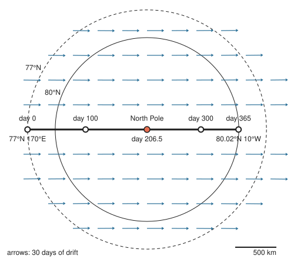
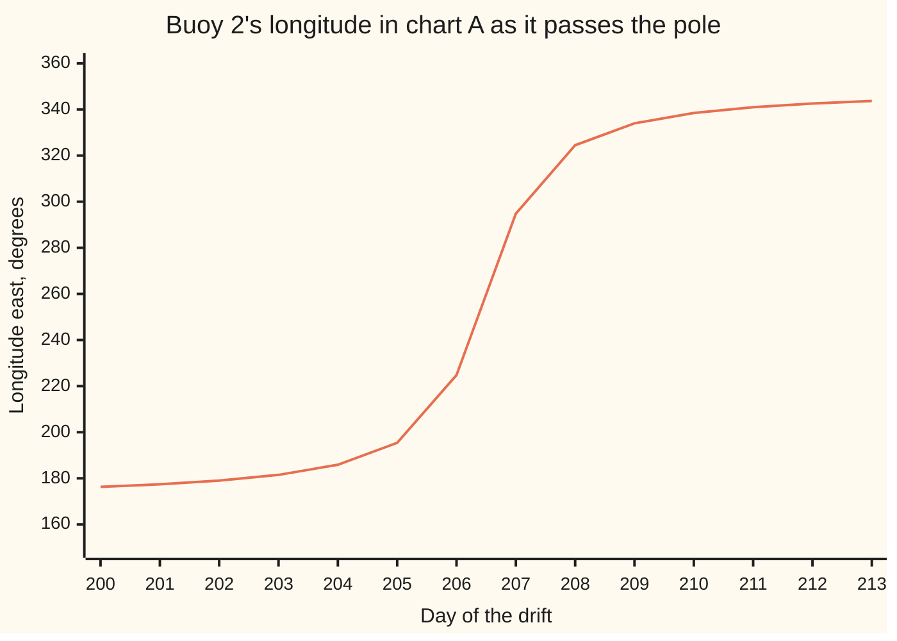

# Vector field and its flow: follow the arrows and you get a motion

[Syllabus](../../../SYLLABUS.md) → [Differential geometry and Lie groups](../README.md) → [Manifolds](../README.md#s03) → Vector field and its flow

---

## General Overview

Sea ice in the Arctic Ocean drifts from the Siberian side, across the middle of the ocean, toward the Fram Strait between Greenland and Svalbard. Ice scientists call this current the Transpolar Drift. On average it carries ice about 7 km a day.

Scientists freeze tracking buoys into this ice. Say one buoy goes in at 77°N, 170°E. At every point of the ocean the current is an arrow: a direction and a speed. The buoy has no engine. It only follows the arrow under it, moment by moment. Where is it a year later?

Follow the arrows in a model current and the answer is **80.02°N, 10.00°W**, in the mouth of the Fram Strait. On the way the buoy crosses the North Pole on day 206.50. Latitude and longitude break down at the pole, so the globe's own grid cannot carry the trip. The polar map sheet can, but it misses the South Pole, so no single sheet covers every trip on the globe. In general the motion is built one sheet at a time, and the pieces must agree.

An arrow at every point of a curved space is a **vector field**. The path a buoy traces by following it is an **integral curve**. The rule that moves every point forward by the same time is the **flow**.

**A smooth field of arrows on a curved space gives exactly one motion through each point, the same in every map sheet, and on the globe, which is finite and has no edge, that motion lasts for all time.**

**What kind of fact this is:** vector field, integral curve and flow are definitions. The fundamental theorem on flows is a theorem, proved on this card in Why it works: each point has exactly one motion through it, and on the sphere that motion lasts for all time. The current is a model: a rotation of the whole globe that matches the Transpolar Drift in speed and direction, and nothing else.

### The picture: one year of drift on the polar map sheet

<p align="center"></p>

Drawn to scale on chart B, the polar stereographic sheet, at 0.14 px per km, with a 300 km grid of 42.0 px. The pole sits at pixel (250, 220). The sheet is turned so the 170°E–10°W meridian runs left to right, with 80°E up. The buoy is at x = 46.8 px on day 0, 145.5 on day 100, 341.7 on day 300 and 405.7 on day 365. The 77°N circle has radius 203.2 px and the 80°N circle 156.1 px. Each arrow is 30 days of drift, 29.4 px at the pole, drawn every 300 km.

---

## The formula

**Words first.** The globe is the manifold $`M`$ (a space that looks flat up close, [Smooth manifold](01-smooth-manifolds-and-charts.md)). Here it is the sphere of radius $`R = 6371`$ km, a model of the Earth. A **chart**, or map sheet, gives each point near some place two numbers, $`(x^1, x^2)`$; the upper indices are labels, not powers. $`T_pM`$ is the tangent plane at the point $`p`$: all the arrows that start there ([Tangent space and differential](03-tangent-spaces-and-differentials.md)). In a chart, $`\partial_1`$ and $`\partial_2`$ are the arrows that move one coordinate and hold the other.

A **vector field** $`X`$ picks one arrow $`X_p`$ in $`T_pM`$ for every point $`p`$. In a chart it is two functions, its **components** $`X^1`$ and $`X^2`$:

```math
X = X^1\,\partial_1 + X^2\,\partial_2 = X^i\,\partial_i
```

**Read it aloud:** the arrow is so much of the first coordinate direction plus so much of the second. A repeated upper and lower index is summed, as on [Covectors and tensor fields](05-covectors-and-tensor-fields.md).

An **integral curve** is a path $`\gamma(t)`$ whose velocity is always the arrow under it. In a chart that is a pair of ordinary differential equations:

```math
\gamma'(t) = X_{\gamma(t)} \qquad\Longleftrightarrow\qquad \frac{dx^i}{dt} = X^i\bigl(x^1(t), x^2(t)\bigr), \quad i = 1, 2
```

**Read it aloud:** at every moment, the buoy's velocity is the current's arrow at the buoy.

**Two map sheets.** Chart A is the globe's own grid: $`\varphi`$ is the polar angle, measured down from the North Pole, and $`\theta`$ is longitude east, both in radians. It fails at the poles, where longitude has no value. Chart B is the polar stereographic sheet used for Arctic maps. Its coordinates $`(u, v)`$ are in km, with $`r = \sqrt{u^2 + v^2} = 2R\tan(\varphi/2)`$ the distance from the pole on the sheet. It covers everything except the South Pole.

**The model current.** The whole globe turns slowly about an axis through the equator at longitude $`\alpha = 80°`$. The turn rate is $`\Omega = 7/6371`$ rad per day, so the pole moves at 7 km a day. In chart A:

```math
\varphi' = -\Omega \sin(\theta - \alpha), \qquad \theta' = -\Omega\,\frac{\cos(\theta - \alpha)}{\tan\varphi}
```

In chart B, with $`w = u\sin\alpha - v\cos\alpha`$ the position along the drift line:

```math
u' = \Omega\Bigl(\tfrac{4R^2 - r^2}{4R}\sin\alpha + \tfrac{w\,u}{2R}\Bigr), \qquad v' = \Omega\Bigl(-\tfrac{4R^2 - r^2}{4R}\cos\alpha + \tfrac{w\,v}{2R}\Bigr)
```

**Read it aloud:** in chart A the longitude rate divides by $`\tan\varphi`$ and blows up at the pole; in chart B every term is a plain polynomial, finite everywhere on the sheet.

Where two charts overlap, call the old chart's coordinates $`x^i`$ and the new chart's $`y^j`$. The components change by the **Jacobian** $`J`$ of the transition map (the table of partial derivatives $`\partial y^j/\partial x^i`$, from wing 06; [Covectors and tensor fields](05-covectors-and-tensor-fields.md) calls this new-against-old table $`K`$ and keeps $`J`$ for its inverse). The new components are $`\tilde X^{\,j}`$:

```math
\tilde X^{\,j} = \frac{\partial y^j}{\partial x^i}\,X^i
```

**Read it aloud:** the new components are the old ones pushed through the derivative of the change of coordinates.

**The theorem.** For a smooth field on a manifold, through every point $`p`$ passes exactly one integral curve on the largest possible time interval. On a compact manifold, such as the sphere, that interval is all time. The **flow** $`\varphi_t`$ sends each point $`p`$ to where its curve stands after time $`t`$. It obeys $`\varphi_0(p) = p`$ and $`\varphi_s(\varphi_t(p)) = \varphi_{s+t}(p)`$. The wing writes the polar angle as $`\varphi`$ and, with a subscript $`t`$, the flow; the subscript tells them apart.

For this current the flow is known exactly. It turns the globe by the angle $`\Omega t`$ about the axis $`\mathbf a`$, the unit vector at 0°N, 80°E. Rodrigues' formula writes that turn out, with $`\mathbf p`$ the point as a vector from the Earth's centre:

```math
\varphi_t(\mathbf p) = \mathbf p\cos\Omega t + (\mathbf a \times \mathbf p)\sin\Omega t + \mathbf a\,(\mathbf a\cdot\mathbf p)(1 - \cos\Omega t)
```

**Read it aloud:** the flow of this current is a rotation of the globe through the angle turn rate times time.

A vector field also acts on functions. If $`f`$ is any smooth quantity on the globe, $`Xf`$ is the rate at which $`f`$ changes for a buoy riding the field: $`Xf(p) = df_p(X_p)`$, the differential of $`f`$ fed the arrow.

| Symbol | Plain meaning | In our example | Push it up and the answer… |
| --- | --- | --- | --- |
| $`M`$, $`R`$ | the manifold; the globe's radius | sphere, 6371 km | — |
| $`p`$, $`\mathbf p`$, $`T_pM`$ | a point; it as a vector from the centre; its tangent plane | buoy 2's start, 77.00°N 170.20°E | — |
| $`X`$, $`X_p`$ | the vector field; its arrow at $`p`$ | at the pole, $`(6.894, -1.216)`$ km/day in chart B | faster drift |
| $`X^i`$, $`\partial_i`$ | components in a chart; the chart's coordinate arrows | chart A: $`(-0.00109872, 0.00001660)`$ rad/day | — |
| $`(\varphi, \theta)`$ | chart A: polar angle, longitude east, radians | start: 13°, 170° | — |
| $`(u, v)`$, $`r`$, $`w`$ | chart B in km; distance from the pole on the sheet; place along the drift line | buoy 2: $`(-1430.583, 247.107)`$ | — |
| $`\Omega`$ | turn rate of the model current | 0.0010987 rad/day = 0.06295°/day | the pole is reached sooner |
| $`\alpha`$, $`\mathbf a`$ | longitude of the axis; the axis as a unit vector | 80°E, on the equator | the drift line swings round |
| $`\gamma(t)`$, $`t`$ | an integral curve; time in days | buoy 1 over 365 days | — |
| $`\varphi_t`$ | the flow: every point moved on by time $`t`$ | $`\varphi_{365}`$ takes 77°N 170°E to 80.02°N 10.00°W | — |
| $`f`$, $`Xf`$ | a quantity on the globe; its rate along the field | distance to the pole; −6.999957 km/day | — |
| $`J`$, $`y^j`$, $`\tilde X^{\,j}`$ | Jacobian of a change of chart; the new chart's coordinates; the field's components in them | chart A to chart B at buoy 2: $`(6.983251, -1.230692)`$ km/day | — |

### When it holds

- **The field is smooth in some chart around every point.** Then its components are locally Lipschitz (their slope is bounded near each point), which uniqueness needs. "Head due north at 7 km a day" is smooth in chart A but has no single arrow at the pole, so it is not a vector field on the sphere: see What breaks.
- **The manifold is compact for all-time motion.** Compact, for a surface in space, means closed and bounded: finite in size, with no missing edge points, like the sphere. On the number line, the field $`x' = x^2`$ sends its curves to infinity in finite time ([The flow](../../08-Differential%20equations%20and%20dynamics/02-Existence%2C%20Uniqueness%20and%20Sensitivity/05-the-flow-of-an-equation.md)); the sphere has no infinity to run to.
- **The field does not change with time.** The flow law $`\varphi_s \circ \varphi_t = \varphi_{s+t}`$ needs that. A real current changes with season and wind; then each start time needs its own map.
- **The model is only a model.** Its two still points, where the arrow is zero, sit on the equator at 80°E and 100°W, in the Indian Ocean and the Pacific. It knows no coastline. It fits only the speed and direction of the Arctic drift.

---

## Why it works

### Step 0: in one chart, a field is an ordinary system of equations

Inside one chart the field is two component functions, and an integral curve is a solution of $`dx^i/dt = X^i(x)`$. Smooth components are locally Lipschitz, so by [The Picard-Lindelof theorem](../../08-Differential%20equations%20and%20dynamics/02-Existence%2C%20Uniqueness%20and%20Sensitivity/02-lipschitz-and-the-picard-lindelof-theorem.md) each start gives exactly one solution, for some time. What is new on a manifold is crossing from one chart to another.

### Step 1: every chart has an edge, so no single sheet covers the globe

Chart A stops at the North Pole: there $`\tan\varphi = 0`$ and $`\theta'`$ divides by it. Chart B stops too, at the South Pole. It happens to carry this buoy's whole year, but no single sheet covers the whole sphere, so in general a motion must pass from sheet to sheet. Even short of the pole, chart A is a poor place to work. A second buoy, dropped 5 km east of the first, passes 5.000 km from the pole. As it goes by, its longitude swings from 195.4°E on day 205 to 294.8°E on day 207, while the buoy keeps its steady 7 km a day.



The line is buoy 2's longitude. It creeps, leaps from 224.8°E to 294.8°E between days 206 and 207, then creeps again. Only the chart's coordinate races; in chart B the same buoy moves steadily in a near-straight line.

### Step 2: two charts tell the same story where they overlap

Take a solution in chart A and carry it into chart B by the transition map. By the chain rule its chart-B velocity is the Jacobian times its chart-A velocity. That is exactly how the field's components change between charts. So the carried curve solves chart B's equations. By uniqueness in chart B, it *is* chart B's solution from that start.

At buoy 2's start the numbers bear this out. Chart A's components $`(-0.00109872, 0.00001660)`$ rad/day, pushed through the Jacobian, give $`(6.983251, -1.230692)`$ km/day. Chart B's own formula gives the same pair. Over days 0 to 150, buoy 1's chart-A motion, mapped into chart B, stays within $`10^{-9}`$ km of its chart-B motion.

### Step 3: glue the pieces into one curve

Chart B alone could carry this trip, but on the whole globe no sheet can, so the general construction works sheet by sheet. To show the gluing at work, the code runs in chart A, where it is convenient, until the buoy nears the pole, switches to chart B to cross, then switches back to chart A. Step 2 says the pieces agree on every overlap, so they join into one curve on the globe. Two integral curves through the same point agree on the whole time interval where both exist. The times where they agree spread out from each such time and include their own limits, so they fill the interval.

<details>
<summary>Detailed proof: two integral curves through one point agree everywhere</summary>

Let $`\gamma_1`$ and $`\gamma_2`$ be integral curves of $`X`$ on an open time interval $`I`$ containing 0, with $`\gamma_1(0) = \gamma_2(0) = p`$. Let $`S`$ be the set of times in $`I`$ where they agree. It contains 0.

$`S`$ is open. If $`\gamma_1(t_0) = \gamma_2(t_0) = q`$, take a chart around $`q`$. Near $`t_0`$ both curves stay in it and solve the same system with the same value at $`t_0`$. By Picard-Lindelöf they agree on a small interval around $`t_0`$.

$`S`$ is closed in $`I`$. If $`t_n \to t`$ with $`\gamma_1(t_n) = \gamma_2(t_n)`$, continuity gives $`\gamma_1(t) = \gamma_2(t)`$. This step uses the Hausdorff property of a manifold: two different points have separate neighbourhoods, so a sequence has one limit.

An interval cannot be split into two separate open pieces, so $`S = I`$. The union of all integral curves through $`p`$ is therefore one curve, the **maximal** integral curve, defined on the largest interval any of them reaches.

</details>

### Step 4: on the sphere the motion lasts forever

Every point of the globe has a chart around it and a small time $`\varepsilon`$ for which every curve starting near it is guaranteed to exist. The sphere is compact, so finitely many such patches cover it; take the smallest of their $`\varepsilon`$. Then every integral curve, wherever it is, can be extended by that fixed time. Repeat, and it runs for all time, forwards and backwards. That is the global step, and it needs compactness: on the number line, $`x' = x^2`$ escapes to infinity in finite time.

<details>
<summary>Detailed proof: compactness gives a flow for all time</summary>

For each point $`q`$, Picard-Lindelöf in a chart gives an open neighbourhood $`U_q`$ and a time $`\varepsilon_q > 0`$ such that every solution starting in $`U_q`$ exists for $`\lvert t\rvert < \varepsilon_q`$. The sets $`U_q`$ cover the sphere; by compactness finitely many do, and $`\varepsilon`$, the smallest of their times, is positive.

Suppose a maximal integral curve $`\gamma`$ lived only up to a finite time $`b`$. Pick $`t_1 = b - \varepsilon/2`$. The curve from $`\gamma(t_1)`$ exists for time $`\varepsilon`$, so by Step 3 it extends $`\gamma`$ to $`b + \varepsilon/2`$. That contradicts maximality. The same argument works backwards. So every curve lives on all of $`\mathbb R`$, and $`\varphi_t`$ is defined on the whole sphere for every $`t`$.

</details>

The flow card proved, for an equation that ignores the clock, that waiting $`t`$ then $`s`$ is waiting $`s + t`$ and that the flow can be run backwards ([The flow](../../08-Differential%20equations%20and%20dynamics/02-Existence%2C%20Uniqueness%20and%20Sensitivity/05-the-flow-of-an-equation.md)). The proof uses only uniqueness, so it carries over unchanged. Run 365 days backwards from 80.02°N 10.00°W and the flow returns 77.00°N 170.00°E.

### Step 5: what does not depend on the chart

Components depend on the chart; the arrow does not. One test is $`Xf`$. Take $`f`$ to be the great-circle distance to the North Pole, in km. At buoy 2's start, chart A gives $`Xf = R\varphi' = -6.999957`$ km/day. Chart B gives $`Xf = (u u' + v v') / \bigl(r(1 + r^2/4R^2)\bigr) = -6.999957`$ km/day. The buoy closes on the pole at just under 7 km a day, whichever sheet measures it.

A second test is the end point: the chart-by-chart trip, the chart-B trip and the exact rotation all give 80.02°N 10.00°W. A third: buoys 1 and 2 stay 5.000 km apart all year, so their motions never cross.

---

## Worked numbers, by hand

The current turns the globe about an axis at right angles to the drift line, so buoy 1 travels along one great circle at a steady 7 km a day.

| Step | Arithmetic | Value |
| --- | --- | --- |
| turn rate | 7 km/day ÷ 6371 km | 0.0010987 rad/day = 0.06295°/day |
| distance to the pole | 13° of arc on a 6371 km globe | 1445.5 km |
| day at the pole | 1445.5 ÷ 7 | 206.50 |
| arc in 365 days | 365 × 7 | 2555.0 km = 22.978° |
| past the pole | 22.978° − 13° | 9.978° |
| latitude on day 365 | 90° − 9.978°, on the far meridian, 10°W | **80.02°N, 10.00°W** |

A buoy frozen in at 77°N 170°E in the model reaches the mouth of the Fram Strait a year later, after crossing the pole on day 206.50.

### What breaks if you drop a piece

| Mistake | Comes out at | What went wrong |
| --- | --- | --- |
| Keep buoy 1 in chart A through the pole | polar angle −9.98°, read as 99.98°N | Chart A has no coordinates at the pole; its formula keeps counting past it |
| Chart A with 5-day steps for buoy 2, which passes 5.000 km from the pole | 36.383 km off on day 365; chart B with the same steps, 1.17e-09 km | Near a chart's edge the coordinates race, and a fixed step cannot follow |
| "Head due north at 7 km/day" taken as a field | at the pole, $`(6.894, -1.216)`$ from the 170°E side and $`(-6.894, -1.216)`$ from the 10°E side: a jump of 13.787 km/day | No single arrow at the pole, so not a smooth field: every meridian runs into the pole and none runs out, so a buoy arriving there has no onward motion |

---

## Code, from first principles, and it actually runs

The code takes three independent roads to buoy 1's position on day 365. Road one steps the equations chart by chart with the classical Runge-Kutta rule (RK4, four slope samples per step). It uses chart A for 150 days, chart B for 110 days across the pole, then chart A for 105 days. Road two steps chart B alone for the whole year. Road three is the exact flow, a rotation by Rodrigues' formula. The stepped answers are shown at two step sizes; halving the step cuts the error 16-fold, as a fourth-order rule should. The code also checks the Jacobian rule, $`Xf`$ in both charts, and every number in What breaks.

### Python

```python
# Vector field and its flow -- the check behind the card.  Standard library only.
# Model current: the globe turning about the axis through the equator at 80E,
# 7 km a day at the North Pole.  Road one: RK4 steps chart by chart, chart A
# (polar angle, longitude) -> chart B (polar stereographic, km) -> chart A.
# Road two: RK4 in chart B alone.  Road three: the exact flow, a rotation.
import math
R, OM, AL, D = 6371.0, 7.0 / 6371.0, math.radians(80.0), math.pi / 180.0
SA, CA = math.sin(AL), math.cos(AL)                  # the axis is (CA, SA, 0)

def XA(s):                                           # field in chart A: (phi', theta'), rad/day
    return [-OM * math.sin(s[1] - AL), -OM * math.cos(s[1] - AL) / math.tan(s[0])]

def XB(s):                                           # field in chart B: (u', v'), km/day
    u, v = s
    c, w = (4 * R * R - u * u - v * v) / (4 * R), u * SA - v * CA
    return [OM * (c * SA + w * u / (2 * R)), OM * (-c * CA + w * v / (2 * R))]

def rk4(F, s, days, n):                              # classical Runge-Kutta, n equal steps
    h = days / n
    for _ in range(n):
        k1 = F(s)
        k2 = F([s[i] + h / 2 * k1[i] for i in (0, 1)])
        k3 = F([s[i] + h / 2 * k2[i] for i in (0, 1)])
        k4 = F([s[i] + h * k3[i] for i in (0, 1)])
        s = [s[i] + h / 6 * (k1[i] + 2 * k2[i] + 2 * k3[i] + k4[i]) for i in (0, 1)]
    return s

def A2B(s):                                          # transition map, chart A to chart B
    rho = 2 * R * math.tan(s[0] / 2)
    return [rho * math.cos(s[1]), rho * math.sin(s[1])]

def B2A(s): return [2 * math.atan(math.sqrt(s[0] ** 2 + s[1] ** 2) / (2 * R)), math.atan2(s[1], s[0])]
def P3(s): return [R * math.sin(s[0]) * math.cos(s[1]), R * math.sin(s[0]) * math.sin(s[1]), R * math.cos(s[0])]

def exact(s, t):                                     # the flow: turn by OM t about the axis
    p, c, n = P3(s), math.cos(OM * t), math.sin(OM * t)
    ap, axp, ax = CA * p[0] + SA * p[1], [SA * p[2], -CA * p[2], CA * p[1] - SA * p[0]], [CA, SA, 0.0]
    q = [p[i] * c + axp[i] * n + ax[i] * ap * (1 - c) for i in (0, 1, 2)]
    return [math.atan2(math.sqrt(q[0] ** 2 + q[1] ** 2), q[2]), math.atan2(q[1], q[0])]

def dist(s, t):                                      # great-circle distance, km
    p, q = P3(s), P3(t)
    ch = math.sqrt((p[0] - q[0]) ** 2 + (p[1] - q[1]) ** 2 + (p[2] - q[2]) ** 2)
    return 2 * R * math.asin(min(1.0, ch / (2 * R)))

def ll(s):                                           # latitude and longitude as text
    lon = (s[1] / D + 180) % 360 - 180
    return f"{90 - s[0] / D:.2f}N {abs(lon):.2f}{'W' if lon < 0 else 'E'}"

def chartwise(s, n): return rk4(XA, B2A(rk4(XB, A2B(rk4(XA, s, 150, n)), 110, n)), 105, n)

b1 = [13 * D, 170 * D]                               # buoy 1: 77N 170E
b2 = [13 * D, 170 * D + 5.0 / (R * math.sin(13 * D))]  # buoy 2: 5 km east of buoy 1
e1, e2 = exact(b1, 365), exact(b2, 365)
print(f"turn rate {OM:.7f} rad/day = {OM / D:.5f} deg/day; 13 deg to the pole = {13 * D * R:.1f} km")
print(f"buoy 1 start {ll(b1)}; reaches the pole on day {13 * D / OM:.2f}")
print(f"exact flow, day 365: {ll(e1)}; arc {OM * 365 * R:.1f} km = {OM * 365 / D:.3f} deg, {OM * 365 / D - 13:.3f} past the pole")
errs = []
for n in (10, 20):
    c1, bb = chartwise(b1, n), B2A(rk4(XB, A2B(b1), 365, 2 * n))
    errs += [dist(c1, e1), dist(bb, e1)]
    print(f"{n} steps a leg: chart by chart {ll(c1)}, off by {dist(c1, e1):.2e} km; chart B alone, {2 * n} steps, off by {dist(bb, e1):.2e} km")
print(f"halving the step cuts the errors {errs[0] / errs[2]:.1f}-fold and {errs[1] / errs[3]:.1f}-fold")
sa, sb, gap = b1, A2B(b1), 0.0                       # overlap: A-motion seen in B = B-motion
for _ in range(150):
    sa, sb = rk4(XA, sa, 1, 2), rk4(XB, sb, 1, 2)
    gap = max(gap, math.sqrt((A2B(sa)[0] - sb[0]) ** 2 + (A2B(sa)[1] - sb[1]) ** 2))
print(f"days 0-150, motion in A mapped into B against motion in B: largest gap below 1e-9 km: {'yes' if gap < 1e-9 else 'no'}")
xa, (u, v) = XA(b2), A2B(b2)
xb, r = XB([u, v]), math.sqrt(u * u + v * v)
ph, th = b2
j1, j2 = R / math.cos(ph / 2) ** 2, 2 * R * math.tan(ph / 2)  # d rho/d phi, rho
jx = [j1 * math.cos(th) * xa[0] - j2 * math.sin(th) * xa[1], j1 * math.sin(th) * xa[0] + j2 * math.cos(th) * xa[1]]
xfa, xfb = R * xa[0], (u * xb[0] + v * xb[1]) / (r * (1 + r * r / (4 * R * R)))
print(f"buoy 2 start {ll(b2)}, chart B ({u:.3f}, {v:.3f}) km")
print(f"  chart A components: phi' {xa[0]:.8f}, theta' {xa[1]:.8f} rad/day")
print(f"  chart B components: u' {xb[0]:.6f}, v' {xb[1]:.6f} km/day; Jacobian times A: {jx[0]:.6f}, {jx[1]:.6f}")
print(f"  Xf, f = distance to the pole: chart A {xfa:.6f}, chart B {xfb:.6f} km/day")
p0 = XB([0.0, 0.0])
print(f"pole in chart B: u' {p0[0]:.3f}, v' {p0[1]:.3f}, speed {math.sqrt(p0[0] ** 2 + p0[1] ** 2):.3f} km/day")
for s in ([90 * D, AL], [90 * D, AL - math.pi]):
    x = XA(s)
    print(f"still point {ll(s)}: speed {math.sqrt((R * x[0]) ** 2 + (R * math.sin(s[0]) * x[1]) ** 2):.6f} km/day")
sep = [dist(exact(b1, t), exact(b2, t)) for t in range(366)]
near = min(exact(b2, 200 + k / 100)[0] * R for k in range(1300))
print(f"buoys 1 and 2 apart, days 0-365: {min(sep):.3f} to {max(sep):.3f} km; buoy 2 passes {near:.3f} km from the pole")
print("chart, buoy 2 longitude east 0-360, days 200..213: " + " ".join(f"{(exact(b2, d)[1] / D) % 360:.1f}" for d in range(200, 214)))
ea = [dist(rk4(XA, b2, 365, n), e2) for n in (73, 146, 365)]
eb = dist(B2A(rk4(XB, A2B(b2), 365, 73)), e2)
print(f"buoy 2, chart A alone, steps 5, 2.5, 1 days: off by {ea[0]:.3f}, {ea[1]:.3f}, {ea[2]:.3f} km; chart B, 5-day steps: {eb:.2e} km")
na = rk4(XA, b1, 365, 365)
print(f"mistake, buoy 1 in chart A through the pole: polar angle {na[0] / D:.2f} deg, read as {90 - na[0] / D:.2f}N")
n1, n2 = [-OM * R * math.cos(170 * D), -OM * R * math.sin(170 * D)], [-OM * R * math.cos(10 * D), -OM * R * math.sin(10 * D)]
jump = math.sqrt((n1[0] - n2[0]) ** 2 + (n1[1] - n2[1]) ** 2)
print(f"mistake, 'due north at 7 km/day' at the pole, chart B: from 170E ({n1[0]:.3f}, {n1[1]:.3f}), from 10E ({n2[0]:.3f}, {n2[1]:.3f}); jump {jump:.3f} km/day")
back, b76 = exact(e1, -365), exact([14 * D, 170 * D], 365)
b3 = [13 * D, 170 * D + 50.0 / (R * math.sin(13 * D))]
e3 = dist(rk4(XA, b3, 365, 73), exact(b3, 365))
print(f"try, run back 365 days from {ll(e1)}: {ll(back)}; start 76N 170E: day 365 at {ll(b76)}")
print(f"try, buoy 50 km east: chart A 5-day steps off by {e3:.3f} km; speed 14 km/day: pole on day {13 * D / (2 * OM):.2f}")
sc = 0.14                                            # figure: px per km, pole at (250, 220)
fx = lambda t: [250 + sc * (A2B(exact(b1, t))[0] * SA - A2B(exact(b1, t))[1] * CA), 220 - sc * (A2B(exact(b1, t))[0] * CA + A2B(exact(b1, t))[1] * SA)]
print("figure, buoy 1 px at days 0, 100, 300, 365: " + "; ".join(f"{fx(t)[0]:.1f} {fx(t)[1]:.1f}" for t in (0, 100, 300, 365))
      + f"; 77N circle r {sc * 2 * R * math.tan(6.5 * D):.1f}; 80N circle r {sc * 2 * R * math.tan(5 * D):.1f}")
print(f"figure, scale {sc:.2f} px/km; 30-day arrow at the pole {sc * 30 * OM * R:.1f} px; 300 km grid {sc * 300:.1f} px")
assert dist(chartwise(b1, 20), e1) < 1e-8 and dist(B2A(rk4(XB, A2B(b1), 365, 40)), e1) < 1e-7
assert abs(90 - e1[0] / D - (90 - (OM * 365 / D - 13))) < 1e-9          # hand count past the pole
assert 14 < errs[0] / errs[2] < 18 and 14 < errs[1] / errs[3] < 18      # RK4 is fourth order
assert gap < 1e-9 and abs(jx[0] - xb[0]) < 1e-9 and abs(jx[1] - xb[1]) < 1e-9
assert abs(xfa - xfb) < 1e-9 and abs(xfa + 7 * math.cos(b2[1] - 170 * D)) < 1e-9
assert abs(min(sep) - 5) < 1e-4 and abs(max(sep) - 5) < 1e-4 and abs(near - 5) < 1e-3
assert ea[0] > 1 and eb < 1e-6 and na[0] < 0 and jump > 13 and dist(back, b1) < 1e-9
print("ALL CHECKS PASS")
```

**Ran 2026-11-19 on macOS, Python 3.14.10, standard library only. All checks passed. Output, pasted from the run:**

```text
turn rate 0.0010987 rad/day = 0.06295 deg/day; 13 deg to the pole = 1445.5 km
buoy 1 start 77.00N 170.00E; reaches the pole on day 206.50
exact flow, day 365: 80.02N 10.00W; arc 2555.0 km = 22.978 deg, 9.978 past the pole
10 steps a leg: chart by chart 80.02N 10.00W, off by 8.53e-09 km; chart B alone, 20 steps, off by 2.07e-07 km
20 steps a leg: chart by chart 80.02N 10.00W, off by 5.33e-10 km; chart B alone, 40 steps, off by 1.30e-08 km
halving the step cuts the errors 16.0-fold and 16.0-fold
days 0-150, motion in A mapped into B against motion in B: largest gap below 1e-9 km: yes
buoy 2 start 77.00N 170.20E, chart B (-1430.583, 247.107) km
  chart A components: phi' -0.00109872, theta' 0.00001660 rad/day
  chart B components: u' 6.983251, v' -1.230692 km/day; Jacobian times A: 6.983251, -1.230692
  Xf, f = distance to the pole: chart A -6.999957, chart B -6.999957 km/day
pole in chart B: u' 6.894, v' -1.216, speed 7.000 km/day
still point 0.00N 80.00E: speed 0.000000 km/day
still point 0.00N 100.00W: speed 0.000000 km/day
buoys 1 and 2 apart, days 0-365: 5.000 to 5.000 km; buoy 2 passes 5.000 km from the pole
chart, buoy 2 longitude east 0-360, days 200..213: 176.3 177.4 179.0 181.5 185.9 195.4 224.8 294.8 324.5 334.0 338.5 341.0 342.6 343.7
buoy 2, chart A alone, steps 5, 2.5, 1 days: off by 36.383, 1.728, 0.209 km; chart B, 5-day steps: 1.17e-09 km
mistake, buoy 1 in chart A through the pole: polar angle -9.98 deg, read as 99.98N
mistake, 'due north at 7 km/day' at the pole, chart B: from 170E (6.894, -1.216), from 10E (-6.894, -1.216); jump 13.787 km/day
try, run back 365 days from 80.02N 10.00W: 77.00N 170.00E; start 76N 170E: day 365 at 81.02N 10.00W
try, buoy 50 km east: chart A 5-day steps off by 0.018 km; speed 14 km/day: pole on day 103.25
figure, buoy 1 px at days 0, 100, 300, 365: 46.8 220.0; 145.5 220.0; 341.7 220.0; 405.7 220.0; 77N circle r 203.2; 80N circle r 156.1
figure, scale 0.14 px/km; 30-day arrow at the pole 29.4 px; 300 km grid 42.0 px
ALL CHECKS PASS
```

### Rust

```rust
// Vector field and its flow -- the check behind the card.  std only, no crates.
// Model current: the globe turning about the axis through the equator at 80E,
// 7 km a day at the North Pole.  Road one: RK4 steps chart by chart, chart A
// (polar angle, longitude) -> chart B (polar stereographic, km) -> chart A.
// Road two: RK4 in chart B alone.  Road three: the exact flow, a rotation.
const R: f64 = 6371.0;
const OM: f64 = 7.0 / 6371.0;
const D: f64 = std::f64::consts::PI / 180.0;
type V2 = [f64; 2];

fn al() -> f64 { 80.0 * D }
fn xa(s: V2) -> V2 {                                 // field in chart A: (phi', theta'), rad/day
    [-OM * (s[1] - al()).sin(), -OM * (s[1] - al()).cos() / s[0].tan()]
}
fn xb(s: V2) -> V2 {                                 // field in chart B: (u', v'), km/day
    let (u, v, sa, ca) = (s[0], s[1], al().sin(), al().cos());
    let (c, w) = ((4.0 * R * R - u * u - v * v) / (4.0 * R), u * sa - v * ca);
    [OM * (c * sa + w * u / (2.0 * R)), OM * (-c * ca + w * v / (2.0 * R))]
}
fn rk4(f: fn(V2) -> V2, mut s: V2, days: f64, n: usize) -> V2 {  // classical Runge-Kutta, n steps
    let h = days / n as f64;
    for _ in 0..n {
        let k1 = f(s);
        let k2 = f([s[0] + h / 2.0 * k1[0], s[1] + h / 2.0 * k1[1]]);
        let k3 = f([s[0] + h / 2.0 * k2[0], s[1] + h / 2.0 * k2[1]]);
        let k4 = f([s[0] + h * k3[0], s[1] + h * k3[1]]);
        let mut t = [0.0; 2];
        for i in 0..2 { t[i] = s[i] + h / 6.0 * (k1[i] + 2.0 * k2[i] + 2.0 * k3[i] + k4[i]); }
        s = t;
    }
    s
}
fn a2b(s: V2) -> V2 { let rho = 2.0 * R * (s[0] / 2.0).tan(); [rho * s[1].cos(), rho * s[1].sin()] }
fn b2a(s: V2) -> V2 { [2.0 * ((s[0].powi(2) + s[1].powi(2)).sqrt() / (2.0 * R)).atan(), s[1].atan2(s[0])] }
fn p3(s: V2) -> [f64; 3] { [R * s[0].sin() * s[1].cos(), R * s[0].sin() * s[1].sin(), R * s[0].cos()] }
fn exact(s: V2, t: f64) -> V2 {                      // the flow: turn by OM t about the axis
    let (p, c, n, sa, ca) = (p3(s), (OM * t).cos(), (OM * t).sin(), al().sin(), al().cos());
    let (ap, axp, ax) = (ca * p[0] + sa * p[1], [sa * p[2], -ca * p[2], ca * p[1] - sa * p[0]], [ca, sa, 0.0]);
    let mut q = [0.0; 3];
    for i in 0..3 { q[i] = p[i] * c + axp[i] * n + ax[i] * ap * (1.0 - c); }
    [(q[0].powi(2) + q[1].powi(2)).sqrt().atan2(q[2]), q[1].atan2(q[0])]
}
fn dist(s: V2, t: V2) -> f64 {                       // great-circle distance, km
    let (p, q) = (p3(s), p3(t));
    let ch = ((p[0] - q[0]).powi(2) + (p[1] - q[1]).powi(2) + (p[2] - q[2]).powi(2)).sqrt();
    2.0 * R * (ch / (2.0 * R)).min(1.0).asin()
}
fn lon(x: f64) -> f64 { (x / D + 180.0).rem_euclid(360.0) - 180.0 }
fn ll(s: V2) -> String {                             // latitude and longitude as text
    let l = lon(s[1]);
    format!("{:.2}N {:.2}{}", 90.0 - s[0] / D, l.abs(), if l < 0.0 { "W" } else { "E" })
}
fn e2(x: f64) -> String {                            // Python's .2e: two-digit exponent
    let s = format!("{:.2e}", x);
    let (m, e) = s.split_once('e').unwrap();
    let k: i32 = e.parse().unwrap();
    format!("{}e{}{:02}", m, if k < 0 { '-' } else { '+' }, k.abs())
}
fn chartwise(s: V2, n: usize) -> V2 { rk4(xa, b2a(rk4(xb, a2b(rk4(xa, s, 150.0, n)), 110.0, n)), 105.0, n) }
fn gap2(a: V2, b: V2) -> f64 { ((a[0] - b[0]).powi(2) + (a[1] - b[1]).powi(2)).sqrt() }

fn main() {
    let (sa, ca) = (al().sin(), al().cos());
    let b1 = [13.0 * D, 170.0 * D];                  // buoy 1: 77N 170E
    let b2 = [13.0 * D, 170.0 * D + 5.0 / (R * (13.0 * D).sin())];  // buoy 2: 5 km east of buoy 1
    let (e1, ex2) = (exact(b1, 365.0), exact(b2, 365.0));
    println!("turn rate {:.7} rad/day = {:.5} deg/day; 13 deg to the pole = {:.1} km", OM, OM / D, 13.0 * D * R);
    println!("buoy 1 start {}; reaches the pole on day {:.2}", ll(b1), 13.0 * D / OM);
    println!("exact flow, day 365: {}; arc {:.1} km = {:.3} deg, {:.3} past the pole", ll(e1), OM * 365.0 * R, OM * 365.0 / D, OM * 365.0 / D - 13.0);
    let mut errs = vec![];
    for n in [10usize, 20] {
        let (c1, bb) = (chartwise(b1, n), b2a(rk4(xb, a2b(b1), 365.0, 2 * n)));
        errs.push(dist(c1, e1)); errs.push(dist(bb, e1));
        println!("{} steps a leg: chart by chart {}, off by {} km; chart B alone, {} steps, off by {} km", n, ll(c1), e2(dist(c1, e1)), 2 * n, e2(dist(bb, e1)));
    }
    println!("halving the step cuts the errors {:.1}-fold and {:.1}-fold", errs[0] / errs[2], errs[1] / errs[3]);
    let (mut s_a, mut s_b, mut gap) = (b1, a2b(b1), 0.0f64);  // overlap: A-motion seen in B = B-motion
    for _ in 0..150 {
        s_a = rk4(xa, s_a, 1.0, 2); s_b = rk4(xb, s_b, 1.0, 2);
        gap = gap.max(gap2(a2b(s_a), s_b));
    }
    println!("days 0-150, motion in A mapped into B against motion in B: largest gap below 1e-9 km: {}", if gap < 1e-9 { "yes" } else { "no" });
    let (xa2, uv) = (xa(b2), a2b(b2));
    let (xb2, r) = (xb(uv), (uv[0] * uv[0] + uv[1] * uv[1]).sqrt());
    let (ph, th) = (b2[0], b2[1]);
    let (j1, j2) = (R / (ph / 2.0).cos().powi(2), 2.0 * R * (ph / 2.0).tan());  // d rho/d phi, rho
    let jx = [j1 * th.cos() * xa2[0] - j2 * th.sin() * xa2[1], j1 * th.sin() * xa2[0] + j2 * th.cos() * xa2[1]];
    let (xfa, xfb) = (R * xa2[0], (uv[0] * xb2[0] + uv[1] * xb2[1]) / (r * (1.0 + r * r / (4.0 * R * R))));
    println!("buoy 2 start {}, chart B ({:.3}, {:.3}) km", ll(b2), uv[0], uv[1]);
    println!("  chart A components: phi' {:.8}, theta' {:.8} rad/day", xa2[0], xa2[1]);
    println!("  chart B components: u' {:.6}, v' {:.6} km/day; Jacobian times A: {:.6}, {:.6}", xb2[0], xb2[1], jx[0], jx[1]);
    println!("  Xf, f = distance to the pole: chart A {:.6}, chart B {:.6} km/day", xfa, xfb);
    let p0 = xb([0.0, 0.0]);
    println!("pole in chart B: u' {:.3}, v' {:.3}, speed {:.3} km/day", p0[0], p0[1], (p0[0].powi(2) + p0[1].powi(2)).sqrt());
    for s in [[90.0 * D, al()], [90.0 * D, al() - std::f64::consts::PI]] {
        let x = xa(s);
        println!("still point {}: speed {:.6} km/day", ll(s), ((R * x[0]).powi(2) + (R * s[0].sin() * x[1]).powi(2)).sqrt());
    }
    let sep: Vec<f64> = (0..366).map(|t| dist(exact(b1, t as f64), exact(b2, t as f64))).collect();
    let near = (0..1300).map(|k| exact(b2, 200.0 + k as f64 / 100.0)[0] * R).fold(f64::INFINITY, f64::min);
    let (smin, smax) = (sep.iter().cloned().fold(f64::INFINITY, f64::min), sep.iter().cloned().fold(0.0, f64::max));
    println!("buoys 1 and 2 apart, days 0-365: {:.3} to {:.3} km; buoy 2 passes {:.3} km from the pole", smin, smax, near);
    let lons: Vec<String> = (200..214).map(|d| format!("{:.1}", (exact(b2, d as f64)[1] / D).rem_euclid(360.0))).collect();
    println!("chart, buoy 2 longitude east 0-360, days 200..213: {}", lons.join(" "));
    let ea: Vec<f64> = [73usize, 146, 365].iter().map(|&n| dist(rk4(xa, b2, 365.0, n), ex2)).collect();
    let eb = dist(b2a(rk4(xb, a2b(b2), 365.0, 73)), ex2);
    println!("buoy 2, chart A alone, steps 5, 2.5, 1 days: off by {:.3}, {:.3}, {:.3} km; chart B, 5-day steps: {} km", ea[0], ea[1], ea[2], e2(eb));
    let na = rk4(xa, b1, 365.0, 365);
    println!("mistake, buoy 1 in chart A through the pole: polar angle {:.2} deg, read as {:.2}N", na[0] / D, 90.0 - na[0] / D);
    let n1 = [-OM * R * (170.0 * D).cos(), -OM * R * (170.0 * D).sin()];
    let n2 = [-OM * R * (10.0 * D).cos(), -OM * R * (10.0 * D).sin()];
    let jump = gap2(n1, n2);
    println!("mistake, 'due north at 7 km/day' at the pole, chart B: from 170E ({:.3}, {:.3}), from 10E ({:.3}, {:.3}); jump {:.3} km/day", n1[0], n1[1], n2[0], n2[1], jump);
    let (back, b76) = (exact(e1, -365.0), exact([14.0 * D, 170.0 * D], 365.0));
    let b3 = [13.0 * D, 170.0 * D + 50.0 / (R * (13.0 * D).sin())];
    let e3 = dist(rk4(xa, b3, 365.0, 73), exact(b3, 365.0));
    println!("try, run back 365 days from {}: {}; start 76N 170E: day 365 at {}", ll(e1), ll(back), ll(b76));
    println!("try, buoy 50 km east: chart A 5-day steps off by {:.3} km; speed 14 km/day: pole on day {:.2}", e3, 13.0 * D / (2.0 * OM));
    let sc = 0.14;                                   // figure: px per km, pole at (250, 220)
    let fx = |t: f64| { let b = a2b(exact(b1, t)); [250.0 + sc * (b[0] * sa - b[1] * ca), 220.0 - sc * (b[0] * ca + b[1] * sa)] };
    let pts: Vec<String> = [0.0, 100.0, 300.0, 365.0].iter().map(|&t| format!("{:.1} {:.1}", fx(t)[0], fx(t)[1])).collect();
    println!("figure, buoy 1 px at days 0, 100, 300, 365: {}; 77N circle r {:.1}; 80N circle r {:.1}", pts.join("; "), sc * 2.0 * R * (6.5 * D).tan(), sc * 2.0 * R * (5.0 * D).tan());
    println!("figure, scale {:.2} px/km; 30-day arrow at the pole {:.1} px; 300 km grid {:.1} px", sc, sc * 30.0 * OM * R, sc * 300.0);
    assert!(dist(chartwise(b1, 20), e1) < 1e-8 && dist(b2a(rk4(xb, a2b(b1), 365.0, 40)), e1) < 1e-7);
    assert!((90.0 - e1[0] / D - (90.0 - (OM * 365.0 / D - 13.0))).abs() < 1e-9);  // hand count past the pole
    assert!(14.0 < errs[0] / errs[2] && errs[0] / errs[2] < 18.0);                 // RK4 is fourth order
    assert!(14.0 < errs[1] / errs[3] && errs[1] / errs[3] < 18.0);
    assert!(gap < 1e-9 && (jx[0] - xb2[0]).abs() < 1e-9 && (jx[1] - xb2[1]).abs() < 1e-9);
    assert!((xfa - xfb).abs() < 1e-9 && (xfa + 7.0 * (b2[1] - 170.0 * D).cos()).abs() < 1e-9);
    assert!((smin - 5.0).abs() < 1e-4 && (smax - 5.0).abs() < 1e-4 && (near - 5.0).abs() < 1e-3);
    assert!(ea[0] > 1.0 && eb < 1e-6 && na[0] < 0.0 && jump > 13.0 && dist(back, b1) < 1e-9);
    println!("ALL CHECKS PASS");
}
```

**Ran 2026-11-19 on macOS, rustc 1.98.1, no crates. All checks passed. Output, pasted from the run:**

```text
turn rate 0.0010987 rad/day = 0.06295 deg/day; 13 deg to the pole = 1445.5 km
buoy 1 start 77.00N 170.00E; reaches the pole on day 206.50
exact flow, day 365: 80.02N 10.00W; arc 2555.0 km = 22.978 deg, 9.978 past the pole
10 steps a leg: chart by chart 80.02N 10.00W, off by 8.53e-09 km; chart B alone, 20 steps, off by 2.07e-07 km
20 steps a leg: chart by chart 80.02N 10.00W, off by 5.33e-10 km; chart B alone, 40 steps, off by 1.30e-08 km
halving the step cuts the errors 16.0-fold and 16.0-fold
days 0-150, motion in A mapped into B against motion in B: largest gap below 1e-9 km: yes
buoy 2 start 77.00N 170.20E, chart B (-1430.583, 247.107) km
  chart A components: phi' -0.00109872, theta' 0.00001660 rad/day
  chart B components: u' 6.983251, v' -1.230692 km/day; Jacobian times A: 6.983251, -1.230692
  Xf, f = distance to the pole: chart A -6.999957, chart B -6.999957 km/day
pole in chart B: u' 6.894, v' -1.216, speed 7.000 km/day
still point 0.00N 80.00E: speed 0.000000 km/day
still point 0.00N 100.00W: speed 0.000000 km/day
buoys 1 and 2 apart, days 0-365: 5.000 to 5.000 km; buoy 2 passes 5.000 km from the pole
chart, buoy 2 longitude east 0-360, days 200..213: 176.3 177.4 179.0 181.5 185.9 195.4 224.8 294.8 324.5 334.0 338.5 341.0 342.6 343.7
buoy 2, chart A alone, steps 5, 2.5, 1 days: off by 36.383, 1.728, 0.209 km; chart B, 5-day steps: 1.17e-09 km
mistake, buoy 1 in chart A through the pole: polar angle -9.98 deg, read as 99.98N
mistake, 'due north at 7 km/day' at the pole, chart B: from 170E (6.894, -1.216), from 10E (-6.894, -1.216); jump 13.787 km/day
try, run back 365 days from 80.02N 10.00W: 77.00N 170.00E; start 76N 170E: day 365 at 81.02N 10.00W
try, buoy 50 km east: chart A 5-day steps off by 0.018 km; speed 14 km/day: pole on day 103.25
figure, buoy 1 px at days 0, 100, 300, 365: 46.8 220.0; 145.5 220.0; 341.7 220.0; 405.7 220.0; 77N circle r 203.2; 80N circle r 156.1
figure, scale 0.14 px/km; 30-day arrow at the pole 29.4 px; 300 km grid 42.0 px
ALL CHECKS PASS
```

### Lean

Lean proves the fundamental theorem on flows on a compact manifold with no edge, and on the sphere.

- Take a smooth vector field on a compact manifold with no edge, such as the sphere. Then exactly one integral curve passes through each point, and it lasts for all time.
- Take the same field. Then its flow $`\varphi_t`$ exists for every time $`t`$, and each point's motion under it is an integral curve.
- Take that flow and any point $`p`$. Then $`\varphi_0(p) = p`$ and $`\varphi_s(\varphi_t(p)) = \varphi_{s+t}(p)`$ for all times $`s`$ and $`t`$.
- Take the sphere of radius 1, the globe scaled down. Then any smooth vector field on it has exactly one integral curve through each point, lasting for all time.
- Take 365 days at 7 km a day. Then the buoy's arc is $`365 \times 7 = 2555`$ km.
- Take the start at 77°N. Then it lies 90° − 77° = 13° from the North Pole.

The model current, the buoy's end point, the chart-by-chart stepping and the chart changes are left to the Python and Rust checks.

```lean
-- Vector field and its flow: a smooth vector field on a compact manifold without edge has exactly one integral curve through each point, it lasts for all time, and these curves form a flow on the globe.
import Mathlib.Geometry.Manifold.IntegralCurve.UniformTime
import Mathlib.Geometry.Manifold.Instances.Sphere

open Set
open scoped Manifold ContDiff

section Helpers

open Metric
open scoped Topology


variable
  {E : Type*} [NormedAddCommGroup E] [NormedSpace ℝ E]
  {H : Type*} [TopologicalSpace H] {I : ModelWithCorners ℝ E H}
  {M : Type*} [TopologicalSpace M] [ChartedSpace H M] [IsManifold I 1 M]

set_option backward.isDefEq.respectTransparency false in
/-- Local existence with a uniform time: near each point, every start point has an integral
curve defined on one common interval `Ioo (-ε) ε`. -/
theorem vf_local_uniform_time [CompleteSpace E] [BoundarylessManifold I M]
    {v : (x : M) → TangentSpace I x}
    (hv : CMDiff 1 (fun x ↦ (⟨x, v x⟩ : TangentBundle I M))) (x₀ : M) :
    ∃ U ∈ 𝓝 x₀, ∃ ε > (0 : ℝ), ∀ x ∈ U,
      ∃ γ : ℝ → M, γ 0 = x ∧ IsMIntegralCurveOn γ v (Ioo (-ε) ε) := by
  have hx₀ : I.IsInteriorPoint x₀ := BoundarylessManifold.isInteriorPoint
  have hv' := hv x₀
  rw [contMDiffAt_iff] at hv'
  obtain ⟨_, hv'⟩ := hv'
  have hcd := (hv'.contDiffAt (range_mem_nhds_isInteriorPoint hx₀)).snd
  obtain ⟨ε, hε, a, r, L, K, hr, hpl⟩ := IsPicardLindelof.of_contDiffAt_one hcd
  obtain ⟨α, hα1, hα2⟩ := (hpl 0).exists_forall_mem_closedBall_eq_hasDerivWithinAt_continuousOn
  set y₀ := extChartAt I x₀ x₀ with hy₀
  have hS : closedBall y₀ r ×ˢ Icc (0 - ε) (0 + ε) ∈ 𝓝 (y₀, (0 : ℝ)) :=
    prod_mem_nhds (closedBall_mem_nhds _ hr) (Icc_mem_nhds (by linarith) (by linarith))
  have hcont : ContinuousAt α (y₀, 0) := hα2.continuousAt hS
  have hαy₀ : α (y₀, 0) = y₀ := (hα1 y₀ (mem_closedBall_self hr.le)).1
  have hint : interior (extChartAt I x₀).target ∈ 𝓝 (α (y₀, 0)) := by
    rw [hαy₀]
    exact isOpen_interior.mem_nhds (I.isInteriorPoint_iff.mp hx₀)
  have hpre : α ⁻¹' interior (extChartAt I x₀).target ∈ 𝓝 (y₀, (0 : ℝ)) :=
    hcont.preimage_mem_nhds hint
  obtain ⟨A, hA, B, hB, hAB⟩ := mem_nhds_prod_iff.mp hpre
  obtain ⟨ρ, hρ, hρA⟩ := Metric.mem_nhds_iff.mp hA
  obtain ⟨δ, hδ, hδB⟩ := Metric.mem_nhds_iff.mp hB
  refine ⟨(extChartAt I x₀).source ∩ extChartAt I x₀ ⁻¹' ball y₀ (min ρ r), ?_, min δ ε,
    lt_min hδ hε, ?_⟩
  · exact Filter.inter_mem (extChartAt_source_mem_nhds x₀)
      ((continuousAt_extChartAt x₀).preimage_mem_nhds (ball_mem_nhds _ (lt_min hρ hr)))
  rintro x ⟨hxs, hxb⟩
  set y := extChartAt I x₀ x with hy
  have hyr : y ∈ closedBall y₀ r :=
    ball_subset_closedBall (ball_subset_ball (min_le_right _ _) hxb)
  have hyA : y ∈ A := hρA (ball_subset_ball (min_le_left _ _) hxb)
  refine ⟨(extChartAt I x₀).symm ∘ (fun t ↦ α (y, t)), ?_, ?_⟩
  · have h0 : α (y, 0) = y := (hα1 y hyr).1
    rw [Function.comp_apply, h0]
    exact (extChartAt I x₀).left_inv hxs
  intro t ht
  have htδ : t ∈ Ioo (-δ) δ := ⟨lt_of_le_of_lt (neg_le_neg (min_le_left _ _)) ht.1,
    lt_of_lt_of_le ht.2 (min_le_left _ _)⟩
  have htε : t ∈ Ioo (0 - ε) (0 + ε) := by
    refine ⟨?_, ?_⟩
    · have := ht.1; have := min_le_right δ ε; linarith
    · have := ht.2; have := min_le_right δ ε; linarith
  have htB : t ∈ B := hδB (by rw [Real.ball_eq_Ioo]; simpa using htδ)
  have hf3 : α (y, t) ∈ interior (extChartAt I x₀).target := hAB (mk_mem_prod hyA htB)
  let xₜ : M := (extChartAt I x₀).symm (α (y, t))
  have h : HasDerivAt (fun t ↦ α (y, t)) (x := t) <|
      fderivWithin ℝ (extChartAt I x₀ ∘ (extChartAt I xₜ).symm)
      (range I) (extChartAt I xₜ xₜ) (v xₜ) :=
    ((hα1 y hyr).2 t (Ioo_subset_Icc_self htε)).hasDerivAt (Icc_mem_nhds htε.1 htε.2)
  rw [← tangentCoordChange_def] at h
  have hf3' := mem_of_mem_of_subset hf3 interior_subset
  have hft1 := mem_preimage.mp <|
    mem_of_mem_of_subset hf3' (extChartAt I x₀).target_subset_preimage_source
  have hft2 := mem_extChartAt_source (I := I) xₜ
  apply HasMFDerivAt.hasMFDerivWithinAt
  refine ⟨ContinuousAt.comp (f := fun s ↦ α (y, s)) (continuousAt_extChartAt_symm'' hf3') h.continuousAt,
    HasDerivWithinAt.hasFDerivWithinAt ?_⟩
  simp only [mfld_simps, hasDerivWithinAt_univ]
  change HasDerivAt ((extChartAt I xₜ ∘ (extChartAt I x₀).symm) ∘ (fun t ↦ α (y, t)))
    (v xₜ) t
  rw [← tangentCoordChange_self (I := I) (x := xₜ) (z := xₜ) (v := v xₜ) hft2,
    ← tangentCoordChange_comp (x := x₀) ⟨⟨hft2, hft1⟩, hft2⟩]
  apply HasFDerivAt.comp_hasDerivAt _ _ h
  apply HasFDerivWithinAt.hasFDerivAt (s := range I) _ <|
    mem_nhds_iff.mpr ⟨interior (extChartAt I x₀).target,
      subset_trans interior_subset (extChartAt_target_subset_range ..),
      isOpen_interior, hf3⟩
  rw [← (extChartAt I x₀).right_inv hf3']
  exact hasFDerivWithinAt_tangentCoordChange ⟨hft1, hft2⟩

/-- On a compact manifold with no edge, one time `ε > 0` works for every start point. -/
theorem vf_uniform_time_of_compact [CompleteSpace E] [BoundarylessManifold I M] [CompactSpace M]
    {v : (x : M) → TangentSpace I x}
    (hv : CMDiff 1 (fun x ↦ (⟨x, v x⟩ : TangentBundle I M))) :
    ∃ ε > (0 : ℝ), ∀ x : M, ∃ γ : ℝ → M, γ 0 = x ∧ IsMIntegralCurveOn γ v (Ioo (-ε) ε) := by
  let P : ℝ → M → Prop := fun δ x ↦
    ∃ γ : ℝ → M, γ 0 = x ∧ IsMIntegralCurveOn γ v (Ioo (-|δ|) |δ|)
  have hloc : ∀ x₀ ∈ (univ : Set M), ∀ᶠ z : ℝ × M in 𝓝 ((0 : ℝ), x₀), P z.1 z.2 := by
    intro x₀ _
    obtain ⟨U, hU, ε, hε, hx⟩ := vf_local_uniform_time hv x₀
    filter_upwards [prod_mem_nhds (ball_mem_nhds (0 : ℝ) hε) hU] with z hz
    obtain ⟨γ, h0, hγ⟩ := hx z.2 hz.2
    have hz1 : |z.1| < ε := by simpa [Real.dist_eq] using hz.1
    exact ⟨γ, h0, hγ.mono (Ioo_subset_Ioo (by linarith) hz1.le)⟩
  have hall := isCompact_univ.eventually_forall_of_forall_eventually hloc
  obtain ⟨ρ, hρ, hball⟩ := Metric.eventually_nhds_iff.mp hall
  have hρ2 : (0 : ℝ) < ρ / 2 := by positivity
  have hd : dist (ρ / 2) 0 < ρ := by
    rw [Real.dist_eq, sub_zero, abs_of_pos hρ2]; linarith
  refine ⟨ρ / 2, hρ2, fun x ↦ ?_⟩
  obtain ⟨γ, h0, hγ⟩ := hball hd x (mem_univ x)
  rw [abs_of_pos hρ2] at hγ
  exact ⟨γ, h0, hγ⟩

end Helpers

section General

variable
  {E : Type*} [NormedAddCommGroup E] [NormedSpace ℝ E] [FiniteDimensional ℝ E]
  {H : Type*} [TopologicalSpace H] {I : ModelWithCorners ℝ E H}
  {M : Type*} [TopologicalSpace M] [ChartedSpace H M] [IsManifold I ∞ M] [T2Space M]
  [BoundarylessManifold I M]

/-- Fundamental theorem on flows, global form: on a compact smooth manifold with no edge
(such as the sphere), a smooth vector field `v` has, through every point `x`, exactly one
integral curve `γ` with `γ 0 = x`, and that curve is defined for all time `t ∈ ℝ`. -/
theorem exists_unique_global_integral_curve_of_compact [CompactSpace M]
    {v : (x : M) → TangentSpace I x}
    (hv : CMDiff ∞ (fun x ↦ (⟨x, v x⟩ : TangentBundle I M))) (x : M) :
    ∃! γ : ℝ → M, γ 0 = x ∧ IsMIntegralCurve γ v := by
  have : CompleteSpace E := FiniteDimensional.complete ℝ E
  have hv1 : CMDiff 1 (fun x ↦ (⟨x, v x⟩ : TangentBundle I M)) := hv.of_le (by simp)
  obtain ⟨ε, hε, h⟩ := vf_uniform_time_of_compact hv1
  obtain ⟨γ, h0, hγ⟩ := exists_isMIntegralCurve_of_isMIntegralCurveOn hv1 hε h x
  refine ⟨γ, ⟨h0, hγ⟩, fun γ' ⟨h0', hγ'⟩ ↦ ?_⟩
  exact isMIntegralCurve_Ioo_eq_of_contMDiff_boundaryless (t₀ := 0) hv1 hγ' hγ
    (h0'.trans h0.symm)

/-- The flow: on a compact smooth manifold with no edge, a smooth vector field `v` has a flow
`φ : ℝ → M → M`. Each `t ↦ φ t p` is the integral curve through `p`, `φ 0` moves no point, and
waiting `t` and then `s` is the same as waiting `s + t`: `φ s (φ t p) = φ (s + t) p`. -/
theorem exists_flow_of_compact [CompactSpace M]
    {v : (x : M) → TangentSpace I x}
    (hv : CMDiff ∞ (fun x ↦ (⟨x, v x⟩ : TangentBundle I M))) :
    ∃ φ : ℝ → M → M, (∀ p, IsMIntegralCurve (fun t ↦ φ t p) v) ∧ (∀ p, φ 0 p = p) ∧
      ∀ s t p, φ s (φ t p) = φ (s + t) p := by
  have : CompleteSpace E := FiniteDimensional.complete ℝ E
  have hv1 : CMDiff 1 (fun x ↦ (⟨x, v x⟩ : TangentBundle I M)) := hv.of_le (by simp)
  choose γ hγ using fun p ↦ (exists_unique_global_integral_curve_of_compact hv p).exists
  refine ⟨fun t p ↦ γ p t, fun p ↦ (hγ p).2, fun p ↦ (hγ p).1, fun s t p ↦ ?_⟩
  have heq : γ (γ p t) = γ p ∘ (· + t) :=
    isMIntegralCurve_Ioo_eq_of_contMDiff_boundaryless (t₀ := 0) hv1 (hγ _).2
      ((hγ p).2.comp_add t) (by simp [(hγ _).1])
  simpa using congrFun heq s

end General

/-- On the globe, modelled as the unit sphere in three-dimensional space: every smooth vector
field `v` has, through every point `x`, exactly one integral curve with `γ 0 = x`, defined for
all time. -/
theorem sphere_exists_unique_global_integral_curve
    {v : (x : Metric.sphere (0 : EuclideanSpace ℝ (Fin 3)) 1) → TangentSpace (𝓡 2) x}
    (hv : ContMDiff (𝓡 2) (𝓡 2).tangent ∞ (fun x ↦ (⟨x, v x⟩ : TangentBundle (𝓡 2)
      (Metric.sphere (0 : EuclideanSpace ℝ (Fin 3)) 1))))
    (x : Metric.sphere (0 : EuclideanSpace ℝ (Fin 3)) 1) :
    ∃! γ : ℝ → Metric.sphere (0 : EuclideanSpace ℝ (Fin 3)) 1,
      γ 0 = x ∧ IsMIntegralCurve γ v := by
  exact exists_unique_global_integral_curve_of_compact hv x

-- Worked numbers by hand: 365 days at 7 km a day is 2555 km of arc.
example : (365 : ℕ) * 7 = 2555 := by norm_num
-- The start, 77°N, is 13° from the North Pole.
example : (90 : ℕ) - 77 = 13 := by norm_num

#print axioms vf_local_uniform_time
#print axioms vf_uniform_time_of_compact
#print axioms exists_unique_global_integral_curve_of_compact
#print axioms exists_flow_of_compact
#print axioms sphere_exists_unique_global_integral_curve
```

**Checked 2026-11-19 on macOS, Lean 4.36.0-rc2, Mathlib v4.36.0-rc2. Every proof is complete and uses only Lean's standard axioms. Output, pasted from the run:**

```
'vf_local_uniform_time' depends on axioms: [propext, Classical.choice, Quot.sound]
'vf_uniform_time_of_compact' depends on axioms: [propext, Classical.choice, Quot.sound]
'exists_unique_global_integral_curve_of_compact' depends on axioms: [propext, Classical.choice, Quot.sound]
'exists_flow_of_compact' depends on axioms: [propext, Classical.choice, Quot.sound]
'sphere_exists_unique_global_integral_curve' depends on axioms: [propext, Classical.choice, Quot.sound]
```

> [!TIP]
> **Try changing**
> The check already runs the first three experiments and prints them on its lines starting `try,`.
> - Guess first: run the flow 365 days backwards from 80.02°N 10.00°W. The check does this with `exact(e1, -365)`. It returns 77.00°N 170.00°E: the flow undoes itself.
> - Guess first: start 1° further south, at 76°N 170°E. The check does this as `b76`. Day 365 is 81.02°N 10.00°W, one degree further north.
> - Guess first: drop the second buoy 50 km east instead of 5 km. The check does this as `b3`. Chart A with 5-day steps is now off by 0.018 km, not 36.383 km: the pole is far enough away.
> - Guess first: double the current to 14 km a day. Change `OM` from `7.0 / 6371.0` to `14.0 / 6371.0`. The pole now comes on day 103.25. Then the first assert stops the program: at double speed, the same step counts miss its error limits.

---

## The usual mistake

> [!warning]
> **Treating a chart's components as the arrow itself.** At buoy 2's start, chart A says $`(-0.00109872, 0.00001660)`$ rad/day and chart B says $`(6.983251, -1.230692)`$ km/day. These are one arrow written two ways. Anything real, such as the buoy's position or the rate $`Xf`$ of −6.999957 km/day, comes out the same from both.
>
> - **Pushing a chart past its edge.** Chart A's formula runs on through the pole and reports 99.98°N, a latitude that does not exist.
> - **Big steps near a chart's edge.** With 5-day steps, chart A puts buoy 2 36.383 km off; chart B, with the same steps, 1.17e-09 km.
> - **Calling any rule a field.** "Due north at 7 km/day" jumps by 13.787 km/day at the pole. Every meridian runs into the pole and none runs out, so a buoy arriving there has no onward motion, and many motions lead in.

---

## Where you meet it in real life

- **Arctic sea-ice tracking.** Ice motion and buoy tracks are mapped on polar stereographic grids, because latitude and longitude break down at the pole. This card's chart B is that grid.
- **Global weather and ocean models.** A latitude-longitude grid crowds its cells near the poles, which forces tiny time steps. Many models move to grids with no poles, such as a cube's faces blown up onto the sphere.
- **Search and rescue, oil spills and lost cargo.** Forecasters integrate current and wind fields to predict where a floating object goes, the same integral-curve calculation.
- **The Earth's own spin.** Every point on the globe follows the flow of one rotation field about the polar axis; this card's current is the same kind of field, tilted.

> **Say it back**
> A vector field puts an arrow at every point of a curved space, and an integral curve follows those arrows. In one chart that is an ordinary system of equations with one solution per start. Where charts overlap, the components change by the Jacobian, so the solutions agree and glue into one motion. On the globe, which is compact, every motion lasts for all time, and moving every point at once gives the flow. The buoy from 77°N 170°E crosses the pole on day 206.50 and reaches 80.02°N 10.00°W after a year.

---

## What this builds on

- [Covectors and tensor fields](05-covectors-and-tensor-fields.md): the differential $`df`$ that turns an arrow into the rate $`Xf`$, and the summed-index notation.
- [The flow](../../08-Differential%20equations%20and%20dynamics/02-Existence%2C%20Uniqueness%20and%20Sensitivity/05-the-flow-of-an-equation.md): the flow map of an equation that ignores the clock, its composition law, and why solution curves never cross.
- [The Picard-Lindelof theorem](../../08-Differential%20equations%20and%20dynamics/02-Existence%2C%20Uniqueness%20and%20Sensitivity/02-lipschitz-and-the-picard-lindelof-theorem.md): a Lipschitz rate gives exactly one solution through each start, which this card uses inside each chart.

## Where this goes next

- [Lie bracket](08-lie-brackets-and-frobenius-theorem.md): two fields' flows, run one after the other, usually fail to commute, and the bracket measures by how much.
- [Sard's theorem and degree](10-sards-theorem-and-degree.md): counting how often a map covers a point, a tool for counting a field's zeros.
- [Hairy ball theorem](../06-Lie%20Groups/09-vector-field-zeros-and-the-hairy-ball.md): every smooth field on the sphere has a zero. This current has two, at 0°N 80°E and 0°N 100°W.

This card's current never changes; when the field itself changes with the seasons, what replaces the single flow $`\varphi_t`$?

---

## Sources

Verified 2026-11-19: every link below resolves to the publisher's page.

- Lee, John M. *Introduction to Smooth Manifolds*, 2nd ed. Graduate Texts in Mathematics, Springer, 2012. [doi:10.1007/978-1-4419-9982-5](https://doi.org/10.1007/978-1-4419-9982-5). Vector fields, integral curves, and the fundamental theorem on flows with its proof.
- Tu, Loring W. *An Introduction to Manifolds*, 2nd ed. Universitext, Springer, 2011. [doi:10.1007/978-1-4419-7400-6](https://doi.org/10.1007/978-1-4419-7400-6). A gentler route to vector fields as derivations and to integral curves.
- Snyder, John P. *Map Projections: A Working Manual*. U.S. Geological Survey Professional Paper 1395, 1987. [doi:10.3133/pp1395](https://doi.org/10.3133/pp1395). The polar stereographic projection used as chart B.
- Krumpen, Thomas, et al. "Arctic warming interrupts the Transpolar Drift and affects long-range transport of sea ice and ice-rafted matter." *Scientific Reports* 9 (2019): 5459. [doi:10.1038/s41598-019-41456-y](https://doi.org/10.1038/s41598-019-41456-y). The Transpolar Drift and its average speed of 7 km a day.
