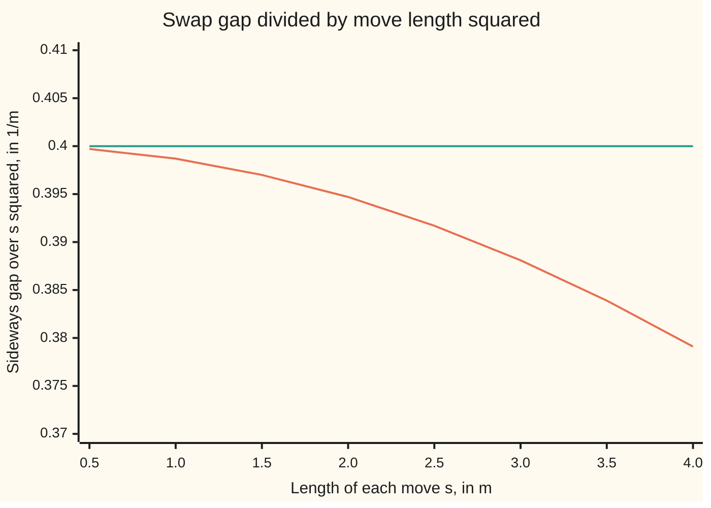
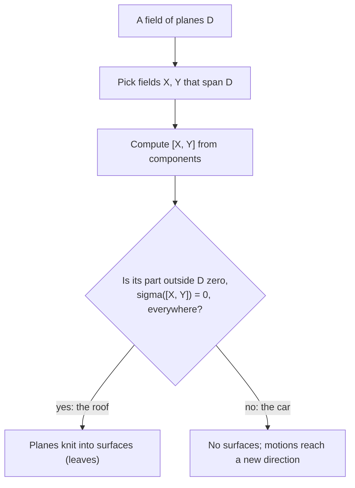

# Lie bracket: what changes when you swap the order of two motions

[Syllabus](../../../SYLLABUS.md) → [Differential geometry and Lie groups](../README.md) → [Manifolds](../README.md#s03) → Lie bracket

---

## General Overview

A car stops beside a free space at the curb, on its left. It cannot slide sideways: its tires roll, they do not skid. It has two moves. It can drive (forward or back) with the wheel at full left lock, or with the wheel at full right lock. In this model the middle of the rear axle then runs round a circle of radius 5 m.

Reverse 3.5 m on left lock, then 3.5 m on right lock. The car ends 6.44 m further back, pointing the same way, and **2.35 m closer to the curb**. Do the same two moves in the other order and it ends 2.35 m out into the traffic lane. Same moves, swapped order, and the two end points are 4.70 m apart, at right angles to the car.

That gap has a name. The **Lie bracket** (say "lee") of two motions is the leading part of what changes when their order is swapped. Here it points straight sideways: the one direction neither move can drive in. That is why parallel parking works.

The same test answers a second question. At each position the car's allowed velocities form a plane (forward-back and turning, never sideways). Do those planes fit together into surfaces, like pages of a book? If they did, the car would be stuck on one page. The **Frobenius theorem** says they fit exactly when the bracket of any two motions in the planes stays in the planes. For the car it does not, so no page traps it.

**The Lie bracket of two motions measures how far "this, then that" misses "that, then this"; a field of planes knits into surfaces exactly when every bracket of motions inside the planes stays inside the planes.**

**What kind of fact this is:** the bracket is a definition, and its link to the swap gap is a theorem proved on this card in Why it works. Frobenius's theorem is a local theorem: the half "surfaces force the test" is proved here in full, and the half "the test gives surfaces" is proved for planes in a fold. The car model (no skidding, a fixed lock radius of 5 m) is an idealization that fits slow driving well.

### The picture: the swap gap settles on the bracket



Orange: the sideways gap between "left lock, then right lock" and "right lock, then left lock", driving forward s metres each, divided by s². Green: the bracket's size, 2/r = 0.4 per metre. As the moves shrink, the orange line meets the green one.

---

## The formula

Notation first, in words. The car's **state** is $`q = (x, y, \theta)`$: the rear axle's middle at $`x`$ metres along the street and $`y`$ metres toward the curb, and the heading $`\theta`$ in radians, anticlockwise from the street direction. The set of all states is a 3-dimensional manifold.

A **vector field** $`X`$ puts an arrow at every state: the velocity of one motion there ([Vector field and its flow](07-vector-fields-and-flows.md)). Its **flow** $`\varphi^X_t`$ moves each state along the arrows for a time (here a distance) $`t`$. $`Xf`$ is the rate of change of a function $`f`$ along $`X`$. In a chart, $`X = X^i\,\partial_i`$, where $`X^i`$ are its components and $`\partial_i`$ the coordinate directions; upper indices are labels, not powers, and a repeated upper-lower pair is summed ([Covectors and tensor fields](05-covectors-and-tensor-fields.md)).

The **Lie bracket** of two fields is a new field:

```math
[X,Y]f = X(Yf) - Y(Xf), \qquad [X,Y]^i = X^j\,\partial_j Y^i - Y^j\,\partial_j X^i
```

**Read it aloud:** the bracket of X and Y is "rate along X of the rate along Y, minus the same in the other order"; in components, how Y changes along X minus how X changes along Y.

What it measures:

```math
\varphi^Y_t\big(\varphi^X_t(p)\big) - \varphi^X_t\big(\varphi^Y_t(p)\big) = t^2\,[X,Y](p) + O(t^3)
```

**Read it aloud:** flow along X then Y, compare with Y then X; the gap is the time squared times the bracket, plus terms that shrink like the time cubed.

The car's two moves, per metre driven, and their bracket:

```math
A = \cos\theta\,\partial_x + \sin\theta\,\partial_y + \tfrac{1}{r}\,\partial_\theta, \quad B = \cos\theta\,\partial_x + \sin\theta\,\partial_y - \tfrac{1}{r}\,\partial_\theta, \quad [A,B] = \tfrac{2}{r}\big(-\sin\theta\,\partial_x + \cos\theta\,\partial_y\big)
```

**Read it aloud:** each lock rolls the car along its heading while turning it at 1/r radians per metre, left or right; their bracket points straight out of the car's left side, with size 2/r.

Here $`A`$ and $`B`$ are fields, not the matrices of [Lie algebra](../06-Lie%20Groups/02-lie-algebras-and-the-exponential-map.md), whose bracket $`AB - BA`$ is the same idea for matrix groups.

A **distribution** $`\mathcal{D}`$ is a field of planes: a $`k`$-dimensional plane of allowed directions at every point, varying smoothly. It is **involutive** when the bracket of any two fields lying in it lies in it. It is **integrable** when through every point runs a $`k`$-dimensional surface (a **leaf**) whose tangent planes are exactly the planes of $`\mathcal{D}`$.

```math
\mathcal{D} \text{ integrable} \iff \mathcal{D} \text{ involutive} \iff \sigma\big([X,Y]\big) = 0 \text{ for every side rule } \sigma \text{ of } \mathcal{D} \text{ and fields } X, Y \text{ spanning } \mathcal{D}
```

**Read it aloud:** the planes knit into surfaces exactly when the bracket of any two spanning fields has no part outside the planes, measured by every side rule.

For a field of 2-planes in 3 dimensions, $`\sigma`$ is the plane's **side rule**: a covector (a rule that takes a direction and returns a number) that is zero exactly on the plane. For the car, $`\sigma = -\sin\theta\,dx + \cos\theta\,dy`$ is the sideways speed, and no skidding means $`\sigma = 0`$. For $`k`$-planes in $`n`$ dimensions it takes $`n - k`$ side rules, one per missing direction, and the test uses each one on every pair of spanning fields.

The **Lie derivative** $`\mathcal{L}_X Y`$ is the rate at which $`Y`$ changes as seen by someone riding the flow of $`X`$:

```math
\mathcal{L}_X Y = \frac{d}{dt}\Big|_{t=0} \big(d\varphi^X_{-t}\big)\,Y\big(\varphi^X_t(p)\big) = [X,Y](p)
```

**Read it aloud:** carry Y's arrow from a little way down X's flow back to p, and see how fast it changes; that rate is the bracket.

| Symbol | Plain meaning | In our example | Push it up and the answer… |
| --- | --- | --- | --- |
| $`q = (x, y, \theta)`$; $`(\rho, \alpha)`$ | state: position along the street, toward the curb (m), heading (rad); polar distance and angle about a lamp post | starts at (0, 0, 0); polar check at x = 4, y = 3 | — |
| $`r`$ | turning radius of the rear axle at full lock | 5 m | smaller bracket: 2/r |
| $`A`$, $`B`$ | full left lock, full right lock, per metre driven | (1, 0, 0.2) and (1, 0, −0.2) at the start | — |
| $`s`$, $`t`$ | length of each move, in m (negative: reverse) | 3.5 m back; 1 m and 0.5 m loops | gap grows like its square |
| $`\varphi^X_t`$, $`\Psi`$ | flow: follow X for time or distance t; the surface swept by two commuting flows | an arc of a 5 m circle | — |
| $`X^i`$, $`\partial_i`$, $`Xf`$; $`(X\cdot\partial)Y`$, $`I`$, $`\partial X`$ | components of a field; coordinate directions; rate of a function f along X; the change of Y along X, $`X^j\partial_j Y`$; the identity, which leaves an arrow unchanged; the matrix of X's partial derivatives (Step 3) | $`A^\theta = 0.2`$ per m | — |
| $`p`$, $`f`$, $`k`$, $`n`$ | a point; a test function; the planes' dimension; the space's dimension | k = 2, n = 3 for the car and the roof of Step 5 | — |
| $`[X,Y]`$ | Lie bracket: the swap gap per unit time squared | $`[A,B] = (0, 0.4, 0)`$ per m | bigger swap gap |
| $`\mathcal{L}_X Y`$ | Lie derivative: Y's rate of change riding X's flow | (0, 0.4, 0), same as the bracket | — |
| $`\mathcal{D}`$ | distribution: a field of planes of allowed directions | the no-skid planes | — |
| $`\sigma`$ | side rule: a covector, zero exactly on the plane | sideways speed; $`\sigma([A,B]) = 0.4`$ | further from knitting |
| $`U`$, $`V`$, $`V_2`$, $`W`$; $`z`$, $`c`$ | fields spanning a saddle roof's planes (Step 5), and variants; the roof's height in m (in Step 5's fold, $`z_1, \dots`$ are the coordinates past $`x`$ and $`y`$); the constant that picks one leaf | $`U = \partial_x + \tfrac{y}{20}\partial_z`$; leaves $`z = xy/20 + c`$ | — |

Clash, said once: $`\sigma`$ is a standard deviation elsewhere, and $`\omega`$ (avoided here) is the rotation rate on the Lie groups shelf and the symplectic form on the forms shelf.

### When it holds

- **Smooth fields.** The bracket takes one derivative of each field. A field that jumps, such as a steering wheel snapped between locks at a point, has no bracket there.
- **Short moves, for the swap formula.** The gap is $`t^2[X,Y]`$ only to leading order. For 3.5 m moves the estimate says 4.90 m; the exact gap is 4.70 m.
- **Planes of the same dimension everywhere, for Frobenius.** Where the plane collapses to a line, as for $`\partial_x`$ and $`x\,\partial_y`$ on the line $`x = 0`$, the theorem says nothing there.
- **Local, not global.** Frobenius gives surfaces near each point. A leaf can still wind round for ever without closing, like a line of irrational slope on a torus.
- **One field is always fine.** For lines ($`k = 1`$) there is nothing to test: a single non-zero field always has curves through it (the straightening theorem, below).

### The decision, as a flowchart



---

## Why it works

### Step 0: the idea

Two motions commute when doing them in either order lands in the same place. Lead with one motion and you start the second one from a moved point. If the second motion's arrows differ there, you pick up the difference.

So the gap is "how Y changes along X" minus "how X changes along Y", each times the time squared. That difference is the bracket.

### Step 1: the swap gap is the bracket

Follow X for a short time t. To second order, $`\varphi^X_t(p) = p + tX + \tfrac{t^2}{2}(X\cdot\partial)X`$, where $`(X\cdot\partial)Y`$ means $`X^j\partial_j Y`$, the change of Y along X.

Now follow Y for t from the new point. Y there is $`Y(p) + t\,(X\cdot\partial)Y`$. The result has one cross term: $`t^2\,(X\cdot\partial)Y`$. The other order has $`t^2\,(Y\cdot\partial)X`$ instead. Everything else matches. Subtracting leaves $`t^2[X,Y]`$.

<details>
<summary>Detailed proof: the expansion to second order</summary>

Write $`X`$, $`Y`$ and their derivatives at $`p`$. The flow's velocity is X at the moving point, so its acceleration is $`(X\cdot\partial)X`$.

$`\displaystyle \varphi^X_t(p) = p + tX + \tfrac{t^2}{2}(X\cdot\partial)X + O(t^3)`$

Start Y's flow at that point. Its velocity there is $`Y + t(X\cdot\partial)Y + O(t^2)`$:

$`\displaystyle \varphi^Y_t\big(\varphi^X_t(p)\big) = p + t(X + Y) + t^2\Big(\tfrac12(X\cdot\partial)X + \tfrac12(Y\cdot\partial)Y + (X\cdot\partial)Y\Big) + O(t^3)`$

Swap the letters for the other order and subtract. The symmetric terms cancel:

$`\displaystyle \varphi^Y_t\varphi^X_t(p) - \varphi^X_t\varphi^Y_t(p) = t^2\big((X\cdot\partial)Y - (Y\cdot\partial)X\big) + O(t^3) = t^2[X,Y](p) + O(t^3)`$

</details>

For the car, the code checks this at shrinking moves. The gap over $`s^2`$ is 0.3987 at 1 m and 0.3997 at 0.5 m. The errors from 0.4, 0.001332 and 0.000333, fall by four when s halves. That is faster than the general rule promises: a gap error of order $`s^3`$ leaves an error of order s in the gap over $`s^2`$, which would only halve. Here the exact gap is $`4r\,(1 - \cos(s/r))`$, which the code checks at all eight move lengths of the chart. It is the same for s and −s, so it has no $`s^3`$ term, and the error falls like $`s^2`$.

### Step 2: the bracket is an arrow, the same in every chart

$`X(Yf)`$ takes two derivatives of f. Expand it: $`X^j(\partial_j Y^i)\,\partial_i f + X^j Y^i\,\partial_j\partial_i f`$. The second part is symmetric in X and Y, because mixed partial derivatives are equal. So it cancels in $`X(Yf) - Y(Xf)`$.

What is left takes one derivative of f: it is a vector field, with components $`X^j\partial_j Y^i - Y^j\partial_j X^i`$. Its definition, $`X(Yf) - Y(Xf)`$, uses no chart. So every chart must give the same arrow.

The code checks this in a second chart: polar coordinates $`(\rho, \alpha, \theta)`$ about a lamp post at the origin, with the car at $`x = 4`$, $`y = 3`$. There $`A`$ has components (0.8000, −0.1200, 0.2000) and the bracket (0.2400, 0.0640, 0.0000). Different numbers; mapped back to $`x`$ and $`y`$, the same arrow (0, 0.4, 0).

Coordinate fields always commute: $`[\partial_i, \partial_j] = 0`$, since their components are constants. On the globe under its overlapping map sheets, going east then south by fixed coordinate amounts lands where south then east does.

### Step 3: the Lie derivative is the bracket

Ride X's flow for a short time t and carry Y's arrow there back to p with $`d\varphi^X_{-t}`$, the flow's derivative (it carries arrows as well as points). To first order, $`d\varphi^X_{-t} \approx I - t\,\partial X`$, where $`I`$ leaves an arrow unchanged and $`\partial X`$ is the matrix of X's partial derivatives, and $`Y(\varphi^X_t p) \approx Y + t\,(X\cdot\partial)Y`$.

The product is $`Y + t\big((X\cdot\partial)Y - (Y\cdot\partial)X\big)`$. Its rate in t is the bracket. The code computes it this way, by nested differences, and gets (0, 0.4, 0) again.

### Step 4: surfaces force the test

Suppose the planes do knit into surfaces. Take two fields X and Y lying in the planes. Their arrows are tangent to the leaf through p, so both flows stay on that leaf.

Then both orders of "X then Y" end on the leaf. Their gap, divided by $`t^2`$, is a chord of the leaf that shrinks to a tangent arrow. By Step 1 that arrow is $`[X,Y]`$. So the bracket lies in the plane.

Turned round: if one bracket leaves the plane, no surfaces exist. For the car, $`\sigma(A) = 0`$ and $`\sigma(B) = 0`$, but $`\sigma([A,B]) = 0.4`$. The no-skid planes do not knit.

### Step 5: the test gives surfaces

Now suppose every bracket stays in the plane. For 2-planes, the proof builds the leaf by sweeping with two commuting flows.

<details>
<summary>Detailed proof: involutive planes knit into surfaces</summary>

Near p, a 2-plane field in coordinates $`(x, y, z_1, \dots)`$ can be taken as a graph over the $`x, y`$ directions. So it is spanned by fields $`X = \partial_x + (\text{parts along the } z\text{'s})`$ and $`Y = \partial_y + (\text{parts along the } z\text{'s})`$.

Their bracket has no $`\partial_x`$ or $`\partial_y`$ part, since those coefficients are the constants 1 and 0. By hypothesis it lies in the plane. The only arrow in the plane with no $`\partial_x`$ or $`\partial_y`$ part is zero. So $`[X,Y] = 0`$.

By Step 3, $`\mathcal{L}_X Y = 0`$ at every point. That is a rate at $`t = 0`$ only. But flow times add: flowing for t plus a little more is flowing the little more, then t. So the rate at any time t is the rate at time 0, taken at the point $`\varphi^X_t(p)`$ and carried back:

$`\displaystyle \frac{d}{dt}\big(d\varphi^X_{-t}\big)\,Y\big(\varphi^X_t(p)\big) = \big(d\varphi^X_{-t}\big)\,(\mathcal{L}_X Y)\big(\varphi^X_t(p)\big) = 0`$

So the carried-back arrow never changes: the flow of X carries Y to itself. It therefore carries Y's flow lines to Y's flow lines, and the two flows commute:

$`\displaystyle \Psi(s,t) = \varphi^X_s\big(\varphi^Y_t(p)\big) = \varphi^Y_t\big(\varphi^X_s(p)\big)`$

From the first form, $`\partial_s\Psi = X`$; from the second, $`\partial_t\Psi = Y`$. Both lie in the plane, and they are independent, so $`\Psi`$ sweeps out a surface whose tangent planes are the planes of $`\mathcal{D}`$: the leaf through p.

For k-planes in n dimensions the same argument, with k commuting fields, gives a chart in which the planes are spanned by $`\partial_1, \dots, \partial_k`$. Lee's book (Sources) gives it in full. For $`k = 1`$ it is the straightening theorem: near any point where X is not zero, some chart turns X into $`\partial_1`$.

</details>

A saddle-shaped roof shows it at work: height $`z = xy/20`$ metres above the ground point $`(x, y)`$. Its tangent planes are $`dz = (y\,dx + x\,dy)/20`$: a step $`(dx, dy)`$ along the ground must climb $`dz`$. They are spanned by $`U = \partial_x + \tfrac{y}{20}\partial_z`$ and $`V = \partial_y + \tfrac{x}{20}\partial_z`$: already in the graph form of the fold. Their bracket is (0, 0, 0). From (4, 2, 0.4), U then V by 4 m each and V then U both land at (8.00, 6.00, 2.40). That point lies on the saddle roof $`z = xy/20`$: 8 × 6 / 20 = 2.40. The leaves are the roofs $`z = xy/20 + c`$.

### Step 6: when the test fails, motions fill space

For the car the three arrows $`A`$, $`B`$ and $`[A,B]`$ point in three independent directions. Their determinant is 0.1600, which is $`4/r^2`$, not zero.

Chow's theorem (stated, not proved here; Sources) says that when brackets of the allowed fields span every direction, every nearby state can be reached using allowed moves only. So the car can reach any position and heading near where it starts, sideways included.

---

## Worked numbers, by hand

The car at the start: $`\theta = 0`$, so $`\cos\theta = 1`$ and $`\sin\theta = 0`$. Only the $`\theta`$ part of each field varies with the state, so only $`\partial_\theta`$ derivatives appear.

| Step | Arithmetic | Value |
| --- | --- | --- |
| A at the start | (cos 0, sin 0, 1/5) | (1, 0, 0.2) |
| B at the start | (cos 0, sin 0, −1/5) | (1, 0, −0.2) |
| how B changes with heading | $`\partial_\theta B = (-\sin\theta, \cos\theta, 0)`$ | (0, 1, 0) |
| how A changes with heading | $`\partial_\theta A`$, the same | (0, 1, 0) |
| first term, change of B along A | $`A^\theta\,\partial_\theta B = 0.2 \times (0, 1, 0)`$ | (0, 0.2, 0) |
| second term, change of A along B | $`B^\theta\,\partial_\theta A = -0.2 \times (0, 1, 0)`$ | (0, −0.2, 0) |
| bracket | first minus second | (0, 0.4, 0) |
| out of the no-skid plane? | $`\sigma([A,B]) = 0.4`$ | yes: no surfaces |
| estimate for 3.5 m moves back | $`3.5^2 \times 0.4`$ | 4.90 m |
| **exact swap gap** | 2.35 − (−2.35) | **4.70 m** |

Each square metre of swapped driving buys about 0.4 m sideways, toward the curb when left lock goes first. For 3.5 m moves the estimate runs high, 4.90 m against 4.70 m, because 3.5 m is not short against a 5 m radius.

### What breaks if you drop a piece

| Mistake | Comes out at | What went wrong |
| --- | --- | --- |
| Keep only the first term, $`X^j\partial_j Y^i`$ | (0, 0.2, 0) (right: (0, 0.4, 0)) | That is not a chart-free arrow; the change of A along B counts too |
| Divide the swap gap by s, not $`s^2`$ | 0.3987 at 1 m, 0.1998 at 0.5 m, heading to 0 | The gap is second order; over $`s^2`$ it settles at 0.3987, 0.3997, toward 0.4 |
| "The bracket is not zero, so no surfaces" | roof: $`[U,W] = (0, 0.25, 0.05)`$, outside part 0.0000 | With $`W = (1 + x/4)V`$, the bracket is non-zero but lies in the plane; the roofs still knit |
| Hypothesis fails: twisted planes $`dz = y\,dx/20`$ | $`[U,V_2] = (0, 0, -0.05)`$; U-then-V₂ and V₂-then-U end −0.80 m apart in height | Not involutive: no surface through (4, 2, 0.4), and the gap is exactly $`4 \times 4 \times (-0.05)`$ |

---

## Code, from first principles, and it actually runs

The code builds the car's two fields and their exact flows (circular arcs), then finds the bracket by six roads. Road 1 is the closed form by hand. Road 2 is the component formula, with central differences for the derivatives. Road 3 is the swap gap over $`s^2`$ at shrinking moves. Road 4 is the four-move loop: left, right, left back, right back. Road 5 is a second chart, polar coordinates, mapped back. Road 6 is the Lie derivative, by carrying B back along A's flow. It also checks the exact arcs against RK4 steps (the classic four-stage stepper), then runs the Frobenius test on the car, the roof and the twisted roof.

### Python

```python
# Lie bracket and Frobenius theorem -- the check behind the card.  Standard library only.
# A car's state q = (x, y, th): rear-axle middle x along the street, y toward the curb (m),
# heading th (rad, anticlockwise).  A = drive on full left lock, B = drive on full right lock.
from math import sin, cos, atan2, sqrt, pi
r = 5.0                                      # rear-axle turning radius at full lock, m
def A(q): return [cos(q[2]), sin(q[2]), 1 / r]
def B(q): return [cos(q[2]), sin(q[2]), -1 / r]
def arc(q, k, s):                            # exact flow: drive s metres along curvature k
    x, y, th = q
    return [x + (sin(th + k * s) - sin(th)) / k, y - (cos(th + k * s) - cos(th)) / k, th + k * s]
def fA(q, s): return arc(q, 1 / r, s)
def fB(q, s): return arc(q, -1 / r, s)
def sub(u, v): return [a - b for a, b in zip(u, v)]
def bracket(X, Y, q, h=1e-5):                # [X,Y]^i = X^j d_j Y^i - Y^j d_j X^i, central differences
    out, Xq, Yq = [0.0] * len(q), X(q), Y(q)
    for j in range(len(q)):
        qp, qm = list(q), list(q); qp[j] += h; qm[j] -= h
        dY = [(a - b) / (2 * h) for a, b in zip(Y(qp), Y(qm))]
        dX = [(a - b) / (2 * h) for a, b in zip(X(qp), X(qm))]
        out = [o + Xq[j] * a - Yq[j] * b for o, a, b in zip(out, dY, dX)]
    return out
def closed(q): return [-2 / r * sin(q[2]), 2 / r * cos(q[2]), 0.0]   # by hand: (2/r)(-sin th, cos th, 0)
def side(q, v): return -sin(q[2]) * v[0] + cos(q[2]) * v[1]          # sideways speed: the no-skid form
def z(a, n=4): return 0.0 if abs(a) < 0.5 * 10.0 ** -n else a        # no "-0.0000" in print
def fmt(v, n=4): return "(" + ", ".join(f"{z(a, n):.{n}f}" for a in v) + ")"
q0 = [0.0, 0.0, 0.0]

# Overview: parallel parking, two reverse moves of 3.5 m, in both orders
s = 3.5
LR, RL = fB(fA(q0, -s), -s), fA(fB(q0, -s), -s)
print(f"park, left lock then right lock, back {s} m each: end {fmt(LR, 2)}")
print(f"park, right lock then left lock, back {s} m each: end {fmt(RL, 2)}")
print(f"swap gap {LR[1] - RL[1]:.2f} m sideways; bracket estimate s^2 x 2/r = {s * s * 2 / r:.2f} m")

# Road 1 and 2: the bracket by hand and by the coordinate formula
br = bracket(A, B, q0)
print(f"[A,B] at the start: by hand {fmt(closed(q0))}, by formula {fmt(br)}")
print(f"A {fmt(A(q0))}, B {fmt(B(q0))}; first term only {fmt([A(q0)[2] * d for d in [0.0, 1.0, 0.0]])}")
q30 = [0.0, 0.0, pi / 6]
print(f"[A,B] at heading 30 deg: by hand {fmt(closed(q30))}, by formula {fmt(bracket(A, B, q30))}")

# Road 3: swap gap over s^2 as the moves shrink (the chart's points)
gaps = []
for k in range(1, 9):
    s = 0.5 * k
    g = sub(fB(fA(q0, s), s), fA(fB(q0, s), s)); gaps.append(g[1] / s ** 2)
    assert abs(g[1] - 4 * r * (1 - cos(s / r))) < 1e-12 and abs(g[0]) < 1e-12
print("swap gap / s^2, s = 0.5 to 4.0 m: " + ", ".join(f"{v:.4f}" for v in gaps))
print(f"errors from 0.4 at s = 1 and 0.5 m: {0.4 - gaps[1]:.6f}, {0.4 - gaps[0]:.6f}")
print(f"wrong: gap / s, s = 1 and 0.5 m: {gaps[1] * 1.0:.4f}, {gaps[0] * 0.5:.4f}")

# Road 4: the four-move loop: left s, right s, left back s, right back s
def loop(s): return fB(fA(fB(fA(q0, s), s), -s), -s)
for s in (1.0, 0.5):
    e = loop(s)
    print(f"loop of {s} m moves: end {fmt(e)}; y / s^2 = {e[1] / s ** 2:.4f}")

# Road 5: a second chart, polar about a lamp post: (rho, al, th), car at x = 4, y = 3
def cart(p): return [p[0] * cos(p[1]), p[0] * sin(p[1]), p[2]]
def to_polar(F):
    def G(p):
        x, y, _ = cart(p); v = F(cart(p)); rho2 = x * x + y * y
        return [(x * v[0] + y * v[1]) / sqrt(rho2), (x * v[1] - y * v[0]) / rho2, v[2]]
    return G
p = [5.0, atan2(3.0, 4.0), 0.0]
bp = bracket(to_polar(A), to_polar(B), p)
back = [cos(p[1]) * bp[0] - p[0] * sin(p[1]) * bp[1], sin(p[1]) * bp[0] + p[0] * cos(p[1]) * bp[1], bp[2]]
print(f"polar chart at (4, 3): A {fmt(to_polar(A)(p))}, [A,B] {fmt(bp)}, back in x, y {fmt(back)}")

# Road 6: Lie derivative: pull B back along A's flow, then take the rate
def pulled(t, e=1e-6):
    m = fA(q0, t); v = B(m)
    hi, lo = fA([a + e * b for a, b in zip(m, v)], -t), fA([a - e * b for a, b in zip(m, v)], -t)
    return [(a - b) / (2 * e) for a, b in zip(hi, lo)]
t = 1e-3
lie = [(a - b) / (2 * t) for a, b in zip(pulled(t), pulled(-t))]
print(f"Lie derivative L_A B at the start: {fmt(lie)}")

# Frobenius, car: is [A,B] inside the no-skid plane?
det = A(q0)[0] * (B(q0)[1] * br[2] - B(q0)[2] * br[1]) - A(q0)[1] * (B(q0)[0] * br[2] - B(q0)[2] * br[0]) \
    + A(q0)[2] * (B(q0)[0] * br[1] - B(q0)[1] * br[0])
print(f"car: sideways part of A {z(side(q0, A(q0))):.4f}, of B {z(side(q0, B(q0))):.4f}, of [A,B] {side(q0, br):.4f}")
print(f"car: det(A, B, [A,B]) = {det:.4f}; 4/r^2 = {4 / r ** 2:.4f}")
# RK4 against the exact arc for the 3.5 m park
def rk4(F, q, s, n):
    h = s / n
    for _ in range(n):
        k1 = F(q); k2 = F([a + h / 2 * b for a, b in zip(q, k1)]); k3 = F([a + h / 2 * b for a, b in zip(q, k2)])
        k4 = F([a + h * b for a, b in zip(q, k3)])
        q = [a + h / 6 * (b + 2 * c + 2 * d + e) for a, b, c, d, e in zip(q, k1, k2, k3, k4)]
    return q
for n in (10, 20):
    print(f"park by RK4, {n} steps per move: y {rk4(B, rk4(A, q0, -3.5, n), -3.5, n)[1]:.8f}; exact {LR[1]:.8f}")

# Frobenius, roof: planes dz = (y dx + x dy)/20, and the twisted planes dz = y dx/20
U = lambda q: [1.0, 0.0, q[1] / 20]
V = lambda q: [0.0, 1.0, q[0] / 20]
V2 = lambda q: [0.0, 1.0, 0.0]
W = lambda q: [c * (1 + q[0] / 4) for c in V(q)]
om = lambda q, v: v[2] - (q[1] * v[0] + q[0] * v[1]) / 20
om2 = lambda q, v: v[2] - q[1] * v[0] / 20
p0 = [4.0, 2.0, 0.4]
for name, X, Y, w in (("roof [U,V]", U, V, om), ("roof [U,W]", U, W, om), ("twisted [U,V2]", U, V2, om2)):
    b = bracket(X, Y, p0)
    print(f"{name}: {fmt(b)}, out-of-plane part {z(w(p0, b)):.4f}")
gU = lambda q, s: [q[0] + s, q[1], q[2] + q[1] * s / 20]
gV = lambda q, t: [q[0], q[1] + t, q[2] + q[0] * t / 20]
gV2 = lambda q, t: [q[0], q[1] + t, q[2]]
uv, vu = gV(gU(p0, 4.0), 4.0), gU(gV(p0, 4.0), 4.0)
uv2, v2u = gV2(gU(p0, 4.0), 4.0), gU(gV2(p0, 4.0), 4.0)
print(f"roof, U then V: {fmt(uv, 2)}; V then U: {fmt(vu, 2)}; xy/20 there = {uv[0] * uv[1] / 20:.2f}")
print(f"twisted, U then V2: {fmt(uv2, 2)}; V2 then U: {fmt(v2u, 2)}; gap {uv2[2] - v2u[2]:.2f} m")

assert all(abs(a - b) < 1e-8 for a, b in zip(br, closed(q0)))            # formula = hand bracket
assert all(abs(a - b) < 1e-8 for a, b in zip(bracket(A, B, q30), closed(q30)))  # and at 30 deg
assert all(abs(a - b) < 1e-8 for a, b in zip(back, closed(q0)))          # polar chart agrees
assert all(abs(a - b) < 1e-5 for a, b in zip(lie, closed(q0)))           # Lie derivative = bracket
assert abs((0.4 - gaps[1]) / (0.4 - gaps[0]) - 4) < 0.01                 # swap gap -> s^2 [A,B]
assert abs(loop(0.5)[1] / 0.25 - 0.4) < 0.01 and abs(det - 4 / r ** 2) < 1e-8
assert abs(rk4(B, rk4(A, q0, -3.5, 20), -3.5, 20)[1] - LR[1]) < 1e-7     # RK4 = exact arcs
assert abs(om(p0, bracket(U, V, p0))) < 1e-9 and abs(uv[2] - vu[2]) < 1e-12
assert abs((uv2[2] - v2u[2]) - 16 * bracket(U, V2, p0)[2]) < 1e-9        # gap = s t [U,V2]
print("ALL CHECKS PASS")
```

**Ran 2026-11-19 on macOS, Python 3.14.10, standard library only. All checks passed. Output, pasted from the run:**

```
park, left lock then right lock, back 3.5 m each: end (-6.44, 2.35, 0.00)
park, right lock then left lock, back 3.5 m each: end (-6.44, -2.35, 0.00)
swap gap 4.70 m sideways; bracket estimate s^2 x 2/r = 4.90 m
[A,B] at the start: by hand (0.0000, 0.4000, 0.0000), by formula (0.0000, 0.4000, 0.0000)
A (1.0000, 0.0000, 0.2000), B (1.0000, 0.0000, -0.2000); first term only (0.0000, 0.2000, 0.0000)
[A,B] at heading 30 deg: by hand (-0.2000, 0.3464, 0.0000), by formula (-0.2000, 0.3464, 0.0000)
swap gap / s^2, s = 0.5 to 4.0 m: 0.3997, 0.3987, 0.3970, 0.3947, 0.3917, 0.3881, 0.3839, 0.3791
errors from 0.4 at s = 1 and 0.5 m: 0.001332, 0.000333
wrong: gap / s, s = 1 and 0.5 m: 0.3987, 0.1998
loop of 1.0 m moves: end (0.0000, 0.3987, 0.0000); y / s^2 = 0.3987
loop of 0.5 m moves: end (0.0000, 0.0999, 0.0000); y / s^2 = 0.3997
polar chart at (4, 3): A (0.8000, -0.1200, 0.2000), [A,B] (0.2400, 0.0640, 0.0000), back in x, y (0.0000, 0.4000, 0.0000)
Lie derivative L_A B at the start: (0.0000, 0.4000, 0.0000)
car: sideways part of A 0.0000, of B 0.0000, of [A,B] 0.4000
car: det(A, B, [A,B]) = 0.1600; 4/r^2 = 0.1600
park by RK4, 10 steps per move: y 2.35157815; exact 2.35157813
park by RK4, 20 steps per move: y 2.35157813; exact 2.35157813
roof [U,V]: (0.0000, 0.0000, 0.0000), out-of-plane part 0.0000
roof [U,W]: (0.0000, 0.2500, 0.0500), out-of-plane part 0.0000
twisted [U,V2]: (0.0000, 0.0000, -0.0500), out-of-plane part -0.0500
roof, U then V: (8.00, 6.00, 2.40); V then U: (8.00, 6.00, 2.40); xy/20 there = 2.40
twisted, U then V2: (8.00, 6.00, 0.80); V2 then U: (8.00, 6.00, 1.60); gap -0.80 m
ALL CHECKS PASS
```

### Rust

```rust
// Lie bracket and Frobenius theorem -- the check behind the card.  std only, no crates.
// A car's state q = (x, y, th): rear-axle middle x along the street, y toward the curb (m),
// heading th (rad, anticlockwise).  A = drive on full left lock, B = drive on full right lock.
use std::f64::consts::PI;
type V = [f64; 3];
const R: f64 = 5.0; // rear-axle turning radius at full lock, m
fn a_f(q: V) -> V { [q[2].cos(), q[2].sin(), 1.0 / R] }
fn b_f(q: V) -> V { [q[2].cos(), q[2].sin(), -1.0 / R] }
fn arc(q: V, k: f64, s: f64) -> V { // exact flow: drive s metres along curvature k
    [q[0] + ((q[2] + k * s).sin() - q[2].sin()) / k, q[1] - ((q[2] + k * s).cos() - q[2].cos()) / k, q[2] + k * s]
}
fn fa(q: V, s: f64) -> V { arc(q, 1.0 / R, s) }
fn fb(q: V, s: f64) -> V { arc(q, -1.0 / R, s) }
fn sub(u: V, v: V) -> V { [u[0] - v[0], u[1] - v[1], u[2] - v[2]] }
fn axpy(u: V, k: f64, v: V) -> V { [u[0] + k * v[0], u[1] + k * v[1], u[2] + k * v[2]] }
// [X,Y]^i = X^j d_j Y^i - Y^j d_j X^i, central differences
fn bracket(x: &dyn Fn(V) -> V, y: &dyn Fn(V) -> V, q: V) -> V {
    let h = 1e-5;
    let (xq, yq) = (x(q), y(q));
    let mut out = [0.0; 3];
    for j in 0..3 {
        let (mut qp, mut qm) = (q, q);
        qp[j] += h;
        qm[j] -= h;
        let (yp, ym, xp, xm) = (y(qp), y(qm), x(qp), x(qm));
        for i in 0..3 {
            let dy = (yp[i] - ym[i]) / (2.0 * h);
            let dx = (xp[i] - xm[i]) / (2.0 * h);
            out[i] = out[i] + xq[j] * dy - yq[j] * dx;
        }
    }
    out
}
fn closed(q: V) -> V { [-2.0 / R * q[2].sin(), 2.0 / R * q[2].cos(), 0.0] } // by hand
fn side(q: V, v: V) -> f64 { -q[2].sin() * v[0] + q[2].cos() * v[1] } // the no-skid form
fn z(a: f64, n: i32) -> f64 { if a.abs() < 0.5 * 10f64.powi(-n) { 0.0 } else { a } }
fn fmt(v: V, n: usize) -> String {
    let parts: Vec<String> = v.iter().map(|&a| format!("{:.*}", n, z(a, n as i32))).collect();
    format!("({})", parts.join(", "))
}
fn rk4(f: fn(V) -> V, mut q: V, s: f64, n: usize) -> V {
    let h = s / n as f64;
    for _ in 0..n {
        let k1 = f(q);
        let k2 = f(axpy(q, h / 2.0, k1));
        let k3 = f(axpy(q, h / 2.0, k2));
        let k4 = f(axpy(q, h, k3));
        for i in 0..3 { q[i] += h / 6.0 * (k1[i] + 2.0 * k2[i] + 2.0 * k3[i] + k4[i]); }
    }
    q
}
fn cart(p: V) -> V { [p[0] * p[1].cos(), p[0] * p[1].sin(), p[2]] }
fn to_polar(f: fn(V) -> V, p: V) -> V {
    let c = cart(p);
    let v = f(c);
    let rho2 = c[0] * c[0] + c[1] * c[1];
    [(c[0] * v[0] + c[1] * v[1]) / rho2.sqrt(), (c[0] * v[1] - c[1] * v[0]) / rho2, v[2]]
}
fn main() {
    let q0 = [0.0; 3];
    // Overview: parallel parking, two reverse moves of 3.5 m, in both orders
    let s = 3.5;
    let (lr, rl) = (fb(fa(q0, -s), -s), fa(fb(q0, -s), -s));
    println!("park, left lock then right lock, back {} m each: end {}", s, fmt(lr, 2));
    println!("park, right lock then left lock, back {} m each: end {}", s, fmt(rl, 2));
    println!("swap gap {:.2} m sideways; bracket estimate s^2 x 2/r = {:.2} m", lr[1] - rl[1], s * s * 2.0 / R);
    // Road 1 and 2: the bracket by hand and by the coordinate formula
    let br = bracket(&a_f, &b_f, q0);
    println!("[A,B] at the start: by hand {}, by formula {}", fmt(closed(q0), 4), fmt(br, 4));
    println!("A {}, B {}; first term only {}", fmt(a_f(q0), 4), fmt(b_f(q0), 4), fmt([0.0, a_f(q0)[2], 0.0], 4));
    let q30 = [0.0, 0.0, PI / 6.0];
    println!("[A,B] at heading 30 deg: by hand {}, by formula {}", fmt(closed(q30), 4), fmt(bracket(&a_f, &b_f, q30), 4));
    // Road 3: swap gap over s^2 as the moves shrink (the chart's points)
    let mut gaps = Vec::new();
    for k in 1..9 {
        let s = 0.5 * k as f64;
        let g = sub(fb(fa(q0, s), s), fa(fb(q0, s), s));
        gaps.push(g[1] / (s * s));
        assert!((g[1] - 4.0 * R * (1.0 - (s / R).cos())).abs() < 1e-12 && g[0].abs() < 1e-12);
    }
    let gs: Vec<String> = gaps.iter().map(|v| format!("{:.4}", v)).collect();
    println!("swap gap / s^2, s = 0.5 to 4.0 m: {}", gs.join(", "));
    println!("errors from 0.4 at s = 1 and 0.5 m: {:.6}, {:.6}", 0.4 - gaps[1], 0.4 - gaps[0]);
    println!("wrong: gap / s, s = 1 and 0.5 m: {:.4}, {:.4}", gaps[1] * 1.0, gaps[0] * 0.5);
    // Road 4: the four-move loop: left s, right s, left back s, right back s
    let lp = |s: f64| fb(fa(fb(fa(q0, s), s), -s), -s);
    for s in [1.0, 0.5] {
        let e = lp(s);
        println!("loop of {:.1} m moves: end {}; y / s^2 = {:.4}", s, fmt(e, 4), e[1] / (s * s));
    }
    // Road 5: a second chart, polar about a lamp post: (rho, al, th), car at x = 4, y = 3
    let p = [5.0, 3.0f64.atan2(4.0), 0.0];
    let pa = |p: V| to_polar(a_f, p);
    let pb = |p: V| to_polar(b_f, p);
    let bp = bracket(&pa, &pb, p);
    let back = [p[1].cos() * bp[0] - p[0] * p[1].sin() * bp[1], p[1].sin() * bp[0] + p[0] * p[1].cos() * bp[1], bp[2]];
    println!("polar chart at (4, 3): A {}, [A,B] {}, back in x, y {}", fmt(pa(p), 4), fmt(bp, 4), fmt(back, 4));
    // Road 6: Lie derivative: pull B back along A's flow, then take the rate
    let pulled = |t: f64| -> V {
        let e = 1e-6;
        let m = fa(q0, t);
        let v = b_f(m);
        let (hi, lo) = (fa(axpy(m, e, v), -t), fa(axpy(m, -e, v), -t));
        [0, 1, 2].map(|i| (hi[i] - lo[i]) / (2.0 * e))
    };
    let t = 1e-3;
    let (pp, pm) = (pulled(t), pulled(-t));
    let lie = [0, 1, 2].map(|i| (pp[i] - pm[i]) / (2.0 * t));
    println!("Lie derivative L_A B at the start: {}", fmt(lie, 4));
    // Frobenius, car: is [A,B] inside the no-skid plane?
    let (a0, b0) = (a_f(q0), b_f(q0));
    let det = a0[0] * (b0[1] * br[2] - b0[2] * br[1]) - a0[1] * (b0[0] * br[2] - b0[2] * br[0])
        + a0[2] * (b0[0] * br[1] - b0[1] * br[0]);
    println!("car: sideways part of A {:.4}, of B {:.4}, of [A,B] {:.4}", z(side(q0, a0), 4), z(side(q0, b0), 4), side(q0, br));
    println!("car: det(A, B, [A,B]) = {:.4}; 4/r^2 = {:.4}", det, 4.0 / (R * R));
    for n in [10, 20] {
        println!("park by RK4, {} steps per move: y {:.8}; exact {:.8}", n, rk4(b_f, rk4(a_f, q0, -3.5, n), -3.5, n)[1], lr[1]);
    }
    // Frobenius, roof: planes dz = (y dx + x dy)/20, and the twisted planes dz = y dx/20
    let u = |q: V| -> V { [1.0, 0.0, q[1] / 20.0] };
    let v = |q: V| -> V { [0.0, 1.0, q[0] / 20.0] };
    let v2 = |_q: V| -> V { [0.0, 1.0, 0.0] };
    let w = |q: V| -> V { let c = 1.0 + q[0] / 4.0; [0.0, c, c * q[0] / 20.0] };
    let om = |q: V, v: V| v[2] - (q[1] * v[0] + q[0] * v[1]) / 20.0;
    let om2 = |q: V, v: V| v[2] - q[1] * v[0] / 20.0;
    let p0 = [4.0, 2.0, 0.4];
    let cases: [(&str, &dyn Fn(V) -> V, &dyn Fn(V, V) -> f64); 3] =
        [("roof [U,V]", &v, &om), ("roof [U,W]", &w, &om), ("twisted [U,V2]", &v2, &om2)];
    for (name, y, wf) in cases {
        let b = bracket(&u, y, p0);
        println!("{}: {}, out-of-plane part {:.4}", name, fmt(b, 4), z(wf(p0, b), 4));
    }
    let gu = |q: V, s: f64| -> V { [q[0] + s, q[1], q[2] + q[1] * s / 20.0] };
    let gv = |q: V, t: f64| -> V { [q[0], q[1] + t, q[2] + q[0] * t / 20.0] };
    let gv2 = |q: V, t: f64| -> V { [q[0], q[1] + t, q[2]] };
    let (uv, vu) = (gv(gu(p0, 4.0), 4.0), gu(gv(p0, 4.0), 4.0));
    let (uv2, v2u) = (gv2(gu(p0, 4.0), 4.0), gu(gv2(p0, 4.0), 4.0));
    println!("roof, U then V: {}; V then U: {}; xy/20 there = {:.2}", fmt(uv, 2), fmt(vu, 2), uv[0] * uv[1] / 20.0);
    println!("twisted, U then V2: {}; V2 then U: {}; gap {:.2} m", fmt(uv2, 2), fmt(v2u, 2), uv2[2] - v2u[2]);

    let c0 = closed(q0);
    assert!((0..3).all(|i| (br[i] - c0[i]).abs() < 1e-8)); // formula = hand bracket
    let (b30, c30) = (bracket(&a_f, &b_f, q30), closed(q30));
    assert!((0..3).all(|i| (b30[i] - c30[i]).abs() < 1e-8)); // and at 30 deg
    assert!((0..3).all(|i| (back[i] - c0[i]).abs() < 1e-8)); // polar chart agrees
    assert!((0..3).all(|i| (lie[i] - c0[i]).abs() < 1e-5)); // Lie derivative = bracket
    assert!(((0.4 - gaps[1]) / (0.4 - gaps[0]) - 4.0).abs() < 0.01); // swap gap -> s^2 [A,B]
    assert!((lp(0.5)[1] / 0.25 - 0.4).abs() < 0.01 && (det - 4.0 / (R * R)).abs() < 1e-8);
    assert!((rk4(b_f, rk4(a_f, q0, -3.5, 20), -3.5, 20)[1] - lr[1]).abs() < 1e-7); // RK4 = exact arcs
    assert!(om(p0, bracket(&u, &v, p0)).abs() < 1e-9 && (uv[2] - vu[2]).abs() < 1e-12);
    assert!(((uv2[2] - v2u[2]) - 16.0 * bracket(&u, &v2, p0)[2]).abs() < 1e-9); // gap = s t [U,V2]
    println!("ALL CHECKS PASS");
}
```

**Ran 2026-11-19 on macOS, rustc 1.98.1, no crates. All checks passed. Output, pasted from the run:**

```
park, left lock then right lock, back 3.5 m each: end (-6.44, 2.35, 0.00)
park, right lock then left lock, back 3.5 m each: end (-6.44, -2.35, 0.00)
swap gap 4.70 m sideways; bracket estimate s^2 x 2/r = 4.90 m
[A,B] at the start: by hand (0.0000, 0.4000, 0.0000), by formula (0.0000, 0.4000, 0.0000)
A (1.0000, 0.0000, 0.2000), B (1.0000, 0.0000, -0.2000); first term only (0.0000, 0.2000, 0.0000)
[A,B] at heading 30 deg: by hand (-0.2000, 0.3464, 0.0000), by formula (-0.2000, 0.3464, 0.0000)
swap gap / s^2, s = 0.5 to 4.0 m: 0.3997, 0.3987, 0.3970, 0.3947, 0.3917, 0.3881, 0.3839, 0.3791
errors from 0.4 at s = 1 and 0.5 m: 0.001332, 0.000333
wrong: gap / s, s = 1 and 0.5 m: 0.3987, 0.1998
loop of 1.0 m moves: end (0.0000, 0.3987, 0.0000); y / s^2 = 0.3987
loop of 0.5 m moves: end (0.0000, 0.0999, 0.0000); y / s^2 = 0.3997
polar chart at (4, 3): A (0.8000, -0.1200, 0.2000), [A,B] (0.2400, 0.0640, 0.0000), back in x, y (0.0000, 0.4000, 0.0000)
Lie derivative L_A B at the start: (0.0000, 0.4000, 0.0000)
car: sideways part of A 0.0000, of B 0.0000, of [A,B] 0.4000
car: det(A, B, [A,B]) = 0.1600; 4/r^2 = 0.1600
park by RK4, 10 steps per move: y 2.35157815; exact 2.35157813
park by RK4, 20 steps per move: y 2.35157813; exact 2.35157813
roof [U,V]: (0.0000, 0.0000, 0.0000), out-of-plane part 0.0000
roof [U,W]: (0.0000, 0.2500, 0.0500), out-of-plane part 0.0000
twisted [U,V2]: (0.0000, 0.0000, -0.0500), out-of-plane part -0.0500
roof, U then V: (8.00, 6.00, 2.40); V then U: (8.00, 6.00, 2.40); xy/20 there = 2.40
twisted, U then V2: (8.00, 6.00, 0.80); V2 then U: (8.00, 6.00, 1.60); gap -0.80 m
ALL CHECKS PASS
```

### Lean

Lean proves the swap gap, Frobenius's theorem in both directions for any dimensions, and the car's bracket, and checks the worked numbers.

- Take smooth fields $`X`$ and $`Y`$, with flows $`\varphi^X_t`$ and $`\varphi^Y_t`$, near a point $`p`$. Then the swap gap after time $`t`$ is $`t^2[X,Y](p)`$, plus terms that shrink like $`t^3`$.
- Take a field of $`k`$-planes in $`n`$ dimensions, the same $`k`$ everywhere, spanned near each point by $`k`$ smooth fields. Then it is involutive exactly when it is integrable: through every point runs a leaf.
- Take the left-lock move $`A`$ and the right-lock move $`B`$, with turning radius $`r`$. Then $`[A,B] = \tfrac{2}{r}(-\sin\theta, \cos\theta, 0)`$ at every state, straight out of the car's left side.
- Take $`r`$ = 5 m at the start. Then $`\det(A, B, [A,B]) = 4/25 = 0.1600`$, and the sideways part of $`[A,B]`$ is 0.4.
- Take the roof's planes and start at (4, 2, 0.4). Then U then V and V then U both reach (8, 6, 2.4), on the roof $`z = xy/20`$.
- Take the twisted planes and the same start. Then the two orders end 0.80 m apart in height, exactly $`4 \times 4 \times (-0.05)`$.

The exact 3.5 m park, the polar chart, the Lie derivative and the RK4 steps are left to the Python and Rust checks.

```lean
-- Lie bracket: the swap gap between two short flows is the time squared times the Lie bracket, a field of planes of one fixed dimension knits into surfaces exactly when brackets of fields in the planes stay in the planes, and the car's two lock moves have bracket (2/r)(−sin θ, cos θ, 0).
import Mathlib
import Mathlib.Analysis.Calculus.VectorField
import Mathlib.Analysis.Calculus.ContDiff.Defs
import Mathlib.Analysis.InnerProductSpace.PiL2
import Mathlib.Analysis.Asymptotics.Defs
import Mathlib.Analysis.SpecialFunctions.Trigonometric.Deriv
import Mathlib.LinearAlgebra.Matrix.Determinant.Basic
import Mathlib.LinearAlgebra.Matrix.Notation
import Mathlib.Tactic.NormNum
import Mathlib.Tactic.FinCases

open Filter Asymptotics Topology Real
open scoped ContDiff

noncomputable section FrobeniusHelpers

open Set
set_option linter.unusedSectionVars false

/-- the unit time interval -/
abbrev FrobI := Set.Icc (0:ℝ) 1

variable {E : Type} [NormedAddCommGroup E] [NormedSpace ℝ E]

/-- pointwise application of a path of linear maps to a path of vectors -/
def frobApp {F : Type} [NormedAddCommGroup F] [NormedSpace ℝ F] :=
  LinearMap.mkContinuous₂
    (LinearMap.mk₂ ℝ (fun (A : C(FrobI, E →L[ℝ] F)) (h : C(FrobI, E)) =>
        (⟨fun s => A s (h s), A.continuous.clm_apply h.continuous⟩ : C(FrobI, F)))
      (fun A B h => by ext s; simp)
      (fun c A h => by ext s; simp)
      (fun A h g => by ext s; simp)
      (fun c A h => by ext s; simp))
    1 (fun A h => by
      rw [one_mul]
      refine (ContinuousMap.norm_le _ (by positivity)).2 fun s => ?_
      exact ((A s).le_opNorm (h s)).trans
        (mul_le_mul (A.norm_coe_le_norm s) (h.norm_coe_le_norm s) (norm_nonneg _) (norm_nonneg A)))

theorem frobApp_apply {F : Type} [NormedAddCommGroup F] [NormedSpace ℝ F]
    (A : C(FrobI, E →L[ℝ] F)) (h : C(FrobI, E)) (s : FrobI) : frobApp (E := E) (F := F) A h s = A s (h s) := rfl

/-- composition with a fixed continuous map -/
def frobNem {F : Type} [NormedAddCommGroup F] [NormedSpace ℝ F] (V : E → F) (hV : Continuous V)
    (γ : C(FrobI, E)) : C(FrobI, F) := (⟨V, hV⟩ : C(E, F)).comp γ

theorem frobNem_apply {F : Type} [NormedAddCommGroup F] [NormedSpace ℝ F] (V : E → F)
    (hV : Continuous V) (γ : C(FrobI, E)) (s : FrobI) : frobNem V hV γ s = V (γ s) := rfl

theorem frobNem_hasFDerivAt [ProperSpace E] {F : Type} [NormedAddCommGroup F] [NormedSpace ℝ F]
    (V : E → F) (hV : ContDiff ℝ 1 V) (γ : C(FrobI, E)) :
    HasFDerivAt (frobNem V hV.continuous)
      (frobApp (frobNem (fderiv ℝ V) (hV.continuous_fderiv one_ne_zero) γ)) γ := by
  rw [hasFDerivAt_iff_isLittleO_nhds_zero, Asymptotics.isLittleO_iff]
  intro c hc
  set K := Metric.cthickening 1 (range γ) with hKdef
  have hK : IsCompact K := (isCompact_range γ.continuous).cthickening
  have huc := (hK.uniformContinuousOn_of_continuous
    (hV.continuous_fderiv one_ne_zero).continuousOn)
  obtain ⟨δ, hδ, hδK⟩ := Metric.uniformContinuousOn_iff.1 huc c hc
  filter_upwards [Metric.ball_mem_nhds (0 : C(FrobI, E)) (lt_min hδ one_pos)] with h hh
  rw [mem_ball_zero_iff] at hh
  refine (ContinuousMap.norm_le _ (by positivity)).2 fun s => ?_
  simp only [ContinuousMap.sub_apply, ContinuousMap.add_apply, frobNem_apply, frobApp_apply]
  have hs : ‖h s‖ ≤ ‖h‖ := h.norm_coe_le_norm s
  have key := Convex.norm_image_sub_le_of_norm_hasFDerivWithin_le'
    (f := V) (f' := fderiv ℝ V) (φ := fderiv ℝ V (γ s)) (C := c)
    (s := Metric.ball (γ s) (min δ 1)) (x := γ s) (y := γ s + h s)
    (fun x _ => ((hV.differentiable one_ne_zero) x).hasFDerivAt.hasFDerivWithinAt)
    (fun x hx => by
      rw [Metric.mem_ball] at hx
      have hxK : x ∈ K := Metric.mem_cthickening_of_dist_le x (γ s) 1 _ (mem_range_self s)
        (hx.le.trans (min_le_right _ _))
      have hgK : γ s ∈ K := Metric.self_subset_cthickening _ (mem_range_self s)
      have := hδK (γ s) hgK x hxK (by rw [dist_comm]; exact hx.trans_le (min_le_left _ _))
      rw [dist_comm, dist_eq_norm] at this
      exact this.le)
    (convex_ball _ _) (Metric.mem_ball_self (lt_min hδ one_pos))
    (by rw [Metric.mem_ball, dist_eq_norm, add_sub_cancel_left]; exact hs.trans_lt hh)
  rw [add_sub_cancel_left] at key
  exact key.trans (mul_le_mul_of_nonneg_left hs hc.le)

theorem frobNem_contDiff [ProperSpace E] (m : ℕ) : ∀ (F : Type) [NormedAddCommGroup F]
    [NormedSpace ℝ F] (V : E → F) (hV : ContDiff ℝ ∞ V),
    ContDiff ℝ m (frobNem V hV.continuous) := by
  induction m with
  | zero =>
    intro F _ _ V hV
    rw [Nat.cast_zero, contDiff_zero]
    exact continuous_iff_continuousAt.2 fun γ =>
      (frobNem_hasFDerivAt V (hV.of_le (by simp)) γ).continuousAt
  | succ m ih =>
    intro F _ _ V hV
    rw [Nat.cast_add, Nat.cast_one, contDiff_succ_iff_hasFDerivAt]
    have hV' : ContDiff ℝ ∞ (fderiv ℝ V) := hV.fderiv_right (by simp)
    refine ⟨fun γ => frobApp (frobNem (fderiv ℝ V) hV'.continuous γ), ?_, fun γ =>
      frobNem_hasFDerivAt V (hV.of_le (by simp)) γ⟩
    exact (ContinuousLinearMap.contDiff (𝕜 := ℝ) (E := C(FrobI, E →L[ℝ] F))
      (F := C(FrobI, E) →L[ℝ] C(FrobI, F)) frobApp).comp (ih (E →L[ℝ] F) (fderiv ℝ V) hV')

theorem frobNem_contDiff_infty [ProperSpace E] {F : Type} [NormedAddCommGroup F]
    [NormedSpace ℝ F] (V : E → F) (hV : ContDiff ℝ ∞ V) :
    ContDiff ℝ ∞ (frobNem V hV.continuous) :=
  contDiff_infty.2 fun m => frobNem_contDiff m F V hV

/-- extend a path on `[0,1]` to the whole line, constant outside -/
def frobExt (f : C(FrobI, E)) : ℝ → E := IccExtend zero_le_one f

theorem frobExt_continuous (f : C(FrobI, E)) : Continuous (frobExt f) :=
  continuous_IccExtend_iff.2 f.continuous

theorem frobExt_of_mem (f : C(FrobI, E)) {τ : ℝ} (hτ : τ ∈ FrobI) : frobExt f τ = f ⟨τ, hτ⟩ :=
  IccExtend_of_mem _ _ hτ

theorem frobExt_add (f g : C(FrobI, E)) : frobExt (f + g) = frobExt f + frobExt g := rfl

theorem frobExt_smul (c : ℝ) (f : C(FrobI, E)) : frobExt (c • f) = c • frobExt f := rfl

theorem frobExt_norm_le (f : C(FrobI, E)) (τ : ℝ) : ‖frobExt f τ‖ ≤ ‖f‖ :=
  f.norm_coe_le_norm _

/-- the integral operator `f ↦ (s ↦ ∫₀ˢ f)` -/
def frobJ [CompleteSpace E] :=
  LinearMap.mkContinuous
    ({ toFun := fun (f : C(FrobI, E)) => (⟨fun s => ∫ τ in (0:ℝ)..(s:ℝ), frobExt f τ,
          (intervalIntegral.continuous_primitive
            (fun a b => (frobExt_continuous f).intervalIntegrable a b) 0).comp
            continuous_subtype_val⟩ : C(FrobI, E))
       map_add' := fun f g => by
         ext s
         simp only [ContinuousMap.coe_mk, ContinuousMap.add_apply, frobExt_add, Pi.add_apply]
         exact intervalIntegral.integral_add ((frobExt_continuous f).intervalIntegrable _ _)
           ((frobExt_continuous g).intervalIntegrable _ _)
       map_smul' := fun c f => by
         ext s
         simp only [ContinuousMap.coe_mk, ContinuousMap.smul_apply, frobExt_smul, Pi.smul_apply,
           RingHom.id_apply]
         exact intervalIntegral.integral_smul c _ } : C(FrobI, E) →ₗ[ℝ] C(FrobI, E))
    1 (fun f => by
      refine (ContinuousMap.norm_le _ (by positivity)).2 fun s => ?_
      simp only [LinearMap.coe_mk, AddHom.coe_mk, ContinuousMap.coe_mk]
      have h1 := intervalIntegral.norm_integral_le_of_norm_le_const (a := 0) (b := (s:ℝ))
        (C := ‖f‖) (f := frobExt f) (fun τ _ => frobExt_norm_le f τ)
      have hs : |(s:ℝ) - 0| ≤ 1 := by
        rw [sub_zero, abs_of_nonneg s.2.1]; exact s.2.2
      calc _ ≤ ‖f‖ * |(s:ℝ) - 0| := h1
        _ ≤ ‖f‖ * 1 := mul_le_mul_of_nonneg_left hs (norm_nonneg _)
        _ = 1 * ‖f‖ := by ring)

theorem frobJ_apply [CompleteSpace E] (f : C(FrobI, E)) (s : FrobI) :
    frobJ f s = ∫ τ in (0:ℝ)..(s:ℝ), frobExt f τ := rfl

/-- the flow equation `γ = p + ∫ Σ uᵢ Vᵢ(γ)` as a zero of a smooth map -/
def frobF [CompleteSpace E] {k : ℕ} (V : Fin k → E → E) (hV : ∀ i, Continuous (V i)) (p : E)
    (z : EuclideanSpace ℝ (Fin k) × C(FrobI, E)) : C(FrobI, E) :=
  z.2 - ContinuousMap.const FrobI p - frobJ (∑ i, z.1 i • frobNem (V i) (hV i) z.2)

theorem frobF_contDiff [CompleteSpace E] [ProperSpace E] {k : ℕ} (V : Fin k → E → E)
    (hV : ∀ i, ContDiff ℝ ∞ (V i)) (p : E) :
    ContDiff ℝ ∞ (frobF V (fun i => (hV i).continuous) p) := by
  unfold frobF
  refine (contDiff_snd.sub contDiff_const).sub ?_
  refine (ContinuousLinearMap.contDiff (𝕜 := ℝ) (E := C(FrobI, E)) (F := C(FrobI, E))
    frobJ).comp ?_
  refine ContDiff.sum fun i _ => ?_
  exact ((EuclideanSpace.proj i).contDiff.comp contDiff_fst).smul
    ((frobNem_contDiff_infty (V i) (hV i)).comp contDiff_snd)

/-- the derivative of `frobF` -/
def frobL [CompleteSpace E] {k : ℕ} (V : Fin k → E → E) (hV : ∀ i, ContDiff ℝ 1 (V i))
    (z : EuclideanSpace ℝ (Fin k) × C(FrobI, E)) :
    EuclideanSpace ℝ (Fin k) × C(FrobI, E) →L[ℝ] C(FrobI, E) :=
  ContinuousLinearMap.snd ℝ _ _ - (frobJ : C(FrobI, E) →L[ℝ] C(FrobI, E)).comp
    (∑ i, (z.1 i • ((frobApp (frobNem (fderiv ℝ (V i)) ((hV i).continuous_fderiv one_ne_zero)
        z.2)).comp (ContinuousLinearMap.snd ℝ _ _)) +
      ((EuclideanSpace.proj i).comp (ContinuousLinearMap.fst ℝ _ _)).smulRight
        (frobNem (V i) (hV i).continuous z.2)))

theorem frobF_hasFDerivAt [CompleteSpace E] [ProperSpace E] {k : ℕ} (V : Fin k → E → E)
    (hV : ∀ i, ContDiff ℝ 1 (V i)) (p : E) (z : EuclideanSpace ℝ (Fin k) × C(FrobI, E)) :
    HasFDerivAt (frobF V (fun i => (hV i).continuous) p) (frobL V hV z) z := by
  unfold frobF frobL
  refine ((hasFDerivAt_snd.sub_const _)).sub ?_
  refine (frobJ : C(FrobI, E) →L[ℝ] C(FrobI, E)).hasFDerivAt.comp z ?_
  apply HasFDerivAt.fun_sum
  intro i _
  have h1 : HasFDerivAt (fun z : EuclideanSpace ℝ (Fin k) × C(FrobI, E) => z.1 i)
      ((EuclideanSpace.proj i).comp (ContinuousLinearMap.fst ℝ _ _)) z := by
    convert ((EuclideanSpace.proj i).comp (ContinuousLinearMap.fst ℝ (EuclideanSpace ℝ (Fin k))
      C(FrobI, E))).hasFDerivAt (x := z) using 1
    ext w; simp
  have h2 := (frobNem_hasFDerivAt (V i) (hV i) z.2).comp z hasFDerivAt_snd
  exact h1.smul h2

theorem frob_ift {E₁ E₂ G : Type} [NormedAddCommGroup E₁] [NormedSpace ℝ E₁] [CompleteSpace E₁]
    [NormedAddCommGroup E₂] [NormedSpace ℝ E₂] [CompleteSpace E₂]
    [NormedAddCommGroup G] [NormedSpace ℝ G] [CompleteSpace G]
    (f : E₁ × E₂ → G) (hf : ContDiff ℝ ∞ f) (u0 : E₁) (γ0 : E₂) (h0 : f (u0, γ0) = 0)
    (hinv : (fderiv ℝ f (u0, γ0) ∘L ContinuousLinearMap.inr ℝ E₁ E₂).IsInvertible) :
    ∃ ψ : E₁ → E₂, ψ u0 = γ0 ∧ ∀ᶠ u in 𝓝 u0, ContDiffAt ℝ ∞ ψ u ∧
      (fderiv ℝ f (u, ψ u) ∘L ContinuousLinearMap.inr ℝ E₁ E₂).IsInvertible ∧
      ∀ᶠ v in 𝓝 u, f (v, ψ v) = 0 := by
  have pn : (∞ : WithTop ℕ∞) ≠ 0 := by simp
  have cdf : ContDiffAt ℝ ∞ f (u0, γ0) := hf.contDiffAt
  set ψ := cdf.implicitFunction pn hinv with hψ
  have h_self : ψ u0 = γ0 := cdf.implicitFunction_apply_self pn hinv
  have h_ev : ∀ᶠ u in 𝓝 u0, f (u, ψ u) = 0 := by
    filter_upwards [cdf.eventually_apply_implicitFunction pn hinv] with u hu
    rw [hu, h0]
  have h_cd : ContDiffAt ℝ ∞ ψ u0 := cdf.contDiffAt_implicitFunction pn hinv
  have hcont : ∀ᶠ u in 𝓝 u0, ContinuousAt ψ u :=
    ((h_cd.of_le (by simp)).eventually (n := 1) (by simp)).mono fun u h => h.continuousAt
  have hg : ContinuousAt (fun u => fderiv ℝ f (u, ψ u) ∘L ContinuousLinearMap.inr ℝ E₁ E₂) u0 :=
    ((hf.continuous_fderiv (by simp)).continuousAt.comp
      (continuousAt_id.prodMk h_cd.continuousAt)).clm_comp continuousAt_const
  have hinvev : ∀ᶠ u in 𝓝 u0,
      (fderiv ℝ f (u, ψ u) ∘L ContinuousLinearMap.inr ℝ E₁ E₂).IsInvertible := by
    have := hinv.eventually_nhds
    rw [← h_self] at this
    exact hg.eventually this
  refine ⟨ψ, h_self, ?_⟩
  filter_upwards [hcont, hinvev, h_ev.eventually_nhds] with u hcu hiu hevu
  refine ⟨?_, hiu, hevu⟩
  have cdf' : ContDiffAt ℝ ∞ f (u, ψ u) := hf.contDiffAt
  have hiff := cdf'.eventually_apply_eq_iff_implicitFunction pn hiu
  have ht : Tendsto (fun v => (v, ψ v)) (𝓝 u) (𝓝 (u, ψ u)) :=
    (continuousAt_id.prodMk hcu)
  have hψ'eq : ψ =ᶠ[𝓝 u] cdf'.implicitFunction pn hiu := by
    filter_upwards [ht.eventually hiff, hevu] with v h1 h2
    exact (h1.1 (by rw [h2, hevu.self_of_nhds])).symm
  exact (cdf'.contDiffAt_implicitFunction pn hiu).congr_of_eventuallyEq hψ'eq

/-- the candidate for the `j`-th partial derivative of the solution path: `s ↦ s • Vⱼ(γ s)` -/
def frobVs (Vj : E → E) (hVj : Continuous Vj) (γ : C(FrobI, E)) : C(FrobI, E) :=
  ⟨fun s => (s : ℝ) • Vj (γ s), continuous_subtype_val.smul (hVj.comp γ.continuous)⟩

theorem frobL_apply [CompleteSpace E] {k : ℕ} (V : Fin k → E → E) (hV : ∀ i, ContDiff ℝ 1 (V i))
    (z : EuclideanSpace ℝ (Fin k) × C(FrobI, E)) (a : EuclideanSpace ℝ (Fin k)) (h : C(FrobI, E)) :
    frobL V hV z (a, h) = h - frobJ (∑ i, (z.1 i • frobApp (frobNem (fderiv ℝ (V i))
      ((hV i).continuous_fderiv one_ne_zero) z.2) h + a i • frobNem (V i) (hV i).continuous z.2)) := by
  simp [frobL]

/-- `s ↦ s • Vⱼ(γ s)` solves the linearized equation, when the fields commute along `γ` -/
theorem frobVs_eq [CompleteSpace E] {k : ℕ} (V : Fin k → E → E) (hV : ∀ i, ContDiff ℝ 1 (V i))
    (p : E) (Wset : Set E)
    (hsym : ∀ x ∈ Wset, ∀ i j, fderiv ℝ (V j) x (V i x) = fderiv ℝ (V i) x (V j x))
    (u : EuclideanSpace ℝ (Fin k)) (γ : C(FrobI, E))
    (hγ : frobF V (fun i => (hV i).continuous) p (u, γ) = 0) (hmem : ∀ s, γ s ∈ Wset) (j : Fin k) :
    frobL V hV (u, γ) (EuclideanSpace.single j 1, frobVs (V j) (hV j).continuous γ) = 0 := by
  rw [frobL_apply]
  set X : C(FrobI, E) := ∑ i, (u i • frobApp (frobNem (fderiv ℝ (V i))
      ((hV i).continuous_fderiv one_ne_zero) γ) (frobVs (V j) (hV j).continuous γ) +
      (EuclideanSpace.single j (1:ℝ)) i • frobNem (V i) (hV i).continuous γ) with hX
  set g : C(FrobI, E) := ∑ i, u i • frobNem (V i) (hV i).continuous γ with hg
  have hγs : ∀ s : FrobI, γ s = p + ∫ τ in (0:ℝ)..(s:ℝ), frobExt g τ := by
    intro s
    have := congrArg (fun f : C(FrobI, E) => f s) hγ
    simp only [frobF, ContinuousMap.sub_apply, ContinuousMap.const_apply, ContinuousMap.zero_apply,
      frobJ_apply] at this
    rw [← hg] at this
    rw [sub_sub, sub_eq_zero] at this
    exact this
  set γh : ℝ → E := fun τ => p + ∫ τ' in (0:ℝ)..τ, frobExt g τ' with hγh
  have hγh_deriv : ∀ τ, HasDerivAt γh (frobExt g τ) τ := fun τ =>
    (((frobExt_continuous g).integral_hasStrictDerivAt 0 τ).hasDerivAt).const_add p
  have hγh_eq : ∀ τ (hτ : τ ∈ FrobI), γh τ = γ ⟨τ, hτ⟩ := fun τ hτ => (hγs ⟨τ, hτ⟩).symm
  set β : ℝ → E := fun τ => τ • V j (γh τ) with hβ
  have hβ_deriv : ∀ τ ∈ FrobI, HasDerivAt β (frobExt X τ) τ := by
    intro τ hτ
    have h1 := (hasDerivAt_id τ).smul
      ((((hV j).differentiable one_ne_zero) (γh τ)).hasFDerivAt.comp_hasDerivAt τ (hγh_deriv τ))
    convert h1 using 1
    · rfl
    simp only [id, Function.comp]
    rw [frobExt_of_mem X hτ, frobExt_of_mem g hτ, hγh_eq τ hτ]
    set x := γ ⟨τ, hτ⟩
    have hx : x ∈ Wset := hmem _
    simp only [hX, hg, ContinuousMap.sum_apply, ContinuousMap.add_apply, ContinuousMap.smul_apply,
      frobApp_apply, frobNem_apply, frobVs, ContinuousMap.coe_mk, map_sum, map_smul,
      one_smul, Finset.sum_add_distrib, Finset.smul_sum]
    congr 1
    · refine Finset.sum_congr rfl fun i _ => ?_
      rw [hsym x hx i j, smul_comm]
    · simp [x]
  ext s
  rw [ContinuousMap.sub_apply, ContinuousMap.zero_apply, sub_eq_zero, frobJ_apply]
  have hsub : Set.uIcc (0:ℝ) s ⊆ FrobI := by
    rw [Set.uIcc_of_le s.2.1]; exact Set.Icc_subset_Icc le_rfl s.2.2
  rw [intervalIntegral.integral_eq_sub_of_hasDerivAt (f := β)
    (fun τ hτ => hβ_deriv τ (hsub hτ)) ((frobExt_continuous X).intervalIntegrable _ _)]
  simp only [hβ, zero_smul, sub_zero, frobVs, ContinuousMap.coe_mk]
  rw [hγh_eq s s.2]

theorem frob_fderiv_eq [CompleteSpace E] [ProperSpace E] {k : ℕ} (V : Fin k → E → E)
    (hV : ∀ i, ContDiff ℝ 1 (V i)) (p : E) (Wset : Set E)
    (hsym : ∀ x ∈ Wset, ∀ i j, fderiv ℝ (V j) x (V i x) = fderiv ℝ (V i) x (V j x))
    (ψ : EuclideanSpace ℝ (Fin k) → C(FrobI, E)) (u : EuclideanSpace ℝ (Fin k))
    (hdiff : DifferentiableAt ℝ ψ u)
    (hzero : ∀ᶠ v in 𝓝 u, frobF V (fun i => (hV i).continuous) p (v, ψ v) = 0)
    (hinv : (fderiv ℝ (frobF V (fun i => (hV i).continuous) p) (u, ψ u) ∘L
      ContinuousLinearMap.inr ℝ (EuclideanSpace ℝ (Fin k)) C(FrobI, E)).IsInvertible)
    (hmem : ∀ s, ψ u s ∈ Wset) (j : Fin k) :
    fderiv ℝ ψ u (EuclideanSpace.single j 1) = frobVs (V j) (hV j).continuous (ψ u) := by
  have hF := frobF_hasFDerivAt V hV p (u, ψ u)
  have hcomp := hF.comp u ((hasFDerivAt_id u).prodMk hdiff.hasFDerivAt)
  have h0 : HasFDerivAt (fun v => frobF V (fun i => (hV i).continuous) p (v, ψ v))
      (0 : EuclideanSpace ℝ (Fin k) →L[ℝ] C(FrobI, E)) u :=
    (hasFDerivAt_const 0 u).congr_of_eventuallyEq hzero
  have heq := hcomp.unique h0
  have h1 : frobL V hV (u, ψ u) (EuclideanSpace.single j 1,
      fderiv ℝ ψ u (EuclideanSpace.single j 1)) = 0 := by
    have := congrArg (fun L => L (EuclideanSpace.single j 1)) heq
    simpa using this
  have h2 := frobVs_eq V hV p Wset hsym u (ψ u) hzero.self_of_nhds hmem j
  rw [hF.fderiv] at hinv
  obtain ⟨e, he⟩ := hinv
  have h3 : (e : C(FrobI, E) →L[ℝ] C(FrobI, E)) (fderiv ℝ ψ u (EuclideanSpace.single j 1) -
      frobVs (V j) (hV j).continuous (ψ u)) = 0 := by
    rw [he, ContinuousLinearMap.comp_apply, ContinuousLinearMap.inr_apply]
    have : ((0 : EuclideanSpace ℝ (Fin k)), fderiv ℝ ψ u (EuclideanSpace.single j 1) -
        frobVs (V j) (hV j).continuous (ψ u)) =
        (EuclideanSpace.single j 1, fderiv ℝ ψ u (EuclideanSpace.single j 1)) -
        (EuclideanSpace.single j 1, frobVs (V j) (hV j).continuous (ψ u)) := by simp
    rw [this, map_sub, h1, h2, sub_zero]
  have h4 : fderiv ℝ ψ u (EuclideanSpace.single j 1) -
      frobVs (V j) (hV j).continuous (ψ u) = 0 :=
    e.injective (by rw [map_zero]; exact h3)
  exact sub_eq_zero.1 h4

theorem frob_flow_leaf [CompleteSpace E] [ProperSpace E] {k : ℕ} (V : Fin k → E → E)
    (hV : ∀ i, ContDiff ℝ ∞ (V i)) (p : E) (Wset : Set E) (hW : Wset ∈ 𝓝 p)
    (hsym : ∀ x ∈ Wset, ∀ i j, fderiv ℝ (V j) x (V i x) = fderiv ℝ (V i) x (V j x)) :
    ∃ Ψ : EuclideanSpace ℝ (Fin k) → E, ContDiff ℝ ∞ Ψ ∧ Ψ 0 = p ∧
      ∀ᶠ u in 𝓝 0, Ψ u ∈ Wset ∧
        ∀ j, fderiv ℝ Ψ u (EuclideanSpace.single j 1) = V j (Ψ u) := by
  have hV1 : ∀ i, ContDiff ℝ 1 (V i) := fun i => (hV i).of_le (by simp)
  set Fz := frobF V (fun i => (hV1 i).continuous) p with hFz
  have hFc : ContDiff ℝ ∞ Fz := frobF_contDiff V hV p
  have h0 : Fz (0, ContinuousMap.const FrobI p) = 0 := by
    simp [hFz, frobF]
  have hinv0 : (fderiv ℝ Fz (0, ContinuousMap.const FrobI p) ∘L
      ContinuousLinearMap.inr ℝ (EuclideanSpace ℝ (Fin k)) C(FrobI, E)).IsInvertible := by
    rw [(frobF_hasFDerivAt V hV1 p _).fderiv]
    have : frobL V hV1 (0, ContinuousMap.const FrobI p) ∘L
        ContinuousLinearMap.inr ℝ (EuclideanSpace ℝ (Fin k)) C(FrobI, E) =
        ContinuousLinearMap.id ℝ _ := by
      ext1 h
      simp [frobL_apply]
    rw [this]
    exact ⟨ContinuousLinearEquiv.refl ℝ _, rfl⟩
  obtain ⟨ψ, hψ0, hψev⟩ := frob_ift Fz hFc 0 (ContinuousMap.const FrobI p) h0 hinv0
  obtain ⟨δ, hδ, hball⟩ := Metric.mem_nhds_iff.1 hW
  have hψc : ContinuousAt ψ 0 := hψev.self_of_nhds.1.continuousAt
  have hclose : ∀ᶠ u in 𝓝 0, dist (ψ u) (ContinuousMap.const FrobI p) < δ := by
    have := Metric.tendsto_nhds.1 hψc δ hδ
    rwa [hψ0] at this
  obtain ⟨r, hr, hG⟩ := Metric.eventually_nhds_iff_ball.1 (hψev.and hclose)
  set one : FrobI := ⟨1, Set.right_mem_Icc.2 zero_le_one⟩
  let χ : ContDiffBump (0 : EuclideanSpace ℝ (Fin k)) :=
    ⟨r / 4, r / 2, by positivity, by linarith⟩
  have hev : ContDiff ℝ ∞ (ContinuousMap.evalCLM ℝ one : C(FrobI, E) →L[ℝ] E) :=
    ContinuousLinearMap.contDiff (𝕜 := ℝ) (E := C(FrobI, E)) (F := E) _
  refine ⟨fun u => p + χ u • (ψ u one - p), ?_, ?_, ?_⟩
  · refine contDiff_iff_contDiffAt.2 fun u => ?_
    by_cases hu : u ∈ Metric.ball (0 : EuclideanSpace ℝ (Fin k)) r
    · have hψu : ContDiffAt ℝ ∞ ψ u := (hG u hu).1.1
      exact contDiffAt_const.add (χ.contDiff.contDiffAt.smul
        ((hev.contDiffAt.comp u hψu).sub contDiffAt_const))
    · have hnot : u ∉ tsupport χ := by
        rw [χ.tsupport_eq]
        intro h
        apply hu
        rw [Metric.mem_closedBall] at h
        rw [Metric.mem_ball]
        have : χ.rOut = r / 2 := rfl
        linarith
      have h1 := (notMem_tsupport_iff_eventuallyEq.1 hnot)
      refine (contDiffAt_const (c := p)).congr_of_eventuallyEq ?_
      filter_upwards [h1] with v hv
      simp [hv]
  · simp [χ.one_of_mem_closedBall (Metric.mem_closedBall_self (by positivity)), hψ0, one]
  · filter_upwards [Metric.ball_mem_nhds (0 : EuclideanSpace ℝ (Fin k)) (by positivity : 0 < r / 4)]
      with u hu
    have hχ : ∀ v ∈ Metric.ball (0 : EuclideanSpace ℝ (Fin k)) (r / 4), χ v = 1 :=
      fun v hv => χ.one_of_mem_closedBall (Metric.ball_subset_closedBall hv)
    have hΨeq : (fun v => p + χ v • (ψ v one - p)) =ᶠ[𝓝 u] fun v => ψ v one := by
      filter_upwards [Metric.isOpen_ball.mem_nhds hu] with v hv
      rw [hχ v hv, one_smul, add_sub_cancel]
    have hu' : u ∈ Metric.ball (0 : EuclideanSpace ℝ (Fin k)) r :=
      Metric.ball_subset_ball (by linarith) hu
    obtain ⟨⟨hψu, hinvu, hzu⟩, hdu⟩ := hG u hu'
    have hmem : ∀ s, ψ u s ∈ Wset := fun s => hball (by
      rw [Metric.mem_ball]
      exact (ContinuousMap.dist_apply_le_dist (f := ψ u) (g := ContinuousMap.const FrobI p) s).trans_lt hdu)
    have hval : p + χ u • (ψ u one - p) = ψ u one := hΨeq.self_of_nhds
    refine ⟨by rw [hval]; exact hmem one, fun j => ?_⟩
    rw [hΨeq.fderiv_eq, hval]
    have hd : HasFDerivAt (fun v => ψ v one)
        ((ContinuousMap.evalCLM ℝ one : C(FrobI, E) →L[ℝ] E).comp (fderiv ℝ ψ u)) u :=
      (ContinuousMap.evalCLM ℝ one : C(FrobI, E) →L[ℝ] E).hasFDerivAt.comp u
        (hψu.differentiableAt (by simp)).hasFDerivAt
    rw [hd.fderiv, ContinuousLinearMap.comp_apply,
      frob_fderiv_eq V hV1 p Wset hsym ψ u (hψu.differentiableAt (by simp)) hzu hinvu hmem j]
    simp [frobVs, one]

theorem frob_euclid_expand {k : ℕ} (c : EuclideanSpace ℝ (Fin k)) :
    c = ∑ j, c j • EuclideanSpace.single j (1:ℝ) := by
  ext i; simp [Pi.single_apply]

set_option synthInstance.maxHeartbeats 200000 in
/-- A smooth frame adapted to a linear map `P`: smooth fields `Vᵢ` in the planes, with
`P (Vᵢ x) = eᵢ` near `p`, and `P` one-to-one on the planes near `p`. -/
theorem frob_frame {n k : ℕ}
    (D : EuclideanSpace ℝ (Fin n) → Submodule ℝ (EuclideanSpace ℝ (Fin n)))
    (hrank : ∀ x, Module.finrank ℝ (D x) = k)
    (hsmooth : ∀ p, ∃ X : Fin k → EuclideanSpace ℝ (Fin n) → EuclideanSpace ℝ (Fin n),
      (∀ i, ContDiff ℝ ∞ (X i)) ∧
      ∀ᶠ x in 𝓝 p, Submodule.span ℝ (Set.range fun i => X i x) = D x)
    (p : EuclideanSpace ℝ (Fin n)) :
    ∃ (V : Fin k → EuclideanSpace ℝ (Fin n) → EuclideanSpace ℝ (Fin n))
      (P : EuclideanSpace ℝ (Fin n) →L[ℝ] EuclideanSpace ℝ (Fin k))
      (W0 : Set (EuclideanSpace ℝ (Fin n))),
      IsOpen W0 ∧ p ∈ W0 ∧ (∀ i, ContDiff ℝ ∞ (V i)) ∧ (∀ i x, V i x ∈ D x) ∧
      (∀ x ∈ W0, ∀ i, P (V i x) = EuclideanSpace.single i 1) ∧
      (∀ x ∈ W0, ∀ v ∈ D x, P v = 0 → v = 0) := by
  obtain ⟨X, hX, hspan⟩ := hsmooth p
  set B : EuclideanSpace ℝ (Fin n) →
      (EuclideanSpace ℝ (Fin k) →L[ℝ] EuclideanSpace ℝ (Fin n)) :=
    fun x => ∑ i, (EuclideanSpace.proj i : EuclideanSpace ℝ (Fin k) →L[ℝ] ℝ).smulRight (X i x)
    with hBdef
  have hBapply : ∀ x c, B x c = ∑ i, c i • X i x := by
    intro x c; simp [hBdef]
  have hBc : ContDiff ℝ ∞ B := by
    refine ContDiff.sum fun i _ => ?_
    exact contDiff_const.smulRight (hX i)
  have hBrange : ∀ x, LinearMap.range (B x).toLinearMap =
      Submodule.span ℝ (Set.range fun i => X i x) := by
    intro x
    apply le_antisymm
    · rintro v ⟨c, rfl⟩
      simp only [ContinuousLinearMap.coe_coe, hBapply]
      exact Submodule.sum_mem _ fun i _ =>
        Submodule.smul_mem _ _ (Submodule.subset_span ⟨i, rfl⟩)
    · rw [Submodule.span_le]
      rintro v ⟨i, rfl⟩
      refine ⟨EuclideanSpace.single i 1, ?_⟩
      simp [hBapply]
  have hBinj : ∀ x, Submodule.span ℝ (Set.range fun i => X i x) = D x →
      LinearMap.ker (B x).toLinearMap = ⊥ := by
    intro x hx
    have h1 := LinearMap.finrank_range_add_finrank_ker (B x).toLinearMap
    rw [hBrange x, hx, hrank x, finrank_euclideanSpace_fin] at h1
    exact Submodule.finrank_eq_zero.1 (by omega)
  obtain ⟨g, hg⟩ := LinearMap.exists_leftInverse_of_injective _ (hBinj p hspan.self_of_nhds)
  set P : EuclideanSpace ℝ (Fin n) →L[ℝ] EuclideanSpace ℝ (Fin k) :=
    LinearMap.toContinuousLinearMap g with hPdef
  have hPB : P ∘L B p = 1 := by
    ext1 c
    have := congrArg (fun f => f c) hg
    simpa [hPdef] using this
  set M : EuclideanSpace ℝ (Fin n) →
      (EuclideanSpace ℝ (Fin k) →L[ℝ] EuclideanSpace ℝ (Fin k)) := fun x => P ∘L B x with hMdef
  have hMc : ContDiff ℝ ∞ M := contDiff_const.clm_comp hBc
  have hMunit : ∀ᶠ x in 𝓝 p, IsUnit (M x) := by
    have : IsUnit (M p) := by rw [hMdef]; simp only; rw [hPB]; exact isUnit_one
    exact hMc.continuous.continuousAt.eventually (Units.isOpen.mem_nhds this)
  obtain ⟨t, ht, htopen, hpt⟩ := eventually_nhds_iff.1 (hspan.and hMunit)
  obtain ⟨ρ, hρ, hρt⟩ := Metric.isOpen_iff.1 htopen p hpt
  set Y : EuclideanSpace ℝ (Fin n) →
      (EuclideanSpace ℝ (Fin k) →L[ℝ] EuclideanSpace ℝ (Fin n)) :=
    fun x => B x ∘L Ring.inverse (M x) with hYdef
  have hYc : ∀ x ∈ t, ContDiffAt ℝ ∞ Y x := by
    intro x hx
    have hu := (ht x hx).2
    refine hBc.contDiffAt.clm_comp ?_
    have := contDiffAt_ringInverse ℝ (n := ∞) hu.unit
    rw [hu.unit_spec] at this
    exact this.comp x hMc.contDiffAt
  have hPY : ∀ x ∈ t, P ∘L Y x = 1 := by
    intro x hx
    have hu := (ht x hx).2
    simp only [hYdef]
    rw [← ContinuousLinearMap.comp_assoc]
    exact Ring.mul_inverse_cancel _ hu
  have hYmem : ∀ x ∈ t, ∀ c, Y x c ∈ D x := by
    intro x hx c
    rw [← (ht x hx).1, ← hBrange x]
    exact ⟨_, rfl⟩
  let χ : ContDiffBump p := ⟨ρ / 4, ρ / 2, by positivity, by linarith⟩
  have hχrOut : χ.rOut = ρ / 2 := rfl
  refine ⟨fun i x => χ x • Y x (EuclideanSpace.single i 1), P, Metric.ball p (ρ / 4),
    Metric.isOpen_ball, Metric.mem_ball_self (by positivity), ?_, ?_, ?_, ?_⟩
  · intro i
    refine contDiff_iff_contDiffAt.2 fun x => ?_
    by_cases hx : x ∈ Metric.ball p ρ
    · exact χ.contDiff.contDiffAt.smul ((hYc x (hρt hx)).clm_apply contDiffAt_const)
    · have hnot : x ∉ tsupport χ := by
        rw [χ.tsupport_eq]
        intro h
        apply hx
        rw [Metric.mem_closedBall] at h
        rw [Metric.mem_ball]
        linarith
      refine (contDiffAt_const (c := (0 : EuclideanSpace ℝ (Fin n)))).congr_of_eventuallyEq ?_
      filter_upwards [notMem_tsupport_iff_eventuallyEq.1 hnot] with v hv
      simp [hv]
  · intro i x
    dsimp only
    by_cases hx : x ∈ Metric.ball p ρ
    · exact Submodule.smul_mem _ _ (hYmem x (hρt hx) _)
    · have hnot : x ∉ tsupport χ := by
        rw [χ.tsupport_eq]
        intro h
        apply hx
        rw [Metric.mem_closedBall] at h
        rw [Metric.mem_ball]
        linarith
      rw [image_eq_zero_of_notMem_tsupport hnot, zero_smul]
      exact Submodule.zero_mem _
  · intro x hx i
    have hxt : x ∈ t := hρt (Metric.ball_subset_ball (by linarith) hx)
    dsimp only
    rw [χ.one_of_mem_closedBall (Metric.ball_subset_closedBall hx), one_smul]
    have := congrArg (fun f => f (EuclideanSpace.single i (1:ℝ))) (hPY x hxt)
    simpa using this
  · intro x hx v hv hPv
    have hxt : x ∈ t := hρt (Metric.ball_subset_ball (by linarith) hx)
    rw [← (ht x hxt).1, ← hBrange x] at hv
    obtain ⟨c, rfl⟩ := hv
    have hu := (ht x hxt).2
    have hc : M x c = 0 := hPv
    have : c = 0 := by
      obtain ⟨u, hu'⟩ := hu
      have := congrArg (fun f => ((u⁻¹ : (EuclideanSpace ℝ (Fin k) →L[ℝ] EuclideanSpace ℝ (Fin k))ˣ) :
        EuclideanSpace ℝ (Fin k) →L[ℝ] EuclideanSpace ℝ (Fin k)) f) hc
      simp only [map_zero] at this
      rw [← hu', ← mul_apply_eq_comp, Units.inv_mul, one_apply_eq_self]
        at this
      exact this
    simp [this]

theorem frob_integrable_of_involutive {n k : ℕ}
    (D : EuclideanSpace ℝ (Fin n) → Submodule ℝ (EuclideanSpace ℝ (Fin n)))
    (hrank : ∀ x, Module.finrank ℝ (D x) = k)
    (hsmooth : ∀ p, ∃ X : Fin k → EuclideanSpace ℝ (Fin n) → EuclideanSpace ℝ (Fin n),
      (∀ i, ContDiff ℝ ∞ (X i)) ∧
      ∀ᶠ x in 𝓝 p, Submodule.span ℝ (Set.range fun i => X i x) = D x)
    (hinv : ∀ X Y : EuclideanSpace ℝ (Fin n) → EuclideanSpace ℝ (Fin n),
        ContDiff ℝ ∞ X → ContDiff ℝ ∞ Y → (∀ x, X x ∈ D x) → (∀ x, Y x ∈ D x) →
        ∀ x, VectorField.lieBracket ℝ X Y x ∈ D x)
    (p : EuclideanSpace ℝ (Fin n)) :
    ∃ Ψ : EuclideanSpace ℝ (Fin k) → EuclideanSpace ℝ (Fin n),
        ContDiff ℝ ∞ Ψ ∧ Ψ 0 = p ∧
        ∀ᶠ u in 𝓝 0, LinearMap.range (fderiv ℝ Ψ u).toLinearMap = D (Ψ u) := by
  obtain ⟨V, P, W0, hW0o, hpW0, hVc, hVD, hPV, hPinj⟩ := frob_frame D hrank hsmooth p
  have hsym : ∀ x ∈ W0, ∀ i j, fderiv ℝ (V j) x (V i x) = fderiv ℝ (V i) x (V j x) := by
    intro x hx i j
    have hbr := hinv (V i) (V j) (hVc i) (hVc j) (hVD i) (hVD j) x
    rw [VectorField.lieBracket_eq] at hbr
    have hP0 : ∀ l w, P (fderiv ℝ (V l) x w) = 0 := by
      intro l w
      have hconst : (fun y => P (V l y)) =ᶠ[𝓝 x] fun _ => EuclideanSpace.single l (1:ℝ) := by
        filter_upwards [hW0o.mem_nhds hx] with y hy
        exact hPV y hy l
      have h1 : HasFDerivAt (fun y => P (V l y)) (P.comp (fderiv ℝ (V l) x)) x :=
        P.hasFDerivAt.comp x (((hVc l).differentiable (by simp)) x).hasFDerivAt
      have h2 : HasFDerivAt (fun y => P (V l y))
          (0 : EuclideanSpace ℝ (Fin n) →L[ℝ] EuclideanSpace ℝ (Fin k)) x :=
        (hasFDerivAt_const _ x).congr_of_eventuallyEq hconst
      have := congrArg (fun L => L w) (h1.unique h2)
      simpa using this
    have := hPinj x hx _ hbr (by simp [map_sub, hP0])
    exact sub_eq_zero.1 this
  obtain ⟨Ψ, hΨc, hΨ0, hΨev⟩ := frob_flow_leaf V hVc p W0 (hW0o.mem_nhds hpW0) hsym
  refine ⟨Ψ, hΨc, hΨ0, ?_⟩
  filter_upwards [hΨev] with u hu
  obtain ⟨hmem, hder⟩ := hu
  have hexp : ∀ c, fderiv ℝ Ψ u c = ∑ j, c j • V j (Ψ u) := by
    intro c
    conv_lhs => rw [frob_euclid_expand c]
    rw [map_sum]
    simp_rw [map_smul, hder]
  have hP : ∀ c, P (fderiv ℝ Ψ u c) = c := by
    intro c
    rw [hexp, map_sum]
    simp_rw [map_smul, hPV _ hmem]
    exact (frob_euclid_expand c).symm
  apply Submodule.eq_of_le_of_finrank_eq
  · rintro v ⟨c, rfl⟩
    simp only [ContinuousLinearMap.coe_coe]
    rw [hexp]
    exact Submodule.sum_mem _ fun j _ => Submodule.smul_mem _ _ (hVD j _)
  · rw [hrank, LinearMap.finrank_range_of_inj, finrank_euclideanSpace_fin]
    intro c c' h
    have := congrArg P h
    simp only [ContinuousLinearMap.coe_coe] at this
    rwa [hP, hP] at this

set_option synthInstance.maxHeartbeats 200000 in
/-- A smooth field along an immersed surface, tangent to it, is the image of a lifted field
`a` on the parameter space that is differentiable at `0`. -/
theorem frob_lift {n k : ℕ} (Ψ : EuclideanSpace ℝ (Fin k) → EuclideanSpace ℝ (Fin n))
    (hΨ : ContDiff ℝ ∞ Ψ) (hinj : LinearMap.ker (fderiv ℝ Ψ 0).toLinearMap = ⊥)
    (Z : EuclideanSpace ℝ (Fin n) → EuclideanSpace ℝ (Fin n)) (hZ : ContDiff ℝ ∞ Z)
    (hrange : ∀ᶠ u in 𝓝 0, Z (Ψ u) ∈ LinearMap.range (fderiv ℝ Ψ u).toLinearMap) :
    ∃ a : EuclideanSpace ℝ (Fin k) → EuclideanSpace ℝ (Fin k), DifferentiableAt ℝ a 0 ∧
      ∀ᶠ u in 𝓝 0, Z (Ψ u) = fderiv ℝ Ψ u (a u) := by
  obtain ⟨g, hg⟩ := LinearMap.exists_leftInverse_of_injective _ hinj
  set L : EuclideanSpace ℝ (Fin n) →L[ℝ] EuclideanSpace ℝ (Fin k) :=
    LinearMap.toContinuousLinearMap g with hLdef
  have hL0 : L ∘L fderiv ℝ Ψ 0 = 1 := by
    ext1 c
    have := congrArg (fun f => f c) hg
    simpa [hLdef] using this
  have hA : ContDiff ℝ ∞ (fderiv ℝ Ψ) := hΨ.fderiv_right (by simp)
  set T : EuclideanSpace ℝ (Fin k) →
      (EuclideanSpace ℝ (Fin k) →L[ℝ] EuclideanSpace ℝ (Fin k)) := fun u => L ∘L fderiv ℝ Ψ u
    with hTdef
  have hTc : ContDiff ℝ ∞ T := contDiff_const.clm_comp hA
  have hT0 : IsUnit (T 0) := by simp only [hTdef]; rw [hL0]; exact isUnit_one
  have hTunit : ∀ᶠ u in 𝓝 0, IsUnit (T u) :=
    hTc.continuous.continuousAt.eventually (Units.isOpen.mem_nhds hT0)
  refine ⟨fun u => Ring.inverse (T u) (L (Z (Ψ u))), ?_, ?_⟩
  · have h1 := contDiffAt_ringInverse ℝ (n := ∞) hT0.unit
    rw [hT0.unit_spec] at h1
    have h2 : ContDiffAt ℝ ∞ (fun u => Ring.inverse (T u)) 0 := h1.comp 0 hTc.contDiffAt
    exact (h2.clm_apply (contDiffAt_const.clm_apply
      (hZ.contDiffAt.comp 0 hΨ.contDiffAt))).differentiableAt (by simp)
  · filter_upwards [hTunit, hrange] with u hu hr
    obtain ⟨w, hw⟩ := hr
    simp only [ContinuousLinearMap.coe_coe] at hw
    rw [← hw]
    congr 1
    have : L (fderiv ℝ Ψ u w) = T u w := rfl
    rw [this, ← mul_apply_eq_comp, Ring.inverse_mul_cancel _ hu,
      one_apply_eq_self]

theorem frob_deriv_identity {n k : ℕ} (Ψ : EuclideanSpace ℝ (Fin k) → EuclideanSpace ℝ (Fin n))
    (hΨ : ContDiff ℝ ∞ Ψ) (Z : EuclideanSpace ℝ (Fin n) → EuclideanSpace ℝ (Fin n))
    (hZ : ContDiff ℝ ∞ Z) (a : EuclideanSpace ℝ (Fin k) → EuclideanSpace ℝ (Fin k))
    (ha : DifferentiableAt ℝ a 0) (hZa : ∀ᶠ u in 𝓝 0, Z (Ψ u) = fderiv ℝ Ψ u (a u))
    (v : EuclideanSpace ℝ (Fin k)) :
    fderiv ℝ Z (Ψ 0) (fderiv ℝ Ψ 0 v) =
      fderiv ℝ (fderiv ℝ Ψ) 0 v (a 0) + fderiv ℝ Ψ 0 (fderiv ℝ a 0 v) := by
  have hA : ContDiff ℝ ∞ (fderiv ℝ Ψ) := hΨ.fderiv_right (by simp)
  have h1 : HasFDerivAt (fun u => Z (Ψ u)) ((fderiv ℝ Z (Ψ 0)).comp (fderiv ℝ Ψ 0)) 0 :=
    ((hZ.differentiable (by simp)) (Ψ 0)).hasFDerivAt.comp 0
      ((hΨ.differentiable (by simp)) 0).hasFDerivAt
  have h2 := ((hA.differentiable (by simp)) 0).hasFDerivAt.clm_apply ha.hasFDerivAt
  have h3 := h2.congr_of_eventuallyEq hZa
  have := congrArg (fun L => L v) (h1.unique h3)
  simpa [add_comm] using this

theorem frob_involutive_of_integrable {n k : ℕ}
    (D : EuclideanSpace ℝ (Fin n) → Submodule ℝ (EuclideanSpace ℝ (Fin n)))
    (hrank : ∀ x, Module.finrank ℝ (D x) = k)
    (hint : ∀ p, ∃ Ψ : EuclideanSpace ℝ (Fin k) → EuclideanSpace ℝ (Fin n),
        ContDiff ℝ ∞ Ψ ∧ Ψ 0 = p ∧
        ∀ᶠ u in 𝓝 0, LinearMap.range (fderiv ℝ Ψ u).toLinearMap = D (Ψ u)) :
    ∀ X Y : EuclideanSpace ℝ (Fin n) → EuclideanSpace ℝ (Fin n),
        ContDiff ℝ ∞ X → ContDiff ℝ ∞ Y → (∀ x, X x ∈ D x) → (∀ x, Y x ∈ D x) →
        ∀ x, VectorField.lieBracket ℝ X Y x ∈ D x := by
  intro X Y hX hY hXD hYD x
  obtain ⟨Ψ, hΨc, hΨ0, hΨr⟩ := hint x
  have hr0 : LinearMap.range (fderiv ℝ Ψ 0).toLinearMap = D x := by
    have := hΨr.self_of_nhds
    rwa [hΨ0] at this
  have hinj : LinearMap.ker (fderiv ℝ Ψ 0).toLinearMap = ⊥ := by
    have h1 := LinearMap.finrank_range_add_finrank_ker (fderiv ℝ Ψ 0).toLinearMap
    rw [hr0, hrank x, finrank_euclideanSpace_fin] at h1
    exact Submodule.finrank_eq_zero.1 (by omega)
  have hXr : ∀ᶠ u in 𝓝 0, X (Ψ u) ∈ LinearMap.range (fderiv ℝ Ψ u).toLinearMap :=
    hΨr.mono fun u hu => by rw [hu]; exact hXD _
  have hYr : ∀ᶠ u in 𝓝 0, Y (Ψ u) ∈ LinearMap.range (fderiv ℝ Ψ u).toLinearMap :=
    hΨr.mono fun u hu => by rw [hu]; exact hYD _
  obtain ⟨a, ha, hXa⟩ := frob_lift Ψ hΨc hinj X hX hXr
  obtain ⟨b, hb, hYb⟩ := frob_lift Ψ hΨc hinj Y hY hYr
  have hX0 : X x = fderiv ℝ Ψ 0 (a 0) := by
    have := hXa.self_of_nhds
    rwa [hΨ0] at this
  have hY0 : Y x = fderiv ℝ Ψ 0 (b 0) := by
    have := hYb.self_of_nhds
    rwa [hΨ0] at this
  have e1 := frob_deriv_identity Ψ hΨc X hX a ha hXa (b 0)
  have e2 := frob_deriv_identity Ψ hΨc Y hY b hb hYb (a 0)
  rw [← hY0, hΨ0] at e1
  rw [← hX0, hΨ0] at e2
  have hsymm : IsSymmSndFDerivAt ℝ Ψ 0 := hΨc.contDiffAt.isSymmSndFDerivAt (by simp)
  have hbr : VectorField.lieBracket ℝ X Y x =
      fderiv ℝ Ψ 0 (fderiv ℝ b 0 (a 0) - fderiv ℝ a 0 (b 0)) := by
    rw [VectorField.lieBracket_eq]
    dsimp only
    rw [e1, e2, hsymm (a 0) (b 0), map_sub]
    abel
  rw [hbr, ← hr0]
  exact ⟨_, rfl⟩

end FrobeniusHelpers

#print axioms frobApp_apply
#print axioms frobNem_apply
#print axioms frobNem_hasFDerivAt
#print axioms frobNem_contDiff
#print axioms frobNem_contDiff_infty
#print axioms frobExt_continuous
#print axioms frobExt_of_mem
#print axioms frobExt_add
#print axioms frobExt_smul
#print axioms frobExt_norm_le
#print axioms frobJ_apply
#print axioms frobF_contDiff
#print axioms frobF_hasFDerivAt
#print axioms frob_ift
#print axioms frobL_apply
#print axioms frobVs_eq
#print axioms frob_fderiv_eq
#print axioms frob_flow_leaf
#print axioms frob_euclid_expand
#print axioms frob_frame
#print axioms frob_integrable_of_involutive
#print axioms frob_lift
#print axioms frob_deriv_identity
#print axioms frob_involutive_of_integrable

section SwapGapAux
open Set Metric

variable {E : Type*} [NormedAddCommGroup E] [NormedSpace ℝ E]

/-- A curve solving `g' = V ∘ g` with `‖V‖ ≤ M` on a ball stays in the ball for a short time. -/
theorem swapAux_stay {V : E → E} {g : ℝ → E} {T M R : ℝ} (hM0 : 0 ≤ M)
    (hg : ∀ s ∈ Icc 0 T, HasDerivAt g (V (g s)) s)
    (hV : ∀ z ∈ closedBall (g 0) R, ‖V z‖ ≤ M) (hTR : (M + 1) * T ≤ R) :
    ∀ s ∈ Icc 0 T, ‖g s - g 0‖ ≤ (M + 1) * s := by
  have hB : ∀ x : ℝ, HasDerivAt (fun s : ℝ => (M + 1) * s) (M + 1) x := fun x => by
    simpa using (hasDerivAt_id x).const_mul (M + 1)
  refine image_norm_le_of_norm_deriv_right_lt_deriv_boundary (f := fun s => g s - g 0)
    (f' := fun s => V (g s)) ?_ ?_ (by simp) hB ?_
  · exact fun x hx => ((hg x hx).continuousAt.sub continuousAt_const).continuousWithinAt
  · exact fun x hx => ((hg x (Ico_subset_Icc_self hx)).sub_const (g 0)).hasDerivWithinAt
  · intro x hx hEq
    have hmem : g x ∈ closedBall (g 0) R := by
      rw [mem_closedBall, dist_eq_norm, hEq]
      exact le_trans (mul_le_mul_of_nonneg_left hx.2.le (by linarith)) hTR
    linarith [hV _ hmem]

/-- First-order expansion of `Z` along a solution curve, forward in time. -/
theorem swapAux_first {V Z : E → E} {g : ℝ → E} {T M R K : ℝ} (hM0 : 0 ≤ M) (hK0 : 0 ≤ K)
    (hg : ∀ s ∈ Icc 0 T, HasDerivAt g (V (g s)) s)
    (hV : ∀ z ∈ closedBall (g 0) R, ‖V z‖ ≤ M) (hTR : (M + 1) * T ≤ R)
    (hZ : Differentiable ℝ Z)
    (hU : ∀ z ∈ closedBall (g 0) R,
      ‖fderiv ℝ Z z (V z) - fderiv ℝ Z (g 0) (V (g 0))‖ ≤ K * ‖z - g 0‖) :
    ∀ s ∈ Icc 0 T, ‖Z (g s) - Z (g 0) - s • fderiv ℝ Z (g 0) (V (g 0))‖ ≤ K * (M + 1) * T * s := by
  set u0 := fderiv ℝ Z (g 0) (V (g 0))
  have hstay := swapAux_stay hM0 hg hV hTR
  have hderiv : ∀ x ∈ Icc 0 T, HasDerivWithinAt (fun s => Z (g s) - Z (g 0) - s • u0)
      (fderiv ℝ Z (g x) (V (g x)) - u0) (Icc 0 T) x := by
    intro x hx
    have h1 := (hZ (g x)).hasFDerivAt.comp_hasDerivAt x (hg x hx)
    have h2 := ((h1.sub_const (Z (g 0))).sub ((hasDerivAt_id x).smul_const u0))
    convert h2.hasDerivWithinAt using 1 <;> first | rfl | simp
  have key := norm_image_sub_le_of_norm_deriv_le_segment' hderiv (C := K * (M + 1) * T) ?_
  · intro s hs
    simpa using key s hs
  · intro x hx
    have hx' : x ∈ Icc 0 T := Ico_subset_Icc_self hx
    have hd := hstay x hx'
    have hmem : g x ∈ closedBall (g 0) R := by
      rw [mem_closedBall, dist_eq_norm]
      exact le_trans hd (le_trans (mul_le_mul_of_nonneg_left hx'.2 (by linarith)) hTR)
    calc ‖fderiv ℝ Z (g x) (V (g x)) - u0‖ ≤ K * ‖g x - g 0‖ := hU _ hmem
      _ ≤ K * ((M + 1) * x) := mul_le_mul_of_nonneg_left hd hK0
      _ ≤ K * (M + 1) * T := by
        rw [← mul_assoc]; exact mul_le_mul_of_nonneg_left hx'.2 (by positivity)

/-- Second-order expansion of a solution curve, forward in time. -/
theorem swapAux_second {V : E → E} {g : ℝ → E} {T M R K : ℝ} (hM0 : 0 ≤ M) (hK0 : 0 ≤ K)
    (hT : 0 ≤ T)
    (hg : ∀ s ∈ Icc 0 T, HasDerivAt g (V (g s)) s)
    (hV : ∀ z ∈ closedBall (g 0) R, ‖V z‖ ≤ M) (hTR : (M + 1) * T ≤ R)
    (hVd : Differentiable ℝ V)
    (hU : ∀ z ∈ closedBall (g 0) R,
      ‖fderiv ℝ V z (V z) - fderiv ℝ V (g 0) (V (g 0))‖ ≤ K * ‖z - g 0‖) :
    ‖g T - g 0 - T • V (g 0) - (T ^ 2 / 2) • fderiv ℝ V (g 0) (V (g 0))‖ ≤
      K * (M + 1) * T ^ 3 := by
  set w0 := fderiv ℝ V (g 0) (V (g 0))
  have hfirst := swapAux_first hM0 hK0 hg hV hTR hVd hU
  have hderiv : ∀ x ∈ Icc 0 T, HasDerivWithinAt
      (fun s => g s - g 0 - s • V (g 0) - (s ^ 2 / 2) • w0)
      (V (g x) - V (g 0) - x • w0) (Icc 0 T) x := by
    intro x hx
    have h2 : HasDerivAt (fun s : ℝ => s ^ 2 / 2) x x := by
      simpa using ((hasDerivAt_pow 2 x).div_const 2)
    have h3 := (((hg x hx).sub_const (g 0)).sub ((hasDerivAt_id x).smul_const (V (g 0)))).sub
      (h2.smul_const w0)
    convert h3.hasDerivWithinAt using 1 <;> first | rfl | simp
  have key := norm_image_sub_le_of_norm_deriv_le_segment' hderiv (C := K * (M + 1) * T * T) ?_
  · have := key T ⟨hT, le_rfl⟩
    simp at this
    calc _ ≤ K * (M + 1) * T * T * T := this
      _ = _ := by ring
  · intro x hx
    have hx' : x ∈ Icc 0 T := Ico_subset_Icc_self hx
    exact le_trans (hfirst x hx') (mul_le_mul_of_nonneg_left hx'.2 (by
      have : 0 ≤ M + 1 := by linarith
      positivity))


theorem swapAux_neg_curve {V : E → E} {φ : ℝ → E} {ε : ℝ}
    (hφ : ∀ s, |s| < ε → HasDerivAt φ (V (φ s)) s) :
    ∀ s, |s| < ε → HasDerivAt (fun s => φ (-s)) ((fun z => -V z) ((fun s => φ (-s)) s)) s := by
  intro s hs
  have h := (hφ (-s) (by rwa [abs_neg])).scomp s (hasDerivAt_neg s)
  convert h using 1
  · rfl
  · simp

/-- First-order expansion, both directions of time. -/
theorem swapAux_two_first {V Z : E → E} {φ : ℝ → E} {q : E} {ε M R K : ℝ}
    (hM0 : 0 ≤ M) (hK0 : 0 ≤ K) (h0 : φ 0 = q)
    (hφ : ∀ s, |s| < ε → HasDerivAt φ (V (φ s)) s)
    (hV : ∀ z ∈ closedBall q R, ‖V z‖ ≤ M) (hZ : Differentiable ℝ Z)
    (hU : ∀ z ∈ closedBall q R, ‖fderiv ℝ Z z (V z) - fderiv ℝ Z q (V q)‖ ≤ K * ‖z - q‖)
    {t : ℝ} (ht : |t| < ε) (htR : (M + 1) * |t| ≤ R) :
    ‖φ t - q‖ ≤ (M + 1) * |t| ∧
      ‖Z (φ t) - Z q - t • fderiv ℝ Z q (V q)‖ ≤ K * (M + 1) * |t| ^ 2 := by
  subst h0
  rcases le_total 0 t with htp | htn
  · rw [abs_of_nonneg htp] at ht htR ⊢
    have hg : ∀ s ∈ Icc 0 t, HasDerivAt φ (V (φ s)) s := fun s hs =>
      hφ s (by rw [abs_of_nonneg hs.1]; linarith [hs.2])
    refine ⟨swapAux_stay hM0 hg hV htR t ⟨htp, le_rfl⟩, ?_⟩
    have := swapAux_first hM0 hK0 hg hV htR hZ hU t ⟨htp, le_rfl⟩
    calc _ ≤ _ := this
      _ = _ := by ring
  · rw [abs_of_nonpos htn] at ht htR ⊢
    have hg : ∀ s ∈ Icc 0 (-t), HasDerivAt (fun s => φ (-s)) ((fun z => -V z) ((fun s => φ (-s)) s)) s :=
      fun s hs => swapAux_neg_curve hφ s (by rw [abs_of_nonneg hs.1]; linarith [hs.2])
    have hg0 : (fun s => φ (-s)) 0 = φ 0 := by simp
    have hV' : ∀ z ∈ closedBall ((fun s => φ (-s)) 0) R, ‖(fun z => -V z) z‖ ≤ M := by
      rw [hg0]; intro z hz; simpa using hV z hz
    have hU' : ∀ z ∈ closedBall ((fun s => φ (-s)) 0) R,
        ‖fderiv ℝ Z z ((fun z => -V z) z) - fderiv ℝ Z ((fun s => φ (-s)) 0)
          ((fun z => -V z) ((fun s => φ (-s)) 0))‖ ≤ K * ‖z - (fun s => φ (-s)) 0‖ := by
      rw [hg0]; intro z hz
      simp only [map_neg, neg_sub_neg]
      rw [norm_sub_rev]; exact hU z hz
    have h1 := swapAux_stay (V := fun z => -V z) (g := fun s => φ (-s)) hM0 hg hV' htR (-t) ⟨by linarith, le_rfl⟩
    have h2 := swapAux_first (V := fun z => -V z) (g := fun s => φ (-s)) hM0 hK0 hg hV' htR hZ hU' (-t) ⟨by linarith, le_rfl⟩
    simp only [neg_neg, hg0, map_neg, smul_neg, neg_smul] at h1 h2
    exact ⟨h1, h2.trans (le_of_eq (by ring))⟩

/-- Second-order expansion, both directions of time. -/
theorem swapAux_two_second {V : E → E} {φ : ℝ → E} {q : E} {ε M R K : ℝ}
    (hM0 : 0 ≤ M) (hK0 : 0 ≤ K) (h0 : φ 0 = q)
    (hφ : ∀ s, |s| < ε → HasDerivAt φ (V (φ s)) s)
    (hV : ∀ z ∈ closedBall q R, ‖V z‖ ≤ M) (hVd : Differentiable ℝ V)
    (hU : ∀ z ∈ closedBall q R, ‖fderiv ℝ V z (V z) - fderiv ℝ V q (V q)‖ ≤ K * ‖z - q‖)
    {t : ℝ} (ht : |t| < ε) (htR : (M + 1) * |t| ≤ R) :
    ‖φ t - q - t • V q - (t ^ 2 / 2) • fderiv ℝ V q (V q)‖ ≤ K * (M + 1) * |t| ^ 3 := by
  subst h0
  rcases le_total 0 t with htp | htn
  · rw [abs_of_nonneg htp] at ht htR ⊢
    have hg : ∀ s ∈ Icc 0 t, HasDerivAt φ (V (φ s)) s := fun s hs =>
      hφ s (by rw [abs_of_nonneg hs.1]; linarith [hs.2])
    exact swapAux_second hM0 hK0 htp hg hV htR hVd hU
  · rw [abs_of_nonpos htn] at ht htR ⊢
    have hg : ∀ s ∈ Icc 0 (-t), HasDerivAt (fun s => φ (-s)) ((fun z => -V z) ((fun s => φ (-s)) s)) s :=
      fun s hs => swapAux_neg_curve hφ s (by rw [abs_of_nonneg hs.1]; linarith [hs.2])
    have hg0 : (fun s => φ (-s)) 0 = φ 0 := by simp
    have hfd : ∀ z, fderiv ℝ (fun z => -V z) z ((fun z => -V z) z) = fderiv ℝ V z (V z) := by
      intro z; rw [fderiv_fun_neg]; simp
    have hV' : ∀ z ∈ closedBall ((fun s => φ (-s)) 0) R, ‖(fun z => -V z) z‖ ≤ M := by
      rw [hg0]; intro z hz; simpa using hV z hz
    have hU' : ∀ z ∈ closedBall ((fun s => φ (-s)) 0) R,
        ‖fderiv ℝ (fun z => -V z) z ((fun z => -V z) z) - fderiv ℝ (fun z => -V z)
          ((fun s => φ (-s)) 0) ((fun z => -V z) ((fun s => φ (-s)) 0))‖ ≤
          K * ‖z - (fun s => φ (-s)) 0‖ := by
      rw [hg0, hfd]; intro z hz; rw [hfd]; exact hU z hz
    have h2 := swapAux_second (V := fun z => -V z) (g := fun s => φ (-s)) hM0 hK0 (by linarith) hg hV' htR hVd.neg hU'
    simp only [neg_neg, neg_zero, neg_smul_neg, neg_sq] at h2
    have := hfd (φ 0)
    simp only at this
    rw [this] at h2
    exact h2

end SwapGapAux

#print axioms swapAux_stay
#print axioms swapAux_first
#print axioms swapAux_second
#print axioms swapAux_neg_curve
#print axioms swapAux_two_first
#print axioms swapAux_two_second

section CarAux

/-- The derivative of a car move field `q ↦ (cos θ, sin θ, c)`. -/
theorem frobCar_fderiv (c : ℝ) (q v : ℝ × ℝ × ℝ) :
    fderiv ℝ (fun q : ℝ × ℝ × ℝ => (cos q.2.2, sin q.2.2, c)) q v =
      (-sin q.2.2 * v.2.2, cos q.2.2 * v.2.2, 0) := by
  have h3 : HasFDerivAt (fun q : ℝ × ℝ × ℝ => q.2.2)
      ((ContinuousLinearMap.snd ℝ ℝ ℝ).comp (ContinuousLinearMap.snd ℝ ℝ (ℝ × ℝ))) q :=
    ((ContinuousLinearMap.snd ℝ ℝ ℝ).comp (ContinuousLinearMap.snd ℝ ℝ (ℝ × ℝ))).hasFDerivAt
  have h := h3.cos.prodMk (h3.sin.prodMk (hasFDerivAt_const c q))
  rw [h.fderiv]
  simp [mul_comm]

end CarAux

#print axioms frobCar_fderiv

/-- Frobenius's theorem (local). Let `D` be a field of `k`-dimensional planes in an
`n`-dimensional space, the same dimension `k` at every point, and smooth: near every point it is
spanned by `k` smooth vector fields. Then the planes are involutive (the Lie bracket of any two
smooth fields lying in the planes lies in the planes) exactly when they are integrable (through
every point `p` runs a smooth `k`-dimensional surface `Ψ`, a leaf, whose tangent plane at each
of its points near `p` is exactly the plane of `D` there). -/
theorem frobenius_involutive_iff_integrable {n k : ℕ}
    (D : EuclideanSpace ℝ (Fin n) → Submodule ℝ (EuclideanSpace ℝ (Fin n)))
    (hrank : ∀ x, Module.finrank ℝ (D x) = k)
    (hsmooth : ∀ p, ∃ X : Fin k → EuclideanSpace ℝ (Fin n) → EuclideanSpace ℝ (Fin n),
      (∀ i, ContDiff ℝ ∞ (X i)) ∧
      ∀ᶠ x in 𝓝 p, Submodule.span ℝ (Set.range fun i => X i x) = D x) :
    (∀ X Y : EuclideanSpace ℝ (Fin n) → EuclideanSpace ℝ (Fin n),
        ContDiff ℝ ∞ X → ContDiff ℝ ∞ Y → (∀ x, X x ∈ D x) → (∀ x, Y x ∈ D x) →
        ∀ x, VectorField.lieBracket ℝ X Y x ∈ D x) ↔
    (∀ p, ∃ Ψ : EuclideanSpace ℝ (Fin k) → EuclideanSpace ℝ (Fin n),
        ContDiff ℝ ∞ Ψ ∧ Ψ 0 = p ∧
        ∀ᶠ u in 𝓝 0, LinearMap.range (fderiv ℝ Ψ u).toLinearMap = D (Ψ u)) := by
  exact ⟨fun h p => frob_integrable_of_involutive D hrank hsmooth h p,
    fun h => frob_involutive_of_integrable D hrank h⟩

/-- The swap gap is the bracket. For smooth vector fields `X` and `Y` with flows `φX` and `φY`
near a point `p`, flowing along `X` then `Y` for a short time `t`, compared with `Y` then `X`,
misses by `t² [X, Y](p)` plus terms that shrink like `t³`. -/
theorem swap_gap_eq_sq_mul_lieBracket {n : ℕ}
    (X Y : EuclideanSpace ℝ (Fin n) → EuclideanSpace ℝ (Fin n))
    (hX : ContDiff ℝ ∞ X) (hY : ContDiff ℝ ∞ Y)
    (φX φY : ℝ → EuclideanSpace ℝ (Fin n) → EuclideanSpace ℝ (Fin n))
    (p : EuclideanSpace ℝ (Fin n))
    (hφX0 : ∀ᶠ q in 𝓝 p, φX 0 q = q)
    (hφX : ∀ᶠ z in 𝓝 ((0 : ℝ), p), HasDerivAt (fun s => φX s z.2) (X (φX z.1 z.2)) z.1)
    (hφY0 : ∀ᶠ q in 𝓝 p, φY 0 q = q)
    (hφY : ∀ᶠ z in 𝓝 ((0 : ℝ), p), HasDerivAt (fun s => φY s z.2) (Y (φY z.1 z.2)) z.1) :
    (fun t : ℝ => φY t (φX t p) - φX t (φY t p) - t ^ 2 • VectorField.lieBracket ℝ X Y p)
      =O[𝓝 0] fun t : ℝ => t ^ 3 := by
  -- smoothness facts
  have h0 : (∞ : WithTop ℕ∞) ≠ 0 := by simp
  have h11 : (1 : WithTop ℕ∞) + 1 ≤ ∞ := by simp
  have h1 : (1 : WithTop ℕ∞) ≤ ∞ := by simp
  have hXd : Differentiable ℝ X := hX.differentiable h0
  have hYd : Differentiable ℝ Y := hY.differentiable h0
  set Uxx := fun z => fderiv ℝ X z (X z) with hUxx
  set Uyy := fun z => fderiv ℝ Y z (Y z) with hUyy
  set Uyx := fun z => fderiv ℝ Y z (X z) with hUyx
  set Uxy := fun z => fderiv ℝ X z (Y z) with hUxy
  have cUxx : ContDiff ℝ 1 Uxx := (hX.fderiv_right h11).clm_apply (hX.of_le h1)
  have cUyy : ContDiff ℝ 1 Uyy := (hY.fderiv_right h11).clm_apply (hY.of_le h1)
  have cUyx : ContDiff ℝ 1 Uyx := (hY.fderiv_right h11).clm_apply (hX.of_le h1)
  have cUxy : ContDiff ℝ 1 Uxy := (hX.fderiv_right h11).clm_apply (hY.of_le h1)
  -- Lipschitz constants near p
  obtain ⟨Kxx, sxx, hsxx, Lxx⟩ := cUxx.contDiffAt (x := p) |>.exists_lipschitzOnWith
  obtain ⟨Kyy, syy, hsyy, Lyy⟩ := cUyy.contDiffAt (x := p) |>.exists_lipschitzOnWith
  obtain ⟨Kyx, syx, hsyx, Lyx⟩ := cUyx.contDiffAt (x := p) |>.exists_lipschitzOnWith
  obtain ⟨Kxy, sxy, hsxy, Lxy⟩ := cUxy.contDiffAt (x := p) |>.exists_lipschitzOnWith
  obtain ⟨r1, hr1, hr1s⟩ := Metric.mem_nhds_iff.mp (inter_mem (inter_mem hsxx hsyy) (inter_mem hsyx hsxy))
  -- bounds on X and Y near p
  obtain ⟨Mx0, hMx0⟩ := (isCompact_closedBall p 1).exists_bound_of_continuousOn hX.continuous.continuousOn
  obtain ⟨My0, hMy0⟩ := (isCompact_closedBall p 1).exists_bound_of_continuousOn hY.continuous.continuousOn
  set Mx := max Mx0 0
  set My := max My0 0
  have hMx : 0 ≤ Mx := le_max_right _ _
  have hMy : 0 ≤ My := le_max_right _ _
  -- flow hypotheses as radii
  obtain ⟨ρX, hρX, hρX'⟩ := Metric.eventually_nhds_iff.mp hφX
  obtain ⟨ρY, hρY, hρY'⟩ := Metric.eventually_nhds_iff.mp hφY
  obtain ⟨σX, hσX, hσX'⟩ := Metric.eventually_nhds_iff.mp hφX0
  obtain ⟨σY, hσY, hσY'⟩ := Metric.eventually_nhds_iff.mp hφY0
  set δ := min (min r1 1) (min (min ρX ρY) (min σX σY)) / 4 with hδ
  have hδ0 : 0 < δ := by positivity
  have hδr1 : 2 * δ < r1 := by
    have := min_le_left (min r1 1) (min (min ρX ρY) (min σX σY))
    have := min_le_left r1 1; rw [hδ]; linarith
  have hδ1 : 2 * δ ≤ 1 := by
    have := min_le_left (min r1 1) (min (min ρX ρY) (min σX σY))
    have := min_le_right r1 1; rw [hδ]; linarith
  have hδρ : δ < ρX ∧ δ < ρY ∧ δ < σX ∧ δ < σY := by
    have := min_le_right (min r1 1) (min (min ρX ρY) (min σX σY))
    have := min_le_left (min ρX ρY) (min σX σY)
    have := min_le_right (min ρX ρY) (min σX σY)
    have := min_le_left ρX ρY; have := min_le_right ρX ρY
    have := min_le_left σX σY; have := min_le_right σX σY
    refine ⟨?_, ?_, ?_, ?_⟩ <;> rw [hδ] <;> linarith
  set ε := min ρX ρY
  have hε0 : 0 < ε := lt_min hρX hρY
  -- facts at a base point q with ‖q - p‖ ≤ δ
  have big : ∀ q, dist q p ≤ δ → Metric.closedBall q δ ⊆ Metric.closedBall p (2 * δ) := by
    intro q hq z hz
    rw [Metric.mem_closedBall] at hz ⊢
    linarith [dist_triangle z q p]
  have inL : Metric.closedBall p (2 * δ) ⊆ Metric.ball p r1 := Metric.closedBall_subset_ball hδr1
  have inB : Metric.closedBall p (2 * δ) ⊆ Metric.closedBall p 1 := Metric.closedBall_subset_closedBall hδ1
  have bX : ∀ q, dist q p ≤ δ → ∀ z ∈ Metric.closedBall q δ, ‖X z‖ ≤ Mx := fun q hq z hz =>
    (hMx0 z (inB (big q hq hz))).trans (le_max_left _ _)
  have bY : ∀ q, dist q p ≤ δ → ∀ z ∈ Metric.closedBall q δ, ‖Y z‖ ≤ My := fun q hq z hz =>
    (hMy0 z (inB (big q hq hz))).trans (le_max_left _ _)
  have lip : ∀ (U : EuclideanSpace ℝ (Fin n) → EuclideanSpace ℝ (Fin n)) (K : NNReal) (s : Set _),
      LipschitzOnWith K U s → Metric.ball p r1 ⊆ s → ∀ q, dist q p ≤ δ → ∀ z ∈ Metric.closedBall q δ,
        ‖U z - U q‖ ≤ K * ‖z - q‖ := by
    intro U K s hL hs q hq z hz
    have hz' : z ∈ s := hs (inL (big q hq hz))
    have hq' : q ∈ s := hs (inL (big q hq (Metric.mem_closedBall_self hδ0.le)))
    rw [← dist_eq_norm, ← dist_eq_norm]
    exact hL.dist_le_mul z hz' q hq'
  have lxx := lip Uxx Kxx _ Lxx (fun z hz => (hr1s hz).1.1)
  have lyy := lip Uyy Kyy _ Lyy (fun z hz => (hr1s hz).1.2)
  have lyx := lip Uyx Kyx _ Lyx (fun z hz => (hr1s hz).2.1)
  have lxy := lip Uxy Kxy _ Lxy (fun z hz => (hr1s hz).2.2)
  have dX : ∀ q, dist q p ≤ δ → ∀ s, |s| < ε → HasDerivAt (fun s => φX s q) (X (φX s q)) s := by
    intro q hq s hs
    refine hρX' (y := (s, q)) ?_
    rw [Prod.dist_eq, max_lt_iff, Real.dist_eq, sub_zero]
    exact ⟨hs.trans_le (min_le_left _ _), hq.trans_lt hδρ.1⟩
  have dY : ∀ q, dist q p ≤ δ → ∀ s, |s| < ε → HasDerivAt (fun s => φY s q) (Y (φY s q)) s := by
    intro q hq s hs
    refine hρY' (y := (s, q)) ?_
    rw [Prod.dist_eq, max_lt_iff, Real.dist_eq, sub_zero]
    exact ⟨hs.trans_le (min_le_right _ _), hq.trans_lt hδρ.2.1⟩
  have iX : ∀ q, dist q p ≤ δ → φX 0 q = q := fun q hq => hσX' (hq.trans_lt hδρ.2.2.1)
  have iY : ∀ q, dist q p ≤ δ → φY 0 q = q := fun q hq => hσY' (hq.trans_lt hδρ.2.2.2)
  have hpp : dist p p ≤ δ := by simp [hδ0.le]
  -- the time window
  set τ := min ε (δ / (Mx + My + 1))
  have hτ0 : 0 < τ := lt_min hε0 (by positivity)
  have K0 : ∀ K : NNReal, (0 : ℝ) ≤ K := fun K => K.2
  set C := Kxx * (Mx + 1) + Kyy * (My + 1) + Kyx * (Mx + 1) + Kyy * (Mx + 1) / 2 +
    Kyy * (My + 1) + Kxx * (Mx + 1) + Kxy * (My + 1) + Kxx * (My + 1) / 2
  refine IsBigO.of_bound C (Metric.eventually_nhds_iff.mpr ⟨τ, hτ0, fun {t} ht => ?_⟩)
  rw [Real.dist_eq, sub_zero] at ht
  have htε : |t| < ε := ht.trans_le (min_le_left _ _)
  have htδ : (Mx + My + 1) * |t| ≤ δ := by
    have := ht.trans_le (min_le_right _ _)
    rw [lt_div_iff₀ (by positivity)] at this
    linarith
  have htX : (Mx + 1) * |t| ≤ δ := by nlinarith [abs_nonneg t]
  have htY : (My + 1) * |t| ≤ δ := by nlinarith [abs_nonneg t]
  -- expansions along X from p
  obtain ⟨sa, e3⟩ := swapAux_two_first (φ := fun s => φX s p) (Z := Y) hMx (K0 Kyx) (iX p hpp)
    (dX p hpp) (bX p hpp) hYd (lyx p hpp) htε htX
  have e1 := swapAux_two_second (φ := fun s => φX s p) hMx (K0 Kxx) (iX p hpp)
    (dX p hpp) (bX p hpp) hXd (lxx p hpp) htε htX
  obtain ⟨sb, f3⟩ := swapAux_two_first (φ := fun s => φY s p) (Z := X) hMy (K0 Kxy) (iY p hpp)
    (dY p hpp) (bY p hpp) hXd (lxy p hpp) htε htY
  have f1 := swapAux_two_second (φ := fun s => φY s p) hMy (K0 Kyy) (iY p hpp)
    (dY p hpp) (bY p hpp) hYd (lyy p hpp) htε htY
  set a := φX t p
  set b := φY t p
  have ha : dist a p ≤ δ := by rw [dist_eq_norm]; exact sa.trans htX
  have hb : dist b p ≤ δ := by rw [dist_eq_norm]; exact sb.trans htY
  have e2 := swapAux_two_second (φ := fun s => φY s a) hMy (K0 Kyy) (iY a ha)
    (dY a ha) (bY a ha) hYd (lyy a ha) htε htY
  have f2 := swapAux_two_second (φ := fun s => φX s b) hMx (K0 Kxx) (iX b hb)
    (dX b hb) (bX b hb) hXd (lxx b hb) htε htX
  have e4 : ‖Uyy a - Uyy p‖ ≤ Kyy * ((Mx + 1) * |t|) :=
    (lyy p hpp a (by rw [Metric.mem_closedBall]; exact ha)).trans
      (mul_le_mul_of_nonneg_left sa (K0 Kyy))
  have f4 : ‖Uxx b - Uxx p‖ ≤ Kxx * ((My + 1) * |t|) :=
    (lxx p hpp b (by rw [Metric.mem_closedBall]; exact hb)).trans
      (mul_le_mul_of_nonneg_left sb (K0 Kxx))
  simp only [hUyy, hUxx] at e4 f4
  have hlb : VectorField.lieBracket ℝ X Y p = fderiv ℝ Y p (X p) - fderiv ℝ X p (Y p) := rfl
  set A1 := a - p - t • X p - (t ^ 2 / 2) • (fderiv ℝ X p) (X p)
  set A2 := φY t a - a - t • Y a - (t ^ 2 / 2) • (fderiv ℝ Y a) (Y a)
  set A3 := Y a - Y p - t • (fderiv ℝ Y p) (X p)
  set A4 := (fderiv ℝ Y a) (Y a) - (fderiv ℝ Y p) (Y p)
  set B1 := b - p - t • Y p - (t ^ 2 / 2) • (fderiv ℝ Y p) (Y p)
  set B2 := φX t b - b - t • X b - (t ^ 2 / 2) • (fderiv ℝ X b) (X b)
  set B3 := X b - X p - t • (fderiv ℝ X p) (Y p)
  set B4 := (fderiv ℝ X b) (X b) - (fderiv ℝ X p) (X p)
  have hid : φY t a - φX t b - t ^ 2 • VectorField.lieBracket ℝ X Y p =
      (A2 + A1 + t • A3 + (t ^ 2 / 2) • A4) - (B2 + B1 + t • B3 + (t ^ 2 / 2) • B4) := by
    rw [hlb]; simp only [A1, A2, A3, A4, B1, B2, B3, B4]; module
  rw [hid]
  have n0 := norm_sub_le (A2 + A1 + t • A3 + (t ^ 2 / 2) • A4) (B2 + B1 + t • B3 + (t ^ 2 / 2) • B4)
  have n1 := norm_add_le (A2 + A1 + t • A3) ((t ^ 2 / 2) • A4)
  have n2 := norm_add_le (A2 + A1) (t • A3)
  have n3 := norm_add_le A2 A1
  have m1 := norm_add_le (B2 + B1 + t • B3) ((t ^ 2 / 2) • B4)
  have m2 := norm_add_le (B2 + B1) (t • B3)
  have m3 := norm_add_le B2 B1
  have ht2 : t ^ 2 = |t| ^ 2 := (sq_abs t).symm
  have hs3 : ‖t • A3‖ ≤ |t| * (Kyx * (Mx + 1) * |t| ^ 2) := by
    rw [norm_smul, Real.norm_eq_abs]; exact mul_le_mul_of_nonneg_left e3 (abs_nonneg t)
  have hs4 : ‖(t ^ 2 / 2) • A4‖ ≤ (|t| ^ 2 / 2) * (Kyy * ((Mx + 1) * |t|)) := by
    rw [norm_smul, Real.norm_eq_abs, abs_of_nonneg (by positivity), ht2]
    exact mul_le_mul_of_nonneg_left e4 (by positivity)
  have hs3' : ‖t • B3‖ ≤ |t| * (Kxy * (My + 1) * |t| ^ 2) := by
    rw [norm_smul, Real.norm_eq_abs]; exact mul_le_mul_of_nonneg_left f3 (abs_nonneg t)
  have hs4' : ‖(t ^ 2 / 2) • B4‖ ≤ (|t| ^ 2 / 2) * (Kxx * ((My + 1) * |t|)) := by
    rw [norm_smul, Real.norm_eq_abs, abs_of_nonneg (by positivity), ht2]
    exact mul_le_mul_of_nonneg_left f4 (by positivity)
  rw [norm_pow, Real.norm_eq_abs]
  have : C * |t| ^ 3 = Kyy * (My + 1) * |t| ^ 3 + Kxx * (Mx + 1) * |t| ^ 3 +
      |t| * (Kyx * (Mx + 1) * |t| ^ 2) + (|t| ^ 2 / 2) * (Kyy * ((Mx + 1) * |t|)) +
      (Kxx * (Mx + 1) * |t| ^ 3 + Kyy * (My + 1) * |t| ^ 3 +
      |t| * (Kxy * (My + 1) * |t| ^ 2) + (|t| ^ 2 / 2) * (Kxx * ((My + 1) * |t|))) := by
    simp only [C]; ring
  rw [this]
  linarith

/-- The car's bracket. With state `(x, y, θ)` and turning radius `r`, the left-lock move
`A = cos θ ∂x + sin θ ∂y + (1/r) ∂θ` and the right-lock move `B = cos θ ∂x + sin θ ∂y − (1/r) ∂θ`
have Lie bracket `[A, B] = (2/r)(−sin θ ∂x + cos θ ∂y)`: straight out of the car's left side. -/
theorem car_lock_moves_lieBracket (r : ℝ) (q : ℝ × ℝ × ℝ) :
    VectorField.lieBracket ℝ
        (fun q : ℝ × ℝ × ℝ => (cos q.2.2, sin q.2.2, 1 / r))
        (fun q : ℝ × ℝ × ℝ => (cos q.2.2, sin q.2.2, -(1 / r))) q =
      (-(2 / r) * sin q.2.2, (2 / r) * cos q.2.2, 0) := by
  rw [VectorField.lieBracket_eq]
  dsimp only
  rw [frobCar_fderiv, frobCar_fderiv]
  ext <;> simp <;> ring

-- Worked numbers with r = 5 at the start (θ = 0): A = (1, 0, 1/5), B = (1, 0, −1/5),
-- [A, B] = (0, 2/5, 0). The three arrows are independent: det(A, B, [A, B]) = 4/r² = 4/25.
example : Matrix.det !![(1 : ℚ), 0, 1 / 5; 1, 0, -1 / 5; 0, 2 / 5, 0] = 4 / 25 := by
  simp [Matrix.det_fin_three]; norm_num

-- Hand bracket at the start: A^θ ∂θB − B^θ ∂θA in the y slot is (1/5)·1 − (−1/5)·1 = 2/5 = 2/r.
example : (1 / 5 : ℚ) * 1 - (-1 / 5) * 1 = 2 / 5 := by norm_num

-- The saddle roof z = xy/20: from (4, 2, 2/5), U then V by 4 m each and V then U both land at
-- (8, 6, 12/5), and 8 · 6 / 20 = 12/5, so the end point is on the roof.
example :
    let gU : ℚ × ℚ × ℚ → ℚ → ℚ × ℚ × ℚ := fun q s => (q.1 + s, q.2.1, q.2.2 + q.2.1 * s / 20)
    let gV : ℚ × ℚ × ℚ → ℚ → ℚ × ℚ × ℚ := fun q t => (q.1, q.2.1 + t, q.2.2 + q.1 * t / 20)
    gV (gU (4, 2, 2 / 5) 4) 4 = (8, 6, 12 / 5) ∧ gU (gV (4, 2, 2 / 5) 4) 4 = (8, 6, 12 / 5) ∧
      (8 : ℚ) * 6 / 20 = 12 / 5 := by
  norm_num

-- The twisted planes dz = y dx/20, with V₂ = ∂y: U then V₂ ends at height 4/5, V₂ then U at 8/5;
-- the gap −4/5 m is exactly 4 · 4 · [U, V₂]^z = 16 · (−1/20).
example :
    let gU : ℚ × ℚ × ℚ → ℚ → ℚ × ℚ × ℚ := fun q s => (q.1 + s, q.2.1, q.2.2 + q.2.1 * s / 20)
    let gV₂ : ℚ × ℚ × ℚ → ℚ → ℚ × ℚ × ℚ := fun q t => (q.1, q.2.1 + t, q.2.2)
    gV₂ (gU (4, 2, 2 / 5) 4) 4 = (8, 6, 4 / 5) ∧ gU (gV₂ (4, 2, 2 / 5) 4) 4 = (8, 6, 8 / 5) ∧
      (4 / 5 : ℚ) - 8 / 5 = 4 * 4 * (-1 / 20) := by
  norm_num

#print axioms frobenius_involutive_iff_integrable
#print axioms swap_gap_eq_sq_mul_lieBracket
#print axioms car_lock_moves_lieBracket
```

**Checked 2026-11-19 on macOS, Lean 4.36.0-rc2, Mathlib v4.36.0-rc2. Every proof is complete and uses only Lean's standard axioms. Output, pasted from the run:**

```
'frobApp_apply' depends on axioms: [propext, Classical.choice, Quot.sound]
'frobNem_apply' depends on axioms: [propext, Classical.choice, Quot.sound]
'frobNem_hasFDerivAt' depends on axioms: [propext, Classical.choice, Quot.sound]
'frobNem_contDiff' depends on axioms: [propext, Classical.choice, Quot.sound]
'frobNem_contDiff_infty' depends on axioms: [propext, Classical.choice, Quot.sound]
'frobExt_continuous' depends on axioms: [propext, Classical.choice, Quot.sound]
'frobExt_of_mem' depends on axioms: [propext, Classical.choice, Quot.sound]
'frobExt_add' depends on axioms: [propext, Classical.choice, Quot.sound]
'frobExt_smul' depends on axioms: [propext, Classical.choice, Quot.sound]
'frobExt_norm_le' depends on axioms: [propext, Classical.choice, Quot.sound]
'frobJ_apply' depends on axioms: [propext, Classical.choice, Quot.sound]
'frobF_contDiff' depends on axioms: [propext, Classical.choice, Quot.sound]
'frobF_hasFDerivAt' depends on axioms: [propext, Classical.choice, Quot.sound]
'frob_ift' depends on axioms: [propext, Classical.choice, Quot.sound]
'frobL_apply' depends on axioms: [propext, Classical.choice, Quot.sound]
'frobVs_eq' depends on axioms: [propext, Classical.choice, Quot.sound]
'frob_fderiv_eq' depends on axioms: [propext, Classical.choice, Quot.sound]
'frob_flow_leaf' depends on axioms: [propext, Classical.choice, Quot.sound]
'frob_euclid_expand' depends on axioms: [propext, Classical.choice, Quot.sound]
'frob_frame' depends on axioms: [propext, Classical.choice, Quot.sound]
'frob_integrable_of_involutive' depends on axioms: [propext, Classical.choice, Quot.sound]
'frob_lift' depends on axioms: [propext, Classical.choice, Quot.sound]
'frob_deriv_identity' depends on axioms: [propext, Classical.choice, Quot.sound]
'frob_involutive_of_integrable' depends on axioms: [propext, Classical.choice, Quot.sound]
'swapAux_stay' depends on axioms: [propext, Classical.choice, Quot.sound]
'swapAux_first' depends on axioms: [propext, Classical.choice, Quot.sound]
'swapAux_second' depends on axioms: [propext, Classical.choice, Quot.sound]
'swapAux_neg_curve' depends on axioms: [propext, Classical.choice, Quot.sound]
'swapAux_two_first' depends on axioms: [propext, Classical.choice, Quot.sound]
'swapAux_two_second' depends on axioms: [propext, Classical.choice, Quot.sound]
'frobCar_fderiv' depends on axioms: [propext, Classical.choice, Quot.sound]
'frobenius_involutive_iff_integrable' depends on axioms: [propext, Classical.choice, Quot.sound]
'swap_gap_eq_sq_mul_lieBracket' depends on axioms: [propext, Classical.choice, Quot.sound]
'car_lock_moves_lieBracket' depends on axioms: [propext, Classical.choice, Quot.sound]
```

> [!TIP]
> **Try changing**
> - Guess first: shrink the loop's moves from 1 m to 0.5 m. Does the sideways shift halve? The code's `loop` lines run both. Answer: it falls to a quarter, 0.3987 m to 0.0999 m, because the gap goes like $`s^2`$.
> - Guess first: park with right lock first. Answer: the end point moves to (−6.44, −2.35, 0.00), 2.35 m into the traffic lane. Swapping the order flips the sign of the bracket's contribution.
> - Guess first: start at a heading of 30°. The code's `q30` line does it. Answer: $`[A,B] = (-0.2000, 0.3464, 0)`$, still length 0.4 and still straight out of the car's left side.
> - Guess first: replace V by V₂ = $`\partial_y`$ in the roof. Answer: the bracket gains an outside part, −0.0500, and the two orders end 0.80 m apart in height.

---

## The usual mistake

> [!warning]
> **Reading "the bracket is not zero" as "no surfaces".** Frobenius asks whether the bracket leaves the plane, not whether it vanishes. On the roof, $`U`$ and $`W = (1 + x/4)V`$ have bracket (0, 0.25, 0.05) at (4, 2, 0.4). Its outside part is 0.0000, so the planes still knit into the roofs $`z = xy/20 + c`$.
>
> - **Half a bracket.** Keeping only the change of B along A gives (0, 0.2, 0), half the true sideways 0.4.
> - **The wrong power of s.** The swap gap over s gives 0.1998 at 0.5 m and falls toward 0. Over $`s^2`$ it settles on 0.4.
> - **Order matters for the sign.** Left lock first moves the car 2.35 m toward the curb; right lock first moves it 2.35 m away.
> - **Components are not the arrow.** In polar coordinates the bracket reads (0.2400, 0.0640, 0.0000). That is the same arrow as (0, 0.4, 0) in street coordinates.

---

## Where you meet it in real life

- **Parallel parking.** Two reverse moves on opposite locks shift the car 2.35 m sideways while backing 6.44 m. In a tight space, drivers repeat small forward and back shuffles, each a short loop that buys about 0.4 m sideways per square metre.
- **Robot motion planning.** Wheeled robots, trailers and snake robots cannot move in every direction directly. Planners steer them along bracket directions, often by driving the inputs as sine waves (Murray and Sastry, Sources).
- **Thermodynamics.** The directions with zero heat flow form a field of planes. Carathéodory's version of the second law says these planes do knit into surfaces, the surfaces of constant entropy.
- **Curvature.** The Levi-Civita connection and the curvature tensor are both defined with $`[X,Y]`$ in them, to cancel the part of a swapped derivative that only comes from the fields themselves.

> **Say it back**
> The Lie bracket of two motions is the leading part of the gap between doing them in one order and the other: the gap is the time squared times the bracket. In components it is how Y changes along X minus how X changes along Y, and it is the same arrow in every chart. A car's left-lock and right-lock moves have a bracket of 0.4 per metre pointing straight sideways, so swapped 3.5 m moves land 4.70 m apart. Frobenius's theorem says a field of planes knits into surfaces exactly when brackets of fields in the planes stay in the planes. The car's no-skid planes fail that test, so the car can reach the curb; a saddle roof's planes pass it.

---

## What this builds on

- [Vector field and its flow](07-vector-fields-and-flows.md): fields, flows and $`Xf`$, the pieces the bracket is made from.
- [From one equation to a system](../../08-Differential%20equations%20and%20dynamics/04-Systems%20and%20the%20Matrix%20Exponential/01-from-one-equation-to-a-system.md): a state vector whose rate is a field, here the car's (x, y, θ).
- [Tangent space and differential](03-tangent-spaces-and-differentials.md): the arrows at a point, and $`d\varphi`$ carrying them.
- [Covectors and tensor fields](05-covectors-and-tensor-fields.md): the side rule $`\sigma`$, a covector that is zero on the plane.

## Where this goes next

- [Levi-Civita connection](../05-Riemannian%20Geometry/02-levi-civita-connection-and-christoffel-symbols.md): "no torsion" is the rule $`\nabla_X Y - \nabla_Y X = [X,Y]`$, where $`\nabla_X Y`$ is the rate of change of Y along X that a metric fixes.
- [Riemann curvature tensor](../05-Riemannian%20Geometry/06-riemann-curvature-tensor.md): curvature is what is left when two covariant derivatives are swapped, after subtracting a bracket term.
- [Lie algebra](../06-Lie%20Groups/02-lie-algebras-and-the-exponential-map.md): the bracket of left-invariant fields on a matrix group (fields that the group's own multiplication carries to themselves), read at the identity, is the matrix bracket $`XY - YX`$.
- [Baker-Campbell-Hausdorff](../06-Lie%20Groups/03-baker-campbell-hausdorff-in-outline.md): the full series behind "two small motions leave a bracket behind".
- [Killing field](../06-Lie%20Groups/07-killing-fields-and-symmetries-of-a-metric.md): a field whose flow keeps lengths, $`\mathcal{L}_X g = 0`$, using the Lie derivative from this card.

Brackets of the car's moves span every direction, so every state is reachable; the open question is the cheapest route, and how much driving the shortest parking manoeuvre needs.

---

## Sources

Verified 2026-11-19: every link below resolves to the publisher's page.

- Lee, John M. *Introduction to Smooth Manifolds*, 2nd ed. Springer, Graduate Texts in Mathematics 218, 2012. [doi:10.1007/978-1-4419-9982-5](https://doi.org/10.1007/978-1-4419-9982-5). The bracket, Lie derivatives, commuting flows and the full proof of Frobenius's theorem.
- Frobenius, G. "Ueber das Pfaffsche Problem." *Journal für die reine und angewandte Mathematik* 82 (1877). [doi:10.1515/crll.1877.82.230](https://doi.org/10.1515/crll.1877.82.230). The original integrability theorem for fields of planes.
- Chow, Wei-Liang. "Über Systeme von linearen partiellen Differentialgleichungen erster Ordnung." *Mathematische Annalen* 117 (1940). [doi:10.1007/BF01450011](https://doi.org/10.1007/BF01450011). Brackets that span every direction make every nearby state reachable.
- Murray, Richard M., and S. Shankar Sastry. "Nonholonomic motion planning: steering using sinusoids." *IEEE Transactions on Automatic Control* 38(5), 1993. [doi:10.1109/9.277235](https://doi.org/10.1109/9.277235). Steering cars and trailers along bracket directions.
