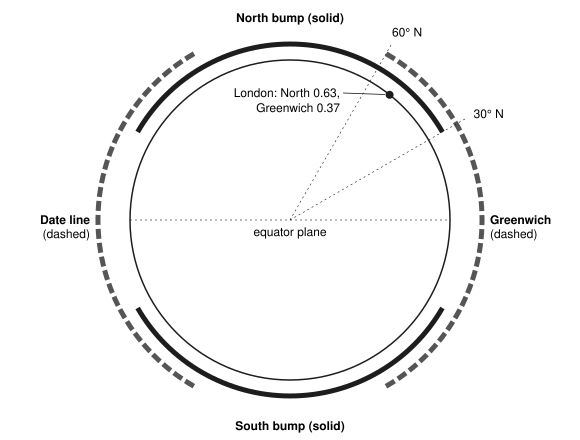
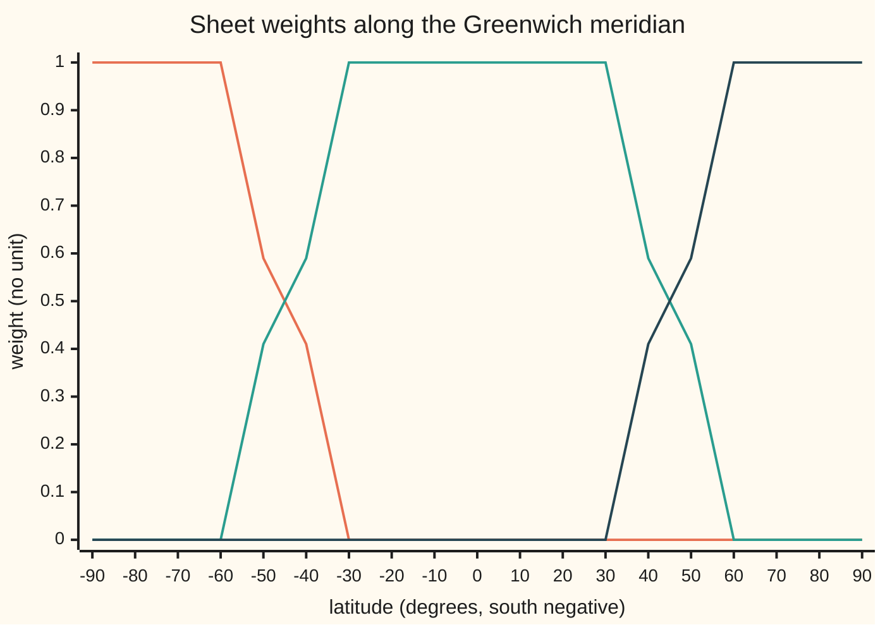

# Partition of unity: glue local work into one global object

[Syllabus](../../../SYLLABUS.md) → [Differential geometry and Lie groups](../README.md) → [Manifolds](../README.md#s03) → Partition of unity

---

## General Overview

The [Smooth manifold](01-smooth-manifolds-and-charts.md) card covered the Earth with six flat map sheets. Each sheet looks straight down on one half of the globe and gives every point on that half two numbers, in kilometres. London lies on two of the sheets: the North sheet puts it at (3965.4, −8.8), the Greenwich sheet at (−8.8, 4986.5). The Earth here is a sphere of radius 6371 km, a model.

Each sheet is good only on its own half. Many jobs need one object for the whole globe, such as one list of coordinates that works everywhere. Cutting the globe along sheet borders gives an object that jumps at every border.

The fix is to blend instead of cut. Give each sheet a **weight**: a number from 0 to 1 at every point, which fades smoothly to 0 well before the sheet's rim. Make the weights add up to 1 at every point. At London the North sheet gets 0.632327, the Greenwich sheet 0.367673 and the other four sheets 0. Mix the sheets' local work in those proportions and there are no seams.

This card builds those weights, then uses them to stitch all six sheets into one map, F, giving every point one list of 18 numbers. No two places get the same list, so the globe sits inside 18-dimensional flat space as a faithful copy, built from sheet data alone.

**A partition of unity is a set of smooth weights, one per chart, each zero outside its own chart and all adding to 1 at every point; weighting local work by them and adding glues it into one smooth global object, and gluing the charts themselves this way places a compact manifold inside flat space.**

**What kind of fact this is:** two definitions (bump function, partition of unity) and two theorems proved on this card in Why it works. The theorems are that the six bumps below cover the globe, and that the stitched map F is a smooth embedding for any compact manifold with finitely many charts. Two further results are stated with their sources, not proved: every smooth manifold has partitions of unity, and Whitney's theorem that an n-dimensional manifold fits inside 2n-dimensional flat space.

<p align="center"></p>

The figure is a to-scale slice through the globe along the Greenwich meridian (right) and the date line (left). Each thick arc, drawn just outside the globe's circle, marks where one sheet's weight is above 0. Neighbouring arcs overlap between 30° and 60° of latitude; London sits in the North–Greenwich overlap.

---

## The formula

Notation first, in words. A **bump function** $`\psi_i`$ (say "psi i") is a smooth function on the globe that is never negative and is 0 outside a closed region inside sheet $`i`$. That closed region, the smallest closed set outside which $`\psi_i`$ is 0, is the bump's **support**. A **partition of unity** for the sheets is a list of such functions, one per sheet, that add to 1 at every point; "unity" just means the number 1.

Divide each bump by the sum of all the bumps and the result is a partition of unity. Multiply each sheet's coordinates by its own bump and the result is one map F that works everywhere:

```math
\rho_i = \frac{\psi_i}{\psi_1 + \dots + \psi_k}, \qquad \rho_1 + \dots + \rho_k = 1, \qquad F = \left(\psi_1 x_1, \dots, \psi_k x_k,\ R\psi_1, \dots, R\psi_k\right)
```

**Read it aloud:** each weight is that sheet's bump divided by the total of all bumps, so the weights add to 1; and F lists every sheet's coordinates, each scaled by its own bump, followed by the bumps themselves.

On the globe, the bump of sheet $`i`$ uses one number, $`t_i`$: the coordinate the sheet drops, with the sign of the sheet's half, divided by $`R`$. It is 1 at the sheet's centre and 0 on its rim. The bump is

```math
\psi_i(p) = f\left(\frac{t_i(p) - 0.5}{0.1}\right), \qquad f(s) = \begin{cases} e^{-1/s^2} & s > 0 \\ 0 & s \le 0 \end{cases}
```

**Read it aloud:** a sheet's bump is off until the point is more than halfway from the sheet's rim to its centre (within 60° of the centre), then rises smoothly toward 1.

| Symbol | Plain meaning | In our example | Push it up and the answer… |
| --- | --- | --- | --- |
| $`M`$ | the manifold, the space being covered | the Earth's surface | — |
| $`k`$, $`n`$ | number of charts; dimension of the manifold | 6 sheets; $`n = 2`$ | F needs $`k(n + 1)`$ numbers: here 18 |
| $`U_i`$, $`x_i`$ | the patch sheet $`i`$ covers, and its chart (coordinates) | North sheet: half with $`Z > 0`$; London at (3965.4, −8.8) km | — |
| $`t_i`$ | dropped coordinate over $`R`$, signed: how deep into sheet $`i`$'s half a point lies | London: 0.78269 (North), 0.62241 (Greenwich) | bump grows |
| $`X`$, $`Y`$, $`Z`$ | a point's coordinates in space, in km; $`Z`$ points to the North Pole, $`X`$ to Greenwich on the equator | London: (3965.4, −8.8, 4986.5) km | — |
| $`f`$, $`s`$ | the one-sided smooth ramp $`f(s) = e^{-1/s^2}`$, 0 for $`s \le 0`$; its input $`s`$ is $`(t_i - 0.5)/0.1`$ | London, North: $`f(2.8269) = 0.882377`$ | rises toward 1 |
| $`\psi_i`$ | bump of sheet $`i`$: smooth, never negative, 0 outside its support | London: 0.882377 (North), 0.513068 (Greenwich) | that sheet's say grows |
| $`\mathrm{supp}\,\psi_i`$ | the support: where $`\psi_i`$ is not 0, plus its edge | North: latitude 30° N and above | must stay inside $`U_i`$ |
| $`\rho_i`$ | weight of sheet $`i`$; the $`\rho_i`$ add to 1 | London: 0.632327 (North), 0.367673 (Greenwich) | other weights shrink |
| $`F`$ | the stitched map from the globe into flat space with $`k(n + 1)`$ coordinates | London: 3499.0, −7.8, … , 5621.6, 0.0, 3268.8, … km | — |
| $`dF_p`$, $`v`$ | the differential of F at point $`p`$: how F moves a tangent vector $`v`$, a velocity along the ground ([Tangent space and differential](03-tangent-spaces-and-differentials.md)) | stretches London's ground by at least 1.0207 | — |
| $`R`$ | the Earth's radius, a sphere model; it also scales the bump entries of F into km | 6371 km | — |

### When it holds

- **The places where bumps are positive must cover the whole manifold.** Start the bumps at $`t_i > 0.6`$ instead of 0.5 and the point 35.26° N, 45.00° E, where three sheets meet, gets total weight 0.000000. There is nothing to divide by.
- **Each support must sit inside its own chart, away from the rim.** A chart's coordinates mean nothing past its rim, so a bump still on at the rim leaves $`\psi_i x_i`$ undefined just beyond it. Here each support stops 60° from its sheet's centre, 30° short of the rim.
- **Bumps must be smooth, not just continuous.** A tent-shaped bump, $`\max(s, 0)`$, gives F a corner: the North bump's slope at 30° N jumps from 0.0000 to 1.3593 per 1000 km.
- **The manifold must pass the two background tests: Hausdorff and second countable** ([Smooth manifold](01-smooth-manifolds-and-charts.md)). The line with two origins (the ordinary line with its 0 doubled) has no partition of unity for its two charts, by the argument in Step 8; it fails the Hausdorff test. It also fits inside no flat space, because flat space keeps distinct points apart.
- **"One-to-one with a one-to-one derivative" is guaranteed to give a faithful copy only on a compact manifold** (closed and bounded, like the globe). Elsewhere it can fail: an open interval can be bent into a figure 6 whose loose end runs into its own middle: one-to-one, smooth, yet not a faithful copy. Whitney's general theorem handles such manifolds with a stronger kind of map.

---

## Why it works

### Step 0: cut, weight, add

A sheet's local work, such as its coordinates or its ruler, exists only on the sheet. Multiply it by a bump that is 0 near the sheet's rim and the product can be set to 0 everywhere off the sheet, smoothly. Now it lives on the whole globe. Add up these products over all sheets.

If the weights add to 1, a quantity all sheets agree on comes back unchanged; where they disagree, the result is a smooth blend. Everything below builds the bumps and tests the blend.

### Step 1: a bump on the line

The ramp $`f(s) = e^{-1/s^2}`$ for $`s > 0`$, and 0 for $`s \le 0`$, is smooth. The [Taylor series](../../06-Calculus%20and%20analysis/06-Series/05-taylor-series.md) card proves that $`e^{-1/s^2}`$, set to 0 at 0, has every derivative 0 there. So the right side joins the flat left side with no corner in any derivative.

No function equal to its own Taylor series everywhere can do this. If such a function is 0 on an interval, its Taylor series there is 0, so it is 0 everywhere. Smooth functions are free of that rule, and that freedom is what makes bumps possible.

### Step 2: a bump on each sheet

Each sheet drops one coordinate of space. For the North sheet, $`t = Z/R`$, which runs from 1 at the North Pole to 0 on the equator. In space $`t`$ is a linear function, so on the globe it is smooth in every chart. The bump $`\psi = f((t - 0.5)/0.1)`$ is then smooth too.

The North bump is positive exactly where $`t > 0.5`$: north of 30° N. Its support is $`t \ge 0.5`$, a closed cap that stays 30° away from the North sheet's rim at the equator. The other five sheets work the same way, each with its own dropped coordinate.

### Step 3: the bumps cover the globe, so dividing works

At any point $`X^2 + Y^2 + Z^2 = R^2`$, so the largest of $`|X|`$, $`|Y|`$, $`|Z|`$ is at least $`R/\sqrt{3}`$, which is $`0.57735R`$. That coordinate's sheet has $`t \ge 0.57735 > 0.5`$, so its bump is positive. Every point is under at least one bump.

The cover is thinnest at the eight points with all three coordinates equal in size, such as 35.26° N, 45.00° E, where the largest coordinate is as small as it can be. Three bumps reach there, with total 0.563960. The code's grid search finds no lower total: its lowest is 0.732084.

Since the total is never 0, each weight $`\rho_i = \psi_i / (\psi_1 + \dots + \psi_6)`$ is a smooth quotient, and the weights add to 1. At London they come out 0.632327 for North and 0.367673 for Greenwich, adding to 1.000000000000.



Orange is the South sheet's weight, green the Greenwich sheet's, dark blue the North sheet's. Each hand-over happens between 30° and 60° of latitude, and at every latitude the three weights add to 1.

### Step 4: gluing one thing, a ruler

Each sheet has its own **paper ruler**: measure a step on the ground by how far it moves on that sheet's paper. Walk 1 km due north from London. On the North sheet that step measures 0.7827 km; on the Greenwich sheet, 0.6224 km. Neither is the true 1 km, and they disagree.

Blend their squares with London's weights: $`\sqrt{0.632327 \times 0.7827^2 + 0.367673 \times 0.6224^2} = 0.7279`$. This **glued ruler** is defined on the whole globe, changes smoothly, and is never 0 on a real step, since every paper ruler is positive. It is not the true ground ruler, and need not be: the same recipe gives any manifold a way to measure lengths ([Riemannian metric](../05-Riemannian%20Geometry/01-riemannian-metrics.md)).

### Step 5: stitching the sheets into one map

Now glue the charts themselves. Scale each sheet's two coordinates by its bump. Then list the six bumps too, each multiplied by $`R`$ so that every entry is in km. That is F, with $`6 \times (2 + 1) = 18`$ entries.

London's 18 entries are 3499.0, −7.8 (North block), 0.0, 0.0 (South), −4.5, 2558.4 (Greenwich), six zeros (date line, East, West), then the bump entries 5621.6, 0.0, 3268.8, 0.0, 0.0, 0.0.

**F is one-to-one.** Given F's 18 numbers, look at the last six and pick the largest; that sheet's bump is positive at the point. Divide that sheet's block by its bump to recover the chart coordinates, and the chart gives back the point. The code does exactly this for 614 grid points and recovers each to within 1.11e-12 km.

The bump entries matter. Without them, the North Pole and the South Pole both map to all zeros: each pole has coordinates (0, 0) on its own sheet, and every other bump is 0 there. With them, the poles land 8656.669233 km apart.

### Step 6: F has a one-to-one derivative

A map whose differential is one-to-one at every point is an **immersion** ([Diffeomorphism, immersion, submersion](04-diffeomorphisms-immersions-and-embeddings.md)). F is one. By the product rule, moving along a tangent vector $`v`$ changes $`\psi_i x_i`$ at the rate $`x_i\, d\psi_i(v) + \psi_i\, dx_i(v)`$.

Suppose F does not move at all along $`v`$. The bump entries say every $`d\psi_i(v)`$ is 0. Then the blocks say $`\psi_i\, dx_i(v) = 0`$. Pick a sheet whose bump is positive at the point; there $`dx_i(v) = 0`$, and a chart's differential is invertible, so $`v = 0`$.

The code checks the product rule against difference quotients at London; they agree to 4.50e-08. It then measures how much $`dF`$ stretches a 1 km ground step. The least stretch at London is 1.0207, and over the whole grid 0.6361, never close to 0.

### Step 7: on a compact manifold, that makes a faithful copy

An **embedding** is a one-to-one immersion that is also a two-way continuous match between the manifold and its image. On a compact manifold the last part comes free: a one-to-one continuous map from a compact space into flat space always has a continuous inverse on its image (proof in the fold).

So F places the globe inside 18-dimensional flat space as a faithful smooth copy. As a numerical sign, over all 188191 pairs of grid points, F's distance is never less than 0.5965 times the distance in space.

<details>
<summary>Detailed proof: F is a smooth embedding of any compact manifold with a finite atlas</summary>

Let $`M`$ be a compact manifold with charts $`x_1, \dots, x_k`$ on patches $`U_1, \dots, U_k`$, and bumps $`\psi_i`$ whose supports lie inside $`U_i`$ and whose positive sets cover $`M`$. Define $`F = (\psi_1 x_1, \dots, \psi_k x_k, \psi_1, \dots, \psi_k)`$; the factor $`R`$ only changes units.

**Smooth.** Each $`\psi_i x_i`$ is smooth on $`U_i`$ and 0 on a neighbourhood of every point outside the support of $`\psi_i`$. The two descriptions agree on the overlap, so $`\psi_i x_i`$ is smooth on all of $`M`$.

**One-to-one.** Suppose $`F(p) = F(q)`$. The last $`k`$ entries give $`\psi_i(p) = \psi_i(q)`$ for every $`i`$. Choose $`i`$ with $`\psi_i(p) > 0`$. Then $`p`$ and $`q`$ both lie in $`U_i`$, and dividing the $`i`$-th block by the same positive number gives $`x_i(p) = x_i(q)`$. A chart is one-to-one, so $`p = q`$.

**Immersion.** Let $`v`$ be a tangent vector at $`p`$ with $`dF_p(v) = 0`$. Then $`d\psi_i(v) = 0`$ for every $`i`$, and the product rule gives

$`\displaystyle d(\psi_i x_i)_p(v) = x_i(p)\, d\psi_i(v) + \psi_i(p)\, dx_i(v) = \psi_i(p)\, dx_i(v) = 0.`$

For $`i`$ with $`\psi_i(p) > 0`$ this forces $`dx_i(v) = 0`$. A chart's differential is invertible, so $`v = 0`$.

**Continuous inverse on the image.** Let $`A`$ be a closed subset of $`M`$. It is compact, so $`F(A)`$ is compact, hence closed in flat space. So F sends closed sets to closed sets, which says exactly that the inverse map from $`F(M)`$ back to $`M`$ is continuous.

</details>

### Step 8: every manifold, and how low the dimension can go

**Existence in general.** Every smooth manifold that is Hausdorff and second countable has a partition of unity for any open cover by charts (Lee, Sources). It may need infinitely many bumps, chosen **locally finite**: near each point only finitely many are not 0. So every sum is finite near each point and no limit is taken. An infinite sum of smooth functions can lose smoothness, the problem of the [Uniform convergence](../../06-Calculus%20and%20analysis/06-Series/07-uniform-convergence.md) card.

**Why the Hausdorff test is needed.** On the line with two origins, call the doubled points $`0_a`$ and $`0_b`$, with chart $`a`$ missing $`0_b`$ and chart $`b`$ missing $`0_a`$. A bump inside chart $`a`$ must be 0 near $`0_b`$. But the points near $`0_b`$ are the same as the points near $`0_a`$, so by continuity it is 0 at $`0_a`$ too. The same holds for chart $`b`$, so the two weights add to 0 at $`0_a`$, not 1.

**Lower dimensions.** F used $`k(n + 1)`$ numbers, which grows with the number of charts. Whitney proved in 1936 that $`2n + 1`$ always suffice. The standard proof for a compact manifold projects F onto a flat space of one fewer dimension along a direction chosen so that the copy stays faithful, and repeats. Today's proof picks the direction with [Sard's theorem and degree](10-sards-theorem-and-degree.md), applied to a map from a lower-dimensional space. A direction is bad if it runs along a chord between two points of the copy or along a tangent arrow, and these directions are the image of a 2n-dimensional space of pairs. While F's space has more than 2n + 1 dimensions, its directions form a space of more than 2n dimensions, so every point of that map is critical, and Sard says its image takes up no room. So almost every direction is safe. In 1944 Whitney reached $`2n`$, by a harder argument that removes the last self-crossings (Sources). This card states those results and does not prove them.

For the globe, $`2n = 4`$, though it already sits in 3-dimensional space. The real projective plane ([Sphere, torus and projective plane](02-example-manifolds-sphere-torus-and-projective-space.md)) shows 4 can be needed: it fits in 4 dimensions but in no 3-dimensional space.

---

## Worked numbers, by hand

London: 51.5074° N, 0.1278° W, at (3965.4, −8.8, 4986.5) km in space.

| Step | Arithmetic | Value |
| --- | --- | --- |
| North depth $`t_N`$ | $`4986.5 / 6371`$ | 0.78269 |
| Greenwich depth $`t_G`$ | $`3965.4 / 6371`$ | 0.62241 |
| ramp inputs $`s`$ | $`(0.78269 - 0.5)/0.1`$; $`(0.62241 - 0.5)/0.1`$ | 2.8269; 1.2241 |
| North bump | $`e^{-1/2.8269^2}`$ | 0.882377 |
| Greenwich bump | $`e^{-1/1.2241^2}`$ | 0.513068 |
| other four bumps | $`t < 0.5`$ on each | 0 |
| total | $`0.882377 + 0.513068`$ | 1.395444 |
| weights | $`0.882377 / 1.395444`$; $`0.513068 / 1.395444`$ | **0.632327; 0.367673** |
| North block of F | $`0.882377 \times (3965.4, -8.8)`$ | (3499.0, −7.8) km |
| Greenwich block of F | $`0.513068 \times (-8.8, 4986.5)`$ | (−4.5, 2558.4) km |
| bump entries | $`6371 \times 0.882377`$; $`6371 \times 0.513068`$ | 5621.6; 3268.8 km |

London is deeper inside the North sheet's half than the Greenwich sheet's, so the North sheet carries about 63% of the say there; F records both sheets' views of London, scaled by those bumps.

### What breaks if you drop a piece

| Mistake | Comes out at | What went wrong |
| --- | --- | --- |
| Bumps start at $`t > 0.6`$ | total weight 0.000000 at 35.26° N, 45.00° E | no bump reaches that point, so there is nothing to divide by |
| F without the bump entries | North and South Poles 0.000000 km apart (right: 8656.669233 km) | both poles have chart coordinates (0, 0); only the bumps tell them apart |
| Tent bump $`\max(s, 0)`$ | slope at 30° N: 0.0000 below, 1.3593 above, per 1000 km | the bump has a corner, so F is not smooth there |
| Hard cut: bump 1 inside, 0 outside | North bump jumps from 0 to 1 within 1 km at 30° N (1000.0000 per 1000 km) | a cut is not a blend: F tears along every border |

The code prints every row.

---

## Code, from first principles, and it actually runs

The code builds the six bumps, the weights and the stitched map F for the globe. It takes **two independent roads** to each claim. One-to-one: reading each point back off its 18 numbers, and a brute-force search over all 188191 pairs of grid points. The derivative: the product rule against difference quotients along a great circle. Covering: the corner formula against a grid search. It then prints the four broken versions and the chart's weights.

### Python

```python
# Partition of unity and Whitney embedding -- the check behind the card.  Standard library only.
# The Earth is a sphere of radius R = 6371 km (a model), covered by six orthographic sheets.
# Each sheet drops one coordinate of space and keeps the other two; it covers the open half
# where the dropped coordinate has its sign.  A bump on each sheet glues them into one map F.
from math import exp, sqrt, sin, cos, asin, radians, degrees

R, C, W = 6371.0, 0.5, 0.1      # km; a bump is on where t > C, with t = dropped coordinate / R
SHEETS = [("North", 2, 1), ("South", 2, -1), ("Greenwich", 0, 1),
          ("Date line", 0, -1), ("East", 1, 1), ("West", 1, -1)]   # (name, dropped axis, sign)

def f(s): return exp(-1.0 / (s * s)) if s > 0 else 0.0        # e^(-1/s^2), cut to 0 for s <= 0
def df(s): return 2.0 / s ** 3 * f(s) if s > 0 else 0.0       # its slope
def tent(s): return max(s, 0.0)                               # a bump with a corner, for "what breaks"
def cut(s): return 1.0 if s > 0 else 0.0                       # a hard cut, no fading at all
def t_of(P, k): return SHEETS[k][2] * P[SHEETS[k][1]] / R
def bump(P, k, c=C, prof=f): return prof((t_of(P, k) - c) / W)
def chart(P, k): return [P[j] for j in range(3) if j != SHEETS[k][1]]
def point(lat, lon):
    a, b = radians(lat), radians(lon)
    return [R * cos(a) * cos(b), R * cos(a) * sin(b), R * sin(a)]
def dist(A, B): return sqrt(sum((a - b) ** 2 for a, b in zip(A, B)))

def embed(P, with_bumps=True):          # F(p) = (psi_1 x_1, ..., psi_6 x_6, R psi_1, ..., R psi_6), km
    psi = [bump(P, k) for k in range(6)]
    out = [psi[k] * u for k in range(6) for u in chart(P, k)]
    return out + [R * p for p in psi] if with_bumps else out

def unembed(F):                         # road 1 to "one-to-one": read p back off F(p)
    k = max(range(6), key=lambda i: F[12 + i])
    x = [R * F[2 * k] / F[12 + k], R * F[2 * k + 1] / F[12 + k]]
    a, sg = SHEETS[k][1], SHEETS[k][2]
    P = x[:a] + [sg * sqrt(R * R - x[0] ** 2 - x[1] ** 2)] + x[a:]
    return P

def dF(P, v):                           # derivative of F along a tangent vector v, by the product rule
    rows, dpsi = [], []
    for k in range(6):
        a, sg = SHEETS[k][1], SHEETS[k][2]
        s = (t_of(P, k) - C) / W
        dp = df(s) / W * sg * v[a] / R
        rows += [dp * u + bump(P, k) * w for u, w in zip(chart(P, k), chart(v, k))]
        dpsi.append(R * dp)
    return rows + dpsi

def tangents(P):                        # two unit vectors at right angles, tangent to the globe
    a = [0.0, 0.0, 1.0] if abs(P[2]) < 0.9 * R else [1.0, 0.0, 0.0]
    e = [a[1] * P[2] - a[2] * P[1], a[2] * P[0] - a[0] * P[2], a[0] * P[1] - a[1] * P[0]]
    n = sqrt(sum(u * u for u in e)); e = [u / n for u in e]
    g = [(P[1] * e[2] - P[2] * e[1]) / R, (P[2] * e[0] - P[0] * e[2]) / R, (P[0] * e[1] - P[1] * e[0]) / R]
    return e, g

def min_stretch(P):                     # smallest stretch of dF on unit ground vectors (2x2 Gram matrix)
    e, g = tangents(P)
    A, B = dF(P, e), dF(P, g)
    p, q, r = sum(x * x for x in A), sum(x * y for x, y in zip(A, B)), sum(y * y for y in B)
    return sqrt((p + r) / 2 - sqrt(((p - r) / 2) ** 2 + q * q))

grid = [point(lat, lon) for lat in range(-80, 81, 10) for lon in range(0, 360, 10)]
grid += [point(90, 0), point(-90, 0)]

# ---- the partition of unity at London ----
L = point(51.5074, -0.1278)
psiL = [bump(L, k) for k in range(6)]
rhoL = [p / sum(psiL) for p in psiL]
print("London in space (km):", ", ".join(f"{u:.1f}" for u in L))
for k in range(6):
    print(f"{SHEETS[k][0]:<10} t = {t_of(L, k):8.5f}  s = {(t_of(L, k) - C) / W:8.4f}  bump {psiL[k]:.6f}  weight {rhoL[k]:.6f}")
print(f"bumps add to {sum(psiL):.6f}; weights add to {sum(rhoL):.12f}")
print("F(London), km:", ", ".join(f"{u + 0.0:.1f}" for u in embed(L)))
north = [-sin(radians(51.5074)) * cos(radians(-0.1278)), -sin(radians(51.5074)) * sin(radians(-0.1278)),
         cos(radians(51.5074))]
spd = [sqrt(sum(u * u for u in chart(north, k))) for k in range(6)]
print(f"walking north: North sheet speed {spd[0]:.4f}, Greenwich {spd[2]:.4f}, "
      f"glued ruler {sqrt(sum(rhoL[k] * spd[k] ** 2 for k in range(6))):.4f}")

# ---- every point is under some bump: grid search against the corner formula ----
tot = [sum(bump(P, k) for k in range(6)) for P in grid]
corner = 3 * f((1 / sqrt(3) - C) / W)
print(f"sum of bumps: grid minimum {min(tot):.6f}, at the corner {degrees(asin(1 / sqrt(3))):.2f} N 45.00 E, "
      f"t = {1 / sqrt(3):.5f}, total {corner:.6f}")
assert min(tot) >= corner - 1e-12 and corner > 0.5

# ---- road 1: F is one-to-one, because p can be read back off F(p) ----
back = max(dist(unembed(embed(P)), P) for P in grid)
print(f"grid points {len(grid)}; worst miss reading p back from F(p): {back:.2e} km")
assert back < 1e-6

# ---- road 2: F is one-to-one, by brute force over every pair of grid points ----
FG = [embed(P) for P in grid]
ratio = min(dist(FG[i], FG[j]) / dist(grid[i], grid[j])
            for i in range(len(grid)) for j in range(i))
print(f"pairs {len(grid) * (len(grid) - 1) // 2}; smallest (gap in F) / (gap in space): {ratio:.4f}")
assert ratio > 0.1

# ---- F is an immersion: product rule against difference quotients, then the whole grid ----
e, g = tangents(L)
h = 1.0
Ph = [cos(h / R) * p + R * sin(h / R) * u for p, u in zip(L, e)]
Pm = [cos(h / R) * p - R * sin(h / R) * u for p, u in zip(L, e)]
num = [(a - b) / (2 * h) for a, b in zip(embed(Ph), embed(Pm))]
miss = max(abs(a - b) for a, b in zip(num, dF(L, e)))
print(f"London: product rule vs difference quotient, worst entry miss {miss:.2e}")
assert miss < 1e-6
st = [min_stretch(P) for P in grid]
print(f"smallest stretch of dF: at London {min_stretch(L):.4f}, over the grid {min(st):.4f}")
assert min(st) > 0.1

# ---- what breaks ----
Np, Sp = [0.0, 0.0, R], [0.0, 0.0, -R]
print(f"poles apart in F: with bump entries {dist(embed(Np), embed(Sp)):.6f}, "
      f"without {dist(embed(Np, False), embed(Sp, False)):.6f}")
assert dist(embed(Np, False), embed(Sp, False)) == 0.0
print(f"bumps start at t > 0.6: sum at the corner {3 * f((1 / sqrt(3) - 0.6) / W):.6f}")
for prof, name in ((f, "e^(-1/s^2)"), (tent, "tent"), (cut, "hard cut")):
    at = lambda lat: bump(point(lat, 0), 0, C, prof)
    step = 1.0 / R * 180 / 3.141592653589793                 # 1 km of ground, in degrees
    print(f"{name:<10} North bump slope at 30 N, per 1000 km: below {1000 * (at(30) - at(30 - step)):.4f}, "
          f"above {1000 * (at(30 + step) - at(30)):.4f}")

# ---- the chart along the Greenwich meridian, and the figure ----
lats = range(-90, 91, 10)
print("latitude  ", ", ".join(str(lat) for lat in lats))
for k, name in ((1, "South"), (2, "Greenwich"), (0, "North")):
    w = [bump(point(lat, 0), k) / sum(bump(point(lat, 0), j) for j in range(6)) for lat in lats]
    print(f"{name:<10}", ", ".join(f"{u:.2f}" for u in w))
px = lambda P, r=160: (220 + P[0] / R * r, 220 - P[2] / R * r)   # globe circle r = 160 px; arcs drawn outside it
print("figure, London px ({:.1f}, {:.1f}); North arc (r 176) right end ({:.1f}, {:.1f}); Greenwich arc (r 192) top end "
      "({:.1f}, {:.1f}); 30 N and 60 N rays (r 205) end ({:.1f}, {:.1f}), ({:.1f}, {:.1f})".format(
    *px(L), *px(point(30, 0), 176), *px(point(60, 0), 192), *px(point(30, 0), 205), *px(point(60, 0), 205)))
print("ALL CHECKS PASS")
```

**Ran 2026-11-19 on macOS, Python 3.14.10, standard library only. All checks passed. Output, pasted from the run:**

```
London in space (km): 3965.4, -8.8, 4986.5
North      t =  0.78269  s =   2.8269  bump 0.882377  weight 0.632327
South      t = -0.78269  s = -12.8269  bump 0.000000  weight 0.000000
Greenwich  t =  0.62241  s =   1.2241  bump 0.513068  weight 0.367673
Date line  t = -0.62241  s = -11.2241  bump 0.000000  weight 0.000000
East       t = -0.00139  s =  -5.0139  bump 0.000000  weight 0.000000
West       t =  0.00139  s =  -4.9861  bump 0.000000  weight 0.000000
bumps add to 1.395444; weights add to 1.000000000000
F(London), km: 3499.0, -7.8, 0.0, 0.0, -4.5, 2558.4, 0.0, 0.0, 0.0, 0.0, 0.0, 0.0, 5621.6, 0.0, 3268.8, 0.0, 0.0, 0.0
walking north: North sheet speed 0.7827, Greenwich 0.6224, glued ruler 0.7279
sum of bumps: grid minimum 0.732084, at the corner 35.26 N 45.00 E, t = 0.57735, total 0.563960
grid points 614; worst miss reading p back from F(p): 1.11e-12 km
pairs 188191; smallest (gap in F) / (gap in space): 0.5965
London: product rule vs difference quotient, worst entry miss 4.50e-08
smallest stretch of dF: at London 1.0207, over the grid 0.6361
poles apart in F: with bump entries 8656.669233, without 0.000000
bumps start at t > 0.6: sum at the corner 0.000000
e^(-1/s^2) North bump slope at 30 N, per 1000 km: below 0.0000, above 0.0000
tent       North bump slope at 30 N, per 1000 km: below 0.0000, above 1.3593
hard cut   North bump slope at 30 N, per 1000 km: below 0.0000, above 1000.0000
latitude   -90, -80, -70, -60, -50, -40, -30, -20, -10, 0, 10, 20, 30, 40, 50, 60, 70, 80, 90
South      1.00, 1.00, 1.00, 1.00, 0.59, 0.41, 0.00, 0.00, 0.00, 0.00, 0.00, 0.00, 0.00, 0.00, 0.00, 0.00, 0.00, 0.00, 0.00
Greenwich  0.00, 0.00, 0.00, 0.00, 0.41, 0.59, 1.00, 1.00, 1.00, 1.00, 1.00, 1.00, 1.00, 0.59, 0.41, 0.00, 0.00, 0.00, 0.00
North      0.00, 0.00, 0.00, 0.00, 0.00, 0.00, 0.00, 0.00, 0.00, 0.00, 0.00, 0.00, 0.00, 0.41, 0.59, 1.00, 1.00, 1.00, 1.00
figure, London px (319.6, 94.8); North arc (r 176) right end (372.4, 132.0); Greenwich arc (r 192) top end (316.0, 53.7); 30 N and 60 N rays (r 205) end (397.5, 117.5), (322.5, 42.5)
ALL CHECKS PASS
```

### Rust

```rust
// Partition of unity and Whitney embedding -- the check behind the card.  std only, no crates.
// The Earth is a sphere of radius R = 6371 km (a model), covered by six orthographic sheets.
// Each sheet drops one coordinate of space and keeps the other two; it covers the open half
// where the dropped coordinate has its sign.  A bump on each sheet glues them into one map F.
const R: f64 = 6371.0;
const C: f64 = 0.5; // a bump is on where t > C, with t = dropped coordinate / R
const W: f64 = 0.1;
const SHEETS: [(&str, usize, f64); 6] = [("North", 2, 1.0), ("South", 2, -1.0), ("Greenwich", 0, 1.0),
    ("Date line", 0, -1.0), ("East", 1, 1.0), ("West", 1, -1.0)]; // (name, dropped axis, sign)
type V = Vec<f64>;

fn f(s: f64) -> f64 { if s > 0.0 { (-1.0 / (s * s)).exp() } else { 0.0 } } // e^(-1/s^2), 0 for s <= 0
fn df(s: f64) -> f64 { if s > 0.0 { 2.0 / s.powi(3) * f(s) } else { 0.0 } }
fn tent(s: f64) -> f64 { s.max(0.0) }
fn cut(s: f64) -> f64 { if s > 0.0 { 1.0 } else { 0.0 } }
fn t_of(p: &[f64], k: usize) -> f64 { SHEETS[k].2 * p[SHEETS[k].1] / R }
fn bump_with(p: &[f64], k: usize, c: f64, prof: fn(f64) -> f64) -> f64 { prof((t_of(p, k) - c) / W) }
fn bump(p: &[f64], k: usize) -> f64 { bump_with(p, k, C, f) }
fn chart(p: &[f64], k: usize) -> V { (0..3).filter(|&j| j != SHEETS[k].1).map(|j| p[j]).collect() }
fn point(lat: f64, lon: f64) -> V {
    let (a, b) = (lat.to_radians(), lon.to_radians());
    vec![R * a.cos() * b.cos(), R * a.cos() * b.sin(), R * a.sin()]
}
fn dist(a: &[f64], b: &[f64]) -> f64 { a.iter().zip(b).map(|(x, y)| (x - y) * (x - y)).sum::<f64>().sqrt() }
fn sci(x: f64) -> String { // Python's {:.2e}: two-digit exponent
    let s = format!("{:.2e}", x);
    let (m, e) = s.split_once('e').unwrap();
    let e: i32 = e.parse().unwrap();
    format!("{}e{}{:02}", m, if e < 0 { "-" } else { "+" }, e.abs())
}

fn embed(p: &[f64], with_bumps: bool) -> V { // F(p) = (psi_1 x_1, ..., psi_6 x_6, R psi_1, ..., R psi_6), km
    let psi: V = (0..6).map(|k| bump(p, k)).collect();
    let mut out: V = Vec::new();
    for k in 0..6 { for u in chart(p, k) { out.push(psi[k] * u); } }
    if with_bumps { for q in &psi { out.push(R * q); } }
    out
}
fn unembed(fv: &[f64]) -> V { // road 1 to "one-to-one": read p back off F(p)
    let mut k = 0;
    for i in 1..6 { if fv[12 + i] > fv[12 + k] { k = i; } }
    let x = [R * fv[2 * k] / fv[12 + k], R * fv[2 * k + 1] / fv[12 + k]];
    let (a, sg) = (SHEETS[k].1, SHEETS[k].2);
    let mut p: V = x[..a].to_vec();
    p.push(sg * (R * R - x[0] * x[0] - x[1] * x[1]).sqrt());
    p.extend_from_slice(&x[a..]);
    p
}
fn d_f(p: &[f64], v: &[f64]) -> V { // derivative of F along a tangent vector v, by the product rule
    let (mut rows, mut dpsi) = (Vec::new(), Vec::new());
    for k in 0..6 {
        let (a, sg) = (SHEETS[k].1, SHEETS[k].2);
        let s = (t_of(p, k) - C) / W;
        let dp = df(s) / W * sg * v[a] / R;
        for (u, w) in chart(p, k).iter().zip(chart(v, k)) { rows.push(dp * u + bump(p, k) * w); }
        dpsi.push(R * dp);
    }
    rows.extend(dpsi);
    rows
}
fn tangents(p: &[f64]) -> (V, V) { // two unit vectors at right angles, tangent to the globe
    let a = if p[2].abs() < 0.9 * R { [0.0, 0.0, 1.0] } else { [1.0, 0.0, 0.0] };
    let e = [a[1] * p[2] - a[2] * p[1], a[2] * p[0] - a[0] * p[2], a[0] * p[1] - a[1] * p[0]];
    let n = e.iter().map(|u| u * u).sum::<f64>().sqrt();
    let e: V = e.iter().map(|u| u / n).collect();
    let g = vec![(p[1] * e[2] - p[2] * e[1]) / R, (p[2] * e[0] - p[0] * e[2]) / R, (p[0] * e[1] - p[1] * e[0]) / R];
    (e, g)
}
fn dot(a: &[f64], b: &[f64]) -> f64 { a.iter().zip(b).map(|(x, y)| x * y).sum() }
fn min_stretch(p: &[f64]) -> f64 { // smallest stretch of dF on unit ground vectors (2x2 Gram matrix)
    let (e, g) = tangents(p);
    let (a, b) = (d_f(p, &e), d_f(p, &g));
    let (pp, q, r) = (dot(&a, &a), dot(&a, &b), dot(&b, &b));
    ((pp + r) / 2.0 - (((pp - r) / 2.0).powi(2) + q * q).sqrt()).sqrt()
}

fn main() {
    let mut grid: Vec<V> = Vec::new();
    for lat in (-80..=80).step_by(10) { for lon in (0..360).step_by(10) { grid.push(point(lat as f64, lon as f64)); } }
    grid.push(point(90.0, 0.0));
    grid.push(point(-90.0, 0.0));

    // ---- the partition of unity at London ----
    let l = point(51.5074, -0.1278);
    let psi_l: V = (0..6).map(|k| bump(&l, k)).collect();
    let tot_l: f64 = psi_l.iter().sum();
    let rho_l: V = psi_l.iter().map(|p| p / tot_l).collect();
    println!("London in space (km): {}", l.iter().map(|u| format!("{:.1}", u)).collect::<Vec<_>>().join(", "));
    for k in 0..6 {
        println!("{:<10} t = {:8.5}  s = {:8.4}  bump {:.6}  weight {:.6}", SHEETS[k].0, t_of(&l, k), (t_of(&l, k) - C) / W,
                 psi_l[k], rho_l[k]);
    }
    println!("bumps add to {:.6}; weights add to {:.12}", tot_l, rho_l.iter().sum::<f64>());
    println!("F(London), km: {}", embed(&l, true).iter().map(|u| format!("{:.1}", u + 0.0)).collect::<Vec<_>>().join(", "));
    let (la, lo) = (51.5074f64.to_radians(), (-0.1278f64).to_radians());
    let north = [-la.sin() * lo.cos(), -la.sin() * lo.sin(), la.cos()];
    let spd: V = (0..6).map(|k| chart(&north, k).iter().map(|u| u * u).sum::<f64>().sqrt()).collect();
    let glued = (0..6).map(|k| rho_l[k] * spd[k] * spd[k]).sum::<f64>().sqrt();
    println!("walking north: North sheet speed {:.4}, Greenwich {:.4}, glued ruler {:.4}", spd[0], spd[2], glued);

    // ---- every point is under some bump: grid search against the corner formula ----
    let tot: V = grid.iter().map(|p| (0..6).map(|k| bump(p, k)).sum()).collect();
    let tmin = tot.iter().cloned().fold(f64::INFINITY, f64::min);
    let corner = 3.0 * f((1.0 / 3f64.sqrt() - C) / W);
    println!("sum of bumps: grid minimum {:.6}, at the corner {:.2} N 45.00 E, t = {:.5}, total {:.6}", tmin,
             (1.0 / 3f64.sqrt()).asin().to_degrees(), 1.0 / 3f64.sqrt(), corner);
    assert!(tmin >= corner - 1e-12 && corner > 0.5);

    // ---- road 1: F is one-to-one, because p can be read back off F(p) ----
    let back = grid.iter().map(|p| dist(&unembed(&embed(p, true)), p)).fold(0.0, f64::max);
    println!("grid points {}; worst miss reading p back from F(p): {} km", grid.len(), sci(back));
    assert!(back < 1e-6);

    // ---- road 2: F is one-to-one, by brute force over every pair of grid points ----
    let fg: Vec<V> = grid.iter().map(|p| embed(p, true)).collect();
    let mut ratio = f64::INFINITY;
    for i in 0..grid.len() { for j in 0..i { ratio = ratio.min(dist(&fg[i], &fg[j]) / dist(&grid[i], &grid[j])); } }
    println!("pairs {}; smallest (gap in F) / (gap in space): {:.4}", grid.len() * (grid.len() - 1) / 2, ratio);
    assert!(ratio > 0.1);

    // ---- F is an immersion: product rule against difference quotients, then the whole grid ----
    let (e, _g) = tangents(&l);
    let h = 1.0;
    let ph: V = l.iter().zip(&e).map(|(p, u)| (h / R).cos() * p + R * (h / R).sin() * u).collect();
    let pm: V = l.iter().zip(&e).map(|(p, u)| (h / R).cos() * p - R * (h / R).sin() * u).collect();
    let num: V = embed(&ph, true).iter().zip(embed(&pm, true)).map(|(a, b)| (a - b) / (2.0 * h)).collect();
    let miss = num.iter().zip(d_f(&l, &e)).map(|(a, b)| (a - b).abs()).fold(0.0, f64::max);
    println!("London: product rule vs difference quotient, worst entry miss {}", sci(miss));
    assert!(miss < 1e-6);
    let st = grid.iter().map(|p| min_stretch(p)).fold(f64::INFINITY, f64::min);
    println!("smallest stretch of dF: at London {:.4}, over the grid {:.4}", min_stretch(&l), st);
    assert!(st > 0.1);

    // ---- what breaks ----
    let (np, sp) = (vec![0.0, 0.0, R], vec![0.0, 0.0, -R]);
    println!("poles apart in F: with bump entries {:.6}, without {:.6}",
             dist(&embed(&np, true), &embed(&sp, true)), dist(&embed(&np, false), &embed(&sp, false)));
    assert!(dist(&embed(&np, false), &embed(&sp, false)) == 0.0);
    println!("bumps start at t > 0.6: sum at the corner {:.6}", 3.0 * f((1.0 / 3f64.sqrt() - 0.6) / W));
    let profs: [(fn(f64) -> f64, &str); 3] = [(f, "e^(-1/s^2)"), (tent, "tent"), (cut, "hard cut")];
    for (prof, name) in profs {
        let at = |lat: f64| bump_with(&point(lat, 0.0), 0, C, prof);
        let step = 1.0 / R * 180.0 / 3.141592653589793; // 1 km of ground, in degrees
        println!("{:<10} North bump slope at 30 N, per 1000 km: below {:.4}, above {:.4}", name,
                 1000.0 * (at(30.0) - at(30.0 - step)), 1000.0 * (at(30.0 + step) - at(30.0)));
    }

    // ---- the chart along the Greenwich meridian, and the figure ----
    let lats: Vec<i32> = (-90..=90).step_by(10).collect();
    println!("latitude   {}", lats.iter().map(|x| x.to_string()).collect::<Vec<_>>().join(", "));
    for (k, name) in [(1, "South"), (2, "Greenwich"), (0, "North")] {
        let w: Vec<String> = lats.iter().map(|&lat| {
            let p = point(lat as f64, 0.0);
            format!("{:.2}", bump(&p, k) / (0..6).map(|j| bump(&p, j)).sum::<f64>())
        }).collect();
        println!("{:<10} {}", name, w.join(", "));
    }
    let px = |p: &[f64], r: f64| (220.0 + p[0] / R * r, 220.0 - p[2] / R * r); // globe circle r = 160 px; arcs drawn outside it
    let (a, b, c) = (px(&l, 160.0), px(&point(30.0, 0.0), 176.0), px(&point(60.0, 0.0), 192.0));
    let (d, e) = (px(&point(30.0, 0.0), 205.0), px(&point(60.0, 0.0), 205.0));
    println!("figure, London px ({:.1}, {:.1}); North arc (r 176) right end ({:.1}, {:.1}); Greenwich arc (r 192) top end ({:.1}, {:.1}); 30 N and 60 N rays (r 205) end ({:.1}, {:.1}), ({:.1}, {:.1})",
             a.0, a.1, b.0, b.1, c.0, c.1, d.0, d.1, e.0, e.1);
    println!("ALL CHECKS PASS");
}
```

**Ran 2026-11-19 on macOS, rustc 1.98.1, no crates. All checks passed. Output, pasted from the run:**

```
London in space (km): 3965.4, -8.8, 4986.5
North      t =  0.78269  s =   2.8269  bump 0.882377  weight 0.632327
South      t = -0.78269  s = -12.8269  bump 0.000000  weight 0.000000
Greenwich  t =  0.62241  s =   1.2241  bump 0.513068  weight 0.367673
Date line  t = -0.62241  s = -11.2241  bump 0.000000  weight 0.000000
East       t = -0.00139  s =  -5.0139  bump 0.000000  weight 0.000000
West       t =  0.00139  s =  -4.9861  bump 0.000000  weight 0.000000
bumps add to 1.395444; weights add to 1.000000000000
F(London), km: 3499.0, -7.8, 0.0, 0.0, -4.5, 2558.4, 0.0, 0.0, 0.0, 0.0, 0.0, 0.0, 5621.6, 0.0, 3268.8, 0.0, 0.0, 0.0
walking north: North sheet speed 0.7827, Greenwich 0.6224, glued ruler 0.7279
sum of bumps: grid minimum 0.732084, at the corner 35.26 N 45.00 E, t = 0.57735, total 0.563960
grid points 614; worst miss reading p back from F(p): 1.11e-12 km
pairs 188191; smallest (gap in F) / (gap in space): 0.5965
London: product rule vs difference quotient, worst entry miss 4.50e-08
smallest stretch of dF: at London 1.0207, over the grid 0.6361
poles apart in F: with bump entries 8656.669233, without 0.000000
bumps start at t > 0.6: sum at the corner 0.000000
e^(-1/s^2) North bump slope at 30 N, per 1000 km: below 0.0000, above 0.0000
tent       North bump slope at 30 N, per 1000 km: below 0.0000, above 1.3593
hard cut   North bump slope at 30 N, per 1000 km: below 0.0000, above 1000.0000
latitude   -90, -80, -70, -60, -50, -40, -30, -20, -10, 0, 10, 20, 30, 40, 50, 60, 70, 80, 90
South      1.00, 1.00, 1.00, 1.00, 0.59, 0.41, 0.00, 0.00, 0.00, 0.00, 0.00, 0.00, 0.00, 0.00, 0.00, 0.00, 0.00, 0.00, 0.00
Greenwich  0.00, 0.00, 0.00, 0.00, 0.41, 0.59, 1.00, 1.00, 1.00, 1.00, 1.00, 1.00, 1.00, 0.59, 0.41, 0.00, 0.00, 0.00, 0.00
North      0.00, 0.00, 0.00, 0.00, 0.00, 0.00, 0.00, 0.00, 0.00, 0.00, 0.00, 0.00, 0.00, 0.41, 0.59, 1.00, 1.00, 1.00, 1.00
figure, London px (319.6, 94.8); North arc (r 176) right end (372.4, 132.0); Greenwich arc (r 192) top end (316.0, 53.7); 30 N and 60 N rays (r 205) end (397.5, 117.5), (322.5, 42.5)
ALL CHECKS PASS
```

The two outputs match line for line.

### Lean

Lean proves Steps 3 and 5 to 7, for any manifold with finitely many charts and for the globe at any radius.

- Suppose finitely many smooth bumps, never negative, each have support inside their own chart and together reach every point. Then each weight $`\rho_i`$ is smooth and never negative, with support inside its chart, and the weights add to 1.
- Suppose such bumps sit on a compact manifold that passes the Hausdorff and second countable tests. Then F is smooth, one-to-one and an immersion, and it is an embedding: a faithful copy. Lean puts each bump beside its own block and drops the factor $`R`$, which only reorders entries and changes units.
- Take any point with $`X^2 + Y^2 + Z^2 = R^2`$ and $`R > 0`$. Then the six globe bumps have a positive total there, so dividing by it works.
- For the globe, F has 18 entries, three per sheet, and Whitney's bound is 4 dimensions.

Every printed number, the grid searches and the four broken versions are left to the Python and Rust checks.

```lean
-- Partition of unity: bumps divided by their total are smooth weights adding to 1, the six globe bumps cover the sphere, and stitching bump-scaled charts gives a smooth embedding of a compact manifold into flat space.
import Mathlib.Geometry.Manifold.PartitionOfUnity
import Mathlib.Analysis.SpecialFunctions.Exp

open Function Set Topology
open scoped Manifold ContDiff

/-- The one-sided smooth ramp of the card: `f(s) = e^(-1/s^2)` for `s > 0`, and `0` for `s ≤ 0`. -/
noncomputable def ramp (s : ℝ) : ℝ := if 0 < s then Real.exp (-1 / s ^ 2) else 0

/-- The ramp is never negative. -/
theorem ramp_nonneg (s : ℝ) : 0 ≤ ramp s := by
  unfold ramp; split_ifs <;> positivity

/-- The ramp is positive for positive input. -/
theorem ramp_pos {s : ℝ} (hs : 0 < s) : 0 < ramp s := by
  unfold ramp; simp only [hs, ↓reduceIte]; positivity

/-- A sheet's bump is positive once the coordinate passes half the radius. -/
theorem ramp_sheet_pos {R t : ℝ} (hR : 0 < R) (ht : R / 2 < t) :
    0 < ramp ((t / R - 1 / 2) / (1 / 10)) := by
  apply ramp_pos
  have : 1 / 2 < t / R := by rw [lt_div_iff₀ hR]; linarith
  exact div_pos (by linarith) (by norm_num)

/-- **Gluing charts into flat space.** Let `M` be a compact smooth manifold (Hausdorff and second
countable) with finitely many charts `x_i` (the chart at `c i`, on its patch `U_i`), and smooth,
never-negative bumps `ψ_i`, each with support inside its own chart's patch, whose positive sets
cover `M`. Then the stitched map `F = (ψ_1 x_1, ψ_1, …, ψ_k x_k, ψ_k)`, with `k(n + 1)` coordinates,
is smooth, one-to-one, has a one-to-one differential at every point, and is a faithful copy
(a closed embedding): a smooth embedding of `M` into flat space. -/
theorem stitched_charts_embed_compact_manifold
    {ι : Type*} [Fintype ι]
    {E : Type*} [NormedAddCommGroup E] [NormedSpace ℝ E] [FiniteDimensional ℝ E]
    {H : Type*} [TopologicalSpace H] (I : ModelWithCorners ℝ E H)
    {M : Type*} [TopologicalSpace M] [ChartedSpace H M] [IsManifold I ∞ M]
    [T2Space M] [SecondCountableTopology M] [CompactSpace M]
    (c : ι → M) (ψ : ι → M → ℝ)
    (hψ_smooth : ∀ i, ContMDiff I 𝓘(ℝ) ∞ (ψ i))
    (hψ_nonneg : ∀ i x, 0 ≤ ψ i x)
    (hψ_supp : ∀ i, tsupport (ψ i) ⊆ (chartAt H (c i)).source)
    (hcover : ∀ x, ∃ i, 0 < ψ i x) :
    let F : M → (ι → E × ℝ) := fun x i => (ψ i x • extChartAt I (c i) x, ψ i x)
    ContMDiff I 𝓘(ℝ, ι → E × ℝ) ∞ F ∧ Injective F ∧
      (∀ x, Injective (mfderiv I 𝓘(ℝ, ι → E × ℝ) F x)) ∧ IsClosedEmbedding F := by
  intro F
  have hsupp : ∀ i x, ψ i x ≠ 0 → x ∈ (chartAt H (c i)).source :=
    fun i x h => hψ_supp i (subset_tsupport _ h)
  have hsmooth : ContMDiff I 𝓘(ℝ, ι → E × ℝ) ∞ F := by
    refine contMDiff_pi_module_iff.2 fun i => ContMDiff.prodMk_space ?_ (hψ_smooth i)
    refine contMDiff_of_tsupport fun x hx => ?_
    have hx' : x ∈ (chartAt H (c i)).source := hψ_supp i (tsupport_smul_subset_left _ _ hx)
    exact (hψ_smooth i x).smul (((contMDiffOn_extChartAt (I := I) (x := c i)) x hx').contMDiffAt
      ((chartAt H (c i)).open_source.mem_nhds hx'))
  have hinj : Injective F := by
    intro x y h
    obtain ⟨i, hi⟩ := hcover x
    have h' := congr_fun h i
    simp only [F, Prod.mk.injEq] at h'
    obtain ⟨h1, h2⟩ := h'
    rw [← h2] at h1
    have hx := hsupp i x hi.ne'
    have hy := hsupp i y (h2 ▸ hi.ne')
    have h3 := smul_right_injective E hi.ne' h1
    exact (extChartAt I (c i)).injOn (by simpa using hx) (by simpa using hy) h3
  have hmd : ∀ x, Injective (mfderiv I 𝓘(ℝ, ι → E × ℝ) F x) := by
    intro x
    obtain ⟨i, hi⟩ := hcover x
    have hx : x ∈ (chartAt H (c i)).source := hsupp i x hi.ne'
    let g : (ι → E × ℝ) → E := fun z => (z i).2⁻¹ • (z i).1
    have hgd : DifferentiableAt ℝ g (F x) := by
      have h0 : (F x i).2 ≠ 0 := hi.ne'
      have hl : DifferentiableAt ℝ (fun z : ι → E × ℝ => (z i).2) (F x) := by fun_prop
      have hr : DifferentiableAt ℝ (fun z : ι → E × ℝ => (z i).1) (F x) := by fun_prop
      exact (hl.inv h0).smul hr
    have hF := (hsmooth.mdifferentiableAt (x := x) (by simp)).hasMFDerivAt
    have hcomp := hgd.hasFDerivAt.hasMFDerivAt.comp x hF
    have heq : (g ∘ F) =ᶠ[𝓝 x] extChartAt I (c i) := by
      have hne : ∀ᶠ y in 𝓝 x, ψ i y ≠ 0 :=
        (hψ_smooth i).continuous.continuousAt.eventually_ne hi.ne'
      filter_upwards [hne] with y hy
      simp [g, F, smul_smul, inv_mul_cancel₀ hy]
    have h2 := hasMFDerivAt_unique (hcomp.congr_of_eventuallyEq heq.symm)
      (hasMFDerivAt_extChartAt hx)
    have hk := (mdifferentiable_chart (I := I) (c i)).ker_mfderiv_eq_bot hx
    have hker : (mfderiv I 𝓘(ℝ, ι → E × ℝ) F x).ker = ⊥ := by
      apply bot_unique
      rw [← hk]
      intro v hv
      have hv' : (mfderiv I 𝓘(ℝ, ι → E × ℝ) F x) v = 0 := hv
      have h3 := congrArg (fun L => L v) h2
      simp only [ContinuousLinearMap.comp_apply] at h3
      show (mfderiv I I (chartAt H (c i)) x) v = 0
      have h4 : (fderiv ℝ g (F x)).comp (mfderiv I 𝓘(ℝ, ι → E × ℝ) F x) v = 0 := by
        change fderiv ℝ g (F x) ((mfderiv I 𝓘(ℝ, ι → E × ℝ) F x) v) = 0
        rw [hv']
        exact (fderiv ℝ g (F x)).map_zero
      erw [h4] at h3
      exact h3.symm.trans rfl
    exact LinearMap.ker_eq_bot.1 hker
  exact ⟨hsmooth, hinj, hmd, hsmooth.continuous.isClosedEmbedding hinj⟩

/-- **Bumps divided by their total form a partition of unity.** If finitely many smooth,
never-negative bumps `ψ_i`, each with support inside its own chart's patch, have positive sets
covering the manifold, then the weights `ρ_i = ψ_i / (ψ_1 + … + ψ_k)` are smooth, never negative,
each zero outside its own chart's patch (support inside the patch), and add to 1 at every point. -/
theorem bumps_over_total_are_partition_of_unity
    {ι : Type*} [Fintype ι]
    {E : Type*} [NormedAddCommGroup E] [NormedSpace ℝ E]
    {H : Type*} [TopologicalSpace H] (I : ModelWithCorners ℝ E H)
    {M : Type*} [TopologicalSpace M] [ChartedSpace H M] [IsManifold I ∞ M]
    (c : ι → M) (ψ : ι → M → ℝ)
    (hψ_smooth : ∀ i, ContMDiff I 𝓘(ℝ) ∞ (ψ i))
    (hψ_nonneg : ∀ i x, 0 ≤ ψ i x)
    (hψ_supp : ∀ i, tsupport (ψ i) ⊆ (chartAt H (c i)).source)
    (hcover : ∀ x, ∃ i, 0 < ψ i x) :
    let ρ : ι → M → ℝ := fun i x => ψ i x / ∑ j, ψ j x
    (∀ i, ContMDiff I 𝓘(ℝ) ∞ (ρ i)) ∧ (∀ i x, 0 ≤ ρ i x) ∧
      (∀ i, tsupport (ρ i) ⊆ (chartAt H (c i)).source) ∧ (∀ x, ∑ i, ρ i x = 1) := by
  intro ρ
  have hpos : ∀ x, 0 < ∑ j, ψ j x := fun x => by
    obtain ⟨i, hi⟩ := hcover x
    exact lt_of_lt_of_le hi
      (Finset.single_le_sum (fun j _ => hψ_nonneg j x) (Finset.mem_univ i))
  have hsum : ContMDiff I 𝓘(ℝ) ∞ (fun x => ∑ j, ψ j x) :=
    contMDiff_finsetSum (fun j _ => hψ_smooth j)
  refine ⟨fun i => (hψ_smooth i).div₀ hsum (fun x => (hpos x).ne'),
    fun i x => div_nonneg (hψ_nonneg i x) (hpos x).le, fun i => ?_, fun x => ?_⟩
  · refine subset_trans (closure_mono ?_) (hψ_supp i)
    intro x hx
    simp only [mem_support] at hx ⊢
    intro h
    apply hx
    simp [ρ, h]
  · simp only [ρ]
    rw [← Finset.sum_div, div_self (hpos x).ne']

/-- **The six globe bumps cover the globe.** On the sphere `X² + Y² + Z² = R²` of radius `R > 0`,
the six sheets' bumps `f((t - 1/2)/(1/10))`, where `t` is `Z/R`, `-Z/R`, `X/R`, `-X/R`, `Y/R`,
`-Y/R` (North, South, Greenwich, date line, East, West), have a positive total at every point,
so dividing by that total always works. -/
theorem six_globe_bumps_cover_sphere (R X Y Z : ℝ) (hR : 0 < R)
    (hsphere : X ^ 2 + Y ^ 2 + Z ^ 2 = R ^ 2) :
    0 < (([Z, -Z, X, -X, Y, -Y] : List ℝ).map fun t => ramp ((t / R - 1 / 2) / (1 / 10))).sum := by
  simp only [List.map_cons, List.map_nil, List.sum_cons, List.sum_nil]
  have key : R / 2 < Z ∨ R / 2 < -Z ∨ R / 2 < X ∨ R / 2 < -X ∨ R / 2 < Y ∨ R / 2 < -Y := by
    by_contra h
    push Not at h
    obtain ⟨h1, h2, h3, h4, h5, h6⟩ := h
    nlinarith [mul_nonneg (sub_nonneg.2 h1) (sub_nonneg.2 (show -Z ≤ R / 2 from h2)),
      mul_nonneg (sub_nonneg.2 h3) (sub_nonneg.2 (show -X ≤ R / 2 from h4)),
      mul_nonneg (sub_nonneg.2 h5) (sub_nonneg.2 (show -Y ≤ R / 2 from h6))]
  have a1 := ramp_nonneg ((Z / R - 1 / 2) / (1 / 10))
  have a2 := ramp_nonneg ((-Z / R - 1 / 2) / (1 / 10))
  have a3 := ramp_nonneg ((X / R - 1 / 2) / (1 / 10))
  have a4 := ramp_nonneg ((-X / R - 1 / 2) / (1 / 10))
  have a5 := ramp_nonneg ((Y / R - 1 / 2) / (1 / 10))
  have a6 := ramp_nonneg ((-Y / R - 1 / 2) / (1 / 10))
  rcases key with h | h | h | h | h | h <;> have := ramp_sheet_pos hR h <;> linarith

-- The stitched map for the globe: 6 sheets, each with 2 chart coordinates and 1 bump entry.
example : 6 * (2 + 1) = 18 := by norm_num
-- Whitney's bound 2n for the globe (n = 2).
example : 2 * 2 = 4 := by norm_num

#print axioms ramp_nonneg
#print axioms ramp_pos
#print axioms ramp_sheet_pos
#print axioms stitched_charts_embed_compact_manifold
#print axioms bumps_over_total_are_partition_of_unity
#print axioms six_globe_bumps_cover_sphere
```

**Checked 2026-11-19 on macOS, Lean 4.36.0-rc2, Mathlib v4.36.0-rc2. Every proof is complete and uses only Lean's standard axioms. Output, pasted from the run:**

```
'ramp_nonneg' depends on axioms: [propext, Classical.choice, Quot.sound]
'ramp_pos' depends on axioms: [propext, Classical.choice, Quot.sound]
'ramp_sheet_pos' depends on axioms: [propext, Classical.choice, Quot.sound]
'stitched_charts_embed_compact_manifold' depends on axioms: [propext, Classical.choice, Quot.sound]
'bumps_over_total_are_partition_of_unity' depends on axioms: [propext, Classical.choice, Quot.sound]
'six_globe_bumps_cover_sphere' depends on axioms: [propext, Classical.choice, Quot.sound]
```

> [!TIP]
> **Try changing**
> Guess first, then run it.
> - **A finer grid.** In `grid`, change both steps of 10 to 5, with latitudes `range(-85, 86, 5)`. Guess whether the smallest gap ratio stays at 0.5965. Answer: no. With 2522 points and 3178981 pairs it falls to 0.2993, and the least stretch to 0.6203; every check still passes, in about 5 seconds. The ratio is a grid number, not a property of the globe.
> - **A steeper ramp.** Set `W` to `0.05`. Guess London's weights. Answer: 0.533836 and 0.466164. The corner total rises to 1.975391, above the grid's lowest, 0.960789, so the first assert stops it: the corner is no longer the thinnest spot, though no point is uncovered.
> - **Later bumps.** Set `C` to `0.55`. Guess the corner total. Answer: 0.000005, almost uncovered; the first assert stops it.

---

## The usual mistake

> [!warning]
> **Cutting instead of blending.** Splitting the globe into territories, one per sheet, looks like a partition of unity with weights 0 and 1. It is not one: a hard-cut North bump jumps from 0 to 1 within 1 km at 30° N, so anything glued with it tears along every border. The weights must fade smoothly, which is why the bumps overlap.
>
> - **Dividing by a total that can be 0.** Start the bumps at $`t > 0.6`$ and the total at 35.26° N, 45.00° E is 0.000000; the weights there are undefined.
> - **Leaving the bumps out of F.** The blocks $`\psi_i x_i`$ alone send both poles to the same list, 0.000000 km apart instead of 8656.669233 km.
> - **Using a bump with a corner.** A tent bump's slope jumps from 0.0000 to 1.3593 per 1000 km at 30° N; F is then continuous but not smooth.
> - **Reading 18 as the best possible.** F's size grows with the number of charts. Whitney's theorem brings any surface down to 4 dimensions, and the globe already sits in 3.

---

## Where you meet it in real life

- **Satellite and aerial photo mosaics.** Overlapping image tiles are blended with weights that fade to 0 at each tile's edge and add to 1 in the overlap. A hard cut leaves visible seams; the blend does not.
- **Computer-aided design (CAD).** The B-spline basis functions, the standard smooth building blocks of CAD curves and surfaces, are never negative and add to 1. A curve is a weighted blend of control points, and moving one point changes only the stretch where its weight is not 0.
- **Reconstructing a system from one sensor.** Takens's delay embedding, built on Whitney's theorem, records one measurement at $`2n + 1`$ successive times. For a system whose state needs n numbers, almost every choice of sensor gives lists that form a faithful copy of its motion.
- **Integration on curved spaces.** A total over a manifold, such as flux through a surface, is computed sheet by sheet and glued with a partition of unity, so no point is counted twice.

> **Say it back**
> A bump function is smooth, never negative and 0 outside a closed region inside one chart; the ramp $`e^{-1/s^2}`$ makes one because it meets 0 with every derivative 0. Dividing each bump by the total of all bumps gives weights that add to 1, a partition of unity, as long as the bumps together reach every point. Weighting local work by them and adding glues it into one smooth global object, such as a ruler on the whole globe. Gluing the six charts this way gives a map into 18-dimensional flat space that is one-to-one with a one-to-one derivative, so the compact globe sits there as a faithful copy. Whitney showed that $`2n`$ dimensions always suffice for an n-dimensional manifold.

---

## What this builds on

- [Smooth manifold](01-smooth-manifolds-and-charts.md): the six orthographic sheets of the globe, charts and the two background tests.
- [Tangent space and differential](03-tangent-spaces-and-differentials.md): the differential $`dF_p`$, used to show F is an immersion.
- [Taylor series](../../06-Calculus%20and%20analysis/06-Series/05-taylor-series.md): $`e^{-1/s^2}`$ has every derivative 0 at 0, so the bump is smooth.
- [Uniform convergence](../../06-Calculus%20and%20analysis/06-Series/07-uniform-convergence.md): why an infinite sum of smooth functions needs care, and why locally finite bumps avoid the question.

## Where this goes next

- [Sard's theorem and degree](10-sards-theorem-and-degree.md): the next card; its theorem, applied to a map from a lower-dimensional space, shows almost every direction is safe to project along, which cuts F down toward Whitney's $`2n + 1`$.
- [Integration on an oriented manifold](../04-Differential%20Forms/05-integration-on-manifolds.md): integrals done chart by chart and glued with a partition of unity.
- [Riemannian metric](../05-Riemannian%20Geometry/01-riemannian-metrics.md): the glued ruler of Step 4, made into a way to measure lengths and angles on any manifold.
- [Transversality and cobordism](11-transversality-intersection-numbers-and-cobordism.md): crossings that survive a wiggle, and shapes that bound together.

Blending keeps whatever survives averaging, such as positive rulers, but a blend of nonzero wind fields can cancel to calm air: which global objects, such as a wind field on the globe that is nowhere calm, can a manifold carry at all?

---

## Sources

Verified 2026-11-19: every link below resolves to the publisher's page.

- Lee, John M. *Introduction to Smooth Manifolds*, 2nd edition. Springer, Graduate Texts in Mathematics 218, 2012. [DOI 10.1007/978-1-4419-9982-5](https://doi.org/10.1007/978-1-4419-9982-5). Bump functions, existence of partitions of unity on every smooth manifold, and the Whitney embedding theorem with its proof by projection.
- Whitney, Hassler. "Differentiable manifolds." *Annals of Mathematics* 37 (1936), 645–680. [DOI 10.2307/1968482](https://doi.org/10.2307/1968482). Every smooth n-dimensional manifold embeds in flat space of dimension $`2n + 1`$.
- Whitney, Hassler. "The self-intersections of a smooth n-manifold in 2n-space." *Annals of Mathematics* 45 (1944), 220–246. [DOI 10.2307/1969265](https://doi.org/10.2307/1969265). The improvement to $`2n`$.
- Hirsch, Morris W. *Differential Topology*. Springer, Graduate Texts in Mathematics 33, 1976. [DOI 10.1007/978-1-4684-9449-5](https://doi.org/10.1007/978-1-4684-9449-5). Partitions of unity, approximation of maps and embeddings, including the non-compact case.
