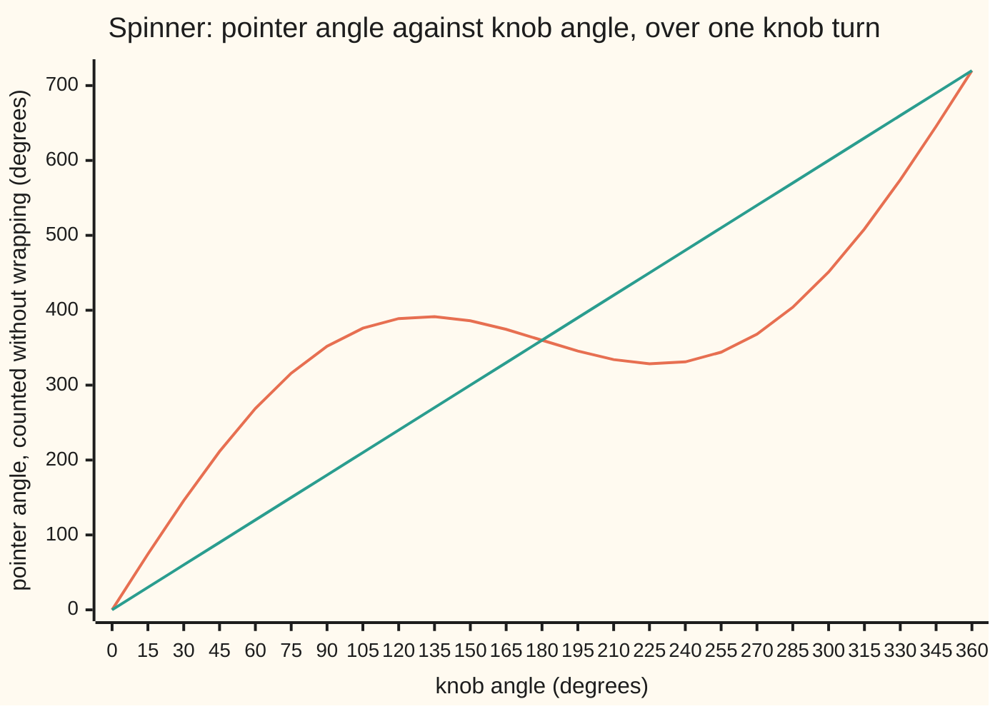

# Sard's theorem and degree: bad values are rare, wrapping is a whole number

[Syllabus](../../../SYLLABUS.md) → [Differential geometry and Lie groups](../README.md) → [Manifolds](../README.md#s03) → Sard's theorem and degree

---

## General Overview

A board-game spinner has a knob under the board. A 2-to-1 gear carries the pointer twice round the dial for each full turn of the knob. A small crank adds a wobble: the pointer runs up to 171.89° ahead of or behind where the gear alone would put it. Over part of each knob turn the wobble wins, and the pointer swings backward.

Ask how many knob positions put the pointer at 12 o'clock. The answer is four: 0°, 94.30°, 180° and 265.70°. For 6 o'clock it is two: 37.58° and 322.42°. The raw count depends on the target, so it says nothing about the spinner itself.

Now score each knob position +1 if the pointer is moving forward (clockwise) there and −1 if it is moving backward. At 12 o'clock the scores are +1, +1, −1, +1, a total of 2. At 6 o'clock they are +1, +1, again 2. Every target gives 2. That signed count is the spinner's **degree**: how many times it wraps the dial, with the backward swings cancelled.

The count fails at only two pointer positions, 31.74° and 328.26°. There the pointer stops to turn round, and a stopped point has no direction to score. **Sard's theorem** says such bad targets are always rare: for any smooth map they fill zero length on the dial, and zero volume in higher dimensions.

**For a smooth map between closed manifolds of the same dimension, almost every target is a regular value (Sard's theorem), and at every regular value the points that land on it, each scored +1 or −1 by whether the map keeps or reverses direction there, add up to the same whole number: the degree, which equals the homology degree.**

**What kind of fact this is:** two theorems and a definition. Sard's theorem is proved on this card for maps between spaces of the same dimension and stated with a source in general. The degree is a definition; that it does not depend on the target is a global theorem, proved in a fold, which needs the source to be closed. Its agreement with the homology degree is proved here on the circle and stated with a source in every dimension.

### The picture: the pointer's total turn as the knob goes round



Orange: the spinner with its wobble. Teal: the gear alone. Both start at 0° and end at 720°, two full turns. The orange line rises, falls between knob angles 131.81° and 228.19°, then rises again. Draw a level line at 360°, which is 12 o'clock after one turn: the orange line crosses it three times, up, down, up. Both checks print every point.

---

## The formula

Five words first, each in one line.

- A **closed manifold** is a smooth manifold that is compact (every covering by open patches has a finite sub-covering; in flat space, closed and bounded: [Compactness three ways](../../17-Topology/01-Metric%20Spaces/06-compactness-in-metric-spaces.md)) and has no edge. A circle and the Earth's surface are closed; an open arc, missing its end points, is not ([Smooth manifold](01-smooth-manifolds-and-charts.md)).
- An **orientation** is a choice, in every chart, of which turning direction counts as positive (in higher dimensions, which order of the axes, read off a determinant's sign), made so that the charts agree where they overlap. On the dial, clockwise is positive.
- A **critical point** of a smooth map $`F`$ is a point $`x`$ where the differential $`dF_x`$ (the map's best linear approximation at $`x`$, [Tangent space and differential](03-tangent-spaces-and-differentials.md)) is not onto. On the circle, that means the slope is zero.
- A **critical value** is the image $`F(x)`$ of a critical point. Every other target is a **regular value**, including targets that nothing lands on.
- A set has **measure zero** when it can be covered by boxes of total length, area or volume as small as wanted ([Null sets and almost everywhere](../../10-Measure%20and%20integration/01-Sets%20You%20Can%20Measure/07-null-sets-and-almost-everywhere.md)). On a manifold, this is checked in charts.

Sard's theorem, for a smooth map $`F`$ from a manifold $`M`$ to a manifold $`N`$:

```math
C = \{\, x \in M : dF_x \text{ is not onto} \,\}, \qquad F(C) \text{ has measure zero in } N
```

**Read it aloud:** collect the critical points into a set C; the targets they hit take up no room in N.

The degree, for $`M`$ and $`N`$ closed, oriented, connected and of the same dimension $`n`$, at any regular value $`y`$:

```math
\deg F = \sum_{x \in F^{-1}(y)} \mathrm{sign}\, \det dF_x
```

**Read it aloud:** list the points x that F sends to y; score each +1 if the differential there keeps orientation and −1 if it reverses it; the total is the degree of F.

Here $`\det dF_x`$ is the determinant of the Jacobian matrix of $`F`$ read in oriented charts. On the circle that matrix is one number, the slope $`F'(t)`$. On the spinner at 12 o'clock the slopes are +5.000, +1.775, −1.000 and +1.775, so the degree is 1 + 1 − 1 + 1 = 2.

The agreement with homology, where $`[M]`$ is the **fundamental class** (the whole manifold covered once, in its orientation) and $`F_*`$ is what $`F`$ does to homology:

```math
F_*[M] = (\deg F)\,[N]
```

**Read it aloud:** pushing the whole of M through F covers N exactly deg F times, counted in homology.

| Symbol | Plain meaning | In our example | Push it up and the answer… |
| --- | --- | --- | --- |
| $`M`$, $`N`$, $`n`$ | source and target: closed, oriented, connected manifolds of the same dimension n | the knob's circle, the dial's circle; n = 1 | larger n: the Jacobian is n by n |
| $`F`$ | a smooth map from $`M`$ to $`N`$ | knob angle to pointer angle | — |
| $`t`$, $`F(t) = Gt + A\sin t`$ | the knob angle; the spinner, in radians, counted without wrapping | $`2t + 3\sin t`$ | — |
| $`G`$, $`A`$ | the gear ratio; the wobble's size in radians | 2; 3.0 rad, 171.89° | G raises the degree; A adds fold-backs |
| $`u`$, $`d`$ | a second chart, a tan of half an angle (Step 2); the net whole turns in Step 4 | slope +0.954 at 94.30°; d = 2 | — |
| $`x`$, $`y`$ | a source point; a target point | knob at 94.30°; pointer at 12 o'clock | — |
| $`F^{-1}(y)`$ | the preimages: all points sent to $`y`$ | knob at 0°, 94.30°, 180°, 265.70° | — |
| $`dF_x`$, $`F'(t)`$ | the differential; on the circle, the slope | +1.775 at 94.30° | — |
| $`C`$, $`F(C)`$ | critical points; critical values | knob 131.81°, 228.19°; pointer 31.74°, 328.26° | — |
| $`\deg F`$, $`[M]`$, $`F_*`$, $`H_n`$ | the degree; the fundamental class; F's effect on homology; the top homology group, a copy of the whole numbers $`\mathbb{Z}`$ | 2; the circle walked once clockwise; $`F_*[M] = 2\,[N]`$ | — |
| $`\Psi`$, $`F_1`$, $`\varphi_s`$, $`z`$ | in Step 3: a homotopy (a smooth slide) from F to a map $`F_1`$; a flow at time s; a second target | — | — |
| $`m`$, $`Q`$, $`k`$, $`c`$, $`D`$, $`E`$, $`L`$, $`\omega`$, $`\delta`$ | in Step 1: source dimension; in its proof, a cube of side 1, cuts per side; a critical point, its Jacobian, the error; bounds on the Jacobian, its change, and the small cube's width | — | — |

Clash, said once: $`\omega`$ here bounds the Jacobian's change, not the symplectic form; the homotopy is $`\Psi`$, not the usual H, since $`H_n`$ is homology.

### When it holds

- **The source is closed.** Limit the knob to the open arc from 0° to 240° and the signed count is 0 at 359.5° but 1 at 179.5°. Preimages can leave through the missing ends.
- **The target is a regular value.** At the critical value 31.74° three knob positions land, and at one of them, 131.81°, the slope is zero: there is no sign to give it.
- **The map is smooth.** Sard needs derivatives. A staircase-shaped spinner that is only continuous, described in What breaks, has rough points of zero length whose images fill the whole dial.
- **Both manifolds are oriented and of the same dimension.** Without orientations, "keeps direction" has no meaning; only the count mod 2 survives, which works on the projective plane. With different dimensions the determinant is not defined.
- **The target is connected.** On a target in two pieces, each piece can have its own count.

---

## Why it works

### Step 0: preimages are born and die in pairs

Move the target slowly round the dial and watch the knob positions that land on it. Away from a fold they slide smoothly, keeping their scores. A pair can only appear or vanish where the pointer stops to turn round. Such a pair is one forward point and one backward point, so it adds +1 − 1 = 0.

That is the whole idea. Signs make births and deaths invisible, so the signed count never changes. Sard's theorem guarantees that the targets where pairs are born are so rare that almost every target is safe to count at.

### Step 1: Sard's theorem, bad values take up no room

On the spinner the critical values are just two points. In general the critical points can fill a whole region. A spinner that pauses for 10° of knob turn has a whole arc of critical points, yet that arc sends the pointer to one single value. Sard's theorem says this always happens: the critical values are thin, even when the critical points are not.

The proof for equal dimensions is a covering count. Cut the knob's circle into small arcs. On an arc that holds a critical point the slope is close to zero, so the arc's image is very short. The checks add up these images on the spinner:

| Arcs | Each arc | Bad values fill |
| --- | --- | --- |
| 36 | 10° | 2.501672° |
| 360 | 1° | 0.025733° |
| 3600 | 0.1° | 0.000314° |

Each tenfold refinement shrinks the total roughly a hundredfold: at a fold, an arc's image grows with the square of its width. The total heads to zero, which is "measure zero".

<details>
<summary>Detailed proof: Sard's theorem when source and target have the same dimension</summary>

Work in one chart, so F maps a closed cube Q of side 1 (rescale the chart if needed) in n-dimensional space into n-dimensional space, with continuous first derivatives. Let C be the critical points in Q.

Cut Q into $`k^n`$ small cubes of side 1/k. Let $`\omega(\delta)`$ be the largest change of the Jacobian matrix between two points at most $`\delta`$ apart; it tends to 0 as $`\delta`$ does, because the derivative is continuous on a compact cube. Let L bound the size of the Jacobian on Q.

Take a small cube that holds a critical point c, and let D be the Jacobian at c. For x in the cube, with $`\delta = \sqrt n / k`$, the small cube's diagonal,

$`\displaystyle F(x) = F(c) + D(x - c) + E, \qquad \lvert E \rvert \le \omega(\delta)\,\delta.`$

D is not onto, so $`D(x - c)`$ lies in a flat piece of dimension n − 1 through the origin and has length at most $`L\delta`$. So F maps the small cube into a slab: a box of n − 1 sides of length $`2(L + \omega)\delta`$ and one side of length $`2\omega(\delta)\delta`$. Its volume is at most

$`\displaystyle 2^n (L + \omega)^{n-1} \omega(\delta)\, \delta^n = \mathrm{const} \cdot \omega(\delta) \cdot k^{-n}.`$

There are at most $`k^n`$ such cubes, so F(C) fits in a total volume of at most const times $`\omega(\delta)`$. As k grows, $`\delta`$ shrinks and $`\omega(\delta)`$ tends to 0. So F(C) has measure zero in each chart, and a manifold needs only countably many charts.

</details>

The general theorem allows the source to have a larger dimension m than the target's n. Then F needs continuous derivatives up to order m − n + 1, and at least order 1. Sard proved it in 1942; Milnor's book gives the proof for smooth maps (Sources). This card states that case and does not prove it.

### Step 2: at a regular value there are finitely many points, and the sign belongs to the map

At a regular value y, every preimage x has an invertible differential, since onto and square means invertible. By the [Regular value theorem](06-submanifolds-and-the-regular-value-theorem.md), the preimage is a manifold of dimension n − n = 0: a set of isolated points. A closed source is compact, and isolated points in a compact set are finitely many. So the sum in the formula is finite.

The sign does not depend on the charts. Changing to another oriented chart multiplies the Jacobian by transition Jacobians, which have positive determinant by the choice of orientation, so the sign of the determinant survives. The checks show this on the spinner. Read each circle instead in the chart $`u = \tan(t/2)`$ on the half facing 0°, or $`u = \tan((t - \pi)/2)`$ on the half facing 180°. Here the knob points at 94.30°, 180° and 265.70° use the second, and the target, 12 o'clock, uses the first. Both charts turn clockwise as u grows. The slopes at the four preimages of 12 o'clock change from +5.000, +1.775, −1.000, +1.775 to +5.000, +0.954, −1.000, +0.954. The sizes are the chart's business; the signs are the map's.

### Step 3: the count is the same at every regular value

By the inverse function theorem ([Inverse and implicit function theorems](../../06-Calculus%20and%20analysis/07-Several%20Variables/07-inverse-and-implicit-function-theorems.md)), F is a smooth one-to-one map near each preimage, with a smooth inverse. Move y a little and each preimage moves a little, keeping its sign. Compactness stops new preimages from arriving from far away. So the signed count is constant near y.

Two more facts finish the argument, both from Milnor's book and proved in the fold.

1. **Homotopic maps give the same count.** If F slides smoothly into another map $`F_1`$, the two counts at a common regular value agree.
2. **Any target can be moved to any other.** A flow on N carries y to z, and the map at time 1 slides into the identity.

Together they carry the count at y to the count at any z, so all regular values give one number, the degree.

<details>
<summary>Detailed proof: homotopy invariance and moving the target</summary>

**Homotopy invariance.** Let $`\Psi : M \times [0, 1] \to N`$ be smooth, with $`\Psi(\cdot, 0) = F`$ and $`\Psi(\cdot, 1) = F_1`$, and let y be a regular value of F, $`F_1`$ and $`\Psi`$ (Sard gives such y close to any target, and Step 3's local constancy lets us use it). By the regular value theorem for manifolds with boundary, $`\Psi^{-1}(y)`$ is a compact manifold of dimension 1: finitely many circles and arcs. Each arc has its two endpoints on the end slices $`M \times \{0\}`$ and $`M \times \{1\}`$.

Orient each arc using the orientations of M, [0, 1] and N. Milnor shows that the two ends of an arc carry opposite signs when both lie on the same end slice, and equal signs when they lie on different end slices. So an arc with both ends at time 0 adds +1 − 1 = 0 there, and an arc from time 0 to time 1 contributes the same sign to both counts. So the signed counts at the two ends agree.

**Moving the target.** On a connected N, any two points y and z can be joined by a chain of small balls. In each ball take a smooth vector field that is zero outside the ball and points from one point to the other near the segment between them ([Vector field and its flow](07-vector-fields-and-flows.md)). Its flow $`\varphi_s`$ is a diffeomorphism for each s, starts at the identity, and carries the first point to the second. Then $`\varphi_1 \circ F`$ is homotopic to F, and its preimages of z are exactly F's preimages of y, with the same signs, because $`\varphi_1`$ keeps orientation. Homotopy invariance gives: count of F at z = count of $`\varphi_1 \circ F`$ at z = count of F at y.

</details>

The checks test this on 360 targets, at 0.5°, 1.5°, …, 359.5°. Without signs, 296 targets have 2 preimages and 64 have 4. With signs, all 360 give 2.

### Step 4: on the circle, the count is the number of turns

On the circle there is a direct proof, and it shows why the answer is a whole number. Follow the pointer angle without wrapping, as in the chart. It starts at $`F(0)`$ and ends one knob turn later at $`F(0) + 360° \times d`$ for some whole number d: the knob is back where it started, so the pointer is too.

A target y sits at the levels y, y + 360°, y + 720°, and so on. Each time the unwrapped line crosses one of these levels going up, the pointer passes y moving forward: +1. Each downward crossing is a backward pass: −1. Going from $`F(0)`$ to $`F(0) + 360° \times d`$, the line must cross exactly d more levels upward than downward. So the signed count is d, the net number of turns.

On the spinner the line starts at 0° and ends at 720°: d = 2. At 12 o'clock it touches 0° at the start, then crosses 360° up at 94.30°, down at 180°, and up at 265.70°. The start and finish at 0° and 720° are the same knob position, counted once. Total: +1 + 1 − 1 + 1 = 2.

[Turning and winding numbers](../01-Curves/08-turning-number-and-winding-number.md) counts these net turns for loops, and [Homology of spheres, and degree](../../17-Topology/05-Homology/07-homology-of-spheres-and-degree.md) shows that on the circle the homology degree is this same net turn count. So on the circle the smooth degree and the homology degree agree.

### Step 5: in every dimension, the smooth count is the homology degree

The spheres card defines the degree of a map of spheres as the whole number that multiplies the sphere's fundamental class, and proves the signed count for maps built from simplices. [Homology groups](../../17-Topology/05-Homology/02-homology-groups.md) measure holes as cycles that are not boundaries. Beyond spheres, a closed, connected, oriented n-manifold also has top group $`H_n \cong \mathbb{Z}`$, generated by a fundamental class $`[M]`$; this card takes that from Hatcher (Sources).

The smooth count meets it like this. Near each preimage x of a regular value, F is a diffeomorphism of small balls. It sends the local top class at x to $`\pm`$ the local class at y, with the sign of $`\det dF_x`$. The fundamental class of M restricts, at each point, to that point's local class. So $`F_*[M]`$ is the sum of the signs times $`[N]`$. Hatcher's book proves this for spheres as Proposition 2.30, and its Section 3.3 carries the argument to closed oriented manifolds (Sources). This card states it and does not repeat the proof.

One consequence: every continuous map between closed, oriented, connected manifolds of the same dimension has a degree. It can be slid to a smooth map without changing its homology degree, and Sard then gives a regular value to count at.

---

## Worked numbers, by hand

The spinner, $`F(t) = 2t + 3\sin t`$, target 12 o'clock. The wobble term $`3\sin t`$ radians is $`171.89° \times \sin t`$.

| Step | Arithmetic | Value |
| --- | --- | --- |
| knob 0° | 0.00 + 0.00 = 0.00°; slope 2 + 3 cos 0° = +5.000 | +1 |
| knob 94.30° | 188.60 + 171.40 = 360.00°; slope 2 + 3 cos 94.30° = +1.775 | +1 |
| knob 180° | 360.00 + 0.00 = 360.00°; slope 2 + 3 cos 180° = −1.000 | −1 |
| knob 265.70° | 531.40 − 171.40 = 360.00°; slope +1.775 | +1 |
| knob positions found | four landings on 12 o'clock | 4 |
| signed count | 1 + 1 − 1 + 1 | **degree 2** |
| 6 o'clock, as a check | knob 37.58° (+4.377) and 322.42° (+4.377) | 2 |

Every target is hit twice in net per knob turn, once per gear turn. The wobble adds landings only in forward-backward pairs.

### What breaks if you drop a piece

| Mistake | Comes out at | What went wrong |
| --- | --- | --- |
| Count without signs | 4 at 12 o'clock, 2 at 6 o'clock; truly 2 everywhere | the backward pass at 180° must cancel one forward pass |
| Count at a critical value | 3 knob positions at 31.74°: 6.36°, 131.81°, 280.40° | the slope is 0 at 131.81°, a fold with no sign |
| Drop "closed": knob limited to 0°–240° | signed count 0 at 359.5°, 1 at 179.5° | preimages leave through the open ends |
| Drop smoothness: a staircase spinner | slope integral 0 turns; pointer turns 1 | rough points of length 0.007707 at stage 12 have images filling the whole turn |

The last row uses the **devil's staircase**, a continuous function that climbs from 0 to 1 while staying flat on the gaps of the Cantor set ([The Cantor set](../../10-Measure%20and%20integration/02-Length%20Done%20Properly/07-the-cantor-set.md)). As a spinner it turns the pointer once, so its degree is 1. Its slope is 0 on gaps of length 0.992293 at stage 12, so the slope integral gives 0 turns. All the climbing happens at rough points with no derivative. They fit in length 0.197531, 0.039018 and 0.007707 at stages 4, 8 and 12, yet their images fill 1.000000 turn each time.

---

## Code, from first principles, and it actually runs

Both programs find every knob position that lands on a target by scanning a grid of 3600 cells and halving the crossing cell 60 times. The degree comes by **three independent roads**:

- the signed count of preimages, at 4 named targets and at 360 sample targets;
- the net turns of the pointer, added up from its positions alone in 3600 small steps with atan2 (the angle of a point from its two coordinates), never using the slope;
- the integral of the slope over one knob turn, by Simpson's rule, divided by one full turn.

The signs are also re-read in a second chart, $`u = \tan(t/2)`$, by finite differences. The checks then print Sard's covering numbers and every case in What breaks. In the code, N is the grid size, not the target manifold.

### Python

```python
# Sard's theorem and degree -- the check behind the card.  Standard library only.
# A spinner: one turn of the knob (angle t) drives the pointer to F(t) = G t + A sin t radians.
# The degree comes three ways: preimages counted with signs, net turns read from pointer
# positions alone, and the integral of the slope F'.  Signs are re-read in a second chart.
import math
TAU, G, A, N = 2 * math.pi, 2, 3.0, 3600       # gear ratio G, wobble A radians, N grid steps

def F(t): return G * t + A * math.sin(t)      # pointer angle, not wrapped, radians
def dF(t): return G + A * math.cos(t)         # slope: pointer turn per knob turn
def deg(x): return math.degrees(x)
def fix(x): return 0.0 if abs(x) < 5e-7 else x   # print -0.00 as 0.00

def preimages(f, y, lo=0.0, hi=TAU, closed=True):   # knob angles where f = y + whole turns
    out, ts = [], [lo + (i + 0.5) * (hi - lo) / N for i in range(N)]
    for i in range(N if closed else N - 1):   # f is a formula on all reals: f(t + TAU) = f(t) + G TAU
        a, b = ts[i], (ts[i + 1] if i < N - 1 else ts[0] + TAU)
        ka, kb = math.floor((f(a) - y) / TAU), math.floor((f(b) - y) / TAU)
        if ka != kb:                          # the cell crosses the level y + max(ka, kb) turns
            lev = y + TAU * max(ka, kb)
            for _ in range(60):               # bisection
                m = (a + b) / 2
                a, b = (a, m) if (f(a) - lev) * (f(m) - lev) <= 0 else (m, b)
            r = ((a + b) / 2) % TAU
            out.append(0.0 if r > TAU - 1e-9 else r)
    return sorted(out)

def sgn(s): return 0 if abs(s) < 1e-9 else (1 if s > 0 else -1)
def signed(f, df, y, **kw): return sum(sgn(df(t)) for t in preimages(f, y, **kw))

def net_turns(f, steps=N):                    # road 2: positions only, small turns by atan2
    total, prev = 0.0, (math.cos(f(0)), math.sin(f(0)))
    for i in range(1, steps + 1):
        p = (math.cos(f(TAU * i / steps)), math.sin(f(TAU * i / steps)))
        total += math.atan2(prev[0] * p[1] - prev[1] * p[0], prev[0] * p[0] + prev[1] * p[1])
        prev = p
    return total / TAU

def simpson(g, a, b, n=N):                    # road 3: integral of the slope
    h = (b - a) / n
    return h / 3 * sum((1 if i in (0, n) else 4 if i % 2 else 2) * g(a + i * h) for i in range(n + 1))

def chart_slope(t, y):                        # second chart: u = tan((angle - c)/2), c = 0 or pi
    cs, cy = (0.0 if math.cos(t) > 0 else math.pi), (0.0 if math.cos(y) > 0 else math.pi)
    phi = lambda u: math.tan((F(cs + 2 * math.atan(u)) - cy) / 2)
    u, h = math.tan((t - cs) / 2), 1e-6
    return (phi(u + h) - phi(u - h)) / (2 * h)

print(f"spinner: pointer = {G} x knob + {A:.1f} rad x sin(knob); wobble {deg(A):.2f} deg")
knobs = list(range(0, 361, 15))
print("chart,knob," + ",".join(str(k) for k in knobs))
print("chart,pointer," + ",".join(f"{deg(F(math.radians(k))):.1f}" for k in knobs))
print("chart,gear only," + ",".join(f"{G * k:.1f}" for k in knobs))

crit = []                                     # critical points: where the slope changes sign
for i in range(N):
    a, b = (i + 0.5) * TAU / N, (i + 1.5) * TAU / N
    if dF(a) * dF(b) < 0:
        for _ in range(60):
            m = (a + b) / 2
            a, b = (a, m) if dF(a) * dF(m) <= 0 else (m, b)
        crit.append((a + b) / 2 % TAU)
cvals = [deg(F(c)) % 360 for c in crit]
print("critical knob angles (slope 0):", " ".join(f"{deg(c):.2f}" for c in crit))
print("critical values (pointer):", " ".join(f"{v:.2f}" for v in cvals))

for name, yd in (("12 o'clock", 0), ("3 o'clock", 90), ("6 o'clock", 180), ("9 o'clock", 270)):
    ts = preimages(F, math.radians(yd))
    print(f"target {name} ({yd} deg): " + " ".join(f"{fix(deg(t)):.2f}({dF(t):+.3f})" for t in ts)
          + f" -> unsigned {len(ts)}, signed {sum(sgn(dF(t)) for t in ts)}")
ts0 = preimages(F, 0.0)
print("by hand:", "; ".join(f"{G * deg(t):.2f} {fix(deg(A * math.sin(t))):+.2f} = {deg(F(t)):.2f}" for t in ts0))
cs = [chart_slope(t, 0.0) for t in ts0]
print("slopes read in the tan charts:", " ".join(f"{s:+.3f}" for s in cs))
assert [sgn(s) for s in cs] == [sgn(dF(t)) for t in ts0], "a chart change flipped a sign"

tally, signs = {}, set()
for j in range(360):                          # targets at 0.5, 1.5, ..., 359.5 degrees
    ts = preimages(F, math.radians(j + 0.5))
    tally[len(ts)] = tally.get(len(ts), 0) + 1
    signs.add(sum(sgn(dF(t)) for t in ts))
print("unsigned counts over 360 targets:", ", ".join(f"{k} at {tally[k]}" for k in sorted(tally)))
print("signed counts over 360 targets:", sorted(signs))
d1, d2, d3 = signed(F, dF, 0.0), net_turns(F), simpson(dF, 0.0, TAU) / TAU
print(f"road 1 signed count {d1}; road 2 net turns {d2:.6f}; road 3 slope integral {d3:.6f}")
assert signs == {d1} and abs(d2 - d1) < 1e-9 and abs(d3 - d1) < 1e-9, "the three roads disagree"
assert (len(tally) > 1) == bool(crit), "unsigned counts vary exactly when the map folds"

covers = []
for m in (36, 360, 3600):                     # Sard: image of the arcs holding a critical point
    w, tot = TAU / m, 0.0
    for i in range(m):
        if dF(i * w) * dF((i + 1) * w) < 0:   # samples, plus the turning point itself
            vals = [F(i * w + w * k / 200) for k in range(201)] + [F(c) for c in crit if int(c / w) == i]
            tot += deg(max(vals) - min(vals))
    print(f"sard cover, {m} arcs of {360 / m:g} deg: bad values fill {tot:.6f} deg")
    covers.append(tot)
assert all(a > 50 * b for a, b in zip(covers, covers[1:])), "a tenfold finer cover shrinks like the square"

if crit:                                      # what breaks 1: count at a critical value
    yc = F(crit[0])
    near = [t for t in preimages(F, yc) if abs(t - crit[0]) > 1e-3] + [crit[0]]
    print(f"at critical value {cvals[0]:.2f}: knob " + " ".join(f"{deg(t):.2f}({fix(dF(t)):+.3f})"
          for t in sorted(near)) + f" -> {len(near)} points, one has no sign")
    assert sgn(dF(crit[0])) == 0 and (len(near) - 1 - d1) % 2 == 0, "transverse points = degree mod 2"
op = [signed(F, dF, math.radians(j + 0.5), hi=math.radians(240), closed=False) for j in range(360)]
print(f"knob limited to 0-240 deg: signed count {op[359]} at 359.5 deg, {op[179]} at 179.5 deg;"
      f" values seen {sorted(set(op))}")
assert len(set(op)) > 1, "an open source lets the signed count change"

cells = [(0.0, 1.0, 0.0, 1.0)]                # what breaks 2: the devil's staircase
for k in range(1, 13):
    cells = [c for a, b, ca, cb in cells for c in ((a, a + (b - a) / 3, ca, (ca + cb) / 2),
                                                   (b - (b - a) / 3, b, (ca + cb) / 2, cb))]
    if k in (4, 8, 12):
        cov, img = sum(b - a for a, b, _, _ in cells), sum(cb - ca for _, _, ca, cb in cells)
        print(f"staircase stage {k}: rough points covered by length {cov:.6f}, their images {img:.6f} turn")
assert abs(cov - (2 / 3) ** 12) < 1e-12 and abs(img - 1) < 1e-12
print(f"staircase: slope 0 on gaps of length {1 - cov:.6f}, so slope integral -> 0 turns; pointer turns {img:.0f}")

mF, mdF = (lambda t: -F(t)), (lambda t: -dF(t))
mirror = (signed(mF, mdF, 0.0), net_turns(mF))
print(f"mirrored dial: signed count {mirror[0]}, net turns {mirror[1]:.6f}")
assert mirror[0] == -d1 and abs(mirror[1] + d1) < 1e-9
print("ALL CHECKS PASS")
```

**Ran 2026-11-19 on macOS, Python 3.14.10, standard library only. All checks passed. Output, pasted from the run:**

```
spinner: pointer = 2 x knob + 3.0 rad x sin(knob); wobble 171.89 deg
chart,knob,0,15,30,45,60,75,90,105,120,135,150,165,180,195,210,225,240,255,270,285,300,315,330,345,360
chart,pointer,0.0,74.5,145.9,211.5,268.9,316.0,351.9,376.0,388.9,391.5,385.9,374.5,360.0,345.5,334.1,328.5,331.1,344.0,368.1,404.0,451.1,508.5,574.1,645.5,720.0
chart,gear only,0.0,30.0,60.0,90.0,120.0,150.0,180.0,210.0,240.0,270.0,300.0,330.0,360.0,390.0,420.0,450.0,480.0,510.0,540.0,570.0,600.0,630.0,660.0,690.0,720.0
critical knob angles (slope 0): 131.81 228.19
critical values (pointer): 31.74 328.26
target 12 o'clock (0 deg): 0.00(+5.000) 94.30(+1.775) 180.00(-1.000) 265.70(+1.775) -> unsigned 4, signed 2
target 3 o'clock (90 deg): 18.18(+4.850) 299.67(+3.485) -> unsigned 2, signed 2
target 6 o'clock (180 deg): 37.58(+4.377) 322.42(+4.377) -> unsigned 2, signed 2
target 9 o'clock (270 deg): 60.33(+3.485) 341.82(+4.850) -> unsigned 2, signed 2
by hand: 0.00 +0.00 = 0.00; 188.60 +171.40 = 360.00; 360.00 +0.00 = 360.00; 531.40 -171.40 = 360.00
slopes read in the tan charts: +5.000 +0.954 -1.000 +0.954
unsigned counts over 360 targets: 2 at 296, 4 at 64
signed counts over 360 targets: [2]
road 1 signed count 2; road 2 net turns 2.000000; road 3 slope integral 2.000000
sard cover, 36 arcs of 10 deg: bad values fill 2.501672 deg
sard cover, 360 arcs of 1 deg: bad values fill 0.025733 deg
sard cover, 3600 arcs of 0.1 deg: bad values fill 0.000314 deg
at critical value 31.74: knob 6.36(+4.982) 131.81(+0.000) 280.40(+2.542) -> 3 points, one has no sign
knob limited to 0-240 deg: signed count 0 at 359.5 deg, 1 at 179.5 deg; values seen [0, 1]
staircase stage 4: rough points covered by length 0.197531, their images 1.000000 turn
staircase stage 8: rough points covered by length 0.039018, their images 1.000000 turn
staircase stage 12: rough points covered by length 0.007707, their images 1.000000 turn
staircase: slope 0 on gaps of length 0.992293, so slope integral -> 0 turns; pointer turns 1
mirrored dial: signed count -2, net turns -2.000000
ALL CHECKS PASS
```

### Rust

```rust
// Sard's theorem and degree -- the check behind the card.  Rust std only, no crates.
// A spinner: one turn of the knob (angle t) drives the pointer to F(t) = G t + A sin t radians.
// The degree comes three ways: preimages counted with signs, net turns read from pointer
// positions alone, and the integral of the slope F'.  Signs are re-read in a second chart.
use std::collections::BTreeMap;
use std::f64::consts::PI;
const TAU: f64 = 2.0 * PI;
const G: i32 = 2; // gear ratio
const A: f64 = 3.0; // wobble, radians
const N: usize = 3600; // grid steps

fn f(t: f64) -> f64 { G as f64 * t + A * t.sin() } // pointer angle, not wrapped, radians
fn df(t: f64) -> f64 { G as f64 + A * t.cos() } // slope: pointer turn per knob turn
fn deg(x: f64) -> f64 { x.to_degrees() }
fn fix(x: f64) -> f64 { if x.abs() < 5e-7 { 0.0 } else { x } } // print -0.00 as 0.00
fn sgn(s: f64) -> i32 { if s.abs() < 1e-9 { 0 } else if s > 0.0 { 1 } else { -1 } }

// knob angles where g = y + whole turns; g is a formula on all reals, g(t + TAU) = g(t) + G TAU
fn preimages(g: &dyn Fn(f64) -> f64, y: f64, lo: f64, hi: f64, closed: bool) -> Vec<f64> {
    let ts: Vec<f64> = (0..N).map(|i| lo + (i as f64 + 0.5) * (hi - lo) / N as f64).collect();
    let mut out = Vec::new();
    for i in 0..(if closed { N } else { N - 1 }) {
        let (mut a, mut b) = (ts[i], if i < N - 1 { ts[i + 1] } else { ts[0] + TAU });
        let ka = ((g(a) - y) / TAU).floor();
        let kb = ((g(b) - y) / TAU).floor();
        if ka != kb { // the cell crosses the level y + max(ka, kb) turns
            let lev = y + TAU * ka.max(kb);
            for _ in 0..60 { // bisection
                let m = (a + b) / 2.0;
                if (g(a) - lev) * (g(m) - lev) <= 0.0 { b = m } else { a = m }
            }
            let r = ((a + b) / 2.0).rem_euclid(TAU);
            out.push(if r > TAU - 1e-9 { 0.0 } else { r });
        }
    }
    out.sort_by(|p, q| p.partial_cmp(q).unwrap());
    out
}

fn signed(g: &dyn Fn(f64) -> f64, dg: &dyn Fn(f64) -> f64, y: f64, hi: f64, closed: bool) -> i32 {
    preimages(g, y, 0.0, hi, closed).iter().map(|&t| sgn(dg(t))).sum()
}

fn net_turns(g: &dyn Fn(f64) -> f64) -> f64 { // road 2: positions only, small turns by atan2
    let (mut total, mut prev) = (0.0, (g(0.0).cos(), g(0.0).sin()));
    for i in 1..=N {
        let x = g(TAU * i as f64 / N as f64);
        let p = (x.cos(), x.sin());
        total += (prev.0 * p.1 - prev.1 * p.0).atan2(prev.0 * p.0 + prev.1 * p.1);
        prev = p;
    }
    total / TAU
}

fn simpson(g: &dyn Fn(f64) -> f64, a: f64, b: f64) -> f64 { // road 3: integral of the slope
    let h = (b - a) / N as f64;
    let mut s = 0.0;
    for i in 0..=N {
        let w = if i == 0 || i == N { 1.0 } else if i % 2 == 1 { 4.0 } else { 2.0 };
        s += w * g(a + i as f64 * h);
    }
    h / 3.0 * s
}

fn chart_slope(t: f64, y: f64) -> f64 { // second chart: u = tan((angle - c)/2), c = 0 or pi
    let cs = if t.cos() > 0.0 { 0.0 } else { PI };
    let cy = if y.cos() > 0.0 { 0.0 } else { PI };
    let phi = |u: f64| ((f(cs + 2.0 * u.atan()) - cy) / 2.0).tan();
    let (u, h) = (((t - cs) / 2.0).tan(), 1e-6);
    (phi(u + h) - phi(u - h)) / (2.0 * h)
}
fn join(v: &[String], sep: &str) -> String { v.join(sep) }
fn main() {
    println!("spinner: pointer = {} x knob + {:.1} rad x sin(knob); wobble {:.2} deg", G, A, deg(A));
    let knobs: Vec<i32> = (0..=360).step_by(15).collect();
    println!("chart,knob,{}", join(&knobs.iter().map(|k| k.to_string()).collect::<Vec<_>>(), ","));
    println!("chart,pointer,{}", join(&knobs.iter().map(|&k| format!("{:.1}", deg(f((k as f64).to_radians())))).collect::<Vec<_>>(), ","));
    println!("chart,gear only,{}", join(&knobs.iter().map(|&k| format!("{:.1}", (G * k) as f64)).collect::<Vec<_>>(), ","));

    let mut crit = Vec::new(); // critical points: where the slope changes sign
    for i in 0..N {
        let (mut a, mut b) = ((i as f64 + 0.5) * TAU / N as f64, (i as f64 + 1.5) * TAU / N as f64);
        if df(a) * df(b) < 0.0 {
            for _ in 0..60 {
                let m = (a + b) / 2.0;
                if df(a) * df(m) <= 0.0 { b = m } else { a = m }
            }
            crit.push(((a + b) / 2.0).rem_euclid(TAU));
        }
    }
    let cvals: Vec<f64> = crit.iter().map(|&c| deg(f(c)).rem_euclid(360.0)).collect();
    println!("critical knob angles (slope 0): {}", join(&crit.iter().map(|&c| format!("{:.2}", deg(c))).collect::<Vec<_>>(), " "));
    println!("critical values (pointer): {}", join(&cvals.iter().map(|v| format!("{:.2}", v)).collect::<Vec<_>>(), " "));

    for (name, yd) in [("12 o'clock", 0), ("3 o'clock", 90), ("6 o'clock", 180), ("9 o'clock", 270)] {
        let ts = preimages(&f, (yd as f64).to_radians(), 0.0, TAU, true);
        let s: i32 = ts.iter().map(|&t| sgn(df(t))).sum();
        println!("target {} ({} deg): {} -> unsigned {}, signed {}", name, yd,
                 join(&ts.iter().map(|&t| format!("{:.2}({:+.3})", fix(deg(t)), df(t))).collect::<Vec<_>>(), " "), ts.len(), s);
    }
    let ts0 = preimages(&f, 0.0, 0.0, TAU, true);
    println!("by hand: {}", join(&ts0.iter().map(|&t| format!("{:.2} {:+.2} = {:.2}", G as f64 * deg(t), fix(deg(A * t.sin())), deg(f(t)))).collect::<Vec<_>>(), "; "));
    let cs: Vec<f64> = ts0.iter().map(|&t| chart_slope(t, 0.0)).collect();
    println!("slopes read in the tan charts: {}", join(&cs.iter().map(|s| format!("{:+.3}", s)).collect::<Vec<_>>(), " "));
    assert!(cs.iter().zip(&ts0).all(|(&s, &t)| sgn(s) == sgn(df(t))), "a chart change flipped a sign");

    let mut tally: BTreeMap<usize, usize> = BTreeMap::new();
    let mut signs = std::collections::BTreeSet::new();
    for j in 0..360 { // targets at 0.5, 1.5, ..., 359.5 degrees
        let ts = preimages(&f, (j as f64 + 0.5).to_radians(), 0.0, TAU, true);
        *tally.entry(ts.len()).or_insert(0) += 1;
        signs.insert(ts.iter().map(|&t| sgn(df(t))).sum::<i32>());
    }
    println!("unsigned counts over 360 targets: {}", join(&tally.iter().map(|(k, v)| format!("{} at {}", k, v)).collect::<Vec<_>>(), ", "));
    println!("signed counts over 360 targets: {:?}", signs.iter().collect::<Vec<_>>());
    let (d1, d2, d3) = (signed(&f, &df, 0.0, TAU, true), net_turns(&f), simpson(&df, 0.0, TAU) / TAU);
    println!("road 1 signed count {}; road 2 net turns {:.6}; road 3 slope integral {:.6}", d1, d2, d3);
    assert!(signs.len() == 1 && signs.contains(&d1) && (d2 - d1 as f64).abs() < 1e-9 && (d3 - d1 as f64).abs() < 1e-9, "the three roads disagree");
    assert!((tally.len() > 1) == !crit.is_empty(), "unsigned counts vary exactly when the map folds");

    let mut covers = Vec::new();
    for (m, lab) in [(36usize, "10"), (360, "1"), (3600, "0.1")] { // Sard: image of the arcs holding a critical point
        let (w, mut tot) = (TAU / m as f64, 0.0);
        for i in 0..m {
            if df(i as f64 * w) * df((i + 1) as f64 * w) < 0.0 { // samples, plus the turning point itself
                let vals: Vec<f64> = (0..=200).map(|k| f(i as f64 * w + w * k as f64 / 200.0)).chain(crit.iter().filter(|&&c| (c / w) as usize == i).map(|&c| f(c))).collect();
                tot += deg(vals.iter().fold(f64::MIN, |a, &v| a.max(v)) - vals.iter().fold(f64::MAX, |a, &v| a.min(v)));
            }
        }
        println!("sard cover, {} arcs of {} deg: bad values fill {:.6} deg", m, lab, tot);
        covers.push(tot);
    }
    assert!(covers.windows(2).all(|p| p[0] > 50.0 * p[1]), "a tenfold finer cover shrinks like the square");

    if !crit.is_empty() { // what breaks 1: count at a critical value
        let yc = f(crit[0]);
        let mut near: Vec<f64> = preimages(&f, yc, 0.0, TAU, true).into_iter().filter(|t| (t - crit[0]).abs() > 1e-3).collect();
        near.push(crit[0]);
        near.sort_by(|p, q| p.partial_cmp(q).unwrap());
        println!("at critical value {:.2}: knob {} -> {} points, one has no sign", cvals[0],
                 join(&near.iter().map(|&t| format!("{:.2}({:+.3})", deg(t), fix(df(t)))).collect::<Vec<_>>(), " "), near.len());
        assert!(sgn(df(crit[0])) == 0 && (near.len() as i32 - 1 - d1) % 2 == 0, "transverse points = degree mod 2");
    }
    let op: Vec<i32> = (0..360).map(|j| signed(&f, &df, (j as f64 + 0.5).to_radians(), 240f64.to_radians(), false)).collect();
    let mut seen = op.clone();
    seen.sort();
    seen.dedup();
    println!("knob limited to 0-240 deg: signed count {} at 359.5 deg, {} at 179.5 deg; values seen {:?}", op[359], op[179], seen);
    assert!(seen.len() > 1, "an open source lets the signed count change");

    let mut cells = vec![(0.0f64, 1.0f64, 0.0f64, 1.0f64)]; // what breaks 2: the devil's staircase
    let (mut cov, mut img) = (0.0, 0.0);
    for k in 1..=12 {
        cells = cells.iter().flat_map(|&(a, b, ca, cb)| vec![(a, a + (b - a) / 3.0, ca, (ca + cb) / 2.0),
                                                             (b - (b - a) / 3.0, b, (ca + cb) / 2.0, cb)]).collect();
        if k == 4 || k == 8 || k == 12 {
            cov = cells.iter().fold(0.0, |s, c| s + (c.1 - c.0));
            img = cells.iter().fold(0.0, |s, c| s + (c.3 - c.2));
            println!("staircase stage {}: rough points covered by length {:.6}, their images {:.6} turn", k, cov, img);
        }
    }
    assert!((cov - (2.0f64 / 3.0).powi(12)).abs() < 1e-12 && (img - 1.0).abs() < 1e-12);
    println!("staircase: slope 0 on gaps of length {:.6}, so slope integral -> 0 turns; pointer turns {:.0}", 1.0 - cov, img);

    let (mf, mdf) = (|t: f64| -f(t), |t: f64| -df(t));
    let mirror = (signed(&mf, &mdf, 0.0, TAU, true), net_turns(&mf));
    println!("mirrored dial: signed count {}, net turns {:.6}", mirror.0, mirror.1);
    assert!(mirror.0 == -d1 && (mirror.1 + d1 as f64).abs() < 1e-9);
    println!("ALL CHECKS PASS");
}
```

**Ran 2026-11-19 on macOS, rustc 1.98.1, no crates. All checks passed. Output, pasted from the run:**

```
spinner: pointer = 2 x knob + 3.0 rad x sin(knob); wobble 171.89 deg
chart,knob,0,15,30,45,60,75,90,105,120,135,150,165,180,195,210,225,240,255,270,285,300,315,330,345,360
chart,pointer,0.0,74.5,145.9,211.5,268.9,316.0,351.9,376.0,388.9,391.5,385.9,374.5,360.0,345.5,334.1,328.5,331.1,344.0,368.1,404.0,451.1,508.5,574.1,645.5,720.0
chart,gear only,0.0,30.0,60.0,90.0,120.0,150.0,180.0,210.0,240.0,270.0,300.0,330.0,360.0,390.0,420.0,450.0,480.0,510.0,540.0,570.0,600.0,630.0,660.0,690.0,720.0
critical knob angles (slope 0): 131.81 228.19
critical values (pointer): 31.74 328.26
target 12 o'clock (0 deg): 0.00(+5.000) 94.30(+1.775) 180.00(-1.000) 265.70(+1.775) -> unsigned 4, signed 2
target 3 o'clock (90 deg): 18.18(+4.850) 299.67(+3.485) -> unsigned 2, signed 2
target 6 o'clock (180 deg): 37.58(+4.377) 322.42(+4.377) -> unsigned 2, signed 2
target 9 o'clock (270 deg): 60.33(+3.485) 341.82(+4.850) -> unsigned 2, signed 2
by hand: 0.00 +0.00 = 0.00; 188.60 +171.40 = 360.00; 360.00 +0.00 = 360.00; 531.40 -171.40 = 360.00
slopes read in the tan charts: +5.000 +0.954 -1.000 +0.954
unsigned counts over 360 targets: 2 at 296, 4 at 64
signed counts over 360 targets: [2]
road 1 signed count 2; road 2 net turns 2.000000; road 3 slope integral 2.000000
sard cover, 36 arcs of 10 deg: bad values fill 2.501672 deg
sard cover, 360 arcs of 1 deg: bad values fill 0.025733 deg
sard cover, 3600 arcs of 0.1 deg: bad values fill 0.000314 deg
at critical value 31.74: knob 6.36(+4.982) 131.81(+0.000) 280.40(+2.542) -> 3 points, one has no sign
knob limited to 0-240 deg: signed count 0 at 359.5 deg, 1 at 179.5 deg; values seen [0, 1]
staircase stage 4: rough points covered by length 0.197531, their images 1.000000 turn
staircase stage 8: rough points covered by length 0.039018, their images 1.000000 turn
staircase stage 12: rough points covered by length 0.007707, their images 1.000000 turn
staircase: slope 0 on gaps of length 0.992293, so slope integral -> 0 turns; pointer turns 1
mirrored dial: signed count -2, net turns -2.000000
ALL CHECKS PASS
```

### Lean

Lean proves Sard's theorem when the dimensions are equal, and the degree on the circle only.

- Take a smooth map between manifolds of the same dimension, where the source needs only countably many charts. Then its critical values have measure zero in every chart of the target.
- Take a smooth map of the circle that, counted without wrapping, moves on $`d`$ whole turns per knob turn. Then each regular value has finitely many landing points, and their signed count is $`d`$.
- Take the spinner $`F(t) = 2t + 3\sin t`$ and any regular value. Then the signed count is 2.
- Take the spinner again. Then knob 0° gives slope +5, knob 180° gives pointer 360° and slope −1, and one knob turn adds 720°.

Every printed number, the tan chart of Step 2 and the cases in What breaks are left to the Python and Rust checks.

```lean
-- Sard's theorem and degree: critical values of a smooth map between manifolds of the same dimension have measure zero in every chart, and on the circle the signed count of preimages at any regular value equals the number of net turns.
import Mathlib.Geometry.Manifold.MFDeriv.Defs
import Mathlib.Geometry.Manifold.Instances.Real
import Mathlib.MeasureTheory.Measure.Haar.InnerProductSpace
import Mathlib.Analysis.SpecialFunctions.Trigonometric.Deriv
import Mathlib.Algebra.BigOperators.Finprod
import Mathlib.Data.Sign.Basic
import Mathlib.MeasureTheory.Function.Jacobian
import Mathlib.Geometry.Manifold.MFDeriv.Atlas
import Mathlib.Geometry.Manifold.MFDeriv.FDeriv

open scoped Manifold ContDiff
open MeasureTheory Set

section SardHelpers

open Filter Topology

theorem sard_det_eq_zero_of_not_surjective {E : Type*} [NormedAddCommGroup E] [NormedSpace ℝ E]
    [FiniteDimensional ℝ E] (A : E →L[ℝ] E) (hA : ¬ Function.Surjective A) : A.det = 0 := by
  by_contra h
  apply hA
  have hu : IsUnit (A : E →ₗ[ℝ] E) :=
    (LinearMap.isUnit_iff_isUnit_det _).2 (isUnit_iff_ne_zero.2 h)
  exact ((Module.End.isUnit_iff _).1 hu).2

open Classical in
/-- Left-hand value of `⌈G⌉` at `s`: the value just before `s`. -/
noncomputable def sardLeftVal (G D : ℝ → ℝ) (s : ℝ) : ℤ :=
  if ∃ k : ℤ, G s = k then (if 0 < D s then ⌈G s⌉ else ⌈G s⌉ + 1) else ⌈G s⌉

open Classical in
/-- Right-hand value of `⌈G⌉` at `s`: the value just after `s`. -/
noncomputable def sardRightVal (G D : ℝ → ℝ) (s : ℝ) : ℤ :=
  if ∃ k : ℤ, G s = k then (if 0 < D s then ⌈G s⌉ + 1 else ⌈G s⌉) else ⌈G s⌉

theorem sard_slope_pos {G : ℝ → ℝ} {d x : ℝ} (h : HasDerivAt G d x) (hd : 0 < d) :
    (∀ᶠ p in 𝓝[>] x, G x < G p) ∧ (∀ᶠ p in 𝓝[<] x, G p < G x) := by
  have ht := hasDerivAt_iff_tendsto_slope.1 h
  have hev : ∀ᶠ p in 𝓝[≠] x, 0 < slope G x p := ht.eventually (lt_mem_nhds hd)
  constructor
  · have h1 : ∀ᶠ p in 𝓝[>] x, 0 < slope G x p :=
      nhdsWithin_mono _ (show Ioi x ⊆ {x}ᶜ from fun p hp => ne_of_gt hp) hev
    filter_upwards [h1, self_mem_nhdsWithin] with p hp hxp
    rw [slope_def_field] at hp
    have : 0 < p - x := sub_pos.2 hxp
    have := (div_pos_iff_of_pos_right this).1 hp
    linarith
  · have h1 : ∀ᶠ p in 𝓝[<] x, 0 < slope G x p :=
      nhdsWithin_mono _ (show Iio x ⊆ {x}ᶜ from fun p hp => ne_of_lt hp) hev
    filter_upwards [h1, self_mem_nhdsWithin] with p hp hxp
    rw [slope_def_field] at hp
    have : p - x < 0 := sub_neg.2 hxp
    rcases div_pos_iff.1 hp with h | h
    · linarith [h.2]
    · linarith [h.1]

theorem sard_slope_neg {G : ℝ → ℝ} {d x : ℝ} (h : HasDerivAt G d x) (hd : d < 0) :
    (∀ᶠ p in 𝓝[>] x, G p < G x) ∧ (∀ᶠ p in 𝓝[<] x, G x < G p) := by
  obtain ⟨h1, h2⟩ := sard_slope_pos h.neg (by linarith)
  exact ⟨h1.mono fun p hp => by simpa using hp, h2.mono fun p hp => by simpa using hp⟩

theorem sard_isolated {G D : ℝ → ℝ} (hG : ∀ t, HasDerivAt G (D t) t)
    (hT : ∀ t, ∀ k : ℤ, G t = k → D t ≠ 0) (t : ℝ) :
    ∀ᶠ p in 𝓝[≠] t, ¬ ∃ k : ℤ, G p = k := by
  have hc : ContinuousAt G t := (hG t).continuousAt
  by_cases hx : ∃ k : ℤ, G t = k
  · obtain ⟨k, hk⟩ := hx
    have hne := (hG t).eventually_ne (c := G t) (hT t k hk)
    have hnear : ∀ᶠ p in 𝓝 t, G p ∈ Ioo ((k : ℝ) - 1) (k + 1) :=
      hc.eventually (Ioo_mem_nhds (by rw [hk]; linarith) (by rw [hk]; linarith))
    filter_upwards [hne, nhdsWithin_le_nhds hnear] with p hp1 hp2
    rintro ⟨j, hj⟩
    rw [hj] at hp2
    have h1 : k - 1 < j := by exact_mod_cast hp2.1
    have h2 : j < k + 1 := by exact_mod_cast hp2.2
    have : j = k := by omega
    exact hp1 (by rw [hj, hk, this])
  · push_neg at hx
    set m := ⌈G t⌉
    have hlt : G t < m := lt_of_le_of_ne (Int.le_ceil _) (hx m)
    have hgt : (m : ℝ) - 1 < G t := by
      have := Int.ceil_lt_add_one (G t); linarith
    have hnear : ∀ᶠ p in 𝓝 t, G p ∈ Ioo ((m : ℝ) - 1) m := hc.eventually (Ioo_mem_nhds hgt hlt)
    filter_upwards [nhdsWithin_le_nhds hnear] with p hp
    rintro ⟨j, hj⟩
    rw [hj] at hp
    have h1 : m - 1 < j := by exact_mod_cast hp.1
    have h2 : j < m := by exact_mod_cast hp.2
    omega

theorem sard_finite {G D : ℝ → ℝ} (hG : ∀ t, HasDerivAt G (D t) t)
    (hT : ∀ t, ∀ k : ℤ, G t = k → D t ≠ 0) (a b : ℝ) :
    {t | t ∈ Icc a b ∧ ∃ k : ℤ, G t = k}.Finite := by
  by_contra h
  obtain ⟨x, -, hacc⟩ := Set.Infinite.exists_accPt_of_subset_isCompact h isCompact_Icc
    (fun t ht => ht.1)
  obtain ⟨p, hp1, hp2⟩ :=
    ((accPt_iff_frequently_nhdsNE.1 hacc).and_eventually (sard_isolated hG hT x)).exists
  exact hp2 hp1.2

theorem sard_const {G D : ℝ → ℝ} (hG : ∀ t, HasDerivAt G (D t) t) {u v : ℝ}
    (hno : ∀ t ∈ Ioo u v, ¬ ∃ k : ℤ, G t = k) {p q : ℝ} (hp : p ∈ Ioo u v) (hq : q ∈ Ioo u v) :
    ⌈G p⌉ = ⌈G q⌉ := by
  have hcont : Continuous G := continuous_iff_continuousAt.2 fun t => (hG t).continuousAt
  have key : ∀ p ∈ Ioo u v, ∀ q ∈ Ioo u v, ⌈G p⌉ ≤ ⌈G q⌉ := by
    intro p hp q hq
    by_contra hlt
    push_neg at hlt
    set n := ⌈G q⌉
    have h1 : G q < n := lt_of_le_of_ne (Int.le_ceil _) (fun h => hno q hq ⟨n, h⟩)
    have h2 : (n : ℝ) < G p := Int.lt_ceil.1 hlt
    have hmem : (n : ℝ) ∈ uIcc (G q) (G p) := by
      rw [uIcc_of_le (by linarith)]; exact ⟨h1.le, h2.le⟩
    obtain ⟨s, hs, hsn⟩ := intermediate_value_uIcc hcont.continuousOn hmem
    exact hno s (ordConnected_Ioo.uIcc_subset hq hp hs) ⟨n, hsn⟩
  exact le_antisymm (key p hp q hq) (key q hq p hp)

theorem sard_right_witness {G D : ℝ → ℝ} (hG : ∀ t, HasDerivAt G (D t) t)
    (hT : ∀ t, ∀ k : ℤ, G t = k → D t ≠ 0) {u v : ℝ} (huv : u < v) :
    ∃ p ∈ Ioo u v, ⌈G p⌉ = sardRightVal G D u := by
  have hc : ContinuousAt G u := (hG u).continuousAt
  suffices H : ∀ᶠ p in 𝓝[>] u, ⌈G p⌉ = sardRightVal G D u by
    obtain ⟨p, hp1, hp2⟩ := (H.and (Ioo_mem_nhdsGT huv)).exists
    exact ⟨p, hp2, hp1⟩
  unfold sardRightVal
  by_cases hx : ∃ k : ℤ, G u = k
  · obtain ⟨k, hk⟩ := hx
    rw [if_pos ⟨k, hk⟩, hk, Int.ceil_intCast]
    have hnear : ∀ᶠ p in 𝓝 u, G p ∈ Ioo ((k : ℝ) - 1) (k + 1) :=
      hc.eventually (Ioo_mem_nhds (by rw [hk]; linarith) (by rw [hk]; linarith))
    rcases lt_or_gt_of_ne (hT u k hk) with hneg | hpos
    · rw [if_neg (not_lt.2 hneg.le)]
      filter_upwards [(sard_slope_neg (hG u) hneg).1, nhdsWithin_le_nhds hnear] with p hp1 hp2
      rw [Int.ceil_eq_iff]; rw [hk] at hp1; exact ⟨hp2.1, hp1.le⟩
    · rw [if_pos hpos]
      filter_upwards [(sard_slope_pos (hG u) hpos).1, nhdsWithin_le_nhds hnear] with p hp1 hp2
      rw [Int.ceil_eq_iff]; rw [hk] at hp1; push_cast; exact ⟨by linarith, hp2.2.le⟩
  · rw [if_neg hx]
    push_neg at hx
    set m := ⌈G u⌉
    have hlt : G u < m := lt_of_le_of_ne (Int.le_ceil _) (hx m)
    have hgt : (m : ℝ) - 1 < G u := by
      have := Int.ceil_lt_add_one (G u); linarith
    have hnear : ∀ᶠ p in 𝓝 u, G p ∈ Ioo ((m : ℝ) - 1) m := hc.eventually (Ioo_mem_nhds hgt hlt)
    filter_upwards [nhdsWithin_le_nhds hnear] with p hp
    rw [Int.ceil_eq_iff]; exact ⟨hp.1, hp.2.le⟩

theorem sard_left_witness {G D : ℝ → ℝ} (hG : ∀ t, HasDerivAt G (D t) t)
    (hT : ∀ t, ∀ k : ℤ, G t = k → D t ≠ 0) {u v : ℝ} (huv : u < v) :
    ∃ q ∈ Ioo u v, ⌈G q⌉ = sardLeftVal G D v := by
  have hc : ContinuousAt G v := (hG v).continuousAt
  suffices H : ∀ᶠ q in 𝓝[<] v, ⌈G q⌉ = sardLeftVal G D v by
    obtain ⟨q, hq1, hq2⟩ := (H.and (Ioo_mem_nhdsLT huv)).exists
    exact ⟨q, hq2, hq1⟩
  unfold sardLeftVal
  by_cases hx : ∃ k : ℤ, G v = k
  · obtain ⟨k, hk⟩ := hx
    rw [if_pos ⟨k, hk⟩, hk, Int.ceil_intCast]
    have hnear : ∀ᶠ p in 𝓝 v, G p ∈ Ioo ((k : ℝ) - 1) (k + 1) :=
      hc.eventually (Ioo_mem_nhds (by rw [hk]; linarith) (by rw [hk]; linarith))
    rcases lt_or_gt_of_ne (hT v k hk) with hneg | hpos
    · rw [if_neg (not_lt.2 hneg.le)]
      filter_upwards [(sard_slope_neg (hG v) hneg).2, nhdsWithin_le_nhds hnear] with p hp1 hp2
      rw [Int.ceil_eq_iff]; rw [hk] at hp1; push_cast; exact ⟨by linarith, hp2.2.le⟩
    · rw [if_pos hpos]
      filter_upwards [(sard_slope_pos (hG v) hpos).2, nhdsWithin_le_nhds hnear] with p hp1 hp2
      rw [Int.ceil_eq_iff]; rw [hk] at hp1; exact ⟨hp2.1, hp1.le⟩
  · rw [if_neg hx]
    push_neg at hx
    set m := ⌈G v⌉
    have hlt : G v < m := lt_of_le_of_ne (Int.le_ceil _) (hx m)
    have hgt : (m : ℝ) - 1 < G v := by
      have := Int.ceil_lt_add_one (G v); linarith
    have hnear : ∀ᶠ p in 𝓝 v, G p ∈ Ioo ((m : ℝ) - 1) m := hc.eventually (Ioo_mem_nhds hgt hlt)
    filter_upwards [nhdsWithin_le_nhds hnear] with p hp
    rw [Int.ceil_eq_iff]; exact ⟨hp.1, hp.2.le⟩

theorem sard_gap {G D : ℝ → ℝ} (hG : ∀ t, HasDerivAt G (D t) t)
    (hT : ∀ t, ∀ k : ℤ, G t = k → D t ≠ 0) {u v : ℝ} (huv : u < v)
    (hno : ∀ t ∈ Ioo u v, ¬ ∃ k : ℤ, G t = k) :
    sardRightVal G D u = sardLeftVal G D v := by
  obtain ⟨p, hp, hp'⟩ := sard_right_witness hG hT huv
  obtain ⟨q, hq, hq'⟩ := sard_left_witness hG hT huv
  rw [← hp', ← hq']
  exact sard_const hG hno hp hq

theorem sard_noncross {G D : ℝ → ℝ} {s : ℝ} (hs : ¬ ∃ k : ℤ, G s = k) :
    sardLeftVal G D s = sardRightVal G D s := by
  simp only [sardLeftVal, sardRightVal, if_neg hs]

theorem sard_telescope {G D : ℝ → ℝ} (hG : ∀ t, HasDerivAt G (D t) t)
    (hT : ∀ t, ∀ k : ℤ, G t = k → D t ≠ 0) (a : ℝ) :
    ∀ n : ℕ, ∀ b, a ≤ b → {t | t ∈ Ico a b ∧ ∃ k : ℤ, G t = k}.ncard = n →
      ∑ᶠ t ∈ {t | t ∈ Ico a b ∧ ∃ k : ℤ, G t = k}, (sardRightVal G D t - sardLeftVal G D t)
        = sardLeftVal G D b - sardLeftVal G D a := by
  intro n
  induction n using Nat.strong_induction_on with
  | _ n ih =>
  intro b hab hn
  set Z := {t | t ∈ Ico a b ∧ ∃ k : ℤ, G t = k} with hZ
  have hfin : Z.Finite :=
    (sard_finite hG hT a b).subset fun t ht => ⟨Ico_subset_Icc_self ht.1, ht.2⟩
  rcases Z.eq_empty_or_nonempty with he | hne
  · rw [he, finsum_mem_empty]
    rcases hab.lt_or_eq with hlt | heq
    · have ha : ¬ ∃ k : ℤ, G a = k := fun h => by
        have : a ∈ Z := ⟨⟨le_rfl, hlt⟩, h⟩
        rw [he] at this; exact this
      rw [← sard_gap hG hT hlt (fun t ht h => by
        have : t ∈ Z := ⟨⟨ht.1.le, ht.2⟩, h⟩
        rw [he] at this; exact this), sard_noncross ha]
      ring
    · rw [heq]; ring
  · obtain ⟨t0, ht0, hmax⟩ := Set.exists_max_image Z id hfin hne
    have hsplit : Z = insert t0 {t | t ∈ Ico a t0 ∧ ∃ k : ℤ, G t = k} := by
      ext t
      simp only [hZ, mem_setOf_eq, mem_insert_iff, mem_Ico]
      constructor
      · rintro ⟨⟨h1, h2⟩, h3⟩
        rcases eq_or_ne t t0 with h | h
        · exact Or.inl h
        · exact Or.inr ⟨⟨h1, lt_of_le_of_ne (hmax t ⟨⟨h1, h2⟩, h3⟩) h⟩, h3⟩
      · rintro (rfl | ⟨⟨h1, h2⟩, h3⟩)
        · exact ht0
        · exact ⟨⟨h1, h2.trans ht0.1.2⟩, h3⟩
    have hnot : t0 ∉ {t | t ∈ Ico a t0 ∧ ∃ k : ℤ, G t = k} := fun h => lt_irrefl _ h.1.2
    have hfin' : {t | t ∈ Ico a t0 ∧ ∃ k : ℤ, G t = k}.Finite :=
      hfin.subset (by rw [hsplit]; exact subset_insert _ _)
    have hcard : {t | t ∈ Ico a t0 ∧ ∃ k : ℤ, G t = k}.ncard < n := by
      rw [← hn, hsplit, ncard_insert_of_notMem hnot hfin']
      omega
    rw [hsplit, finsum_mem_insert _ hnot hfin', ih _ hcard t0 ht0.1.1 rfl,
      sard_gap hG hT ht0.1.2 (fun t ht h => by
        have := hmax t ⟨⟨ht0.1.1.trans ht.1.le, ht.2⟩, h⟩
        exact absurd ht.1 (not_lt.2 this))]
    ring

end SardHelpers

/-- Sard's theorem, same dimension: for a smooth map `F` between smooth manifolds of the same
dimension `n`, the critical values (images of the points where `dF` is not onto) take up no room
in the target: read in any chart of `N`, they form a set of measure zero. -/
theorem critical_values_measure_zero {n : ℕ}
    {M : Type*} [TopologicalSpace M] [ChartedSpace (EuclideanSpace ℝ (Fin n)) M]
    [IsManifold (𝓡 n) ∞ M] [SecondCountableTopology M]
    {N : Type*} [TopologicalSpace N] [ChartedSpace (EuclideanSpace ℝ (Fin n)) N]
    [IsManifold (𝓡 n) ∞ N]
    (F : M → N) (hF : ContMDiff (𝓡 n) (𝓡 n) ∞ F) :
    ∀ e ∈ atlas (EuclideanSpace ℝ (Fin n)) N,
      volume (e '' (F '' {x | ¬ Function.Surjective (mfderiv (𝓡 n) (𝓡 n) F x)} ∩ e.source)) = 0 := by
  intro e he
  set C := {x | ¬ Function.Surjective (mfderiv (𝓡 n) (𝓡 n) F x)} with hC
  obtain ⟨s, hs, hcover⟩ := TopologicalSpace.countable_cover_nhds
    (f := fun x : M => (chartAt (EuclideanSpace ℝ (Fin n)) x).source)
    (fun x => (chartAt (EuclideanSpace ℝ (Fin n)) x).open_source.mem_nhds (mem_chart_source _ x))
  have hFd : MDifferentiable (𝓡 n) (𝓡 n) F := hF.mdifferentiable (by simp)
  let D : M → Set M := fun x => C ∩ F ⁻¹' e.source ∩ (chartAt (EuclideanSpace ℝ (Fin n)) x).source
  let g : M → EuclideanSpace ℝ (Fin n) → EuclideanSpace ℝ (Fin n) :=
    fun x p => e (F ((chartAt (EuclideanSpace ℝ (Fin n)) x).symm p))
  have hsub : e '' (F '' C ∩ e.source) ⊆
      ⋃ x ∈ s, g x '' ((chartAt (EuclideanSpace ℝ (Fin n)) x) '' D x) := by
    rintro _ ⟨_, ⟨⟨z, hz, rfl⟩, hze⟩, rfl⟩
    have hzu : z ∈ ⋃ x ∈ s, (chartAt (EuclideanSpace ℝ (Fin n)) x).source := by
      rw [hcover]; trivial
    simp only [mem_iUnion] at hzu
    obtain ⟨x, hx, hzx⟩ := hzu
    simp only [mem_iUnion]
    refine ⟨x, hx, _, ⟨z, ⟨⟨hz, hze⟩, hzx⟩, rfl⟩, ?_⟩
    simp only [g, (chartAt (EuclideanSpace ℝ (Fin n)) x).left_inv hzx]
  refine measure_mono_null hsub ?_
  refine (measure_biUnion_null_iff hs).2 fun x _ => ?_
  set φ := chartAt (EuclideanSpace ℝ (Fin n)) x with hφ
  have key : ∀ z ∈ D x, MDifferentiableAt (𝓡 n) (𝓡 n) (g x) (φ z) ∧
      ¬ Function.Surjective (mfderiv (𝓡 n) (𝓡 n) (g x) (φ z)) := by
    rintro z ⟨⟨hzC, hze⟩, hzx⟩
    have h1 : MDifferentiableAt (𝓡 n) (𝓡 n) φ.symm (φ z) :=
      mdifferentiableAt_atlas_symm (chart_mem_atlas _ _) (φ.map_source hzx)
    have h2 : MDifferentiableAt (𝓡 n) (𝓡 n) F (φ.symm (φ z)) := hFd _
    have hze' : F (φ.symm (φ z)) ∈ e.source := by rw [φ.left_inv hzx]; exact hze
    have h3 : MDifferentiableAt (𝓡 n) (𝓡 n) e (F (φ.symm (φ z))) :=
      mdifferentiableAt_atlas he hze'
    have h21 := h2.comp (φ z) h1
    refine ⟨h3.comp (φ z) h21, ?_⟩
    have hg : g x = e ∘ (F ∘ φ.symm) := rfl
    rw [hg, mfderiv_comp (φ z) h3 h21, mfderiv_comp (φ z) h2 h1]
    intro hsurj
    apply hzC
    have hinj := (mdifferentiable_of_mem_atlas (I := 𝓡 n) he).mfderiv_injective hze'
    rw [φ.left_inv hzx] at hinj
    intro u
    obtain ⟨v, hv⟩ := hsurj (mfderiv (𝓡 n) (𝓡 n) e (F z) u)
    have hw : φ.symm (φ z) = z := φ.left_inv hzx
    simp only [Function.comp_apply] at hv
    generalize φ.symm (φ z) = w at hv hw
    subst hw
    exact ⟨_, hinj hv⟩
  refine addHaar_image_eq_zero_of_det_fderivWithin_eq_zero _
    (f' := fun p => mfderiv (𝓡 n) (𝓡 n) (g x) p) (fun p hp => ?_) (fun p hp => ?_)
  · obtain ⟨z, hz, rfl⟩ := hp
    exact (key z hz).1.hasMFDerivAt.hasFDerivAt.hasFDerivWithinAt
  · obtain ⟨z, hz, rfl⟩ := hp
    exact sard_det_eq_zero_of_not_surjective _ (key z hz).2

/-- Degree on the circle: let `F` be a smooth map of the circle to itself, followed without
wrapping, so that one full turn of the source moves it on by `d` full turns
(`F (t + 2π) = F t + 2π d`). At every regular value `y` the source points landing on `y`
are finitely many, and scoring each `+1` or `-1` by the sign of the slope there gives `d`,
the same whole number for every regular value. -/
theorem signed_count_eq_net_turns (F : ℝ → ℝ) (d : ℤ) (hF : ContDiff ℝ ∞ F)
    (hturn : ∀ t, F (t + 2 * Real.pi) = F t + 2 * Real.pi * d) (y : ℝ)
    (hreg : ∀ t, ∀ k : ℤ, F t = y + 2 * Real.pi * k → deriv F t ≠ 0) :
    {t | t ∈ Ico 0 (2 * Real.pi) ∧ ∃ k : ℤ, F t = y + 2 * Real.pi * k}.Finite ∧
      ∑ᶠ t ∈ {t | t ∈ Ico 0 (2 * Real.pi) ∧ ∃ k : ℤ, F t = y + 2 * Real.pi * k},
        ((SignType.sign (deriv F t) : SignType) : ℤ) = d := by
  have hpi : 0 < 2 * Real.pi := by positivity
  have hd : Differentiable ℝ F := hF.differentiable (by simp)
  let G : ℝ → ℝ := fun t => (F t - y) / (2 * Real.pi)
  let D : ℝ → ℝ := fun t => deriv F t / (2 * Real.pi)
  have hG : ∀ t, HasDerivAt G (D t) t := fun t => ((hd t).hasDerivAt.sub_const y).div_const _
  have hcross : ∀ t (k : ℤ), F t = y + 2 * Real.pi * k ↔ G t = k := by
    intro t k
    simp only [G]
    rw [div_eq_iff hpi.ne']
    constructor <;> intro h <;> linarith
  have hT : ∀ t, ∀ k : ℤ, G t = k → D t ≠ 0 := fun t k hk =>
    div_ne_zero (hreg t k ((hcross t k).2 hk)) hpi.ne'
  have hS : {t | t ∈ Ico 0 (2 * Real.pi) ∧ ∃ k : ℤ, F t = y + 2 * Real.pi * k} =
      {t | t ∈ Ico 0 (2 * Real.pi) ∧ ∃ k : ℤ, G t = k} := by
    ext t; simp only [mem_setOf_eq, hcross]
  rw [hS]
  refine ⟨(sard_finite hG hT 0 (2 * Real.pi)).subset
    fun t ht => ⟨Ico_subset_Icc_self ht.1, ht.2⟩, ?_⟩
  have hsum : ∀ t ∈ {t | t ∈ Ico 0 (2 * Real.pi) ∧ ∃ k : ℤ, G t = k},
      ((SignType.sign (deriv F t) : SignType) : ℤ) = sardRightVal G D t - sardLeftVal G D t := by
    intro t ht
    obtain ⟨k, hk⟩ := ht.2
    have hne := hreg t k ((hcross t k).2 hk)
    have hDpos : 0 < D t ↔ 0 < deriv F t := div_pos_iff_of_pos_right hpi
    unfold sardRightVal sardLeftVal
    rw [if_pos ht.2, if_pos ht.2]
    rcases lt_or_gt_of_ne hne with h | h
    · rw [if_neg (by rw [hDpos]; exact not_lt.2 h.le), if_neg (by rw [hDpos]; exact not_lt.2 h.le),
        sign_neg h]
      simp
    · rw [if_pos (hDpos.2 h), if_pos (hDpos.2 h), sign_pos h]
      simp
  rw [finsum_mem_congr rfl hsum, sard_telescope hG hT 0 _ (2 * Real.pi) hpi.le rfl]
  have hF2 : F (2 * Real.pi) = F 0 + 2 * Real.pi * d := by simpa using hturn 0
  have hD2 : deriv F (2 * Real.pi) = deriv F 0 := by
    have h1 : (fun t => F (t + 2 * Real.pi)) = fun t => F t + 2 * Real.pi * d := funext hturn
    have h2 := congrArg (fun f => deriv f 0) h1
    rw [deriv_comp_add_const, deriv_add_const, zero_add] at h2
    exact h2
  have hG2 : G (2 * Real.pi) = G 0 + d := by
    simp only [G]; rw [hF2]; field_simp; ring
  have hX2 : (∃ k : ℤ, G (2 * Real.pi) = k) ↔ ∃ k : ℤ, G 0 = k := by
    rw [hG2]
    constructor
    · rintro ⟨k, hk⟩; exact ⟨k - d, by push_cast; linarith⟩
    · rintro ⟨k, hk⟩; exact ⟨k + d, by push_cast; linarith⟩
  have hDD : D (2 * Real.pi) = D 0 := by simp only [D, hD2]
  unfold sardLeftVal
  rw [hDD]
  by_cases h0 : ∃ k : ℤ, G 0 = k
  · rw [if_pos (hX2.2 h0), if_pos h0, hG2, Int.ceil_add_intCast]
    split_ifs <;> ring
  · rw [if_neg (fun h => h0 (hX2.1 h)), if_neg h0, hG2, Int.ceil_add_intCast]
    ring

/-- The spinner `F t = 2 t + 3 sin t` has degree 2: at every regular value the signed count of
knob positions landing on it is 2. -/
theorem spinner_signed_count_eq_two (y : ℝ)
    (hreg : ∀ t, ∀ k : ℤ, 2 * t + 3 * Real.sin t = y + 2 * Real.pi * k →
      deriv (fun s => 2 * s + 3 * Real.sin s) t ≠ 0) :
    ∑ᶠ t ∈ {t | t ∈ Ico 0 (2 * Real.pi) ∧ ∃ k : ℤ, 2 * t + 3 * Real.sin t = y + 2 * Real.pi * k},
      ((SignType.sign (deriv (fun s => 2 * s + 3 * Real.sin s) t) : SignType) : ℤ) = 2 := by
  have hsm : ContDiff ℝ ∞ (fun s : ℝ => 2 * s + 3 * Real.sin s) := by fun_prop
  have hturn : ∀ t, (fun s : ℝ => 2 * s + 3 * Real.sin s) (t + 2 * Real.pi) =
      (fun s : ℝ => 2 * s + 3 * Real.sin s) t + 2 * Real.pi * ((2 : ℤ) : ℝ) := by
    intro t; simp only [Real.sin_add_two_pi]; push_cast; ring
  exact (signed_count_eq_net_turns _ 2 hsm hturn y hreg).2

-- The spinner wraps the dial twice: one knob turn moves the pointer on by two full turns.
example : ∀ t : ℝ, 2 * (t + 2 * Real.pi) + 3 * Real.sin (t + 2 * Real.pi)
    = (2 * t + 3 * Real.sin t) + 2 * Real.pi * 2 := by
  intro t; rw [Real.sin_add_two_pi]; ring

-- Knob 0°: pointer at 0°, slope 2 + 3 cos 0 = +5.
example : 2 * (0 : ℝ) + 3 * Real.sin 0 = 0 ∧
    deriv (fun s : ℝ => 2 * s + 3 * Real.sin s) 0 = 5 := by
  have h : HasDerivAt (fun s : ℝ => 2 * s + 3 * Real.sin s) (2 * 1 + 3 * Real.cos 0) 0 :=
    ((hasDerivAt_id' 0).const_mul 2).add ((Real.hasDerivAt_sin 0).const_mul 3)
  refine ⟨by simp, ?_⟩
  rw [h.deriv]; norm_num

-- Knob 180°: pointer at 360°, slope 2 + 3 cos 180° = -1.
example : 2 * Real.pi + 3 * Real.sin Real.pi = 2 * Real.pi ∧
    deriv (fun s : ℝ => 2 * s + 3 * Real.sin s) Real.pi = -1 := by
  have h : HasDerivAt (fun s : ℝ => 2 * s + 3 * Real.sin s)
      (2 * 1 + 3 * Real.cos Real.pi) Real.pi :=
    ((hasDerivAt_id' Real.pi).const_mul 2).add ((Real.hasDerivAt_sin Real.pi).const_mul 3)
  refine ⟨by simp, ?_⟩
  rw [h.deriv]; norm_num

-- The signed count at 12 o'clock: 1 + 1 - 1 + 1 = 2.
example : (1 + 1 - 1 + 1 : ℤ) = 2 := by
  norm_num

-- Unsigned counts over 360 targets: 296 with 2 preimages and 64 with 4.
example : (296 + 64 : ℕ) = 360 := by
  norm_num

#print axioms sard_det_eq_zero_of_not_surjective
#print axioms sard_slope_pos
#print axioms sard_slope_neg
#print axioms sard_isolated
#print axioms sard_finite
#print axioms sard_const
#print axioms sard_right_witness
#print axioms sard_left_witness
#print axioms sard_gap
#print axioms sard_noncross
#print axioms sard_telescope
#print axioms critical_values_measure_zero
#print axioms signed_count_eq_net_turns
#print axioms spinner_signed_count_eq_two
```

**Checked 2026-11-19 on macOS, Lean 4.36.0-rc2, Mathlib v4.36.0-rc2. Every proof is complete and uses only Lean's standard axioms. Output, pasted from the run:**

```
'sard_det_eq_zero_of_not_surjective' depends on axioms: [propext, Classical.choice, Quot.sound]
'sard_slope_pos' depends on axioms: [propext, Classical.choice, Quot.sound]
'sard_slope_neg' depends on axioms: [propext, Classical.choice, Quot.sound]
'sard_isolated' depends on axioms: [propext, Classical.choice, Quot.sound]
'sard_finite' depends on axioms: [propext, Classical.choice, Quot.sound]
'sard_const' depends on axioms: [propext, Classical.choice, Quot.sound]
'sard_right_witness' depends on axioms: [propext, Classical.choice, Quot.sound]
'sard_left_witness' depends on axioms: [propext, Classical.choice, Quot.sound]
'sard_gap' depends on axioms: [propext, Classical.choice, Quot.sound]
'sard_noncross' depends on axioms: [propext, Classical.choice, Quot.sound]
'sard_telescope' depends on axioms: [propext, Classical.choice, Quot.sound]
'critical_values_measure_zero' depends on axioms: [propext, Classical.choice, Quot.sound]
'signed_count_eq_net_turns' depends on axioms: [propext, Classical.choice, Quot.sound]
'spinner_signed_count_eq_two' depends on axioms: [propext, Classical.choice, Quot.sound]
```

> [!TIP]
> **Try changing**
> - **Guess first: does a gentler wobble remove the bad values?** Set `A = 1.5`. The slope 2 + 1.5 cos t never reaches zero, so there are no critical values: every one of the 360 targets has exactly 2 preimages. The degree is still 2.
> - **Guess first: does a wilder wobble change the degree?** Set `A = 6.0`. The critical values move to 183.06° and 176.94°, and the raw counts become 4 at 354 targets and 6 at 6 targets. The signed count is still 2 at every one.
> - **Guess first: what does the gear ratio do?** Set `G = 3` and `A = 4.0`. All three roads give 3, raw counts are 3 at 306 targets and 5 at 54, and the mirrored dial gives −3.
> - **Guess first: what does a mirrored dial give?** Already printed: reading the dial anticlockwise flips every slope, so the degree is −2 by both the count and the net turns.

---

## The usual mistake

> [!warning]
> **Counting the points that land, without signs.** The raw count changes with the target: 4 at 12 o'clock, 2 at 6 o'clock. It describes one target, not the map. The degree is the signed count, and only the signed count is the same at every regular value.
>
> Four smaller traps:
> - **Counting at a critical value.** At 31.74° there are 3 landing points, one with slope 0 and no sign.
> - **Using a source that is not closed.** On the knob arc from 0° to 240° the signed count is 0 at 359.5° and 1 at 179.5°.
> - **Reading the size of the slope as part of the answer.** At knob 94.30° the slope is +1.775 in the angle chart and +0.954 in the tan chart. Only the sign belongs to the map.
> - **Integrating the slope of a map that is not smooth.** The devil's staircase turns the pointer once, yet its slope integrates to 0 turns.

---

## Where you meet it in real life

- **Drawing letters on a screen.** Fonts fill a glyph by the nonzero winding rule: a pixel is inside if the outline winds round it a nonzero number of times. Renderers find the winding by casting a ray and counting crossings, +1 or −1 by direction. A ray through a corner of the outline is a critical value, and renderers handle it by a tie-break rule.
- **Solving polynomial systems.** Homotopy continuation slides an easy system with known solutions into the hard one and follows each solution along. The paths are the arcs in Step 3's detailed proof. Starting from a random complex constant makes the paths regular with probability 1, which is Sard's theorem at work.
- **Magnetic skyrmions.** In thin magnetic films, the direction of magnetisation at each point gives a map from the film, closed up at infinity into a sphere, to the sphere of directions. Its degree, the skyrmion number, is a whole number that cannot change smoothly, which keeps these whirls stable; they are studied as possible carriers of stored data.
- **Height functions on shapes.** Sard applied to the Gauss map ([Gauss map and second fundamental form](../02-Surfaces/04-gauss-map-and-second-fundamental-form.md)) shows that almost every viewing direction gives a height function with isolated, non-degenerate critical points. Shape-analysis tools such as Reeb graphs rely on this ([Mapper and Reeb graphs](../../17-Topology/06-Topological%20Data%20Analysis/06-mapper-and-reeb-graphs.md)).

> **Say it back**
> A smooth map between closed manifolds of the same dimension can be counted at a target: list the points that land there and score each +1 or −1 by whether the map keeps or reverses direction. Sard's theorem says the bad targets, hit by a point with a degenerate differential, take up no room, so almost every target can be counted. Extra landings appear only in pairs with opposite scores, so the signed count is one whole number for every good target: the degree. On the spinner it is 2, the number of times the pointer wraps the dial, and it equals the degree that homology defines.

---

## What this builds on

- [Regular value theorem](06-submanifolds-and-the-regular-value-theorem.md): the preimage of a regular value is a manifold, here of dimension 0, so a finite set of points to count.
- [Vector field and its flow](07-vector-fields-and-flows.md): the flow that carries one target to another in Step 3, as a diffeomorphism that slides into the identity.
- [Homology groups](../../17-Topology/05-Homology/02-homology-groups.md): cycles that are not boundaries, and homology groups as counts of holes in each dimension.
- [Homology of spheres, and degree](../../17-Topology/05-Homology/07-homology-of-spheres-and-degree.md): defines the degree through homology and counts preimages for maps built from simplices, with $`z^n`$ of degree n; this card gives the smooth count and shows the two agree.

## Where this goes next

- [Hairy ball theorem](../06-Lie%20Groups/09-vector-field-zeros-and-the-hairy-ball.md): the index of a zero of a vector field is a local degree, and the indices on the globe add up to 2.
- [The fundamental theorem of algebra](../../03-Algebra/10-For%20the%20Curious/01-fundamental-theorem-of-algebra.md): a polynomial of degree n has degree n as a map, so it must hit 0.
- [Brouwer and Borsuk-Ulam](../../17-Topology/04-Homotopy/08-brouwer-and-borsuk-ulam.md): fixed points and antipodes, two classic results that degree proves in every dimension.
- [Transversality and cobordism](11-transversality-intersection-numbers-and-cobordism.md): crossings that survive a wiggle, and shapes that bound together.
- [Morse theory](12-morse-theory-critical-points-and-handles.md): a height function's critical points build the shape.

The degree counts wrapping by points; can the same whole number be found by integrating, adding up how much area or volume the map covers with signs, as road 3 does on the circle? That is the question this card leaves open.

---

## Sources

Verified 2026-11-19: every link below resolves to the publisher's page (for Hatcher, its front matter, plus the author's free edition), and every DOI was checked against Crossref.

- Sard, Arthur. "The Measure of the Critical Values of Differentiable Maps." *Bulletin of the American Mathematical Society* 48 (1942): 883–890. [doi:10.1090/S0002-9904-1942-07811-6](https://doi.org/10.1090/S0002-9904-1942-07811-6). The original theorem, with the smoothness needed when dimensions differ.
- Milnor, John. *Topology from the Differentiable Viewpoint*. Princeton University Press, 1997. [Publisher page](https://press.princeton.edu/books/paperback/9780691048338/topology-from-the-differentiable-viewpoint). Sard's theorem for smooth maps, the signed-preimage degree, homotopy invariance and the homogeneity lemma: the route of Steps 1 to 3.
- Lee, John M. *Introduction to Smooth Manifolds*, 2nd ed. Springer, 2012. [doi:10.1007/978-1-4419-9982-5](https://doi.org/10.1007/978-1-4419-9982-5). Chapter 6: sets of measure zero on manifolds, and Sard's theorem with its proof.
- Hatcher, Allen. *Algebraic Topology*. Cambridge University Press, 2002. [Publisher's front matter](https://assets.cambridge.org/97805217/95401/frontmatter/9780521795401_frontmatter.pdf); [author's page, with the free edition](https://pi.math.cornell.edu/~hatcher/AT/ATpage.html). Section 2.2: degree in homology and Proposition 2.30, the degree as a sum of local degrees; Section 3.3: the fundamental class. Used in Step 5.
- Brouwer, L. E. J. "Über Abbildung von Mannigfaltigkeiten." *Mathematische Annalen* 71 (1911): 97–115. [doi:10.1007/BF01456931](https://doi.org/10.1007/BF01456931). The paper that introduced the degree of a map and proved it is a homotopy invariant.
