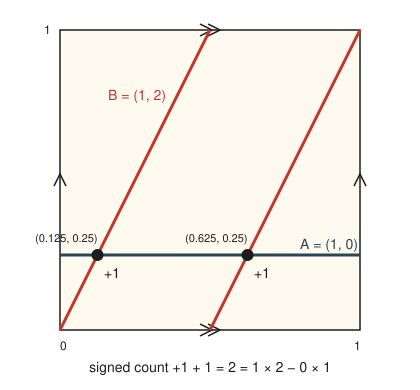

# Transversality and cobordism: crossings that survive a wiggle, and shapes that bound together

[Syllabus](../../../SYLLABUS.md) → [Differential geometry and Lie groups](../README.md) → [Manifolds](../README.md#s03) → Transversality and cobordism

---

## General Overview

Take one map sheet and glue its opposite edges. Walk off the right edge and you come back on the left; walk off the top and you come back at the bottom. This glued sheet is the **flat torus**, the surface of a ring doughnut drawn flat ([Sphere, torus and projective plane](02-example-manifolds-sphere-torus-and-projective-space.md)). Measure positions on it from the bottom-left corner, with the sheet's side as 1.

Draw two closed loops on it. Loop A runs straight across once at height 0.25: one trip across, no trips up, written (1, 0). Loop B starts at the corner and climbs 2 units for every 1 across: one trip across, two up, written (1, 2). They cross at two points, (0.125, 0.25) and (0.625, 0.25).

Now wiggle B. With a wiggle of size 0.3, B's height at position x across the sheet becomes $`2x + 0.3 \sin 6\pi x`$, and the loops cross at 4 points. Wiggle A as well, to height $`0.25 + 0.2 \sin 4\pi x`$, and they cross at 6. The raw count depends on the drawing. Score each crossing +1 or −1 by which way B passes through A, and the total is 2 every time. It equals 1 × 2 − 0 × 1, a formula in the loops' trip numbers.

The globe shows the other side. The equator and the meridian circle through Greenwich and both poles cross twice, at longitudes 0° and 180°. Their scores are +1 and −1, total 0. Tilt the meridian circle and lift it toward the North Pole: the two crossings slide together, meet at longitude 90°E, and vanish. A total of 0 allows that; a total of 2 forbids it.

**Two pieces of complementary dimension cross transversally (cleanly, with their directions filling the whole space) at almost every position; counted with signs, or mod 2 without orientations, their crossings give a whole number that no deformation changes, because the crossings traced through the deformation form a compact curve whose ends cancel in pairs: a cobordism.**

**What kind of fact this is:** three definitions (transversal, intersection number, cobordism) and four theorems. Stability of transversal crossings, invariance of the intersection numbers and the torus formula ad − bc are proved on this card. The transversality theorem is proved from Sard's theorem in a fold. Two inputs are stated with sources: the list of compact curves (circles and arcs), and that every surface with even Euler characteristic (vertices − edges + faces, over any division into triangles) is a boundary. Invariance is a global result: it needs the pieces to be compact.

<p align="center"></p>

The glued sheet, to scale; arrows mark the glued edges. Loop B leaves the top at x = 0.5 and returns at the bottom. Both checks print the figure's coordinates.

---

## The formula

Four ideas first, each in one line.

- **Submanifold.** A smooth piece of a manifold, such as a loop on a surface ([Regular value theorem](06-submanifolds-and-the-regular-value-theorem.md)).
- **Tangent space.** $`T_pM`$ is the flat space of directions at a point p of a manifold M ([Tangent space and differential](03-tangent-spaces-and-differentials.md)). For a loop it is a line, for a surface a plane.
- **Transversal.** Two submanifolds A and B are transversal, written $`A \pitchfork B`$, when at every point p they share, their directions together fill all of $`T_pM`$. Two loops on a surface are transversal when they cross at an angle and never touch tangentially.
- **Complementary dimensions.** The dimensions k of A and l of B add up to the dimension n of M. Then transversal crossings are isolated points, so they can be counted.

Transversality, at every shared point:

```math
T_pA + T_pB = T_pM \quad \text{for every } p \in A \cap B
```

**Read it aloud:** at each crossing, the directions along A plus the directions along B make up every direction in M.

The intersection numbers, for compact A and B of complementary dimensions, transversal, inside M:

```math
I_2(A, B) = \#(A \cap B) \bmod 2, \qquad I(A, B) = \sum_{p \in A \cap B} \varepsilon_p
```

**Read it aloud:** the mod-2 number is the count of crossings, even or odd; the oriented number adds a sign for each crossing.

The sign $`\varepsilon_p`$ is +1 when an oriented list of A's directions, followed by an oriented list of B's directions, is an oriented list of M's directions, and −1 otherwise ([Orientability](../../17-Topology/03-Surfaces%20and%20Manifolds/03-orientability-mobius-strip-and-klein-bottle.md)). For two loops on a surface it is the sign of the determinant of the two tangent vectors: +1 when B passes A going left, as seen walking along A.

On the glued sheet, a straight loop that makes a trips across and b trips up is written (a, b). For two such loops:

```math
I\big((a, b), (c, d)\big) = ad - bc
```

**Read it aloud:** the oriented intersection number of the loops (a, b) and (c, d) is a times d minus b times c.

The invariance theorem. If A slides smoothly into A′ (a homotopy, written $`A \simeq A'`$), and both are transversal to B, then

```math
A \simeq A' \;\Longrightarrow\; I_2(A, B) = I_2(A', B) \text{ and } I(A, B) = I(A', B)
```

**Read it aloud:** sliding one piece never changes the mod-2 count, and with orientations never changes the signed count either. Sliding B instead works the same way, because swapping A and B multiplies the number by $`(-1)^{kl}`$: for two loops on a surface, every sign flips.

The low-dimensional cobordism groups. Two closed n-manifolds are **cobordant** when together they form the whole boundary of a compact (n + 1)-manifold W. The classes form the **unoriented cobordism group** $`\Omega_n`$, with disjoint union as addition. (Thom wrote $`\mathfrak{N}_n`$; many texts keep $`\Omega_n`$ for the oriented kind, a different group.)

```math
\Omega_0 = \mathbb{Z}/2, \qquad \Omega_1 = 0, \qquad \Omega_2 = \mathbb{Z}/2, \text{ detected by } \chi \bmod 2
```

**Read it aloud:** point sets are cobordant when their counts agree mod 2; every closed curve bounds; a closed surface bounds exactly when its Euler characteristic is even.

| Symbol | Plain meaning | In our example | Push it up and the answer… |
| --- | --- | --- | --- |
| $`M`$, $`n`$ | the surrounding manifold and its dimension | glued sheet or globe; n = 2 | larger n: more room, so pieces need more dimensions to meet |
| $`A`$, $`B`$, $`k`$, $`l`$ | two compact submanifolds and their dimensions, with k + l = n | loops A and B; k = l = 1 | k + l < n: they can be pulled apart |
| $`p`$, $`T_pM`$, $`T_pA`$, $`T_pB`$, $`\pitchfork`$ | a crossing; the directions there in M, along A, along B; transversal, when those fill $`T_pM`$ | (0.125, 0.25); the plane, (1, 0), (1, 2); A and B cross at an angle | — |
| $`\varepsilon_p`$ | the sign of one crossing, +1 or −1 | +1 at both torus crossings | swap A and B: every sign changes by $`(-1)^{kl}`$, so flips for two loops |
| $`I`$, $`I_2`$ | oriented and mod-2 intersection numbers | 2 and 0 on the sheet; 0 and 0 on the globe | — |
| $`(a, b)`$, $`(c, d)`$, $`x`$, $`t`$, $`u`$ | a straight loop's trips across and up; position across the sheet; times along A and along B | (1, 0) and (1, 2); crossings at x = 0.125, 0.625 | each trip adds crossings |
| $`\Psi`$, $`s`$, $`\simeq`$, $`f_s`$, $`F`$, $`S`$ | a slide (homotopy) and its time from 0 to 1; "slides into"; in Step 2, one position, the whole family, the parameter space | the circles on the globe, s from 0 to 1 | — |
| $`Z`$, $`\pi`$, $`w`$, $`v`$, $`v'`$, $`\sigma`$, $`\beta`$ | in the Step 2 fold: the family's crossings, the map sending a crossing to its parameter (not the number π), a direction at p split into parts | — | — |
| $`W`$, $`\partial W`$, $`DW`$ | a compact manifold, its boundary (its edge), and two copies glued along it | the trace of the crossings: one arc | — |
| $`\chi`$ | Euler characteristic, vertices − edges + faces | sphere 2, torus 0, projective plane 1 | — |
| $`\Omega_n`$ | the unoriented cobordism group: closed n-manifolds up to cobordism (Thom's $`\mathfrak{N}_n`$) | $`\Omega_2`$: 0 or 1 by the parity of χ | — |
| $`R`$, $`\theta`$ | the globe's radius, a model; a crossing's longitude | 6371 km; 15.46° at s = 0.25 | — |

Clash, said once: W here is a cobordism, not shape operator W from the surfaces shelf, and the slide is $`\Psi`$, not H, since H is the Hamiltonian and mean curvature.

### When it holds

- **The crossing is transversal.** At s = 0.5986 the moving circle touches the equator at longitude 90°E. The two directions coincide, the determinant is 0, and the one touching point has no sign.
- **Both pieces are compact, with no edge.** A meridian arc from 30°N to 30°S, a piece with ends, crosses the equator once. Slide it 40° north and it crosses 0 times: its end walked across the equator.
- **The dimensions are complementary.** Two loops in space have 1 + 1 < 3. A wiggle pulls them apart, so their intersection number is 0. Linking is a different count, through a surface.
- **Orientations exist, for the signed count.** On the Klein bottle and the projective plane no sign can be fixed consistently. Only $`I_2`$ survives there.
- **The slide is smooth.** The proofs use derivatives along the slide. M need not be connected: on a split M the count is the sum over its pieces; connectedness matters only for degree.

---

## Why it works

### Step 0: crossings are born and die in pairs

Slide one loop slowly and watch the crossings. A transversal crossing moves a little and keeps its sign. Crossings appear or vanish only at a tangency, where two of them merge. The merging pair passes in opposite directions, so their signs are +1 and −1, and the total never changes.

On the globe, the crossings at longitude 0° (+1) and 180° (−1) meet at 90°E and vanish. The steps below make this precise.

### Step 1: a transversal crossing survives a wiggle

At a transversal crossing of two loops on a surface, the tangent vectors are independent, so the determinant of the two is not 0. A small wiggle changes the determinant only a little. So it stays non-zero, with the same sign.

The crossing itself moves only a little too. Write the crossing as the solution of two equations, one saying "on A" and one saying "on B". The Jacobian of that system is, up to sign, the determinant just described. It is invertible, so the inverse function theorem ([Inverse and implicit function theorems](../../06-Calculus%20and%20analysis/07-Several%20Variables/07-inverse-and-implicit-function-theorems.md)) gives one nearby solution after the wiggle, and only one. Compactness stops new crossings arriving from far away. So transversality is **stable**: a small wiggle keeps the count and every sign.

### Step 2: almost every position is transversal

Stability says transversal positions form an open set. They are also almost all positions. This is the **transversality theorem**, due to Thom (1954) and a consequence of Sard's theorem.

Let a family of positions be given by a parameter s in some parameter space S, so $`f_s`$ places A in M. Suppose the whole family $`F(x, s) = f_s(x)`$ is transversal to B. That is easy to arrange by letting s include all small translations. Then for almost every s, the single position $`f_s`$ is transversal to B.

<details>
<summary>Detailed proof: the transversality theorem from Sard's theorem</summary>

Let $`F : A \times S \to M`$ be smooth and transversal to B. By the regular value theorem, applied in charts in which B is a flat slice, $`Z = F^{-1}(B)`$ is a submanifold of $`A \times S`$.

Let $`\pi : Z \to S`$ send (x, s) to s. The claim is: s is a regular value of π exactly when $`f_s`$ is transversal to B. Take (x, s) in Z with p = F(x, s). Transversality of F says every direction w at p splits as $`w = dF(v, \sigma) + \beta`$, with (v, σ) a direction in $`A \times S`$ and β along B.

If s is a regular value of π, pick a direction (v′, σ) in Z with the same σ. Then $`dF(v - v', 0) = dF(v, \sigma) - dF(v', \sigma)`$, and $`dF(v', \sigma)`$ lies along B because Z maps into B. So $`w = d f_s(v - v') + (\text{a direction along } B)`$, and $`f_s`$ is transversal at x. The reverse runs the same lines backwards.

Sard's theorem says almost every s is a regular value of π ([Sard's theorem and degree](10-sards-theorem-and-degree.md)). So $`f_s \pitchfork B`$ for almost every s.

To get such a family for any map into any M, place M inside a flat space $`\mathbb{R}^N`$ (Whitney, [Partition of unity](09-partitions-of-unity-and-whitney-embedding.md)), add a small vector s to each image point, and push the result back onto M along the straight lines that meet M at right angles. Guillemin and Pollack carry this out (Sources).

</details>

Two practical readings follow. Any position can be wiggled, as little as wanted, into a transversal one. And any slide between two transversal positions can be wiggled, keeping its ends, into a slide $`\Psi`$ that is transversal to B as a whole.

### Step 3: the trace of a slide is a cobordism, so the count cannot change

Let the slide $`\Psi : A \times [0, 1] \to M`$ be transversal to B. Collect every (x, s) where the moving piece meets B:

```math
W = \Psi^{-1}(B) \subset A \times [0, 1]
```

**Read it aloud:** W is the set of all crossings, at all times of the slide.

The regular value theorem, for a manifold with an edge, says W is a compact curve. Its ends lie on the two end times: the crossings at s = 0 and the crossings at s = 1. So W is a cobordism between the starting crossings and the final crossings.

A compact curve is a finite set of circles and arcs. That list is stated here with its source, Milnor's appendix (Sources). Each arc has two ends. So the number of ends is even, and the crossings at s = 0 and at s = 1 agree mod 2. That is the invariance of $`I_2`$.

For signs, orient W from the orientations of A, [0, 1], B and M. An arc with both ends at the same time passes through B and back, so its ends carry opposite signs and cancel. An arc from s = 0 to s = 1 carries the same sign at both ends. So the signed counts at s = 0 and s = 1 agree. The fold below proves this sign rule, which the [Sard's theorem and degree](10-sards-theorem-and-degree.md) card states with Milnor as its source.

<details>
<summary>Detailed proof: the signs at the two ends of an arc</summary>

Order the directions of $`A \times [0, 1]`$ with A's first and time last. At a point of W, take directions that Ψ carries across B, listed so that their images followed by B's directions form an oriented list for M. A direction along W counts as forward when that list, followed by it, is an oriented list for $`A \times [0, 1]`$. Two such lists differ only by directions along W, which Ψ carries along B, so the choice does not matter.

At an end of an arc the time is 0 or 1, and the piece there is transversal to B. So A's own directions, with time held still, are carried across B. In A's order they pass the test above exactly when the crossing's sign $`\varepsilon_p`$ is +1; if it is −1, flip one of them. Now add the forward direction along W. Only its time part points out of A, so the list is oriented exactly when that time part is positive, or negative after a flip. It is not 0, because the piece is transversal there (the Step 2 fold). So $`\varepsilon_p`$ is +1 where time increases going forward along W, and −1 where it decreases.

An arc runs into $`A \times [0, 1]`$ at its start and out at its finish. Time increases at a start on s = 0 and at a finish on s = 1: sign +1. Time decreases at a finish on s = 0 and at a start on s = 1: sign −1. Both cases of the rule above follow.

</details>

On the globe, W is one arc. It starts at longitude 0° at s = 0, sign +1, climbs to longitude 90°E at s = 0.5986, and returns to longitude 180° at s = 0, sign −1. Both ends sit at the start, with opposite signs.

### Step 4: on the glued sheet, the count is ad − bc

Any loop on the glued sheet slides into a straight one with the same trip numbers. By Step 3 the count does not change, so it is enough to count straight loops.

Unroll the sheet onto the whole plane, with a copy of it at every whole-number position. A crossing of the straight loops (a, b) and (c, d) is a pair of times t and u in [0, 1) at which the points $`(0, 0.25) + t(a, b)`$ and $`u(c, d)`$ differ by whole numbers in both coordinates. Those whole-number differences are lattice points, and they fill a parallelogram spanned by (a, b) and (c, d), one lattice point per unit of area. Its area is $`\lvert ad - bc \rvert`$. Every crossing has the same two directions, so every sign is the sign of ad − bc. The checks count the lattice points directly.

The globe needs no formula. Any closed curve on the sphere slides to a tiny loop near a pole, which misses the equator. So the equator meets every closed curve with total 0.

### Step 5: degree is "meet a point"

The [Sard's theorem and degree](10-sards-theorem-and-degree.md) card counted the points sent to one target, with signs. That is an intersection number. The map's graph meets the set "target = y" in exactly those points. So the degree is the special case where one piece is a single point, and its invariance is Step 3 again.

On the glued sheet, I(A, B) for A = (1, 0) is the number of times B's height passes 0.25, counted with direction. That is the degree of B's height, read as a map from a circle to a circle. B climbs 2 units in one trip, so the degree is d = 2. The checks compute it from positions alone, as net turns.

### Step 6: which shapes bound

Cobordism turns Step 3 into a classification. In dimension 0, a finite set of points bounds a set of arcs exactly when the count is even, so $`\Omega_0 = \mathbb{Z}/2`$. In dimension 1, every closed curve is a set of circles, and each circle bounds a disc, so $`\Omega_1 = 0`$.

In dimension 2 a new obstruction appears. If a closed surface is the whole boundary of a compact 3-manifold W, then its Euler characteristic is even:

```math
\chi(\partial W) = 2\,\chi(W)
```

**Read it aloud:** the Euler characteristic of the boundary is twice that of the solid.

The projective plane has χ = 1, odd. So it bounds nothing, and $`\Omega_2 \neq 0`$. The sphere (χ = 2) bounds a ball, the torus (χ = 0) a solid ring, and the Klein bottle (χ = 0) bounds a Möbius band thickened into a slab.

<details>
<summary>Detailed proof: a boundary has even Euler characteristic</summary>

Glue two copies of W along their common boundary. The result, the double DW, is a closed 3-manifold. Count cells: those of the two copies, with the boundary counted once.

$`\displaystyle \chi(DW) = 2\,\chi(W) - \chi(\partial W).`$

A closed manifold of odd dimension has χ = 0. This is a consequence of Poincaré duality, proved on [Poincare duality](../../17-Topology/05-Homology/12-cap-product-and-poincare-duality.md) for oriented manifolds; with coefficients mod 2 the same proof covers all of them. So $`0 = 2\chi(W) - \chi(\partial W)`$, and $`\chi(\partial W) = 2\chi(W)`$, which is even.

</details>

The converse, that every surface with even χ bounds, is stated here with Thom's 1954 paper as the source. In outline: every surface with even χ is a sphere or is glued together from tori and Klein bottles, and each of these bounds. So χ mod 2 is the whole answer, and $`\Omega_2 = \mathbb{Z}/2`$.

[The Chow ring](../../22-Algebraic%20geometry/09-Intersection%20Theory%20and%20Surfaces/01-chow-rings-and-intersection-products.md) counts intersections of algebraic varieties by algebra: it is this card's algebraic twin.

---

## Worked numbers, by hand

The glued sheet: A at height 0.25, B with height 2x for x from 0 to 1.

| Step | Arithmetic | Value |
| --- | --- | --- |
| where B reaches A | 2x = 0.25 or 2x = 1.25 | x = 0.125 and x = 0.625 |
| directions there | A along (1, 0), B along (1, 2) | — |
| sign at each crossing | det = 1 × 2 − 0 × 1 = 2, positive | +1, +1 |
| signed count | +1 + 1 | **I(A, B) = 2** |
| formula | ad − bc = 1 × 2 − 0 × 1 | 2 |
| mod-2 count | 2 crossings, even | 0 |
| order swapped | B first, then A: det = 1 × 0 − 2 × 1 | −2 |

The answer 2 means no slide can pull the two loops apart. The mod-2 count, 0, cannot see that.

The globe, radius R = 6371 km. At time s the meridian circle's plane is tilted by 90° × s from upright toward the equator's plane, and moved to distance s × R × cos 10° from the globe's centre; at s = 1 it is the circle 10° from the North Pole.

| Time s | Circle's radius | Crossings: longitude (sign) | Signed |
| --- | --- | --- | --- |
| 0 | 6371.0 km | 0.00° (+1), 180.00° (−1), 20015 km apart | 0 |
| 0.25 | 6174.9 km | 15.46° (+1), 164.54° (−1), 16578 km apart | 0 |
| 0.5 | 5545.1 km | 44.14° (+1), 135.86° (−1), 10200 km apart | 0 |
| 0.59 | 5185.2 km | 75.40° (+1), 104.60° (−1), 3247 km apart | 0 |
| 0.5986 | 5146.1 km | touches at 90.00°, determinant 0 | none |
| 0.75 | 4294.9 km | none | 0 |
| 1 | 1106.3 km | none | **0** |

The pair slides together over 20015 km of equator and vanishes at one moment. Every longitude agrees with the closed form: the crossing longitude θ satisfies sin θ = (plane's distance from the centre) / (R × cosine of the tilt). Each sign is +1 where the circle heads north, nearer longitude 0°.

### What breaks if you drop a piece

| Mistake | Comes out at | What went wrong |
| --- | --- | --- |
| Count crossings without signs | 2, 4 or 6 on the sheet; 2 or 0 on the globe | the extra crossings come in +1, −1 pairs |
| Count at a tangency | 1 point at longitude 90.00°, s = 0.5986 | not transversal: the determinant is 0 |
| Use a piece with ends: the meridian arc from 30°N to 30°S | 1 crossing, then 0 after a 40° slide north | its end crossed the equator; no compact trace |
| Read the mod-2 count as "can be pulled apart" | 0 for (1, 0) and (1, 2) | the signed count is 2: they never come apart |

---

## Code, from first principles, and it actually runs

Both programs count the crossings of loops on the glued sheet by **four independent roads**: the formula ad − bc; a count of lattice points for straight loops, which checks the size of ad − bc; a crossing finder that scans 3001 cells, refines each crossing by halving 60 times and reads its sign from the tangent determinant; and the net turns of B's height above A, from positions alone. The finder runs on wiggled loops, and over a 61-step slide. On the globe, a second finder locates each crossing in three dimensions and takes its sign from (east, along the circle, up). The longitudes are checked against the closed form, and the signs against the circle's direction. Near the touch the crossing determinant shrinks: its square, extended in a straight line, reaches 0 at s = 0.5986. Last, the programs count χ on triangulated surfaces, test them for orientation, and check $`\chi(\partial W) = 2\chi(W)`$ on three solids built from cubes.

### Python

```python
# Transversality and cobordism -- the check behind the card.  Standard library only.
# Loops on a map sheet with opposite edges glued (a flat torus) and circles on the globe,
# counted with signs.  Roads: the formula ad - bc, a lattice count, a crossing finder on
# wiggled loops, and the net vertical turns; then Euler characteristics of cell complexes.
import math
TAU, R, Y0 = 2 * math.pi, 6371.0, 0.25            # R: the globe's radius in km (a model)
def sgn(x): return 0 if abs(x) < 1e-9 else (1 if x > 0 else -1)
def det(u, v): return u[0] * v[1] - u[1] * v[0]
def cross(u, v): return (u[1] * v[2] - u[2] * v[1], u[2] * v[0] - u[0] * v[2], u[0] * v[1] - u[1] * v[0])
def dot(u, v): return sum(a * b for a, b in zip(u, v))
def root(g, a, b):                                 # bisection on a cell where g changes sign
    for _ in range(60): m = (a + b) / 2; a, b = (a, m) if g(a) * g(m) <= 0 else (m, b)
    return (a + b) / 2
def lattice(p, q):                                 # road 2: (0, Y0) + t p = u q + (m, n), t, u in [0, 1)
    D, pts = det(p, (-q[0], -q[1])), []
    for w in ((m, n - Y0) for m in range(-9, 10) for n in range(-9, 10)):
        t, u = det(w, (-q[0], -q[1])) / D, det(p, w) / D
        if -1e-9 <= t < 1 - 1e-9 and -1e-9 <= u < 1 - 1e-9:
            pts.append(sgn(det(p, q)))             # sign: do the tangents (A, B) turn left?
    return pts
def crossings(fa, fb, n=3001):                     # road 3: loops as graphs y = f(x), x in [0, 1)
    h, out, e = (lambda x: fb(x) - fa(x)), [], 1e-6
    for i in range(n):
        a, b = i / n, (i + 1) / n
        ka, kb = math.floor(h(a)), math.floor(h(b))
        if ka != kb:                               # fb - fa passes a whole number: the loops meet
            x = root(lambda t: h(t) - max(ka, kb), a, b)
            ta, tb = (1, (fa(x + e) - fa(x - e)) / (2 * e)), (1, (fb(x + e) - fb(x - e)) / (2 * e))
            out.append((x, fa(x) % 1, sgn(det(ta, tb))))
    return out
def net_turns(fa, fb, n=3000):                     # road 4: positions only, angle 2 pi (fb - fa)
    ps = [(math.cos(TAU * (fb(i / n) - fa(i / n))), math.sin(TAU * (fb(i / n) - fa(i / n)))) for i in range(n + 1)]
    return sum(math.atan2(det(p, q), dot(p, q)) for p, q in zip(ps, ps[1:])) / TAU
print("map sheet: A = (1,0) along y = 0.25, B = (1,2) from the corner (0,0)")
for p, q in (((1, 0), (1, 2)), ((1, 0), (0, 1)), ((2, 1), (1, 3)), ((1, 1), (1, -1)), ((1, 2), (1, 0))):
    pts, f = lattice(p, q), p[0] * q[1] - p[1] * q[0]
    print(f"pair {p} {q}: ad - bc = {f}; lattice count {len(pts)} points, signed {sum(pts)}, mod 2 {len(pts) % 2}")
    assert len(pts) == abs(f), "lattice count disagrees with ad - bc"
fA, fB = (lambda x: Y0), (lambda x: 2 * x)
c0 = crossings(fA, fB)
print("crossings of A and B:", " ".join(f"({x:.3f}, {y:.3f}) sign {s:+d}" for x, y, s in c0))
def wig(w, v): return (lambda x: Y0 + v * math.sin(2 * TAU * x)), (lambda x: 2 * x + w * math.sin(3 * TAU * x))
for w, v in ((0.3, 0.0), (0.0, 0.2), (0.3, 0.2)):
    cs, nt = crossings(*wig(w, v)), net_turns(*wig(w, v))
    print(f"wiggle B by {w:.1f}, A by {v:.1f}: {len(cs)} points at x = " + " ".join(f"{x:.3f}" for x, _, _ in cs)
          + f"; signs {''.join('+' if s > 0 else '-' for _, _, s in cs)}; signed {sum(s for _, _, s in cs)}; net turns {nt:.6f}")
    assert sum(s for _, _, s in cs) == 2 and abs(nt - 2) < 1e-9 and len(cs) % 2 == 0
raw = set()
for k in range(61):                                # the whole slide from straight to wiggled
    cs = crossings(*wig(0.3 * k / 60, 0.2 * k / 60))
    raw.add(len(cs)); assert sum(s for _, _, s in cs) == 2
print(f"slide in 61 steps: raw counts seen {sorted(raw)}, signed count 2 at every step")
print(f"order swapped, I(B, A) = {sum(s for _, _, s in crossings(fB, fA))}")
def circle(s):                                     # the moving circle: plane n . p = h on the globe
    al, h = math.pi * s / 2, s * R * math.cos(math.radians(10))
    n, r, e2 = (0.0, math.cos(al), math.sin(al)), math.sqrt(R * R - h * h), (0.0, -math.sin(al), math.cos(al))
    P = lambda t: tuple(h * n[i] + r * ((math.cos(t) if i == 0 else 0.0) + math.sin(t) * e2[i]) for i in range(3))
    T = lambda t: tuple(r * ((-math.sin(t) if i == 0 else 0.0) + math.cos(t) * e2[i]) for i in range(3))
    return P, T, h, al, r
def lon(p): return (math.degrees(math.atan2(p[1], p[0])) + 360) % 360
def sign_at(p, tc): return dot(cross((-p[1] / R, p[0] / R, 0.0), tc), p)   # (east, circle, up)
def globe(s, n=3001, raw=False):                   # where circle s crosses the equator: signs, or determinants
    P, T, h, al, r = circle(s)
    cells = [(TAU * (i + 0.5) / n, TAU * (i + 1.5) / n) for i in range(n)]
    ts = [root(lambda t: P(t)[2], a, b) for a, b in cells if P(a)[2] * P(b)[2] < 0]
    return sorted((lon(P(t)), (lambda d: d if raw else sgn(d))(sign_at(P(t), T(t)) / (R * r))) for t in ts)
sstar = root(lambda s: s * math.cos(math.radians(10)) - math.cos(math.pi * s / 2), 0.0, 1.0)
print(f"globe, R = {R:.0f} km: the circles cross the equator, signs from (east, circle, up)")
for s in (0.0, 0.25, 0.5, 0.59, sstar, 0.75, 1.0):
    P, T, h, al, r = circle(s)
    if s == sstar:                                 # the touching point, lowest on the circle
        p, z = P(-math.pi / 2), (s - 0.01, s - 0.001)  # crossing determinants just before the touch
        dd = [globe(x, raw=True)[0][1] for x in z]; s0 = z[1] + dd[1] ** 2 * (z[1] - z[0]) / (dd[0] ** 2 - dd[1] ** 2)
        print(f"s = {s:.4f}: circle radius {r:.1f} km touches at lon {lon(p):.2f}, height {abs(p[2]):.6f} km; crossing determinant "
              f"{dd[0]:.4f} at s = {z[0]:.4f}, {dd[1]:.4f} at s = {z[1]:.4f}, extrapolated to 0 at s = {s0:.4f}: not transverse")
        assert abs(p[2]) < 1e-6 and abs(s0 - sstar) < 1e-4; continue  # det^2 is straight in s near the touch
    g = globe(s)
    km = f"; apart {R * math.radians(g[1][0] - g[0][0]):.0f} km" if g else ""
    print(f"s = {s:.4f}: circle radius {r:.1f} km; crossings " + (" ".join(f"lon {x:.2f} ({e:+d})" for x, e in g) or "none")
          + f"; signed {sum(e for _, e in g)}{km}")
    assert sum(e for _, e in g) == 0 and len(g) == (2 if s < sstar else 0)
    if g: th = math.degrees(math.asin(h / (R * math.cos(al)))); assert abs(g[0][0] - th) + abs(g[1][0] - 180 + th) < 1e-6
    assert all(e == sgn(math.cos(math.radians(x))) for x, e in g)   # +1 where the circle heads north, at cos(lon) > 0
counts = {len(globe(k / 50)) for k in range(51)}
print(f"51 circles from s = 0 to 1: raw counts {sorted(counts)}, signed count 0 at all")
arc = [sum(1 for i in range(600) if math.cos(math.radians(60 - d + i / 10)) * math.cos(math.radians(60 - d + (i + 1) / 10)) < 0) for d in (0, 40)]
print(f"meridian arc from 30N to 30S, polar angles 60-120 deg: {arc[0]} crossing; slid 40 deg north: {arc[1]}")
assert arc == [1, 0]
def surface(tris):                                 # Euler characteristic, closedness, orientability
    E = {frozenset(e) for t in tris for e in ((t[0], t[1]), (t[1], t[2]), (t[0], t[2]))}
    closed = all(sum(1 for t in tris if e <= set(t)) == 2 for e in E)
    orient, todo, ok = {0: tris[0]}, [0], True
    while todo:
        i = todo.pop(); a, b, c = orient[i]
        for x, y in ((a, b), (b, c), (c, a)):      # a neighbour must run the shared edge backwards
            for j, t in enumerate(tris):
                if j != i and {x, y} <= set(t):
                    want = (y, x, [v for v in t if v not in (x, y)][0])
                    if j not in orient: orient[j] = want; todo.append(j)
                    elif orient[j] not in (want, want[1:] + want[:1], want[2:] + want[:2]): ok = False
    return len({v for t in tris for v in t}) - len(E) + len(tris), closed, ok
def grid(twist, n=4):                              # n by n squares, glued straight or with a flip
    def v(i, j): return (i % n, (-j if twist and i >= n else j) % n)
    return [t for i in range(n) for j in range(n)
            for t in ((v(i, j), v(i + 1, j), v(i + 1, j + 1)), (v(i, j), v(i + 1, j + 1), v(i, j + 1)))]
rp2 = [(1, 2, 3), (1, 3, 4), (1, 4, 5), (1, 5, 6), (1, 6, 2), (2, 3, 5), (3, 4, 6), (4, 5, 2), (5, 6, 3), (6, 2, 4)]
chi = {}
for name, tris in (("sphere", [(0, 1, 2), (0, 1, 3), (0, 2, 3), (1, 2, 3)]), ("torus", grid(False)),
                   ("Klein bottle", grid(True)), ("projective plane", rp2)):
    chi[name], closed, ok = surface(tris)
    print(f"surface {name}: {len(tris)} triangles, chi = {chi[name]}, closed {closed}, orientable {ok}")
    assert closed and ok == (name in ("sphere", "torus"))
def solid(ring, twist):                            # unit cubes in a ring of `ring` (0: one cube)
    def key(c, st):                                # a cell: st[d] = 0 low side, 1 high side, 2 whole edge
        pts = [(c + x, y, z) for x in (0, 1) for y in (0, 1) for z in (0, 1)
               if all(s in (2, o) for s, o in zip(st, (x, y, z)))]
        if ring: pts = [(x % ring, 1 - y if twist and x >= ring else y, z) for x, y, z in pts]
        return frozenset(pts)
    def subs(st): return [u for u in ((a, b, c) for a in range(3) for b in range(3) for c in range(3)) if all(s in (2, o) for s, o in zip(st, u))]
    cells, faces = {}, {}
    for c in range(ring or 1):
        for st in subs((2, 2, 2)):
            cells[key(c, st)] = st.count(2)
            if st.count(2) == 2: faces.setdefault(key(c, st), []).append((c, st))
    bd = {key(c, s2): s2.count(2) for fs in faces.values() if len(fs) == 1 for c, st in fs for s2 in subs(st)}
    return sum((-1) ** d for d in cells.values()), sum((-1) ** d for d in bd.values())
for name, ring, tw in (("ball, 1 cube", 0, False), ("torus, 4 cubes", 4, False), ("Mobius band x interval", 4, True)):
    cw, cb = solid(ring, tw)
    print(f"solid {name}: chi(W) = {cw}, chi(its boundary) = {cb}")
    assert cb == 2 * cw, "the boundary of a compact 3-manifold has chi = 2 chi(W)"
print(f"so a boundary has even chi; the projective plane has chi = {chi['projective plane']}: it bounds nothing")
assert chi["projective plane"] % 2 == 1 and chi["Klein bottle"] % 2 == 0
print("figure,square 0 0 1 1; A y=0.250; B (0,0)-(0.5,1) and (0.5,0)-(1,1); crossings "
      + " ".join(f"({x:.3f},{y:.3f})" for x, y, _ in c0))
print("ALL CHECKS PASS")
```

**Ran 2026-11-24 on macOS, Python 3.14.10, standard library only. All checks passed. Output, pasted from the run:**

```
map sheet: A = (1,0) along y = 0.25, B = (1,2) from the corner (0,0)
pair (1, 0) (1, 2): ad - bc = 2; lattice count 2 points, signed 2, mod 2 0
pair (1, 0) (0, 1): ad - bc = 1; lattice count 1 points, signed 1, mod 2 1
pair (2, 1) (1, 3): ad - bc = 5; lattice count 5 points, signed 5, mod 2 1
pair (1, 1) (1, -1): ad - bc = -2; lattice count 2 points, signed -2, mod 2 0
pair (1, 2) (1, 0): ad - bc = -2; lattice count 2 points, signed -2, mod 2 0
crossings of A and B: (0.125, 0.250) sign +1 (0.625, 0.250) sign +1
wiggle B by 0.3, A by 0.0: 4 points at x = 0.034 0.191 0.267 0.656; signs +-++; signed 2; net turns 2.000000
wiggle B by 0.0, A by 0.2: 2 points at x = 0.192 0.692; signs ++; signed 2; net turns 2.000000
wiggle B by 0.3, A by 0.2: 6 points at x = 0.058 0.131 0.260 0.393 0.453 0.677; signs +-++-+; signed 2; net turns 2.000000
slide in 61 steps: raw counts seen [2, 4, 6], signed count 2 at every step
order swapped, I(B, A) = -2
globe, R = 6371 km: the circles cross the equator, signs from (east, circle, up)
s = 0.0000: circle radius 6371.0 km; crossings lon 0.00 (+1) lon 180.00 (-1); signed 0; apart 20015 km
s = 0.2500: circle radius 6174.9 km; crossings lon 15.46 (+1) lon 164.54 (-1); signed 0; apart 16578 km
s = 0.5000: circle radius 5545.1 km; crossings lon 44.14 (+1) lon 135.86 (-1); signed 0; apart 10200 km
s = 0.5900: circle radius 5185.2 km; crossings lon 75.40 (+1) lon 104.60 (-1); signed 0; apart 3247 km
s = 0.5986: circle radius 5146.1 km touches at lon 90.00, height 0.000000 km; crossing determinant 0.2000 at s = 0.5886, 0.0638 at s = 0.5976, extrapolated to 0 at s = 0.5986: not transverse
s = 0.7500: circle radius 4294.9 km; crossings none; signed 0
s = 1.0000: circle radius 1106.3 km; crossings none; signed 0
51 circles from s = 0 to 1: raw counts [0, 2], signed count 0 at all
meridian arc from 30N to 30S, polar angles 60-120 deg: 1 crossing; slid 40 deg north: 0
surface sphere: 4 triangles, chi = 2, closed True, orientable True
surface torus: 32 triangles, chi = 0, closed True, orientable True
surface Klein bottle: 32 triangles, chi = 0, closed True, orientable False
surface projective plane: 10 triangles, chi = 1, closed True, orientable False
solid ball, 1 cube: chi(W) = 1, chi(its boundary) = 2
solid torus, 4 cubes: chi(W) = 0, chi(its boundary) = 0
solid Mobius band x interval: chi(W) = 0, chi(its boundary) = 0
so a boundary has even chi; the projective plane has chi = 1: it bounds nothing
figure,square 0 0 1 1; A y=0.250; B (0,0)-(0.5,1) and (0.5,0)-(1,1); crossings (0.125,0.250) (0.625,0.250)
ALL CHECKS PASS
```

### Rust

```rust
// Transversality and cobordism -- the check behind the card.  Rust std only, no crates.
// Loops on a map sheet with opposite edges glued (a flat torus) and circles on the globe,
// counted with signs.  Roads: the formula ad - bc, a lattice count, a crossing finder on
// wiggled loops, and the net vertical turns; then Euler characteristics of cell complexes.
use std::collections::{BTreeMap, BTreeSet};
use std::f64::consts::PI;
const TAU: f64 = 2.0 * PI;
const R: f64 = 6371.0; // the globe's radius in km (a model)
const Y0: f64 = 0.25;
type V3 = (f64, f64, f64);
type F = Box<dyn Fn(f64) -> f64>;
type Tri = Vec<(i32, i32)>;
fn sgn(x: f64) -> i32 { if x.abs() < 1e-9 { 0 } else if x > 0.0 { 1 } else { -1 } }
fn det(u: (f64, f64), v: (f64, f64)) -> f64 { u.0 * v.1 - u.1 * v.0 }
fn cross(u: V3, v: V3) -> V3 { (u.1 * v.2 - u.2 * v.1, u.2 * v.0 - u.0 * v.2, u.0 * v.1 - u.1 * v.0) }
fn dot(u: V3, v: V3) -> f64 { u.0 * v.0 + u.1 * v.1 + u.2 * v.2 }
fn root(g: &dyn Fn(f64) -> f64, mut a: f64, mut b: f64) -> f64 { // bisection on a sign-change cell
    for _ in 0..60 { let m = (a + b) / 2.0; if g(a) * g(m) <= 0.0 { b = m } else { a = m } }
    (a + b) / 2.0
}
fn lattice(p: (i32, i32), q: (i32, i32)) -> Vec<i32> { // road 2: (0, Y0) + t p = u q + (m, n), t, u in [0, 1)
    let (pf, nq) = ((p.0 as f64, p.1 as f64), (-q.0 as f64, -q.1 as f64));
    let mut pts = Vec::new();
    for m in -9..10 { for n in -9..10 {
        let w = (m as f64, n as f64 - Y0);
        let (t, u) = (det(w, nq) / det(pf, nq), det(pf, w) / det(pf, nq));
        if -1e-9 <= t && t < 1.0 - 1e-9 && -1e-9 <= u && u < 1.0 - 1e-9 { pts.push(sgn(det(pf, (q.0 as f64, q.1 as f64)))); } // sign: do (A, B) turn left?
    } }
    pts
}
fn crossings(fa: &F, fb: &F) -> Vec<(f64, f64, i32)> { // road 3: loops as graphs y = f(x), x in [0, 1)
    let (n, e, h) = (3001, 1e-6, |x: f64| fb(x) - fa(x));
    let mut out = Vec::new();
    for i in 0..n {
        let (a, b) = (i as f64 / n as f64, (i + 1) as f64 / n as f64);
        let (ka, kb) = (h(a).floor(), h(b).floor());
        if ka != kb { // fb - fa passes a whole number: the loops meet
            let x = root(&|t| h(t) - ka.max(kb), a, b);
            out.push((x, fa(x).rem_euclid(1.0), sgn(det((1.0, (fa(x + e) - fa(x - e)) / (2.0 * e)), (1.0, (fb(x + e) - fb(x - e)) / (2.0 * e))))));
        }
    }
    out
}
fn net_turns(fa: &F, fb: &F) -> f64 { // road 4: positions only, angle 2 pi (fb - fa)
    let ps: Vec<(f64, f64)> = (0..=3000).map(|i| { let a = TAU * (fb(i as f64 / 3000.0) - fa(i as f64 / 3000.0)); (a.cos(), a.sin()) }).collect();
    ps.windows(2).map(|w| det(w[0], w[1]).atan2(w[0].0 * w[1].0 + w[0].1 * w[1].1)).sum::<f64>() / TAU
}
fn wig(w: f64, v: f64) -> (F, F) { (Box::new(move |x| Y0 + v * (2.0 * TAU * x).sin()), Box::new(move |x| 2.0 * x + w * (3.0 * TAU * x).sin())) }
fn signs(cs: &[(f64, f64, i32)]) -> i32 { cs.iter().map(|c| c.2).sum() }
struct Circle { h: f64, al: f64, r: f64, e2: V3, n: V3 }
fn circle(s: f64) -> Circle { // the moving circle: plane n . p = h on the globe
    let (al, h) = (PI * s / 2.0, s * R * 10f64.to_radians().cos());
    Circle { h, al, r: (R * R - h * h).sqrt(), e2: (0.0, -al.sin(), al.cos()), n: (0.0, al.cos(), al.sin()) }
}
impl Circle {
    fn p(&self, t: f64) -> V3 { let (c, s, r, n, e) = (t.cos(), t.sin(), self.r, self.n, self.e2);
        (self.h * n.0 + r * (c + s * e.0), self.h * n.1 + r * (0.0 + s * e.1), self.h * n.2 + r * (0.0 + s * e.2)) }
    fn t(&self, t: f64) -> V3 { let (c, s, r, e) = (t.cos(), t.sin(), self.r, self.e2); (r * (-s + c * e.0), r * (0.0 + c * e.1), r * (0.0 + c * e.2)) }
}
fn lon(p: V3) -> f64 { (p.1.atan2(p.0).to_degrees() + 360.0) % 360.0 }
fn sign_at(p: V3, tc: V3) -> f64 { dot(cross((-p.1 / R, p.0 / R, 0.0), tc), p) } // (east, circle, up)
fn globe_det(s: f64) -> Vec<(f64, f64)> { // where circle s crosses the equator, with determinants
    let (c, n) = (circle(s), 3001);
    let mut out: Vec<(f64, f64)> = (0..n).map(|i| (TAU * (i as f64 + 0.5) / n as f64, TAU * (i as f64 + 1.5) / n as f64))
        .filter(|&(a, b)| c.p(a).2 * c.p(b).2 < 0.0).map(|(a, b)| root(&|t| c.p(t).2, a, b))
        .map(|t| (lon(c.p(t)), sign_at(c.p(t), c.t(t)) / (R * c.r))).collect();
    out.sort_by(|a, b| a.partial_cmp(b).unwrap()); out
}
fn globe(s: f64) -> Vec<(f64, i32)> { globe_det(s).into_iter().map(|(x, d)| (x, sgn(d))).collect() } // with signs
fn py_bool(b: bool) -> &'static str { if b { "True" } else { "False" } }
fn surface(tris: &[Tri]) -> (i32, bool, bool) { // Euler characteristic, closedness, orientability
    let e: BTreeSet<Vec<(i32, i32)>> = tris.iter().flat_map(|t| [(0, 1), (1, 2), (0, 2)].map(|(i, j)| { let mut v = vec![t[i], t[j]]; v.sort(); v })).collect();
    let closed = e.iter().all(|ed| tris.iter().filter(|t| ed.iter().all(|x| t.contains(x))).count() == 2);
    let (mut orient, mut todo, mut ok) = (BTreeMap::from([(0usize, tris[0].clone())]), vec![0usize], true);
    while let Some(i) = todo.pop() {
        let o = orient[&i].clone();
        for (x, y) in [(o[0], o[1]), (o[1], o[2]), (o[2], o[0])] { // a neighbour must run the shared edge backwards
            for (j, t) in tris.iter().enumerate() {
                if j == i || !t.contains(&x) || !t.contains(&y) { continue; }
                let z = *t.iter().find(|v| **v != x && **v != y).unwrap();
                if !orient.contains_key(&j) { orient.insert(j, vec![y, x, z]); todo.push(j); }
                else if ![vec![y, x, z], vec![x, z, y], vec![z, y, x]].contains(&orient[&j]) { ok = false; }
            }
        }
    }
    (tris.iter().flatten().collect::<BTreeSet<_>>().len() as i32 - e.len() as i32 + tris.len() as i32, closed, ok)
}
fn grid(twist: bool) -> Vec<Tri> { // 4 by 4 squares, glued straight or with a flip
    let v = |i: i32, j: i32| (i % 4, (if twist && i >= 4 { -j } else { j }).rem_euclid(4));
    (0..16).flat_map(|k| { let (i, j) = (k / 4, k % 4);
        [vec![v(i, j), v(i + 1, j), v(i + 1, j + 1)], vec![v(i, j), v(i + 1, j + 1), v(i, j + 1)]] }).collect()
}
fn solid(ring: i32, twist: bool) -> (i32, i32) { // unit cubes in a ring of `ring` (0: one cube)
    let fits = |st: [i32; 3], u: [i32; 3]| (0..3).all(|d| st[d] == 2 || st[d] == u[d]);
    let key = |c: i32, st: [i32; 3]| -> BTreeSet<(i32, i32, i32)> { // a cell: st[d] = 0 low side, 1 high side, 2 whole edge
        (0..8).map(|k| [k / 4, k / 2 % 2, k % 2]).filter(|&u| fits(st, u)).map(|[x, y, z]| {
            let (px, py) = (c + x, y);
            if ring > 0 { (px % ring, if twist && px >= ring { 1 - py } else { py }, z) } else { (px, py, z) } }).collect()
    };
    let subs = |st: [i32; 3]| -> Vec<[i32; 3]> { (0..27).map(|k| [k / 9, k / 3 % 3, k % 3]).filter(|&u| fits(st, u)).collect() };
    let dim = |st: [i32; 3]| st.iter().filter(|&&s| s == 2).count() as u32;
    let (mut cells, mut faces, mut bd) = (BTreeMap::new(), BTreeMap::new(), BTreeMap::new());
    for c in 0..ring.max(1) { for st in subs([2, 2, 2]) { cells.insert(key(c, st), dim(st));
        if dim(st) == 2 { faces.entry(key(c, st)).or_insert_with(Vec::new).push((c, st)); } } }
    for fs in faces.values().filter(|fs| fs.len() == 1) { for s2 in subs(fs[0].1) { bd.insert(key(fs[0].0, s2), dim(s2)); } }
    (cells.values().map(|&d| (-1i32).pow(d)).sum(), bd.values().map(|&d| (-1i32).pow(d)).sum())
}
fn main() {
    println!("map sheet: A = (1,0) along y = 0.25, B = (1,2) from the corner (0,0)");
    for (p, q) in [((1, 0), (1, 2)), ((1, 0), (0, 1)), ((2, 1), (1, 3)), ((1, 1), (1, -1)), ((1, 2), (1, 0))] {
        let (pts, f) = (lattice(p, q), p.0 * q.1 - p.1 * q.0); let sum: i32 = pts.iter().sum();
        println!("pair {:?} {:?}: ad - bc = {}; lattice count {} points, signed {}, mod 2 {}", p, q, f, pts.len(), sum, pts.len() % 2);
        assert!(pts.len() as i32 == f.abs(), "lattice count disagrees with ad - bc");
    }
    let (fa, fb): (F, F) = (Box::new(|_| Y0), Box::new(|x| 2.0 * x));
    let c0 = crossings(&fa, &fb);
    println!("crossings of A and B: {}", c0.iter().map(|c| format!("({:.3}, {:.3}) sign {:+}", c.0, c.1, c.2)).collect::<Vec<_>>().join(" "));
    for (w, v) in [(0.3, 0.0), (0.0, 0.2), (0.3, 0.2)] {
        let (ga, gb) = wig(w, v); let (cs, nt) = (crossings(&ga, &gb), net_turns(&ga, &gb));
        println!("wiggle B by {:.1}, A by {:.1}: {} points at x = {}; signs {}; signed {}; net turns {:.6}", w, v, cs.len(),
            cs.iter().map(|c| format!("{:.3}", c.0)).collect::<Vec<_>>().join(" "),
            cs.iter().map(|c| if c.2 > 0 { '+' } else { '-' }).collect::<String>(), signs(&cs), nt);
        assert!(signs(&cs) == 2 && (nt - 2.0).abs() < 1e-9 && cs.len() % 2 == 0);
    }
    let mut raw = BTreeSet::new();
    for k in 0..61 { let (ga, gb) = wig(0.3 * k as f64 / 60.0, 0.2 * k as f64 / 60.0); let cs = crossings(&ga, &gb); raw.insert(cs.len()); assert!(signs(&cs) == 2); } // the whole slide
    println!("slide in 61 steps: raw counts seen {:?}, signed count 2 at every step", raw.iter().collect::<Vec<_>>());
    println!("order swapped, I(B, A) = {}", signs(&crossings(&fb, &fa)));
    let sstar = root(&|s| s * 10f64.to_radians().cos() - (PI * s / 2.0).cos(), 0.0, 1.0);
    println!("globe, R = {:.0} km: the circles cross the equator, signs from (east, circle, up)", R);
    for s in [0.0, 0.25, 0.5, 0.59, sstar, 0.75, 1.0] {
        let c = circle(s);
        if s == sstar { // the touching point, lowest on the circle; crossing determinants just before the touch
            let (p, z) = (c.p(-PI / 2.0), [s - 0.01, s - 0.001]); let dd = z.map(|x| globe_det(x)[0].1);
            let s0 = z[1] + dd[1].powi(2) * (z[1] - z[0]) / (dd[0].powi(2) - dd[1].powi(2)); // det^2 is straight in s near the touch
            println!("s = {:.4}: circle radius {:.1} km touches at lon {:.2}, height {:.6} km; crossing determinant {:.4} at s = {:.4}, {:.4} at s = {:.4}, extrapolated to 0 at s = {:.4}: not transverse", s, c.r, lon(p), p.2.abs(), dd[0], z[0], dd[1], z[1], s0);
            assert!(p.2.abs() < 1e-6 && (s0 - sstar).abs() < 1e-4); continue;
        }
        let g = globe(s);
        let (km, list) = if g.is_empty() { (String::new(), "none".to_string()) } else { (format!("; apart {:.0} km", R * (g[1].0 - g[0].0).to_radians()),
            g.iter().map(|(x, e)| format!("lon {:.2} ({:+})", x, e)).collect::<Vec<_>>().join(" ")) };
        let total: i32 = g.iter().map(|x| x.1).sum();
        println!("s = {:.4}: circle radius {:.1} km; crossings {}; signed {}{}", s, c.r, list, total, km);
        assert!(total == 0 && g.len() == if s < sstar { 2 } else { 0 });
        if !g.is_empty() { let th = (c.h / (R * c.al.cos())).asin().to_degrees(); assert!((g[0].0 - th).abs() + (g[1].0 - 180.0 + th).abs() < 1e-6); }
        assert!(g.iter().all(|&(x, e)| e == sgn(x.to_radians().cos())), "+1 where the circle heads north, at cos(lon) > 0");
    }
    let counts: BTreeSet<usize> = (0..51).map(|k| globe(k as f64 / 50.0).len()).collect();
    println!("51 circles from s = 0 to 1: raw counts {:?}, signed count 0 at all", counts.iter().collect::<Vec<_>>());
    let arc: Vec<usize> = [0.0, 40.0].iter().map(|d: &f64| (0..600).filter(|&i| (60.0 - d + i as f64 / 10.0).to_radians().cos() * (60.0 - d + (i + 1) as f64 / 10.0).to_radians().cos() < 0.0).count()).collect();
    println!("meridian arc from 30N to 30S, polar angles 60-120 deg: {} crossing; slid 40 deg north: {}", arc[0], arc[1]);
    assert!(arc == vec![1, 0]);
    let t = |l: &[(i32, i32, i32)]| -> Vec<Tri> { l.iter().map(|&(a, b, c)| vec![(a, 0), (b, 0), (c, 0)]).collect() };
    let rp2 = t(&[(1, 2, 3), (1, 3, 4), (1, 4, 5), (1, 5, 6), (1, 6, 2), (2, 3, 5), (3, 4, 6), (4, 5, 2), (5, 6, 3), (6, 2, 4)]);
    let mut chi = BTreeMap::new();
    for (name, tris) in [("sphere", t(&[(0, 1, 2), (0, 1, 3), (0, 2, 3), (1, 2, 3)])), ("torus", grid(false)), ("Klein bottle", grid(true)), ("projective plane", rp2)] {
        let (x, closed, ok) = surface(&tris); chi.insert(name, x);
        println!("surface {}: {} triangles, chi = {}, closed {}, orientable {}", name, tris.len(), x, py_bool(closed), py_bool(ok));
        assert!(closed && ok == (name == "sphere" || name == "torus"));
    }
    for (name, ring, tw) in [("ball, 1 cube", 0, false), ("torus, 4 cubes", 4, false), ("Mobius band x interval", 4, true)] {
        let (cw, cb) = solid(ring, tw);
        println!("solid {}: chi(W) = {}, chi(its boundary) = {}", name, cw, cb);
        assert!(cb == 2 * cw, "the boundary of a compact 3-manifold has chi = 2 chi(W)");
    }
    println!("so a boundary has even chi; the projective plane has chi = {}: it bounds nothing", chi["projective plane"]);
    assert!(chi["projective plane"] % 2 == 1 && chi["Klein bottle"] % 2 == 0);
    println!("figure,square 0 0 1 1; A y=0.250; B (0,0)-(0.5,1) and (0.5,0)-(1,1); crossings {}", c0.iter().map(|c| format!("({:.3},{:.3})", c.0, c.1)).collect::<Vec<_>>().join(" "));
    println!("ALL CHECKS PASS");
}
```

**Ran 2026-11-24 on macOS, rustc 1.98.1, no crates. All checks passed. Output, pasted from the run:**

```
map sheet: A = (1,0) along y = 0.25, B = (1,2) from the corner (0,0)
pair (1, 0) (1, 2): ad - bc = 2; lattice count 2 points, signed 2, mod 2 0
pair (1, 0) (0, 1): ad - bc = 1; lattice count 1 points, signed 1, mod 2 1
pair (2, 1) (1, 3): ad - bc = 5; lattice count 5 points, signed 5, mod 2 1
pair (1, 1) (1, -1): ad - bc = -2; lattice count 2 points, signed -2, mod 2 0
pair (1, 2) (1, 0): ad - bc = -2; lattice count 2 points, signed -2, mod 2 0
crossings of A and B: (0.125, 0.250) sign +1 (0.625, 0.250) sign +1
wiggle B by 0.3, A by 0.0: 4 points at x = 0.034 0.191 0.267 0.656; signs +-++; signed 2; net turns 2.000000
wiggle B by 0.0, A by 0.2: 2 points at x = 0.192 0.692; signs ++; signed 2; net turns 2.000000
wiggle B by 0.3, A by 0.2: 6 points at x = 0.058 0.131 0.260 0.393 0.453 0.677; signs +-++-+; signed 2; net turns 2.000000
slide in 61 steps: raw counts seen [2, 4, 6], signed count 2 at every step
order swapped, I(B, A) = -2
globe, R = 6371 km: the circles cross the equator, signs from (east, circle, up)
s = 0.0000: circle radius 6371.0 km; crossings lon 0.00 (+1) lon 180.00 (-1); signed 0; apart 20015 km
s = 0.2500: circle radius 6174.9 km; crossings lon 15.46 (+1) lon 164.54 (-1); signed 0; apart 16578 km
s = 0.5000: circle radius 5545.1 km; crossings lon 44.14 (+1) lon 135.86 (-1); signed 0; apart 10200 km
s = 0.5900: circle radius 5185.2 km; crossings lon 75.40 (+1) lon 104.60 (-1); signed 0; apart 3247 km
s = 0.5986: circle radius 5146.1 km touches at lon 90.00, height 0.000000 km; crossing determinant 0.2000 at s = 0.5886, 0.0638 at s = 0.5976, extrapolated to 0 at s = 0.5986: not transverse
s = 0.7500: circle radius 4294.9 km; crossings none; signed 0
s = 1.0000: circle radius 1106.3 km; crossings none; signed 0
51 circles from s = 0 to 1: raw counts [0, 2], signed count 0 at all
meridian arc from 30N to 30S, polar angles 60-120 deg: 1 crossing; slid 40 deg north: 0
surface sphere: 4 triangles, chi = 2, closed True, orientable True
surface torus: 32 triangles, chi = 0, closed True, orientable True
surface Klein bottle: 32 triangles, chi = 0, closed True, orientable False
surface projective plane: 10 triangles, chi = 1, closed True, orientable False
solid ball, 1 cube: chi(W) = 1, chi(its boundary) = 2
solid torus, 4 cubes: chi(W) = 0, chi(its boundary) = 0
solid Mobius band x interval: chi(W) = 0, chi(its boundary) = 0
so a boundary has even chi; the projective plane has chi = 1: it bounds nothing
figure,square 0 0 1 1; A y=0.250; B (0,0)-(0.5,1) and (0.5,0)-(1,1); crossings (0.125,0.250) (0.625,0.250)
ALL CHECKS PASS
```

### Lean

Lean proves the glued-sheet count for every pair of straight loops, and the counting fact behind Step 3.

- Take straight loops (a, b) and (c, d) on the glued sheet, with ad − bc not 0. Then they cross at exactly |ad − bc| points, whatever height loop A starts at.
- Score every crossing with the sign of ad − bc, as Step 4 does. Then the signed count is ad − bc.
- Take a finite set of arcs and circles, drawn as dots joined by lines, each dot with at most two neighbours. Then the number of ends, dots with one neighbour, is even.
- Take the six pairs of loops on the card, with (3, 1) and (1, 2) from Try changing. Then ad − bc is 2, 1, 5, −2, −2 and 5.
- Take the projective plane built from 10 triangles on 6 vertices. Then vertices − edges + faces gives χ = 1, which is odd.
- Take the sphere and torus divided as on the card. Then vertices − edges + faces gives 4 − 6 + 4 = 2 and 16 − 48 + 32 = 0.

The wiggled loops, the slide, the globe's circles, the orientation tests and the cube solids are left to the Python and Rust checks.

```lean
-- Transversality and cobordism: on the glued map sheet (flat torus), the straight loops (a, b) and (c, d) cross at |ad - bc| points, each with sign that of ad - bc, so their oriented intersection number is ad - bc; and a finite union of arcs and circles has an even number of ends.
import Mathlib.Data.Set.Card
import Mathlib.Algebra.BigOperators.Finprod
import Mathlib.Data.Real.Basic
import Mathlib.Combinatorics.SimpleGraph.DegreeSum
import Mathlib.LinearAlgebra.FreeModule.Finite.CardQuotient
import Mathlib.LinearAlgebra.Matrix.ToLin
import Mathlib.Algebra.Order.Floor.Ring
import Mathlib.Tactic.LinearCombination
import Mathlib.Tactic.FinCases
import Mathlib.Tactic.Linarith
import Mathlib.Algebra.Order.Archimedean.Real.Basic

theorem torus_crossing_natCard_aux (a b c d : ℤ) (y0 : ℝ) (h : a * d - b * c ≠ 0) :
    Nat.card {p : ℝ × ℝ | p.1 ∈ Set.Ico (0 : ℝ) 1 ∧ p.2 ∈ Set.Ico (0 : ℝ) 1 ∧
        ∃ m n : ℤ, p.1 * a - p.2 * c = m ∧ y0 + p.1 * b - p.2 * d = n} =
      (a * d - b * c).natAbs := by
  have hDr : ((a : ℝ) * d - b * c) ≠ 0 := by exact_mod_cast h
  let A : Matrix (Fin 2) (Fin 2) ℤ := !![a, -c; b, -d]
  let N : Submodule ℤ (Fin 2 → ℤ) := LinearMap.range (Matrix.toLin' A)
  have hinj : Function.Injective (Matrix.toLin' A) := by
    rw [← LinearMap.ker_eq_bot, LinearMap.ker_eq_bot']
    intro x hx
    have h0 := congrFun hx 0
    have h1 := congrFun hx 1
    simp [A, Matrix.mulVec, dotProduct, Fin.sum_univ_two] at h0 h1
    have e0 : (a * d - b * c) * x 0 = 0 := by linear_combination d * h0 - c * h1
    have e1 : (a * d - b * c) * x 1 = 0 := by linear_combination b * h0 - a * h1
    ext i; fin_cases i
    · simpa [h] using e0
    · simpa [h] using e1
  have hcard : Nat.card ((Fin 2 → ℤ) ⧸ N) = (a * d - b * c).natAbs := by
    rw [← Submodule.natAbs_det_equiv N (LinearEquiv.ofInjective _ hinj)]
    have : N.subtype ∘ₗ AddMonoidHom.toIntLinearMap
        ((LinearEquiv.ofInjective _ hinj : (Fin 2 → ℤ) ≃ₗ[ℤ] N) : (Fin 2 → ℤ) →+ N) =
        Matrix.toLin' A := by
      ext x : 1
      rfl
    rw [this, LinearMap.det_toLin', Matrix.det_fin_two_of, ← Int.natAbs_neg]
    congr 1
    ring
  -- membership in N, in coordinates
  have L1 : ∀ x : Fin 2 → ℤ, x ∈ N → ∃ k0 k1 : ℤ,
      ((x 0 : ℝ) * d - c * x 1) / (a * d - b * c) = k0 ∧
      ((b : ℝ) * x 0 - a * x 1) / (a * d - b * c) = k1 := by
    rintro x ⟨k, rfl⟩
    refine ⟨k 0, k 1, ?_, ?_⟩
    · rw [div_eq_iff hDr]
      simp [A, Matrix.mulVec, dotProduct, Fin.sum_univ_two]
      ring
    · rw [div_eq_iff hDr]
      simp [A, Matrix.mulVec, dotProduct, Fin.sum_univ_two]
      ring
  have L2 : ∀ (x : Fin 2 → ℤ) (k0 k1 : ℤ),
      ((x 0 : ℝ) * d - c * x 1) / (a * d - b * c) = k0 →
      ((b : ℝ) * x 0 - a * x 1) / (a * d - b * c) = k1 → x ∈ N := by
    intro x k0 k1 h0 h1
    rw [div_eq_iff hDr] at h0 h1
    refine ⟨![k0, k1], ?_⟩
    ext i; fin_cases i
    · simp [A, Matrix.mulVec, dotProduct, Fin.sum_univ_two]
      have : ((a * k0 + -(c * k1) : ℤ) : ℝ) = x 0 := by
        apply mul_left_cancel₀ hDr
        push_cast
        linear_combination (-a) * h0 + c * h1
      exact_mod_cast this
    · simp [A, Matrix.mulVec, dotProduct, Fin.sum_univ_two]
      have : ((b * k0 + -(d * k1) : ℤ) : ℝ) = x 1 := by
        apply mul_left_cancel₀ hDr
        push_cast
        linear_combination (-b) * h0 + d * h1
      exact_mod_cast this
  set S := {p : ℝ × ℝ | p.1 ∈ Set.Ico (0 : ℝ) 1 ∧ p.2 ∈ Set.Ico (0 : ℝ) 1 ∧
        ∃ m n : ℤ, p.1 * a - p.2 * c = m ∧ y0 + p.1 * b - p.2 * d = n} with hSdef
  obtain ⟨T, hT⟩ : ∃ T : (Fin 2 → ℤ) → ℝ,
      ∀ v, T v = ((v 0 : ℝ) * d - c * ((v 1 : ℝ) - y0)) / (a * d - b * c) := ⟨_, fun _ => rfl⟩
  obtain ⟨U, hU⟩ : ∃ U : (Fin 2 → ℤ) → ℝ,
      ∀ v, U v = ((b : ℝ) * v 0 - a * ((v 1 : ℝ) - y0)) / (a * d - b * c) := ⟨_, fun _ => rfl⟩
  have hTd : ∀ v w : Fin 2 → ℤ, T v - T w =
      (((v - w) 0 : ℤ) * (d : ℝ) - c * ((v - w) 1 : ℤ)) / (a * d - b * c) := by
    intro v w; rw [hT, hT]; simp only [Pi.sub_apply, Int.cast_sub]; field_simp; ring
  have hUd : ∀ v w : Fin 2 → ℤ, U v - U w =
      ((b : ℝ) * ((v - w) 0 : ℤ) - a * ((v - w) 1 : ℤ)) / (a * d - b * c) := by
    intro v w; rw [hU, hU]; simp only [Pi.sub_apply, Int.cast_sub]; field_simp; ring
  have hpre : ∀ p ∈ S, ∃ v : Fin 2 → ℤ, T v = p.1 ∧ U v = p.2 := by
    rintro p ⟨-, -, m, n, hm, hn⟩
    refine ⟨![m, n], ?_, ?_⟩
    · rw [hT, div_eq_iff hDr]
      simp only [Matrix.cons_val_zero, Matrix.cons_val_one]
      rw [← hm, ← hn]; ring
    · rw [hU, div_eq_iff hDr]
      simp only [Matrix.cons_val_zero, Matrix.cons_val_one]
      rw [← hm, ← hn]; ring
  have hmem : ∀ v : Fin 2 → ℤ, (Int.fract (T v), Int.fract (U v)) ∈ S := by
    intro v
    have hTD : T v * (a * d - b * c) = (v 0 : ℝ) * d - c * ((v 1 : ℝ) - y0) := by
      rw [hT, div_mul_cancel₀ _ hDr]
    have hUD : U v * (a * d - b * c) = (b : ℝ) * v 0 - a * ((v 1 : ℝ) - y0) := by
      rw [hU, div_mul_cancel₀ _ hDr]
    have eA : T v * a - U v * c = v 0 := by
      apply mul_right_cancel₀ hDr
      linear_combination (a : ℝ) * hTD - (c : ℝ) * hUD
    have eB : y0 + T v * b - U v * d = v 1 := by
      apply mul_right_cancel₀ hDr
      linear_combination (b : ℝ) * hTD - (d : ℝ) * hUD
    refine ⟨⟨Int.fract_nonneg _, Int.fract_lt_one _⟩, ⟨Int.fract_nonneg _, Int.fract_lt_one _⟩,
      v 0 - ⌊T v⌋ * a + ⌊U v⌋ * c, v 1 - ⌊T v⌋ * b + ⌊U v⌋ * d, ?_, ?_⟩
    · rw [Int.fract, Int.fract]; push_cast; linear_combination eA
    · rw [Int.fract, Int.fract]; push_cast; linear_combination eB
  let g : S → (Fin 2 → ℤ) ⧸ N := fun p => Submodule.Quotient.mk (hpre p.1 p.2).choose
  rw [← hcard]
  refine Nat.card_eq_of_bijective g ⟨?_, ?_⟩
  · rintro ⟨p, hp⟩ ⟨q, hq⟩ hpq
    have hx := (Submodule.Quotient.eq N).1 hpq
    obtain ⟨k0, k1, h0, h1⟩ := L1 _ hx
    obtain ⟨hp1, hp2⟩ := (hpre p hp).choose_spec
    obtain ⟨hq1, hq2⟩ := (hpre q hq).choose_spec
    rw [← hTd, hp1, hq1] at h0
    rw [← hUd, hp2, hq2] at h1
    have e1 : Int.fract p.1 = Int.fract q.1 := Int.fract_eq_fract.2 ⟨k0, h0⟩
    have e2 : Int.fract p.2 = Int.fract q.2 := Int.fract_eq_fract.2 ⟨k1, h1⟩
    rw [Int.fract_eq_self.2 hp.1, Int.fract_eq_self.2 hq.1] at e1
    rw [Int.fract_eq_self.2 hp.2.1, Int.fract_eq_self.2 hq.2.1] at e2
    exact Subtype.ext (Prod.ext e1 e2)
  · intro y
    obtain ⟨w, rfl⟩ := Submodule.Quotient.mk_surjective N y
    refine ⟨⟨_, hmem w⟩, ?_⟩
    show Submodule.Quotient.mk _ = Submodule.Quotient.mk w
    rw [Submodule.Quotient.eq]
    obtain ⟨h1, h2⟩ := (hpre _ (hmem w)).choose_spec
    refine L2 _ (-⌊T w⌋) (-⌊U w⌋) ?_ ?_
    · rw [← hTd, h1]; dsimp only; rw [Int.fract]; push_cast; ring
    · rw [← hUd, h2]; dsimp only; rw [Int.fract]; push_cast; ring
#print axioms torus_crossing_natCard_aux


/-- On the map sheet with opposite edges glued, loop A starts at (0, y0) and makes a trips across
and b trips up; loop B starts at the corner and makes c trips across and d trips up. A crossing is a
pair of times t, u in [0, 1) at which the two points differ by whole numbers in both coordinates.
When the loops cross transversally (ad - bc is not 0), every crossing has sign the sign of
ad - bc, and the sum of the signs over all crossings, the oriented intersection number, is ad - bc. -/
theorem torus_loop_intersection_number_eq_det (a b c d : ℤ) (y0 : ℝ) (h : a * d - b * c ≠ 0) :
    (∑ᶠ p ∈ {p : ℝ × ℝ | p.1 ∈ Set.Ico (0 : ℝ) 1 ∧ p.2 ∈ Set.Ico (0 : ℝ) 1 ∧
        ∃ m n : ℤ, p.1 * a - p.2 * c = m ∧ y0 + p.1 * b - p.2 * d = n},
      Int.sign (a * d - b * c)) = a * d - b * c := by
  have hc := torus_crossing_natCard_aux a b c d y0 h
  have hfin : Set.Finite {p : ℝ × ℝ | p.1 ∈ Set.Ico (0 : ℝ) 1 ∧ p.2 ∈ Set.Ico (0 : ℝ) 1 ∧
        ∃ m n : ℤ, p.1 * a - p.2 * c = m ∧ y0 + p.1 * b - p.2 * d = n} := by
    apply Nat.finite_of_card_ne_zero
    rw [hc]
    exact Int.natAbs_ne_zero.2 h
  rw [finsum_mem_eq_finite_toFinset_sum _ hfin, Finset.sum_const, ← Set.ncard_eq_toFinset_card _ hfin,
    ← Nat.card_coe_set_eq, hc, nsmul_eq_mul, Int.natCast_natAbs, mul_comm]
  exact Int.sign_mul_abs _

/-- The raw count: two transversal straight loops (a, b) and (c, d) on the glued map sheet cross at
exactly |ad - bc| points (the lattice points in the parallelogram they span). Its parity is the
mod-2 intersection number. -/
theorem torus_loop_crossing_count_eq_abs_det (a b c d : ℤ) (y0 : ℝ) (h : a * d - b * c ≠ 0) :
    Set.ncard {p : ℝ × ℝ | p.1 ∈ Set.Ico (0 : ℝ) 1 ∧ p.2 ∈ Set.Ico (0 : ℝ) 1 ∧
        ∃ m n : ℤ, p.1 * a - p.2 * c = m ∧ y0 + p.1 * b - p.2 * d = n} = (a * d - b * c).natAbs := by
  rw [← Nat.card_coe_set_eq]
  exact torus_crossing_natCard_aux a b c d y0 h

/-- Step 3's counting fact: a finite union of arcs and circles, drawn as a finite graph in which
every point has at most two neighbours, has an even number of ends (points with one neighbour). -/
theorem even_card_arc_ends {V : Type*} [Fintype V] [DecidableEq V] (G : SimpleGraph V)
    [DecidableRel G.Adj] (h : ∀ v, G.degree v ≤ 2) :
    Even (Finset.univ.filter (fun v => G.degree v = 1)).card := by
  have key := G.even_card_odd_degree_vertices
  convert key using 3 with v
  constructor
  · intro hv; rw [hv]; exact odd_one
  · intro hv
    have h2 := h v
    rcases Nat.lt_or_ge (G.degree v) 2 with hlt | hge
    · interval_cases hd : G.degree v
      · exact absurd hv (by decide)
      · rfl
    · have : G.degree v = 2 := le_antisymm h2 hge
      rw [this] at hv
      exact absurd hv (by decide)

-- The card's pairs: ad - bc for (1,0),(1,2); (1,0),(0,1); (2,1),(1,3); (1,1),(1,-1); (1,2),(1,0); (3,1),(1,2).
example : (1 : ℤ) * 2 - 0 * 1 = 2 := by norm_num
example : (1 : ℤ) * 1 - 0 * 0 = 1 := by norm_num
example : (2 : ℤ) * 3 - 1 * 1 = 5 := by norm_num
example : (1 : ℤ) * (-1) - 1 * 1 = -2 := by norm_num
example : (1 : ℤ) * 0 - 2 * 1 = -2 := by norm_num
example : (3 : ℤ) * 2 - 1 * 1 = 5 := by norm_num
-- Mod-2 count for (1, 0) and (1, 2): 2 crossings, even.
example : (2 : ℕ) % 2 = 0 := by decide

-- The projective plane from 10 triangles on 6 vertices: 15 edges, chi = 6 - 15 + 10 = 1, odd.
example :
    let tris : Finset (Finset ℕ) := {{1, 2, 3}, {1, 3, 4}, {1, 4, 5}, {1, 5, 6}, {1, 6, 2},
      {2, 3, 5}, {3, 4, 6}, {4, 5, 2}, {5, 6, 3}, {6, 2, 4}}
    let edges := tris.biUnion (fun t => t.powersetCard 2)
    let verts := tris.biUnion id
    (verts.card : ℤ) - edges.card + tris.card = 1 := by decide
-- Sphere 2, torus 0, projective plane 1 (vertices - edges + faces).
example : (4 : ℤ) - 6 + 4 = 2 := by norm_num
example : (16 : ℤ) - 48 + 32 = 0 := by norm_num

#print axioms torus_loop_intersection_number_eq_det
#print axioms torus_loop_crossing_count_eq_abs_det
#print axioms even_card_arc_ends
```

**Checked 2026-11-24 on macOS, Lean 4.36.0-rc2, Mathlib v4.36.0-rc2. Every proof is complete and uses only Lean's standard axioms. Output, pasted from the run:**

```
'torus_crossing_natCard_aux' depends on axioms: [propext, Classical.choice, Quot.sound]
'torus_loop_intersection_number_eq_det' depends on axioms: [propext, Classical.choice, Quot.sound]
'torus_loop_crossing_count_eq_abs_det' depends on axioms: [propext, Classical.choice, Quot.sound]
'even_card_arc_ends' depends on axioms: [propext, Classical.choice, Quot.sound]
```

> [!TIP]
> **Try changing**
> - **Guess first: how often do (3, 1) and (1, 2) cross?** Add `((3, 1), (1, 2))` to the list of pairs. Answer: ad − bc = 3 × 2 − 1 × 1 = 5, and the lattice count finds 5 points, all +1. Mod 2 it is 1.
> - **Guess first: does a wilder wiggle change the answer?** Change `(0.3, 0.0)` to `(0.5, 0.0)`. Answer: 6 crossings at x = 0.022 to 0.659, signs +−++−+, signed count still 2.
> - **Guess first: where do the globe's crossings vanish if the last circle is 30° from the pole?** Change both `radians(10)` to `radians(30)`. Answer: they meet at longitude 90.00° at s = 0.6316, later than 0.5986; the signed count is 0 throughout.
> - **Guess first: what does swapping the loops do?** Already printed: I(B, A) = −2. For two loops on a surface, swapping the order flips every sign.

---

## The usual mistake

> [!warning]
> **Counting crossings without signs.** The raw count belongs to one drawing, not to the loops. On the glued sheet it reads 2, 4 or 6 as the loops wiggle; on the globe it drops from 2 to 0. Only the signed count, 2 and 0, survives every slide.
>
> Four smaller traps:
> - **Counting at a tangency.** At s = 0.5986 the circle touches the equator at one point, longitude 90.00°. That point has no sign; wiggle first, then count.
> - **Trusting mod 2 alone.** For (1, 0) and (1, 2) the mod-2 count is 0, yet the loops can never be pulled apart: the signed count is 2.
> - **Ignoring the order.** I(B, A) = −2, not 2. For two loops on a surface the order matters.
> - **Counting pieces with edges.** The meridian arc from 30°N to 30°S crosses the equator once, then 0 times after a 40° slide north.

---

## Where you meet it in real life

- **Point-in-polygon tests.** Mapping and graphics software decide whether a point lies inside a region by casting a ray from it and counting edge crossings mod 2: odd means inside. By Step 3 the ray's direction does not matter. A ray through a corner is a tangency, settled by a fixed tie-break rule.
- **Circular DNA.** The two strands of a closed DNA loop wind round each other. Their linking number is the intersection number of one strand with a surface spanning the other. It cannot change without cutting a strand. Topoisomerase enzymes cut and rejoin to change it, by 1 or 2 at a time.
- **Solving polynomial systems.** Bézout's theorem says two plane curves cross in the product of their degrees, counting complex points, points at infinity and tangencies with multiplicity. Homotopy continuation software follows the solutions of an easy system along a slide to the hard one. It relies on the invariance here, and wiggles the start at random so every path stays transversal.

> **Say it back**
> Two pieces of complementary dimension cross transversally when their directions fill the whole space, and almost every position is like that. A transversal crossing survives a small wiggle. Counting crossings mod 2, or with signs when orientations exist, gives a whole number that no slide changes, because the crossings traced through the slide form a compact curve whose ends cancel in pairs. On the glued sheet the loops (1, 0) and (1, 2) always cross with total 2 = ad − bc; on the globe the equator and a meridian circle total 0, and can be pulled apart. The same edge-counting shows the projective plane, with odd Euler characteristic, is the boundary of nothing.

---

## What this builds on

- [Regular value theorem](06-submanifolds-and-the-regular-value-theorem.md): the preimage of a regular value is a submanifold; here it makes the crossings isolated points and the trace of a slide a compact curve.
- [Sard's theorem and degree](10-sards-theorem-and-degree.md): almost every value is regular, which gives the transversality theorem, and the degree is the intersection number with a point.
- [Partition of unity](09-partitions-of-unity-and-whitney-embedding.md): Whitney's placement of M in a flat space, which supplies the family of small translations in Step 2.
- [Orientability](../../17-Topology/03-Surfaces%20and%20Manifolds/03-orientability-mobius-strip-and-klein-bottle.md): consistent orientations give each crossing its sign, and their absence on the Klein bottle and projective plane leaves only mod 2.
- [Homology of spheres, and degree](../../17-Topology/05-Homology/07-homology-of-spheres-and-degree.md): degree as a whole number fixed by homology, the special case Step 5 recovers.

## Where this goes next

- [Morse theory](12-morse-theory-critical-points-and-handles.md): a height function's critical points, found where its gradient crosses the zero section transversally, rebuild a manifold handle by handle.
- [Poincare duality](../../17-Topology/05-Homology/12-cap-product-and-poincare-duality.md): the homology view of intersection numbers, where crossing two cycles becomes a product of classes, and the source of χ = 0 in odd dimensions.
- [The smooth Poincare conjecture in dimension four](../../25-Frontier/04-Geometry%20and%20Combinatorics/11-smooth-four-dimensional-poincare-conjecture.md): Smale's h-cobordism theorem, a cobordism argument built on these tools, proved the topological Poincaré conjecture in dimensions 5 and up in 1961; smoothly the conjecture can fail, with 28 smooth 7-spheres.

The intersection number is a count that cannot change; can a whole manifold, not just a crossing, be built up and recognised from such counts? That is the question this card leaves open.

---

## Sources

Verified 2026-11-24: every link below resolves to the publisher's page, and every DOI was checked against Crossref.

- Guillemin, Victor, and Alan Pollack. *Differential Topology*. AMS Chelsea Publishing, 2010. [doi:10.1090/chel/370](https://doi.org/10.1090/chel/370). Chapter 2: transversality, the transversality theorem and mod-2 intersection numbers; chapter 3: oriented intersection numbers. The route of Steps 1 to 3.
- Milnor, John. *Topology from the Differentiable Viewpoint*. Princeton University Press, 1997. [Publisher page](https://press.princeton.edu/books/paperback/9780691048338/topology-from-the-differentiable-viewpoint). Degree mod 2, smooth homotopy and cobordism, and the appendix classifying compact curves as circles and arcs.
- Hirsch, Morris W. *Differential Topology*. Graduate Texts in Mathematics 33, Springer, 1976. [doi:10.1007/978-1-4684-9449-5](https://doi.org/10.1007/978-1-4684-9449-5). Chapter 3: transversality in function spaces; chapter 5: intersection numbers; chapter 7: cobordism.
- Thom, René. "Quelques propriétés globales des variétés différentiables." *Commentarii Mathematici Helvetici* 28 (1954): 17–86. [doi:10.1007/BF02566923](https://doi.org/10.1007/BF02566923). The transversality theorem and the computation of the cobordism groups, including $`\Omega_2 = \mathbb{Z}/2`$.
