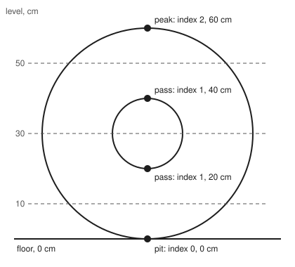

# Morse theory: a height function's critical points build the shape

[Syllabus](../../../SYLLABUS.md) → [Differential geometry and Lie groups](../README.md) → [Manifolds](../README.md#s03) → Morse theory

---

## General Overview

Walk over any landscape on a round planet and count three kinds of special place. A **pit** is a low point, where every way out goes up. A **peak** is a high point. A **pass** is a saddle between two peaks, where the ground goes up in two directions and down in two others. For any ordinary landscape, pits minus passes plus peaks is 2. A toy planet on this card has 3 pits, 4 passes and 3 peaks: 3 − 4 + 3 = 2.

The 2 has nothing to do with this terrain. It belongs to the sphere. A swim ring shows the same idea on a different shape. Stand a ring 60 cm across on its edge on the floor: the tube's centre circle has radius 20 cm and the tube has radius 10 cm. Its height has 4 special points: the bottom at 0 cm, a pass at the bottom of the hole at 20 cm, a pass at the top of the hole at 40 cm, and the top at 60 cm. Here 1 − 2 + 1 = 0, and 0 is the ring's Euler characteristic, as [Euler characteristic](../../17-Topology/03-Surfaces%20and%20Manifolds/04-euler-characteristic-and-triangulations.md) counts it from triangles.

Morse theory explains why. Raise a water level from the floor and watch the part of the ring's surface below it, the wet part. Between special heights its shape does not change. At each special height exactly one piece is glued on: a disc at a pit, a strip at a pass, a cap at a peak. So the special points are a recipe for building the shape, and the shape's holes limit how few of them there can be.

**Each nondegenerate critical point of a height function has an index k, its number of independent downhill directions; passing its level glues one k-dimensional cell onto the part below, so the counts by index are at least the Betti numbers and their alternating sum is the Euler characteristic.**

**What kind of fact this is:** a theorem, local and global. The Morse lemma and chart-independence of the index are proved on this card, the handle step is proved in outline in a fold, and the Morse inequalities are proved from cellular homology. The global part needs a closed manifold (compact, with no edge). Morse homology is stated in outline only, with a named source. The toy planet is a model terrain, not the real Earth.

### The picture: the swim ring stood on edge

<p align="center"></p>

Drawn to scale at 5 px per cm, in orthographic projection along the ring's axis (looking straight through the hole). The floor is at y = 340 px and the centre at (210, 190). The outer edge has radius 150 px and the hole 50 px. The critical points sit at y = 340, 240, 140 and 40 px. The dashed lines are water levels at 10, 30 and 50 cm.

---

## The formula

Six words first, each in one line.

- A **height function** is a smooth function $`h`$ from a manifold $`M`$ (a space that looks flat up close, [Smooth manifold](01-smooth-manifolds-and-charts.md)) to the real numbers. On the ring, $`h`$ is height above the floor, in cm.
- A **critical point** of $`h`$ is a point $`p`$ where the differential $`dh_p`$ is zero: every first derivative vanishes in a chart. Its height $`h(p)`$ is a **critical value**. This is the case of [Sard's theorem and degree](10-sards-theorem-and-degree.md) where the target is the line.
- The **Hessian** $`H(p)`$ is the square table of second partial derivatives in a chart ([Hessian](../../06-Calculus%20and%20analysis/07-Several%20Variables/05-hessian-and-second-order-approximation.md)). Clash, said once: H here is wing 06's Hessian matrix, not mean curvature or a Hamiltonian.
- A critical point is **nondegenerate** when $`\det H(p) \ne 0`$. A function whose critical points are all nondegenerate is a **Morse function**.
- The **index** of a nondegenerate critical point is the number of negative eigenvalues of $`H(p)`$: how many independent directions run downhill.
- The **sublevel set** $`M^{\le t}`$ is the part of $`M`$ at height $`t`$ or less: the wet part when the water stands at $`t`$.

The critical point and its index, in a chart $`x = (x^1, \dots, x^n)`$ (upper indices are labels, not powers):

```math
dh_p = 0, \qquad \mathrm{ind}_p\, h = \#\{\text{negative eigenvalues of } H(p)\}, \qquad H(p)_{ij} = \frac{\partial^2 h}{\partial x^i \partial x^j}(p)
```

**Read it aloud:** a critical point is where all slopes vanish, and its index is how many of the Hessian's eigenvalues are negative.

The **Morse lemma** says that near a nondegenerate critical point of index k there is a chart in which the function is exactly a sum of squares:

```math
h = h(p) - (x^1)^2 - \dots - (x^k)^2 + (x^{k+1})^2 + \dots + (x^n)^2
```

**Read it aloud:** near the point, the height is its own value, minus k squares for the downhill directions, plus the rest for the uphill ones.

The **handle step**: if $`p`$ is the only critical point with height in $`[h(p) - \varepsilon, h(p) + \varepsilon]`$ and has index k, then up to a deformation (homotopy equivalence),

```math
M^{\le h(p) + \varepsilon} \simeq M^{\le h(p) - \varepsilon} \cup e^k
```

**Read it aloud:** raising the water past the critical level is, up to deformation, gluing one k-dimensional cell $`e^k`$ onto what was already wet.

The **Morse inequalities**, where $`c_k`$ counts the critical points of index k and $`b_k`$ is the k-th Betti number (the number of independent k-dimensional holes):

```math
c_k \ge b_k, \qquad \sum_{i=0}^{k} (-1)^{k-i} c_i \ \ge\ \sum_{i=0}^{k} (-1)^{k-i} b_i, \qquad \sum_{k=0}^{n} (-1)^k c_k = \sum_{k=0}^{n} (-1)^k b_k = \chi(M)
```

**Read it aloud:** there are at least as many index-k points as k-dimensional holes; the same holds for alternating partial sums; and the full alternating sum is exactly the Euler characteristic.

On the ring: $`c = (1, 2, 1)`$, $`b = (1, 2, 1)`$, and 1 − 2 + 1 = 0 = $`\chi`$.

| Symbol | Plain meaning | In our example | Push it up and the answer… |
| --- | --- | --- | --- |
| $`M`$, $`n`$ | a closed manifold; its dimension | the ring's surface (a torus); n = 2 | more possible indices, 0 to n |
| $`a`$, $`b`$ | radius of the tube's centre circle; tube radius (not the Betti number $`b_k`$) | 20 cm; 10 cm | wider gap between the passes |
| $`u`$, $`v`$; $`x`$, $`y`$, $`z`$ | angle round the ring, angle round the tube; on the toy planet, a point of the unit sphere | ring bottom at u = 180°, v = 0° | — |
| $`h`$ | the height function | $`30 + (a + b\cos v)\cos u`$: 0, 20, 40, 60 cm at the critical points | — |
| $`p`$, $`dh_p`$, $`\mathrm{grad}\, h`$ | a critical point; the differential there; the uphill gradient (Step 3) | the pass at 20 cm; zero; zero | — |
| $`H(p)`$, $`H_{uu}`$, $`H_{uv}`$, $`H_{vv}`$ | Hessian and its entries, in cm per radian squared | 10, 0, −10 at the lower pass | — |
| $`k`$, $`\mathrm{ind}_p\, h`$ | the index: negative eigenvalues | 0 pit, 1 pass, 2 peak | one more downhill direction |
| $`x^1, \dots, x^n`$; $`q_{ij}`$, $`\tilde q_{ij}`$, $`y^1`$ | the Morse chart's coordinates; in its proof, the coefficient functions before and after one square is completed, and the first new coordinate | — | — |
| $`M^{\le t}`$, $`s`$, $`t`$, $`\varepsilon`$ | wet part at water level t; two water levels; a small height margin | below 30 cm: a band round the bottom | — |
| $`e^k`$, $`D^k`$ | a k-cell; a k-dimensional disc, so a k-handle is $`D^k \times D^{n-k}`$ | the pass at 20 cm adds $`e^1`$ | — |
| $`c_k`$, $`b_k`$, $`\chi`$; $`\partial_k`$, $`r_k`$ | critical points of index k; Betti numbers; Euler characteristic; boundary matrices and their ranks (Step 5) | (1, 2, 1); (1, 2, 1); 0 | more points, same alternating sum |
| $`J`$, $`w`$, $`K`$, $`F`$ | a change-of-chart matrix (Step 1); a direction (Step 6); Gauss curvature; the modified function in the handle proof | $`J`$ = `[[1, 0.4], [0, 1]]`; straight up | changes entries, never the index |

### When it holds

- **Every critical point is nondegenerate.** A ring lying flat on a table has whole circles of critical points along its top and bottom, so there is nothing to count. A monkey saddle, with three valleys, has a zero Hessian and acts like two passes at once.
- **The manifold is closed.** On an open strip a height function can have no critical points at all, and the counts say nothing.
- **The function is smooth, at least twice differentiable.** The Hessian needs second derivatives. A pyramid's apex is a peak with no Hessian.
- **Counting is by index.** The raw number of critical points depends on the terrain: 4 on the ring, 10 on the toy planet. Only the alternating sum is the shape's.

---

## Why it works

### Step 0: rising water changes shape only at critical levels

Let the water rise slowly. Where the ground is not flat, the water's edge moves smoothly and the wet region only grows a little everywhere: its shape stays the same. Something new can only happen where the ground is flat, at a critical point. The Morse lemma says what the ground looks like there, and that fixes what is added.

### Step 1: the index belongs to the shape, not the chart

The Hessian's entries change with the chart. Its index does not. At a critical point, a change of chart with Jacobian matrix $`J`$ sends $`H`$ to $`J^{\mathsf T} H J`$, where $`J^{\mathsf T}`$ is $`J`$ transposed (rows and columns swapped). The term with first derivatives drops out, because they are all zero.

Sylvester's law of inertia ([Bilinear forms](../../03-Algebra/07-Eigenvalues%20and%20Symmetric%20Matrices/12-bilinear-forms-and-sylvesters-law.md)) says $`J^{\mathsf T} H J`$ has as many negative eigenvalues as $`H`$ when $`J`$ is invertible. So the index is a property of the point.

At the bottom of the ring, $`H`$ is diagonal with entries 30 and 10. The checks read it in a bent second chart whose Jacobian at the point is $`J`$ = `[[1, 0.4], [0, 1]]`. There it becomes 30, 12 and 14.80: different entries, determinant still positive, both eigenvalues still positive, index still 0. At all four points the second chart gives the same index as the first.

### Step 2: the Morse lemma, squares in a good chart

Near a nondegenerate critical point, Taylor's theorem says the function is its value plus half its Hessian's quadratic form, plus higher terms. The Morse lemma says a chart change can absorb the higher terms exactly. Then diagonalising and rescaling turns the quadratic form into k minus squares and n − k plus squares.

<details>
<summary>Detailed proof: the Morse lemma</summary>

Move $`p`$ to the origin and set $`h(p) = 0`$. Since $`h(0) = 0`$ and $`dh_0 = 0`$, applying the fundamental theorem of calculus twice along the segment from 0 to x writes

$`\displaystyle h(x) = \sum_{i,j} x^i x^j\, q_{ij}(x), \qquad q_{ij}(x) = \int_0^1 (1 - s)\, \frac{\partial^2 h}{\partial x^i \partial x^j}(s x)\, ds,`$

with $`q_{ij}`$ smooth, symmetric, and $`q_{ij}(0) = \tfrac12 H(0)_{ij}`$, an invertible matrix.

Complete the square one coordinate at a time. After a linear change, $`q_{11}(0) \ne 0`$. Near 0 set

$`\displaystyle y^1 = \sqrt{\lvert q_{11}(x)\rvert}\,\Big(x^1 + \sum_{j > 1} x^j\, \frac{q_{1j}(x)}{q_{11}(x)}\Big).`$

Then $`h = \pm (y^1)^2 + \sum_{i,j > 1} x^i x^j\, \tilde q_{ij}(x)`$ with $`\tilde q`$ smooth and symmetric. The new coordinates have invertible Jacobian at 0, so by the inverse function theorem they form a chart. Repeat n times. The number of minus signs is the index, by Step 1.

</details>

On the ring the normal form is visible: at the lower pass, going round the ring (u) is uphill, with $`H_{uu}`$ = 10, and going round the tube (v) is downhill, with $`H_{vv}`$ = −10. One downhill direction: index 1.

A third way to read the index needs no derivatives. Walk a small circle round the point and mark where the ground is lower than the point. At a pit nothing is lower. At a peak everything is. At a pass there are exactly 2 lower stretches, the two valleys. The checks find 0, 2, 2 and "all" at the ring's four points.

### Step 3: between critical levels, the flow pushes the shape down

Take two heights $`s < t`$ with no critical value between them. On the slab of heights from s to t, use the vector field $`-\mathrm{grad}\, h / \lvert \mathrm{grad}\, h \rvert^2`$, where $`\mathrm{grad}\, h`$ points uphill. Cut it off smoothly to zero outside a slightly thicker slab, still free of critical points, so it is defined everywhere, even at the pit. Along its flow ([Vector field and its flow](07-vector-fields-and-flows.md)) the height falls at exactly 1 cm per unit of time inside the slab. Flowing for time $`t - s`$ carries the wet part at level t onto the wet part at level s, smoothly and reversibly.

This needs two things. The gradient must not vanish in the slab, which is why the slab has no critical value. The slab must be compact, so the flow lasts long enough; a closed manifold gives that. So $`M^{\le t}`$ and $`M^{\le s}`$ are diffeomorphic: same shape.

### Step 4: crossing a critical level glues a handle

In the Morse chart near an index-k point, the region just below the critical level is the set where $`-(x^1)^2 - \dots - (x^k)^2 + (x^{k+1})^2 + \dots`$ is below $`-\varepsilon`$. Raising the water past 0 fills in a **k-handle**: a k-dimensional disc thickened by an (n − k)-dimensional one, written $`D^k \times D^{n-k}`$. It is glued along its thin rim, so up to deformation it is a k-cell glued along its boundary sphere ([CW complexes](../../17-Topology/04-Homotopy/07-cw-complexes-and-gluing-cells.md)).

<details>
<summary>Detailed proof: the handle step, in outline</summary>

Milnor's *Morse Theory* (Theorem 3.2, Sources) builds a new function F equal to h outside a small ball round p and slightly smaller inside it. Then $`F^{\le h(p) + \varepsilon}`$ equals $`h^{\le h(p) + \varepsilon}`$, and F has no critical value in the slab above $`h(p) - \varepsilon`$, so Step 3 pushes it down to $`h^{\le h(p) - \varepsilon}`$ together with the handle. The core of the handle, the points with $`x^{k+1} = \dots = x^n = 0`$ and $`\sum_{i \le k} (x^i)^2 \le \varepsilon`$, is a k-disc whose rim lies on the old level. Squeezing the handle's thickness to zero along straight lines in the Morse chart deforms the whole onto the old sublevel set with that k-disc attached.

</details>

Each k-cell changes the Euler characteristic by $`(-1)^k`$. On the ring the checks count vertices minus edges plus triangles on a 60 × 60 mesh, keeping only triangles below the water:

| Water level | What was just glued | Wet part | Euler count |
| --- | --- | --- | --- |
| 10 cm | a 0-cell, at the pit | a disc | 1 |
| 30 cm | a 1-cell, at the lower pass | a band round the bottom | 0 |
| 50 cm | a 1-cell, at the upper pass | the ring with a disc missing at the top | −1 |
| 70 cm | a 2-cell, at the peak | the whole ring | 0 |

The ring is built from one point, two loops and one square: exactly the cell recipe for the torus used in [CW complexes](../../17-Topology/04-Homotopy/07-cw-complexes-and-gluing-cells.md).

### Step 5: the Morse inequalities from cellular homology

Steps 3 and 4 make $`M`$, up to deformation, a cell complex with $`c_k`$ cells of dimension k. [Cellular homology](../../17-Topology/05-Homology/05-cellular-homology.md) computes the Betti numbers from that recipe: a chain group of dimension $`c_k`$ in each dimension, and boundary matrices between them. The k-th homology is the cycles modulo the boundaries, so its dimension cannot exceed the chain group's: $`b_k \le c_k`$.

<details>
<summary>Detailed proof: the strong inequalities and the Euler sum</summary>

Work over the rationals. Let $`\partial_k`$ be the boundary matrix from k-chains to (k − 1)-chains, with rank $`r_k`$, and $`r_0 = r_{n+1} = 0`$. The cycles have dimension $`c_k - r_k`$, so

$`\displaystyle b_k = c_k - r_k - r_{k+1}.`$

Form the alternating sum from 0 up to k. The ranks telescope:

$`\displaystyle \sum_{i=0}^{k} (-1)^{k-i} b_i = \sum_{i=0}^{k} (-1)^{k-i} c_i - r_{k+1}.`$

Since $`r_{k+1} \ge 0`$, the strong inequality follows. At k = n, $`r_{n+1} = 0`$ gives equality. There the left side is $`(-1)^n \chi(M)`$ and the right side is $`(-1)^n \sum_i (-1)^i c_i`$, so the alternating count is $`\chi(M)`$. The weak inequality is the sum of the strong ones at k and k − 1.

</details>

The checks compute the Betti numbers independently, by exact ranks of the boundary matrices on a 9-vertex, 27-edge, 18-triangle triangulation of the ring: $`b = (1, 2, 1)`$. The counts by index are $`c = (1, 2, 1)`$. Every inequality is met, here with equality: a Morse function with $`c_k = b_k`$ for all k is called **perfect**.

The toy planet is not perfect. Its counts are (3, 4, 3) against the sphere's Betti numbers (1, 0, 1). Weak: 3 ≥ 1, 4 ≥ 0, 3 ≥ 1. Strong: 4 − 3 = 1 ≥ 0 − 1 = −1. Full sum: 3 − 4 + 3 = 2 = 1 − 0 + 1.

### Step 6: almost every direction gives a Morse function

For a surface in space, height in a direction w has a critical point wherever the unit normal is ±w. That point is degenerate exactly when the Gauss map (the map sending each point to its unit normal, [Gauss map and second fundamental form](../02-Surfaces/04-gauss-map-and-second-fundamental-form.md)) is critical there: where the Gauss curvature K is zero. So w is bad only when w or −w is a critical value of the Gauss map. By [Sard's theorem and degree](10-sards-theorem-and-degree.md), those directions fill zero area on the sphere of directions. Almost every direction is Morse.

The ring shows both cases. Lying flat, straight up is a bad direction: the whole top circle of the tube has normal pointing up, and K = 0 along it. Tilt the ring 5° and the checks find 4 nondegenerate critical points again, with indices 0, 1, 1, 2.

### Step 7, in outline: Morse homology

The boundary matrices can be read off the function itself. Count the steepest-descent paths that run from each index-k point down to each index-(k − 1) point, with signs from orientations. Each critical point has a descending set (everything that flows down out of it) and an ascending set (everything that flows up out of it). When every descending set crosses every ascending set transversally, at a clean angle as in [Transversality and cobordism](11-transversality-intersection-numbers-and-cobordism.md) (the **Morse–Smale** condition), these counts form a chain complex whose homology is the homology of $`M`$. The gradient paths drawn on the manifold form the **Morse–Smale complex**.

On the ring, the two downhill paths from the lower pass both end at the pit, with opposite signs, so the boundary is 0, as it must be for a perfect function. The ring stood exactly upright is not Morse–Smale: two paths, the two halves of the hole's rim, run straight from the upper pass down to the lower pass. A small tilt removes them. This card states Morse homology and does not prove it; Matsumoto's book and Bott's survey give the details (Sources).

---

## Worked numbers, by hand

The ring: $`h = 30 + (a + b\cos v)\cos u`$ with a = 20 cm and b = 10 cm. Its derivatives are $`H_{uu} = -(a + b\cos v)\cos u`$, $`H_{vv} = -b\cos v\cos u`$ and $`H_{uv} = b\sin v\sin u`$. The slopes vanish only where $`\sin u = 0`$ and $`\sin v = 0`$.

| Step | Arithmetic | Value |
| --- | --- | --- |
| u = 180°, v = 0° | height 30 − 30 = 0 cm; $`H_{uu}`$ = 30, $`H_{vv}`$ = 10 | index 0, pit |
| u = 180°, v = 180° | height 30 − 10 = 20 cm; $`H_{uu}`$ = 10, $`H_{vv}`$ = −10 | index 1, pass |
| u = 0°, v = 180° | height 30 + 10 = 40 cm; $`H_{uu}`$ = −10, $`H_{vv}`$ = 10 | index 1, pass |
| u = 0°, v = 0° | height 30 + 30 = 60 cm; $`H_{uu}`$ = −30, $`H_{vv}`$ = −10 | index 2, peak |
| counts by index | one 0, two 1s, one 2 | c = (1, 2, 1) |
| alternating sum | 1 − 2 + 1 | **0 = χ of the torus** |

At every critical point $`H_{uv}`$ = 0, because $`\sin u = 0`$. The answer means the ring is one point, two loops and one square glued together, and no Morse function on it can have fewer than 4 critical points.

### What breaks if you drop a piece

| Mistake | Comes out at | What went wrong |
| --- | --- | --- |
| Ring lying flat: height is $`10 + b\sin v`$ | Hessian 0, 0, −10 at the top circle, slope 0 all round it | a whole circle of degenerate critical points; tilting 5° gives 4 points, indices 0, 1, 1, 2 |
| Toy planet with no nudge: $`x^3 - 3xy^2`$ | 3 pits, 0 passes, 3 peaks: sum 6 | each pole is a monkey saddle: Hessian 0, 0, 0 and 3 lower stretches; it counts as 2 passes |
| Counting points without index signs | 4 on the ring, 10 on the planet | χ is 0 and 2: the passes must count negatively |
| Reading Hessian entries as the shape's | bottom of the ring: 30, 0, 10 in one chart, 30, 12, 14.80 in another | only the number of negative eigenvalues survives a chart change |

The code prints all four.

---

## Code, from first principles, and it actually runs

Both programs find the critical points with Newton's method, using finite-difference slopes and Hessians, from a grid of starting points. The index comes by **three independent roads**: the signs of the Hessian's eigenvalues; the number of lower stretches on a small circle, which uses no derivatives; and the Hessian in a bent second chart. The counts are then set against three more roads: Betti numbers from exact ranks of boundary matrices on a triangulation, Euler counts of the wet part on a 60 × 60 mesh, and a mesh count of pits, passes and peaks from sign changes round each vertex, which uses no derivatives at all.

The toy planet is a model terrain on a unit sphere, $`1000\,\mathrm{m} \times (x^3 - 3xy^2 + 0.3\,x)`$, with $`(x, y, z)`$ a point of the sphere, read in the globe's chart of polar angle and longitude. All four passes sit at sea level, 0 m; one is at polar angle 18.43°, longitude 90°, and the other three are its mirror images. The deepest pit, −1300 m, is on the equator at longitude 180°. The 48 × 96 planet mesh gives the same 3, 4, 3 as Newton's method.

### Python

```python
# Morse theory -- the check behind the card.  Standard library only.
# A swim ring stood on edge: tube-centre circle a = 20 cm, tube radius b = 10 cm, height
# h(u, v) = 30 + (a + b cos v) cos u in cm.  Newton's method finds the critical points; each is
# classified three ways (Hessian signs, lower arcs on a small circle, a second chart).  The counts
# meet Betti numbers from exact ranks, sublevel Euler counts and a mesh count of pits and passes.
from fractions import Fraction
from math import cos, sin, pi, hypot, radians, degrees
A, B, D, TAU = 20.0, 10.0, 1e-4, 2 * pi
def ring(u, v): return 30 + (A + B * cos(v)) * cos(u)
def planet(e):                              # toy planet terrain in metres, chart: polar angle, longitude
    def f(p, t):
        x, y = sin(p) * cos(t), sin(p) * sin(t)
        return 1000 * (x**3 - 3 * x * y * y + e * x)
    return f
def grad(f, u, v): return ((f(u + D, v) - f(u - D, v)) / (2 * D), (f(u, v + D) - f(u, v - D)) / (2 * D))
def hess(f, u, v):
    e, c = 1e-3, f(u, v)
    huv = (f(u + e, v + e) - f(u + e, v - e) - f(u - e, v + e) + f(u - e, v - e)) / (4 * e * e)
    return (f(u + e, v) - 2 * c + f(u - e, v)) / e**2, huv, (f(u, v + e) - 2 * c + f(u, v - e)) / e**2
def index(H):                               # negative eigenvalues of [[H0, H1], [H1, H2]]
    det = H[0] * H[2] - H[1] ** 2
    return None if abs(det) < 1e-3 else 1 if det < 0 else 0 if H[0] + H[2] > 0 else 2
def arcs(f, u, v, r=0.02):                  # separate stretches of a small circle lying below the point
    s = [f(u + r * cos(TAU * k / 72), v + r * sin(TAU * k / 72)) < f(u, v) for k in range(72)]
    return "all" if all(s) else sum(s[k] and not s[k - 1] for k in range(72))
def chart2(f, u, v):                        # the same function read in a bent second chart
    return lambda s, t: f(u + s + 0.4 * t + 0.3 * s * s, v + t - 0.5 * s * t)
def critical(f, starts, ok):
    found = []
    for u, v in starts:
        for _ in range(40):
            (gu, gv), (a, b, c) = grad(f, u, v), hess(f, u, v)
            if abs(a * c - b * b) < 1e-12: break
            u, v = u - (c * gu - b * gv) / (a * c - b * b), v - (a * gv - b * gu) / (a * c - b * b)
        k = (cos(u), sin(u), cos(v), sin(v))
        if hypot(*grad(f, u, v)) < 1e-6 and ok(u, v) and all(max(abs(x - y) for x, y in zip(k, q)) > 1e-5 for q, _ in found):
            found.append((k, (u % TAU, v % TAU)))
    return sorted((p for _, p in found), key=lambda p: f(*p))
def fx(x, d=2): return f"{x if abs(x) >= 0.5 * 10**-d else 0.0:.{d}f}"
def mesh(n, m, sphere):                     # triangles of an n-by-m grid, glued into a torus or a sphere
    def vid(i, j):
        if not sphere: return (i % n) * m + j % m
        return 0 if i == 0 else 1 + (n - 1) * m if i == n else 1 + (i - 1) * m + j % m
    tris = [t for i in range(n) for j in range(m) for t in ((vid(i, j), vid(i + 1, j), vid(i, j + 1)),
            (vid(i + 1, j), vid(i + 1, j + 1), vid(i, j + 1))) if len(set(t)) == 3]
    pos = {vid(i, j): ((pi if sphere else TAU) * i / n, TAU * j / m) for i in range(n + 1) for j in range(m)}
    return tris, pos
def rank(M):                                # exact Gaussian elimination in fractions
    M, r = [[Fraction(x) for x in row] for row in M], 0
    for c in range(len(M[0])):
        p = next((i for i in range(r, len(M)) if M[i][c]), None)
        if p is None: continue
        M[r], M[p] = M[p], M[r]
        for i in range(len(M)):
            if i != r and M[i][c]:
                k = M[i][c] / M[r][c]
                M[i] = [x - k * y for x, y in zip(M[i], M[r])]
        r += 1
    return r
def betti(tris):
    V = sorted({v for t in tris for v in t})
    E = sorted({tuple(sorted(e)) for p, q, r in tris for e in ((p, q), (q, r), (p, r))})
    d1 = [[(v == b) - (v == a) for a, b in E] for v in V]
    T = [tuple(sorted(t)) for t in tris]
    d2 = [[(e == (q, r)) - (e == (p, r)) + (e == (p, q)) for p, q, r in T] for e in E]
    r1, r2 = rank(d1), rank(d2)
    return [len(V) - r1, len(E) - r1 - r2, len(T) - r2], (len(V), len(E), len(T))
def euler_below(tris, val, c):              # V - E + T of the part of the mesh at or below level c
    T = [t for t in tris if max(val[v] for v in t) <= c]
    E = {tuple(sorted(e)) for p, q, r in T for e in ((p, q), (q, r), (p, r))}
    return len({v for t in T for v in t}) - len(E) + len(T)
def mesh_count(tris, val):                  # pits, passes, peaks from sign changes round each vertex
    nxt, kinds = {}, [0, 0, 0]
    for p, q, r in tris:
        for v, x, y in ((p, q, r), (q, r, p), (r, p, q)): nxt.setdefault(v, {})[x] = y
    for v, link in nxt.items():
        cyc = [next(iter(link))]
        while link[cyc[-1]] != cyc[0]: cyc.append(link[cyc[-1]])
        s = [val[w] > val[v] for w in cyc]
        sc = sum(s[k] != s[k - 1] for k in range(len(s)))
        if sc == 0: kinds[0 if s[0] else 2] += 1
        else: kinds[1] += sc // 2 - 1
    return kinds
grid = [(TAU * i / 7 + 0.1, TAU * j / 7 + 0.2) for i in range(7) for j in range(7)]
crit = critical(ring, grid, lambda u, v: True)
counts = [0, 0, 0]
print("swim ring stood on edge: a = 20 cm, b = 10 cm; critical points, lowest first")
for u, v in crit:
    H, K = hess(ring, u, v), hess(chart2(ring, u, v), 0, 0)
    counts[index(H)] += 1
    print(f"u {round(degrees(u)) % 360} deg, v {round(degrees(v)) % 360} deg, height {fx(ring(u, v))} cm; Hessian {fx(H[0])}, "
          f"{fx(H[1])}, {fx(H[2])}; index {index(H)}; lower arcs {arcs(ring, u, v)}; chart 2: {fx(K[0])}, {fx(K[1])}, "
          f"{fx(K[2])}, index {index(K)}")
b_t, vet = betti(mesh(3, 3, False)[0])
print(f"counts by index c = {counts}; Betti numbers b = {b_t} by exact ranks on {vet[0]}-{vet[1]}-{vet[2]} triangles")
print(f"weak: c_k >= b_k {'yes' if all(c >= b for c, b in zip(counts, b_t)) else 'no'}; strong: c1 - c0 = {counts[1] - counts[0]} "
      f">= b1 - b0 = {b_t[1] - b_t[0]}; c0 - c1 + c2 = {counts[0] - counts[1] + counts[2]} = chi = {vet[0] - vet[1] + vet[2]}")
tris, pos = mesh(60, 60, False)
val = {k: ring(*p) for k, p in pos.items()}
chis, mr = [euler_below(tris, val, c) for c in (10, 30, 50, 70)], mesh_count(tris, val)
print(f"sublevel Euler counts below 10, 30, 50, 70 cm on a 60 x 60 mesh: {chis}; mesh pits, passes, peaks {mr}")
terrain = planet(0.3)
peaks = critical(terrain, [(radians(10 + 20 * i), radians(30 * j)) for i in range(9) for j in range(12)],
                 lambda p, t: 0.02 < p < pi - 0.02)
kinds = [index(hess(terrain, *p)) for p in peaks]
pl = [kinds.count(k) for k in (0, 1, 2)]
print(f"toy planet: {pl[0]} pits, {pl[1]} passes, {pl[2]} peaks; {pl[0]} - {pl[1]} + {pl[2]} = {pl[0] - pl[1] + pl[2]}")
print("heights (m): " + ", ".join(fx(terrain(*p), 0) for p in peaks))
for p in peaks[:1] + [p for p in peaks if index(hess(terrain, *p)) == 1][:1]:
    print(f"  polar angle {degrees(p[0]):.2f} deg, longitude {degrees(p[1]):.2f} deg, index {index(hess(terrain, *p))}")
tris_s, pos_s = mesh(48, 96, True)
mc = mesh_count(tris_s, {k: terrain(*p) for k, p in pos_s.items()})
b_s, ve_s = betti(mesh(3, 4, True)[0])
print(f"planet 48 x 96 mesh count {mc}, alternating sum {mc[0] - mc[1] + mc[2]}; sphere Betti {b_s} by exact ranks, chi {ve_s[0] - ve_s[1] + ve_s[2]}")
flat = lambda u, v: 10 + B * sin(v)
print(f"break 1, ring lying flat: Hessian at v = 90 deg {', '.join(fx(x) for x in hess(flat, 0.0, pi / 2))}, "
      f"largest slope on that circle {max(hypot(*grad(flat, TAU * k / 36, pi / 2)) for k in range(36)):.6f}")
tilt = lambda u, v: 30 + (B * sin(v)) * cos(radians(5)) + (A + B * cos(v)) * cos(u) * sin(radians(5))
ct = critical(tilt, grid, lambda u, v: True)
print(f"break 2, ring tilted 5 deg from flat: {len(ct)} critical points, indices {[index(hess(tilt, *p)) for p in ct]}")
monkey = lambda x, y: x**3 - 3 * x * y * y
pm = critical(planet(0.0), [(radians(10 + 20 * i), radians(30 * j)) for i in range(9) for j in range(12)],
              lambda p, t: 0.02 < p < pi - 0.02)
km = [index(hess(planet(0.0), *p)) for p in pm]
print(f"break 3, planet with no nudge: Newton finds {km.count(0)} pits, {km.count(1)} passes, {km.count(2)} peaks, "
      f"sum {km.count(0) - km.count(1) + km.count(2)}; at each pole Hessian {', '.join(fx(x) for x in hess(monkey, 0.0, 0.0))}, "
      f"lower arcs {arcs(monkey, 0.0, 0.0)}")
print(f"break 4, counting without signs: ring {len(crit)} points against chi 0; planet {len(peaks)} against chi 2")
print("figure, 5 px per cm, floor y 340, centre (210, 190), outer r 150, hole r 50, critical points at y "
      + ", ".join(f"{340 - 5 * ring(*p):.0f}" for p in crit))
assert [index(hess(ring, *p)) for p in crit] == [index(hess(chart2(ring, *p), 0, 0)) for p in crit] == [0, 1, 1, 2]
assert [arcs(ring, *p) for p in crit] == [0, 2, 2, "all"]       # second road to the index
assert all(abs(ring(*p) - h) < 1e-6 for p, h in zip(crit, (30 - A - B, 30 - A + B, 30 + A - B, 30 + A + B)))  # 30 -/+ (a -/+ b)
assert counts == b_t == mr == [1, 2, 1] and chis == [1, 0, -1, 0]  # Morse counts against exact ranks, sublevels, mesh
assert pl == mc == [3, 4, 3] and ve_s[0] - ve_s[1] + ve_s[2] == pl[0] - pl[1] + pl[2] and b_s == [1, 0, 1]
assert index(hess(flat, 0.0, pi / 2)) is None and len(ct) == 4 and arcs(monkey, 0.0, 0.0) == 3
print("ALL CHECKS PASS")
```

**Ran 2026-11-24 on macOS, Python 3.14.10, standard library only. All checks passed. Output, pasted from the run:**

```
swim ring stood on edge: a = 20 cm, b = 10 cm; critical points, lowest first
u 180 deg, v 0 deg, height 0.00 cm; Hessian 30.00, 0.00, 10.00; index 0; lower arcs 0; chart 2: 30.00, 12.00, 14.80, index 0
u 180 deg, v 180 deg, height 20.00 cm; Hessian 10.00, 0.00, -10.00; index 1; lower arcs 2; chart 2: 10.00, 4.00, -8.40, index 1
u 0 deg, v 180 deg, height 40.00 cm; Hessian -10.00, 0.00, 10.00; index 1; lower arcs 2; chart 2: -10.00, -4.00, 8.40, index 1
u 0 deg, v 0 deg, height 60.00 cm; Hessian -30.00, 0.00, -10.00; index 2; lower arcs all; chart 2: -30.00, -12.00, -14.80, index 2
counts by index c = [1, 2, 1]; Betti numbers b = [1, 2, 1] by exact ranks on 9-27-18 triangles
weak: c_k >= b_k yes; strong: c1 - c0 = 1 >= b1 - b0 = 1; c0 - c1 + c2 = 0 = chi = 0
sublevel Euler counts below 10, 30, 50, 70 cm on a 60 x 60 mesh: [1, 0, -1, 0]; mesh pits, passes, peaks [1, 2, 1]
toy planet: 3 pits, 4 passes, 3 peaks; 3 - 4 + 3 = 2
heights (m): -1300, -854, -854, 0, 0, 0, 0, 854, 854, 1300
  polar angle 90.00 deg, longitude 180.00 deg, index 0
  polar angle 18.43 deg, longitude 90.00 deg, index 1
planet 48 x 96 mesh count [3, 4, 3], alternating sum 2; sphere Betti [1, 0, 1] by exact ranks, chi 2
break 1, ring lying flat: Hessian at v = 90 deg 0.00, 0.00, -10.00, largest slope on that circle 0.000000
break 2, ring tilted 5 deg from flat: 4 critical points, indices [0, 1, 1, 2]
break 3, planet with no nudge: Newton finds 3 pits, 0 passes, 3 peaks, sum 6; at each pole Hessian 0.00, 0.00, 0.00, lower arcs 3
break 4, counting without signs: ring 4 points against chi 0; planet 10 against chi 2
figure, 5 px per cm, floor y 340, centre (210, 190), outer r 150, hole r 50, critical points at y 340, 240, 140, 40
ALL CHECKS PASS
```

### Rust

Same numbers, same labels, built with `rustc --edition 2021 -O`. The exact rank uses fraction-free elimination in whole numbers instead of fractions; both are exact.

```rust
// Morse theory -- the same check as the Python, in Rust.  No crates.
// A swim ring stood on edge: tube-centre circle a = 20 cm, tube radius b = 10 cm, height
// h(u, v) = 30 + (a + b cos v) cos u in cm.  Newton's method finds the critical points; each is
// classified three ways (Hessian signs, lower arcs on a small circle, a second chart).  The counts
// meet Betti numbers from exact ranks, sublevel Euler counts and a mesh count of pits and passes.
use std::f64::consts::PI;
const A: f64 = 20.0; const B: f64 = 10.0; const D: f64 = 1e-4; const TAU: f64 = 2.0 * PI;
type Fun<'a> = &'a dyn Fn(f64, f64) -> f64;
fn ring(u: f64, v: f64) -> f64 { 30.0 + (A + B * v.cos()) * u.cos() }
fn planet(e: f64) -> impl Fn(f64, f64) -> f64 { // toy planet terrain in metres, chart: polar angle, longitude
    move |p: f64, t: f64| { let (x, y) = (p.sin() * t.cos(), p.sin() * t.sin()); 1000.0 * (x.powi(3) - 3.0 * x * y * y + e * x) }
}
fn grad(f: Fun, u: f64, v: f64) -> (f64, f64) { ((f(u + D, v) - f(u - D, v)) / (2.0 * D), (f(u, v + D) - f(u, v - D)) / (2.0 * D)) }
fn hess(f: Fun, u: f64, v: f64) -> [f64; 3] {
    let (e, c) = (1e-3, f(u, v));
    let huv = (f(u + e, v + e) - f(u + e, v - e) - f(u - e, v + e) + f(u - e, v - e)) / (4.0 * e * e);
    [(f(u + e, v) - 2.0 * c + f(u - e, v)) / e.powi(2), huv, (f(u, v + e) - 2.0 * c + f(u, v - e)) / e.powi(2)]
}
fn index(h: [f64; 3]) -> Option<usize> { // negative eigenvalues of [[H0, H1], [H1, H2]]
    let det = h[0] * h[2] - h[1].powi(2);
    if det.abs() < 1e-3 { None } else if det < 0.0 { Some(1) } else if h[0] + h[2] > 0.0 { Some(0) } else { Some(2) }
}
fn arcs(f: Fun, u: f64, v: f64) -> String { // separate stretches of a small circle lying below the point
    let s: Vec<bool> = (0..72).map(|k| { let a = TAU * k as f64 / 72.0; f(u + 0.02 * a.cos(), v + 0.02 * a.sin()) < f(u, v) }).collect();
    if s.iter().all(|&x| x) { return "all".to_string() }
    (0..72).filter(|&k| s[k] && !s[(k + 71) % 72]).count().to_string()
}
fn chart2<'a>(f: Fun<'a>, u: f64, v: f64) -> impl Fn(f64, f64) -> f64 + 'a { // the same function in a bent second chart
    move |s: f64, t: f64| f(u + s + 0.4 * t + 0.3 * s * s, v + t - 0.5 * s * t)
}
fn critical(f: Fun, starts: &[(f64, f64)], ok: &dyn Fn(f64, f64) -> bool) -> Vec<(f64, f64)> {
    let mut found: Vec<([f64; 4], (f64, f64))> = Vec::new();
    for &(mut u, mut v) in starts {
        for _ in 0..40 {
            let ((gu, gv), h) = (grad(f, u, v), hess(f, u, v));
            let det = h[0] * h[2] - h[1] * h[1];
            if det.abs() < 1e-12 { break }
            (u, v) = (u - (h[2] * gu - h[1] * gv) / det, v - (h[0] * gv - h[1] * gu) / det);
        }
        let (k, (gu, gv)) = ([u.cos(), u.sin(), v.cos(), v.sin()], grad(f, u, v));
        if gu.hypot(gv) < 1e-6 && ok(u, v) && found.iter().all(|(q, _)| (0..4).map(|i| (k[i] - q[i]).abs()).fold(0.0, f64::max) > 1e-5) {
            found.push((k, (u.rem_euclid(TAU), v.rem_euclid(TAU))));
        }
    }
    let mut pts: Vec<(f64, f64)> = found.into_iter().map(|(_, p)| p).collect();
    pts.sort_by(|p, q| f(p.0, p.1).partial_cmp(&f(q.0, q.1)).unwrap());
    pts
}
fn fx(x: f64, d: usize) -> String { format!("{:.*}", d, if x.abs() >= 0.5 * 10f64.powi(-(d as i32)) { x } else { 0.0 }) }
fn deg(x: f64) -> i64 { (x.to_degrees().round() as i64).rem_euclid(360) }
type Mesh = (Vec<[usize; 3]>, Vec<(f64, f64)>);
fn mesh(n: usize, m: usize, sphere: bool) -> Mesh { // triangles of an n-by-m grid, glued into a torus or a sphere
    let vid = |i: usize, j: usize| -> usize {
        if !sphere { (i % n) * m + j % m } else if i == 0 { 0 } else if i == n { 1 + (n - 1) * m } else { 1 + (i - 1) * m + j % m }
    };
    let mut tris = Vec::new();
    for i in 0..n { for j in 0..m {
        for t in [[vid(i, j), vid(i + 1, j), vid(i, j + 1)], [vid(i + 1, j), vid(i + 1, j + 1), vid(i, j + 1)]] {
            if t[0] != t[1] && t[1] != t[2] && t[0] != t[2] { tris.push(t) }
        }
    } }
    let nv = if sphere { 2 + (n - 1) * m } else { n * m };
    let mut pos = vec![(0.0, 0.0); nv];
    for i in 0..=n { for j in 0..m { pos[vid(i, j)] = ((if sphere { PI } else { TAU }) * i as f64 / n as f64, TAU * j as f64 / m as f64) } }
    (tris, pos)
}
fn rank(mut m: Vec<Vec<i128>>) -> usize { // exact fraction-free (Bareiss) elimination in whole numbers
    let (mut r, mut prev) = (0, 1i128);
    for c in 0..m[0].len() {
        let Some(p) = (r..m.len()).find(|&i| m[i][c] != 0) else { continue };
        m.swap(r, p);
        for i in r + 1..m.len() {
            for j in 0..m[0].len() { if j != c { m[i][j] = (m[i][j] * m[r][c] - m[i][c] * m[r][j]) / prev } }
            m[i][c] = 0;
        }
        prev = m[r][c]; r += 1;
    }
    r
}
fn edges(tris: &[[usize; 3]]) -> Vec<(usize, usize)> {
    let mut e: Vec<(usize, usize)> = tris.iter().flat_map(|t| [(t[0], t[1]), (t[1], t[2]), (t[0], t[2])]).map(|(a, b)| (a.min(b), a.max(b))).collect();
    e.sort(); e.dedup(); e
}
fn betti(tris: &[[usize; 3]]) -> (Vec<i64>, [i64; 3]) {
    let mut vs: Vec<usize> = tris.iter().flatten().copied().collect(); vs.sort(); vs.dedup();
    let e = edges(tris);
    let t: Vec<[usize; 3]> = tris.iter().map(|t| { let mut s = *t; s.sort(); s }).collect();
    let d1 = vs.iter().map(|&v| e.iter().map(|&(a, b)| (v == b) as i128 - (v == a) as i128).collect()).collect();
    let d2 = e.iter().map(|&x| t.iter().map(|s| (x == (s[1], s[2])) as i128 - (x == (s[0], s[2])) as i128 + (x == (s[0], s[1])) as i128).collect()).collect();
    let (r1, r2, nv, ne, nt) = (rank(d1) as i64, rank(d2) as i64, vs.len() as i64, e.len() as i64, t.len() as i64);
    (vec![nv - r1, ne - r1 - r2, nt - r2], [nv, ne, nt])
}
fn euler_below(tris: &[[usize; 3]], val: &[f64], c: f64) -> i64 { // V - E + T of the part at or below level c
    let t: Vec<[usize; 3]> = tris.iter().filter(|t| t.iter().all(|&v| val[v] <= c)).copied().collect();
    let mut vs: Vec<usize> = t.iter().flatten().copied().collect(); vs.sort(); vs.dedup();
    vs.len() as i64 - edges(&t).len() as i64 + t.len() as i64
}
fn mesh_count(tris: &[[usize; 3]], val: &[f64]) -> Vec<i64> { // pits, passes, peaks from sign changes round each vertex
    let mut link: Vec<Vec<(usize, usize)>> = vec![Vec::new(); val.len()];
    for t in tris { for (v, x, y) in [(t[0], t[1], t[2]), (t[1], t[2], t[0]), (t[2], t[0], t[1])] { link[v].push((x, y)) } }
    let mut kinds = vec![0i64; 3];
    for v in 0..val.len() {
        let mut cyc = vec![link[v][0].0];
        loop { let nx = link[v].iter().find(|p| p.0 == *cyc.last().unwrap()).unwrap().1; if nx == cyc[0] { break } cyc.push(nx) }
        let s: Vec<bool> = cyc.iter().map(|&w| val[w] > val[v]).collect();
        let sc = (0..s.len()).filter(|&k| s[k] != s[(k + s.len() - 1) % s.len()]).count() as i64;
        if sc == 0 { kinds[if s[0] { 0 } else { 2 }] += 1 } else { kinds[1] += sc / 2 - 1 }
    }
    kinds
}
fn idx(f: Fun, p: (f64, f64)) -> usize { index(hess(f, p.0, p.1)).unwrap() }
fn main() {
    let grid: Vec<(f64, f64)> = (0..49).map(|k| (TAU * (k / 7) as f64 / 7.0 + 0.1, TAU * (k % 7) as f64 / 7.0 + 0.2)).collect();
    let crit = critical(&ring, &grid, &|_, _| true);
    let mut counts = vec![0i64; 3];
    println!("swim ring stood on edge: a = 20 cm, b = 10 cm; critical points, lowest first");
    for &(u, v) in &crit {
        let (h, k) = (hess(&ring, u, v), hess(&chart2(&ring, u, v), 0.0, 0.0));
        counts[index(h).unwrap()] += 1;
        println!("u {} deg, v {} deg, height {} cm; Hessian {}, {}, {}; index {}; lower arcs {}; chart 2: {}, {}, {}, index {}", deg(u), deg(v),
                 fx(ring(u, v), 2), fx(h[0], 2), fx(h[1], 2), fx(h[2], 2), index(h).unwrap(), arcs(&ring, u, v), fx(k[0], 2), fx(k[1], 2), fx(k[2], 2), index(k).unwrap());
    }
    let (b_t, vet) = betti(&mesh(3, 3, false).0);
    println!("counts by index c = {:?}; Betti numbers b = {:?} by exact ranks on {}-{}-{} triangles", counts, b_t, vet[0], vet[1], vet[2]);
    println!("weak: c_k >= b_k {}; strong: c1 - c0 = {} >= b1 - b0 = {}; c0 - c1 + c2 = {} = chi = {}", if (0..3).all(|k| counts[k] >= b_t[k]) { "yes" } else { "no" },
             counts[1] - counts[0], b_t[1] - b_t[0], counts[0] - counts[1] + counts[2], vet[0] - vet[1] + vet[2]);
    let (tris, pos) = mesh(60, 60, false);
    let val: Vec<f64> = pos.iter().map(|p| ring(p.0, p.1)).collect();
    let (chis, mr): (Vec<i64>, Vec<i64>) = ([10.0, 30.0, 50.0, 70.0].iter().map(|&c| euler_below(&tris, &val, c)).collect(), mesh_count(&tris, &val));
    println!("sublevel Euler counts below 10, 30, 50, 70 cm on a 60 x 60 mesh: {:?}; mesh pits, passes, peaks {:?}", chis, mr);
    let terrain = planet(0.3);
    let starts: Vec<(f64, f64)> = (0..108).map(|k| ((10.0 + 20.0 * (k / 12) as f64).to_radians(), (30.0 * (k % 12) as f64).to_radians())).collect();
    let inside = |p: f64, _t: f64| 0.02 < p && p < PI - 0.02;
    let peaks = critical(&terrain, &starts, &inside);
    let kinds: Vec<usize> = peaks.iter().map(|&p| idx(&terrain, p)).collect();
    let pl: Vec<i64> = (0..3).map(|k| kinds.iter().filter(|&&x| x == k).count() as i64).collect();
    println!("toy planet: {} pits, {} passes, {} peaks; {} - {} + {} = {}", pl[0], pl[1], pl[2], pl[0], pl[1], pl[2], pl[0] - pl[1] + pl[2]);
    println!("heights (m): {}", peaks.iter().map(|p| fx(terrain(p.0, p.1), 0)).collect::<Vec<_>>().join(", "));
    for &p in peaks.iter().take(1).chain(peaks.iter().filter(|&&p| idx(&terrain, p) == 1).take(1)) { // the deepest pit, then the first pass if any
        println!("  polar angle {:.2} deg, longitude {:.2} deg, index {}", p.0.to_degrees(), p.1.to_degrees(), idx(&terrain, p)) }
    let (tris_s, pos_s) = mesh(48, 96, true);
    let mc = mesh_count(&tris_s, &pos_s.iter().map(|p| terrain(p.0, p.1)).collect::<Vec<f64>>());
    let (b_s, ve_s) = betti(&mesh(3, 4, true).0);
    println!("planet 48 x 96 mesh count {:?}, alternating sum {}; sphere Betti {:?} by exact ranks, chi {}", mc, mc[0] - mc[1] + mc[2], b_s, ve_s[0] - ve_s[1] + ve_s[2]);
    let flat = |_u: f64, v: f64| 10.0 + B * v.sin();
    let hf = hess(&flat, 0.0, PI / 2.0);
    let slope = (0..36).map(|k| { let g = grad(&flat, TAU * k as f64 / 36.0, PI / 2.0); g.0.hypot(g.1) }).fold(0.0, f64::max);
    println!("break 1, ring lying flat: Hessian at v = 90 deg {}, {}, {}, largest slope on that circle {:.6}", fx(hf[0], 2), fx(hf[1], 2), fx(hf[2], 2), slope);
    let tilt = |u: f64, v: f64| 30.0 + (B * v.sin()) * 5f64.to_radians().cos() + (A + B * v.cos()) * u.cos() * 5f64.to_radians().sin();
    let ct = critical(&tilt, &grid, &|_, _| true);
    println!("break 2, ring tilted 5 deg from flat: {} critical points, indices {:?}", ct.len(), ct.iter().map(|&p| idx(&tilt, p)).collect::<Vec<_>>());
    let (monkey, flat_planet) = (|x: f64, y: f64| x.powi(3) - 3.0 * x * y * y, planet(0.0));
    let km: Vec<usize> = critical(&flat_planet, &starts, &inside).iter().map(|&p| idx(&flat_planet, p)).collect();
    let c = |k: usize| km.iter().filter(|&&x| x == k).count() as i64;
    let hm = hess(&monkey, 0.0, 0.0);
    println!("break 3, planet with no nudge: Newton finds {} pits, {} passes, {} peaks, sum {}; at each pole Hessian {}, {}, {}, lower arcs {}",
             c(0), c(1), c(2), c(0) - c(1) + c(2), fx(hm[0], 2), fx(hm[1], 2), fx(hm[2], 2), arcs(&monkey, 0.0, 0.0));
    println!("break 4, counting without signs: ring {} points against chi 0; planet {} against chi 2", crit.len(), peaks.len());
    println!("figure, 5 px per cm, floor y 340, centre (210, 190), outer r 150, hole r 50, critical points at y {}",
             crit.iter().map(|p| format!("{:.0}", 340.0 - 5.0 * ring(p.0, p.1))).collect::<Vec<_>>().join(", "));
    let i1: Vec<usize> = crit.iter().map(|&p| idx(&ring, p)).collect();
    let i2: Vec<usize> = crit.iter().map(|&p| index(hess(&chart2(&ring, p.0, p.1), 0.0, 0.0)).unwrap()).collect();
    assert!(i1 == i2 && i1 == vec![0, 1, 1, 2]);
    assert!(crit.iter().map(|p| arcs(&ring, p.0, p.1)).collect::<Vec<_>>() == ["0", "2", "2", "all"]); // second road to the index
    assert!(crit.iter().zip([30.0 - A - B, 30.0 - A + B, 30.0 + A - B, 30.0 + A + B]).all(|(p, h)| (ring(p.0, p.1) - h).abs() < 1e-6)); // 30 -/+ (a -/+ b)
    assert!(counts == b_t && b_t == mr && b_t == vec![1, 2, 1] && chis == vec![1, 0, -1, 0]); // Morse counts against exact ranks, sublevels, mesh
    assert!(pl == mc && pl == vec![3, 4, 3] && ve_s[0] - ve_s[1] + ve_s[2] == pl[0] - pl[1] + pl[2] && b_s == vec![1, 0, 1]);
    assert!(index(hf).is_none() && ct.len() == 4 && arcs(&monkey, 0.0, 0.0) == "3");
    println!("ALL CHECKS PASS");
}
```

**Ran 2026-11-24 on macOS, rustc 1.98.1, no crates. All checks passed. Output, pasted from the run:**

```
swim ring stood on edge: a = 20 cm, b = 10 cm; critical points, lowest first
u 180 deg, v 0 deg, height 0.00 cm; Hessian 30.00, 0.00, 10.00; index 0; lower arcs 0; chart 2: 30.00, 12.00, 14.80, index 0
u 180 deg, v 180 deg, height 20.00 cm; Hessian 10.00, 0.00, -10.00; index 1; lower arcs 2; chart 2: 10.00, 4.00, -8.40, index 1
u 0 deg, v 180 deg, height 40.00 cm; Hessian -10.00, 0.00, 10.00; index 1; lower arcs 2; chart 2: -10.00, -4.00, 8.40, index 1
u 0 deg, v 0 deg, height 60.00 cm; Hessian -30.00, 0.00, -10.00; index 2; lower arcs all; chart 2: -30.00, -12.00, -14.80, index 2
counts by index c = [1, 2, 1]; Betti numbers b = [1, 2, 1] by exact ranks on 9-27-18 triangles
weak: c_k >= b_k yes; strong: c1 - c0 = 1 >= b1 - b0 = 1; c0 - c1 + c2 = 0 = chi = 0
sublevel Euler counts below 10, 30, 50, 70 cm on a 60 x 60 mesh: [1, 0, -1, 0]; mesh pits, passes, peaks [1, 2, 1]
toy planet: 3 pits, 4 passes, 3 peaks; 3 - 4 + 3 = 2
heights (m): -1300, -854, -854, 0, 0, 0, 0, 854, 854, 1300
  polar angle 90.00 deg, longitude 180.00 deg, index 0
  polar angle 18.43 deg, longitude 90.00 deg, index 1
planet 48 x 96 mesh count [3, 4, 3], alternating sum 2; sphere Betti [1, 0, 1] by exact ranks, chi 2
break 1, ring lying flat: Hessian at v = 90 deg 0.00, 0.00, -10.00, largest slope on that circle 0.000000
break 2, ring tilted 5 deg from flat: 4 critical points, indices [0, 1, 1, 2]
break 3, planet with no nudge: Newton finds 3 pits, 0 passes, 3 peaks, sum 6; at each pole Hessian 0.00, 0.00, 0.00, lower arcs 3
break 4, counting without signs: ring 4 points against chi 0; planet 10 against chi 2
figure, 5 px per cm, floor y 340, centre (210, 190), outer r 150, hole r 50, critical points at y 340, 240, 140, 40
ALL CHECKS PASS
```

The two outputs match line for line.

### Lean

Lean proves the Morse inequalities from the cell recipe over the rationals, and that the index does not change with the chart.

- Take chain groups over the rationals of dimension $`c_k`$, where two boundary matrices in a row give zero. Then every Betti number obeys $`b_k \le c_k`$.
- Take the same chain groups, with none above dimension $`n`$. Then the alternating count of critical points equals the alternating sum of Betti numbers, the Euler characteristic.
- Take the same chain groups and any index $`k`$. Then each alternating partial sum of the counts up to $`k`$ is at least the matching sum of Betti numbers.
- Take a symmetric Hessian $`H`$ and an invertible change-of-chart matrix $`J`$. Then $`J^{\mathsf T} H J`$ has exactly as many negative eigenvalues as $`H`$, so the same index.
- Take the bottom of the ring, where $`H`$ is diagonal with entries 30 and 10, and $`J`$ = `[[1, 0.4], [0, 1]]`. Then $`J^{\mathsf T} H J`$ has entries 30, 12 and 14.80, with determinant 300.
- Take the toy planet's counts (3, 4, 3) and the sphere's Betti numbers (1, 0, 1). Then both inequalities hold, and 3 − 4 + 3 = 2 = 1 − 0 + 1.
- Take the ring's counts (1, 2, 1). Then 1 − 2 + 1 = 0, its Euler characteristic, and the mesh's 9 − 27 + 18 = 0 agrees.

Finding the critical points, reading their indices and computing the ring's and planet's Betti numbers are left to the Python and Rust checks.

```lean
-- Morse theory: in the cell recipe a Morse function gives (c_k cells of dimension k, boundary maps over the rationals) every Betti number is at most the count c_k, the alternating partial sums obey the strong Morse inequalities, the full alternating count equals the alternating Betti sum (the Euler characteristic), and the index of a Hessian does not change with the chart.
import Mathlib.Analysis.Matrix.Spectrum
import Mathlib.LinearAlgebra.Dimension.Finrank
import Mathlib.LinearAlgebra.FiniteDimensional.Defs
import Mathlib.LinearAlgebra.Quotient.Basic
import Mathlib.Algebra.BigOperators.Intervals
import Mathlib.Tactic.NormNum
import Mathlib.Tactic.FinCases

/-! Mathlib has no Morse functions, no Morse lemma and no handle attachment, so the card's
geometric steps (Steps 0, 2, 3, 4, 6 and 7) are not stated here. This file states the parts the
card proves that can be stated exactly:

* Step 5, the Morse inequalities, from the cell recipe of Steps 3 and 4. Passing the critical
  levels builds `M`, up to deformation, from `c_k` cells of dimension `k`. Cellular homology over
  the rationals turns that recipe into a chain complex: a space `C k` of dimension `c_k` in each
  dimension `k`, and boundary maps `∂ k : C (k + 1) → C k` with `∂ ∘ ∂ = 0`. The Betti number `b_k`
  is the dimension of cycles modulo boundaries.
* Step 1, the index belongs to the point: at a critical point a change of chart with invertible
  Jacobian `J` sends the Hessian `H` to `Jᵀ H J`, and that has as many negative eigenvalues as `H`.

The examples check the card's whole-number worked numbers. -/

namespace MorseTheory

open Module

theorem alt_sum_rev_telescope (x r : ℕ → ℤ) (h0 : x 0 = r 0)
    (hs : ∀ k, x (k + 1) = r (k + 1) + r k) (k : ℕ) :
    ∑ i ∈ Finset.range (k + 1), (-1 : ℤ) ^ (k - i) * x i = r k := by
  induction k with
  | zero => simp [h0]
  | succ k ih =>
    rw [Finset.sum_range_succ, Nat.sub_self, pow_zero, one_mul, hs]
    have : ∑ i ∈ Finset.range (k + 1), (-1 : ℤ) ^ (k + 1 - i) * x i =
        -∑ i ∈ Finset.range (k + 1), (-1 : ℤ) ^ (k - i) * x i := by
      rw [← Finset.sum_neg_distrib]
      refine Finset.sum_congr rfl fun i hi => ?_
      have hik : i ≤ k := Nat.lt_succ_iff.mp (Finset.mem_range.mp hi)
      rw [show k + 1 - i = (k - i) + 1 by omega, pow_succ]
      ring
    rw [this, ih]
    ring

theorem alt_sum_telescope (x r : ℕ → ℤ) (h0 : x 0 = r 0)
    (hs : ∀ k, x (k + 1) = r (k + 1) + r k) (k : ℕ) :
    ∑ i ∈ Finset.range (k + 1), (-1 : ℤ) ^ i * x i = (-1 : ℤ) ^ k * r k := by
  induction k with
  | zero => simp [h0]
  | succ k ih =>
    rw [Finset.sum_range_succ, ih, hs]
    ring

open Matrix in
/-- Sylvester for diagonal real matrices: if `diagonal d = Mᴴ * diagonal d' * M` then `d` has at
most as many negative entries as `d'`. -/
theorem card_neg_le_of_diagonal_eq {ι : Type*} [Fintype ι] [DecidableEq ι] (d d' : ι → ℝ)
    (M : Matrix ι ι ℝ) (hM : Matrix.diagonal d = Mᴴ * Matrix.diagonal d' * M) :
    (Finset.univ.filter fun i => d i < 0).card ≤ (Finset.univ.filter fun i => d' i < 0).card := by
  classical
  let ext : ({i // d i < 0} → ℝ) →ₗ[ℝ] (ι → ℝ) :=
    { toFun := fun c i => if h : d i < 0 then c ⟨i, h⟩ else 0
      map_add' := fun c c' => by
        funext i; by_cases h : d i < 0 <;> simp [h]
      map_smul' := fun a c => by
        funext i; by_cases h : d i < 0 <;> simp [h] }
  let φ : ({i // d i < 0} → ℝ) →ₗ[ℝ] ({j // d' j < 0} → ℝ) :=
    LinearMap.funLeft ℝ ℝ Subtype.val ∘ₗ Matrix.toLin' M ∘ₗ ext
  have hinj : Function.Injective φ := by
    rw [← LinearMap.ker_eq_bot, LinearMap.ker_eq_bot']
    intro c hc
    set x := ext c with hx
    set y := M *ᵥ x with hy
    have hy0 : ∀ j, d' j < 0 → y j = 0 := fun j hj => congr_fun hc ⟨j, hj⟩
    have hQ : x ⬝ᵥ (Matrix.diagonal d *ᵥ x) = y ⬝ᵥ (Matrix.diagonal d' *ᵥ y) := by
      rw [hM, hy, ← Matrix.mulVec_mulVec, ← Matrix.mulVec_mulVec, Matrix.dotProduct_mulVec,
        Matrix.dotProduct_mulVec, Matrix.vecMul_conjTranspose, star_trivial, star_trivial,
        Matrix.dotProduct_mulVec (M *ᵥ x) (diagonal d')]
    have hxi : ∀ i, x i = if h : d i < 0 then c ⟨i, h⟩ else 0 := fun i => rfl
    have hle : ∀ i ∈ Finset.univ, x i * (d i * x i) ≤ 0 := by
      intro i _
      rw [hxi i]
      split_ifs with h
      · nlinarith [mul_self_nonneg (c ⟨i, h⟩)]
      · simp
    have hge : ∀ j ∈ Finset.univ, 0 ≤ y j * (d' j * y j) := by
      intro j _
      by_cases h : d' j < 0
      · simp [hy0 j h]
      · nlinarith [mul_self_nonneg (y j), not_lt.mp h]
    simp only [dotProduct, mulVec_diagonal] at hQ
    have hsum : ∑ i, x i * (d i * x i) = 0 :=
      le_antisymm (Finset.sum_nonpos hle) (hQ ▸ Finset.sum_nonneg hge)
    have hzero := (Finset.sum_eq_zero_iff_of_nonpos hle).mp hsum
    funext ⟨i, hi⟩
    have h1 := hzero i (Finset.mem_univ i)
    simp only [hxi i, hi, ↓reduceDIte] at h1
    have h2 : c ⟨i, hi⟩ * c ⟨i, hi⟩ = 0 := by
      have : d i * (c ⟨i, hi⟩ * c ⟨i, hi⟩) = 0 := by linarith
      exact (mul_eq_zero.mp this).resolve_left hi.ne
    simpa using mul_self_eq_zero.mp h2
  have := LinearMap.finrank_le_finrank_of_injective hinj
  simpa [Module.finrank_fintype_fun_eq_card, Fintype.card_subtype] using this

open Matrix in
/-- Sylvester for Hermitian real matrices: if `A = Mᴴ * A' * M` then `A` has at most as many
negative eigenvalues as `A'`. -/
theorem card_neg_eigenvalues_le {ι : Type*} [Fintype ι] [DecidableEq ι] {A A' : Matrix ι ι ℝ}
    (hA : A.IsHermitian) (hA' : A'.IsHermitian) (M : Matrix ι ι ℝ) (h : A = Mᴴ * A' * M) :
    (Finset.univ.filter fun i => hA.eigenvalues i < 0).card ≤
      (Finset.univ.filter fun i => hA'.eigenvalues i < 0).card := by
  have hD := hA.conjStarAlgAut_star_eigenvectorUnitary
  have hD' := hA'.spectral_theorem
  rw [Unitary.conjStarAlgAut_star_apply] at hD
  rw [Unitary.conjStarAlgAut_apply] at hD'
  simp only [RCLike.ofReal_real_eq_id, Function.id_comp] at hD hD'
  set U : Matrix ι ι ℝ := (hA.eigenvectorUnitary : Matrix ι ι ℝ) with hUdef
  set V : Matrix ι ι ℝ := (hA'.eigenvectorUnitary : Matrix ι ι ℝ) with hVdef
  have hUA : star U * A * U = star U * (Mᴴ * A' * M) * U := congrArg (fun X => star U * X * U) h
  apply card_neg_le_of_diagonal_eq _ _ (star V * M * U)
  rw [← hD, hUA, congrArg (fun X => star U * (Mᴴ * X * M) * U) hD']
  simp only [Matrix.star_eq_conjTranspose, Matrix.conjTranspose_mul,
    Matrix.conjTranspose_conjTranspose, Matrix.mul_assoc]

variable {C : ℕ → Type*} [∀ k, AddCommGroup (C k)] [∀ k, Module ℚ (C k)]
  [∀ k, FiniteDimensional ℚ (C k)]

/-- The `k`-cycles of the chain complex: `k`-chains whose boundary is zero. Every 0-chain is a
cycle, since nothing lies below dimension 0. -/
def cycles (d : ∀ k, C (k + 1) →ₗ[ℚ] C k) : (k : ℕ) → Submodule ℚ (C k)
  | 0 => ⊤
  | k + 1 => LinearMap.ker (d k)

/-- The `k`-th Betti number of the chain complex over the rationals: the dimension of the
homology, `k`-cycles modulo `k`-boundaries (the image of `∂ k` from the `(k + 1)`-chains). -/
noncomputable def betti (d : ∀ k, C (k + 1) →ₗ[ℚ] C k) (k : ℕ) : ℕ :=
  finrank ℚ ((cycles d k) ⧸ (LinearMap.range (d k)).comap (cycles d k).subtype)

omit [∀ k, FiniteDimensional ℚ (C k)] in
theorem range_le_cycles (d : ∀ k, C (k + 1) →ₗ[ℚ] C k)
    (hdd : ∀ k, (d k).comp (d (k + 1)) = 0) (k : ℕ) :
    LinearMap.range (d k) ≤ cycles d k := by
  cases k with
  | zero => exact le_top
  | succ k => exact LinearMap.range_le_ker_iff.mpr (hdd k)

theorem betti_add_finrank_range (d : ∀ k, C (k + 1) →ₗ[ℚ] C k)
    (hdd : ∀ k, (d k).comp (d (k + 1)) = 0) (k : ℕ) :
    betti d k + finrank ℚ (LinearMap.range (d k)) = finrank ℚ (cycles d k) := by
  rw [betti, ← (Submodule.comapSubtypeEquivOfLe (range_le_cycles d hdd k)).finrank_eq]
  exact Submodule.finrank_quotient_add_finrank _

omit [∀ k, FiniteDimensional ℚ (C k)] in
theorem finrank_zero_eq_cycles (d : ∀ k, C (k + 1) →ₗ[ℚ] C k) :
    finrank ℚ (C 0) = finrank ℚ (cycles d 0) := by
  show finrank ℚ (C 0) = finrank ℚ (⊤ : Submodule ℚ (C 0))
  rw [finrank_top]

theorem finrank_succ_eq (d : ∀ k, C (k + 1) →ₗ[ℚ] C k) (k : ℕ) :
    finrank ℚ (C (k + 1)) = finrank ℚ (LinearMap.range (d k)) + finrank ℚ (cycles d (k + 1)) :=
  (LinearMap.finrank_range_add_finrank_ker (d k)).symm

/-- **The Morse inequalities, weak form and Euler sum.** Take the cell recipe of a Morse function
on a closed `n`-dimensional manifold: over the rationals, a chain space `C k` whose dimension
`c_k` is the number of critical points of index `k`, with no cells above dimension `n`, and
boundary maps with `∂ ∘ ∂ = 0`. Then every Betti number is at most the count of critical points
of that index, `b_k ≤ c_k`, and the alternating count of critical points equals the alternating
sum of Betti numbers, the Euler characteristic: `c_0 − c_1 + ⋯ ± c_n = b_0 − b_1 + ⋯ ± b_n`. -/
theorem morse_inequalities_weak_and_euler (n : ℕ) (d : ∀ k, C (k + 1) →ₗ[ℚ] C k)
    (hdd : ∀ k, (d k).comp (d (k + 1)) = 0) (htop : ∀ k, n < k → finrank ℚ (C k) = 0) :
    (∀ k, betti d k ≤ finrank ℚ (C k)) ∧
      ∑ k ∈ Finset.range (n + 1), (-1 : ℤ) ^ k * (finrank ℚ (C k) : ℤ) =
        ∑ k ∈ Finset.range (n + 1), (-1 : ℤ) ^ k * (betti d k : ℤ) := by
  refine ⟨fun k => ?_, ?_⟩
  · exact (Submodule.finrank_quotient_le _).trans (Submodule.finrank_le _)
  · have key := alt_sum_telescope (fun k => (finrank ℚ (C k) : ℤ) - betti d k)
      (fun k => (finrank ℚ (LinearMap.range (d k)) : ℤ)) ?_ ?_ n
    · have hr : finrank ℚ (LinearMap.range (d n)) = 0 :=
        Nat.eq_zero_of_le_zero ((LinearMap.finrank_range_le (d n)).trans
          (htop (n + 1) (Nat.lt_succ_self n)).le)
      simp only [hr, Nat.cast_zero, mul_zero, mul_sub, Finset.sum_sub_distrib] at key
      linarith
    · have h1 := betti_add_finrank_range d hdd 0
      have h2 := finrank_zero_eq_cycles d
      omega
    · intro k
      have h1 := betti_add_finrank_range d hdd (k + 1)
      have h2 := finrank_succ_eq d k
      omega

/-- **The strong Morse inequalities.** For the same cell recipe (chain spaces of dimension `c_k`
over the rationals, boundary maps with `∂ ∘ ∂ = 0`), every alternating partial sum of the counts
is at least the matching alternating partial sum of the Betti numbers:
`c_k − c_{k−1} + ⋯ ± c_0 ≥ b_k − b_{k−1} + ⋯ ± b_0` for every `k`. -/
theorem strong_morse_inequalities (d : ∀ k, C (k + 1) →ₗ[ℚ] C k)
    (hdd : ∀ k, (d k).comp (d (k + 1)) = 0) (k : ℕ) :
    ∑ i ∈ Finset.range (k + 1), (-1 : ℤ) ^ (k - i) * (betti d i : ℤ) ≤
      ∑ i ∈ Finset.range (k + 1), (-1 : ℤ) ^ (k - i) * (finrank ℚ (C i) : ℤ) := by
  have key := alt_sum_rev_telescope (fun k => (finrank ℚ (C k) : ℤ) - betti d k)
    (fun k => (finrank ℚ (LinearMap.range (d k)) : ℤ)) ?_ ?_ k
  · simp only [mul_sub, Finset.sum_sub_distrib] at key
    have : (0 : ℤ) ≤ (finrank ℚ (LinearMap.range (d k)) : ℤ) := Nat.cast_nonneg _
    linarith
  · have h1 := betti_add_finrank_range d hdd 0
    have h2 := finrank_zero_eq_cycles d
    omega
  · intro k
    have h1 := betti_add_finrank_range d hdd (k + 1)
    have h2 := finrank_succ_eq d k
    omega

/-- **The index belongs to the point, not the chart (Sylvester's law of inertia).** At a critical
point, a change of chart with invertible Jacobian matrix `J` sends the Hessian `H` (a real
symmetric matrix) to `Jᵀ H J`. Here `Jᴴ`, the conjugate transpose, is the transpose `Jᵀ` because
the entries are real. The new matrix has exactly as many negative eigenvalues as `H`, so the
index is the same in both charts. -/
theorem morse_index_independent_of_chart {ι : Type*} [Fintype ι] [DecidableEq ι]
    (H : Matrix ι ι ℝ) (hH : H.IsHermitian) (J : Matrix ι ι ℝ) (hJ : IsUnit J.det) :
    (Finset.univ.filter fun i => (Matrix.isHermitian_conjTranspose_mul_mul J hH).eigenvalues i < 0).card =
      (Finset.univ.filter fun i => hH.eigenvalues i < 0).card := by
  apply le_antisymm
  · exact card_neg_eigenvalues_le _ hH J rfl
  · refine card_neg_eigenvalues_le hH _ J⁻¹ ?_
    rw [Matrix.conjTranspose_nonsing_inv, ← Matrix.mul_assoc, ← Matrix.mul_assoc,
      Matrix.nonsing_inv_mul _ (by rw [Matrix.det_conjTranspose, star_trivial]; exact hJ), Matrix.one_mul,
      Matrix.mul_assoc, Matrix.mul_nonsing_inv _ hJ, Matrix.mul_one]

/-! ### The card's worked numbers -/

-- The toy planet: 3 pits, 4 passes, 3 peaks, and 3 - 4 + 3 = 2, the sphere's Euler characteristic.
example : (3 : ℤ) - 4 + 3 = 2 := by norm_num
-- The swim ring: counts by index (1, 2, 1), 1 - 2 + 1 = 0, the torus's Euler characteristic.
example : (1 : ℤ) - 2 + 1 = 0 := by norm_num
-- Ring heights h = 30 + (a + b cos v) cos u with a = 20, b = 10 and cos u, cos v = ±1:
-- 0, 20, 40 and 60 cm at the pit, the two passes and the peak.
example : (30 : ℤ) + (20 + 10 * 1) * (-1) = 0 ∧ (30 : ℤ) + (20 + 10 * (-1)) * (-1) = 20 ∧
    (30 : ℤ) + (20 + 10 * (-1)) * 1 = 40 ∧ (30 : ℤ) + (20 + 10 * 1) * 1 = 60 := by norm_num
-- Hessian diagonals H_uu = -(a + b cos v) cos u and H_vv = -b cos v cos u at the four points:
-- (30, 10), (10, -10), (-10, 10), (-30, -10).
example : -((20 : ℤ) + 10 * 1) * (-1) = 30 ∧ -(10 : ℤ) * 1 * (-1) = 10 ∧
    -((20 : ℤ) + 10 * (-1)) * (-1) = 10 ∧ -(10 : ℤ) * (-1) * (-1) = -10 ∧
    -((20 : ℤ) + 10 * (-1)) * 1 = -10 ∧ -(10 : ℤ) * (-1) * 1 = 10 ∧
    -((20 : ℤ) + 10 * 1) * 1 = -30 ∧ -(10 : ℤ) * 1 * 1 = -10 := by norm_num
-- Step 1 at the bottom of the ring: J = [[1, 2/5], [0, 1]] sends diag(30, 10) to
-- [[30, 12], [12, 74/5]]; its determinant is 300 > 0 and its corner 30 > 0, so both
-- eigenvalues stay positive and the index stays 0.
example : (!![1, 0; 2 / 5, 1] : Matrix (Fin 2) (Fin 2) ℚ) * !![30, 0; 0, 10] * !![1, 2 / 5; 0, 1] =
    !![30, 12; 12, 74 / 5] := by
  ext i j; fin_cases i <;> fin_cases j <;> norm_num [Matrix.mul_apply, Fin.sum_univ_two]
example : (30 : ℚ) * (74 / 5) - 12 * 12 = 300 := by norm_num
-- The ring's 9-vertex, 27-edge, 18-triangle mesh: Euler count 9 - 27 + 18 = 0, and with boundary
-- ranks 8 and 17, b_k = c_k - r_k - r_(k+1) gives Betti numbers 9 - 8 = 1, 27 - 8 - 17 = 2, 18 - 17 = 1.
example : (9 : ℤ) - 27 + 18 = 0 ∧ (9 : ℤ) - 8 = 1 ∧ (27 : ℤ) - 8 - 17 = 2 ∧ (18 : ℤ) - 17 = 1 := by
  norm_num
-- Ring: weak c = (1, 2, 1) ≥ b = (1, 2, 1); strong c1 - c0 = 1 ≥ b1 - b0 = 1.
example : (1 : ℤ) ≥ 1 ∧ (2 : ℤ) ≥ 2 ∧ (1 : ℤ) ≥ 1 ∧ (2 : ℤ) - 1 ≥ 2 - 1 := by norm_num
-- Sublevel Euler counts at 10, 30, 50, 70 cm: each k-cell adds (-1)^k, giving 1, 0, -1, 0.
example : (1 : ℤ) = 1 ∧ (1 : ℤ) - 1 = 0 ∧ (1 : ℤ) - 1 - 1 = -1 ∧ (1 : ℤ) - 1 - 1 + 1 = 0 := by norm_num
-- Toy planet against the sphere's Betti numbers (1, 0, 1): weak 3 ≥ 1, 4 ≥ 0, 3 ≥ 1;
-- strong 4 - 3 = 1 ≥ 0 - 1 = -1; full sum 3 - 4 + 3 = 1 - 0 + 1.
example : (3 : ℤ) ≥ 1 ∧ (4 : ℤ) ≥ 0 ∧ (3 : ℤ) ≥ 1 ∧ (4 : ℤ) - 3 ≥ 0 - 1 ∧
    (3 : ℤ) - 4 + 3 = 1 - 0 + 1 := by norm_num
-- What breaks: the planet with no nudge gives 3 pits, 0 passes, 3 peaks, sum 6, not 2;
-- counting without signs gives 4 on the ring (χ = 0) and 10 on the planet (χ = 2).
example : (3 : ℤ) - 0 + 3 = 6 ∧ 1 + 2 + 1 = 4 ∧ 3 + 4 + 3 = 10 := by norm_num

#print axioms alt_sum_rev_telescope
#print axioms alt_sum_telescope
#print axioms card_neg_le_of_diagonal_eq
#print axioms card_neg_eigenvalues_le
#print axioms range_le_cycles
#print axioms betti_add_finrank_range
#print axioms finrank_zero_eq_cycles
#print axioms finrank_succ_eq
#print axioms morse_inequalities_weak_and_euler
#print axioms strong_morse_inequalities
#print axioms morse_index_independent_of_chart

end MorseTheory
```

**Checked 2026-11-24 on macOS, Lean 4.36.0-rc2, Mathlib v4.36.0-rc2. Every proof is complete and uses only Lean's standard axioms. Output, pasted from the run:**

```
'MorseTheory.alt_sum_rev_telescope' depends on axioms: [propext, Classical.choice, Quot.sound]
'MorseTheory.alt_sum_telescope' depends on axioms: [propext, Classical.choice, Quot.sound]
'MorseTheory.card_neg_le_of_diagonal_eq' depends on axioms: [propext, Classical.choice, Quot.sound]
'MorseTheory.card_neg_eigenvalues_le' depends on axioms: [propext, Classical.choice, Quot.sound]
'MorseTheory.range_le_cycles' depends on axioms: [propext, Classical.choice, Quot.sound]
'MorseTheory.betti_add_finrank_range' depends on axioms: [propext, Classical.choice, Quot.sound]
'MorseTheory.finrank_zero_eq_cycles' depends on axioms: [propext, Classical.choice, Quot.sound]
'MorseTheory.finrank_succ_eq' depends on axioms: [propext, Classical.choice, Quot.sound]
'MorseTheory.morse_inequalities_weak_and_euler' depends on axioms: [propext, Classical.choice, Quot.sound]
'MorseTheory.strong_morse_inequalities' depends on axioms: [propext, Classical.choice, Quot.sound]
'MorseTheory.morse_index_independent_of_chart' depends on axioms: [propext, Classical.choice, Quot.sound]
```

> [!TIP]
> **Try changing**
> - **Guess first: does a fatter tube change the counts?** Set `B` to `15.0`. The centre stays 30 cm up, so the critical heights move to −5, 25, 35 and 65 cm, and the Hessian at the bottom becomes 35, 0, 15. The indices stay 0, 1, 1, 2 and every check still passes.
> - **Guess first: does flipping the planet's nudge change the sum?** Change `planet(0.3)` to `planet(-0.3)`. The passes leave sea level for ±63 m and the peaks become 1154, 1154 and 700 m. Still 3 pits, 4 passes, 3 peaks.
> - **Guess first: what does a strong nudge do?** Change `planet(0.3)` to `planet(4.0)`. The tilt term wins: 1 pit at −5000 m, 0 passes, 1 peak at 5000 m, still 1 − 0 + 1 = 2. The mesh agrees, and the assert pinned to 3, 4, 3 stops the run. On the way, at a nudge of exactly 3, the height is not Morse: 2 pits, 4 passes and 2 peaks merge into two degenerate points, then vanish.
> - **Guess first: does the second chart ever change an index?** Change `0.4 * t` in `chart2` to `0.9 * t`. The bottom's entries become 30, 27, 34.30 and the lower pass's 10, 9, −1.90. The indices stay 0, 1, 1, 2, since the chart's Jacobian stays invertible.

---

## The usual mistake

> [!warning]
> **Counting critical points instead of counting them by index.** The ring has 4 critical points and the toy planet 10, but those numbers depend on the terrain. Only the alternating sum, pits minus passes plus peaks in two dimensions, belongs to the shape: 0 for the ring, 2 for the sphere.
>
> Four smaller traps:
> - **Using a degenerate height.** The ring lying flat has whole circles of critical points; the Hessian there is 0, 0, −10.
> - **Leaving out the monkey saddles.** The unnudged planet gives 3 − 0 + 3 = 6 if its poles are left out; each pole hides 2 passes.
> - **Reading the index off one Hessian entry.** At the lower pass $`H_{uu}`$ = 10 is positive, yet the index is 1, because $`H_{vv}`$ = −10.
> - **Reading the weak inequality as an equality.** The planet has 4 passes and the sphere has no 1-dimensional holes: $`c_1`$ = 4 > $`b_1`$ = 0.

---

## Where you meet it in real life

- **Terrain and maps.** Digital elevation models are scanned for pits, passes and peaks to trace ridges, valleys and watersheds. Cayley (1859) and Maxwell (1870) wrote down the rule that peaks minus passes plus pits is fixed, long before Morse.
- **Topological data analysis.** Raising a level through a function on data is a filtration: holes appear at index-k events and close at index-(k + 1) ones ([Filtration and persistent homology](../../17-Topology/06-Topological%20Data%20Analysis/01-filtrations-and-persistent-homology.md)). [Mapper and Reeb graphs](../../17-Topology/06-Topological%20Data%20Analysis/06-mapper-and-reeb-graphs.md) summarise a shape by how its level sets split and join at critical values.
- **Chemistry.** The electron density of a molecule has critical points at bonds, rings and cages, and peaks at the nuclei. For an isolated molecule, nuclei − bonds + rings − cages = 1: the Euler characteristic of all of space.
- **Robot coverage planning.** A floor-cleaning or crop-spraying robot can split a room into cells at the critical points of a sweep line's position, then cover each cell in simple back-and-forth strokes.

> **Say it back**
> A height function's critical points are where the ground is flat, and the index of each is how many independent directions run downhill. The Hessian's signs give the index in any chart, and the Morse lemma says the height is a sum of squares there. Between critical levels the rising water keeps its shape; at an index-k level it glues on one k-cell. So the critical points are a cell recipe for the shape: their counts are at least the Betti numbers, and their alternating sum is the Euler characteristic. On a ring stood on edge, 1 − 2 + 1 = 0; on any round planet, pits − passes + peaks = 2.

---

## What this builds on

- [Sard's theorem and degree](10-sards-theorem-and-degree.md): bad values fill no room, so almost every direction gives a Morse height.
- [Transversality and cobordism](11-transversality-intersection-numbers-and-cobordism.md): clean crossings of submanifolds, the idea behind the Morse–Smale condition, and cobordisms, which handles build.
- [Vector field and its flow](07-vector-fields-and-flows.md): the gradient flow that carries one sublevel set onto another.
- [Hessian](../../06-Calculus%20and%20analysis/07-Several%20Variables/05-hessian-and-second-order-approximation.md): the table of second derivatives and the quadratic model behind the Morse lemma.
- [CW complexes](../../17-Topology/04-Homotopy/07-cw-complexes-and-gluing-cells.md): gluing cells along their rims, which the handle step produces.
- [Cellular homology](../../17-Topology/05-Homology/05-cellular-homology.md): Betti numbers from a cell recipe, giving the Morse inequalities.
- [Euler characteristic](../../17-Topology/03-Surfaces%20and%20Manifolds/04-euler-characteristic-and-triangulations.md): the alternating count that the critical points reproduce.

## Where this goes next

- [Yang-Mills](../07-Geometric%20Analysis%20and%20Physics/03-yang-mills-fields-and-gauge-theory.md): the Yang-Mills energy treated as a Morse function on the space of connections, as Atiyah and Bott did.
- [Riemannian Hessian](../07-Geometric%20Analysis%20and%20Physics/06-riemannian-hessian-and-trust-regions.md): the Hessian built into the manifold, so optimisers can tell minima from saddles.
- [The persistence algorithm](../../17-Topology/06-Topological%20Data%20Analysis/03-the-persistence-algorithm.md): discrete Morse theory collapses a complex before reduction, keeping its bars.
- [The smooth Poincare conjecture in dimension four](../../25-Frontier/04-Geometry%20and%20Combinatorics/11-smooth-four-dimensional-poincare-conjecture.md): Smale cancelled handles in pairs to prove the h-cobordism theorem and the topological Poincaré conjecture in dimensions 5 and up; dimension 4 is where that trick fails.

Every Morse function's counts are at least the Betti numbers; which closed manifolds carry a perfect one, and what else fixes the fewest critical points a function can have, is the question this card leaves open.

---

## Sources

Verified 2026-11-24: every link below resolves to the publisher's page, and every DOI was checked against Crossref for title and first author. The AMS and De Gruyter pages answer automated requests with a bot check, so for those Crossref is the confirmation.

- Morse, Marston. "Relations between the critical points of a real function of n independent variables." *Transactions of the American Mathematical Society* 27 (1925): 345–396. [doi:10.1090/S0002-9947-1925-1501318-X](https://doi.org/10.1090/S0002-9947-1925-1501318-X). The original paper: nondegenerate critical points, the index and the inequalities.
- Milnor, John. *Morse Theory*. Annals of Mathematics Studies 51, Princeton University Press, 1963. [doi:10.1515/9781400881802](https://doi.org/10.1515/9781400881802). Part I, sections 2 to 5: the Morse lemma, sublevel sets between and across critical levels (Theorems 3.1 and 3.2), and the inequalities. The route of Steps 2 to 5.
- Matsumoto, Yukio. *An Introduction to Morse Theory*. Translations of Mathematical Monographs 208, American Mathematical Society, 2002. [doi:10.1090/mmono/208](https://doi.org/10.1090/mmono/208). Height functions on surfaces such as the torus, handle decompositions and handle pictures.
- Guillemin, Victor, and Alan Pollack. *Differential Topology*. AMS Chelsea Publishing, 2010 reprint. [doi:10.1090/chel/370](https://doi.org/10.1090/chel/370). Chapter 1, section 7: Morse functions, and the proof by Sard's theorem that almost every height function is Morse.
- Bott, Raoul. "Morse theory indomitable." *Publications Mathématiques de l'IHÉS* 68 (1988): 99–114. [doi:10.1007/BF02698544](https://doi.org/10.1007/BF02698544). A survey from Morse to Morse homology, gradient-path counting, and the Yang-Mills functional as a Morse function.
