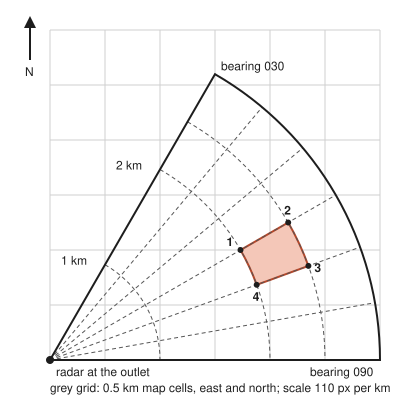

# Pullback: carry a form backwards through a map

[Syllabus](../../../SYLLABUS.md) → [Differential geometry and Lie groups](../README.md) → [Differential Forms](../README.md#s04) → Pullback

---

## General Overview

A storm has crossed a valley. The flood team holds a rain map on the ordinary east–north grid, in kilometres from the valley outlet. Rain lies 20 mm deep at the outlet and deepens by 10 mm per kilometre out. The valley is a fan: out to 3 km from the outlet, between compass bearings 030 and 090.

A weather radar stands at the outlet. It does not think in east and north. Each of its cells is addressed by **range** (distance from the radar, km) and **azimuth** (compass bearing, measured clockwise from north). To compare the map with the radar, the rain map must be re-gridded onto range and azimuth.

Re-gridding is not just relabelling. A radar cell 0.5 km deep and 10° wide covers 0.196350 square kilometres at 2 to 2.5 km out, and far less near the radar. The cell's corners also run clockwise on the map, so the radar grid is "left-handed": it has the opposite **orientation** (sense of turning) to the east–north grid. Both facts must show up in the new rain numbers.

The **pullback** does all of this in one move. Write the rain as a 2-form (a quantity built to be added up over areas). Substitute the radar's formulas into it, including into the small steps dx and dy. The area stretch, here −r per unit of range and azimuth, falls out of the algebra by itself, with its sign. The total over the valley comes out at 188,496 cubic metres, the same as the ordinary change of variables gives.

**The pullback rewrites a form in a map's input coordinates by substituting the map into everything, differentials included; in the plane this produces the Jacobian determinant with its sign, so integrating it is change of variables with orientation built in.**

**What kind of fact this is:** a definition (the pullback) and three theorems proved on this card in Why it works: the determinant rule, the order reversal for two maps in a row, and the integral identity. The first two are local, true point by point. The integral identity is global: it needs the map to cover each place once and to keep or reverse orientation everywhere on the region. It rests on the change-of-variables theorem, proved on [Change of variables](../../06-Calculus%20and%20analysis/08-Multiple%20Integrals/03-change-of-variables-and-jacobians.md).

### The picture: one radar cell over the map

<p align="center"></p>

Drawn to scale, 110 px per km, radar at the outlet in the lower left. The shaded cell runs 2 to 2.5 km in range and 060 to 070 in bearing. Walk its corners in address order: 1 to 2 raises the range, 2 to 3 raises the azimuth. On the map that walk goes clockwise. Its signed area, taken from the corners alone, is −0.195354 km². The true cell area is 0.196350 km²; the corner polygon cuts off the curved edges.

---

## The formula

Reminders. A **2-form** on the plane is a rule that takes two arrows at a point and returns a signed number that adds up over areas. On the map every 2-form is $`f\,dx\wedge dy`$. Here $`dx\wedge dy`$ ("dx wedge dy") gives the signed area of the parallelogram the two arrows span. The **wedge** $`\wedge`$ is the product of forms that flips sign when its factors swap: $`dy\wedge dx = -\,dx\wedge dy`$, and so $`dx\wedge dx = 0`$ ([Differential form](01-forms-and-the-wedge-product.md)). It is not logical "and".

The rain form is $`\omega = f\,dx\wedge dy`$ (omega), with $`f`$ the rain depth in mm. Its integral over a region is in mm km². One mm over one km² is 1,000 m³.

New notation, in words first. Let $`F`$ be a smooth map from input coordinates $`(u, v)`$ to the map. The **pullback** $`F^*\omega`$ ("F star omega") is the form on the inputs that feeds two input arrows to $`F`$'s differential (the matrix that carries arrows forward), then hands the results to $`\omega`$. The star is a superscript, not the Hodge star ⋆ met later on this shelf.

```math
(F^*\omega)_p(v_1, v_2) = \omega_{F(p)}\big(dF_p\,v_1,\ dF_p\,v_2\big)
```

**Read it aloud:** to measure two arrows at an input point, carry them forward through the map and measure them there with the original form.

In coordinates the rule is substitution. Pull back the function by composing, and the differentials by the chain rule, $`F^*dx = d(x\circ F)`$. For a 2-form in the plane this gives:

```math
F^*\big(f\,dx\wedge dy\big) = (f\circ F)\,\det J_F\;du\wedge dv
```

**Read it aloud:** the pulled-back rain is the rain at the image place, times the signed area stretch of the map, per unit of input area.

Integrating it is change of variables with the sign kept. For $`F`$ one-to-one from a region $`S`$ onto $`D`$:

```math
\int_S F^*\omega = \pm\int_{D}\omega, \qquad + \text{ if } \det J_F > 0 \text{ on } S,\quad - \text{ if } \det J_F < 0
```

**Read it aloud:** the integral of the pullback over the inputs equals the integral of the form over the image, with a minus sign when the map reverses orientation.

The radar map is $`F(r, \alpha) = (r\sin\alpha,\ r\cos\alpha)`$, with $`\alpha`$ in radians clockwise from north. Its pullback of the rain is

```math
F^*\omega = -(20 + 10r)\,r\;dr\wedge d\alpha
```

| Symbol | Plain meaning | In our example | Push it up and the answer… |
| --- | --- | --- | --- |
| $`x`$, $`y`$ | map place: km east and km north of the radar | the valley floor | — |
| $`r`$, $`\alpha`$ | radar address: range in km, azimuth in radians clockwise from north | 0 to 3 km, π/6 to π/2 (030 to 090) | larger r: more ground per cell |
| $`f`$ | rain depth, mm | 20 + 10r; 42.5 at the marked cell's centre | total grows in proportion |
| $`\omega`$ | the rain 2-form, $`f\,dx\wedge dy`$: its coefficient $`f`$ in mm, its integral in mm km² | adds up to 188.495559 mm km² | — |
| $`F`$ | the radar map, address to place | $`(r\sin\alpha, r\cos\alpha)`$ | — |
| $`F^*`$ | pullback: substitute $`F`$ into a form, differentials included | $`F^*dx = \sin\alpha\,dr + r\cos\alpha\,d\alpha`$ | — |
| $`\wedge`$ | wedge: sign-flipping product of forms | $`d\alpha\wedge dr = -\,dr\wedge d\alpha`$ | — |
| $`J_F`$, $`\det J_F`$ | Jacobian matrix of $`F`$; its determinant, the signed area stretch | −r; −2.25 at the marked cell | bigger stretch, more rain per cell |
| $`u`$, $`v`$, $`S`$, $`D`$ | general inputs; the input region; its image on the map | r, α; a rectangle; the fan | — |
| $`G`$; $`c`$, $`k`$; $`H`$ | a raster grid's map to places; its column (east) and row (counted south); the radar-to-raster map | 0.25 km cells; $`G(c, k) = (0.25c,\ 3 - 0.25k)`$; $`\det J_H`$ = 36 at the marked cell | — |
| $`p`$; $`v_1`$, $`v_2`$; $`dF_p`$ | an input point; two arrows at it; the differential carrying them to the map | the marked cell's centre; unit steps in r and α | — |
| $`\mu`$, $`\nu`$; $`h`$; $`x_u`$; $`e_u`$, $`e_v`$ | any two forms; any coefficient on the input grid; rate of x per unit of u; unit input arrows | $`F^*dx`$, $`F^*dy`$; $`-(20 + 10r)r`$; $`x_r`$ = 0.906308; unit steps in r and α | — |

### When it holds

- **The map is smooth.** The pullback needs the map's differential. At a corner of a map there is no single stretch, and the rule has nothing to substitute.
- **The map covers each place once on the region.** The pointwise rule always holds. The integral identity fails if the azimuth sweeps twice: the full 3 km disc then totals 2261.946711 mm km², twice its true 1130.973355.
- **The determinant keeps one sign on the region, except on a set of zero area.** The radar's determinant is −r everywhere except at the radar itself, where it is 0, one point. If the sign changed inside the region, the region would fold over itself and parts would cancel.
- **The input region carries a stated orientation.** "Integrate $`h\,dr\wedge d\alpha`$" means "integrate $`h`$ with $`(r, \alpha)`$ taken as the positive order". Drop this and the valley total is −188.495559: negative rain.
- **Angles in radians.** In degrees the azimuth range is 60 instead of π/3, and the valley gets 10800.000000 mm km².

---

## Why it works

### Step 0: forms are built to be substituted into

A form is not a number at a place. It is a machine that eats arrows. Re-gridding moves the arrows: a unit step in range is a definite arrow on the map. So the honest way to re-grid a form is to carry the input arrows forward and let the original form measure them. That is the definition of the pullback.

Everything else follows from one fact: $`dx\wedge dy`$ measures signed area, and the signed area of the two images of the grid steps is exactly the Jacobian determinant. Nothing needs to be "remembered" about the stretch. The wedge's sign rule produces it.

### Step 1: pull back the pieces one at a time

A form on the map has three kinds of piece. Each pulls back by its own rule.

1. **A function.** Compose: $`F^*f = f\circ F`$. The rain at radar address $`(r, \alpha)`$ is the rain at the place $`F(r, \alpha)`$. Here $`f\circ F = 20 + 10r`$.
2. **A coordinate differential.** $`F^*dx = d(x\circ F)`$, which the chain rule expands. With $`x\circ F = r\sin\alpha`$ and $`y\circ F = r\cos\alpha`$:

```math
F^*dx = \sin\alpha\,dr + r\cos\alpha\,d\alpha, \qquad F^*dy = \cos\alpha\,dr - r\sin\alpha\,d\alpha
```

3. **A wedge.** Pullback respects it: $`F^*(\mu\wedge\nu) = F^*\mu\wedge F^*\nu`$ for any two forms $`\mu`$, $`\nu`$. This holds because the definition carries both arrows forward through the same differential.

The four coefficients are the four entries of the Jacobian matrix, read row by row: $`F^*dx`$ gives the first row, $`F^*dy`$ the second. At the marked cell's centre, 2.25 km out on bearing 065, they are 0.906308, 0.950891, 0.422618 and −2.039193.

### Step 2: the wedge produces the determinant

Multiply the two pulled-back 1-forms (forms that eat one arrow), keeping the wedge rules $`dr\wedge dr = 0`$, $`d\alpha\wedge d\alpha = 0`$ and $`d\alpha\wedge dr = -\,dr\wedge d\alpha`$:

```math
F^*dx\wedge F^*dy = \big(\sin\alpha\cdot(-r\sin\alpha) - r\cos\alpha\cdot\cos\alpha\big)\,dr\wedge d\alpha = -r\;dr\wedge d\alpha
```

The same expansion for any map gives $`(x_u y_v - x_v y_u)\,du\wedge dv`$, where $`x_u`$ is the rate of $`x`$ per unit of $`u`$. That bracket is $`\det J_F`$. The squares of $`du`$ and $`dv`$ vanish; the two cross terms meet with opposite signs. The Jacobian determinant is what is left.

So $`F^*\omega = -(20 + 10r)\,r\,dr\wedge d\alpha`$. At the marked cell's centre the coefficient is 42.5 × (−2.25) = −95.625 mm km² per km per radian.

### Step 3: why the sign is negative, and why that is right

The sign is geometry, not a slip. A step in range at bearing 065 points out along the bearing. A step in azimuth turns the place clockwise. Clockwise is the negative sense of the east–north plane, whose positive sense turns east toward north. So the two grid steps span a parallelogram of negative signed area.

Three independent readings agree at the marked cell's centre:

| Road | How | det |
| --- | --- | --- |
| wedge the pulled-back 1-forms | finite differences, then Step 2's rule | −2.250000 |
| closed form | $`-r`$ | −2.250000 |
| signed area of a tiny mapped cell | shoelace formula on its four corners, divided by the cell's address size | −2.250050 |

The shoelace road never mentions a derivative. Its small error comes from the tiny cell's finite size.

Measured counterclockwise from east instead, the same range-and-angle grid has determinant +2.25. Only the direction of counting changed.

### Step 4: two re-griddings in a row reverse their order

Gridded rain files often store rows from the top down. Take a raster with 0.25 km cells: column $`c`$ counts east, row $`k`$ counts south from the line 3 km north. Its map to places is $`G(c, k) = (0.25c,\ 3 - 0.25k)`$, and

```math
G^*(dx\wedge dy) = 0.25\,dc\wedge(-0.25\,dk) = -0.0625\;dc\wedge dk
```

That raster is also left-handed. Now re-grid in two stages: first pull the map's rain back to the raster ($`G^*`$), then pull the raster's form back to the radar grid ($`H^*`$). Here $`H`$ carries a radar address to its raster cell, so that $`F = G\circ H`$. Pullbacks then run in the opposite order:

```math
(G\circ H)^* = H^*\,G^*
```

The reason is the chain rule: $`d(G\circ H) = dG\circ dH`$. Carrying arrows forward goes through $`H`$ first, then $`G`$, so pulling a form back meets $`G`$ first, then $`H`$. That is the "backwards" in the name.

With numbers at the marked cell: the raster coefficient is 42.5 × (−0.0625) = −2.65625. The determinant of $`H`$ there is +36.000000: two left-handed grids, one relative to the other, keep orientation. The product is −2.65625 × 36 = −95.625, the same as the one-stage pullback.

### Step 5: integrating the pullback is change of variables, sign included

[Change of variables](../../06-Calculus%20and%20analysis/08-Multiple%20Integrals/03-change-of-variables-and-jacobians.md) proves $`\iint_D f\,dx\,dy = \iint_S (f\circ F)\,\lvert\det J_F\rvert\,du\,dv`$, with absolute value bars. Forms keep the sign instead, and let the orientation of $`S`$ absorb it.

- Where $`\det J_F > 0`$, the bars do nothing, and $`\int_S F^*\omega = \int_D\omega`$.
- Where $`\det J_F < 0`$, the bars flip the sign, and $`\int_S F^*\omega = -\int_D\omega`$.

For the valley, $`S`$ is the rectangle $`r`$ from 0 to 3 km, $`\alpha`$ from π/6 to π/2, taken in the order $`(r, \alpha)`$:

```math
\int_S F^*\omega = -\int_{\pi/6}^{\pi/2}\!\!\int_0^3 (20 + 10r)\,r\,dr\,d\alpha = -\frac{\pi}{3}\cdot 180 = -60\pi
```

The radar grid reverses orientation, so the valley's rain is $`+60\pi`$ = 188.495559 mm km². Equivalently, list the radar coordinates as $`(\alpha, r)`$: then $`F^*\omega = (20 + 10r)\,r\,d\alpha\wedge dr`$, with a positive coefficient, and the order is right-handed.

<details>
<summary>Detailed proof: the determinant rule, the order reversal and the integral identity</summary>

Determinant rule. Write $`F^*dx = x_u\,du + x_v\,dv`$ and $`F^*dy = y_u\,du + y_v\,dv`$, from the chain rule. The wedge is bilinear and alternating, so

$`\displaystyle F^*dx\wedge F^*dy = x_u y_u\,du\wedge du + x_u y_v\,du\wedge dv + x_v y_u\,dv\wedge du + x_v y_v\,dv\wedge dv = (x_u y_v - x_v y_u)\,du\wedge dv.`$

Pullback of a function is composition, and pullback respects products, so $`F^*(f\,dx\wedge dy) = (f\circ F)\det J_F\,du\wedge dv`$. From the definition directly: $`\omega(dF\,e_u, dF\,e_v) = f\cdot\det[\,dF\,e_u \mid dF\,e_v\,]`$, the determinant of the Jacobian's two columns.

Order reversal. For arrows $`v_1, v_2`$ at $`p`$:

$`\displaystyle ((G\circ H)^*\omega)_p(v_1, v_2) = \omega\big(dG\,dH\,v_1,\ dG\,dH\,v_2\big) = (G^*\omega)_{H(p)}(dH\,v_1, dH\,v_2) = (H^*G^*\omega)_p(v_1, v_2).`$

The middle step uses the chain rule $`d(G\circ H)_p = dG_{H(p)}\,dH_p`$. For 2-forms in the plane this is the product rule for determinants, $`\det J_{G\circ H} = \det J_G\cdot\det J_H`$.

Integral identity. Orient $`S`$ by $`(u, v)`$, so $`\int_S h\,du\wedge dv = \iint_S h\,du\,dv`$. Suppose $`F`$ is one-to-one with continuous partial derivatives, and $`\det J_F`$ has one sign on $`S`$ off a set of zero area. By the change-of-variables theorem, $`\int_D\omega = \iint_S (f\circ F)\lvert\det J_F\rvert\,du\,dv`$. Replace $`\lvert\det J_F\rvert`$ by $`\pm\det J_F`$, the sign being that of $`\det J_F`$. The right side becomes $`\pm\int_S F^*\omega`$.

</details>

---

## Worked numbers, by hand

The marked radar cell first, at its centre $`r = 2.25`$ km, $`\alpha`$ = 065, then the whole valley.

| Step | Arithmetic | Value |
| --- | --- | --- |
| rain at the centre | $`20 + 10 \times 2.25`$ | 42.5 mm |
| $`F^*dx`$ | $`\sin 65^\circ\,dr + 2.25\cos 65^\circ\,d\alpha`$ | $`0.906308\,dr + 0.950891\,d\alpha`$ |
| $`F^*dy`$ | $`\cos 65^\circ\,dr - 2.25\sin 65^\circ\,d\alpha`$ | $`0.422618\,dr - 2.039193\,d\alpha`$ |
| wedge them | $`0.906308 \times (-2.039193) - 0.950891 \times 0.422618`$ | −2.250000 |
| pulled-back rain coefficient | $`42.5 \times (-2.25)`$ | −95.625 |
| rain in the marked cell | $`\tfrac{\pi}{18}\big(10(2.5^2 - 2^2) + \tfrac{10}{3}(2.5^3 - 2^3)\big)`$ | 8.363036 mm km² |
| range part, whole valley | $`\int_0^3 (20 + 10r)\,r\,dr = 90 + 90`$ | 180 |
| pullback integral, order $`(r, \alpha)`$ | $`-\tfrac{\pi}{3} \times 180`$ | −188.495559 |
| flip once: the grid is left-handed | $`-(-188.495559)`$ | **188.495559 mm km²** |
| in cubic metres | $`\times 1{,}000`$ | **188,496 m³** |

The valley took 188,496 cubic metres of rain. That is the total [Change of variables](../../06-Calculus%20and%20analysis/08-Multiple%20Integrals/03-change-of-variables-and-jacobians.md) found with polar angle from east; the radar grid, counted the other way round, gives the same water once its orientation is read correctly.

A count with no pullback at all agrees. Adding rain × area over square map cells inside the fan gives 188.329258 with 0.05 km cells and 188.520469 with 0.025 km cells. The error comes from cells cut by the fan's edge and shrinks with the cell size.

### What breaks if you drop a piece

| Mistake | Comes out at | What went wrong |
| --- | --- | --- |
| Pull back the function, not the differentials: $`f\circ F\;dr\,d\alpha`$ | 109.955743 mm km² | The radar cells were treated as equal in area. Far cells are larger and wetter. |
| Treat the wedge as an ordinary product, so $`d\alpha\wedge dr = +\,dr\wedge d\alpha`$; pullback integral in the order $`(r, \alpha)`$ | −77.942286 mm km² | The cross terms add instead of cancelling: $`r\cos 2\alpha`$ replaces $`-r`$. The right value at this stage is −188.495559. |
| Keep the sign but ignore orientation | −188.495559 mm km² | The left-handed radar grid was integrated as if right-handed. |
| Azimuth in degrees | 10800.000000 mm km² | $`d\alpha`$ must be in radians, π/3 across the valley, not 60. |
| Sweep the azimuth twice round the full 3 km disc | 2261.946711 mm km² | The map is not one-to-one, so every place counts twice; the true total is 1130.973355. |

---

## Code, from first principles, and it actually runs

The code pulls the rain form back to the radar grid with no algebra done for it. It differentiates the map by central differences, wedges the two pulled-back 1-forms, and integrates the result by Simpson's rule. It reaches the answer by five independent roads: the wedge, the closed form −r, the signed shoelace area of a tiny mapped cell, a two-stage pullback through the raster grid, and a plain count of square map cells that never uses a pullback. Both programs print the figure's corner coordinates in km on the line starting `figure,`.

### Python

```python
# Pullback and change of variables -- the check behind the card.  Standard library only.
# A rain map on the east-north grid is pulled back to a radar's (range, azimuth) grid.
# Roads: the pullback built by wedging pulled-back 1-forms (finite differences), the
# closed form -r, the signed (shoelace) area of a mapped cell, a two-stage pullback
# through a raster grid, and a plain cell count on the map that uses no pullback at all.
from math import sin, cos, sqrt, pi, radians

def rain(x, y):                 # rain depth, mm, at x km east and y km north of the radar
    return 20.0 + 10.0 * sqrt(x * x + y * y)

def radar(r, a):                # radar address -> map place; azimuth a clockwise from north
    return (r * sin(a), r * cos(a))

def raster_to_map(c, k):        # raster column c (east), row k counted south from y = 3 km
    return (0.25 * c, 3.0 - 0.25 * k)

def radar_to_raster(r, a):      # the two re-griddings in a row: radar address -> raster cell
    x, y = radar(r, a)
    return (4.0 * x, 4.0 * (3.0 - y))

def wedge(p, q):                # (p1 du + p2 dv) ^ (q1 du + q2 dv) = (p1 q2 - p2 q1) du ^ dv
    return p[0] * q[1] - p[1] * q[0]

def pull(F, u, v):              # F*(dx ^ dy) at (u, v): pull dx and dy back, then wedge them
    return wedge(pull_1form(F, u, v, 0), pull_1form(F, u, v, 1))

def pull_1form(F, u, v, i, h=1e-5):     # F*dx (i = 0) or F*dy (i = 1): its du and dv parts
    return ((F(u + h, v)[i] - F(u - h, v)[i]) / (2 * h), (F(u, v + h)[i] - F(u, v - h)[i]) / (2 * h))

def shoelace(pts):              # signed area of a polygon: positive anticlockwise
    return 0.5 * sum(pts[i][0] * pts[(i + 1) % len(pts)][1] - pts[(i + 1) % len(pts)][0] * pts[i][1]
                     for i in range(len(pts)))

def simpson2(g, a0, a1, b0, b1, n=60):    # double Simpson's rule, n even
    ha, hb = (a1 - a0) / n, (b1 - b0) / n
    w = lambda i: 1 if i in (0, n) else (4 if i % 2 else 2)
    return sum(w(i) * w(j) * g(a0 + i * ha, b0 + j * hb)
               for i in range(n + 1) for j in range(n + 1)) * ha * hb / 9.0

def cell_count(h):              # road with no pullback: add rain x cell area over map cells in the valley
    tot, m = 0.0, int(round(3.0 / h))
    for i in range(m):
        for j in range(m):
            x, y = (i + 0.5) * h, (j + 0.5) * h
            if x * x + y * y <= 9.0 and 2.0 * x >= sqrt(x * x + y * y):
                tot += rain(x, y) * h * h
    return tot

r0, a0 = 2.25, radians(65.0)             # centre of the marked radar cell
f0 = rain(*radar(r0, a0))
det_fd, det_cf = pull(radar, r0, a0), -r0
dr, da = 1e-4, 1e-4
tiny = [radar(r0, a0), radar(r0 + dr, a0), radar(r0 + dr, a0 + da), radar(r0, a0 + da)]
det_sh = shoelace(tiny) / (dr * da)
px, py = [pull_1form(radar, r0, a0, i) for i in (0, 1)]
coef = f0 * det_fd                        # radar-grid coefficient of the pulled-back rain form
k0 = radar_to_raster(r0, a0)
det_G = pull(raster_to_map, *k0)                                      # raster cell -> map place
coef_raster = rain(*raster_to_map(*k0)) * det_G                       # rain form in raster cells
coef_two = coef_raster * pull(radar_to_raster, r0, a0)                # then back to radar cells
cell = [radar(2.0, radians(60)), radar(2.5, radians(60)), radar(2.5, radians(70)), radar(2.0, radians(70))]
cell_rain = radians(10) * (10 * (2.5**2 - 2.0**2) + 10 / 3 * (2.5**3 - 2.0**3))

A0, A1 = radians(30), radians(90)        # the valley: bearings 030 to 090, out to 3 km
g = lambda r, a: rain(*radar(r, a)) * pull(radar, r, a)
I_pull = simpson2(g, 0.0, 3.0, A0, A1)   # integral of the pullback in the order (r, a)
I_closed = -(A1 - A0) * (10 * 9 + 10 / 3 * 27)
total = -I_pull                          # the radar grid is left-handed: flip once
c1, c2 = cell_count(0.05), cell_count(0.025)

no_d = (A1 - A0) * (20 * 3 + 5 * 9)                       # f only, differentials dropped
comm = 180.0 * (sin(2 * A1) - sin(2 * A0)) / 2            # dr^da treated like da^dr: r cos 2a
degs = (90 - 30) * 180.0                                  # azimuth in degrees
twice = -simpson2(g, 0.0, 3.0, 0.0, 4 * pi)               # two sweeps of the whole disc
disc = 2 * pi * 180.0

rows = [("rain at cell centre, mm", f0), ("pulled-back dx: dr part", px[0]), ("pulled-back dx: da part", px[1]),
        ("pulled-back dy: dr part", py[0]), ("pulled-back dy: da part", py[1]), ("det by wedging pulled-back dx, dy", det_fd),
        ("det closed form, -r", det_cf), ("det from shoelace of a tiny cell", det_sh),
        ("rain form coefficient on radar grid", coef), ("  via raster cells, two stages", coef_two),
        ("  raster-grid coefficient", coef_raster), ("  det radar -> raster", pull(radar_to_raster, r0, a0)),
        ("  det raster -> map", det_G), ("  bars: |det| x |det|", abs(det_G) * abs(pull(radar_to_raster, r0, a0))),
        ("marked cell: shoelace of corners", shoelace(cell)), ("marked cell: exact area, km2", radians(10) * 1.125),
        ("marked cell: rain, mm km2", cell_rain),
        ("range part: integral of (20 + 10r) r dr", 10 * 9 + 10 / 3 * 27), ("integral of pullback, Simpson", I_pull), ("integral of pullback, closed form", I_closed),
        ("valley total, mm km2", total), ("valley total, cubic metres", total * 1000),
        ("cell count on map, 0.05 km", c1), ("cell count on map, 0.025 km", c2),
        ("wrong: differentials dropped", no_d), ("wrong: wedge treated as commuting", comm),
        ("wrong: sign not flipped", I_pull), ("wrong: azimuth in degrees", degs),
        ("fails: azimuth swept twice", twice), ("  true rain on the 3 km disc", disc),
        ("try: azimuth anticlockwise from east, det", pull(lambda r, t: (r * cos(t), r * sin(t)), r0, radians(25))),
        ("try: raster rows counted north, det", pull(lambda c, k: (0.25 * c, 0.25 * k), 1.0, 1.0)),
        ("try: valley area, km2", (A1 - A0) * 4.5), ("try: uniform 40 mm, mm km2", 40 * (A1 - A0) * 4.5)]
for name, v in rows:
    print(f"{name:<42}{v:>16.6f}")
print("figure," + ",".join(f"{p[0]:.4f} {p[1]:.4f}" for p in cell))

assert abs(det_fd - det_cf) < 1e-6                 # wedging pulled-back 1-forms gives -r
assert abs(det_sh - det_cf) < 1e-3                 # so does the signed area of a mapped cell
assert abs(coef_two - coef) < 1e-6                 # two-stage pullback agrees with one stage
assert abs(I_pull - I_closed) < 1e-6               # Simpson on the pullback against the closed form
assert abs(c2 - total) < 0.005 * c2                # a cell count with no pullback at all
assert shoelace(cell) < 0                          # the radar grid runs clockwise on the map
assert pull(radar_to_raster, r0, a0) > 0           # two reversals in a row preserve orientation
assert abs(abs(det_G) * abs(pull(radar_to_raster, r0, a0)) - abs(det_fd)) < 1e-6   # bars compose too, minus the sign
assert abs(twice - 2 * disc) < 1e-6                # two sweeps count every place twice
assert abs(no_d - total) > 50                      # the dropped differentials are a real error
print("ALL CHECKS PASS")
```

**Ran 2026-11-19 on macOS, Python 3.14.10, standard library only. All checks passed. Output, pasted from the run:**

```
rain at cell centre, mm                          42.500000
pulled-back dx: dr part                           0.906308
pulled-back dx: da part                           0.950891
pulled-back dy: dr part                           0.422618
pulled-back dy: da part                          -2.039193
det by wedging pulled-back dx, dy                -2.250000
det closed form, -r                              -2.250000
det from shoelace of a tiny cell                 -2.250050
rain form coefficient on radar grid             -95.625000
  via raster cells, two stages                  -95.625000
  raster-grid coefficient                        -2.656250
  det radar -> raster                            36.000000
  det raster -> map                              -0.062500
  bars: |det| x |det|                             2.250000
marked cell: shoelace of corners                 -0.195354
marked cell: exact area, km2                      0.196350
marked cell: rain, mm km2                         8.363036
range part: integral of (20 + 10r) r dr         180.000000
integral of pullback, Simpson                  -188.495559
integral of pullback, closed form              -188.495559
valley total, mm km2                            188.495559
valley total, cubic metres                   188495.559214
cell count on map, 0.05 km                      188.329258
cell count on map, 0.025 km                     188.520469
wrong: differentials dropped                    109.955743
wrong: wedge treated as commuting               -77.942286
wrong: sign not flipped                        -188.495559
wrong: azimuth in degrees                     10800.000000
fails: azimuth swept twice                     2261.946711
  true rain on the 3 km disc                   1130.973355
try: azimuth anticlockwise from east, det         2.250000
try: raster rows counted north, det               0.062500
try: valley area, km2                             4.712389
try: uniform 40 mm, mm km2                      188.495559
figure,1.7321 1.0000,2.1651 1.2500,2.3492 0.8551,1.8794 0.6840
ALL CHECKS PASS
```

### Rust

```rust
// Pullback and change of variables -- the check behind the card.  std only, no crates.
// A rain map on the east-north grid is pulled back to a radar's (range, azimuth) grid.
// Roads: the pullback built by wedging pulled-back 1-forms (finite differences), the
// closed form -r, the signed (shoelace) area of a mapped cell, a two-stage pullback
// through a raster grid, and a plain cell count on the map that uses no pullback at all.
use std::f64::consts::PI;

type Map = dyn Fn(f64, f64) -> (f64, f64);

fn rain(x: f64, y: f64) -> f64 { 20.0 + 10.0 * (x * x + y * y).sqrt() } // mm
fn radar(r: f64, a: f64) -> (f64, f64) { (r * a.sin(), r * a.cos()) } // azimuth clockwise from north
fn raster_to_map(c: f64, k: f64) -> (f64, f64) { (0.25 * c, 3.0 - 0.25 * k) } // rows counted south
fn radar_to_raster(r: f64, a: f64) -> (f64, f64) {
    let (x, y) = radar(r, a);
    (4.0 * x, 4.0 * (3.0 - y))
}
fn rad(d: f64) -> f64 { d.to_radians() }
fn wedge(p: (f64, f64), q: (f64, f64)) -> f64 { p.0 * q.1 - p.1 * q.0 }
fn comp(p: (f64, f64), i: usize) -> f64 { if i == 0 { p.0 } else { p.1 } }

// F*dx (i = 0) or F*dy (i = 1): its du and dv parts, by central differences
fn pull_1form(f: &Map, u: f64, v: f64, i: usize) -> (f64, f64) {
    let h = 1e-5;
    ((comp(f(u + h, v), i) - comp(f(u - h, v), i)) / (2.0 * h),
     (comp(f(u, v + h), i) - comp(f(u, v - h), i)) / (2.0 * h))
}
// F*(dx ^ dy) at (u, v): pull dx and dy back, then wedge them
fn pull(f: &Map, u: f64, v: f64) -> f64 { wedge(pull_1form(f, u, v, 0), pull_1form(f, u, v, 1)) }

fn shoelace(p: &[(f64, f64)]) -> f64 {
    let n = p.len();
    let mut s = 0.0;
    for i in 0..n { s += p[i].0 * p[(i + 1) % n].1 - p[(i + 1) % n].0 * p[i].1; }
    0.5 * s
}

fn simpson2(g: &dyn Fn(f64, f64) -> f64, a0: f64, a1: f64, b0: f64, b1: f64) -> f64 {
    let n = 60;
    let (ha, hb) = ((a1 - a0) / n as f64, (b1 - b0) / n as f64);
    let w = |i: usize| -> i64 { if i == 0 || i == n { 1 } else if i % 2 == 1 { 4 } else { 2 } };
    let mut s = 0.0;
    for i in 0..=n {
        for j in 0..=n { s += (w(i) * w(j)) as f64 * g(a0 + i as f64 * ha, b0 + j as f64 * hb); }
    }
    s * ha * hb / 9.0
}

// road with no pullback: add rain x cell area over map cells in the valley
fn cell_count(h: f64) -> f64 {
    let m = (3.0 / h).round() as usize;
    let mut tot = 0.0;
    for i in 0..m {
        for j in 0..m {
            let (x, y) = ((i as f64 + 0.5) * h, (j as f64 + 0.5) * h);
            if x * x + y * y <= 9.0 && 2.0 * x >= (x * x + y * y).sqrt() { tot += rain(x, y) * h * h; }
        }
    }
    tot
}

fn main() {
    let (r0, a0) = (2.25, rad(65.0)); // centre of the marked radar cell
    let (cx, cy) = radar(r0, a0);
    let f0 = rain(cx, cy);
    let (det_fd, det_cf) = (pull(&radar, r0, a0), -r0);
    let (dr, da) = (1e-4, 1e-4);
    let tiny = [radar(r0, a0), radar(r0 + dr, a0), radar(r0 + dr, a0 + da), radar(r0, a0 + da)];
    let det_sh = shoelace(&tiny) / (dr * da);
    let (px, py) = (pull_1form(&radar, r0, a0, 0), pull_1form(&radar, r0, a0, 1));
    let coef = f0 * det_fd; // radar-grid coefficient of the pulled-back rain form
    let k0 = radar_to_raster(r0, a0);
    let (mx, my) = raster_to_map(k0.0, k0.1);
    let det_g = pull(&raster_to_map, k0.0, k0.1); // raster cell -> map place
    let coef_raster = rain(mx, my) * det_g; // rain form in raster cells
    let det_rr = pull(&radar_to_raster, r0, a0);
    let coef_two = coef_raster * det_rr; // then back to radar cells
    let cell = [radar(2.0, rad(60.0)), radar(2.5, rad(60.0)), radar(2.5, rad(70.0)), radar(2.0, rad(70.0))];
    let cell_rain = rad(10.0) * (10.0 * (2.5f64.powi(2) - 2.0f64.powi(2)) + 10.0 / 3.0 * (2.5f64.powi(3) - 2.0f64.powi(3)));

    let (aa, ab) = (rad(30.0), rad(90.0)); // the valley: bearings 030 to 090, out to 3 km
    let g = |r: f64, a: f64| { let (x, y) = radar(r, a); rain(x, y) * pull(&radar, r, a) };
    let i_pull = simpson2(&g, 0.0, 3.0, aa, ab); // integral of the pullback in the order (r, a)
    let i_closed = -(ab - aa) * (90.0 + 10.0 / 3.0 * 27.0);
    let total = -i_pull; // the radar grid is left-handed: flip once
    let (c1, c2) = (cell_count(0.05), cell_count(0.025));

    let no_d = (ab - aa) * 105.0; // f only, differentials dropped
    let comm = 180.0 * ((2.0 * ab).sin() - (2.0 * aa).sin()) / 2.0; // dr^da treated like da^dr
    let degs = 60.0 * 180.0; // azimuth in degrees
    let twice = -simpson2(&g, 0.0, 3.0, 0.0, 4.0 * PI); // two sweeps of the whole disc
    let disc = 2.0 * PI * 180.0;
    let ccw = |r: f64, t: f64| (r * t.cos(), r * t.sin());
    let north = |c: f64, k: f64| (0.25 * c, 0.25 * k);

    let rows: Vec<(&str, f64)> = vec![
        ("rain at cell centre, mm", f0), ("pulled-back dx: dr part", px.0), ("pulled-back dx: da part", px.1),
        ("pulled-back dy: dr part", py.0), ("pulled-back dy: da part", py.1),
        ("det by wedging pulled-back dx, dy", det_fd), ("det closed form, -r", det_cf),
        ("det from shoelace of a tiny cell", det_sh),
        ("rain form coefficient on radar grid", coef), ("  via raster cells, two stages", coef_two),
        ("  raster-grid coefficient", coef_raster), ("  det radar -> raster", det_rr),
        ("  det raster -> map", det_g), ("  bars: |det| x |det|", det_g.abs() * det_rr.abs()),
        ("marked cell: shoelace of corners", shoelace(&cell)), ("marked cell: exact area, km2", rad(10.0) * 1.125),
        ("marked cell: rain, mm km2", cell_rain),
        ("range part: integral of (20 + 10r) r dr", 90.0 + 10.0 / 3.0 * 27.0), ("integral of pullback, Simpson", i_pull), ("integral of pullback, closed form", i_closed),
        ("valley total, mm km2", total), ("valley total, cubic metres", total * 1000.0),
        ("cell count on map, 0.05 km", c1), ("cell count on map, 0.025 km", c2),
        ("wrong: differentials dropped", no_d), ("wrong: wedge treated as commuting", comm),
        ("wrong: sign not flipped", i_pull), ("wrong: azimuth in degrees", degs),
        ("fails: azimuth swept twice", twice), ("  true rain on the 3 km disc", disc),
        ("try: azimuth anticlockwise from east, det", pull(&ccw, r0, rad(25.0))),
        ("try: raster rows counted north, det", pull(&north, 1.0, 1.0)),
        ("try: valley area, km2", (ab - aa) * 4.5), ("try: uniform 40 mm, mm km2", 40.0 * (ab - aa) * 4.5),
    ];
    for (name, v) in &rows { println!("{:<42}{:>16.6}", name, v); }
    let fig: Vec<String> = cell.iter().map(|p| format!("{:.4} {:.4}", p.0, p.1)).collect();
    println!("figure,{}", fig.join(","));

    assert!((det_fd - det_cf).abs() < 1e-6); // wedging pulled-back 1-forms gives -r
    assert!((det_sh - det_cf).abs() < 1e-3); // so does the signed area of a mapped cell
    assert!((coef_two - coef).abs() < 1e-6); // two-stage pullback agrees with one stage
    assert!((i_pull - i_closed).abs() < 1e-6); // Simpson on the pullback against the closed form
    assert!((c2 - total).abs() < 0.005 * c2); // a cell count with no pullback at all
    assert!(shoelace(&cell) < 0.0); // the radar grid runs clockwise on the map
    assert!(det_rr > 0.0); // two reversals in a row preserve orientation
    assert!((det_g.abs() * det_rr.abs() - det_fd.abs()).abs() < 1e-6); // bars compose too, minus the sign
    assert!((twice - 2.0 * disc).abs() < 1e-6); // two sweeps count every place twice
    assert!((no_d - total).abs() > 50.0); // the dropped differentials are a real error
    println!("ALL CHECKS PASS");
}
```

**Ran 2026-11-19 on macOS, rustc 1.98.1, no crates. All checks passed. Output, pasted from the run:**

```
rain at cell centre, mm                          42.500000
pulled-back dx: dr part                           0.906308
pulled-back dx: da part                           0.950891
pulled-back dy: dr part                           0.422618
pulled-back dy: da part                          -2.039193
det by wedging pulled-back dx, dy                -2.250000
det closed form, -r                              -2.250000
det from shoelace of a tiny cell                 -2.250050
rain form coefficient on radar grid             -95.625000
  via raster cells, two stages                  -95.625000
  raster-grid coefficient                        -2.656250
  det radar -> raster                            36.000000
  det raster -> map                              -0.062500
  bars: |det| x |det|                             2.250000
marked cell: shoelace of corners                 -0.195354
marked cell: exact area, km2                      0.196350
marked cell: rain, mm km2                         8.363036
range part: integral of (20 + 10r) r dr         180.000000
integral of pullback, Simpson                  -188.495559
integral of pullback, closed form              -188.495559
valley total, mm km2                            188.495559
valley total, cubic metres                   188495.559214
cell count on map, 0.05 km                      188.329258
cell count on map, 0.025 km                     188.520469
wrong: differentials dropped                    109.955743
wrong: wedge treated as commuting               -77.942286
wrong: sign not flipped                        -188.495559
wrong: azimuth in degrees                     10800.000000
fails: azimuth swept twice                     2261.946711
  true rain on the 3 km disc                   1130.973355
try: azimuth anticlockwise from east, det         2.250000
try: raster rows counted north, det               0.062500
try: valley area, km2                             4.712389
try: uniform 40 mm, mm km2                      188.495559
figure,1.7321 1.0000,2.1651 1.2500,2.3492 0.8551,1.8794 0.6840
ALL CHECKS PASS
```

### Lean

Lean proves the three theorems of Why it works, for smooth maps of the plane, and the card's worked numbers exactly.

- Suppose $`F`$ is smooth and $`\omega = f\,dx\wedge dy`$. Then $`F^*\omega = (f\circ F)\,\det J_F\;du\wedge dv`$ at every input point.
- Suppose $`G`$ and $`H`$ are smooth maps of the plane. Then $`(G\circ H)^* = H^*G^*`$: pull back through $`G`$ first, then $`H`$.
- Take $`F`$ smooth and one-to-one on $`S`$, with $`\det J_F`$ of one sign there off a zero-area set. Then, with $`S`$ oriented by $`(u, v)`$, $`\int_S F^*\omega = \pm\int_D\omega`$, taking the sign of $`\det J_F`$.
- The radar map's Jacobian determinant is exactly $`-r`$, for every range and azimuth.
- The raster map $`G`$ has determinant −0.0625.
- At the marked cell, one stage and two stages both give −95.625.
- The range part $`\int_0^3 (20 + 10r)\,r\,dr`$ is 180, so the pullback integral is $`-60\pi`$.

The finite differences, Simpson's rule, shoelace areas, cell counts, decimals and failure cases are left to the Python and Rust checks.

```lean
-- Pullback: pulling a 2-form f dx∧dy back through a smooth map of the plane gives (f ∘ F) det J_F du∧dv, pullbacks of two maps in a row come in reverse order, and integrating a pullback is change of variables with the sign of det J_F kept.
import Mathlib.Analysis.Calculus.DifferentialForm.Basic
import Mathlib.Analysis.Calculus.ContDiff.Basic
import Mathlib.Analysis.Normed.Module.Alternating.Basic
import Mathlib.Topology.Algebra.Module.Determinant
import Mathlib.LinearAlgebra.Determinant
import Mathlib.MeasureTheory.Function.Jacobian
import Mathlib.Analysis.SpecialFunctions.Trigonometric.Basic
import Mathlib.Analysis.SpecialFunctions.Integrals.Basic

open MeasureTheory

/-! The plane is `Fin 2 → ℝ`: an arrow `v` has coordinates `v 0` (x) and `v 1` (y).
A 2-form field is `ω : (Fin 2 → ℝ) → (Fin 2 → ℝ) [⋀^Fin 2]→L[ℝ] ℝ`.
`dx ∧ dy` (and likewise `du ∧ dv` on the input plane) is the standard area form
`(Pi.basisFun ℝ (Fin 2)).det`, which sends two arrows to the signed area they span.
The pullback of `ω` through `F` at `p` is Mathlib's
`(ω (F p)).compContinuousLinearMap (fderiv ℝ F p)`: carry the two arrows forward through
the differential of `F`, then measure them with `ω` at `F p`. -/

/-- Helper: a 2-form on the plane evaluated on the images of the unit arrows under a linear
map `A` is `det A` times its value on the unit arrows. -/
theorem form_comp_basis (η : (Fin 2 → ℝ) [⋀^Fin 2]→L[ℝ] ℝ) (A : (Fin 2 → ℝ) →L[ℝ] (Fin 2 → ℝ)) :
    η.compContinuousLinearMap A (Pi.basisFun ℝ (Fin 2))
      = A.det * η (Pi.basisFun ℝ (Fin 2)) := by
  have h := congrArg (fun g : (Fin 2 → ℝ) [⋀^Fin 2]→ₗ[ℝ] ℝ =>
      g ((A : (Fin 2 → ℝ) →ₗ[ℝ] (Fin 2 → ℝ)) ∘ Pi.basisFun ℝ (Fin 2)))
    (η.toAlternatingMap.eq_smul_basis_det (Pi.basisFun ℝ (Fin 2)))
  rw [_root_.smul_apply, smul_eq_mul, Module.Basis.det_comp,
    Module.Basis.det_self, mul_one] at h
  rw [ContinuousAlternatingMap.compContinuousLinearMap_apply, ContinuousLinearMap.det]
  exact h.trans (mul_comm _ _)

#print axioms form_comp_basis

/-- Determinant rule. If `F` is a smooth map of the plane and `ω = f dx ∧ dy`, then the
pullback `F*ω` at every point `p` is `(f ∘ F)(p) · det J_F(p) · du ∧ dv`: the pulled-back
form is the form's coefficient at the image place times the signed area stretch of `F`. -/
theorem pullback_two_form_eq_comp_mul_det
    (F : (Fin 2 → ℝ) → (Fin 2 → ℝ)) (hF : ContDiff ℝ ((⊤ : ℕ∞) : WithTop ℕ∞) F)
    (f : (Fin 2 → ℝ) → ℝ) (ω : (Fin 2 → ℝ) → (Fin 2 → ℝ) [⋀^Fin 2]→L[ℝ] ℝ)
    (hω : ∀ y v, ω y v = f y * (Pi.basisFun ℝ (Fin 2)).det v)
    (p : Fin 2 → ℝ) (v : Fin 2 → (Fin 2 → ℝ)) :
    (ω (F p)).compContinuousLinearMap (fderiv ℝ F p) v
      = (f (F p) * (fderiv ℝ F p).det) * (Pi.basisFun ℝ (Fin 2)).det v := by
  have hw : (ω (F p)).compContinuousLinearMap (fderiv ℝ F p) v
      = ω (F p) ((fderiv ℝ F p : (Fin 2 → ℝ) →ₗ[ℝ] (Fin 2 → ℝ)) ∘ v) := rfl
  rw [hw, hω, Module.Basis.det_comp]
  simp only [ContinuousLinearMap.det]
  ring

/-- Order reversal. For smooth maps `H` then `G` of the plane, pulling a 2-form back through
the composite `G ∘ H` is the same as pulling it back through `G` first and then through `H`:
`(G ∘ H)* = H* G*`. -/
theorem pullback_comp_eq_pullback_pullback
    (G H : (Fin 2 → ℝ) → (Fin 2 → ℝ))
    (hG : ContDiff ℝ ((⊤ : ℕ∞) : WithTop ℕ∞) G) (hH : ContDiff ℝ ((⊤ : ℕ∞) : WithTop ℕ∞) H)
    (ω : (Fin 2 → ℝ) → (Fin 2 → ℝ) [⋀^Fin 2]→L[ℝ] ℝ) (p : Fin 2 → ℝ) :
    (ω ((G ∘ H) p)).compContinuousLinearMap (fderiv ℝ (G ∘ H) p)
      = ((ω (G (H p))).compContinuousLinearMap (fderiv ℝ G (H p))).compContinuousLinearMap
          (fderiv ℝ H p) := by
  have hGd : Differentiable ℝ G := hG.differentiable (by simp)
  have hHd : Differentiable ℝ H := hH.differentiable (by simp)
  rw [fderiv_comp p (hGd (H p)) (hHd p)]
  ext v
  rfl

/-- Integral identity. Let `F` be a smooth map of the plane, one-to-one on a region `S`,
whose Jacobian determinant has one sign `ε = ±1` on `S` except on a set of zero area.
Integrate 2-forms with the standard orientation, so `∫_S h du∧dv = ∫_S h`, the value of a
form on the unit arrows `e_u, e_v` being its coefficient. Then the integral of the pullback
over `S` is `ε` times the integral of the form over the image `F(S)`: `+` when `F` keeps
orientation, `−` when it reverses it. -/
theorem integral_pullback_eq_sign_mul_integral
    (F : (Fin 2 → ℝ) → (Fin 2 → ℝ)) (hF : ContDiff ℝ ((⊤ : ℕ∞) : WithTop ℕ∞) F)
    (S : Set (Fin 2 → ℝ)) (hS : MeasurableSet S) (hinj : Set.InjOn F S)
    (ε : ℝ) (hε : ε = 1 ∨ ε = -1)
    (hsign : ∀ᵐ x ∂(volume.restrict S), 0 < ε * (fderiv ℝ F x).det)
    (ω : (Fin 2 → ℝ) → (Fin 2 → ℝ) [⋀^Fin 2]→L[ℝ] ℝ) :
    ∫ x in S, (ω (F x)).compContinuousLinearMap (fderiv ℝ F x) (Pi.basisFun ℝ (Fin 2))
      = ε * ∫ y in F '' S, ω y (Pi.basisFun ℝ (Fin 2)) := by
  have hHd : Differentiable ℝ F := hF.differentiable (by simp)
  have key : ∀ x, (ω (F x)).compContinuousLinearMap (fderiv ℝ F x) (Pi.basisFun ℝ (Fin 2))
      = (fderiv ℝ F x).det * ω (F x) (Pi.basisFun ℝ (Fin 2)) := by
    intro x
    exact form_comp_basis _ _
  simp_rw [key]
  rw [integral_image_eq_integral_abs_det_fderiv_smul volume hS
    (fun x _ => (hHd x).hasFDerivAt.hasFDerivWithinAt) hinj, ← integral_const_mul]
  refine integral_congr_ae ?_
  filter_upwards [hsign] with x hx
  simp only [smul_eq_mul]
  rcases hε with rfl | rfl
  · rw [abs_of_pos (by simpa using hx)]; ring
  · rw [abs_of_neg (by linarith)]; ring

/-! The card's worked numbers, exactly (the card's decimals written as fractions). -/

-- The radar map (r sin α, r cos α) has Jacobian determinant x_r y_α − x_α y_r = −r.
example (r a : ℝ) :
    Real.sin a * (-(r * Real.sin a)) - r * Real.cos a * Real.cos a = -r := by
  have h := Real.sin_sq_add_cos_sq a
  linear_combination (-r) * h

-- Rain at the marked cell's centre: 20 + 10 × 2.25 = 42.5 mm.
example : (20 : ℚ) + 10 * (9 / 4) = 85 / 2 := by
  norm_num

-- Pulled-back rain coefficient there: 42.5 × (−2.25) = −95.625.
example : (85 / 2 : ℚ) * (-(9 / 4)) = -765 / 8 := by
  norm_num

-- The raster map G(c, k) = (0.25c, 3 − 0.25k) has determinant −0.0625.
example : Matrix.det !![(1 / 4 : ℚ), 0; 0, -(1 / 4)] = -1 / 16 := by
  simp [Matrix.det_fin_two]; norm_num

-- Two stages agree with one: 42.5 × (−0.0625) × 36 = −95.625.
example : (85 / 2 : ℚ) * (-1 / 16) * 36 = -765 / 8 := by
  norm_num

-- Range part over the whole valley: ∫₀³ (20 + 10r) r dr = 90 + 90 = 180.
example : ∫ r in (0 : ℝ)..3, (20 + 10 * r) * r = 180 := by
  have : (fun r : ℝ => (20 + 10 * r) * r) = fun r => 20 * r + 10 * r ^ 2 := by
    funext r; ring
  rw [this, intervalIntegral.integral_add, intervalIntegral.integral_const_mul,
    intervalIntegral.integral_const_mul, integral_id, integral_pow]
  · norm_num
  · exact (continuous_const.mul continuous_id).intervalIntegrable _ _
  · exact (continuous_const.mul (continuous_pow 2)).intervalIntegrable _ _

-- Pullback integral in the order (r, α): −(π/2 − π/6) × 180 = −60π; flipped once, 60π.
example : -((Real.pi / 2 - Real.pi / 6) * 180) = -(60 * Real.pi) := by
  ring

#print axioms pullback_two_form_eq_comp_mul_det
#print axioms pullback_comp_eq_pullback_pullback
#print axioms integral_pullback_eq_sign_mul_integral
```

**Checked 2026-11-19 on macOS, Lean 4.36.0-rc2, Mathlib v4.36.0-rc2. Every proof is complete and uses only Lean's standard axioms. Output, pasted from the run:**

```
'form_comp_basis' depends on axioms: [propext, Classical.choice, Quot.sound]
'pullback_two_form_eq_comp_mul_det' depends on axioms: [propext, Classical.choice, Quot.sound]
'pullback_comp_eq_pullback_pullback' depends on axioms: [propext, Classical.choice, Quot.sound]
'integral_pullback_eq_sign_mul_integral' depends on axioms: [propext, Classical.choice, Quot.sound]
```

> [!TIP]
> **Try changing**
> - Guess first: measure the angle counterclockwise from east, as in the polar map: swap `radar()` for `(r * cos(t), r * sin(t))` at t = 25°, as the first `try:` row does. The determinant at the marked cell becomes +2.250000. The grid is now right-handed and no flip is needed.
> - Guess first: count the raster rows north instead of south: swap `raster_to_map()` for `(0.25 * c, 0.25 * k)`, the second `try:` row. Its determinant becomes +0.062500, one cell's area in km².
> - Guess first: make the rain a uniform 40 mm: `rain()` returns `40.0`. The valley gets 188.495559 mm km², exactly the storm's total, on 4.712389 km². The storm's mean depth was 40 mm.
> - Guess first: sweep the azimuth twice round the full 3 km disc: run $`\alpha`$ from 0 to 4π, as the code's `twice` line does. The total comes out at 2261.946711, twice the true 1130.973355, because the map is no longer one-to-one.

---

## The usual mistake

> [!warning]
> **Taking the absolute value too early.** The determinant's sign is information: it says whether the new grid is right-handed or left-handed. Strip it and the record of handedness is gone, and the pullback no longer matches the wedge: $`F^*dx\wedge F^*dy`$ is $`-r\,dr\wedge d\alpha`$, not $`r\,dr\wedge d\alpha`$. Signs still multiply through two stages: −0.0625 × 36 = −2.25 at the marked cell. With bars the product is 2.25, and nothing says the radar grid is left-handed. Keep the sign, and let the region's orientation settle the integral once, at the end.
>
> Smaller traps:
> - **Pulling back only the function.** $`f\circ F`$ alone treats every radar cell as the same size: 109.955743 mm km², not 188.495559.
> - **Commuting the wedge.** With $`d\alpha\wedge dr = dr\wedge d\alpha`$ the cross terms add, and the pullback integral in the order $`(r, \alpha)`$ is −77.942286 mm km², not −188.495559.
> - **Pushing a form forward.** A form goes backwards: given $`F`$ from inputs to places, a form on the places becomes a form on the inputs. Going the other way needs $`F`$'s inverse, and fails where $`F`$ is not one-to-one.
> - **Forgetting the convention of the grid.** Meteorological azimuth runs clockwise from north; image rows run downward. Both flip orientation, and the integral comes out at −188.495559 if the flip is missed.

---

## Where you meet it in real life

- **Radar rainfall mosaics.** National systems re-grid each radar's range-and-azimuth cells onto one common grid of about 1 km before adding them up. A catchment total over radar cells then needs each cell's true area, the factor this card pulls back.
- **Raster data files.** Satellite images and gridded rain files usually store row 0 at the top. Software that integrates over them must handle the negative determinant of the row direction.
- **Finite element meshes.** Engineering software maps a reference triangle onto each mesh element. A negative Jacobian determinant there flags an inverted element, and the solver stops.
- **Probability.** A probability density changes like a top-degree form, but with the Jacobian's absolute value, because probabilities carry no orientation. It is the same rule, in the form used for transforming random numbers.
- **Physics in curved coordinates.** Field equations written with forms change coordinates by pullback alone, so they hold in every chart without extra correction factors.

> **Say it back**
> A pullback re-grids a form: substitute the map into the function and into every differential. In the plane, wedging the two pulled-back differentials leaves the Jacobian determinant, sign included. The weather radar's clockwise azimuth makes it −r, a left-handed grid. Integrating the pullback is the change-of-variables theorem, with the sign settled by the orientation of the input region. The valley took 188,496 cubic metres either way.

---

## What this builds on

- [Differential form](01-forms-and-the-wedge-product.md): k-forms and the wedge, whose sign rule produces the determinant on this card.
- [Change of variables](../../06-Calculus%20and%20analysis/08-Multiple%20Integrals/03-change-of-variables-and-jacobians.md): the theorem with absolute value bars, and the same valley storm worked in polar coordinates; the integral identity here rests on it.

## Where this goes next

- [Exterior derivative](03-exterior-derivative.md): the derivative d of a form, which commutes with pullback, so it gives the same answer in every chart.
- [Integration on an oriented manifold](05-integration-on-manifolds.md): uses this card's integral identity to show that the integral of a form over a curved shape does not depend on the chart.
- [Stokes on manifolds](06-stokes-theorem-on-manifolds.md): the boundary theorem, whose proof pulls everything back to a half-plane.

The question this card leaves open: pullback carries forms backwards and keeps integrals, but how does it interact with differentiating a form, and why does that make d independent of coordinates?

---

## Sources

Verified 2026-11-19: every link below resolves to the publisher's page.

- Lee, John M. *Introduction to Smooth Manifolds*, 2nd ed. Springer, 2012. [doi:10.1007/978-1-4419-9982-5](https://doi.org/10.1007/978-1-4419-9982-5). Chapters 14 and 15: pullback of differential forms, its formula in coordinates, and orientation.
- do Carmo, Manfredo P. *Differential Forms and Applications*. Springer, 1994. [doi:10.1007/978-3-642-57951-6](https://doi.org/10.1007/978-3-642-57951-6). Chapter 1: pullback in the plane and in space, and the Jacobian determinant arising from it.
- Tu, Loring W. *An Introduction to Manifolds*, 2nd ed. Springer, 2011. [doi:10.1007/978-1-4419-7400-6](https://doi.org/10.1007/978-1-4419-7400-6). Pullback of forms, its order reversal, and integration with orientation.
- Zhang, Jian, and others. "Multi-Radar Multi-Sensor (MRMS) Quantitative Precipitation Estimation: Initial Operating Capabilities." *Bulletin of the American Meteorological Society* 97, no. 4 (2016): 621–638. [doi:10.1175/BAMS-D-14-00174.1](https://doi.org/10.1175/BAMS-D-14-00174.1). Radar rainfall re-gridded from range and azimuth onto a common 1 km grid.
