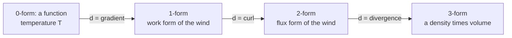

# Exterior derivative: one rule containing gradient, curl and divergence

[Syllabus](../../../SYLLABUS.md) → [Differential geometry and Lie groups](../README.md) → [Differential Forms](../README.md#s04) → Exterior derivative

---

## General Overview

A weather mast stands in a valley that runs north. It is 200 m east of the valley's centre line, 300 m along it and 50 m above the centre of the floor. At the mast the air moves 4.43 m/s up the valley, 0.22 m/s east and 0.035 m/s upward. The air there is 20.275 °C.

A forecaster asks three questions about the air at the mast:

- **How fast does a weather balloon drifting with the wind see the temperature change?** The answer comes from the **gradient**: the rates of change of temperature east, north and up.
- **Does the air spin?** The answer is the **curl**: the turning of the air per unit area, one part for each plane.
- **Does air pile up or drain away?** The answer is the **divergence**: the net outflow per unit volume.

Vector calculus teaches these as three separate formulas. This card shows they are one operation, the **exterior derivative** $`d`$, applied to three kinds of object. At the mast it gives a warming of 1.557 °C per hour for the balloon, a spin of 0.005 rad/s about an east–west axis, and a divergence of exactly zero: the air neither piles up nor drains away.

### The picture: one operator, three steps



Each arrow is the same rule. Two arrows in a row always give zero: that is why a gradient has no curl and a curl has no divergence.

**The exterior derivative turns a k-form into a (k+1)-form by one rule, differentiate each coefficient and put the new direction in front with the wedge's sign rule; in three dimensions it is the gradient on functions, the curl on one-forms and the divergence on two-forms, it gives zero when applied twice, and it reads the same in every chart.**

**What kind of fact this is:** $`d`$ is a definition. That it measures what a form adds up round the edge of a tiny box, that it matches gradient, curl and divergence, that $`d \circ d = 0`$ and that it commutes with pullback are theorems, proved on this card in Why it works. All of them are local: they hold at each point, with no condition on the shape of the whole region.

---

## The formula

New notation, in words first. This card introduces the **exterior derivative** $`d`$. From [Differential form](01-forms-and-the-wedge-product.md): a **k-form** is a rule that takes k arrows at a point and returns a number that flips sign when two arrows swap. Its building blocks are $`dx`$, $`dy`$, $`dz`$, which read off an arrow's east, north and up parts, joined by the **wedge** $`\wedge`$, which obeys $`dy \wedge dx = -dx \wedge dy`$ and $`dx \wedge dx = 0`$. From [Pullback](02-pullback-and-change-of-variables.md): $`F^*`$ carries a form back through a map $`F`$.

In coordinates $`x^1, \dots, x^n`$ (upper indices are labels, not powers), write a k-form as a sum of terms $`f_I\, dx^I`$, where $`dx^I = dx^{i_1} \wedge \dots \wedge dx^{i_k}`$. Then

```math
d\Big(\sum_I f_I\, dx^I\Big) = \sum_I \sum_{j=1}^{n} \frac{\partial f_I}{\partial x^j}\; dx^j \wedge dx^I
```

**Read it aloud:** differentiate each coefficient in every direction, put that direction's $`dx^j`$ in front of the term, and then let the wedge rules cancel and sign the pieces.

Here $`\partial f/\partial x^j`$ is the **partial rate** (partial derivative) of $`f`$: how fast it changes along $`x^j`$ with the other coordinates held fixed.

In three dimensions, with the wind $`(P, Q, R)`$ in m/s and the temperature $`T`$ in °C, the rule gives three formulas. The **work form** $`\omega`$ (omega) measures the wind along a displacement. The **flux form** $`\Phi`$ (capital phi) measures the air crossing a small patch.

```math
dT = \frac{\partial T}{\partial x}\,dx + \frac{\partial T}{\partial y}\,dy + \frac{\partial T}{\partial z}\,dz
```

```math
\omega = P\,dx + Q\,dy + R\,dz, \qquad d\omega = \Big(\frac{\partial R}{\partial y} - \frac{\partial Q}{\partial z}\Big) dy\wedge dz + \Big(\frac{\partial P}{\partial z} - \frac{\partial R}{\partial x}\Big) dz\wedge dx + \Big(\frac{\partial Q}{\partial x} - \frac{\partial P}{\partial y}\Big) dx\wedge dy
```

```math
\Phi = P\,dy\wedge dz + Q\,dz\wedge dx + R\,dx\wedge dy, \qquad d\Phi = \Big(\frac{\partial P}{\partial x} + \frac{\partial Q}{\partial y} + \frac{\partial R}{\partial z}\Big)\, dx\wedge dy\wedge dz
```

**Read it aloud:** $`d`$ of the temperature has the gradient's parts; $`d`$ of the work form has the curl's parts; $`d`$ of the flux form has the divergence. And always $`d(d\alpha) = 0`$.

The card's valley, with $`x`$ metres east of the centre line, $`y`$ metres north and $`z`$ metres up:

```math
P = 0.001x - 0.0006y + 0.004z, \quad Q = 4 + 0.0003y + 0.01z - 0.000004x^2, \quad R = 0.0005x - 0.0013z, \quad T = 20 + 0.003x - 0.0065z
```

The wind blows up the valley, faster aloft and slower near the walls. It spreads sideways and rises along the sunlit east slope. The air cools 6.5 °C per km of height, the standard lapse rate.

| Symbol | Plain meaning | In our example | Push it up and the answer… |
| --- | --- | --- | --- |
| $`x, y, z`$; $`x^j`$ | metres east, north, up; a general coordinate | mast $`M = (200, 300, 50)`$ | — |
| $`P, Q, R`$ | wind's east, north, up parts, m/s | 0.22, 4.43, 0.035 at $`M`$ | — |
| $`T`$ | air temperature, °C | 20.275 at $`M`$ | — |
| $`dx, dy, dz`$; $`dx^I`$ | read off an arrow's east, north, up part; a wedge of several | $`dz`$ of a 10 m climb is 10 | — |
| $`\wedge`$ | wedge: signed area or volume of the arrows' box | $`dx\wedge dy`$ of a 10 m square is 100 m² | — |
| $`k`$; $`\alpha, \beta`$; $`f_I`$; $`I`$, $`j`$ | degree of a form; any forms; a coefficient; an index list and one index | $`k`$ = 0, 1, 2 for $`T`$, $`\omega`$, $`\Phi`$ | $`d`$ raises $`k`$ by 1 |
| $`d`$ | exterior derivative | $`dT = 0.003\,dx - 0.0065\,dz`$ °C/m | — |
| $`\omega`$ | work form: wind along a displacement, m²/s | $`d\omega`$ parts −0.01, 0.0035, −0.001 per s | — |
| $`\Phi`$ | flux form: air through a patch, m³/s | $`d\Phi = 0`$ | — |
| $`\ell`$; $`p`$, $`a, b`$, $`e_a`$, $`u`$, $`o(\ell^2)`$, $`m`$, $`g`$, $`F^i`$ | side of a small box, m; in the proofs: a point, two coordinate directions, a unit step along $`x^a`$, distance along an edge, a remainder that shrinks faster than $`\ell^2`$, a direction's number counting from 1, any function, the $`i`$-th part of $`F`$ | 10 m | ratios unchanged here |
| $`s`$, $`h(x)`$, $`F`$, $`F^*`$ | height above the valley floor; the floor's height $`0.0005x^2`$; the chart map $`(x, y, s) \mapsto (x, y, s + h(x))`$; its pullback | $`s`$ = 30 m, $`h`$ = 20 m, slope 0.2 at $`M`$ | steeper floor, bigger chart terms |
| $`\mathrm{grad}\, T`$, $`\mathrm{curl}\, \mathbf{v}`$, $`\mathrm{div}\, \mathbf{v}`$ | the old names, for the wind $`\mathbf{v} = (P, Q, R)`$ | (0.003, 0, −0.0065); (−0.01, 0.0035, −0.001); 0 | — |

### When it holds

- **The coefficients have continuous first rates.** Then $`d`$ exists. For $`d(d\alpha) = 0`$ they need continuous second rates. The pinched function in "What breaks" has first rates everywhere, and there the rule gives $`d(df)`$ = 2 while every box gives 0.
- **Gradient, curl and divergence need straight axes at right angles, in metres.** $`d`$ itself works in any chart. In the terrain chart below, its parts are no longer the curl's parts, because the old formulas assume flat axes.
- **The curl reading needs right-handed axes.** Swap east and north and the curl arrow flips; the two-form $`d\omega`$ does not.
- **The two-form to arrow match is special to three dimensions.** In space-time, $`d`$ of a one-form has six parts, not three: the field two-form of [Hodge star](09-hodge-star-and-maxwell-in-forms.md).
- **$`d`$ is local.** It needs the form near one point only. Whether a form with $`d\alpha = 0`$ comes from a potential is a global question, the subject of [Closed and exact forms](04-closed-and-exact-forms-and-the-poincare-lemma.md).

---

## Why it works

### Step 0: d measures what a form adds up round the edge of a tiny box

A function is read at points, a one-form along paths, a two-form over patches. The edge of a segment is two points; the edge of a square is four segments; the edge of a cube is six faces. So a k-form can be added up round the edge of a tiny (k+1)-dimensional box.

Divide that sum by the box's size and shrink the box. The limit is $`d`$. This is [Stokes on manifolds](06-stokes-theorem-on-manifolds.md) at the smallest scale. The rule in The formula is that limit, worked out.

### Step 1: degree 0, the gradient

The edge of a short segment is its end minus its start. So $`dT`$ applied to an arrow is the rate of change of $`T`$ along it: for a 1 m arrow, the change in °C. Its parts are the three partial rates:

```math
dT = 0.003\,dx + 0\,dy - 0.0065\,dz \ \ °\mathrm{C/m}
```

Road two checks this with no derivatives: $`T`$ at the end of a 10 m segment, minus $`T`$ at its start, divided by 10 m. East it gives 0.003 °C/m; up it gives −0.0065 °C/m.

Feed $`dT`$ the wind arrow. A balloon drifting with the wind sees $`dT(\mathbf{v}) = 0.003 \times 0.22 - 0.0065 \times 0.035 = 0.0004325`$ °C/s. That is 1.557 °C per hour.

### Step 2: degree 1, the curl

Apply the rule to each term of $`\omega`$. Each $`dP`$ has three parts, and the wedge kills the part along the term's own direction:

```math
d(P\,dx) = \frac{\partial P}{\partial y}\,dy\wedge dx + \frac{\partial P}{\partial z}\,dz\wedge dx = -\frac{\partial P}{\partial y}\,dx\wedge dy + \frac{\partial P}{\partial z}\,dz\wedge dx
```

The same for $`Q\,dy`$ and $`R\,dz`$, then collect by plane. Each plane receives one cross rate with a plus and one with a minus. The minus comes from $`dy\wedge dx = -dx\wedge dy`$. That is exactly the curl's pattern.

Why the minus is right: walk a small square in the $`x`$–$`y`$ plane anticlockwise. The east edge, walked north, collects $`Q`$; the west edge gives it back, netting $`\partial Q/\partial x`$ times the area. The south and north edges are walked in opposite senses along $`x`$, netting $`-\partial P/\partial y`$ times the area. The square's circulation divided by its area is the $`dx\wedge dy`$ part. [Divergence and curl](../../06-Calculus%20and%20analysis/09-Vector%20Calculus/03-divergence-and-curl.md) works this walk in full for a flat wind.

At the mast, the three planes give:

| Plane | Rule | Value, per s | 10 m square: circulation |
| --- | --- | --- | --- |
| $`dy\wedge dz`$ (axis east) | $`0 - 0.01`$ | −0.010000 | −1.000000 m²/s |
| $`dz\wedge dx`$ (axis north) | $`0.004 - 0.0005`$ | 0.003500 | 0.350000 m²/s |
| $`dx\wedge dy`$ (axis up) | $`-0.0016 - (-0.0006)`$ | −0.001000 | −0.100000 m²/s |

Divide each circulation by 100 m² and the rule's value comes back. The air's spin is half the curl ([Divergence and curl](../../06-Calculus%20and%20analysis/09-Vector%20Calculus/03-divergence-and-curl.md), Step 3). The biggest part is the wind's growth with height. It rolls the air about an east–west axis at 0.005 rad/s, a full turn in 1256.6 s (20.9 minutes). Seen from above, the air turns clockwise at 0.0005 rad/s.

### Step 3: degree 2, the divergence

Apply the rule to $`\Phi`$. In $`d(P\,dy\wedge dz)`$, the $`y`$ and $`z`$ rates die, since $`dy`$ and $`dz`$ are already in the wedge. Only $`\partial P/\partial x\; dx\wedge dy\wedge dz`$ survives. Likewise $`Q\,dz\wedge dx`$ keeps only its $`y`$ rate: $`dy\wedge dz\wedge dx`$ takes two swaps to become $`dx\wedge dy\wedge dz`$, so its sign is plus. The sum is the divergence.

The box reading: the flux form added up over the six faces of a small cube is the net air leaving it. For a 10 m cube at the mast:

| Pair of faces | Rate | Net outflow, m³/s |
| --- | --- | --- |
| east and west | $`\partial P/\partial x = 0.001`$ | 1.000000 |
| north and south | $`\partial Q/\partial y = 0.0003`$ | 0.300000 |
| top and bottom | $`\partial R/\partial z = -0.0013`$ | −1.300000 |
| total | divergence × 1000 m³ | **0.000000** |

The air rising in through the floor leaves through the sides. Air near the ground is close to incompressible, so a real wind has divergence close to zero, and this one passes.

### Step 4: applying d twice gives zero

Apply $`d`$ to $`dT`$. Each term gets two rates, in two orders: $`\partial^2 T/\partial x\,\partial y\; dx\wedge dy`$ and $`\partial^2 T/\partial y\,\partial x\; dy\wedge dx`$. The rates are equal; the wedges are opposite. They cancel. So $`d(dT) = 0`$, which in old terms reads $`\mathrm{curl}\,\mathrm{grad}\, T = 0`$. The same cancellation gives $`d(d\omega) = 0`$: $`\mathrm{div}\,\mathrm{curl}\, \mathbf{v} = 0`$.

The geometric reason: the edge of a box's edge is empty. The four edges of a square meet at corners, and each corner is the end of one edge and the start of the next. The code applies $`d`$ twice to $`T`$ and $`\omega`$ in the map chart, to the pulled-back $`\omega`$ in the terrain chart, and in both charts to a test form, $`\omega + 0.001\,yz\,dx`$. The largest coefficient is 0.000000000. Only the test form puts the cancellation to work: $`T`$ and this wind have no mixed second rates, so for them each cancelling pair is 0 and 0.

<details>
<summary>Detailed proof: the rule equals the box limit, and d∘d = 0</summary>

**The box limit.** Take a one-form $`\omega = \sum_i \omega_i\, dx^i`$ with continuous first rates, a point $`p`$, and two coordinate directions $`a < b`$. Walk the square $`[0, \ell]^2`$ in the $`x^a`$–$`x^b`$ plane from $`p`$, first along $`a`$, then along $`b`$. The two edges along $`a`$ contribute

$`\displaystyle \int_0^\ell \big(\omega_a(p + u e_a) - \omega_a(p + u e_a + \ell e_b)\big)\, du = -\ell^2\, \partial_b \omega_a(p) + o(\ell^2)`$

by the mean value theorem and continuity of $`\partial_b \omega_a`$. Here $`e_a`$ is a unit step along $`x^a`$, and $`o(\ell^2)`$ is a remainder that shrinks faster than $`\ell^2`$. The two edges along $`b`$ give $`+\ell^2\, \partial_a \omega_b(p) + o(\ell^2)`$. Divided by $`\ell^2`$, the circulation tends to $`\partial_a \omega_b - \partial_b \omega_a`$.

The rule gives the same number. Its $`dx^a\wedge dx^b`$ coefficient collects $`\partial_a \omega_b`$ from $`dx^a\wedge dx^b`$ and $`\partial_b \omega_a`$ from $`dx^b\wedge dx^a = -dx^a\wedge dx^b`$. A k-form on a (k+1)-box runs the same way, face by face: across the $`m`$-th direction, counting from 1, the far face minus the near face carries the sign $`(-1)^{m-1}`$.

**d∘d = 0.** For $`\alpha = f\, dx^I`$ with continuous second rates,

$`\displaystyle d(d\alpha) = \sum_{j, k} \frac{\partial^2 f}{\partial x^k\, \partial x^j}\; dx^k \wedge dx^j \wedge dx^I`$

Swap the names $`j`$ and $`k`$. The second rates are unchanged, by the symmetry of second derivatives, and $`dx^j\wedge dx^k = -dx^k\wedge dx^j`$. So the sum equals minus itself and is zero. Terms with $`j = k`$ die on their own.

</details>

### Step 5: the same answer in every chart

Forecast models often use **terrain-following coordinates**: height above the ground, $`s = z - h(x)`$, in place of $`z`$. Here the floor $`h(x) = 0.0005x^2`$ is 20 m high at the mast and rises 0.2 m per metre east. The mast sits at $`s`$ = 30 m.

The theorem is $`F^*(d\alpha) = d(F^*\alpha)`$: differentiate then pull back, or the reverse, and the result is the same. The pullback moves the $`dz`$ too: $`dz = ds + 0.2\,dx`$ at the mast. The code takes both orders:

| Part, terrain chart | $`d`$ of pulled-back $`\omega`$ | Pulled-back $`d\omega`$ |
| --- | --- | --- |
| $`dy\wedge ds`$ | −0.010000 | −0.010000 |
| $`ds\wedge dx`$ | 0.003500 | 0.003500 |
| $`dx\wedge dy`$ | 0.001000 | 0.001000 |

The $`dx\wedge dy`$ part has flipped from −0.001 to +0.001. In this chart a "$`dx\wedge dy`$ patch" tilts with the ground, so it also catches some of the large east–west spin. Since $`dy\wedge dz = dy\wedge ds - 0.2\, dx\wedge dy`$, the part is $`-0.001 - 0.2 \times (-0.01) = 0.001`$. The parts change with the chart; the form does not.

The temperature tells the same story. Pulled back, $`dT = 0.0017\,dx - 0.0065\,ds`$. Moving 1 m east while staying 30 m above the ground climbs 0.2 m, so $`T`$ changes by $`0.003 - 0.0065 \times 0.2 = 0.0017`$ °C. The divergence also survives: $`d`$ of the pulled-back $`\Phi`$ is 0, and this chart's volume factor, its Jacobian determinant, is 1.

<details>
<summary>Detailed proof: d commutes with pullback</summary>

For a function $`f`$, $`F^*(df)`$ and $`d(f \circ F)`$ agree by the chain rule: both send an arrow $`v`$ to the rate of $`f`$ along $`dF(v)`$.

For $`dx^i`$ itself, $`F^* dx^i = d(x^i \circ F) = dF^i`$, so $`d(F^* dx^i) = d(dF^i) = 0`$ by Step 4.

For $`\alpha = f\, dx^{i_1}\wedge\dots\wedge dx^{i_k}`$, pullback respects wedges, so

$`\displaystyle F^*\alpha = (f\circ F)\; dF^{i_1}\wedge\dots\wedge dF^{i_k}`$

The product rule for $`d`$, $`d(g\,\beta) = dg\wedge\beta + g\, d\beta`$, then gives $`d(F^*\alpha) = d(f\circ F)\wedge dF^{i_1}\wedge\dots\wedge dF^{i_k}`$, since each $`d(dF^{i})`$ is zero. That is $`F^*(df)\wedge F^*(dx^{i_1})\wedge\dots = F^*(d\alpha)`$.

</details>

---

## Worked numbers, by hand

The rates at the mast $`M = (200, 300, 50)`$, read off the formulas: $`P`$ has rates 0.001, −0.0006, 0.004; $`Q`$ has −0.0016, 0.0003, 0.01; $`R`$ has 0.0005, 0, −0.0013.

| Step | Arithmetic | Value |
| --- | --- | --- |
| wind at $`M`$ | the formulas at (200, 300, 50) | 0.22, 4.43, 0.035 m/s |
| $`dT`$ | rates of $`T`$ | 0.003, 0, −0.0065 °C/m |
| $`dT(\mathbf{v})`$ | $`0.003 \times 0.22 - 0.0065 \times 0.035`$ | 0.0004325 °C/s = 1.557 °C/h |
| $`d\omega`$, $`dy\wedge dz`$ | $`\partial R/\partial y - \partial Q/\partial z = 0 - 0.01`$ | −0.01 per s |
| $`d\omega`$, $`dz\wedge dx`$ | $`\partial P/\partial z - \partial R/\partial x = 0.004 - 0.0005`$ | 0.0035 per s |
| $`d\omega`$, $`dx\wedge dy`$ | $`\partial Q/\partial x - \partial P/\partial y = -0.0016 + 0.0006`$ | −0.001 per s |
| spin about east–west axis | half of 0.01; $`2\pi / 0.005`$ | 0.005 rad/s, a turn in 1256.6 s |
| $`d\Phi`$ | $`0.001 + 0.0003 - 0.0013`$ | **0 per s** |

So at the mast the air warms a drifting balloon by 1.557 °C per hour, rolls about an east–west axis once every 20.9 minutes, and is neither gathered nor thinned.

### What breaks if you drop a piece

| Mistake | Comes out at | What went wrong |
| --- | --- | --- |
| Treat $`dy\wedge dx`$ as $`dx\wedge dy`$ | up part −0.0022 per s, not −0.001 | The sign rule is what turns two cross rates into a difference. |
| Write the flux form with $`Q\,dx\wedge dz`$ for $`Q\,dz\wedge dx`$ | $`d\Phi`$ = −0.0006 per s, not 0 | The north face is oriented backwards: air seems to vanish. |
| Terrain chart: put $`z = s + h(x)`$ into $`P, Q, R`$ but keep $`dz`$ as $`ds`$ | $`ds\wedge dx`$ part 0.00376, not 0.0035 | A pullback moves the $`dz`$ too: $`dz = ds + 0.2\,dx`$. |
| The rule on a pinched function, $`f = xy(x^2 - y^2)/(x^2 + y^2)`$, at 0 | rule: $`d(df)`$ = 2; every box: 0 | Its second rates jump at 0, so the hypothesis "continuous second rates" fails and the rule no longer computes $`d`$. |

---

## Code, from first principles, and it actually runs

The code computes $`d`$ at the mast three independent ways. Road one is the rule by hand. Road two uses no derivatives: it adds up each form round the edges of 10 m segments, squares and cubes, by Simpson's rule (a parabola over each pair of strips), and divides by the size. Road three is one general $`d`$ for every degree, by central differences, run in both charts against the pullback of road one. The code also applies $`d`$ twice and prints every "what breaks" and "try changing" number.

### Python

```python
# Exterior derivative on the valley wind -- the check behind the card.  Standard library only.
# x east, y north, z up, in metres; the mast M stands at (200, 300, 50).  Three roads:
# (1) the rule by hand, (2) sums round small boxes with no derivatives at all,
# (3) one general d by central differences, in the map chart and in a terrain-following chart.
from itertools import combinations, permutations

def P(x, y, z): return 0.001 * x - 0.0006 * y + 0.004 * z            # east wind, m/s
def Q(x, y, z): return 4 + 0.0003 * y + 0.01 * z - 0.000004 * x * x  # north wind, along the valley
def R(x, y, z): return 0.0005 * x - 0.0013 * z                       # upward wind
def T(x, y, z): return 20 + 0.003 * x - 0.0065 * z                   # air temperature, degC
M, MS, H = (200.0, 300.0, 50.0), (200.0, 300.0, 30.0), 0.01           # MS: the mast in the terrain chart
def cl(v): return 0.0 if abs(v) < 1e-8 else v
def f6(*vs): return " ".join(f"{cl(v):.6f}" for v in vs)

def hand(x, y, z):            # road 1: the rule by hand, each rate read off the formulas above
    Px, Py, Pz, Qx, Qy, Qz, Rx, Ry, Rz = 0.001, -0.0006, 0.004, -0.000008 * x, 0.0003, 0.01, 0.0005, 0.0, -0.0013
    return (0.003, 0.0, -0.0065), (Ry - Qz, Pz - Rx, Qx - Py), Px + Qy + Rz, (Px, Qy, Rz), Qx + Py

# A k-form is a dict {sorted index tuple: coefficient function}; 0, 1, 2 stand for dx, dy, dz.
def partial(f, j, p, h=H):
    a, b = list(p), list(p); a[j] += h; b[j] -= h
    return (f(*a) - f(*b)) / (2 * h)
def d(form, signed=True):     # road 3: the one rule, for every degree; signed=False drops the sign rule
    terms = {}
    for I, f in form.items():
        for j in range(3):
            if j in I: continue                               # dx^j wedge dx^j = 0
            sign = (-1) ** sum(1 for i in I if i < j) if signed else 1   # each swap past a smaller dx^i flips the sign
            terms.setdefault(tuple(sorted(I + (j,))), []).append((sign, f, j))
    return {J: (lambda *p, t=t: sum(s * partial(f, j, p) for s, f, j in t)) for J, t in terms.items()}
def sgn(pm): return (-1) ** sum(1 for a in range(len(pm)) for b in range(a + 1, len(pm)) if pm[a] > pm[b])
def det(m):
    out = 0.0
    for pm in permutations(range(len(m))):
        t = sgn(pm)
        for r in range(len(m)): t *= m[r][pm[r]]
        out += t
    return out
def chart(x, y, s, k=0.0005): return (x, y, s + k * x * x)     # s: height above the valley floor k x^2
def pull(form, k=0.0005):     # pullback to (x, y, s): coefficients times minors of the chart's Jacobian
    def coeff(A):
        def c(*q):
            J = [[partial(lambda *u: chart(*u, k)[i], a, q) for a in range(3)] for i in range(3)]
            return sum(f(*chart(*q, k)) * det([[J[i][a] for a in A] for i in I]) for I, f in form.items())
        return c
    return {A: coeff(A) for A in combinations(range(3), len(next(iter(form))))}

temp, omega = {(): T}, {(0,): P, (1,): Q, (2,): R}
Phi = {(1, 2): P, (0, 2): lambda *p: -Q(*p), (0, 1): R}      # P dy^dz + Q dz^dx + R dx^dy
gT, curl, div, own, swapped = hand(*M)
print(f"mast M (200, 300, 50) m: wind {f6(P(*M), Q(*M), R(*M))} m/s, T {T(*M):.6f} degC")
print(f"road 1, dT = gradient (dx dy dz): {f6(*gT)} degC/m; dT(wind) {gT[0] * P(*M) + gT[2] * R(*M):.7f} degC/s"
      f" = {(gT[0] * P(*M) + gT[2] * R(*M)) * 3600:.6f} degC/h")
print(f"road 1, d omega = curl (dy^dz dz^dx dx^dy): {f6(*curl)} per s; spin {f6(*[c / 2 for c in curl])} rad/s")
turn = 2 * 3.141592653589793 / abs(curl[0] / 2)
print(f"  rates (x y z): P 0.001000 -0.000600 0.004000; Q {-0.000008 * M[0]:.6f} 0.000300 0.010000; R 0.000500 0.000000 -0.001300")
print(f"  east-west spin: a turn in {turn:.1f} s = {turn / 60:.1f} min")
print(f"road 1, d Phi = div (dx^dy^dz): {f6(div)} per s = {f6(own[0])} + {f6(own[1])} + {f6(own[2])}")
g0, g1, g2 = d(temp), d(omega), d(Phi)
r3 = ([g0[(i,)](*M) for i in range(3)], [g1[(1, 2)](*M), -g1[(0, 2)](*M), g1[(0, 1)](*M)], g2[(0, 1, 2)](*M))
print(f"road 3, general d: dT {f6(*r3[0])}; d omega {f6(*r3[1])}; d Phi {f6(r3[2])}")
for a, b in zip(gT + curl + (div,), r3[0] + r3[1] + [r3[2]]): assert abs(a - b) < 1e-9

def simpson(g, a, b, n=4):
    h = (b - a) / n
    return h / 3 * (g(a) + g(b) + sum((4 if k % 2 else 2) * g(a + k * h) for k in range(1, n)))
def pt(*moves):
    p = list(M)
    for ax, amt in moves: p[ax] += amt
    return p
F = (P, Q, R)
def circ(i, j, L):            # walk the L-square round M in the plane of axes i, j, turning from i towards j
    a = L / 2
    return (simpson(lambda u: F[i](*pt((i, u), (j, -a))) - F[i](*pt((i, u), (j, a))), -a, a)
            + simpson(lambda v: F[j](*pt((i, a), (j, v))) - F[j](*pt((i, -a), (j, v))), -a, a))
def outflow(k, L):            # net air leaving the L-cube through its two faces across axis k, m^3/s
    i, j = [m for m in range(3) if m != k]; a = L / 2
    return simpson(lambda u: simpson(lambda v: F[k](*pt((k, a), (i, u), (j, v)))
                                     - F[k](*pt((k, -a), (i, u), (j, v))), -a, a), -a, a)
L = 10.0
seg = [(T(*pt((0, L))) - T(*M)) / L, (T(*pt((2, L))) - T(*M)) / L]
cs, fl = [circ(1, 2, L), circ(2, 0, L), circ(0, 1, L)], [outflow(k, L) for k in range(3)]
print(f"road 2, 10 m east and up: T changes {f6(*seg)} degC/m")
print(f"road 2, 10 m squares: circulation {f6(*cs)} m^2/s; per area {f6(*[c / L ** 2 for c in cs])}")
print(f"road 2, 10 m cube: outflow east-west {f6(fl[0])}, north-south {f6(fl[1])}, top-bottom {f6(fl[2])},"
      f" total {f6(sum(fl))} m^3/s")
assert abs(seg[0] - gT[0]) < 1e-12 and abs(seg[1] - gT[2]) < 1e-12
for c, h in zip(cs, curl): assert abs(c / L ** 2 - h) < 1e-12        # Stokes in the small, degree 1
for f, h in zip(fl, own): assert abs(f / L ** 3 - h) < 1e-12          # Stokes in the small, degree 2
cs100 = [circ(1, 2, 100.0) / 1e4, circ(2, 0, 100.0) / 1e4, circ(0, 1, 100.0) / 1e4]

pT, pw, pP = pull(temp), pull(omega), pull(Phi)
dpw = d(pw)
pdw = pull({(1, 2): lambda *p: hand(*p)[1][0], (0, 2): lambda *p: -hand(*p)[1][1], (0, 1): lambda *p: hand(*p)[1][2]})
print(f"terrain chart s = z - 0.0005 x^2: at M floor {0.0005 * MS[0] ** 2:.0f} m, s = {MS[2]:.0f} m, floor slope {0.001 * MS[0]:.6f}")
print(f"  dT pulled back (dx dy ds): {f6(*[d(pT)[(i,)](*MS) for i in range(3)])} degC/m")
print(f"  omega pulled back (dx dy ds): {f6(*[pw[(i,)](*MS) for i in range(3)])} m/s")
row = lambda f: [f[(1, 2)](*MS), -f[(0, 2)](*MS), f[(0, 1)](*MS)]
print(f"  d(pulled-back omega) (dy^ds ds^dx dx^dy): {f6(*row(dpw))}")
print(f"  pulled-back d omega  (dy^ds ds^dx dx^dy): {f6(*row(pdw))}")
print(f"  d(pulled-back Phi) {f6(d(pP)[(0, 1, 2)](*MS))}; Jacobian determinant {pull({(0, 1, 2): lambda *p: 1.0})[(0, 1, 2)](*MS):.6f}")
for a, b in zip(row(dpw), row(pdw)): assert abs(a - b) < 1e-9          # d commutes with pullback
pg = [d(pT)[(i,)](*MS) for i in range(3)]
assert abs(pg[0] - (gT[0] + gT[2] * 0.2)) < 1e-9 and abs(pg[2] - gT[2]) < 1e-9
test = {(0,): lambda x, y, z: P(x, y, z) + 0.001 * y * z, (1,): Q, (2,): R}   # a mixed second rate, 0.001
dd = [v(*M) for f in (temp, omega, test) for v in d(d(f)).values()] + [v(*MS) for f in (pw, pull(test)) for v in d(d(f)).values()]
print(f"d(d .) of T, omega, omega + 0.001 yz dx; of pulled-back omega, omega + 0.001 yz dx: largest coefficient {max(abs(cl(v)) for v in dd):.9f}")
assert max(abs(v) for v in dd) < 1e-9

def fx(x, y): return 0.0 if x == y == 0 else y * (x ** 4 + 4 * x * x * y * y - y ** 4) / (x * x + y * y) ** 2
def fy(x, y): return 0.0 if x == y == 0 else x * (x ** 4 - 4 * x * x * y * y - y ** 4) / (x * x + y * y) ** 2
rule = (fy(1e-4, 0) - fy(-1e-4, 0)) / 2e-4 - (fx(0, 1e-4) - fx(0, -1e-4)) / 2e-4
a = 0.5e-3
box = (simpson(lambda u: fx(u, -a) - fx(u, a), -a, a, 256) + simpson(lambda v: fy(a, v) - fy(-a, v), -a, a, 256)) / (2 * a) ** 2
naive = d({(i,): (lambda *q, i=i: F[i](*chart(*q))) for i in range(3)})
print(f"breaks: commuting wedge, up part {f6(swapped)}; dx^dz for dz^dx, d Phi {f6(own[0] - own[1] + own[2])};"
      f" chart without dz = ds + 0.2 dx, ds^dx {f6(-naive[(0, 2)](*MS))}")
print(f"breaks: pinched f = xy(x^2-y^2)/(x^2+y^2) at 0: rule gives d(df) {f6(rule)}, box gives {f6(box)}")
assert abs(rule - 2.0) < 1e-9 and abs(box) < 1e-8 and abs(swapped - d(omega, False)[(0, 1)](*M)) < 1e-9
Q2 = lambda x, y, z: Q(x, y, z) + 0.01 * z
dw2 = d({(0,): P, (1,): Q2, (2,): R})
print(f"try: mast at x = 400 m, up part {f6(hand(400, 300, 50)[1][2])}; floor 0.001 x^2, slope {0.002 * MS[0]:.6f}, terrain dx^dy"
      f" {f6(d(pull(omega, 0.001))[(0, 1)](*MS))}; shear 0.02, dy^dz {f6(dw2[(1, 2)](*M))}")
print(f"try: 100 m squares, per area {f6(*cs100)}")
for a, b in zip(cs100, curl): assert abs(a - b) < 1e-12
print("ALL CHECKS PASS")
```

**Ran 2026-11-19 on macOS, Python 3.14.10, standard library only. All checks passed. Output, pasted from the run:**

```
mast M (200, 300, 50) m: wind 0.220000 4.430000 0.035000 m/s, T 20.275000 degC
road 1, dT = gradient (dx dy dz): 0.003000 0.000000 -0.006500 degC/m; dT(wind) 0.0004325 degC/s = 1.557000 degC/h
road 1, d omega = curl (dy^dz dz^dx dx^dy): -0.010000 0.003500 -0.001000 per s; spin -0.005000 0.001750 -0.000500 rad/s
  rates (x y z): P 0.001000 -0.000600 0.004000; Q -0.001600 0.000300 0.010000; R 0.000500 0.000000 -0.001300
  east-west spin: a turn in 1256.6 s = 20.9 min
road 1, d Phi = div (dx^dy^dz): 0.000000 per s = 0.001000 + 0.000300 + -0.001300
road 3, general d: dT 0.003000 0.000000 -0.006500; d omega -0.010000 0.003500 -0.001000; d Phi 0.000000
road 2, 10 m east and up: T changes 0.003000 -0.006500 degC/m
road 2, 10 m squares: circulation -1.000000 0.350000 -0.100000 m^2/s; per area -0.010000 0.003500 -0.001000
road 2, 10 m cube: outflow east-west 1.000000, north-south 0.300000, top-bottom -1.300000, total 0.000000 m^3/s
terrain chart s = z - 0.0005 x^2: at M floor 20 m, s = 30 m, floor slope 0.200000
  dT pulled back (dx dy ds): 0.001700 0.000000 -0.006500 degC/m
  omega pulled back (dx dy ds): 0.227000 4.430000 0.035000 m/s
  d(pulled-back omega) (dy^ds ds^dx dx^dy): -0.010000 0.003500 0.001000
  pulled-back d omega  (dy^ds ds^dx dx^dy): -0.010000 0.003500 0.001000
  d(pulled-back Phi) 0.000000; Jacobian determinant 1.000000
d(d .) of T, omega, omega + 0.001 yz dx; of pulled-back omega, omega + 0.001 yz dx: largest coefficient 0.000000000
breaks: commuting wedge, up part -0.002200; dx^dz for dz^dx, d Phi -0.000600; chart without dz = ds + 0.2 dx, ds^dx 0.003760
breaks: pinched f = xy(x^2-y^2)/(x^2+y^2) at 0: rule gives d(df) 2.000000, box gives 0.000000
try: mast at x = 400 m, up part -0.002600; floor 0.001 x^2, slope 0.400000, terrain dx^dy 0.003000; shear 0.02, dy^dz -0.020000
try: 100 m squares, per area -0.010000 0.003500 -0.001000
ALL CHECKS PASS
```

### Rust

```rust
// Exterior derivative on the valley wind -- the check behind the card.  std only, no crates.
// x east, y north, z up, in metres; the mast M stands at (200, 300, 50).  Three roads:
// (1) the rule by hand, (2) sums round small boxes with no derivatives at all,
// (3) one general d by central differences, in the map chart and in a terrain-following chart.
use std::collections::BTreeMap;
use std::rc::Rc;
type Pt = [f64; 3];
type Coef = Rc<dyn Fn(&Pt) -> f64>;
type Form = BTreeMap<Vec<usize>, Coef>; // sorted index list -> coefficient; 0, 1, 2 stand for dx, dy, dz
const M: Pt = [200.0, 300.0, 50.0];
const MS: Pt = [200.0, 300.0, 30.0]; // the mast in the terrain chart
const H: f64 = 0.01;

fn p_(p: &Pt) -> f64 { 0.001 * p[0] - 0.0006 * p[1] + 0.004 * p[2] } // east wind, m/s
fn q_(p: &Pt) -> f64 { 4.0 + 0.0003 * p[1] + 0.01 * p[2] - 0.000004 * p[0] * p[0] } // north wind
fn r_(p: &Pt) -> f64 { 0.0005 * p[0] - 0.0013 * p[2] } // upward wind
fn t_(p: &Pt) -> f64 { 20.0 + 0.003 * p[0] - 0.0065 * p[2] } // air temperature, degC
fn wind(k: usize, p: &Pt) -> f64 { [p_, q_, r_][k](p) }
fn cl(v: f64) -> f64 { if v.abs() < 1e-8 { 0.0 } else { v } }
fn f6(vs: &[f64]) -> String { vs.iter().map(|v| format!("{:.6}", cl(*v))).collect::<Vec<_>>().join(" ") }

// road 1: the rule by hand, each rate read off the formulas above
fn hand(p: &Pt) -> ([f64; 3], [f64; 3], f64, [f64; 3], f64) {
    let (px, py, pz, qx, qy, qz, rx, ry, rz) = (0.001, -0.0006, 0.004, -0.000008 * p[0], 0.0003, 0.01, 0.0005, 0.0, -0.0013);
    ([0.003, 0.0, -0.0065], [ry - qz, pz - rx, qx - py], px + qy + rz, [px, qy, rz], qx + py)
}
fn partial(f: &dyn Fn(&Pt) -> f64, j: usize, p: &Pt, h: f64) -> f64 {
    let (mut a, mut b) = (*p, *p); a[j] += h; b[j] -= h;
    (f(&a) - f(&b)) / (2.0 * h)
}
fn d(form: &Form) -> Form { d_rule(form, true) }
fn d_rule(form: &Form, signed: bool) -> Form { // road 3: the one rule, for every degree; signed = false drops the sign rule
    let mut terms: BTreeMap<Vec<usize>, Vec<(f64, Coef, usize)>> = BTreeMap::new();
    for (i_, f) in form {
        for j in 0..3 {
            if i_.contains(&j) { continue; } // dx^j wedge dx^j = 0
            let sign = if !signed || i_.iter().filter(|&&i| i < j).count() % 2 == 0 { 1.0 } else { -1.0 };
            let mut jj = i_.clone(); jj.push(j); jj.sort();
            terms.entry(jj).or_default().push((sign, f.clone(), j));
        }
    }
    terms.into_iter().map(|(jj, t)| {
        let c: Coef = Rc::new(move |p: &Pt| t.iter().map(|(s, f, j)| s * partial(&**f, *j, p, H)).sum());
        (jj, c)
    }).collect()
}
fn det(m: &Vec<Vec<f64>>) -> f64 { // Laplace expansion along the first row; the empty matrix has det 1
    if m.is_empty() { return 1.0; }
    (0..m.len()).map(|c| {
        let minor: Vec<Vec<f64>> = m[1..].iter().map(|r| r.iter().enumerate().filter(|(k, _)| *k != c).map(|(_, v)| *v).collect()).collect();
        if c % 2 == 0 { m[0][c] * det(&minor) } else { -m[0][c] * det(&minor) }
    }).sum()
}
fn chart(q: &Pt, k: f64) -> Pt { [q[0], q[1], q[2] + k * q[0] * q[0]] } // s: height above the floor k x^2
fn pull(form: &Form, k: f64) -> Form { // pullback to (x, y, s): coefficients times Jacobian minors
    let deg = form.keys().next().unwrap().len();
    let sets: Vec<Vec<usize>> = match deg { 0 => vec![vec![]], 1 => vec![vec![0], vec![1], vec![2]],
        2 => vec![vec![0, 1], vec![0, 2], vec![1, 2]], _ => vec![vec![0, 1, 2]] };
    sets.into_iter().map(|a| {
        let form = form.clone(); let a2 = a.clone();
        let c: Coef = Rc::new(move |q: &Pt| {
            let jm: Vec<Vec<f64>> = (0..3).map(|i| (0..3).map(|b| partial(&|u: &Pt| chart(u, k)[i], b, q, H)).collect()).collect();
            form.iter().map(|(i_, f)| f(&chart(q, k)) * det(&i_.iter().map(|&i| a2.iter().map(|&b| jm[i][b]).collect()).collect())).sum()
        });
        (a, c)
    }).collect()
}
fn mk(v: Vec<(Vec<usize>, Coef)>) -> Form { v.into_iter().collect() }
fn simpson(g: &dyn Fn(f64) -> f64, a: f64, b: f64, n: usize) -> f64 {
    let h = (b - a) / n as f64;
    h / 3.0 * (g(a) + g(b) + (1..n).map(|k| (if k % 2 == 1 { 4.0 } else { 2.0 }) * g(a + k as f64 * h)).sum::<f64>())
}
fn pt(moves: &[(usize, f64)]) -> Pt { let mut p = M; for &(ax, amt) in moves { p[ax] += amt; } p }
fn circ(i: usize, j: usize, l: f64) -> f64 { // walk the l-square round M in the plane of axes i, j
    let a = l / 2.0;
    simpson(&|u| wind(i, &pt(&[(i, u), (j, -a)])) - wind(i, &pt(&[(i, u), (j, a)])), -a, a, 4)
        + simpson(&|v| wind(j, &pt(&[(i, a), (j, v)])) - wind(j, &pt(&[(i, -a), (j, v)])), -a, a, 4)
}
fn outflow(k: usize, l: f64) -> f64 { // net air leaving the l-cube through its two faces across axis k
    let o: Vec<usize> = (0..3).filter(|&m| m != k).collect(); let (i, j, a) = (o[0], o[1], l / 2.0);
    simpson(&|u| simpson(&|v| wind(k, &pt(&[(k, a), (i, u), (j, v)])) - wind(k, &pt(&[(k, -a), (i, u), (j, v)])), -a, a, 4), -a, a, 4)
}
fn fx(x: f64, y: f64) -> f64 { if x == 0.0 && y == 0.0 { 0.0 } else { y * (x.powi(4) + 4.0 * x * x * y * y - y.powi(4)) / (x * x + y * y).powi(2) } }
fn fy(x: f64, y: f64) -> f64 { if x == 0.0 && y == 0.0 { 0.0 } else { x * (x.powi(4) - 4.0 * x * x * y * y - y.powi(4)) / (x * x + y * y).powi(2) } }

fn main() {
    let temp = mk(vec![(vec![], Rc::new(t_) as Coef)]);
    let omega = mk(vec![(vec![0], Rc::new(p_) as Coef), (vec![1], Rc::new(q_) as Coef), (vec![2], Rc::new(r_) as Coef)]);
    let phi = mk(vec![(vec![1, 2], Rc::new(p_) as Coef), (vec![0, 2], Rc::new(|p: &Pt| -q_(p)) as Coef), (vec![0, 1], Rc::new(r_) as Coef)]);
    let (gt, curl, div, own, swapped) = hand(&M);
    println!("mast M (200, 300, 50) m: wind {} m/s, T {:.6} degC", f6(&[p_(&M), q_(&M), r_(&M)]), t_(&M));
    let rate = gt[0] * p_(&M) + gt[2] * r_(&M);
    println!("road 1, dT = gradient (dx dy dz): {} degC/m; dT(wind) {:.7} degC/s = {:.6} degC/h", f6(&gt), rate, rate * 3600.0);
    println!("road 1, d omega = curl (dy^dz dz^dx dx^dy): {} per s; spin {} rad/s", f6(&curl), f6(&curl.map(|c| c / 2.0)));
    let turn = 2.0 * 3.141592653589793 / (curl[0] / 2.0).abs();
    println!("  rates (x y z): P 0.001000 -0.000600 0.004000; Q {:.6} 0.000300 0.010000; R 0.000500 0.000000 -0.001300", -0.000008 * M[0]);
    println!("  east-west spin: a turn in {:.1} s = {:.1} min", turn, turn / 60.0);
    println!("road 1, d Phi = div (dx^dy^dz): {} per s = {} + {} + {}", f6(&[div]), f6(&[own[0]]), f6(&[own[1]]), f6(&[own[2]]));
    let (g0, g1, g2) = (d(&temp), d(&omega), d(&phi));
    let row = |f: &Form, p: &Pt| [f[&vec![1, 2]](p), -f[&vec![0, 2]](p), f[&vec![0, 1]](p)];
    let r30: Vec<f64> = (0..3).map(|i| g0[&vec![i]](&M)).collect();
    let (r31, r32) = (row(&g1, &M), g2[&vec![0, 1, 2]](&M));
    println!("road 3, general d: dT {}; d omega {}; d Phi {}", f6(&r30), f6(&r31), f6(&[r32]));
    let hv = [gt[0], gt[1], gt[2], curl[0], curl[1], curl[2], div];
    let rv = [r30[0], r30[1], r30[2], r31[0], r31[1], r31[2], r32];
    for (a, b) in hv.iter().zip(rv.iter()) { assert!((a - b).abs() < 1e-9); }

    let l = 10.0;
    let seg = [(t_(&pt(&[(0, l)])) - t_(&M)) / l, (t_(&pt(&[(2, l)])) - t_(&M)) / l];
    let cs = [circ(1, 2, l), circ(2, 0, l), circ(0, 1, l)];
    let fl = [outflow(0, l), outflow(1, l), outflow(2, l)];
    println!("road 2, 10 m east and up: T changes {} degC/m", f6(&seg));
    println!("road 2, 10 m squares: circulation {} m^2/s; per area {}", f6(&cs), f6(&cs.map(|c| c / (l * l))));
    println!("road 2, 10 m cube: outflow east-west {}, north-south {}, top-bottom {}, total {} m^3/s",
             f6(&[fl[0]]), f6(&[fl[1]]), f6(&[fl[2]]), f6(&[fl[0] + fl[1] + fl[2]]));
    assert!((seg[0] - gt[0]).abs() < 1e-12 && (seg[1] - gt[2]).abs() < 1e-12);
    for k in 0..3 { assert!((cs[k] / (l * l) - curl[k]).abs() < 1e-12); } // Stokes in the small, degree 1
    for k in 0..3 { assert!((fl[k] / (l * l * l) - own[k]).abs() < 1e-12); } // Stokes in the small, degree 2
    let cs100 = [circ(1, 2, 100.0) / 1e4, circ(2, 0, 100.0) / 1e4, circ(0, 1, 100.0) / 1e4];

    let (pt_, pw, pp) = (pull(&temp, 0.0005), pull(&omega, 0.0005), pull(&phi, 0.0005));
    let dpw = d(&pw);
    let hd = |k: usize, sg: f64| -> Coef { Rc::new(move |p: &Pt| sg * hand(p).1[k]) };
    let pdw = pull(&mk(vec![(vec![1, 2], hd(0, 1.0)), (vec![0, 2], hd(1, -1.0)), (vec![0, 1], hd(2, 1.0))]), 0.0005);
    println!("terrain chart s = z - 0.0005 x^2: at M floor {:.0} m, s = {:.0} m, floor slope {:.6}", 0.0005 * MS[0] * MS[0], MS[2], 0.001 * MS[0]);
    let dpt = d(&pt_);
    let pg: Vec<f64> = (0..3).map(|i| dpt[&vec![i]](&MS)).collect();
    println!("  dT pulled back (dx dy ds): {} degC/m", f6(&pg));
    println!("  omega pulled back (dx dy ds): {} m/s", f6(&(0..3).map(|i| pw[&vec![i]](&MS)).collect::<Vec<_>>()));
    println!("  d(pulled-back omega) (dy^ds ds^dx dx^dy): {}", f6(&row(&dpw, &MS)));
    println!("  pulled-back d omega  (dy^ds ds^dx dx^dy): {}", f6(&row(&pdw, &MS)));
    let vol = pull(&mk(vec![(vec![0, 1, 2], Rc::new(|_: &Pt| 1.0) as Coef)]), 0.0005);
    println!("  d(pulled-back Phi) {}; Jacobian determinant {:.6}", f6(&[d(&pp)[&vec![0, 1, 2]](&MS)]), vol[&vec![0, 1, 2]](&MS));
    for (a, b) in row(&dpw, &MS).iter().zip(row(&pdw, &MS).iter()) { assert!((a - b).abs() < 1e-9); } // d commutes with pullback
    assert!((pg[0] - (gt[0] + gt[2] * 0.2)).abs() < 1e-9 && (pg[2] - gt[2]).abs() < 1e-9);
    let test = mk(vec![(vec![0], Rc::new(|p: &Pt| p_(p) + 0.001 * p[1] * p[2]) as Coef), (vec![1], Rc::new(q_) as Coef), (vec![2], Rc::new(r_) as Coef)]);
    let ptest = pull(&test, 0.0005); // test: a mixed second rate, 0.001
    let mut dd: Vec<f64> = Vec::new();
    for f in [&temp, &omega, &test] { for v in d(&d(f)).values() { dd.push(v(&M)); } }
    for f in [&pw, &ptest] { for v in d(&d(f)).values() { dd.push(v(&MS)); } }
    let ddmax = dd.iter().fold(0.0f64, |m, v| m.max(v.abs()));
    println!("d(d .) of T, omega, omega + 0.001 yz dx; of pulled-back omega, omega + 0.001 yz dx: largest coefficient {:.9}", cl(ddmax));
    assert!(ddmax < 1e-9);

    let rule = (fy(1e-4, 0.0) - fy(-1e-4, 0.0)) / 2e-4 - (fx(0.0, 1e-4) - fx(0.0, -1e-4)) / 2e-4;
    let a = 0.5e-3;
    let bx = (simpson(&|u| fx(u, -a) - fx(u, a), -a, a, 256) + simpson(&|v| fy(a, v) - fy(-a, v), -a, a, 256)) / (2.0 * a * 2.0 * a);
    let naive = d(&mk((0..3).map(|i| (vec![i], Rc::new(move |q: &Pt| wind(i, &chart(q, 0.0005))) as Coef)).collect()));
    println!("breaks: commuting wedge, up part {}; dx^dz for dz^dx, d Phi {}; chart without dz = ds + 0.2 dx, ds^dx {}",
             f6(&[swapped]), f6(&[own[0] - own[1] + own[2]]), f6(&[-naive[&vec![0, 2]](&MS)]));
    println!("breaks: pinched f = xy(x^2-y^2)/(x^2+y^2) at 0: rule gives d(df) {}, box gives {}", f6(&[rule]), f6(&[bx]));
    assert!((rule - 2.0).abs() < 1e-9 && bx.abs() < 1e-8 && (swapped - d_rule(&omega, false)[&vec![0, 1]](&M)).abs() < 1e-9);
    let w2 = mk(vec![(vec![0], Rc::new(p_) as Coef), (vec![1], Rc::new(|p: &Pt| q_(p) + 0.01 * p[2]) as Coef), (vec![2], Rc::new(r_) as Coef)]);
    println!("try: mast at x = 400 m, up part {}; floor 0.001 x^2, slope {:.6}, terrain dx^dy {}; shear 0.02, dy^dz {}",
             f6(&[hand(&[400.0, 300.0, 50.0]).1[2]]), 0.002 * MS[0], f6(&[d(&pull(&omega, 0.001))[&vec![0, 1]](&MS)]), f6(&[d(&w2)[&vec![1, 2]](&M)]));
    println!("try: 100 m squares, per area {}", f6(&cs100));
    for k in 0..3 { assert!((cs100[k] - curl[k]).abs() < 1e-12); }
    println!("ALL CHECKS PASS");
}
```

**Ran 2026-11-19 on macOS, rustc 1.98.1, no crates. All checks passed. Output, pasted from the run:**

```
mast M (200, 300, 50) m: wind 0.220000 4.430000 0.035000 m/s, T 20.275000 degC
road 1, dT = gradient (dx dy dz): 0.003000 0.000000 -0.006500 degC/m; dT(wind) 0.0004325 degC/s = 1.557000 degC/h
road 1, d omega = curl (dy^dz dz^dx dx^dy): -0.010000 0.003500 -0.001000 per s; spin -0.005000 0.001750 -0.000500 rad/s
  rates (x y z): P 0.001000 -0.000600 0.004000; Q -0.001600 0.000300 0.010000; R 0.000500 0.000000 -0.001300
  east-west spin: a turn in 1256.6 s = 20.9 min
road 1, d Phi = div (dx^dy^dz): 0.000000 per s = 0.001000 + 0.000300 + -0.001300
road 3, general d: dT 0.003000 0.000000 -0.006500; d omega -0.010000 0.003500 -0.001000; d Phi 0.000000
road 2, 10 m east and up: T changes 0.003000 -0.006500 degC/m
road 2, 10 m squares: circulation -1.000000 0.350000 -0.100000 m^2/s; per area -0.010000 0.003500 -0.001000
road 2, 10 m cube: outflow east-west 1.000000, north-south 0.300000, top-bottom -1.300000, total 0.000000 m^3/s
terrain chart s = z - 0.0005 x^2: at M floor 20 m, s = 30 m, floor slope 0.200000
  dT pulled back (dx dy ds): 0.001700 0.000000 -0.006500 degC/m
  omega pulled back (dx dy ds): 0.227000 4.430000 0.035000 m/s
  d(pulled-back omega) (dy^ds ds^dx dx^dy): -0.010000 0.003500 0.001000
  pulled-back d omega  (dy^ds ds^dx dx^dy): -0.010000 0.003500 0.001000
  d(pulled-back Phi) 0.000000; Jacobian determinant 1.000000
d(d .) of T, omega, omega + 0.001 yz dx; of pulled-back omega, omega + 0.001 yz dx: largest coefficient 0.000000000
breaks: commuting wedge, up part -0.002200; dx^dz for dz^dx, d Phi -0.000600; chart without dz = ds + 0.2 dx, ds^dx 0.003760
breaks: pinched f = xy(x^2-y^2)/(x^2+y^2) at 0: rule gives d(df) 2.000000, box gives 0.000000
try: mast at x = 400 m, up part -0.002600; floor 0.001 x^2, slope 0.400000, terrain dx^dy 0.003000; shear 0.02, dy^dz -0.020000
try: 100 m squares, per area -0.010000 0.003500 -0.001000
ALL CHECKS PASS
```

### Lean

Lean proves the gradient, curl and divergence matches and Steps 4 and 5, for any wind, temperature and form.

- Take a temperature $`T`$ with continuous first rates. Then $`dT`$ fed any arrow gives the gradient's parts times the arrow's parts, added up.
- Take a wind $`(P, Q, R)`$ with continuous first rates, and its work form $`\omega`$. Then the parts of $`d\omega`$ are the curl's parts, plane by plane.
- Take the same wind and its flux form $`\Phi`$. Then $`d\Phi`$ is the divergence times $`dx\wedge dy\wedge dz`$.
- Take any k-form $`\alpha`$, in any number of dimensions, whose coefficients have continuous second rates. Then $`d(d\alpha) = 0`$.
- Take a chart map $`F`$ with continuous second rates, and a k-form $`\alpha`$ with continuous first rates. Then $`F^*(d\alpha) = d(F^*\alpha)`$.
- Lean also redoes the hand arithmetic, from the balloon's 1.557 °C per hour to the What breaks numbers.

The box sums of Step 0, the pinched function and every printed decimal are left to the Python and Rust checks.

```lean
-- Exterior derivative: in three dimensions d is the gradient on functions, the curl on one-forms and the divergence on two-forms, d applied twice is zero, and d commutes with pullback.
import Mathlib.Analysis.Calculus.DifferentialForm.Basic
import Mathlib.LinearAlgebra.CrossProduct
import Mathlib.LinearAlgebra.Matrix.Determinant.Basic
import Mathlib.Tactic.NormNum

open Matrix

theorem clm_apply_eq_sum (L : (Fin 3 → ℝ) →L[ℝ] ℝ) (a : Fin 3 → ℝ) :
    L a = ∑ i, a i * L (Pi.single i 1) := by
  conv_lhs => rw [← Finset.univ_sum_single a]
  rw [map_sum]
  refine Finset.sum_congr rfl fun i _ => ?_
  rw [show Pi.single i (a i) = a i • (Pi.single i 1 : Fin 3 → ℝ) by
    rw [← Pi.single_smul, smul_eq_mul, mul_one], map_smul, smul_eq_mul]

#print axioms clm_apply_eq_sum

/-- The one-form `a ↦ a j`. -/
noncomputable def oneFormProj (j : Fin 3) : (Fin 3 → ℝ) [⋀^Fin 1]→L[ℝ] ℝ :=
  ContinuousAlternatingMap.ofSubsingleton ℝ (Fin 3 → ℝ) ℝ (0 : Fin 1)
    (ContinuousLinearMap.proj j)

theorem oneFormProj_apply (j : Fin 3) (m : Fin 1 → Fin 3 → ℝ) : oneFormProj j m = m 0 j := by
  simp [oneFormProj]

#print axioms oneFormProj_apply

/-- The two-form `(a, b) ↦ a k * b l - b k * a l`. -/
noncomputable def twoFormProj (k l : Fin 3) : (Fin 3 → ℝ) [⋀^Fin 2]→L[ℝ] ℝ :=
  ContinuousAlternatingMap.alternatizeUncurryFin
    ((ContinuousLinearMap.proj k : (Fin 3 → ℝ) →L[ℝ] ℝ).smulRight (oneFormProj l))

theorem twoFormProj_apply (k l : Fin 3) (a b : Fin 3 → ℝ) :
    twoFormProj k l ![a, b] = a k * b l - b k * a l := by
  simp [twoFormProj, ContinuousAlternatingMap.alternatizeUncurryFin_apply, Fin.sum_univ_two,
    oneFormProj_apply, Fin.removeNth]
  ring

#print axioms twoFormProj_apply

/-- In three dimensions, with straight right-handed axes, the exterior derivative is the
gradient, the curl and the divergence. Let `T` be a temperature and `v = (P, Q, R)` a wind on
`ℝ³`, both with continuous first rates at the point `x`. Then:
* `d` of the 0-form `T`, fed an arrow `a`, is `grad T · a`;
* `d` of the work form `ω = P dx + Q dy + R dz` (so `ω(a) = v · a`), fed two arrows `a, b`,
  is `curl v · (a × b)`: its parts on `dy ∧ dz`, `dz ∧ dx`, `dx ∧ dy` are the curl's parts;
* `d` of the flux form `Φ = P dy ∧ dz + Q dz ∧ dx + R dx ∧ dy` (so `Φ(a, b) = v · (a × b)`),
  fed three arrows `a, b, c`, is `div v` times the volume `det (a, b, c)`. -/
theorem exterior_derivative_is_grad_curl_div
    (T : (Fin 3 → ℝ) → ℝ) (v : (Fin 3 → ℝ) → (Fin 3 → ℝ))
    (ω : (Fin 3 → ℝ) → (Fin 3 → ℝ) [⋀^Fin 1]→L[ℝ] ℝ)
    (Φ : (Fin 3 → ℝ) → (Fin 3 → ℝ) [⋀^Fin 2]→L[ℝ] ℝ)
    (hω : ∀ y a, ω y ![a] = v y ⬝ᵥ a)
    (hΦ : ∀ y a b, Φ y ![a, b] = v y ⬝ᵥ (a ⨯₃ b))
    (x : Fin 3 → ℝ) (hT : ContDiffAt ℝ 1 T x) (hv : ContDiffAt ℝ 1 v x) :
    (∀ a : Fin 3 → ℝ,
      extDeriv (fun y => ContinuousAlternatingMap.constOfIsEmpty ℝ (Fin 3 → ℝ) (Fin 0) (T y))
          x ![a] =
        (fun i => fderiv ℝ T x (Pi.single i 1)) ⬝ᵥ a) ∧
    (∀ a b : Fin 3 → ℝ,
      extDeriv ω x ![a, b] =
        ![fderiv ℝ (fun y => v y 2) x (Pi.single 1 1) - fderiv ℝ (fun y => v y 1) x (Pi.single 2 1),
          fderiv ℝ (fun y => v y 0) x (Pi.single 2 1) - fderiv ℝ (fun y => v y 2) x (Pi.single 0 1),
          fderiv ℝ (fun y => v y 1) x (Pi.single 0 1) - fderiv ℝ (fun y => v y 0) x (Pi.single 1 1)]
          ⬝ᵥ (a ⨯₃ b)) ∧
    (∀ a b c : Fin 3 → ℝ,
      extDeriv Φ x ![a, b, c] =
        (fderiv ℝ (fun y => v y 0) x (Pi.single 0 1) + fderiv ℝ (fun y => v y 1) x (Pi.single 1 1)
          + fderiv ℝ (fun y => v y 2) x (Pi.single 2 1)) * (Matrix.of ![a, b, c]).det) := by
  have hvj : ∀ j, DifferentiableAt ℝ (fun y => v y j) x :=
    differentiableAt_pi.1 (hv.differentiableAt one_ne_zero)
  refine ⟨?_, ?_, ?_⟩
  · -- the gradient
    intro a
    rw [extDeriv_constOfIsEmpty]
    simp only [ContinuousAlternatingMap.ofSubsingleton_apply_apply, Matrix.cons_val_zero]
    rw [clm_apply_eq_sum, dotProduct]
    simp [mul_comm]
  · -- the curl
    have hωeq : ω = fun y => ∑ j, v y j • oneFormProj j := by
      funext y
      ext m
      have hm : m = ![m 0] := by ext i; fin_cases i; rfl
      rw [hm, hω]
      simp [dotProduct, oneFormProj_apply]
    have hdiff : DifferentiableAt ℝ ω x := by
      rw [hωeq]
      exact DifferentiableAt.fun_sum fun j _ => (hvj j).smul_const _
    have hfd : ∀ b : Fin 3 → ℝ, ∀ a, fderiv ℝ (fun y => ω y ![b]) x a =
        ∑ j, (∑ i, a i * fderiv ℝ (fun y => v y j) x (Pi.single i 1)) * b j := by
      intro b a
      simp only [hω, dotProduct]
      rw [fderiv_fun_sum (fun j _ => (hvj j).mul_const _)]
      simp only [FunLike.coe_sum, Finset.sum_apply]
      refine Finset.sum_congr rfl fun j _ => ?_
      rw [fderiv_mul_const (hvj j)]
      simp only [clm_apply_eq_sum _ a]
      rw [Finset.sum_mul]
      exact Finset.sum_congr rfl fun i _ => by
        rw [smul_apply, smul_eq_mul]; ring
    intro a b
    rw [extDeriv_apply hdiff]
    have h0 : Fin.removeNth 0 ![a, b] = ![b] := by ext i; fin_cases i; rfl
    have h1 : Fin.removeNth 1 ![a, b] = ![a] := by ext i; fin_cases i; rfl
    rw [Fin.sum_univ_two, h0, h1]
    simp only [Matrix.cons_val_zero, Matrix.cons_val_one, hfd]
    simp [Fin.sum_univ_three, cross_apply, dotProduct]
    ring
  · -- the divergence
    have hΦeq : Φ = fun y => ∑ j, v y j •
        ![twoFormProj 1 2, twoFormProj 2 0, twoFormProj 0 1] j := by
      funext y
      ext m
      have hm : m = ![m 0, m 1] := by ext i; fin_cases i <;> rfl
      rw [hm, hΦ]
      simp [dotProduct, Fin.sum_univ_three, twoFormProj_apply, cross_apply]
      ring
    have hdiff : DifferentiableAt ℝ Φ x := by
      rw [hΦeq]
      exact DifferentiableAt.fun_sum fun j _ => (hvj j).smul_const _
    have hfd : ∀ p q : Fin 3 → ℝ, ∀ a, fderiv ℝ (fun y => Φ y ![p, q]) x a =
        ∑ j, (∑ i, a i * fderiv ℝ (fun y => v y j) x (Pi.single i 1)) * (p ⨯₃ q) j := by
      intro p q a
      simp only [hΦ, dotProduct]
      rw [fderiv_fun_sum (fun j _ => (hvj j).mul_const _)]
      simp only [FunLike.coe_sum, Finset.sum_apply]
      refine Finset.sum_congr rfl fun j _ => ?_
      rw [fderiv_mul_const (hvj j)]
      simp only [clm_apply_eq_sum _ a]
      rw [Finset.sum_mul]
      exact Finset.sum_congr rfl fun i _ => by
        rw [smul_apply, smul_eq_mul]; ring
    intro a b c
    rw [extDeriv_apply hdiff]
    have h0 : Fin.removeNth 0 ![a, b, c] = ![b, c] := by ext i; fin_cases i <;> rfl
    have h1 : Fin.removeNth 1 ![a, b, c] = ![a, c] := by ext i; fin_cases i <;> rfl
    have h2 : Fin.removeNth 2 ![a, b, c] = ![a, b] := by ext i; fin_cases i <;> rfl
    rw [Fin.sum_univ_three, h0, h1, h2]
    simp only [Matrix.cons_val_zero, Matrix.cons_val_one, Matrix.cons_val_two, hfd]
    simp [Fin.sum_univ_three, cross_apply, Matrix.det_fin_three]
    ring

/-- Applying `d` twice gives zero: for a k-form on `ℝⁿ` whose coefficients have continuous
second rates near `x`, `d(dα) = 0` at `x` (a gradient has no curl, a curl has no divergence). -/
theorem exterior_derivative_twice_eq_zero {n k : ℕ}
    (α : (Fin n → ℝ) → (Fin n → ℝ) [⋀^Fin k]→L[ℝ] ℝ) (x : Fin n → ℝ)
    (hα : ContDiffAt ℝ 2 α x) :
    extDeriv (extDeriv α) x = 0 := by
  exact extDeriv_extDeriv_apply hα (by simp)

/-- `d` reads the same in every chart: for a chart map `F` with continuous second rates and a
k-form `α` with continuous first rates, differentiating then pulling back equals pulling back
then differentiating, `F*(dα) = d(F*α)`. -/
theorem exterior_derivative_commutes_with_pullback {n m k : ℕ}
    (α : (Fin m → ℝ) → (Fin m → ℝ) [⋀^Fin k]→L[ℝ] ℝ) (F : (Fin n → ℝ) → (Fin m → ℝ))
    (x : Fin n → ℝ) (hα : ContDiffAt ℝ 1 α (F x)) (hF : ContDiffAt ℝ 2 F x) :
    extDeriv (fun y => (α (F y)).compContinuousLinearMap (fderiv ℝ F y)) x =
      (extDeriv α (F x)).compContinuousLinearMap (fderiv ℝ F x) := by
  exact extDeriv_pullback (hα.differentiableAt one_ne_zero) hF (by simp)

-- The card's worked numbers at the mast, as exact fractions.
-- dT(wind) = 0.003 * 0.22 - 0.0065 * 0.035 = 0.0004325 degC/s, which is 1.557 degC per hour.
example : (3 / 1000 : ℚ) * (22 / 100) - (65 / 10000) * (35 / 1000) = 4325 / 10000000 := by
  norm_num
example : (4325 / 10000000 : ℚ) * 3600 = 1557 / 1000 := by norm_num
-- The three curl parts: 0 - 0.01, 0.004 - 0.0005, -0.0016 - (-0.0006).
example : (0 : ℚ) - 1 / 100 = -1 / 100 ∧ (4 / 1000 : ℚ) - 5 / 10000 = 35 / 10000 ∧
    (-16 / 10000 : ℚ) - (-6 / 10000) = -1 / 1000 := by norm_num
-- The divergence: 0.001 + 0.0003 - 0.0013 = 0.
example : (1 / 1000 : ℚ) + 3 / 10000 - 13 / 10000 = 0 := by norm_num
-- 10 m squares: circulation = curl part * 100 m^2.
example : (-1 / 100 : ℚ) * 100 = -1 ∧ (35 / 10000 : ℚ) * 100 = 35 / 100 ∧
    (-1 / 1000 : ℚ) * 100 = -1 / 10 := by norm_num
-- Terrain chart: the dx ^ dy part becomes -0.001 - 0.2 * (-0.01) = 0.001, and
-- the pulled-back east rate of T is 0.003 - 0.0065 * 0.2 = 0.0017.
example : (-1 / 1000 : ℚ) - (2 / 10) * (-1 / 100) = 1 / 1000 := by norm_num
example : (3 / 1000 : ℚ) - (65 / 10000) * (2 / 10) = 17 / 10000 := by norm_num
-- What breaks: treating dy ^ dx as dx ^ dy gives -0.0016 + (-0.0006) = -0.0022;
-- writing Q dx ^ dz for Q dz ^ dx gives 0.001 - 0.0003 - 0.0013 = -0.0006.
example : (-16 / 10000 : ℚ) + (-6 / 10000) = -22 / 10000 := by norm_num
example : (1 / 1000 : ℚ) - 3 / 10000 - 13 / 10000 = -6 / 10000 := by norm_num

#print axioms exterior_derivative_is_grad_curl_div
#print axioms exterior_derivative_twice_eq_zero
#print axioms exterior_derivative_commutes_with_pullback
```

**Checked 2026-11-19 on macOS, Lean 4.36.0-rc2, Mathlib v4.36.0-rc2. Every proof is complete and uses only Lean's standard axioms. Output, pasted from the run:**

```
'clm_apply_eq_sum' depends on axioms: [propext, Classical.choice, Quot.sound]
'oneFormProj_apply' depends on axioms: [propext, Classical.choice, Quot.sound]
'twoFormProj_apply' depends on axioms: [propext, Classical.choice, Quot.sound]
'exterior_derivative_is_grad_curl_div' depends on axioms: [propext, Classical.choice, Quot.sound]
'exterior_derivative_twice_eq_zero' depends on axioms: [propext, Classical.choice, Quot.sound]
'exterior_derivative_commutes_with_pullback' depends on axioms: [propext, Classical.choice, Quot.sound]
```

> [!TIP]
> **Try changing**
> - **Move the mast to 400 m east.** Guess first: does the up part of $`d\omega`$ grow? Run `hand(400, 300, 50)`. It prints −0.0026 per s: the along-valley wind falls off faster near the wall.
> - **Steepen the valley floor to $`0.001x^2`$.** Guess first: what happens to the terrain chart's $`dx\wedge dy`$ part? Run `d(pull(omega, 0.001))`. The slope at the mast is now 0.4, and the part becomes $`-0.001 - 0.4 \times (-0.01) = 0.003`$.
> - **Double the wind's growth with height, from 0.01 to 0.02 per s.** Guess first: which parts of $`d\omega`$ move? Only the $`dy\wedge dz`$ part moves, to −0.02, as `Q2` in the code shows. The divergence does not change, since $`\partial Q/\partial z`$ appears in none of its terms.
> - **Grow the boxes to 100 m.** Guess first: do the ratios drift? No: −0.01, 0.0035, −0.001 again, because this wind's rates change evenly across any box.

---

## The usual mistake

> [!warning]
> **Forgetting that the wedge changes sign.** The rule differentiates every coefficient in every direction; the sign rule $`dy\wedge dx = -dx\wedge dy`$ does the rest. Drop it and the curl's difference becomes a sum: the up part at the mast comes out −0.0022 per s instead of −0.001.
>
> Smaller traps:
> - **Orienting a face backwards.** $`Q\,dx\wedge dz`$ in place of $`Q\,dz\wedge dx`$ gives $`d\Phi`$ = −0.0006 per s for air that is in fact conserved.
> - **Changing chart in the coefficients only.** Forgetting $`dz = ds + 0.2\,dx`$ gives a $`ds\wedge dx`$ part of 0.00376 instead of 0.0035.
> - **Reading the curl as the spin.** The curl's east part is −0.01 per s; the air's spin is half, 0.005 rad/s. Take the curl as the spin and the air seems to turn at 0.01 rad/s, twice as fast as it does.
> - **Trusting the rule where second rates jump.** For the pinched function it gives $`d(df)`$ = 2 at 0, while every box gives 0.

---

## Where you meet it in real life

- **Weather and climate models.** Forecasters compute the vorticity (the curl) and divergence of the wind on every grid cell. Many models run in terrain-following coordinates, where the chart-free form of $`d`$ keeps the bookkeeping correct.
- **Electromagnetism.** Maxwell's two source-free equations are one line in forms: $`d`$ of the electromagnetic field two-form is zero. That they hold in every frame is Step 5.
- **Simulation codes.** "Mimetic" and finite-element exterior calculus codes store $`d`$ as matrices of plus and minus ones between grid points, edges, faces and cells. The matrices multiply to zero, as in Step 4, so a discrete gradient never has a discrete curl.
- **Thermodynamics.** Energy obeys $`dU = T_{\mathrm{abs}}\, dS - p\, dV`$, with absolute temperature, entropy, pressure and volume. Applying $`d`$ again gives zero, and that yields one of Maxwell's relations.

> **Say it back**
> The exterior derivative takes a k-form to a (k+1)-form: differentiate each coefficient, put the new direction in front, and let the wedge's sign rule sort the pieces. Its value on a tiny box is what the form adds up round the box's edge, per unit size. In three dimensions it is the gradient on functions, the curl on work forms and the divergence on flux forms. At the valley mast it gives a balloon warming 1.557 °C per hour, a spin of 0.005 rad/s about an east–west axis, and zero divergence. Applied twice it gives zero, and it gives the same form in every chart.

---

## What this builds on

- [Pullback](02-pullback-and-change-of-variables.md): carrying a form back through a map. This card shows that $`d`$ commutes with it, in the terrain chart.
- [Divergence and curl](../../06-Calculus%20and%20analysis/09-Vector%20Calculus/03-divergence-and-curl.md): both computed in components for a wind and read as outflow and spin. This card shows they are $`d`$ in degrees 1 and 2.
- [Differential form](01-forms-and-the-wedge-product.md): k-forms, $`dx^i`$ and the wedge with its sign rule, which does the cancelling here.

## Where this goes next

- [Closed and exact forms](04-closed-and-exact-forms-and-the-poincare-lemma.md): the next card. Every $`d\beta`$ has $`d(d\beta) = 0`$; that card asks when the reverse holds, so that a form with $`d\alpha = 0`$ comes from a potential.
- [Stokes on manifolds](06-stokes-theorem-on-manifolds.md): Step 0's tiny boxes, added up over a whole region, give $`\int_M d\alpha = \int_{\partial M} \alpha`$.
- [Symplectic form](10-symplectic-form-and-hamiltonian-flow.md): the symplectic form $`dq\wedge dp`$, with position $`q`$ and momentum $`p`$, has zero exterior derivative (that card calls it $`\omega`$; it is not this card's work form), and that is what makes Hamiltonian flow keep phase-space area.
- [Principal bundle and connection](../06-Lie%20Groups/10-principal-bundles-and-connections-in-outline.md): the curvature of a connection $`A`$ is $`dA + A\wedge A`$, the exterior derivative with a correction term.

The question this card leaves open: a form with $`d\alpha = 0`$ everywhere in the valley looks like a derivative locally, but is it the derivative of one function across the whole region?

---

## Sources

Verified 2026-11-19: every link below resolves to the publisher's page.

- Cartan, Élie. "Sur certaines expressions différentielles et le problème de Pfaff." *Annales scientifiques de l'École Normale Supérieure* 16 (1899): 239–332. [doi:10.24033/asens.467](https://doi.org/10.24033/asens.467). The paper that introduced exterior differential forms and their derivative.
- Spivak, Michael. *Calculus on Manifolds*. CRC Press, 2018 (first published 1965). [doi:10.1201/9780429501906](https://doi.org/10.1201/9780429501906). The rule for $`d`$, $`d \circ d = 0`$, and $`d`$ commuting with pullback, in Euclidean space.
- Lee, John M. *Introduction to Smooth Manifolds*, 2nd ed. Springer, 2012. [doi:10.1007/978-1-4419-9982-5](https://doi.org/10.1007/978-1-4419-9982-5). The exterior derivative on manifolds: existence, uniqueness and naturality.
- Arnold, V. I. *Mathematical Methods of Classical Mechanics*, 2nd ed. Springer, 1989. [doi:10.1007/978-1-4757-2063-1](https://doi.org/10.1007/978-1-4757-2063-1). The exterior derivative with gradient, curl and divergence as its three-dimensional cases.
- Gal-Chen, Tzvi, and Richard C. J. Somerville. "On the use of a coordinate transformation for the solution of the Navier-Stokes equations." *Journal of Computational Physics* 17, no. 2 (1975): 209–228. [doi:10.1016/0021-9991(75)90037-6](https://doi.org/10.1016/0021-9991%2875%2990037-6). Terrain-following coordinates for flow over hills; Step 5's chart is a simplified form of theirs.
