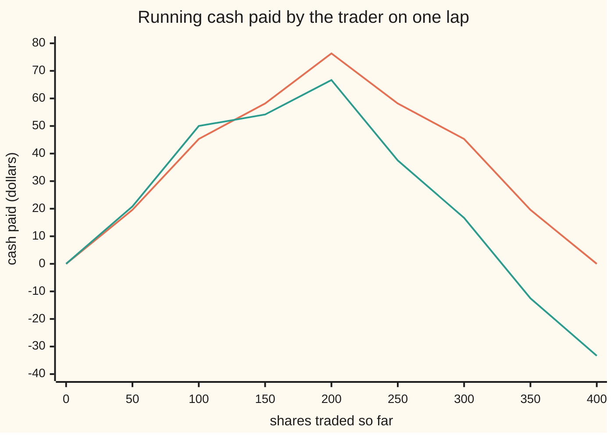
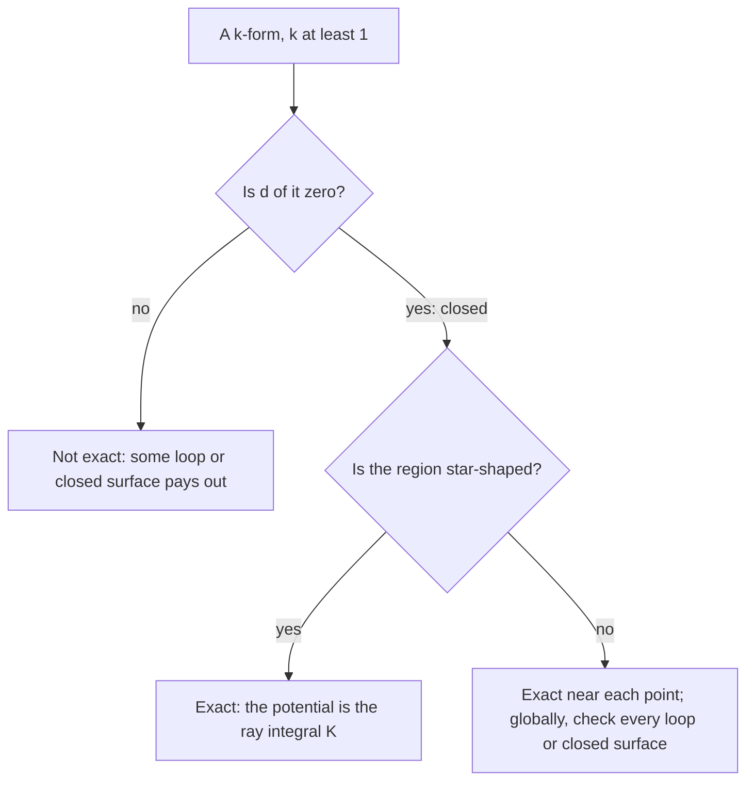

# Closed and exact forms: when a potential exists

[Syllabus](../../../SYLLABUS.md) → [Differential geometry and Lie groups](../README.md) → [Differential Forms](../README.md#s04) → Closed and exact forms

---

## General Overview

A weather market for a valley sells three contracts on tomorrow: Rain, Wind and Calm. Exactly one of them pays $1. A computer program, the **market maker**, quotes a price for each contract and moves the prices as traders buy and sell.

A trader tries a loop. She buys 100 Wind, buys 100 Rain, sells the 100 Wind back, then sells the 100 Rain back. She ends with no shares, exactly where she started. Did she gain cash?

- Against a desk's straight-line pricing rule, she nets $33.33 on every lap. She can repeat it until the market maker runs dry.
- Against the logarithmic cost rule that real prediction markets use, she nets $0.00 on every lap, whatever route she takes.

The second market maker is safe for one reason. Its prices are the slopes of one function, the cost C. Every trade then costs C at the end minus C at the start, so a trade that returns to its start costs nothing. A function whose change gives the payment is a **potential**.

The price list is a **one-form**: a rule that turns a small trade into a cash amount ([Differential form](01-forms-and-the-wedge-product.md)). It is **exact** when it is the change of a potential. It is **closed** when it passes a local test: its cross rates agree (buying Wind moves the Rain price exactly as fast as buying Rain moves the Wind price). Exact always implies closed. The reverse needs a region with no holes, and that is the Poincaré lemma. The same pair of ideas works for forms of every degree, such as the **flux** of wind through a gate across the valley: the air crossing the gate each second.

**A form is closed when its exterior derivative is zero and exact when it is the exterior derivative of another form; every exact form is closed, and on a region with no holes every closed form is exact, with a potential built by integrating along straight rays from one centre point.**

**What kind of fact this is:** two definitions (closed, exact) and a theorem, the Poincaré lemma, proved on this card in Why it works. The test is local. The conclusion "a potential exists" is global and needs a condition on the whole region, here that it is star-shaped; the angle form round a carousel's centre shows the hypothesis cannot be dropped.

### The picture: cash paid round one lap



Orange: the logarithmic cost rule, which climbs and then returns exactly to $0.00. Green: the straight-line rule, which ends at −$33.33, a payment to the trader. Both laps start at no shares sold. The first 200 shares are purchases and the last 200 are sales.

---

## The formula

Notation first, in words.

- The shares sold so far are $`x = (x^1, x^2, x^3)`$ for Rain, Wind and Calm. The raised numbers are labels, not powers.
- The prices are $`p_1, p_2, p_3`$, in dollars per share. Here p is a price, not the momentum of wing 08.
- A **k-form** eats k small arrows and returns a number; $`dx^i`$ is the one-form that reads off the arrow's i-th part, and $`\wedge`$ (wedge) builds higher forms from one-forms ([Differential form](01-forms-and-the-wedge-product.md)).
- The **exterior derivative** $`d`$ turns a k-form into a (k + 1)-form by taking partial rates; $`d(d\alpha) = 0`$ for every form ([Exterior derivative](03-exterior-derivative.md)).
- A region $`U`$ is **star-shaped** about a centre when the straight segment from the centre to each point of $`U`$ stays in $`U`$. A ball, a box and all of space are star-shaped. A plane with one point removed is not.

The price one-form and the two definitions:

```math
\omega = p_1\,dx^1 + p_2\,dx^2 + p_3\,dx^3, \qquad \omega \text{ is closed if } d\omega = 0, \qquad \omega \text{ is exact if } \omega = d\alpha .
```

**Read it aloud:** a small trade costs each price times the shares bought of that contract; the form is closed when its exterior derivative vanishes and exact when it is the exterior derivative of something.

For a one-form, closed means every pair of cross rates agrees:

```math
d\omega = \sum_{i<j}\left(\frac{\partial p_j}{\partial x^i} - \frac{\partial p_i}{\partial x^j}\right) dx^i \wedge dx^j = 0 .
```

**Read it aloud:** for every pair of contracts, the rate at which one price moves when the other contract is bought must equal the reverse rate.

The Poincaré lemma, with its potential written out:

```math
U \text{ star-shaped about } 0,\; d\omega = 0,\; k \ge 1 \;\Rightarrow\; \omega = d(K\omega), \qquad (K\omega)_x = \int_0^1 t^{k-1}\,\omega_{tx}(x, \cdot, \dots, \cdot)\,dt .
```

**Read it aloud:** on a region with no holes, a closed k-form is the exterior derivative of the (k − 1)-form you get by walking out from the centre along the straight ray to each point, feeding the ray's direction into the form's first slot, and weighting by t to the power k − 1. Here $`\omega_{tx}`$ means the form at the point $`tx`$, a fraction t of the way out.

In degree one this is a plain line integral along the ray:

```math
\phi(x) = \int_0^1 \sum_i x^i\, p_i(tx)\,dt .
```

The logarithmic cost rule, with **liquidity** b (how many dollars it takes to move prices a lot), has prices and cost

```math
p_i = \frac{e^{x^i/b}}{e^{x^1/b} + e^{x^2/b} + e^{x^3/b}}, \qquad C(x) = b \ln\left(e^{x^1/b} + e^{x^2/b} + e^{x^3/b}\right) .
```

| Symbol | Plain meaning | In our example | Push it up and the answer… |
| --- | --- | --- | --- |
| $`x = (x^1, x^2, x^3)`$ | shares sold of Rain, Wind, Calm | (60, 30, 0) | that contract's price rises |
| $`p_i`$, $`Z`$ | price of contract i, dollars per share; Z, the sum of the three exponentials | 0.436752, 0.323554, 0.239694; Z = 4.171978 | — |
| $`b`$ | liquidity, dollars | 100 | prices move more slowly |
| $`C`$, $`\phi`$ | cost function; potential from the ray formula | $`C(x) - C(0)`$ = 32.977788 | — |
| $`\omega`$, $`dx^i`$, $`\wedge`$ | the price one-form; the one-form reading the i-th part; wedge | $`p_i\,dx^i`$ summed | — |
| $`d`$ | exterior derivative | $`d\omega = 0`$ for the log rule | — |
| $`k`$ | degree of the form | 1 for prices, 2 for wind flux | weight $`t^{k-1}`$ steepens |
| $`K`$, $`t`$ | Poincaré's ray operator; position along the ray, 0 at the centre, 1 at the point | $`K\omega = \phi`$ in degree 1 | — |
| $`U`$ | the region the form lives on | all of space, star-shaped | a hole can break exactness |
| $`x`$, $`y`$, $`z`$ | km east, north and up in the valley (no raised index) | gate at x = 1 | — |
| $`v`$, $`\beta`$, $`\alpha`$ | wind in m/s; its flux two-form; a potential with $`d\alpha = \beta`$ | $`v = (x, y, -2z)`$; $`\alpha = yz\,dx - xz\,dy`$ | add any closed form to α: still a potential |
| $`M`$, $`N`$; $`f`$, $`dx^I`$ | a plane one-form's two parts ([Exact equations](../../08-Differential%20equations%20and%20dynamics/01-Rate%20Equations/08-exact-equations.md)); one term's coefficient and wedge, in the proof | — | — |

### When it holds

- **Continuous partial rates.** The test compares partial rates, and the ray formula differentiates under an integral. A price rule with jumps can pass the test where it is defined and still pay out round a jump.
- **A star-shaped region, or one that can be smoothly deformed into one.** Round a hole the test passes and exactness fails: the angle form round a carousel's centre gains 6.283185, which is 2π, per lap.
- **Degree at least one.** A closed 0-form is a function with zero rates, so it is constant on each connected piece. There is nothing for it to be the derivative of.
- **The potential is not unique.** Adding any closed (k − 1)-form to a potential gives another; in degree one that is an added constant. Only differences, such as the $32.98 a trade costs, are fixed.

---

## Why it works

### Step 0: shrink the region to its centre, and keep the record

Slide every point of a star-shaped region along its ray toward the centre, and record what the form adds up on the way. That record is the potential. In degree one it is the cash paid buying along the straight ray from no shares.

### Step 1: exact forms are closed

If $`\omega = dC`$ then $`d\omega = d(dC) = 0`$, because mixed partial rates of a smooth function agree ([Exterior derivative](03-exterior-derivative.md)). For the log rule, $`p_i = \partial C/\partial x^i`$, so each cross rate is a mixed second rate of C:

```math
\frac{\partial p_1}{\partial x^2} = \frac{\partial^2 C}{\partial x^2\,\partial x^1} = -\frac{p_1 p_2}{b} = \frac{\partial p_2}{\partial x^1} .
```

At (60, 30, 0) that is −0.001413 both ways. The pairs (Wind, Calm) and (Rain, Calm) give −0.000776 and −0.001047, each matched. The straight-line rule, $`p_i = 1/3 + (x^i - x^{i+1})/300`$ with the labels wrapping round from Calm to Rain, fails: $`\partial p_1/\partial x^2`$ = −0.003333 but $`\partial p_2/\partial x^1`$ = 0.

### Step 2: in degree one, the ray gives a potential

Define $`\phi`$ as the cash paid buying along the straight ray from no shares to x. Differentiate under the integral sign in $`x^j`$:

```math
\frac{\partial \phi}{\partial x^j} = \int_0^1 \Big(p_j(tx) + \sum_i x^i\, t\, \frac{\partial p_i}{\partial x^j}(tx)\Big)\,dt .
```

Closedness lets $`\partial p_i/\partial x^j`$ become $`\partial p_j/\partial x^i`$. The bracket is then $`p_j(tx) + t\,\tfrac{d}{dt}p_j(tx)`$, the rate in t of $`t\,p_j(tx)`$. Its integral from 0 to 1 is $`p_j(x)`$. So $`d\phi = \omega`$.

That is the whole lemma in degree one. The [Conservative fields](../../06-Calculus%20and%20analysis/09-Vector%20Calculus/04-conservative-fields-and-potentials.md) card ran the same cross-rate test in two dimensions and built a potential on a rectangle. The [Exact equations](../../08-Differential%20equations%20and%20dynamics/01-Rate%20Equations/08-exact-equations.md) card used it to solve M dx + N dy = 0 by integrating twice. This card adds the ray formula and every higher degree.

Three roads give the cost of buying 60 Rain and 30 Wind:

| Road | How | Dollars |
| --- | --- | --- |
| closed form | $`C(x) - C(0)`$ | 32.977788 |
| Poincaré ray | Simpson's rule (parabolas fitted through equally spaced samples), 20 steps | 32.977788 |
| staircase | buy all the Rain, then all the Wind | 32.977788 |

The ray integral is a stepped value: its error is 0.0000000546 at 10 steps and 0.0000000034 at 20.

### Step 3: every degree, by one identity

The ray operator K turns k-forms into (k − 1)-forms. On a star-shaped region it satisfies

```math
d(K\omega) + K(d\omega) = \omega \qquad (k \ge 1).
```

For a closed form the second term is zero, so $`\omega = d(K\omega)`$. The proof is a single product-rule step: weighting by $`t^{k-1}`$ makes the integrand the t-rate of $`t^k`$ times the form's coefficient at $`tx`$.

<details>
<summary>Detailed proof: dK + Kd is the identity on a star-shaped region</summary>

It is enough to check one term $`\omega = f\,dx^{i_1} \wedge \dots \wedge dx^{i_k}`$, since both sides are linear. Feeding $`x`$ into the first slot gives

$`\displaystyle K\omega = \sum_{m=1}^{k} (-1)^{m-1} \Big(\int_0^1 t^{k-1} f(tx)\,dt\Big)\, x^{i_m}\, dx^{i_1} \wedge \dots \widehat{dx^{i_m}} \dots \wedge dx^{i_k},`$

where the hat means that factor is left out. Apply d. Each $`d x^{i_m}`$ that lands back in its gap returns the term with sign +1, and there are k of them; the rest are rates of the integral:

$`\displaystyle d(K\omega) = k\Big(\int_0^1 t^{k-1} f(tx)\,dt\Big)\,dx^I + \sum_{j} \sum_{m} (-1)^{m-1} \Big(\int_0^1 t^{k}\,\partial_j f(tx)\,dt\Big)\, x^{i_m}\, dx^j \wedge dx^{I \setminus i_m}.`$

Here $`dx^I`$ is short for $`dx^{i_1} \wedge \dots \wedge dx^{i_k}`$. Now $`d\omega = \sum_j \partial_j f\, dx^j \wedge dx^I`$, a (k + 1)-form, and K of it has weight $`t^k`$:

$`\displaystyle K(d\omega) = \Big(\int_0^1 t^{k} \sum_j x^j\, \partial_j f(tx)\,dt\Big)\,dx^I - \sum_j \sum_m (-1)^{m-1} \Big(\int_0^1 t^{k}\,\partial_j f(tx)\,dt\Big)\, x^{i_m}\, dx^j \wedge dx^{I \setminus i_m}.`$

The double sums cancel. What is left is

$`\displaystyle \Big(\int_0^1 \big(k\,t^{k-1} f(tx) + t^k \sum_j x^j\,\partial_j f(tx)\big)\,dt\Big)\,dx^I = \Big(\int_0^1 \frac{d}{dt}\big(t^k f(tx)\big)\,dt\Big)\,dx^I = f(x)\,dx^I .`$

The last step is the fundamental theorem of calculus, and it needs $`k \ge 1`$ so that $`t^k f(tx)`$ is 0 at $`t = 0`$. Every segment from 0 to x lies in U, which is why the region must be star-shaped.

</details>

### Step 4: degree two, the wind over the valley

Take a simple model, not a measured night: cold air sinking onto the valley floor and spreading sideways, with wind $`v = (x, y, -2z)`$ m/s at the point x km east, y km north and z km up. Its speeds are scaled up for round numbers, far above real sinking air; only the field's shape matters here. (These plain x, y, z are kilometres; the raised-index $`x^i`$ stay share counts.) At (1, 1, 0.5) km the wind is (1, 1, −1) m/s.

The **flux two-form** $`\beta = v_1\,dy \wedge dz + v_2\,dz \wedge dx + v_3\,dx \wedge dy`$ gives the air flow through a small patch of surface. Its exterior derivative is the **divergence**, the net air leaving a small box per unit volume: $`d\beta = (1 + 1 - 2)\,dx \wedge dy \wedge dz = 0`$. So β is closed: no air is created or lost.

The coefficients are linear, so $`\beta_{tx} = t\,\beta_x`$, and with the weight t the ray integral is $`\int_0^1 t^2\,dt = 1/3`$ of β with the position fed in:

```math
\alpha = K\beta = \tfrac{1}{3}\,(v \times x)\cdot dx = yz\,dx - xz\,dy .
```

At (1, 1, 0.5) km, α has parts (0.5, −0.5, 0). Its exterior derivative, computed by finite differences (rates from small steps either side), is (1, 1, −1): the wind again. So $`d\alpha = \beta`$.

What a potential buys: the flux through any surface equals the circulation of α round its edge ([Stokes on manifolds](06-stokes-theorem-on-manifolds.md)). For a gate 1 km by 1 km standing in the plane x = 1 km, the flux by a 40 by 40 grid is 1.000000 (m/s)·km², and the circulation of α round its four edges is 1.000000.

### Step 5: what a hole does

The angle form round a carousel's centre, $`(-y\,dx + x\,dy)/(x^2 + y^2)`$, is defined everywhere except the centre. It is written $`d\theta`$, with θ the angle round the centre, though no single-valued θ exists on the whole punctured plane. The [Conservative fields](../../06-Calculus%20and%20analysis/09-Vector%20Calculus/04-conservative-fields-and-potentials.md) card met it as the whirlpool round a drain. Its cross rates at (1, 2) are 0.120000 and 0.120000, so it is closed. One lap round a square about the centre gives 6.283137 with Simpson's rule at 8 steps a side and 6.283185 at 64 steps: 2π, not 0. No potential exists.

The ray proof fails for a reason that can be pointed at. The plane without its centre is star-shaped about no point: some ray always crosses the missing centre.

Degree two has the same trap. A point source at the origin, $`v = x/\lvert x\rvert^3`$, has divergence 0.000000 at (1, 2, 2), yet its flux out of the unit sphere is 12.568438 on 50 rings and 12.566887 on 100, close to 4π = 12.566371. A two-form that were exact would give 0, since the sphere has no edge. Counting such failures is [de Rham cohomology](08-de-rham-cohomology.md).



---

## Worked numbers, by hand

The log rule with b = $100, after a trader buys 60 Rain and 30 Wind from x = (0, 0, 0).

| Step | Arithmetic | Value |
| --- | --- | --- |
| exponentials | $`e^{0.6}`$, $`e^{0.3}`$, $`e^{0}`$ | 1.822119, 1.349859, 1.000000 |
| their sum Z | 1.822119 + 1.349859 + 1 | 4.171978 |
| prices | each exponential ÷ Z | 0.436752, 0.323554, 0.239694 |
| closed test, Rain and Wind | −0.436752 × 0.323554 ÷ 100, both orders | −0.001413 |
| cost before | 100 × ln 3 | 109.861229 |
| cost after | 100 × ln 4.171978 | 142.839017 |
| cash paid, any route | 142.839017 − 109.861229 | **32.977788** |

The trader pays $32.98 for the 90 shares, whether she buys Rain first, Wind first, or both together along the ray.

### What breaks if you drop a piece

| Mistake | Comes out at | What went wrong |
| --- | --- | --- |
| Straight-line prices, not closed | trader nets 33.333333 per lap | cross rates −0.003333 and 0 differ; defect 0.003333 × area 10,000 |
| Angle form round a carousel's centre | lap gives 6.283185, not 0 | closed, but the region has a hole |
| Point source, closed off the origin | sphere flux 12.566887, near 4π | the hole is in three dimensions now |
| Ray formula without the weight $`t^{k-1}`$ | gate circulation 1.500000, not 1.000000 | the weight is what makes $`d(K\beta) = \beta`$ |

The code prints all four.

---

## Code, from first principles, and it actually runs

The scripts quote prices by the log rule and by the straight-line rule, then test closedness two ways: by central differences and by the formula $`-p_ip_j/b`$. They find the potential by three independent roads: the closed form C, the Poincaré ray integral by Simpson's rule, and a staircase route. Loops are integrated leg by leg and compared with the cross-rate defect times the area. In degree two, α's finite-difference exterior derivative is compared with the wind, and the gate's flux with α's circulation.

### Python

```python
# Closed and exact forms -- the check behind the card.  Standard library only.
# A market maker sells three contracts on tomorrow's weather in a valley: Rain,
# Wind, Calm.  x = (x1, x2, x3) counts shares sold; a trade dx costs the price
# one-form w = p1 dx1 + p2 dx2 + p3 dx3 dollars.  Is w closed?  Exact?  Then the
# same two questions for a two-form: the wind's flux through a gate.
import math

B = 100.0                                         # liquidity, dollars

def lmsr(x, b=B):                                 # prices from the log cost function
    e = [math.exp(xi / b) for xi in x]
    return [ei / sum(e) for ei in e]

def naive(x, s=300):                              # a desk's straight-line rule
    return [1 / 3 + (x[i] - x[(i + 1) % 3]) / s for i in range(3)]

def cost(x):                                      # the potential, in closed form
    return B * math.log(sum(math.exp(xi / B) for xi in x))

def rate(f, x, i, j, h=1e-3):                     # d f_i / d x_j, central difference
    up, dn = list(x), list(x)
    up[j] += h
    dn[j] -= h
    return (f(up)[i] - f(dn)[i]) / (2 * h)

def simpson(g, n):                                # integral of g over [0, 1], n even
    s = g(0.0) + g(1.0) + sum((4 if k % 2 else 2) * g(k / n) for k in range(1, n))
    return s / (3 * n)

def leg(f, a, b, n=20):                           # line integral of f . dx along a to b
    d = [b[i] - a[i] for i in range(len(a))]
    return simpson(lambda t: sum(c * e for c, e in
                                 zip(f([a[i] + t * d[i] for i in range(len(a))]), d)), n)

def route(f, pts, n=20):
    return sum(leg(f, a, b, n) for a, b in zip(pts, pts[1:]))

def radial(f, x, n):                              # Poincare's potential: the straight ray
    return simpson(lambda t: sum(c * e for c, e in zip(f([t * xi for xi in x]), x)), n)

def fx(v):                                        # fixed decimals, never "-0.000000"
    return f"{v + 0.0:.6f}".replace("-0.000000", "0.000000")

x = [60.0, 30.0, 0.0]
p = lmsr(x)
print("trade: buy 60 Rain and 30 Wind from x = (0, 0, 0); b = 100 dollars")
print(f"prices at (60, 30, 0): Rain {fx(p[0])}, Wind {fx(p[1])}, Calm {fx(p[2])}")
ex = [math.exp(xi / B) for xi in x]
print(f"exp(x/b): {', '.join(fx(e) for e in ex)}; sum Z {fx(sum(ex))}; "
      f"C(0) {fx(cost([0, 0, 0]))}, C(x) {fx(cost(x))}")
for i, j in [(0, 1), (1, 2), (0, 2)]:
    print(f"closed test x{i+1},x{j+1}: dp{i+1}/dx{j+1} {fx(rate(lmsr, x, i, j))}, "
          f"dp{j+1}/dx{i+1} {fx(rate(lmsr, x, j, i))}, formula -p{i+1}p{j+1}/b {fx(-p[i] * p[j] / B)}")
exact = cost(x) - cost([0, 0, 0])
stairs = route(lmsr, [[0, 0, 0], [60, 0, 0], [60, 30, 0]])
r10, r20 = radial(lmsr, x, 10), radial(lmsr, x, 20)
print(f"potential C(x) - C(0), closed form: {fx(exact)} dollars")
print(f"radial formula, Simpson 10 / 20 steps: {fx(r10)} / {fx(r20)}")
print(f"radial formula errors, 10 / 20 steps: {abs(r10 - exact):.10f} / {abs(r20 - exact):.10f}")
print(f"staircase route, Rain first then Wind: {fx(stairs)}")
sq = [[0, 0, 0], [0, 100, 0], [100, 100, 0], [100, 0, 0], [0, 0, 0]]
pts = [[sq[k // 2][i] + (k % 2) * (sq[k // 2 + 1][i] - sq[k // 2][i]) / 2 for i in range(3)]
       for k in range(8)] + [sq[4]]
cum_l, cum_n = [0.0], [0.0]
for a, b in zip(pts, pts[1:]):
    cum_l.append(cum_l[-1] + leg(lmsr, a, b))
    cum_n.append(cum_n[-1] + leg(naive, a, b))
print("chart, shares traded: " + ", ".join(str(50 * k) for k in range(9)))
print("chart, cash paid, log-cost maker: " + ", ".join(f"{v + 0.0:.2f}".replace("-0.00", "0.00") for v in cum_l))
print("chart, cash paid, straight-line rule: " + ", ".join(f"{v + 0.0:.2f}".replace("-0.00", "0.00") for v in cum_n))
defect = rate(naive, x, 1, 0) - rate(naive, x, 0, 1)
print(f"straight-line rule: dp1/dx2 {fx(rate(naive, x, 0, 1))}, dp2/dx1 {fx(rate(naive, x, 1, 0))}, "
      f"defect {fx(defect)} per share squared")
print(f"round trip, log-cost maker: trader nets {fx(-cum_l[-1])} dollars")
print(f"round trip, straight-line rule: trader nets {fx(-cum_n[-1])} dollars; "
      f"defect x area {fx(defect * 100 * 100)}")
print(f"reverse lap on the straight-line rule: trader nets {fx(-route(naive, sq[::-1]))}")
lap50, lap150 = -route(lambda c: lmsr(c, 50.0), sq), -route(lambda c: naive(c, 150.0), sq)
print(f"try: b = 50, log-cost lap: trader nets {fx(lap50)}; straight-line rule over 150: trader nets {fx(lap150)}")

def wind(q):                                      # m/s at q in km: air sinking, spreading
    return [q[0], q[1], -2 * q[2]]

def cross(a, b):
    return [a[1] * b[2] - a[2] * b[1], a[2] * b[0] - a[0] * b[2], a[0] * b[1] - a[1] * b[0]]

def alpha(q, weight=True, n=20):                  # K(beta): integral of t^(k-1) (v(tq) x q)
    return [simpson(lambda t: (t if weight else 1) * cross(wind([t * c for c in q]), q)[i], n)
            for i in range(3)]

def curl(f, q):
    r = lambda i, j: rate(f, q, i, j)
    return [r(2, 1) - r(1, 2), r(0, 2) - r(2, 0), r(1, 0) - r(0, 1)]

q = [1.0, 1.0, 0.5]
div = sum(rate(wind, q, i, i) for i in range(3))
print(f"wind at (1, 1, 0.5) km: {', '.join(fx(c) for c in wind(q))} m/s; closed test d(beta) = div {fx(div)}")
a = alpha(q)
print(f"potential alpha = K(beta) at that point: {', '.join(fx(c) for c in a)}; formula (yz, -xz, 0)")
print(f"d(alpha) by finite differences: {', '.join(fx(c) for c in curl(alpha, q))}")
gate = [[1, 0, 0], [1, 1, 0], [1, 1, 1], [1, 0, 1], [1, 0, 0]]
flux = sum(wind([1, (j + 0.5) / 40, (k + 0.5) / 40])[0] for j in range(40) for k in range(40)) / 1600
circ = route(alpha, gate)
bad = route(lambda c: alpha(c, False), gate)
print(f"gate x = 1 km, 1 km by 1 km: flux {fx(flux)}, circulation of alpha {fx(circ)} (m/s)km^2")
print(f"mistake, dropping the t weight: circulation {fx(bad)}")

def angle(c):                                     # d(theta) round a carousel's centre
    r2 = c[0] ** 2 + c[1] ** 2
    return [-c[1] / r2, c[0] / r2]

print(f"angle form at (1, 2): dP/dy {fx(rate(angle, [1, 2], 0, 1))}, dQ/dx {fx(rate(angle, [1, 2], 1, 0))}")
box = [[1, -1], [1, 1], [-1, 1], [-1, -1], [1, -1]]
l8, l64 = route(angle, box, 8), route(angle, box, 64)
print(f"lap round the centre, Simpson 8 / 64 steps a side: {fx(l8)} / {fx(l64)}; 2 pi {fx(2 * math.pi)}")
src = lambda c: [ci / sum(e * e for e in c) ** 1.5 for ci in c]

def sph(n):                                       # flux out of the unit sphere, n rings
    total = 0.0
    for k in range(n):
        ph = (k + 0.5) * math.pi / n
        for m in range(2 * n):
            th = (m + 0.5) * math.pi / n
            c = [math.sin(ph) * math.cos(th), math.sin(ph) * math.sin(th), math.cos(ph)]
            total += sum(u * w for u, w in zip(src(c), c)) * math.sin(ph) * (math.pi / n) ** 2
    return total

print(f"point source: div at (1, 2, 2) {fx(sum(rate(src, [1, 2, 2], i, i) for i in range(3)))}; "
      f"sphere flux 50 / 100 rings {fx(sph(50))} / {fx(sph(100))}; 4 pi {fx(4 * math.pi)}")
assert abs(rate(lmsr, x, 0, 1) - rate(lmsr, x, 1, 0)) < 1e-9          # closed, by differences
assert abs(rate(lmsr, x, 0, 1) + p[0] * p[1] / B) < 1e-8             # against the formula
assert abs(r20 - exact) < 1e-6 and abs(stairs - exact) < 1e-6        # three roads, one potential
assert abs(cum_l[-1]) < 1e-6 and abs(-cum_n[-1] - defect * 1e4) < 1e-6  # loop = defect x area
assert abs(lap50) < 1e-6 and abs(lap150 - 2 * defect * 1e4) < 1e-6     # exact at any b; half the 300, twice the defect
assert all(abs(u - w) < 1e-6 for u, w in zip(a, [q[1] * q[2], -q[0] * q[2], 0]))
assert all(abs(u - w) < 1e-6 for u, w in zip(curl(alpha, q), wind(q)))   # d(alpha) = beta
assert abs(flux - circ) < 1e-9 and abs(bad - 1.5) < 1e-9
assert abs(l64 - 2 * math.pi) < 1e-6 and abs(sph(100) - 4 * math.pi) < 1e-3
print("ALL CHECKS PASS")
```

**Ran 2026-11-19 on macOS, Python 3.14.10, standard library only. All checks passed. Output, pasted from the run:**

```
trade: buy 60 Rain and 30 Wind from x = (0, 0, 0); b = 100 dollars
prices at (60, 30, 0): Rain 0.436752, Wind 0.323554, Calm 0.239694
exp(x/b): 1.822119, 1.349859, 1.000000; sum Z 4.171978; C(0) 109.861229, C(x) 142.839017
closed test x1,x2: dp1/dx2 -0.001413, dp2/dx1 -0.001413, formula -p1p2/b -0.001413
closed test x2,x3: dp2/dx3 -0.000776, dp3/dx2 -0.000776, formula -p2p3/b -0.000776
closed test x1,x3: dp1/dx3 -0.001047, dp3/dx1 -0.001047, formula -p1p3/b -0.001047
potential C(x) - C(0), closed form: 32.977788 dollars
radial formula, Simpson 10 / 20 steps: 32.977788 / 32.977788
radial formula errors, 10 / 20 steps: 0.0000000546 / 0.0000000034
staircase route, Rain first then Wind: 32.977788
chart, shares traded: 0, 50, 100, 150, 200, 250, 300, 350, 400
chart, cash paid, log-cost maker: 0.00, 19.58, 45.28, 58.17, 76.34, 58.17, 45.28, 19.58, 0.00
chart, cash paid, straight-line rule: 0.00, 20.83, 50.00, 54.17, 66.67, 37.50, 16.67, -12.50, -33.33
straight-line rule: dp1/dx2 -0.003333, dp2/dx1 0.000000, defect 0.003333 per share squared
round trip, log-cost maker: trader nets 0.000000 dollars
round trip, straight-line rule: trader nets 33.333333 dollars; defect x area 33.333333
reverse lap on the straight-line rule: trader nets -33.333333
try: b = 50, log-cost lap: trader nets 0.000000; straight-line rule over 150: trader nets 66.666667
wind at (1, 1, 0.5) km: 1.000000, 1.000000, -1.000000 m/s; closed test d(beta) = div 0.000000
potential alpha = K(beta) at that point: 0.500000, -0.500000, 0.000000; formula (yz, -xz, 0)
d(alpha) by finite differences: 1.000000, 1.000000, -1.000000
gate x = 1 km, 1 km by 1 km: flux 1.000000, circulation of alpha 1.000000 (m/s)km^2
mistake, dropping the t weight: circulation 1.500000
angle form at (1, 2): dP/dy 0.120000, dQ/dx 0.120000
lap round the centre, Simpson 8 / 64 steps a side: 6.283137 / 6.283185; 2 pi 6.283185
point source: div at (1, 2, 2) 0.000000; sphere flux 50 / 100 rings 12.568438 / 12.566887; 4 pi 12.566371
ALL CHECKS PASS
```

### Rust

Same numbers, same labels, built with `rustc --edition 2021 -O`.

```rust
// Closed and exact forms -- the same check as the Python, in Rust.  No crates.
// A market maker sells three contracts on tomorrow's weather in a valley: Rain,
// Wind, Calm.  x = (x1, x2, x3) counts shares sold; a trade dx costs the price
// one-form w = p1 dx1 + p2 dx2 + p3 dx3 dollars.  Is w closed?  Exact?  Then the
// same two questions for a two-form: the wind's flux through a gate.
use std::f64::consts::PI;
type F<'a> = &'a dyn Fn(&[f64]) -> Vec<f64>;
const B: f64 = 100.0; // liquidity, dollars

fn lmsr(x: &[f64]) -> Vec<f64> { lmsr_b(x, B) }
fn lmsr_b(x: &[f64], b: f64) -> Vec<f64> { // prices from the log cost function
    let e: Vec<f64> = x.iter().map(|xi| (xi / b).exp()).collect();
    let z: f64 = e.iter().sum();
    e.iter().map(|ei| ei / z).collect()
}
fn naive(x: &[f64]) -> Vec<f64> { naive_s(x, 300.0) }
fn naive_s(x: &[f64], s: f64) -> Vec<f64> { // a desk's straight-line rule
    (0..3).map(|i| 1.0 / 3.0 + (x[i] - x[(i + 1) % 3]) / s).collect()
}
fn cost(x: &[f64]) -> f64 { B * x.iter().map(|xi| (xi / B).exp()).sum::<f64>().ln() }
fn rate(f: F, x: &[f64], i: usize, j: usize) -> f64 { // d f_i / d x_j, central difference
    let h = 1e-3;
    let (mut up, mut dn) = (x.to_vec(), x.to_vec());
    up[j] += h;
    dn[j] -= h;
    (f(&up)[i] - f(&dn)[i]) / (2.0 * h)
}
fn simpson(g: &dyn Fn(f64) -> f64, n: usize) -> f64 { // integral of g over [0, 1], n even
    let mut s = g(0.0) + g(1.0);
    for k in 1..n { s += (if k % 2 == 1 { 4.0 } else { 2.0 }) * g(k as f64 / n as f64) }
    s / (3.0 * n as f64)
}
fn leg(f: F, a: &[f64], b: &[f64], n: usize) -> f64 { // line integral of f . dx, a to b
    let d: Vec<f64> = (0..a.len()).map(|i| b[i] - a[i]).collect();
    simpson(&|t| {
        let m: Vec<f64> = (0..a.len()).map(|i| a[i] + t * d[i]).collect();
        f(&m).iter().zip(&d).map(|(c, e)| c * e).sum()
    }, n)
}
fn route(f: F, pts: &[Vec<f64>], n: usize) -> f64 {
    pts.windows(2).map(|w| leg(f, &w[0], &w[1], n)).sum()
}
fn radial(f: F, x: &[f64], n: usize) -> f64 { // Poincare's potential: the straight ray
    simpson(&|t| {
        let m: Vec<f64> = x.iter().map(|xi| t * xi).collect();
        f(&m).iter().zip(x).map(|(c, e)| c * e).sum()
    }, n)
}
fn fx(v: f64) -> String { format!("{:.6}", v + 0.0).replace("-0.000000", "0.000000") }
fn wind(q: &[f64]) -> Vec<f64> { vec![q[0], q[1], -2.0 * q[2]] } // m/s at q in km
fn cross(a: &[f64], b: &[f64]) -> Vec<f64> {
    vec![a[1] * b[2] - a[2] * b[1], a[2] * b[0] - a[0] * b[2], a[0] * b[1] - a[1] * b[0]]
}
fn alpha(q: &[f64], weight: bool) -> Vec<f64> { // K(beta): integral of t^(k-1) (v(tq) x q)
    (0..3).map(|i| simpson(&|t| {
        let tq: Vec<f64> = q.iter().map(|c| t * c).collect();
        (if weight { t } else { 1.0 }) * cross(&wind(&tq), q)[i]
    }, 20)).collect()
}
fn curl(f: F, q: &[f64]) -> Vec<f64> {
    let r = |i, j| rate(f, q, i, j);
    vec![r(2, 1) - r(1, 2), r(0, 2) - r(2, 0), r(1, 0) - r(0, 1)]
}
fn angle(c: &[f64]) -> Vec<f64> { // d(theta) round a carousel's centre
    let r2 = c[0] * c[0] + c[1] * c[1];
    vec![-c[1] / r2, c[0] / r2]
}
fn src(c: &[f64]) -> Vec<f64> {
    let r3 = c.iter().map(|e| e * e).sum::<f64>().powf(1.5);
    c.iter().map(|ci| ci / r3).collect()
}
fn sph(n: usize) -> f64 { // flux out of the unit sphere, n rings
    let mut total = 0.0;
    for k in 0..n {
        let ph = (k as f64 + 0.5) * PI / n as f64;
        for m in 0..2 * n {
            let th = (m as f64 + 0.5) * PI / n as f64;
            let c = [ph.sin() * th.cos(), ph.sin() * th.sin(), ph.cos()];
            let dot: f64 = src(&c).iter().zip(&c).map(|(u, w)| u * w).sum();
            total += dot * ph.sin() * (PI / n as f64).powi(2);
        }
    }
    total
}
fn join(v: &[f64], f: &dyn Fn(f64) -> String) -> String {
    v.iter().map(|c| f(*c)).collect::<Vec<_>>().join(", ")
}
fn main() {
    let x = vec![60.0, 30.0, 0.0];
    let p = lmsr(&x);
    println!("trade: buy 60 Rain and 30 Wind from x = (0, 0, 0); b = 100 dollars");
    println!("prices at (60, 30, 0): Rain {}, Wind {}, Calm {}", fx(p[0]), fx(p[1]), fx(p[2]));
    let ex: Vec<f64> = x.iter().map(|xi| (xi / B).exp()).collect();
    println!("exp(x/b): {}; sum Z {}; C(0) {}, C(x) {}", join(&ex, &fx), fx(ex.iter().sum()),
             fx(cost(&[0.0, 0.0, 0.0])), fx(cost(&x)));
    for (i, j) in [(0, 1), (1, 2), (0, 2)] {
        println!("closed test x{},x{}: dp{}/dx{} {}, dp{}/dx{} {}, formula -p{}p{}/b {}", i + 1, j + 1,
                 i + 1, j + 1, fx(rate(&lmsr, &x, i, j)), j + 1, i + 1, fx(rate(&lmsr, &x, j, i)),
                 i + 1, j + 1, fx(-p[i] * p[j] / B));
    }
    let exact = cost(&x) - cost(&[0.0, 0.0, 0.0]);
    let stairs = route(&lmsr, &[vec![0.0, 0.0, 0.0], vec![60.0, 0.0, 0.0], vec![60.0, 30.0, 0.0]], 20);
    let (r10, r20) = (radial(&lmsr, &x, 10), radial(&lmsr, &x, 20));
    println!("potential C(x) - C(0), closed form: {} dollars", fx(exact));
    println!("radial formula, Simpson 10 / 20 steps: {} / {}", fx(r10), fx(r20));
    println!("radial formula errors, 10 / 20 steps: {:.10} / {:.10}", (r10 - exact).abs(), (r20 - exact).abs());
    println!("staircase route, Rain first then Wind: {}", fx(stairs));
    let sq: Vec<Vec<f64>> = [[0.0, 0.0], [0.0, 100.0], [100.0, 100.0], [100.0, 0.0], [0.0, 0.0]]
        .iter().map(|c| vec![c[0], c[1], 0.0]).collect();
    let mut pts: Vec<Vec<f64>> = (0..8).map(|k| (0..3).map(|i|
        sq[k / 2][i] + (k % 2) as f64 * (sq[k / 2 + 1][i] - sq[k / 2][i]) / 2.0).collect()).collect();
    pts.push(sq[4].clone());
    let (mut cum_l, mut cum_n) = (vec![0.0], vec![0.0]);
    for w in pts.windows(2) {
        cum_l.push(cum_l.last().unwrap() + leg(&lmsr, &w[0], &w[1], 20));
        cum_n.push(cum_n.last().unwrap() + leg(&naive, &w[0], &w[1], 20));
    }
    let two = |v: f64| format!("{:.2}", v + 0.0).replace("-0.00", "0.00");
    println!("chart, shares traded: {}", (0..9).map(|k| (50 * k).to_string()).collect::<Vec<_>>().join(", "));
    println!("chart, cash paid, log-cost maker: {}", join(&cum_l, &two));
    println!("chart, cash paid, straight-line rule: {}", join(&cum_n, &two));
    let defect = rate(&naive, &x, 1, 0) - rate(&naive, &x, 0, 1);
    println!("straight-line rule: dp1/dx2 {}, dp2/dx1 {}, defect {} per share squared",
             fx(rate(&naive, &x, 0, 1)), fx(rate(&naive, &x, 1, 0)), fx(defect));
    let (net_l, net_n) = (-cum_l[8], -cum_n[8]);
    println!("round trip, log-cost maker: trader nets {} dollars", fx(net_l));
    println!("round trip, straight-line rule: trader nets {} dollars; defect x area {}", fx(net_n), fx(defect * 1e4));
    let rev: Vec<Vec<f64>> = sq.iter().rev().cloned().collect();
    println!("reverse lap on the straight-line rule: trader nets {}", fx(-route(&naive, &rev, 20)));
    let (lap50, lap150) = (-route(&|c: &[f64]| lmsr_b(c, 50.0), &sq, 20), -route(&|c: &[f64]| naive_s(c, 150.0), &sq, 20));
    println!("try: b = 50, log-cost lap: trader nets {}; straight-line rule over 150: trader nets {}", fx(lap50), fx(lap150));
    let q = vec![1.0, 1.0, 0.5];
    let div: f64 = (0..3).map(|i| rate(&wind, &q, i, i)).sum();
    println!("wind at (1, 1, 0.5) km: {} m/s; closed test d(beta) = div {}", join(&wind(&q), &fx), fx(div));
    let a = alpha(&q, true);
    let al = |c: &[f64]| alpha(c, true);
    let da = curl(&al, &q);
    println!("potential alpha = K(beta) at that point: {}; formula (yz, -xz, 0)", join(&a, &fx));
    println!("d(alpha) by finite differences: {}", join(&da, &fx));
    let gate: Vec<Vec<f64>> = [[0.0, 0.0], [1.0, 0.0], [1.0, 1.0], [0.0, 1.0], [0.0, 0.0]]
        .iter().map(|c| vec![1.0, c[0], c[1]]).collect();
    let mut flux = 0.0;
    for j in 0..40 { for k in 0..40 {
        flux += wind(&[1.0, (j as f64 + 0.5) / 40.0, (k as f64 + 0.5) / 40.0])[0];
    } }
    flux /= 1600.0;
    let circ = route(&al, &gate, 20);
    let bad = route(&|c: &[f64]| alpha(c, false), &gate, 20);
    println!("gate x = 1 km, 1 km by 1 km: flux {}, circulation of alpha {} (m/s)km^2", fx(flux), fx(circ));
    println!("mistake, dropping the t weight: circulation {}", fx(bad));
    println!("angle form at (1, 2): dP/dy {}, dQ/dx {}", fx(rate(&angle, &[1.0, 2.0], 0, 1)),
             fx(rate(&angle, &[1.0, 2.0], 1, 0)));
    let bx: Vec<Vec<f64>> = vec![vec![1.0, -1.0], vec![1.0, 1.0], vec![-1.0, 1.0], vec![-1.0, -1.0], vec![1.0, -1.0]];
    let (l8, l64) = (route(&angle, &bx, 8), route(&angle, &bx, 64));
    println!("lap round the centre, Simpson 8 / 64 steps a side: {} / {}; 2 pi {}", fx(l8), fx(l64), fx(2.0 * PI));
    let dsrc: f64 = (0..3).map(|i| rate(&src, &[1.0, 2.0, 2.0], i, i)).sum();
    let (s50, s100) = (sph(50), sph(100));
    println!("point source: div at (1, 2, 2) {}; sphere flux 50 / 100 rings {} / {}; 4 pi {}",
             fx(dsrc), fx(s50), fx(s100), fx(4.0 * PI));
    assert!((rate(&lmsr, &x, 0, 1) - rate(&lmsr, &x, 1, 0)).abs() < 1e-9); // closed, by differences
    assert!((rate(&lmsr, &x, 0, 1) + p[0] * p[1] / B).abs() < 1e-8); // against the formula
    assert!((r20 - exact).abs() < 1e-6 && (stairs - exact).abs() < 1e-6); // three roads, one potential
    assert!(cum_l[8].abs() < 1e-6 && (net_n - defect * 1e4).abs() < 1e-6); // loop = defect x area
    assert!(lap50.abs() < 1e-6 && (lap150 - 2.0 * defect * 1e4).abs() < 1e-6); // exact at any b; half the 300, twice the defect
    assert!((a[0] - q[1] * q[2]).abs() < 1e-6 && (a[1] + q[0] * q[2]).abs() < 1e-6 && a[2].abs() < 1e-6);
    assert!(da.iter().zip(wind(&q)).all(|(u, w)| (u - w).abs() < 1e-6)); // d(alpha) = beta
    assert!((flux - circ).abs() < 1e-9 && (bad - 1.5).abs() < 1e-9);
    assert!((l64 - 2.0 * PI).abs() < 1e-6 && (s100 - 4.0 * PI).abs() < 1e-3);
    println!("ALL CHECKS PASS");
}
```

**Ran 2026-11-19 on macOS, rustc 1.98.1, no crates. All checks passed. Output, pasted from the run:**

```
trade: buy 60 Rain and 30 Wind from x = (0, 0, 0); b = 100 dollars
prices at (60, 30, 0): Rain 0.436752, Wind 0.323554, Calm 0.239694
exp(x/b): 1.822119, 1.349859, 1.000000; sum Z 4.171978; C(0) 109.861229, C(x) 142.839017
closed test x1,x2: dp1/dx2 -0.001413, dp2/dx1 -0.001413, formula -p1p2/b -0.001413
closed test x2,x3: dp2/dx3 -0.000776, dp3/dx2 -0.000776, formula -p2p3/b -0.000776
closed test x1,x3: dp1/dx3 -0.001047, dp3/dx1 -0.001047, formula -p1p3/b -0.001047
potential C(x) - C(0), closed form: 32.977788 dollars
radial formula, Simpson 10 / 20 steps: 32.977788 / 32.977788
radial formula errors, 10 / 20 steps: 0.0000000546 / 0.0000000034
staircase route, Rain first then Wind: 32.977788
chart, shares traded: 0, 50, 100, 150, 200, 250, 300, 350, 400
chart, cash paid, log-cost maker: 0.00, 19.58, 45.28, 58.17, 76.34, 58.17, 45.28, 19.58, 0.00
chart, cash paid, straight-line rule: 0.00, 20.83, 50.00, 54.17, 66.67, 37.50, 16.67, -12.50, -33.33
straight-line rule: dp1/dx2 -0.003333, dp2/dx1 0.000000, defect 0.003333 per share squared
round trip, log-cost maker: trader nets 0.000000 dollars
round trip, straight-line rule: trader nets 33.333333 dollars; defect x area 33.333333
reverse lap on the straight-line rule: trader nets -33.333333
try: b = 50, log-cost lap: trader nets 0.000000; straight-line rule over 150: trader nets 66.666667
wind at (1, 1, 0.5) km: 1.000000, 1.000000, -1.000000 m/s; closed test d(beta) = div 0.000000
potential alpha = K(beta) at that point: 0.500000, -0.500000, 0.000000; formula (yz, -xz, 0)
d(alpha) by finite differences: 1.000000, 1.000000, -1.000000
gate x = 1 km, 1 km by 1 km: flux 1.000000, circulation of alpha 1.000000 (m/s)km^2
mistake, dropping the t weight: circulation 1.500000
angle form at (1, 2): dP/dy 0.120000, dQ/dx 0.120000
lap round the centre, Simpson 8 / 64 steps a side: 6.283137 / 6.283185; 2 pi 6.283185
point source: div at (1, 2, 2) 0.000000; sphere flux 50 / 100 rings 12.568438 / 12.566887; 4 pi 12.566371
ALL CHECKS PASS
```

The two outputs match line for line.

### Lean

Lean proves exact implies closed, the Poincaré lemma in every dimension and degree, and the carousel's angle form, plus five of the card's numbers.

- Suppose $`\omega = d\alpha`$ on an open region, and α has continuous second partial rates. Then $`d\omega = 0`$ there, because d applied twice gives zero.
- Take a closed form ω of degree at least one, with continuous partial rates, on an open region star-shaped about some centre. Then ω is exact: some form α on the region has $`d\alpha = \omega`$.
- The angle form round the carousel's centre is closed: its cross rates agree at every point except the centre. Yet no potential for it exists on the punctured plane.
- Take the straight-line rule's lap of 100 Wind and 100 Rain. Then the trader nets exactly $`1/300 \times 100 \times 100 = 100/3`$ dollars.
- Take the wind $`v = (x, y, -2z)`$. Then its potential α has parts $`(yz, -xz, 0)`$, which is (0.5, −0.5, 0) at (1, 1, 0.5) km.
- With the weight t, the ray integral is $`\int_0^1 t^2\,dt = 1/3`$. Without it, the integral is 1/2, so the gate's circulation comes out 3/2 times too big.

The log-cost prices, the $32.98 cost, the carousel's 6.283185 per lap and the point source's flux are left to the Python and Rust checks.

```lean
-- Closed and exact forms: every exact form is closed, a closed form of degree at least one on a star-shaped open region is exact, and the angle form round a hole is closed but not exact.
import Mathlib.Analysis.Calculus.DifferentialForm.Basic
import Mathlib.Analysis.InnerProductSpace.PiL2
import Mathlib.Analysis.Convex.Star
import Mathlib.Analysis.SpecialFunctions.Integrals.Basic
import Mathlib.LinearAlgebra.CrossProduct
import Mathlib.Analysis.Calculus.ParametricIntervalIntegral

open Set

open ContinuousAlternatingMap in
theorem poincare_alternatize_flip {E : Type*} [NormedAddCommGroup E] [NormedSpace ℝ E] {k : ℕ}
    (C : (E [⋀^Fin (k + 1)]→L[ℝ] ℝ) →L[ℝ] (E →L[ℝ] E [⋀^Fin k]→L[ℝ] ℝ))
    (hC : ∀ f, C f = f.curryLeft)
    (L : E →L[ℝ] E [⋀^Fin (k + 1)]→L[ℝ] ℝ) (u : E)
    (hL : alternatizeUncurryFin L = 0) :
    alternatizeUncurryFin (C.flip u ∘L L) = L u := by
  ext v
  have h0 : alternatizeUncurryFin L (Matrix.vecCons u v) = 0 := by rw [hL]; rfl
  simp only [alternatizeUncurryFin_apply] at h0 ⊢
  rw [Fin.sum_univ_succ] at h0
  have hr : ∀ i : Fin (k + 1), Fin.removeNth i.succ (Matrix.vecCons u v) =
      Matrix.vecCons u (Fin.removeNth i v) := by
    intro i; ext j; refine Fin.cases ?_ (fun j => ?_) j <;> simp [Fin.removeNth_apply]
  simp [hr, pow_succ] at h0
  simp [hC]
  linarith

open Metric in
open scoped Interval in
theorem poincare_hasFDerivAt_integral {E : Type*} [NormedAddCommGroup E] [NormedSpace ℝ E]
    [FiniteDimensional ℝ E] {k : ℕ} {U : Set E} {c : E} (hU : IsOpen U)
    (hseg : ∀ x ∈ U, ∀ t ∈ Icc (0:ℝ) 1, c + t • (x - c) ∈ U)
    (ω : E → E [⋀^Fin (k + 1)]→L[ℝ] ℝ) (hω : ContDiffOn ℝ 1 ω U)
    (C : (E [⋀^Fin (k + 1)]→L[ℝ] ℝ) →L[ℝ] (E →L[ℝ] E [⋀^Fin k]→L[ℝ] ℝ))
    {x₀ : E} (hx₀ : x₀ ∈ U) :
    ContinuousOn (fun t : ℝ => (t ^ k) • (C (ω (c + t • (x₀ - c))) +
          t • (C.flip (x₀ - c) ∘L fderiv ℝ ω (c + t • (x₀ - c))))) (Icc 0 1) ∧
    HasFDerivAt (fun x => ∫ t in (0:ℝ)..1, (t ^ k) • C (ω (c + t • (x - c))) (x - c))
      (∫ t in (0:ℝ)..1, (t ^ k) • (C (ω (c + t • (x₀ - c))) +
          t • (C.flip (x₀ - c) ∘L fderiv ℝ ω (c + t • (x₀ - c))))) x₀ := by
  let _ : NormedAddCommGroup (E →L[ℝ] E [⋀^Fin k]→L[ℝ] ℝ) := inferInstance
  have hωc : ContinuousOn ω U := hω.continuousOn
  have hDc : ContinuousOn (fderiv ℝ ω) U := hω.continuousOn_fderiv_of_isOpen hU le_rfl
  have hωd : ∀ z ∈ U, HasFDerivAt ω (fderiv ℝ ω z) z := fun z hz =>
    ((hω.differentiableOn one_ne_zero).differentiableAt (hU.mem_nhds hz)).hasFDerivAt
  have hgc : Continuous (fun p : E × ℝ => c + p.2 • (p.1 - c)) := by fun_prop
  have hK : IsCompact ((fun t : ℝ => c + t • (x₀ - c)) '' Icc 0 1) :=
    isCompact_Icc.image (by fun_prop)
  have hKU : (fun t : ℝ => c + t • (x₀ - c)) '' Icc 0 1 ⊆ U := by
    rintro _ ⟨t, ht, rfl⟩; exact hseg x₀ hx₀ t ht
  obtain ⟨δ, δpos, hδ⟩ := hK.exists_cthickening_subset_open hU hKU
  have hyU : ∀ p ∈ closedBall x₀ δ ×ˢ Icc (0:ℝ) 1, c + p.2 • (p.1 - c) ∈ U := by
    rintro ⟨x, t⟩ ⟨hx, ht⟩
    apply hδ
    refine Metric.mem_cthickening_of_dist_le _ (c + t • (x₀ - c)) δ
      ((fun t : ℝ => c + t • (x₀ - c)) '' Icc 0 1) (mem_image_of_mem _ ht) ?_
    rw [dist_eq_norm]
    have : c + t • (x - c) - (c + t • (x₀ - c)) = t • (x - x₀) := by
      simp only [smul_sub]; abel
    rw [this, norm_smul, Real.norm_eq_abs, abs_of_nonneg ht.1, ← dist_eq_norm]
    have := mem_closedBall.1 hx
    calc t * dist x x₀ ≤ 1 * δ := mul_le_mul ht.2 this dist_nonneg zero_le_one
      _ = δ := one_mul δ
  set S := closedBall x₀ δ ×ˢ Icc (0:ℝ) 1 with hS
  have hSc : IsCompact S := (isCompact_closedBall x₀ δ).prod isCompact_Icc
  have hmaps : MapsTo (fun p : E × ℝ => c + p.2 • (p.1 - c)) S U := hyU
  have hω' : ContinuousOn (fun p : E × ℝ => ω (c + p.2 • (p.1 - c))) S :=
    hωc.comp hgc.continuousOn hmaps
  have hD' : ContinuousOn (fun p : E × ℝ => fderiv ℝ ω (c + p.2 • (p.1 - c))) S :=
    hDc.comp hgc.continuousOn hmaps
  have hF'c : ContinuousOn (fun p : E × ℝ => (p.2 ^ k) • (C (ω (c + p.2 • (p.1 - c))) +
          p.2 • (C.flip (p.1 - c) ∘L fderiv ℝ ω (c + p.2 • (p.1 - c))))) S := by
    apply ContinuousOn.fun_smul (by fun_prop)
    apply ContinuousOn.add (C.continuous.comp_continuousOn hω')
    apply ContinuousOn.fun_smul (by fun_prop)
    have h1 : ContinuousOn (fun p : E × ℝ => C.flip (p.1 - c)) S :=
      (C.flip.continuous.comp (by fun_prop : Continuous fun p : E × ℝ => p.1 - c)).continuousOn
    exact h1.clm_comp hD'
  have hFc : ContinuousOn
      (fun p : E × ℝ => (p.2 ^ k) • C (ω (c + p.2 • (p.1 - c))) (p.1 - c)) S := by
    apply ContinuousOn.fun_smul (by fun_prop)
    exact (C.continuous.comp_continuousOn hω').clm_apply (by fun_prop)
  obtain ⟨B, hB⟩ := IsCompact.exists_bound_of_continuousOn
    (E := E →L[ℝ] E [⋀^Fin k]→L[ℝ] ℝ) hSc hF'c
  have hIoc : Ι (0:ℝ) 1 ⊆ Icc 0 1 := by
    intro t ht; rw [uIoc_of_le zero_le_one] at ht; exact ⟨ht.1.le, ht.2⟩
  have hFx : ∀ x ∈ closedBall x₀ δ, ContinuousOn
      (fun t : ℝ => (t ^ k) • C (ω (c + t • (x - c))) (x - c)) (Icc 0 1) :=
    fun x hx => hFc.comp (Continuous.continuousOn (by fun_prop : Continuous fun t : ℝ => (x, t)))
      (fun t ht => ⟨hx, ht⟩)
  have hF'x : ∀ x ∈ closedBall x₀ δ, ContinuousOn
      (fun t : ℝ => (t ^ k) • (C (ω (c + t • (x - c))) +
          t • (C.flip (x - c) ∘L fderiv ℝ ω (c + t • (x - c))))) (Icc 0 1) :=
    fun x hx => hF'c.comp (Continuous.continuousOn (by fun_prop : Continuous fun t : ℝ => (x, t)))
      (fun t ht => ⟨hx, ht⟩)
  have hx₀b : x₀ ∈ closedBall x₀ δ := mem_closedBall_self δpos.le
  refine ⟨hF'x x₀ hx₀b, ?_⟩
  refine intervalIntegral.hasFDerivAt_integral_of_dominated_of_fderiv_le (𝕜 := ℝ) (bound := fun _ => B)
    (F := fun x t => (t ^ k) • C (ω (c + t • (x - c))) (x - c))
    (F' := fun x t => (t ^ k) • (C (ω (c + t • (x - c))) +
          t • (C.flip (x - c) ∘L fderiv ℝ ω (c + t • (x - c)))))
    (ball_mem_nhds x₀ δpos) ?_ ?_ ?_ ?_ ?_ ?_
  · filter_upwards [ball_mem_nhds x₀ δpos] with x hx
    exact ((hFx x (ball_subset_closedBall hx)).mono hIoc).aestronglyMeasurable measurableSet_uIoc
  · exact (hFx x₀ hx₀b).intervalIntegrable_of_Icc zero_le_one
  · exact ((hF'x x₀ hx₀b).mono hIoc).aestronglyMeasurable measurableSet_uIoc
  · refine Filter.Eventually.of_forall (fun t ht x hx => ?_)
    exact hB (x, t) ⟨ball_subset_closedBall hx, hIoc ht⟩
  · exact intervalIntegrable_const
  · refine Filter.Eventually.of_forall (fun t ht x hx => ?_)
    have hyx : c + t • (x - c) ∈ U := hyU (x, t) ⟨ball_subset_closedBall hx, hIoc ht⟩
    have h1 : HasFDerivAt (fun x : E => c + t • (x - c)) (t • ContinuousLinearMap.id ℝ E) x :=
      (((hasFDerivAt_id x).sub_const c).const_smul t).const_add c
    have h2 := ((C.hasFDerivAt.comp x ((hωd _ hyx).comp x h1)).clm_apply
      ((hasFDerivAt_id x).sub_const c)).const_smul (t ^ k)
    convert h2 using 1
    all_goals try rfl
    ext h v
    simp

#print axioms poincare_alternatize_flip
#print axioms poincare_hasFDerivAt_integral

/-- The Poincaré lemma: on an open region of `ℝ^m` that is star-shaped about a centre `c`,
a differential form of degree `k + 1 ≥ 1` with continuous partial rates whose exterior
derivative is zero (a closed form) is the exterior derivative of some `k`-form `α`
(an exact form): a potential exists. -/
theorem closed_form_on_star_shaped_region_is_exact {m k : ℕ}
    {U : Set (EuclideanSpace ℝ (Fin m))} {c : EuclideanSpace ℝ (Fin m)}
    (hU : IsOpen U) (hstar : StarConvex ℝ c U)
    (ω : EuclideanSpace ℝ (Fin m) → EuclideanSpace ℝ (Fin m) [⋀^Fin (k + 1)]→L[ℝ] ℝ)
    (hω : ContDiffOn ℝ 1 ω U) (hclosed : ∀ x ∈ U, extDeriv ω x = 0) :
    ∃ α : EuclideanSpace ℝ (Fin m) → EuclideanSpace ℝ (Fin m) [⋀^Fin k]→L[ℝ] ℝ,
      DifferentiableOn ℝ α U ∧ ∀ x ∈ U, extDeriv α x = ω x := by
  set C := (ContinuousAlternatingMap.curryLeftLI (𝕜 := ℝ) (E := EuclideanSpace ℝ (Fin m))
    (F := ℝ) (n := k)).toContinuousLinearMap with hCdef
  have hC : ∀ f, C f = f.curryLeft := fun f => rfl
  have hseg : ∀ x ∈ U, ∀ t ∈ Icc (0:ℝ) 1, c + t • (x - c) ∈ U :=
    fun x hx t ht => hstar.add_smul_sub_mem hx ht.1 ht.2
  refine ⟨fun x => ∫ t in (0:ℝ)..1, (t ^ k) • C (ω (c + t • (x - c))) (x - c), ?_, ?_⟩
  · intro x hx
    exact (poincare_hasFDerivAt_integral hU hseg ω hω C hx).2.differentiableAt.differentiableWithinAt
  · intro x hx
    obtain ⟨hcont, hd⟩ := poincare_hasFDerivAt_integral hU hseg ω hω C hx
    have hint := ContinuousOn.intervalIntegrable_of_Icc (μ := MeasureTheory.volume)
      (E := EuclideanSpace ℝ (Fin m) →L[ℝ] EuclideanSpace ℝ (Fin m) [⋀^Fin k]→L[ℝ] ℝ) zero_le_one hcont
    unfold extDeriv
    rw [hd.fderiv, ← ContinuousAlternatingMap.alternatizeUncurryFinCLM_apply]
    have hcomm := ContinuousLinearMap.intervalIntegral_comp_comm (𝕜 := ℝ)
      (E := EuclideanSpace ℝ (Fin m) →L[ℝ] EuclideanSpace ℝ (Fin m) [⋀^Fin k]→L[ℝ] ℝ)
      (F := EuclideanSpace ℝ (Fin m) [⋀^Fin (k + 1)]→L[ℝ] ℝ)
      (ContinuousAlternatingMap.alternatizeUncurryFinCLM ℝ (EuclideanSpace ℝ (Fin m)) ℝ (n := k))
      hint
    refine hcomm.symm.trans ?_
    simp only [ContinuousAlternatingMap.alternatizeUncurryFinCLM_apply]
    have hyU : ∀ t ∈ uIcc (0:ℝ) 1, c + t • (x - c) ∈ U := fun t ht =>
      hseg x hx t (by rwa [uIcc_of_le zero_le_one] at ht)
    have hωd : ∀ z ∈ U, HasFDerivAt ω (fderiv ℝ ω z) z := fun z hz =>
      ((hω.differentiableOn one_ne_zero).differentiableAt (hU.mem_nhds hz)).hasFDerivAt
    have key : ∀ t ∈ uIcc (0:ℝ) 1, ContinuousAlternatingMap.alternatizeUncurryFin
        ((t ^ k) • (C (ω (c + t • (x - c))) +
          t • (C.flip (x - c) ∘L fderiv ℝ ω (c + t • (x - c))))) =
        (t ^ (k + 1)) • fderiv ℝ ω (c + t • (x - c)) (x - c) +
          ((↑(k + 1) : ℝ) * t ^ (k + 1 - 1)) • ω (c + t • (x - c)) := by
      intro t ht
      have hcl : ContinuousAlternatingMap.alternatizeUncurryFin
          (fderiv ℝ ω (c + t • (x - c))) = 0 := hclosed _ (hyU t ht)
      have h1 := poincare_alternatize_flip C hC (fderiv ℝ ω (c + t • (x - c))) (x - c) hcl
      simp only [ContinuousAlternatingMap.alternatizeUncurryFin_smul,
        ContinuousAlternatingMap.alternatizeUncurryFin_add, h1, hC,
        ContinuousAlternatingMap.alternatizeUncurryFin_curryLeft]
      ext v
      simp
      ring
    rw [intervalIntegral.integral_congr key]
    have hderiv : ∀ t ∈ uIcc (0:ℝ) 1,
        HasDerivAt (fun t : ℝ => (t ^ (k + 1)) • ω (c + t • (x - c)))
        ((t ^ (k + 1)) • fderiv ℝ ω (c + t • (x - c)) (x - c) +
          ((↑(k + 1) : ℝ) * t ^ (k + 1 - 1)) • ω (c + t • (x - c))) t := by
      intro t ht
      have hl : HasDerivAt (fun t : ℝ => c + t • (x - c)) (x - c) t := by
        simpa using ((hasDerivAt_id t).smul_const (x - c)).const_add c
      exact (hasDerivAt_pow (k + 1) t).smul ((hωd _ (hyU t ht)).comp_hasDerivAt t hl)
    have hcont2 : ContinuousOn (fun t : ℝ => (t ^ (k + 1)) • fderiv ℝ ω (c + t • (x - c)) (x - c) +
        ((↑(k + 1) : ℝ) * t ^ (k + 1 - 1)) • ω (c + t • (x - c))) (uIcc 0 1) := by
      have hDc : ContinuousOn (fderiv ℝ ω) U := hω.continuousOn_fderiv_of_isOpen hU le_rfl
      have hl : ContinuousOn (fun t : ℝ => c + t • (x - c)) (uIcc 0 1) := by fun_prop
      have hm : MapsTo (fun t : ℝ => c + t • (x - c)) (uIcc 0 1) U := hyU
      apply ContinuousOn.add
      · exact (continuousOn_pow _).smul ((hDc.comp hl hm).clm_apply continuousOn_const)
      · exact (by fun_prop : ContinuousOn (fun t : ℝ => ((↑(k + 1) : ℝ) * t ^ (k + 1 - 1))) _).smul
          (hω.continuousOn.comp hl hm)
    rw [intervalIntegral.integral_eq_sub_of_hasDerivAt hderiv hcont2.intervalIntegrable]
    simp

/-- Every exact form is closed: if `ω = dα` on an open region, where the potential `α` has
continuous second partial rates, then `dω = 0` there, because `d(dα) = 0`. -/
theorem exact_form_is_closed {m k : ℕ} {U : Set (EuclideanSpace ℝ (Fin m))} (hU : IsOpen U)
    (α : EuclideanSpace ℝ (Fin m) → EuclideanSpace ℝ (Fin m) [⋀^Fin k]→L[ℝ] ℝ)
    (hα : ContDiffOn ℝ 2 α U)
    (ω : EuclideanSpace ℝ (Fin m) → EuclideanSpace ℝ (Fin m) [⋀^Fin (k + 1)]→L[ℝ] ℝ)
    (hexact : ∀ x ∈ U, ω x = extDeriv α x) :
    ∀ x ∈ U, extDeriv ω x = 0 := by
  intro x hx
  have h1 : ω =ᶠ[nhds x] extDeriv α :=
    Filter.eventually_of_mem (hU.mem_nhds hx) hexact
  rw [h1.extDeriv_eq]
  exact extDeriv_extDeriv_apply (hα.contDiffAt (hU.mem_nhds hx)) (by simp)

/-- The angle form round a carousel's centre, `(-y dx + x dy) / (x² + y²)`, written as the
linear map it applies to a small step `(dx, dy)` at the point `p = (x, y)`. -/
noncomputable def angleForm (p : ℝ × ℝ) : ℝ × ℝ →L[ℝ] ℝ :=
  (p.1 ^ 2 + p.2 ^ 2)⁻¹ •
    (p.1 • ContinuousLinearMap.snd ℝ ℝ ℝ - p.2 • ContinuousLinearMap.fst ℝ ℝ ℝ)

/-- What a hole does: on the plane with its centre removed, the angle form is closed (its
cross rates agree: its derivative is symmetric at every point other than the centre), yet
it is not exact: no function on the punctured plane has it as its derivative. -/
theorem angle_form_closed_but_not_exact :
    (∀ p : ℝ × ℝ, p ≠ 0 → ∀ u v : ℝ × ℝ, fderiv ℝ angleForm p u v = fderiv ℝ angleForm p v u) ∧
    ¬ ∃ f : ℝ × ℝ → ℝ, ∀ p : ℝ × ℝ, p ≠ 0 → HasFDerivAt f (angleForm p) p := by
  constructor
  · intro p hp u v
    have hN : p.1 ^ 2 + p.2 ^ 2 ≠ 0 := by
      intro h
      apply hp
      have h1 : p.1 = 0 := by nlinarith [sq_nonneg p.1, sq_nonneg p.2]
      have h2 : p.2 = 0 := by nlinarith [sq_nonneg p.1, sq_nonneg p.2]
      exact Prod.ext h1 h2
    have hNd : HasFDerivAt (fun q : ℝ × ℝ => q.1 ^ 2 + q.2 ^ 2)
        ((2 * p.1) • ContinuousLinearMap.fst ℝ ℝ ℝ + (2 * p.2) • ContinuousLinearMap.snd ℝ ℝ ℝ) p := by
      have h1 : HasFDerivAt (fun q : ℝ × ℝ => q.1 ^ 2) _ p := (hasFDerivAt_fst (𝕜 := ℝ) (E := ℝ) (F := ℝ) (p := p)).pow 2
      have h2 : HasFDerivAt (fun q : ℝ × ℝ => q.2 ^ 2) _ p := (hasFDerivAt_snd (𝕜 := ℝ) (E := ℝ) (F := ℝ) (p := p)).pow 2
      convert h1.add h2 using 1
      ext <;> simp
    have hL : HasFDerivAt (fun q : ℝ × ℝ => q.1 • ContinuousLinearMap.snd ℝ ℝ ℝ - q.2 • ContinuousLinearMap.fst ℝ ℝ ℝ)
        ((ContinuousLinearMap.fst ℝ ℝ ℝ).smulRight (ContinuousLinearMap.snd ℝ ℝ ℝ) -
          (ContinuousLinearMap.snd ℝ ℝ ℝ).smulRight (ContinuousLinearMap.fst ℝ ℝ ℝ)) p :=
      by
        have h1 : HasFDerivAt (fun q : ℝ × ℝ => q.1 • ContinuousLinearMap.snd ℝ ℝ ℝ) _ p :=
          (hasFDerivAt_fst (𝕜 := ℝ) (E := ℝ) (F := ℝ) (p := p)).smul_const (ContinuousLinearMap.snd ℝ ℝ ℝ)
        have h2 : HasFDerivAt (fun q : ℝ × ℝ => q.2 • ContinuousLinearMap.fst ℝ ℝ ℝ) _ p :=
          (hasFDerivAt_snd (𝕜 := ℝ) (E := ℝ) (F := ℝ) (p := p)).smul_const (ContinuousLinearMap.fst ℝ ℝ ℝ)
        exact h1.sub h2
    have h := ((hasFDerivAt_inv hN).comp p hNd).smul hL
    have hA : HasFDerivAt angleForm _ p := h
    rw [hA.fderiv]
    simp
    field_simp
    ring
  · rintro ⟨f, hf⟩
    have hγ : ∀ t : ℝ, HasDerivAt (fun t => f (Real.cos t, Real.sin t)) 1 t := by
      intro t
      have hne : (Real.cos t, Real.sin t) ≠ 0 := by
        intro h
        have h1 := congrArg Prod.fst h
        have h2 := congrArg Prod.snd h
        simp at h1 h2
        have := Real.cos_sq_add_sin_sq t
        rw [h1, h2] at this; norm_num at this
      have hd := (hf _ hne).comp_hasDerivAt t ((Real.hasDerivAt_cos t).prodMk (Real.hasDerivAt_sin t))
      have h1 : angleForm (Real.cos t, Real.sin t) (-Real.sin t, Real.cos t) = 1 := by
        have := Real.cos_sq_add_sin_sq t
        simp [angleForm, this]
        nlinarith [this]
      rw [h1] at hd
      exact hd
    have hg : ∀ t : ℝ, HasDerivAt (fun t => f (Real.cos t, Real.sin t) - t) 0 t := by
      intro t
      have := (hγ t).sub (hasDerivAt_id' t)
      simp only [sub_self] at this
      exact this
    have hconst := is_const_of_deriv_eq_zero (f := fun t => f (Real.cos t, Real.sin t) - t)
      (fun t => (hg t).differentiableAt) (fun t => (hg t).deriv) (2 * Real.pi) 0
    simp at hconst

-- The straight-line rule p_i = 1/3 + (x^i - x^(i+1))/300 round the lap: buy 100 Wind
-- (Wind price 1/3 + w/300, w from 0 to 100), buy 100 Rain (Rain price 1/3 + (r - 100)/300),
-- sell the Wind (price 1/3 + w/300, w from 100 to 0), sell the Rain (price 1/3 + r/300,
-- r from 100 to 0). The trader pays -100/3 dollars, that is she nets 100/3 = 33.33 dollars,
-- which is the defect 1/300 times the area 100 × 100.
example :
    (∫ w in (0 : ℝ)..100, (1 / 3 + w / 300)) + (∫ r in (0 : ℝ)..100, (1 / 3 + (r - 100) / 300))
      + (∫ w in (100 : ℝ)..0, (1 / 3 + w / 300)) + (∫ r in (100 : ℝ)..0, (1 / 3 + r / 300))
      = -(1 / 300 * (100 * 100)) := by
  norm_num [intervalIntegral.integral_comp_div, integral_id, intervalIntegral.integral_add,
    intervalIntegral.integral_sub, intervalIntegral.integral_div,
    intervalIntegral.integral_comp_sub_right (fun r : ℝ => 1 / 3 + r / 300)]

-- The ray weight in degree two: β at t·x is t·β at x, and with the weight t the ray integral
-- is the integral of t² from 0 to 1, which is 1/3.
example : ∫ t in (0 : ℝ)..1, t ^ 2 = 1 / 3 := by
  norm_num [integral_pow]

-- The mistake of dropping the weight: the integral of t is 1/2, so the gate's circulation
-- comes out 3/2 times too big (1.5 instead of 1).
example : (∫ t in (0 : ℝ)..1, t) / (∫ t in (0 : ℝ)..1, t ^ 2) = 3 / 2 := by
  norm_num [integral_pow, integral_id]

-- The wind v = (x, y, -2z): its divergence 1 + 1 - 2 is zero, and the potential
-- α = (1/3)(v × position) has parts (yz, -xz, 0).
example (x y z : ℝ) :
    (1 / 3 : ℝ) • crossProduct ![x, y, -2 * z] ![x, y, z] = ![y * z, -(x * z), 0] := by
  ext i; fin_cases i <;> simp [cross_apply] <;> ring

-- At (1, 1, 1/2) km the wind is (1, 1, -1) m/s and α has parts (1/2, -1/2, 0).
example : (1 / 3 : ℚ) • crossProduct ![(1 : ℚ), 1, -1] ![1, 1, 1 / 2] = ![1 / 2, -1 / 2, 0] := by
  ext i; fin_cases i <;> simp [cross_apply] <;> norm_num

#print axioms closed_form_on_star_shaped_region_is_exact
#print axioms exact_form_is_closed
#print axioms angle_form_closed_but_not_exact
```

**Checked 2026-11-19 on macOS, Lean 4.36.0-rc2, Mathlib v4.36.0-rc2. Every proof is complete and uses only Lean's standard axioms. Output, pasted from the run:**

```
'poincare_alternatize_flip' depends on axioms: [propext, Classical.choice, Quot.sound]
'poincare_hasFDerivAt_integral' depends on axioms: [propext, Classical.choice, Quot.sound]
'closed_form_on_star_shaped_region_is_exact' depends on axioms: [propext, Classical.choice, Quot.sound]
'exact_form_is_closed' depends on axioms: [propext, Classical.choice, Quot.sound]
'angle_form_closed_but_not_exact' depends on axioms: [propext, Classical.choice, Quot.sound]
```

> [!TIP]
> **Try changing**
> - Guess first: set `B` to 50. Does the log rule's lap still net $0? Yes, 0.000000: the cross rates still agree, so the form stays exact for every liquidity; only the prices along the way change.
> - Guess first: run the lap backwards on the straight-line rule. The trader now nets −33.333333: the sign of a loop integral follows its direction.
> - Guess first: change the straight-line rule's 300 to 150. The defect doubles, so the lap pays the trader 66.666667, twice $33.33.
> - Guess first: give the carousel lap 8 Simpson steps a side instead of 64. It reads 6.283137, short of 2π by a stepping error, not by any change in the form.

---

## The usual mistake

> [!warning]
> **Closed is not the same as exact.** The test is local; exactness is global. The angle form passes the test at every point, 0.120000 against 0.120000 at (1, 2), yet one lap round the carousel's centre gives 6.283185. Before claiming a potential, name a centre from which every ray stays in the region.
>
> - **Reading the potential as the price.** C(x) = 142.839017 is not what the trader pays. The payment is the change, 142.839017 − 109.861229 = 32.977788.
> - **Dropping the weight in higher degree.** Without $`t^{k-1}`$ the ray formula for the wind gives a gate circulation of 1.500000 instead of the true flux 1.000000.
> - **Ignoring direction.** The same straight-line lap run backwards nets −33.333333: the trader loses what the forward lap gains.
> - **Trusting a stepped number to the last digit.** Simpson's rule at 8 steps a side gives 6.283137 for the carousel lap; the exact 2π shows only as the steps grow.

---

## Where you meet it in real life

- **Prediction markets.** Hanson's logarithmic market scoring rule prices contracts as the slopes of one cost function, so no sequence of trades that returns to its start can drain the market maker.
- **Currency exchange.** Exchange rates leave no profitable cycle exactly when each currency has one value level and every rate is a ratio of two of them: a discrete exact form.
- **Thermodynamics.** Heat added is not an exact form, so a heat engine can gain work round a cycle. For reversible changes, heat divided by temperature is exact, and its potential is entropy.
- **Electromagnetism.** The field two-form has zero exterior derivative, so on a region with no holes it is d of a potential one-form ([Hodge star](09-hodge-star-and-maxwell-in-forms.md)).
- **Wind and water flow.** A flow with no sources has a closed flux form; its potential, a stream function in two dimensions, draws the streamlines meteorologists plot.

> **Say it back**
> A form is closed when its exterior derivative is zero, and exact when it is the exterior derivative of another form. Exact forms are always closed, because d applied twice gives zero. On a star-shaped region every closed form of degree one or more is exact, and the potential is the integral along straight rays from the centre, weighted by t to the power k − 1. The log-cost market maker's prices form an exact one-form, so every round trip nets $0, while the straight-line rule pays $33.33 a lap. A hole, like the carousel's centre, lets a closed form fail to be exact.

---

## What this builds on

- [Exterior derivative](03-exterior-derivative.md): the operator d, and d applied twice is zero, which makes every exact form closed.
- [Conservative fields](../../06-Calculus%20and%20analysis/09-Vector%20Calculus/04-conservative-fields-and-potentials.md): the cross-rate test and the whirlpool's 2π, the one-form case in the plane.
- [Exact equations](../../08-Differential%20equations%20and%20dynamics/01-Rate%20Equations/08-exact-equations.md): the same test used to solve M dx + N dy = 0 by integrating twice.

## Where this goes next

- [Integration on an oriented manifold](05-integration-on-manifolds.md): integrating forms over curves, surfaces and solids, which turns a potential into a boundary value.
- [Stokes on manifolds](06-stokes-theorem-on-manifolds.md): why the flux through the gate equals α's circulation round its edge.
- [de Rham cohomology](08-de-rham-cohomology.md): closed forms modulo exact ones, a count of the holes.
- [Darboux's theorem](11-darboux-theorem-and-the-moser-trick.md): every symplectic form looks the same up close.

On a region with holes, how many genuinely different closed forms fail to be exact, and does that number depend on anything but the shape?

---

## Sources

Verified 2026-11-19: every link below resolves to the publisher's page.

- Lee, John M. *Introduction to Smooth Manifolds*, 2nd ed. Springer, 2012. [DOI 10.1007/978-1-4419-9982-5](https://doi.org/10.1007/978-1-4419-9982-5). Closed and exact forms, and the Poincaré lemma on star-shaped sets.
- Bott, Raoul, and Loring W. Tu. *Differential Forms in Algebraic Topology*. Springer, 1982. [DOI 10.1007/978-1-4757-3951-0](https://doi.org/10.1007/978-1-4757-3951-0). The Poincaré lemma proved by a homotopy operator, the method of Step 3.
- Hanson, Robin. "Combinatorial Information Market Design." *Information Systems Frontiers* 5, no. 1 (2003): 107–119. [DOI 10.1023/A:1022058209073](https://doi.org/10.1023/A:1022058209073). The logarithmic market scoring rule.
- Chen, Yiling, and David M. Pennock. "A Utility Framework for Bounded-Loss Market Makers." UAI 2007, 49–56. [DOI 10.48550/arXiv.1206.5252](https://doi.org/10.48550/arXiv.1206.5252). The cost-function form of the market maker used here.
