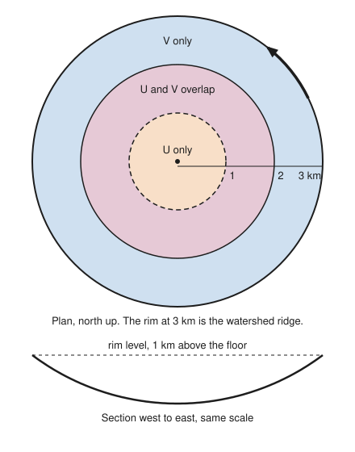
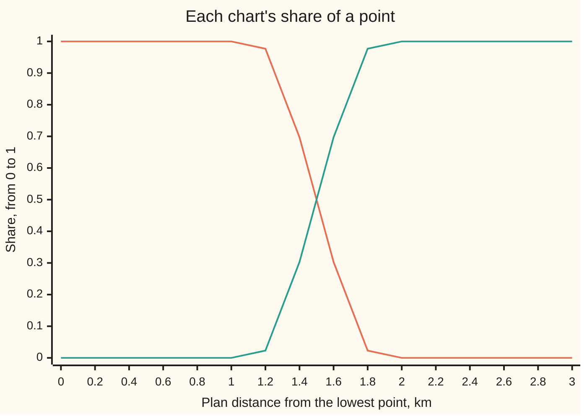

# Integration on an oriented manifold: patch the pieces together consistently

[Syllabus](../../../SYLLABUS.md) → [Differential geometry and Lie groups](../README.md) → [Differential Forms](../README.md#s04) → Integration on an oriented manifold

---

## General Overview

A storm sits over a round valley. The valley is a bowl 6 km across and 1 km deep, and its rim is the watershed ridge: rain that lands inside runs to one stream. Rain gauges on the floor read 10 mm an hour. Rain is heavier higher up, so gauges on the ridge read 20 mm an hour.

The flood forecaster needs one number: how many cubic metres of water land inside the ridge each hour? The answer is 418,879 m³ an hour, or 2.51 million m³ over a 6-hour storm.

Getting it means adding rain over a curved surface. One plan map, in kilometres east and north, would cover this whole bowl. The card splits it into two overlapping maps on purpose, to show the method on a shape small enough to check. Each piece is added in its own map, and the pieces are glued so that nothing is counted twice and nothing changes sign. On a closed surface the method cannot be avoided: the whole globe fits on no single map and needs the overlapping sheets of [Partition of unity](../03-Manifolds/09-partitions-of-unity-and-whitney-embedding.md).

**To integrate over a curved space, cut the quantity into pieces that each live on one map, add each piece in its map's coordinates, and add the results; this works, and gives one answer for every choice of maps, exactly when all the maps agree on which way round is positive.**

**What kind of fact this is:** a definition of $`\int_M \omega`$, plus a theorem proved on this card in Why it works: the answer does not depend on the maps or on how the pieces are cut. It is global, with one global hypothesis: the space has an orientation, a consistent "positive way round", chosen everywhere at once.

### The picture: the valley and its two maps

<p align="center"></p>

To scale, 60 px per km. The arrow is the rim's own direction, which Step 4 derives.

---

## The formula

Notation first, in words.

- $`M`$ is the catchment: the bowl's surface inside the ridge. It is a 2-dimensional **manifold with boundary**: a space that looks like a piece of the plane near each point, and like a half-plane near its edge. Its edge, written $`\partial M`$ (say "boundary of M"), is the ridge.
- A **chart** is a map: a pair of numbers that names each point of a patch of $`M`$ ([Smooth manifold](../03-Manifolds/01-smooth-manifolds-and-charts.md)). This card uses two. Chart U names a point by $`(x, y)`$, its kilometres east and north of the valley's lowest point. It could cover the whole bowl; here it is kept to plan distances below 2 km, so that the two charts overlap and must be glued. Chart V names it by $`(\varphi, \theta)`$, defined below.
- A **2-form** eats two arrows at a point and returns a signed number, the way a determinant does ([Differential form](01-forms-and-the-wedge-product.md)). $`dx \wedge dy`$ is the 2-form that returns the signed area of the arrows' shadow on level ground.
- The rain is the 2-form $`\omega = p\, dx \wedge dy`$, where $`p`$ is the gauge reading. A gauge has a level opening, so $`p`$ is water per square metre of level ground. A sloping patch of hillside catches by its shadow, so the rain is $`p`$ times the shadow's area.
- A form whose degree equals the dimension of the space is **top-degree**. Here both are 2.
- An **orientation** is a choice, made at every point and varying continuously, of which order of arrows counts as positive. Here "positive" means the order east-then-north seen from above, the order that $`dx \wedge dy`$ scores as positive.

In a chart with coordinates $`(u^1, \dots, u^n)`$ that agrees with the orientation, a top-degree form is one function times the basic form, $`\omega = f\, du^1 \wedge \dots \wedge du^n`$. The upper indices are labels, not powers. The integral over all of $`M`$ is:

```math
\int_M \omega \;=\; \sum_{\alpha} \int_{D_\alpha} \psi_\alpha\, f_\alpha \; du_\alpha^1 \cdots du_\alpha^n
```

**Read it aloud:** "For each chart, weight the form by that chart's share of each point, write the result in the chart's own coordinates, do the ordinary integral, and add over the charts."

The shares $`\psi_\alpha`$ form a **partition of unity**: smooth weights, each zero outside its own chart, that add to 1 at every point ([Partition of unity](../03-Manifolds/09-partitions-of-unity-and-whitney-embedding.md)). On this card $`\alpha`$ runs over the two charts, U and V.

For the valley, chart U gives $`f_U = p`$ directly. Chart V uses the bowl's own angles: the bowl is part of a sphere of radius $`R_b = 5`$ km whose centre hangs 5 km above the floor. $`\varphi`$ is the angle at that centre between straight down and the point, and $`\theta`$ is the longitude: the angle round the vertical axis, anticlockwise seen from above, starting due east. On the globe $`\varphi`$ is measured down from the North Pole; here the globe hangs upside down, so it is measured up from the valley floor. Then

```math
x = R_b \sin\varphi \cos\theta, \quad y = R_b \sin\varphi \sin\theta, \qquad f_V = p \cdot J_V, \quad J_V = R_b^2 \sin\varphi \cos\varphi
```

$`J_V`$ is the Jacobian of chart V: the area of level ground swept per unit of $`\varphi`$ and $`\theta`$, with its sign, as in wing 06. The pullback rule gives it ([Pullback](02-pullback-and-change-of-variables.md)). Chart V covers plan distances from 1 km to the rim. Strictly, its seam at $`\theta = 0`$ needs a second copy of the chart turned a quarter-turn; the seam is a line with no area, so the code leaves it out.

| Symbol | Plain meaning | In our example | Push it up and the answer… |
| --- | --- | --- | --- |
| $`M`$, $`\partial M`$ | the catchment surface; its edge | the bowl inside the ridge; the ridge, 18.85 km round | — |
| $`n`$; $`u^1, \dots, u^n`$; $`\partial_1, \dots, \partial_n`$ | the dimension; a chart's coordinates; its coordinate arrows | 2; $`(x, y)`$ or $`(\varphi, \theta)`$ | — |
| $`x`$, $`y`$, $`z`$ | km east, north and up from the lowest point | rim at plan radius 3 km, height 1 km | — |
| $`\rho`$ | plan distance from the lowest point (not the osculating radius of shelf 01) | 1.5 km at the worked point | — |
| $`R_b`$, $`a`$ | the bowl's sphere radius; the rim's plan radius (`R`, `A` in the code) | 5 km; 3 km | larger $`a`$: more catchment |
| $`p`$, $`p_0`$, $`h_0`$ | gauge reading; its value on the floor; the climb that adds another $`p_0`$ | $`p = p_0(1 + z/h_0)`$, 10 mm/h, 1 km | more water |
| $`\omega`$; $`dS`$ | the rain as a 2-form, $`p\, dx \wedge dy`$; slope area, the wrong measure for rain | water landing on each patch of slope, per hour | more water |
| $`\varphi`$, $`\theta`$; $`\varphi_0`$ | chart V: angle up from the floor seen from the sphere's centre; longitude; $`\varphi`$ at the rim | $`\varphi_0`$ = 0.643501 rad (36.87°) | — |
| $`J_V`$ | Jacobian of chart V, signed | 7.154544 km² per rad² at $`\rho`$ = 1.5 km | larger coefficient, same total |
| $`\alpha`$; $`f_\alpha`$, $`D_\alpha`$ | a chart's label; the form's coefficient in chart $`\alpha`$; the chart's region of coordinates | U or V; 12.303040 in U, 88.022641 in V, same point | depends on the chart, not the valley |
| $`\psi_U`$, $`\psi_V`$ | partition of unity: each chart's share of a point | 0.5 and 0.5 at $`\rho`$ = 1.5 km | — |
| $`\int_M \omega`$ | the total catch | 418.879020 mm/h × km² = 418,879 m³/h | — |

One unit conversion carries the whole card: 1 mm of rain an hour on 1 km² of level ground is 1,000 m³ an hour.

### When it holds

- **$`M`$ is orientable, and one orientation is chosen.** Without a consistent "positive way round", the sign of each piece is arbitrary. A Möbius strip (a band with one half-twist) has none: its two charts agree on one part of their overlap and disagree on the other, so no choice works.
- **Every chart agrees with that orientation.** On every overlap the change of coordinates must have a positive Jacobian. Read chart V in the order $`(\theta, \varphi)`$ and its piece flips sign: the total comes out at −258,471 m³/h.
- **The pieces are weighted by a partition of unity.** Each point must be counted with total weight 1. Adding both charts at full weight counts the overlap ring twice: 537,392 m³/h, 118,513 too much.
- **The form has top degree.** A 2-form on a surface, a 3-form on a solid. A 1-form has no total over a surface.
- **The form is zero outside a closed, bounded set.** The catchment is closed and bounded, so the sum is finite. On an endless plain a steady rain has no finite total.

---

## Why it works

### Step 0: a top-degree form already knows how to measure a small cell

An ordinary integral adds "value times size" over small cells. On a curved space there is no single grid to measure size. A top-degree form needs none: fed the two edge arrows of a small cell, it returns that cell's signed amount directly, here the rain the cell catches.

Two things can still go wrong across charts: two charts may disagree on the sign, and an overlap may be counted twice. Orientation fixes the first; a partition of unity fixes the second.

### Step 1: in one chart, the integral is an ordinary integral

Inside one chart, write $`\omega = f\, du^1 \wedge du^2`$ and integrate $`f`$ over the chart's region like any double integral. The question is whether another chart gives the same answer.

Switch from U to V. The pullback rule says the coefficient picks up the Jacobian: $`f_V = f_U \cdot J_V`$ ([Pullback](02-pullback-and-change-of-variables.md)). The change-of-variables rule for double integrals multiplies by $`\lvert J_V \rvert`$. These two factors agree exactly when $`J_V > 0`$. [Surface integrals](../../06-Calculus%20and%20analysis/09-Vector%20Calculus/05-surface-integrals-and-flux.md) uses the same cancellation to show a flux does not depend on the grid.

At the worked point, 1.5 km from the lowest point on the plan, $`J_V`$ = 7.154544 km² per rad². The coefficient is 12.303040 in U and 88.022641 in V. The coefficient depends on the chart. The integral does not, because the extra factor is the size of the new grid's cells.

### Step 2: orientation, in any dimension

An **orientation** of an $`n`$-dimensional space at a point is a class of ordered lists of $`n`$ independent arrows (a basis: no arrow in the list is a combination of the others). Two lists are in the same class when the matrix taking one to the other has positive determinant. There are exactly two classes. Swapping two arrows, or reversing one, moves a list to the other class.

A chart **agrees with the orientation** when its coordinate arrows $`\partial_1, \dots, \partial_n`$ lie in the chosen class at every point. A manifold is **orientable** when it has an atlas (a set of charts covering it) whose transitions (the changes of coordinates on overlaps) all have positive Jacobian.

In dimension 3 the rule is the same. Fill the bowl to its rim and the lake holds $`\int dx \wedge dy \wedge dz`$ = 14.660766 km³ in the order $`(\rho, \theta, z)`$. In the order $`(\rho, z, \theta)`$ the same integral is −14.660766 km³: one swap, one sign.

On the bowl, every point of the overlap gives $`J_V > 0`$. The smallest value, at the inner edge, is 4.898979. So charts U and V agree, and the bowl is oriented by "up". On a Möbius strip, two charts overlap in two pieces. On one piece they give each point the same numbers, so they agree there by construction. On the other piece the code finds they disagree, so no choice of signs makes every transition positive.

### Step 3: cut the form with a partition of unity

Choose $`\psi_U`$ and $`\psi_V`$: smooth, never negative, adding to 1 everywhere. $`\psi_U`$ is 1 inside 1 km, 0 beyond 2 km, and slides smoothly between. Then

```math
\omega = \psi_U\, \omega + \psi_V\, \omega
```

Each piece is zero outside one chart, so each piece has an integral by Step 1. Define $`\int_M \omega`$ as the sum. Here the floor piece is 80.203981 and the slope piece 338.675039, in mm/h × km². Their sum is 418.879020, the closed form to six decimals.

Other charts or weights give the same sum. The fold proves it by writing both sums as one double sum over pairs of charts.

<details>
<summary>Detailed proof: the answer does not depend on the charts or the partition of unity</summary>

**One chart change.** Let $`T`$ take chart-$`B`$ coordinates $`v`$ to chart-$`A`$ coordinates $`u = T(v)`$, smooth with a smooth inverse, and let $`DT`$ be its matrix of partial derivatives. If $`\omega = f\, du^1 \wedge \dots \wedge du^n`$, the pullback gives

$`\displaystyle \omega = (f \circ T)\, \det DT \; dv^1 \wedge \dots \wedge dv^n ,`$

because the wedge of $`n`$ one-forms changes by the determinant. The change-of-variables theorem says

$`\displaystyle \int_{T(D)} f \, du^1 \cdots du^n = \int_{D} (f \circ T)\, \lvert \det DT \rvert \, dv^1 \cdots dv^n .`$

When $`\det DT > 0`$, the two right-hand sides match. So a form that is zero outside one overlap has the same integral in either chart.

**Two partitions.** Let $`\{\psi_\alpha\}`$ go with one oriented atlas and a second partition of unity $`\{\chi_\beta\}`$ with another. Since the $`\chi_\beta`$ add to 1,

$`\displaystyle \sum_\alpha \int \psi_\alpha \omega = \sum_\alpha \sum_\beta \int \psi_\alpha \chi_\beta\, \omega .`$

Each $`\psi_\alpha \chi_\beta\, \omega`$ is zero outside the overlap of chart $`\alpha`$ and chart $`\beta`$, so by the first part it has one integral in either chart. Swapping the order of the finite sums and using that the $`\psi_\alpha`$ add to 1 gives $`\sum_\beta \int \chi_\beta\, \omega`$. Both definitions agree.

Finitely many charts suffice because $`\omega`$ is zero outside a closed, bounded set. The sums are finite, so they may be reordered.

</details>

### Step 4: the edge

Near the ridge, chart V takes $`\varphi`$ up to and including the rim value. So near the rim its region looks like a half-plane with its edge, not an open patch. This is what makes $`M`$ a manifold with boundary. The edge is a curve, with no area, so it adds nothing to the total.

The edge does get a direction from the orientation: put the arrow pointing out of $`M`$ first, then the edge direction, and require the pair to be positive. At the rim point due east, "out" is $`\partial_\varphi`$ and "along" is $`\partial_\theta`$. The coefficient of $`dx \wedge dy`$ on that pair is 12, positive. So the ridge runs anticlockwise seen from above, as the arrow in the picture shows. [Stokes on manifolds](06-stokes-theorem-on-manifolds.md) needs exactly this direction.

---

## Worked numbers, by hand

**The total, in plan coordinates.** On the plan, $`z = R_b - \sqrt{R_b^2 - \rho^2}`$ and $`p = p_0 (1 + z/h_0)`$, so the total is $`p_0`$ times (plan area plus $`\int z\, dA / h_0`$).

| Step | Arithmetic | Value |
| --- | --- | --- |
| rim angle | $`\sin\varphi_0 = a / R_b = 3/5`$ | 0.643501 rad, 36.869898° |
| rim height | $`5 - \sqrt{25 - 9}`$ | 1 km |
| plan area | $`\pi a^2 = 9\pi`$ | 28.274334 km² |
| $`\int z\, dA`$ | $`\pi a^2 R_b - \tfrac{2\pi}{3}\big(R_b^3 - (R_b^2 - a^2)^{3/2}\big) = 45\pi - \tfrac{2\pi}{3}(125 - 64)`$ | 13.613568 km³ |
| catch | $`10 \times (28.274334 + 13.613568 / 1)`$ | 418.879020 mm/h × km² |
| in m³ | × 1,000 | **418,879.020479 m³/h** |
| 6-hour storm | × 6 | 2,513,274.122872 m³ |

**One point, in both charts.** At plan radius 1.5 km: $`\sin\varphi = 0.3`$, $`\cos\varphi = 0.953939`$.

| Step | Arithmetic | Value |
| --- | --- | --- |
| height | $`5 - 5 \times 0.953939`$ | 0.230304 km |
| gauge | $`10 \times 1.230304`$ | 12.303040 mm/h = $`f_U`$ |
| Jacobian | $`25 \times 0.3 \times 0.953939`$ | 7.154544 km²/rad² |
| chart V coefficient | $`12.303040 \times 7.154544`$ | 88.022641 = $`f_V`$ |
| shares | the weights are symmetric about 1.5 km | $`\psi_U = \psi_V = 0.5`$ |

That is 418,879 m³ of rain landing on the catchment each hour. If none soaked in, the stream would carry all of it: a large river in flood.

### What breaks if you drop a piece

| Mistake | Comes out at | What went wrong |
| --- | --- | --- |
| Chart V read as $`(\theta, \varphi)`$ | −258.471058, not 418.879020 | The chart disagrees with the orientation: its Jacobian is negative, so its piece changed sign |
| No partition of unity: both charts at full weight | 537.392084, 118.513063 too much | The overlap ring counted twice |
| Slope area $`dS`$ in place of $`dx \wedge dy`$ | 471.238898, exactly 1.125 times | Rain treated as water per square metre of slope; gauges measure per square metre of level ground |
| A Möbius strip | overlap signs +1 and −1 | No orientation exists, so no sum of chart pieces is meaningful |

All values are mm/h × km²; multiply by 1,000 for m³/h. The code prints all four.

---

## Code, from first principles, and it actually runs

The code builds the rain form in both charts, the partition of unity and its own Simpson's rule (a weighted grid sum for integrals). It takes **four independent roads** to the total: the closed form; the two charts glued by the partition of unity; chart V alone, which misses only the single floor point; and a mesh of flat triangles, each scored by the signed shadow area of its vertices taken anticlockwise. The mesh is approximate. Its error is −0.125961 at 30 rings and −0.031488 at 60, falling by a factor of 4.000343 as the step halves.

### Python

```python
# Integration on an oriented manifold -- the check behind the card.
# Standard library only.  A bowl-shaped valley (part of a sphere, radius 5 km,
# rim radius 3 km, 1 km deep) catches a storm whose rain rate grows with height.
# The rain is the 2-form p dx^dy.  It is integrated three ways: closed form,
# two overlapping charts glued by a partition of unity, and a triangle mesh.
import math

R, A, P0, H0 = 5.0, 3.0, 10.0, 1.0           # km, km, mm/h on the floor, km per extra P0
LO, HI = 1.0, 2.0                            # km: chart V starts at plan radius LO, chart U stops at HI
PHI0, PHI1 = math.asin(A / R), math.asin(LO / R)   # polar angle at the rim and at plan radius LO
def height(rho): return R - math.sqrt(R * R - rho * rho)  # km above the valley floor
def rain(rho): return P0 * (1 + height(rho) / H0)     # mm/h, measured on level ground
def f(t): return math.exp(-1 / t) if t > 0 else 0.0
def psi_u(rho, lo=LO, hi=HI): return f(hi - rho) / (f(hi - rho) + f(rho - lo))  # 1 inside lo, 0 outside hi
def psi_v(rho): return 1 - psi_u(rho)
def det2(a, b, c, d): return a * d - b * c

def simpson2(g, a, b, c, d, n):              # Simpson's rule on an n-by-n grid, n even
    hu, hv, s = (b - a) / n, (d - c) / n, 0.0
    w = [1 if i in (0, n) else (4 if i % 2 else 2) for i in range(n + 1)]
    for i in range(n + 1):
        for j in range(n + 1):
            s += w[i] * w[j] * g(a + i * hu, c + j * hv)
    return s * hu * hv / 9

def chart_v(ph, th):                         # slope chart: polar angle ph from the floor, longitude th
    x, y = R * math.sin(ph) * math.cos(th), R * math.sin(ph) * math.sin(th)
    xp, xt = R * math.cos(ph) * math.cos(th), -R * math.sin(ph) * math.sin(th)
    yp, yt = R * math.cos(ph) * math.sin(th), R * math.sin(ph) * math.cos(th)
    return math.hypot(x, y), det2(xp, xt, yp, yt)  # plan radius, coefficient of dph^dth
def u_part(x, y, weight):                    # floor chart: plan x, y; dx^dy pulls back to itself
    rho = math.hypot(x, y)
    return weight(rho) * rain(rho) if rho < HI else 0.0
def v_part(ph, th, weight, order=1):         # order -1: the chart read as (th, ph)
    rho, j = chart_v(ph, th)
    return weight(rho) * rain(rho) * j * order

f6 = lambda v: f"{v:.6f}"
plan, zint = math.pi * A * A, math.pi * A * A * R - 2 * math.pi / 3 * (R ** 3 - (R * R - A * A) ** 1.5)
closed = P0 * (plan + zint / H0)
print("rim polar angle rad", f6(PHI0), "deg", f6(math.degrees(PHI0)), "rim height km", f6(height(A)), "rim gauge mm/h", f6(rain(A)))
print("plan area km^2", f6(plan), "integral of z dA km^3", f6(zint))
print("closed form, mm/h x km^2", f6(closed), "m^3/h", f6(closed * 1000), "6 h storm m^3", f6(closed * 6000))
rho = 1.5
ph = math.asin(rho / R)
print("at plan radius 1.5 km: sin phi", f6(math.sin(ph)), "cos phi", f6(math.cos(ph)), "z", f6(height(rho)), "p mm/h", f6(rain(rho)), "psi_U", f6(psi_u(rho)), "psi_V", f6(psi_v(rho)))
print("  coefficient in chart U", f6(rain(rho)), "in chart V", f6(rain(rho) * chart_v(ph, 0.7)[1]),
      "Jacobian", f6(chart_v(ph, 0.7)[1]), "R^2 sin cos", f6(R * R * math.sin(ph) * math.cos(ph)))
assert abs(chart_v(ph, 0.7)[1] - R * R * math.sin(ph) * math.cos(ph)) < 1e-12
iu = simpson2(lambda x, y: u_part(x, y, psi_u), -HI, HI, -HI, HI, 400)
iv = simpson2(lambda p, t: v_part(p, t, psi_v), PHI1, PHI0, 0.0, 2 * math.pi, 200)
print("chart U piece", f6(iu), "chart V piece", f6(iv), "sum", f6(iu + iv), "closed", f6(closed))
assert abs(iu + iv - closed) < 1e-4
whole_v = simpson2(lambda p, t: v_part(p, t, lambda r: 1.0), 0.0, PHI0, 0.0, 2 * math.pi, 200)
print("chart V alone over the whole bowl (floor point is one point)", f6(whole_v))
assert abs(whole_v - closed) < 1e-6
dets = [chart_v(PHI1 + k * (math.asin(HI / R) - PHI1) / 10, 0.3 * k)[1] for k in range(11)]
print("overlap: smallest dph^dth coefficient", f6(min(dets)), "all positive", "yes" if min(dets) > 0 else "no")

def mesh(n):                                 # flat triangles on the bowl, vertices in anticlockwise order
    m, tot = 4 * n, 0.0
    pt = lambda i, j: (A * i / n * math.cos(2 * math.pi * j / m), A * i / n * math.sin(2 * math.pi * j / m), height(A * i / n))
    for i in range(n):
        for j in range(m):
            p, q, r, s = pt(i, j), pt(i + 1, j), pt(i + 1, j + 1), pt(i, j + 1)
            for a, b, c in ((p, q, r), (p, r, s)):
                proj = det2(b[0] - a[0], c[0] - a[0], b[1] - a[1], c[1] - a[1]) / 2  # signed dx^dy
                tot += proj * P0 * (1 + (a[2] + b[2] + c[2]) / 3 / H0)
    return tot
m1, m2 = mesh(30), mesh(60)
print("mesh 30 rings", f6(m1), "error", f6(m1 - closed))
print("mesh 60 rings", f6(m2), "error", f6(m2 - closed), "ratio", f6((m1 - closed) / (m2 - closed)))
assert abs(m2 - closed) < abs(m1 - closed) / 3.5

print("rim at (3, 0): outward d/dphi, along d/dtheta, dx^dy coefficient", f6(chart_v(PHI0, 0.0)[1]), "rim length km", f6(2 * math.pi * A))
c3 = lambda r, t: (math.cos(t), -r * math.sin(t), 0.0, math.sin(t), r * math.cos(t), 0.0, 0.0, 0.0, 1.0)  # d(x,y,z)/d(rho,theta,z)
def det3(m): return m[0] * (m[4] * m[8] - m[5] * m[7]) - m[1] * (m[3] * m[8] - m[5] * m[6]) + m[2] * (m[3] * m[7] - m[4] * m[6])
swap = lambda m: [m[k] for k in (0, 2, 1, 3, 5, 4, 6, 8, 7)]         # columns reordered to (rho, z, theta)
lake = simpson2(lambda r, t: det3(c3(r, t)) * (height(A) - height(r)), 0.0, A, 0.0, 2 * math.pi, 200)
lake2 = simpson2(lambda r, t: det3(swap(c3(r, t))) * (height(A) - height(r)), 0.0, A, 0.0, 2 * math.pi, 200)
print("3-form dx^dy^dz, lake to the rim, km^3: order (rho, theta, z)", f6(lake), "order (rho, z, theta)", f6(lake2), "closed 14 pi/3", f6(14 * math.pi / 3))
assert abs(lake - 14 * math.pi / 3) < 1e-6 and abs(lake2 + 14 * math.pi / 3) < 1e-6

flip = iu + simpson2(lambda p, t: v_part(p, t, psi_v, -1), PHI1, PHI0, 0.0, 2 * math.pi, 200)
iu_all = simpson2(lambda r, t: rain(r) * r, 0.0, HI, 0.0, 2 * math.pi, 200)  # chart U at full weight, in plan polar form
iv_all = simpson2(lambda p, t: v_part(p, t, lambda r: 1.0), PHI1, PHI0, 0.0, 2 * math.pi, 200)
slope = simpson2(lambda p, t: rain(R * math.sin(p)) * R * R * math.sin(p), 0.0, PHI0, 0.0, 2 * math.pi, 200)
print("breaks: chart V read as (theta, phi)", f6(flip))
ring = lambda r: P0 * (math.pi * r * r * (1 + R / H0) + 2 * math.pi / (3 * H0) * (R * R - r * r) ** 1.5)  # rain on plan disc r
print("breaks: no partition of unity", f6(iu_all + iv_all), "excess", f6(iu_all + iv_all - closed), "ring 1 to 2 km", f6(ring(HI) - ring(LO)))
print("breaks: slope area dS for dx^dy", f6(slope), "closed 150 pi", f6(150 * math.pi), "ratio", f6(slope / closed))
assert flip < closed / 2 and abs(slope - 150 * math.pi) < 1e-6 and abs(iu_all + iv_all - closed - ring(HI) + ring(LO)) < 1e-6

def mob(s, t):                               # Mobius strip of mid-radius 1 km, width 1 km
    return ((1 + t / 2 * math.cos(s / 2)) * math.cos(s), (1 + t / 2 * math.cos(s / 2)) * math.sin(s), t / 2 * math.sin(s / 2))
def normal(s, t, e=1e-6):
    a = [(mob(s + e, t)[k] - mob(s - e, t)[k]) / (2 * e) for k in range(3)]
    b = [(mob(s, t + e)[k] - mob(s, t - e)[k]) / (2 * e) for k in range(3)]
    return (a[1] * b[2] - a[2] * b[1], a[2] * b[0] - a[0] * b[2], a[0] * b[1] - a[1] * b[0])
sign = lambda u, v: 1 if sum(u[k] * v[k] for k in range(3)) > 0 else -1
same = max(abs(mob(4.0, 0.3)[k] - mob(4.0 - 2 * math.pi, -0.3)[k]) for k in range(3))
print("mobius: chart B point (s - 2 pi, -t) is chart A point (s, t), gap", f6(same))
print("mobius: orientation agreement on overlap piece 1 (same numbers in both charts)", sign(normal(1.0, 0.3), normal(1.0, 0.3)),
      "piece 2", sign(normal(4.0, 0.3), normal(4.0 - 2 * math.pi, -0.3)))
assert same < 1e-12 and sign(normal(4.0, 0.3), normal(4.0 - 2 * math.pi, -0.3)) == -1

print("chart psi_U", " ".join(f"{psi_u(k / 5):.3f}" for k in range(16)))
print("chart psi_V", " ".join(f"{psi_v(k / 5):.3f}" for k in range(16)))
narrow = (simpson2(lambda x, y: u_part(x, y, lambda r: psi_u(r, 1.25, 1.75)), -HI, HI, -HI, HI, 400)
          + simpson2(lambda p, t: v_part(p, t, lambda r: 1 - psi_u(r, 1.25, 1.75)), PHI1, PHI0, 0.0, 2 * math.pi, 200))
print("try: H0 = 0.5 km", f6(P0 * (plan + zint / 0.5)), "try: overlap 1.25 to 1.75 km", f6(narrow))
print("try: mesh 6 rings", f6(mesh(6)))
px = 60.0                                    # figure scale, pixels per km
print("figure,", f"{px:.0f}", "px per km: chart U radius", f6(HI), "chart V from", f6(LO), "to", f6(A), "rim height", f6(height(A)),
      "radii px", " ".join(f"{px * r:.1f}" for r in (LO, HI, A)), "section depth px", f"{px * height(A):.1f}")
print("ALL CHECKS PASS")
```

**Ran 2026-11-19 on macOS, Python 3.14.10, standard library only. All checks passed. Output, pasted from the run:**

```
rim polar angle rad 0.643501 deg 36.869898 rim height km 1.000000 rim gauge mm/h 20.000000
plan area km^2 28.274334 integral of z dA km^3 13.613568
closed form, mm/h x km^2 418.879020 m^3/h 418879.020479 6 h storm m^3 2513274.122872
at plan radius 1.5 km: sin phi 0.300000 cos phi 0.953939 z 0.230304 p mm/h 12.303040 psi_U 0.500000 psi_V 0.500000
  coefficient in chart U 12.303040 in chart V 88.022641 Jacobian 7.154544 R^2 sin cos 7.154544
chart U piece 80.203981 chart V piece 338.675039 sum 418.879020 closed 418.879020
chart V alone over the whole bowl (floor point is one point) 418.879020
overlap: smallest dph^dth coefficient 4.898979 all positive yes
mesh 30 rings 418.753059 error -0.125961
mesh 60 rings 418.847533 error -0.031488 ratio 4.000343
rim at (3, 0): outward d/dphi, along d/dtheta, dx^dy coefficient 12.000000 rim length km 18.849556
3-form dx^dy^dz, lake to the rim, km^3: order (rho, theta, z) 14.660766 order (rho, z, theta) -14.660766 closed 14 pi/3 14.660766
breaks: chart V read as (theta, phi) -258.471058
breaks: no partition of unity 537.392084 excess 118.513063 ring 1 to 2 km 118.513063
breaks: slope area dS for dx^dy 471.238898 closed 150 pi 471.238898 ratio 1.125000
mobius: chart B point (s - 2 pi, -t) is chart A point (s, t), gap 0.000000
mobius: orientation agreement on overlap piece 1 (same numbers in both charts) 1 piece 2 -1
chart psi_U 1.000 1.000 1.000 1.000 1.000 1.000 0.977 0.697 0.303 0.023 0.000 0.000 0.000 0.000 0.000 0.000
chart psi_V 0.000 0.000 0.000 0.000 0.000 0.000 0.023 0.303 0.697 0.977 1.000 1.000 1.000 1.000 1.000 1.000
try: H0 = 0.5 km 555.014702 try: overlap 1.25 to 1.75 km 418.879020
try: mesh 6 rings 415.721537
figure, 60 px per km: chart U radius 2.000000 chart V from 1.000000 to 3.000000 rim height 1.000000 radii px 60.0 120.0 180.0 section depth px 60.0
ALL CHECKS PASS
```

### Rust

Same roads, same numbers, printed in the same format. No crates.

```rust
// Integration on an oriented manifold -- the check behind the card.
// std only, no crates.  A bowl-shaped valley (part of a sphere, radius 5 km,
// rim radius 3 km, 1 km deep) catches a storm whose rain rate grows with height.
// The rain is the 2-form p dx^dy.  It is integrated three ways: closed form,
// two overlapping charts glued by a partition of unity, and a triangle mesh.
use std::f64::consts::PI;
type V3 = [f64; 3];

const R: f64 = 5.0; // sphere radius, km
const A: f64 = 3.0; // rim radius on the plan, km
const P0: f64 = 10.0; // rain rate on the floor, mm/h
const H0: f64 = 1.0; // km of height per extra P0
const LO: f64 = 1.0; // chart V starts at this plan radius, km
const HI: f64 = 2.0; // chart U stops at this plan radius, km

fn height(rho: f64) -> f64 { R - (R * R - rho * rho).sqrt() } // km above the valley floor
fn rain(rho: f64) -> f64 { P0 * (1.0 + height(rho) / H0) } // mm/h, measured on level ground
fn f(t: f64) -> f64 { if t > 0.0 { (-1.0 / t).exp() } else { 0.0 } }
fn psi(rho: f64, lo: f64, hi: f64) -> f64 { f(hi - rho) / (f(hi - rho) + f(rho - lo)) } // 1 inside lo, 0 outside hi
fn psi_u(rho: f64) -> f64 { psi(rho, LO, HI) }
fn psi_v(rho: f64) -> f64 { 1.0 - psi_u(rho) }
fn det2(a: f64, b: f64, c: f64, d: f64) -> f64 { a * d - b * c }

fn simpson2<G: Fn(f64, f64) -> f64>(g: G, a: f64, b: f64, c: f64, d: f64, n: usize) -> f64 {
    // Simpson's rule on an n-by-n grid, n even
    let (hu, hv) = ((b - a) / n as f64, (d - c) / n as f64);
    let w = |i: usize| -> f64 { if i == 0 || i == n { 1.0 } else if i % 2 == 1 { 4.0 } else { 2.0 } };
    let mut s = 0.0;
    for i in 0..=n {
        for j in 0..=n {
            s += w(i) * w(j) * g(a + i as f64 * hu, c + j as f64 * hv);
        }
    }
    s * hu * hv / 9.0
}

fn chart_v(ph: f64, th: f64) -> (f64, f64) {
    // slope chart: polar angle ph from the floor, longitude th
    let (x, y) = (R * ph.sin() * th.cos(), R * ph.sin() * th.sin());
    let (xp, xt) = (R * ph.cos() * th.cos(), -R * ph.sin() * th.sin());
    let (yp, yt) = (R * ph.cos() * th.sin(), R * ph.sin() * th.cos());
    (x.hypot(y), det2(xp, xt, yp, yt)) // plan radius, coefficient of dph^dth
}
fn u_part<W: Fn(f64) -> f64>(x: f64, y: f64, weight: &W) -> f64 {
    // floor chart: plan x, y; dx^dy pulls back to itself
    let rho = x.hypot(y);
    if rho < HI { weight(rho) * rain(rho) } else { 0.0 }
}
fn v_part<W: Fn(f64) -> f64>(ph: f64, th: f64, weight: &W, order: f64) -> f64 {
    // order -1: the chart read as (th, ph)
    let (rho, j) = chart_v(ph, th);
    weight(rho) * rain(rho) * j * order
}

fn mesh(n: usize) -> f64 {
    // flat triangles on the bowl, vertices in anticlockwise order
    let m = 4 * n;
    let pt = |i: usize, j: usize| -> V3 {
        let (r, t) = (A * i as f64 / n as f64, 2.0 * PI * j as f64 / m as f64);
        [r * t.cos(), r * t.sin(), height(r)]
    };
    let mut tot = 0.0;
    for i in 0..n {
        for j in 0..m {
            let (p, q, r, s) = (pt(i, j), pt(i + 1, j), pt(i + 1, j + 1), pt(i, j + 1));
            for (a, b, c) in [(p, q, r), (p, r, s)] {
                let proj = det2(b[0] - a[0], c[0] - a[0], b[1] - a[1], c[1] - a[1]) / 2.0; // signed dx^dy
                tot += proj * P0 * (1.0 + (a[2] + b[2] + c[2]) / 3.0 / H0);
            }
        }
    }
    tot
}

fn c3(r: f64, t: f64) -> [f64; 9] { [t.cos(), -r * t.sin(), 0.0, t.sin(), r * t.cos(), 0.0, 0.0, 0.0, 1.0] } // d(x,y,z)/d(rho,theta,z)
fn det3(m: [f64; 9]) -> f64 { m[0] * (m[4] * m[8] - m[5] * m[7]) - m[1] * (m[3] * m[8] - m[5] * m[6]) + m[2] * (m[3] * m[7] - m[4] * m[6]) }
fn swap(m: [f64; 9]) -> [f64; 9] { [m[0], m[2], m[1], m[3], m[5], m[4], m[6], m[8], m[7]] } // columns reordered to (rho, z, theta)

fn mob(s: f64, t: f64) -> V3 {
    // Mobius strip of mid-radius 1 km, width 1 km
    let w = 1.0 + t / 2.0 * (s / 2.0).cos();
    [w * s.cos(), w * s.sin(), t / 2.0 * (s / 2.0).sin()]
}
fn normal(s: f64, t: f64) -> V3 {
    let e = 1e-6;
    let a: Vec<f64> = (0..3).map(|k| (mob(s + e, t)[k] - mob(s - e, t)[k]) / (2.0 * e)).collect();
    let b: Vec<f64> = (0..3).map(|k| (mob(s, t + e)[k] - mob(s, t - e)[k]) / (2.0 * e)).collect();
    [a[1] * b[2] - a[2] * b[1], a[2] * b[0] - a[0] * b[2], a[0] * b[1] - a[1] * b[0]]
}
fn sign(u: V3, v: V3) -> i32 { if u[0] * v[0] + u[1] * v[1] + u[2] * v[2] > 0.0 { 1 } else { -1 } }

fn main() {
    let (phi0, phi1) = ((A / R).asin(), (LO / R).asin()); // polar angle at the rim and at plan radius LO
    let one = |_: f64| 1.0;
    let plan = PI * A * A;
    let zint = PI * A * A * R - 2.0 * PI / 3.0 * (R.powi(3) - (R * R - A * A).powf(1.5));
    let closed = P0 * (plan + zint / H0);
    println!("rim polar angle rad {:.6} deg {:.6} rim height km {:.6} rim gauge mm/h {:.6}", phi0, phi0.to_degrees(), height(A), rain(A));
    println!("plan area km^2 {:.6} integral of z dA km^3 {:.6}", plan, zint);
    println!("closed form, mm/h x km^2 {:.6} m^3/h {:.6} 6 h storm m^3 {:.6}", closed, closed * 1000.0, closed * 6000.0);
    let rho = 1.5;
    let ph = (rho / R).asin();
    println!("at plan radius 1.5 km: sin phi {:.6} cos phi {:.6} z {:.6} p mm/h {:.6} psi_U {:.6} psi_V {:.6}", ph.sin(), ph.cos(), height(rho), rain(rho), psi_u(rho), psi_v(rho));
    let jv = chart_v(ph, 0.7).1;
    println!("  coefficient in chart U {:.6} in chart V {:.6} Jacobian {:.6} R^2 sin cos {:.6}", rain(rho), rain(rho) * jv, jv, R * R * ph.sin() * ph.cos());
    assert!((jv - R * R * ph.sin() * ph.cos()).abs() < 1e-12);
    let iu = simpson2(|x, y| u_part(x, y, &psi_u), -HI, HI, -HI, HI, 400);
    let iv = simpson2(|p, t| v_part(p, t, &psi_v, 1.0), phi1, phi0, 0.0, 2.0 * PI, 200);
    println!("chart U piece {:.6} chart V piece {:.6} sum {:.6} closed {:.6}", iu, iv, iu + iv, closed);
    assert!((iu + iv - closed).abs() < 1e-4);
    let whole_v = simpson2(|p, t| v_part(p, t, &one, 1.0), 0.0, phi0, 0.0, 2.0 * PI, 200);
    println!("chart V alone over the whole bowl (floor point is one point) {:.6}", whole_v);
    assert!((whole_v - closed).abs() < 1e-6);
    let dmin = (0..11).map(|k| chart_v(phi1 + k as f64 * ((HI / R).asin() - phi1) / 10.0, 0.3 * k as f64).1).fold(f64::INFINITY, f64::min);
    println!("overlap: smallest dph^dth coefficient {:.6} all positive {}", dmin, if dmin > 0.0 { "yes" } else { "no" });

    let (m1, m2) = (mesh(30), mesh(60));
    println!("mesh 30 rings {:.6} error {:.6}", m1, m1 - closed);
    println!("mesh 60 rings {:.6} error {:.6} ratio {:.6}", m2, m2 - closed, (m1 - closed) / (m2 - closed));
    assert!((m2 - closed).abs() < (m1 - closed).abs() / 3.5);

    println!("rim at (3, 0): outward d/dphi, along d/dtheta, dx^dy coefficient {:.6} rim length km {:.6}", chart_v(phi0, 0.0).1, 2.0 * PI * A);
    let lake = simpson2(|r, t| det3(c3(r, t)) * (height(A) - height(r)), 0.0, A, 0.0, 2.0 * PI, 200);
    let lake2 = simpson2(|r, t| det3(swap(c3(r, t))) * (height(A) - height(r)), 0.0, A, 0.0, 2.0 * PI, 200);
    println!("3-form dx^dy^dz, lake to the rim, km^3: order (rho, theta, z) {:.6} order (rho, z, theta) {:.6} closed 14 pi/3 {:.6}", lake, lake2, 14.0 * PI / 3.0);
    assert!((lake - 14.0 * PI / 3.0).abs() < 1e-6 && (lake2 + 14.0 * PI / 3.0).abs() < 1e-6);

    let flip = iu + simpson2(|p, t| v_part(p, t, &psi_v, -1.0), phi1, phi0, 0.0, 2.0 * PI, 200);
    let iu_all = simpson2(|r, _t| rain(r) * r, 0.0, HI, 0.0, 2.0 * PI, 200); // chart U at full weight, in plan polar form
    let iv_all = simpson2(|p, t| v_part(p, t, &one, 1.0), phi1, phi0, 0.0, 2.0 * PI, 200);
    let slope = simpson2(|p, _t| rain(R * p.sin()) * R * R * p.sin(), 0.0, phi0, 0.0, 2.0 * PI, 200);
    println!("breaks: chart V read as (theta, phi) {:.6}", flip);
    let ring = |r: f64| P0 * (PI * r * r * (1.0 + R / H0) + 2.0 * PI / (3.0 * H0) * (R * R - r * r).powf(1.5)); // rain on plan disc r
    println!("breaks: no partition of unity {:.6} excess {:.6} ring 1 to 2 km {:.6}", iu_all + iv_all, iu_all + iv_all - closed, ring(HI) - ring(LO));
    println!("breaks: slope area dS for dx^dy {:.6} closed 150 pi {:.6} ratio {:.6}", slope, 150.0 * PI, slope / closed);
    assert!(flip < closed / 2.0 && (slope - 150.0 * PI).abs() < 1e-6 && (iu_all + iv_all - closed - ring(HI) + ring(LO)).abs() < 1e-6);

    let same = (0..3).map(|k| (mob(4.0, 0.3)[k] - mob(4.0 - 2.0 * PI, -0.3)[k]).abs()).fold(0.0, f64::max);
    println!("mobius: chart B point (s - 2 pi, -t) is chart A point (s, t), gap {:.6}", same);
    let piece2 = sign(normal(4.0, 0.3), normal(4.0 - 2.0 * PI, -0.3));
    println!("mobius: orientation agreement on overlap piece 1 (same numbers in both charts) {} piece 2 {}", sign(normal(1.0, 0.3), normal(1.0, 0.3)), piece2);
    assert!(same < 1e-12 && piece2 == -1);

    let row = |g: &dyn Fn(f64) -> f64| (0..16).map(|k| format!("{:.3}", g(k as f64 / 5.0))).collect::<Vec<_>>().join(" ");
    println!("chart psi_U {}", row(&psi_u));
    println!("chart psi_V {}", row(&psi_v));
    let nu = |r: f64| psi(r, 1.25, 1.75);
    let nv = |r: f64| 1.0 - psi(r, 1.25, 1.75);
    let narrow = simpson2(|x, y| u_part(x, y, &nu), -HI, HI, -HI, HI, 400) + simpson2(|p, t| v_part(p, t, &nv, 1.0), phi1, phi0, 0.0, 2.0 * PI, 200);
    println!("try: H0 = 0.5 km {:.6} try: overlap 1.25 to 1.75 km {:.6}", P0 * (plan + zint / 0.5), narrow);
    println!("try: mesh 6 rings {:.6}", mesh(6));
    let px = 60.0; // figure scale, pixels per km
    println!("figure, {:.0} px per km: chart U radius {:.6} chart V from {:.6} to {:.6} rim height {:.6} radii px {:.1} {:.1} {:.1} section depth px {:.1}",
             px, HI, LO, A, height(A), px * LO, px * HI, px * A, px * height(A));
    println!("ALL CHECKS PASS");
}
```

**Ran 2026-11-19 on macOS, rustc 1.98.1, no crates. All checks passed. Output, pasted from the run:**

```
rim polar angle rad 0.643501 deg 36.869898 rim height km 1.000000 rim gauge mm/h 20.000000
plan area km^2 28.274334 integral of z dA km^3 13.613568
closed form, mm/h x km^2 418.879020 m^3/h 418879.020479 6 h storm m^3 2513274.122872
at plan radius 1.5 km: sin phi 0.300000 cos phi 0.953939 z 0.230304 p mm/h 12.303040 psi_U 0.500000 psi_V 0.500000
  coefficient in chart U 12.303040 in chart V 88.022641 Jacobian 7.154544 R^2 sin cos 7.154544
chart U piece 80.203981 chart V piece 338.675039 sum 418.879020 closed 418.879020
chart V alone over the whole bowl (floor point is one point) 418.879020
overlap: smallest dph^dth coefficient 4.898979 all positive yes
mesh 30 rings 418.753059 error -0.125961
mesh 60 rings 418.847533 error -0.031488 ratio 4.000343
rim at (3, 0): outward d/dphi, along d/dtheta, dx^dy coefficient 12.000000 rim length km 18.849556
3-form dx^dy^dz, lake to the rim, km^3: order (rho, theta, z) 14.660766 order (rho, z, theta) -14.660766 closed 14 pi/3 14.660766
breaks: chart V read as (theta, phi) -258.471058
breaks: no partition of unity 537.392084 excess 118.513063 ring 1 to 2 km 118.513063
breaks: slope area dS for dx^dy 471.238898 closed 150 pi 471.238898 ratio 1.125000
mobius: chart B point (s - 2 pi, -t) is chart A point (s, t), gap 0.000000
mobius: orientation agreement on overlap piece 1 (same numbers in both charts) 1 piece 2 -1
chart psi_U 1.000 1.000 1.000 1.000 1.000 1.000 0.977 0.697 0.303 0.023 0.000 0.000 0.000 0.000 0.000 0.000
chart psi_V 0.000 0.000 0.000 0.000 0.000 0.000 0.023 0.303 0.697 0.977 1.000 1.000 1.000 1.000 1.000 1.000
try: H0 = 0.5 km 555.014702 try: overlap 1.25 to 1.75 km 418.879020
try: mesh 6 rings 415.721537
figure, 60 px per km: chart U radius 2.000000 chart V from 1.000000 to 3.000000 rim height 1.000000 radii px 60.0 120.0 180.0 section depth px 60.0
ALL CHECKS PASS
```

The two outputs agree line for line. The partition of unity they print, against plan distance:



Orange line: $`\psi_U`$, the floor chart's share. Teal line: $`\psi_V`$, the slope chart's share. They add to 1 everywhere and hand over smoothly inside the overlap ring, from 1 km to 2 km.

### Lean

Lean proves the chart change, the swap rule and the two-partition step of the Detailed proof, in any dimension, and checks the worked numbers.

- Suppose a change of coordinates is one-to-one on a region, with positive Jacobian at every point. Then the form's coefficient has the same ordinary integral in either chart.
- Swapping two arrows in an ordered list reverses the sign of their determinant. So the list moves to the other orientation class.
- Suppose two partitions of unity, each with finitely many shares, add to 1 at every point, and every piece has a finite integral. Then both give the same total.
- The worked numbers hold. The rim sits 1 km up, and $`\int z\, dA`$ is $`13\pi/3`$ km³. The total is $`400\pi/3`$ mm/h × km², and slope area gives exactly 1.125 times that. The rim coefficient is 12, and the lake holds $`14\pi/3`$ km³. The order $`(\rho, z, \theta)`$ is one swap from $`(\rho, \theta, z)`$, so its sign is −1.

The integrals done by computer, the mesh, the Möbius strip and the reversed chart are left to the Python and Rust checks.

```lean
-- Integration on an oriented manifold: a top-degree form has the same integral in every chart whose change of coordinates has positive Jacobian, swapping two coordinate arrows flips the sign, and the sum over chart pieces does not depend on the partition of unity.
import Mathlib.MeasureTheory.Function.Jacobian
import Mathlib.MeasureTheory.Integral.Bochner.Basic
import Mathlib.LinearAlgebra.Matrix.Determinant.Basic
import Mathlib.GroupTheory.Perm.Sign

open MeasureTheory

/-- One chart change: a top-degree form `f du¹ ∧ ⋯ ∧ duⁿ` pulls back along the change of
coordinates `u = T v` to `(f ∘ T) · det DT dv¹ ∧ ⋯ ∧ dvⁿ`. When the change of coordinates is
one-to-one with derivative `DT` and positive Jacobian `det DT > 0` (the two charts agree on the
orientation), the ordinary integral of the form's coefficient is the same in either chart. -/
theorem integral_top_form_same_in_oriented_charts {n : ℕ} {s : Set (Fin n → ℝ)}
    {T : (Fin n → ℝ) → (Fin n → ℝ)} {DT : (Fin n → ℝ) → ((Fin n → ℝ) →L[ℝ] (Fin n → ℝ))}
    (hs : MeasurableSet s) (hT : ∀ v ∈ s, HasFDerivWithinAt T (DT v) s v)
    (hinj : Set.InjOn T s) (hpos : ∀ v ∈ s, 0 < (DT v).det) (f : (Fin n → ℝ) → ℝ) :
    ∫ u in T '' s, f u = ∫ v in s, f (T v) * (DT v).det := by
  rw [integral_image_eq_integral_abs_det_fderiv_smul volume hs hT hinj f]
  refine setIntegral_congr_fun hs (fun v hv => ?_)
  simp only [smul_eq_mul, abs_of_pos (hpos v hv)]
  ring

/-- Orientation: swapping two arrows of an ordered list of `n` arrows (the columns of `A`)
reverses the sign of their determinant, so it moves the list to the other orientation class. -/
theorem det_swap_two_arrows {n : ℕ} (A : Matrix (Fin n) (Fin n) ℝ) {i j : Fin n} (hij : i ≠ j) :
    (A.submatrix id (Equiv.swap i j)).det = -A.det := by
  rw [Matrix.det_permute', Equiv.Perm.sign_swap hij]
  simp

/-- Two partitions of unity give the same total: if the weights `ψ a` add to 1 at every point,
and so do the weights `χ b`, then adding the integrals of the pieces `ψ a · g` gives the same
answer as adding the integrals of the pieces `χ b · g` (the double sum over pairs of charts). -/
theorem sum_integral_partition_of_unity_independent {X : Type*} [MeasurableSpace X]
    (μ : Measure X) {ι κ : Type*} [Fintype ι] [Fintype κ] (ψ : ι → X → ℝ) (χ : κ → X → ℝ)
    (g : X → ℝ) (hψ : ∀ x, ∑ a, ψ a x = 1) (hχ : ∀ x, ∑ b, χ b x = 1)
    (hint : ∀ a b, Integrable (fun x => ψ a x * χ b x * g x) μ) :
    ∑ a, ∫ x, ψ a x * g x ∂μ = ∑ b, ∫ x, χ b x * g x ∂μ := by
  have key : ∀ a, ∫ x, ψ a x * g x ∂μ = ∑ b, ∫ x, ψ a x * χ b x * g x ∂μ := by
    intro a
    rw [← integral_finsetSum _ (fun b _ => hint a b)]
    refine integral_congr_ae (Filter.Eventually.of_forall fun x => ?_)
    simp only
    rw [← Finset.sum_mul, ← Finset.mul_sum, hχ x, mul_one]
  have key2 : ∀ b, ∫ x, χ b x * g x ∂μ = ∑ a, ∫ x, ψ a x * χ b x * g x ∂μ := by
    intro b
    rw [← integral_finsetSum _ (fun a _ => hint a b)]
    refine integral_congr_ae (Filter.Eventually.of_forall fun x => ?_)
    simp only
    rw [← Finset.sum_mul, ← Finset.sum_mul, hψ x, one_mul]
  simp_rw [key, key2]
  exact Finset.sum_comm

-- The rim: plan radius 3 km on a sphere of radius 5 km, so the rim sits 5 - 4 = 1 km up.
example : (5 : ℚ) ^ 2 - 3 ^ 2 = 4 ^ 2 := by norm_num

-- The integral of z dA over the plan, in units of π km³: 45 - (2/3)(125 - 64) = 13/3.
example : (45 : ℚ) - 2 / 3 * (125 - 4 ^ 3) = 13 / 3 := by norm_num

-- The total catch, in units of π mm/h × km²: 10 × (9 + 13/3) = 400/3 (418.879020 = 400π/3).
example : (10 : ℚ) * (9 + 13 / 3) = 400 / 3 := by norm_num

-- Slope area in place of level ground: 150π against 400π/3 is exactly 1.125 = 9/8 times.
example : (150 : ℚ) / (400 / 3) = 9 / 8 := by norm_num

-- The rim point due east: dx ∧ dy on (∂φ, ∂θ) is R² sin φ₀ cos φ₀ = 25 × 3/5 × 4/5 = 12.
example : (25 : ℚ) * (3 / 5) * (4 / 5) = 12 := by norm_num

-- The lake filled to the rim: a cap 1 km deep on radius 5 km holds π · 1² · (3·5 - 1)/3 = 14π/3 km³.
example : (1 : ℚ) ^ 2 * (3 * 5 - 1) / 3 = 14 / 3 := by norm_num

-- In dimension 3, the order (ρ, z, θ) is (ρ, θ, z) with one swap: sign -1.
example : Equiv.Perm.sign (Equiv.swap (1 : Fin 3) 2) = -1 := by decide

#print axioms integral_top_form_same_in_oriented_charts
#print axioms det_swap_two_arrows
#print axioms sum_integral_partition_of_unity_independent
```

**Checked 2026-11-19 on macOS, Lean 4.36.0-rc2, Mathlib v4.36.0-rc2. Every proof is complete and uses only Lean's standard axioms. Output, pasted from the run:**

```
'integral_top_form_same_in_oriented_charts' depends on axioms: [propext, Classical.choice, Quot.sound]
'det_swap_two_arrows' depends on axioms: [propext, Classical.choice, Quot.sound]
'sum_integral_partition_of_unity_independent' depends on axioms: [propext, Classical.choice, Quot.sound]
```

> [!TIP]
> **Try changing**
> - Guess first: if the rain rose by another 10 mm/h for every 500 m of climb, not every 1 km, how much would the total grow? Set `H0 = 0.5`. It becomes **555.014702** mm/h × km².
> - Guess first: does it matter where the two charts hand over? Narrow the overlap to 1.25–1.75 km in `psi_u`. The total stays **418.879020**: the partition changes, the integral does not.
> - Guess first: how wrong is a coarse mesh, and in which direction? Use `mesh(6)`. It gives **415.721537**, low, because its flat triangles cut inside the round rim.

---

## The usual mistake

> [!warning]
> **Mixing chart orientations.** Code that integrates chart by chart adds whatever signs the charts produce. List one chart as $`(\theta, \varphi)`$ and its piece turns negative: the total comes out at −258,471 m³/h. Check that every Jacobian is positive on every overlap before adding.
>
> Smaller traps:
> - **Using slope area for a gauge reading.** Gauges measure water per square metre of level ground, so the rain is $`p\, dx \wedge dy`$. Using slope area gives 471,239 m³/h, 12.5% high.
> - **Adding overlapping charts at full weight.** The overlap ring is counted twice: 537,392 m³/h.
> - **Reading the coefficient as a property of the valley.** At one point it is 12.303040 in chart U and 88.022641 in chart V. Only the integral belongs to the valley.
> - **Expecting every surface to have an orientation.** A Möbius strip has none: its overlap signs are +1 and −1.

---

## Where you meet it in real life

- **Flood forecasting.** Radar gives rain per square metre of level ground; a terrain model gives the catchment. The total is this card's integral, cell by cell.
- **Engineering simulation.** Finite element codes integrate over meshes of triangles and tetrahedra. An element listed the wrong way round flips its contribution: the usual mistake, on a mesh.
- **Computer graphics.** A closed 3D model lists every face's corners in one consistent order, so that "outside" is defined. Volume and lighting calculations depend on it.
- **Electromagnetism.** Magnetic flux through a surface is a 2-form integrated over an oriented surface. The surface's orientation fixes the sign, and Faraday's law then fixes which way an induced current runs.

> **Say it back**
> A rain gauge measures water per square metre of level ground, so rain on a hillside is the 2-form $`p\, dx \wedge dy`$, a top-degree form on the 2-dimensional catchment. In any one chart its integral is an ordinary integral of the coefficient. Charts can be swapped without changing the answer only when their Jacobians are positive, which is what an orientation guarantees. A partition of unity cuts the form into pieces that each fit one chart, so nothing is counted twice. The bowl valley catches 418,879 m³ an hour, and its ridge, the edge, gets an anticlockwise direction for free.

---

## What this builds on

- [Closed and exact forms](04-closed-and-exact-forms-and-the-poincare-lemma.md): when a form is the derivative of a potential, and the loop integrals that test it. This card integrates top-degree forms over a whole space.
- [Partition of unity](../03-Manifolds/09-partitions-of-unity-and-whitney-embedding.md): smooth weights that add to 1 and each stay inside one chart. This card uses them to cut a form into chart-sized pieces.
- [Surface integrals](../../06-Calculus%20and%20analysis/09-Vector%20Calculus/05-surface-integrals-and-flux.md): flux through one oriented curved sheet, and its independence from the grid. This card extends that to any dimension and any number of charts.

## Where this goes next

- [Stokes on manifolds](06-stokes-theorem-on-manifolds.md): the next card. The integral of a form's exterior derivative over $`M`$ equals the integral of the form round the edge, taken in the direction Step 4 gives the ridge.
- [Symplectic form](10-symplectic-form-and-hamiltonian-flow.md): a 2-form on a mechanical system's states whose powers are top-degree forms. Their integrals measure volume in state space, which the flow of the motion keeps fixed.

The question this card leaves open: when the form is the derivative of another form, can the whole integral be read off the edge alone?

---

## Sources

Verified 2026-11-19: every link below resolves to the publisher's page.

- Lee, John M. *Introduction to Smooth Manifolds*, 2nd ed. Springer, 2012. [doi:10.1007/978-1-4419-9982-5](https://doi.org/10.1007/978-1-4419-9982-5). Orientations, manifolds with boundary and the integral of a top-degree form, with the proof that it does not depend on charts or partition.
- Tu, Loring W. *An Introduction to Manifolds*, 2nd ed. Springer, 2011. [doi:10.1007/978-1-4419-7400-6](https://doi.org/10.1007/978-1-4419-7400-6). An accessible treatment of orientation, the boundary orientation "outward first", and integration of forms.
- Roe, Gerard H. "Orographic precipitation." *Annual Review of Earth and Planetary Sciences* 33 (2005): 645–671. [doi:10.1146/annurev.earth.33.092203.122541](https://doi.org/10.1146/annurev.earth.33.092203.122541). Why rain is heavier on higher ground; the straight-line rise with height on this card is a simple model, not a measurement.
