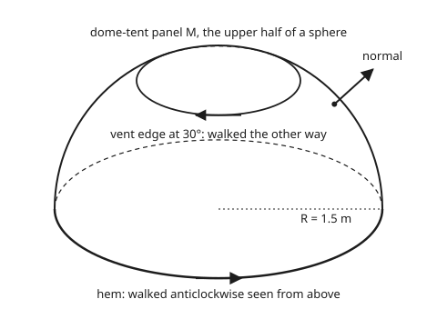

# Stokes on manifolds: a derivative inside equals the thing itself on the edge

[Syllabus](../../../SYLLABUS.md) → [Differential geometry and Lie groups](../README.md) → [Differential Forms](../README.md#s04) → Stokes on manifolds

---

## General Overview

A dome tent stands on the floor of a valley. Its fabric panel is the upper half of a sphere, 1.5 m in radius. Its hem is the circle where the fabric meets the ground.

Wind crosses the valley: a steady breeze of 3.0 m/s blowing east, plus an eddy that turns about the tent's centre pole. At the hem the eddy moves at 0.600 m/s, and it turns faster higher up.

Two people measure the wind on the tent in two different ways.

- **One walks the hem.** She adds up the wind's push along her path, once round. That total is the circulation: 5.654867 m²/s.
- **One never goes near the hem.** He measures how hard the wind spins at every point of the fabric, keeps the part that crosses the fabric, and adds it over the whole panel. He also gets 5.654867 m²/s.

The classical [Stokes' theorem](../../06-Calculus%20and%20analysis/09-Vector%20Calculus/08-stokes-theorem.md) already says this for surfaces in space. That card proves it by flattening the surface onto a rectangle of grid numbers and using Green's theorem there, and it checks the result on a hemispherical bowl. This card states the same fact for a shape of any dimension, written in differential forms, and proves it in that language.

**Integrating the exterior derivative of a form over a whole oriented manifold gives the same number as integrating the form itself over its edge.**

**What kind of fact this is:** a theorem, proved on this card in Why it works. It is global: it needs the whole manifold and its whole edge, with matched orientations.

### The picture: the panel, its hem and a vent

<p align="center"></p>

To scale, in an orthographic view from 25° above the horizon, 120 px per metre. The vent circle is 30° down from the top. The arrow is the panel's normal, at right angles to the fabric and pointing off the sphere. Dashed parts are hidden behind the fabric: the back half of the hem, and the vent circle's short back arc, longitudes 53.9° to 126.1°, just behind the top.

---

## The formula

Notation first, in words. These terms come from earlier cards on this shelf; each gets one line here.

- A **manifold with boundary** $`M`$ is a shape that looks like flat space near each inside point, and like a flat half-space near each edge point. The tent panel is a 2-manifold with boundary.
- Its **boundary** $`\partial M`$ (read "the boundary of M") is the set of edge points: the hem.
- A **differential form** of degree $`p`$, or **p-form** (written $`p`$ here, not the shelf's usual $`k`$, because $`k`$ is the eddy's rate), is a rule that measures signed $`p`$-dimensional pieces: lengths for $`p = 1`$, areas for $`p = 2`$ ([Differential form](01-forms-and-the-wedge-product.md)).
- The **exterior derivative** $`d`$ turns a $`p`$-form into a $`(p+1)`$-form: it measures how much the $`p`$-form collects round the edge of a tiny $`(p+1)`$-dimensional cell, per unit size of that cell ([Exterior derivative](03-exterior-derivative.md)).
- An **orientation** is a consistent choice of "positive turning" across the whole manifold ([Integration on an oriented manifold](05-integration-on-manifolds.md)).

The theorem, for an oriented smooth manifold with boundary $`M`$ of dimension $`n`$ and a smooth $`(n-1)`$-form $`\omega`$ on it with compact support (zero outside some closed, bounded part of $`M`$):

```math
\int_M d\omega \;=\; \int_{\partial M} \omega
```

**Read it aloud:** add up the derivative of omega over every point of M, and you get what omega itself adds up to round the edge of M.

The edge gets its orientation from $`M`$ by one rule, **outward first**. A list of edge directions counts as positive when an outward arrow put in front of it gives a positive list for $`M`$. The outward arrow lies along $`M`$ and points out of it across the edge. It is not the **normal**, the arrow at right angles to the fabric pointing off the sphere, which orients the tent panel: a pair of arrows along the fabric is positive when their cross product points along the normal. Step 4 applies the rule at the hem: walk it anticlockwise seen from above.

On the tent the wind is the 1-form

```math
\omega = (3 - k\,y)\,dx + k\,x\,dy, \qquad k = 0.4\,(1 + z/R)
```

where $`x`$ points east, $`y`$ north, $`z`$ up, all in metres from the tent's centre on the ground. The term $`3\,dx`$ is the breeze. The terms with $`k`$ are the eddy.

| Symbol | Plain meaning | In our example | Push it up and the answer… |
| --- | --- | --- | --- |
| $`M`$, $`\partial M`$; $`A`$, $`B`$ | the oriented manifold with boundary; its edge, oriented outward first; for a path, its start and end | the tent panel; the hem, anticlockwise from above; the half hem's east and west ends | a bigger panel on the same hem changes nothing |
| $`n`$; $`p`$ | the dimension of $`M`$; a form's degree | 2; $`p = 1`$ for $`\omega`$ | — (the theorem holds for every $`n`$) |
| $`\omega`$; $`f`$ | an $`(n-1)`$-form: here the wind's push per metre walked, in m^2/s once integrated; for $`n = 1`$, a function | $`(3 - ky)\,dx + kx\,dy`$; $`f = 3x`$ on the half hem | double it and both sides double |
| $`d\omega`$ | its exterior derivative: the spin crossing each small patch, per second | 1.600000 per second across the top | — |
| $`k`$ | the eddy's turning rate, per second | 0.4 at the ground, growing with height | scale its ground value 0.4 and both sides scale with it |
| $`R`$ | the panel's radius, in m | 1.5 | both sides grow as its square |
| $`x`$, $`y`$, $`z`$ | east, north and up from the tent's centre on the ground, in m | hem at $`z = 0`$ | — |
| $`\varphi`$, $`\theta`$; $`\partial_\varphi`$, $`\partial_\theta`$ | the globe chart: angle down from the top, and longitude east; its coordinate arrows, the velocity of a point as $`\varphi`$ or $`\theta`$ grows | hem at $`\varphi = 90°`$; at the hem due east, $`\partial_\varphi`$ points straight down and $`\partial_\theta`$ north | — |
| $`\rho`$ | the floor-disc chart: distance from the centre after projecting from the bottom of the sphere | 0 to 1.5 m | — (any chart gives the same integral) |
| $`F^*`$ | pullback: rewrite a form in a chart's numbers ([Pullback](02-pullback-and-change-of-variables.md)) | $`F^*\omega = 3\,dx + g\,d\theta`$ | — |
| $`g(\varphi)`$, $`g'(\varphi)`$ | the eddy's part of $`\omega`$ on the sphere, in m^2/s; its rate of change with $`\varphi`$ | 0.900000 at the hem | — |
| $`H^n`$; $`\psi_i`$ | the half-space, the model chart at an edge point; a partition of unity, smooth weights that add to 1 | a chart round a stretch of hem, $`n = 2`$; any such weights | — |

### When it holds

- **An oriented manifold.** A Möbius band has no orientation, so the inside integral is undefined, and outward first gives the edge no direction.
- **The induced orientation on the edge.** Walk the hem clockwise from above and the edge reads −5.654867 against 5.654867 inside.
- **The whole edge.** Cut a vent in the top and $`\partial M`$ has two circles. The hem alone reads 5.654867, but the vented panel holds only 3.016836.
- **A form smooth on all of $`M`$.** The angle form $`d\theta`$ round the centre pole has derivative 0 wherever it is defined. Yet the hem reads 6.283185, because the form breaks at the top of the tent.
- **Compact support.** The form must vanish outside some closed, bounded part of $`M`$. That is automatic here, since the panel itself is closed and bounded.

---

## Why it works

### Step 0: inside walls cancel

Cut $`M`$ into many tiny cells. On one tiny cell, $`d\omega`$ times the cell's size is what $`\omega`$ collects round the cell's edge: that is how the exterior derivative is built.

Now add over all the cells. A wall shared by two neighbouring cells is counted once from each side. Outward first gives it opposite orientations from the two sides, so the two counts cancel. Only walls on the edge of $`M`$ survive. So the sum of $`d\omega`$ inside equals the sum of $`\omega`$ on $`\partial M`$.

Steps 1 to 3 make this exact.

### Step 1: carry everything into a chart

An integral over $`M`$ is defined by pulling the form back to charts ([Integration on an oriented manifold](05-integration-on-manifolds.md)). Pullback also commutes with $`d`$: $`F^*(d\omega) = d(F^*\omega)`$ ([Pullback](02-pullback-and-change-of-variables.md)). So it is enough to prove the theorem in flat coordinates, on the half-space $`H^n`$: the points of $`\mathbb R^n`$ whose last coordinate is 0 or more.

### Step 2: in the half-space it is the fundamental theorem of calculus

Write the form in pieces, each missing one coordinate direction. Its derivative adds up how each piece changes along its missing direction.

Integrate each piece along that missing direction. The fundamental theorem of calculus says the integral of a rate is the change between the ends. For every direction along the edge, both ends are far out where the form is 0, so the piece gives 0. For the last direction, one end is far out and the other end sits on the edge. What is left is exactly the form on the edge, with the sign that outward first fixes.

<details>
<summary>Detailed proof: Stokes on the half-space</summary>

Let $`\omega`$ be a smooth $`(n-1)`$-form on $`H^n = \{x^n \ge 0\}`$, zero outside a bounded box. Here the upper indices are labels, not powers. Write it with a hat marking the missing factor:

$`\displaystyle \omega = \sum_{i=1}^{n} \omega_i\, dx^1 \wedge \cdots \wedge \widehat{dx^i} \wedge \cdots \wedge dx^n.`$

Then, moving $`dx^i`$ past $`i - 1`$ factors,

$`\displaystyle d\omega = \sum_{i=1}^{n} (-1)^{i-1} \frac{\partial \omega_i}{\partial x^i}\, dx^1 \wedge \cdots \wedge dx^n.`$

For $`i < n`$, integrate first in $`x^i`$ over the whole line. The result is $`\omega_i`$ at plus infinity minus $`\omega_i`$ at minus infinity, which is 0.

For $`i = n`$, integrate in $`x^n`$ from 0 to infinity. The result is $`-\omega_n(x^1, \ldots, x^{n-1}, 0)`$. Write $`x'`$ for the edge coordinates $`(x^1, \ldots, x^{n-1})`$. So

$`\displaystyle \int_{H^n} d\omega = (-1)^{n-1}(-1)\int_{\mathbb R^{n-1}} \omega_n(x', 0)\,dx' = (-1)^{n}\int_{\mathbb R^{n-1}} \omega_n(x', 0)\,dx'.`$

On the edge $`x^n = 0`$, every term with $`dx^n`$ vanishes, so only $`\omega_n\,dx^1 \wedge \cdots \wedge dx^{n-1}`$ is left. The outward arrow is $`-\partial_n`$. The list $`(-\partial_n, \partial_1, \ldots, \partial_{n-1})`$ takes $`n - 1`$ swaps to reach the standard order and has one minus sign, so its sign is $`(-1)^n`$. The edge's induced orientation is therefore $`(-1)^n`$ times the standard one on $`\mathbb R^{n-1}`$, and

$`\displaystyle \int_{\partial H^n} \omega = (-1)^n \int_{\mathbb R^{n-1}} \omega_n(x', 0)\,dx'.`$

The two sides agree. If the form also vanishes near the edge, both sides are 0, which covers a chart away from the boundary.

</details>

### Step 3: glue the charts with a partition of unity

A **partition of unity** is a set of smooth functions $`\psi_1, \psi_2, \ldots`$. Each is 0 or more and zero outside one chart, and together they add to 1 at every point ([Integration on an oriented manifold](05-integration-on-manifolds.md)). Then $`\omega = \sum \psi_i \omega`$, a finite sum because $`\omega`$ has compact support. Each piece lives in one chart, where Step 2 holds. Both sides of the theorem are sums over the pieces, so the theorem holds for $`\omega`$.

This is where every hypothesis is used. Orientation lets the chart integrals agree in sign. Smoothness lets $`d`$ act. Compact support keeps the sum finite and the far ends zero.

### Step 4: the tent, in a few lines of forms

On the sphere, use the globe chart: $`x = R\sin\varphi\cos\theta`$, $`y = R\sin\varphi\sin\theta`$, $`z = R\cos\varphi`$. Everywhere off the vertical axis, $`-y\,dx + x\,dy = (x^2 + y^2)\,d\theta`$. On the sphere that is $`R^2\sin^2\varphi\,d\theta`$. So the wind pulls back to

```math
F^*\omega = 3\,dx + g(\varphi)\,d\theta, \qquad g(\varphi) = 0.4\,R^2\,(1 + \cos\varphi)\,\sin^2\varphi .
```

**Read it aloud:** on the fabric, the wind is the breeze plus a longitude form whose strength depends only on how far down the slope the point is.

Now take $`d`$. The breeze gives $`d(3\,dx) = 0`$, since $`d`$ applied twice is 0. The eddy gives $`g'(\varphi)\,d\varphi \wedge d\theta`$. The order $`(\varphi, \theta)`$ is positive: $`\partial_\varphi \times \partial_\theta`$ is $`R^2 \sin\varphi`$ times the unit normal, so it points off the sphere. So

```math
\int_M d\omega = \int_0^{2\pi}\!\!\int_0^{\pi/2} g'(\varphi)\,d\varphi\,d\theta = 2\pi\,\bigl(g(\pi/2) - g(0)\bigr) = 2\pi\,(0.9 - 0) = 5.654867 .
```

The hem's direction comes from outward first. At the hem point due east, $`(R, 0, 0)`$, the arrow out of $`M`$ along the fabric points straight down: it is $`\partial_\varphi`$. Next comes $`\partial_\theta`$, pointing north. The pair $`(\partial_\varphi, \partial_\theta)`$ is positive, so the hem runs the way $`\theta`$ grows: anticlockwise seen from above.

On the hem, $`\varphi = \pi/2`$, so $`\omega = 3\,dx + 0.9\,d\theta`$. Round the hem $`3\,dx`$ adds to 0 and $`0.9\,d\theta`$ adds to $`2\pi \times 0.9`$. Same number.

The step $`g(\pi/2) - g(0)`$ is Step 2 in miniature: the fundamental theorem of calculus in $`\varphi`$. The term $`g(0)`$ is 0 because $`\sin 0 = 0`$. That zero is what goes wrong for the angle form in break 3.

### Step 5: one statement in every dimension

| Dimension $`n`$ | $`M`$ and $`\partial M`$ | What the theorem says |
| --- | --- | --- |
| 1 | a path, and its two end points | the fundamental theorem of calculus |
| 2, flat | a region of the plane, and its edge curve | Green's theorem |
| 2, curved | a surface, and its rim | the classical Stokes theorem |
| 3 | a solid, and its skin | the divergence theorem |

For $`n = 1`$, $`\omega`$ is a function $`f`$, and the edge of a path from $`A`$ to $`B`$ is $`B`$ counted plus and $`A`$ counted minus. On the tent: the breeze form $`3\,dx`$ is $`d(3x)`$. Walked along the half hem from east to west it gives −9.000000, and $`3x`$ at the ends gives $`3 \times (-1.5) - 3 \times 1.5`$ = −9.000000.

The flat, curved and solid rows are derived from this one statement in [Green, divergence and curl theorems](07-classical-vector-calculus-as-stokes.md).

---

## Worked numbers, by hand

| Step | Arithmetic | Value |
| --- | --- | --- |
| eddy speed at the hem | 0.4 per second × 1.5 m | 0.600 m/s |
| breeze's share, both sides | $`d(3\,dx) = 0`$; $`3\,dx`$ round a closed loop | 0.000000 |
| $`g`$ at the hem | 0.4 × 2.25 × (1 + 0) × 1 | 0.900000 |
| $`g`$ at the top | sin 0 = 0 | 0 |
| inside: $`2\pi(g(\pi/2) - g(0))`$ | 2π × 0.9 | **5.654867 m²/s** |
| hem: $`0.9\,d\theta`$ round once | 0.9 × 2π | **5.654867 m²/s** |
| cap down to 30° | 2π × 0.4 × 2.25 × 1.866025 × 0.25 = 2π × 0.419856 | 2.638031 |
| cap down to 60° | 2π × 0.4 × 2.25 × 1.5 × 0.75 = 2π × 1.012500 | 6.361725 |

The same rule holds for every cap: the spin through the fabric above any circle equals the wind's push round that circle. The 60° cap reads more than the whole panel, because the lower band's spin partly runs against the rest.

### What breaks if you drop a piece

| Mistake | Comes out at | What went wrong |
| --- | --- | --- |
| Hem walked clockwise from above | −5.654867 against 5.654867 | the edge's orientation was not induced outward first |
| Vent cut to 30°, hem counted alone | 5.654867 against 3.016836 inside | $`\partial M`$ has a second circle, walked the other way: −2.638031 |
| Angle form round the centre pole | 0.000000 inside, 6.283185 on the hem | the form breaks at the top; a circle 1° from the pole still carries 6.283185 |

The code prints all three.

---

## Code, from first principles, and it actually runs

The code takes three roads to the tent's number, and they share only two helpers: Simpson's rule and the difference quotient for a velocity. Road A walks the hem and adds $`\omega`$ with Simpson's rule, which adds evenly spaced samples weighted 1, 4, 2, 4, …, 4, 1, times a third of the spacing. Road B takes $`d\omega`$ in space by difference quotients (the change over a tiny step, divided by the step), then pulls it back to the globe chart. Road C pulls $`\omega`$ back to a second chart, the floor disc, and takes $`d`$ there. The globe chart pinches at the top. The floor-disc chart (stereographic projection: each point of the fabric sent to the floor along the line from the bottom of the sphere) covers the whole panel in one smooth piece. The code reads that disc in polar numbers $`\rho, \theta`$, which pinch at the top just as the globe chart does; the pinch is one point, with no area, so it does not change the integral. Road C agreeing with road B shows the integral does not depend on the chart. The hand value $`2\pi k R^2`$ is a fourth check, and road B at 4 and 8 strips shows the error closing.

### Python

```python
# Stokes on manifolds -- the check behind the card.  Standard library only.  The manifold M is a
# dome-tent panel: the upper half of a sphere, R = 1.5 m, whose edge (its hem) is the circle on the
# ground.  The valley wind is a one-form w = P dx + Q dy + S dz: a 3 m/s breeze east, plus an eddy
# turning at k = 0.4 per second at the ground and faster higher up.  Stokes: integral of dw over M
# equals integral of w round the hem.  Road A walks the hem.  Road B takes d in space, then pulls it
# back to the globe chart.  Road C pulls w back to a second chart, then takes d there.
import math
PI, R, K0, BREEZE = math.pi, 1.5, 0.4, 3.0

def simpson(f, a, b, n=64):                          # weights 1, 4, 2, ..., 4, 1 times spacing / 3
    h = (b - a) / n
    return h / 3 * sum((1 if j in (0, n) else 4 if j % 2 else 2) * f(a + j * h) for j in range(n + 1))

def wind(p):                                         # (P, Q, S): the form's dx, dy, dz parts, in m/s
    k = K0 * (1 + p[2] / R)
    return (BREEZE - k * p[1], k * p[0], 0.0)

def angle(p):                                        # the carousel's angle form d(theta), no units
    s = p[0] ** 2 + p[1] ** 2
    return (-p[1] / s, p[0] / s, 0.0)

def dot(a, b):
    return sum(x * y for x, y in zip(a, b))

def cross(a, b):
    return (a[1] * b[2] - a[2] * b[1], a[2] * b[0] - a[0] * b[2], a[0] * b[1] - a[1] * b[0])

def rate(f, t, h=1e-5):                              # velocity of a moving point, by difference quotient
    return [(a - b) / (2 * h) for a, b in zip(f(t + h), f(t - h))]

def d(w, p, h=1e-4):                                 # exterior derivative: the dy^dz, dz^dx, dx^dy parts
    def nudge(c, s):
        return [p[k] + s * h * (k == c) for k in range(3)]
    j = [[(w(nudge(c, 1))[i] - w(nudge(c, -1))[i]) / (2 * h) for c in range(3)] for i in range(3)]
    return (j[2][1] - j[1][2], j[0][2] - j[2][0], j[1][0] - j[0][1])

def edge(w, c, t0=0.0, t1=2 * PI, n=64):             # road A: add w along a curve
    return simpson(lambda t: dot(w(c(t)), rate(c, t)), t0, t1, n)

def circle(phi, turn=1):                             # the circle phi down from the top, anticlockwise from above
    return lambda t: (R * math.sin(phi) * math.cos(t), turn * R * math.sin(phi) * math.sin(t), R * math.cos(phi))

def globe(ph, th):                                   # chart one: angle down from the top, longitude
    return (R * math.sin(ph) * math.cos(th), R * math.sin(ph) * math.sin(th), R * math.cos(ph))

def stereo(rho, th):                                 # chart two: the floor disc, lifted from the bottom pole
    u, v, s = rho * math.cos(th), rho * math.sin(th), R * R + rho * rho
    return (2 * R * R * u / s, 2 * R * R * v / s, R * (R * R - rho * rho) / s)

def d_then_pull(w, chart, a0, a1, n=64):             # road B: d in space, pulled back by r_a x r_t
    def g(a, t):
        ra, rt = rate(lambda s: chart(s, t), a), rate(lambda s: chart(a, s), t)
        return dot(d(w, chart(a, t)), cross(ra, rt))
    return simpson(lambda a: simpson(lambda t: g(a, t), 0, 2 * PI, n), a0, a1, n)

def pull(w, chart, a, t):                            # the pulled-back form: its da and dt parts
    p = chart(a, t)
    return (dot(w(p), rate(lambda s: chart(s, t), a)), dot(w(p), rate(lambda s: chart(a, s), t)))

def pull_then_d(w, chart, a0, a1, n=96, h=1e-4):     # road C: d of the pullback, in the chart's numbers
    def g(a, t):
        db_da = (pull(w, chart, a + h, t)[1] - pull(w, chart, a - h, t)[1]) / (2 * h)
        da_dt = (pull(w, chart, a, t + h)[0] - pull(w, chart, a, t - h)[0]) / (2 * h)
        return db_da - da_dt
    return simpson(lambda a: simpson(lambda t: g(a, t), 0, 2 * PI, n), a0, a1, n)

def f(x):                                            # fixed decimals, with no minus sign on a zero
    return f"{0.0 if abs(x) < 5e-7 else x:.6f}"

def gee(ph):                                         # on the sphere, w = 3 dx + gee(phi) d(theta)
    return K0 * R ** 2 * (1 + math.cos(ph)) * math.sin(ph) ** 2

hand = 2 * PI * K0 * R ** 2
hem, A_breeze = edge(wind, circle(PI / 2)), edge(lambda p: (BREEZE, 0.0, 0.0), circle(PI / 2))
B, C = d_then_pull(wind, globe, 0, PI / 2), pull_then_d(wind, stereo, 0, R)
print(f"tent radius {R:.1f} m, R^2 {R * R:.2f} m^2; eddy speed at the hem {K0 * R:.3f} m/s; breeze {BREEZE:.1f} m/s east")
print(f"n = 1, breeze form 3 dx along the half hem, east to west: walked {f(edge(lambda p: (BREEZE, 0.0, 0.0), circle(PI / 2), 0, PI))}; "
      f"endpoints 3x(west) - 3x(east) = {f(BREEZE * (-R) - BREEZE * R)}")
print(f"road A, w round the hem: {f(hem)} m^2/s; the breeze's share {f(A_breeze)}")
print(f"road B, d then pull back, globe chart: {f(B)}")
print(f"road C, pull back then d, floor-disc chart: {f(C)}")
print(f"by hand, 2 pi k R^2 = {f(hand)}")
for deg in (30, 60, 90):
    ph = deg * PI / 180
    print(f"cap down to {deg:2d} deg: dw inside {f(d_then_pull(wind, globe, 0, ph))}; w round its edge "
          f"{f(edge(wind, circle(ph)))}; 2 pi gee {f(2 * PI * gee(ph))}; gee {f(gee(ph))}; "
          f"1 + cos {f(1 + math.cos(ph))}; sin^2 {f(math.sin(ph) ** 2)}")
for top in ((0.0, 0.0, R), (R, 0.0, 0.0)):
    print(f"dw at ({top[0]:.1f}, {top[1]:.1f}, {top[2]:.1f}): dy^dz, dz^dx, dx^dy = " + ", ".join(f(c) for c in d(wind, top)))
for n in (4, 8):
    print(f"road B with {n} Simpson strips a side: {f(d_then_pull(wind, globe, 0, PI / 2, n))}, "
          f"error {abs(d_then_pull(wind, globe, 0, PI / 2, n) - hand):.6f}")
rev = edge(wind, circle(PI / 2, -1))
vent_in, vent_edge = d_then_pull(wind, globe, PI / 6, PI / 2), edge(wind, circle(PI / 6, -1))
print(f"break 1, hem walked clockwise from above: {f(rev)} against {f(B)}")
print(f"break 2, vent cut down to 30 deg: dw inside {f(vent_in)}; hem alone {f(hem)}; "
      f"vent edge walked clockwise {f(vent_edge)}; both edges {f(hem + vent_edge)}")
ang_in = d_then_pull(angle, globe, PI / 180, PI / 2)
print(f"break 3, angle form: d at (1, 0.5, 0.8) " + ", ".join(f(c) for c in d(angle, (1, .5, .8)))
      + f"; dw inside, pole cut out {f(ang_in)}; hem {f(edge(angle, circle(PI / 2)))}; "
      f"circle 1 deg from the pole {f(edge(angle, circle(PI / 180)))}")
E, S, CX, CY = 25 * PI / 180, 120, 240, 230          # view 25 deg above the horizon, 120 px per m
scr = lambda p: (CX + S * p[0], CY - S * (p[1] * math.sin(E) + p[2] * math.cos(E)))
base, tip = scr(globe(PI / 4, 0)), scr([c * (R + 0.5) / R for c in globe(PI / 4, 0)])   # 0.5 m normal
hide = math.asin(math.tan(E) / math.tan(PI / 6))     # the vent circle is behind the top from hide to 180 deg - hide
v1, v2 = scr(circle(PI / 6)(hide)), scr(circle(PI / 6)(PI - hide))
print(f"figure, 120 px per m: hem ry {S * R * math.sin(E):.1f}; vent cy {scr((0, 0, R * math.cos(PI / 6)))[1]:.1f} "
      f"rx {S * R * math.sin(PI / 6):.1f} ry {S * R * math.sin(PI / 6) * math.sin(E):.1f}; "
      f"normal {base[0]:.1f},{base[1]:.1f} to {tip[0]:.1f},{tip[1]:.1f}; vent hidden {math.degrees(hide):.1f} "
      f"to {180 - math.degrees(hide):.1f} deg, {v1[0]:.1f},{v1[1]:.1f} to {v2[0]:.1f},{v2[1]:.1f}")
assert abs(hem - B) < 1e-6 and abs(hem - C) < 1e-6           # three roads, one number
assert abs(B - hand) < 1e-6 and abs(A_breeze) < 1e-9          # the hand count; an exact form round a closed loop
assert abs(vent_in - (hem + vent_edge)) < 1e-6 and abs(vent_in - (hand - 2 * PI * gee(PI / 6))) < 1e-6
assert rev < 0 and abs(ang_in) < 1e-6 and abs(edge(angle, circle(PI / 2)) - 2 * PI) < 1e-9
print("ALL CHECKS PASS")
```

**Ran 2026-11-19 on macOS, Python 3.14.10, standard library only. All checks passed. Output, pasted from the run:**

```
tent radius 1.5 m, R^2 2.25 m^2; eddy speed at the hem 0.600 m/s; breeze 3.0 m/s east
n = 1, breeze form 3 dx along the half hem, east to west: walked -9.000000; endpoints 3x(west) - 3x(east) = -9.000000
road A, w round the hem: 5.654867 m^2/s; the breeze's share 0.000000
road B, d then pull back, globe chart: 5.654867
road C, pull back then d, floor-disc chart: 5.654867
by hand, 2 pi k R^2 = 5.654867
cap down to 30 deg: dw inside 2.638031; w round its edge 2.638031; 2 pi gee 2.638031; gee 0.419856; 1 + cos 1.866025; sin^2 0.250000
cap down to 60 deg: dw inside 6.361725; w round its edge 6.361725; 2 pi gee 6.361725; gee 1.012500; 1 + cos 1.500000; sin^2 0.750000
cap down to 90 deg: dw inside 5.654867; w round its edge 5.654867; 2 pi gee 5.654867; gee 0.900000; 1 + cos 1.000000; sin^2 1.000000
dw at (0.0, 0.0, 1.5): dy^dz, dz^dx, dx^dy = 0.000000, 0.000000, 1.600000
dw at (1.5, 0.0, 0.0): dy^dz, dz^dx, dx^dy = -0.400000, 0.000000, 0.800000
road B with 4 Simpson strips a side: 5.685622, error 0.030755
road B with 8 Simpson strips a side: 5.656602, error 0.001735
break 1, hem walked clockwise from above: -5.654867 against 5.654867
break 2, vent cut down to 30 deg: dw inside 3.016836; hem alone 5.654867; vent edge walked clockwise -2.638031; both edges 3.016836
break 3, angle form: d at (1, 0.5, 0.8) 0.000000, 0.000000, 0.000000; dw inside, pole cut out 0.000000; hem 6.283185; circle 1 deg from the pole 6.283185
figure, 120 px per m: hem ry 76.1; vent cy 88.7 rx 90.0 ry 38.0; normal 367.3,114.6 to 409.7,76.2; vent hidden 53.9 to 126.1 deg, 293.1,58.0 to 186.9,58.0
ALL CHECKS PASS
```

### Rust

Same numbers, same labels, built with `rustc --edition 2021 -O`.

```rust
// Stokes on manifolds -- the same check as the Python, in Rust.  No crates.  The manifold M is a
// dome-tent panel: the upper half of a sphere, R = 1.5 m, whose edge (its hem) is the circle on the
// ground.  The valley wind is a one-form w = P dx + Q dy + S dz: a 3 m/s breeze east, plus an eddy
// turning at k = 0.4 per second at the ground and faster higher up.  Stokes: integral of dw over M
// equals integral of w round the hem.  Road A walks the hem.  Road B takes d in space, then pulls it
// back to the globe chart.  Road C pulls w back to a second chart, then takes d there.
use std::f64::consts::PI;
const R: f64 = 1.5;
const K0: f64 = 0.4;
const BREEZE: f64 = 3.0;
type V = [f64; 3];
type Form = dyn Fn(V) -> V;
type Chart = fn(f64, f64) -> V;

fn simpson(f: &dyn Fn(f64) -> f64, a: f64, b: f64, n: usize) -> f64 {
    let h = (b - a) / n as f64;
    let mut s = 0.0;
    for j in 0..=n {
        let wt = if j == 0 || j == n { 1.0 } else if j % 2 == 1 { 4.0 } else { 2.0 };
        s += wt * f(a + j as f64 * h);
    }
    h / 3.0 * s
}
fn wind(p: V) -> V { let k = K0 * (1.0 + p[2] / R); [BREEZE - k * p[1], k * p[0], 0.0] }
fn breeze(_p: V) -> V { [BREEZE, 0.0, 0.0] }
fn angle(p: V) -> V { let s = p[0] * p[0] + p[1] * p[1]; [-p[1] / s, p[0] / s, 0.0] }
fn dot(a: V, b: V) -> f64 { a[0] * b[0] + a[1] * b[1] + a[2] * b[2] }
fn cross(a: V, b: V) -> V {
    [a[1] * b[2] - a[2] * b[1], a[2] * b[0] - a[0] * b[2], a[0] * b[1] - a[1] * b[0]]
}
fn rate(f: &dyn Fn(f64) -> V, t: f64) -> V {      // velocity of a moving point, by difference quotient
    let h = 1e-5;
    let (a, b) = (f(t + h), f(t - h));
    [(a[0] - b[0]) / (2.0 * h), (a[1] - b[1]) / (2.0 * h), (a[2] - b[2]) / (2.0 * h)]
}
fn d(w: &Form, p: V) -> V {                        // exterior derivative: the dy^dz, dz^dx, dx^dy parts
    let h = 1e-4;
    let mut j = [[0.0; 3]; 3];
    for c in 0..3 {
        let (mut up, mut dn) = (p, p);
        up[c] += h;
        dn[c] -= h;
        let (a, b) = (w(up), w(dn));
        for i in 0..3 { j[i][c] = (a[i] - b[i]) / (2.0 * h) }
    }
    [j[2][1] - j[1][2], j[0][2] - j[2][0], j[1][0] - j[0][1]]
}
fn edge(w: &Form, c: &dyn Fn(f64) -> V, t0: f64, t1: f64) -> f64 {   // road A: add w along a curve
    simpson(&|t| dot(w(c(t)), rate(c, t)), t0, t1, 64)
}
fn circle(phi: f64, turn: f64) -> impl Fn(f64) -> V {
    move |t| [R * phi.sin() * t.cos(), turn * R * phi.sin() * t.sin(), R * phi.cos()]
}
fn globe(ph: f64, th: f64) -> V { [R * ph.sin() * th.cos(), R * ph.sin() * th.sin(), R * ph.cos()] }
fn stereo(rho: f64, th: f64) -> V {               // chart two: the floor disc, lifted from the bottom pole
    let (u, v, s) = (rho * th.cos(), rho * th.sin(), R * R + rho * rho);
    [2.0 * R * R * u / s, 2.0 * R * R * v / s, R * (R * R - rho * rho) / s]
}
fn d_then_pull(w: &Form, chart: Chart, a0: f64, a1: f64, n: usize) -> f64 {   // road B
    let g = |a: f64, t: f64| {
        let (ra, rt) = (rate(&|s| chart(s, t), a), rate(&|s| chart(a, s), t));
        dot(d(w, chart(a, t)), cross(ra, rt))
    };
    simpson(&|a| simpson(&|t| g(a, t), 0.0, 2.0 * PI, n), a0, a1, n)
}
fn pull(w: &Form, chart: Chart, a: f64, t: f64) -> [f64; 2] {   // the pulled-back form: da, dt parts
    let p = chart(a, t);
    [dot(w(p), rate(&|s| chart(s, t), a)), dot(w(p), rate(&|s| chart(a, s), t))]
}
fn pull_then_d(w: &Form, chart: Chart, a0: f64, a1: f64) -> f64 {           // road C
    let h = 1e-4;
    let g = |a: f64, t: f64| {
        (pull(w, chart, a + h, t)[1] - pull(w, chart, a - h, t)[1]) / (2.0 * h)
            - (pull(w, chart, a, t + h)[0] - pull(w, chart, a, t - h)[0]) / (2.0 * h)
    };
    simpson(&|a| simpson(&|t| g(a, t), 0.0, 2.0 * PI, 96), a0, a1, 96)
}
fn f(x: f64) -> String { format!("{:.6}", if x.abs() < 5e-7 { 0.0 } else { x }) }
fn gee(ph: f64) -> f64 { K0 * R * R * (1.0 + ph.cos()) * ph.sin().powi(2) }
fn three(v: V) -> String { format!("{}, {}, {}", f(v[0]), f(v[1]), f(v[2])) }

fn main() {
    let hand = 2.0 * PI * K0 * R * R;
    let (hem, a_breeze) = (edge(&wind, &circle(PI / 2.0, 1.0), 0.0, 2.0 * PI), edge(&breeze, &circle(PI / 2.0, 1.0), 0.0, 2.0 * PI));
    let (b, c) = (d_then_pull(&wind, globe, 0.0, PI / 2.0, 64), pull_then_d(&wind, stereo, 0.0, R));
    println!("tent radius {:.1} m, R^2 {:.2} m^2; eddy speed at the hem {:.3} m/s; breeze {:.1} m/s east", R, R * R, K0 * R, BREEZE);
    println!("n = 1, breeze form 3 dx along the half hem, east to west: walked {}; endpoints 3x(west) - 3x(east) = {}",
             f(edge(&breeze, &circle(PI / 2.0, 1.0), 0.0, PI)), f(BREEZE * (-R) - BREEZE * R));
    println!("road A, w round the hem: {} m^2/s; the breeze's share {}", f(hem), f(a_breeze));
    println!("road B, d then pull back, globe chart: {}", f(b));
    println!("road C, pull back then d, floor-disc chart: {}", f(c));
    println!("by hand, 2 pi k R^2 = {}", f(hand));
    for deg in [30, 60, 90] {
        let ph = deg as f64 * PI / 180.0;
        println!("cap down to {:2} deg: dw inside {}; w round its edge {}; 2 pi gee {}; gee {}; 1 + cos {}; sin^2 {}", deg,
                 f(d_then_pull(&wind, globe, 0.0, ph, 64)), f(edge(&wind, &circle(ph, 1.0), 0.0, 2.0 * PI)),
                 f(2.0 * PI * gee(ph)), f(gee(ph)), f(1.0 + ph.cos()), f(ph.sin().powi(2)));
    }
    for top in [[0.0, 0.0, R], [R, 0.0, 0.0]] {
        println!("dw at ({:.1}, {:.1}, {:.1}): dy^dz, dz^dx, dx^dy = {}", top[0], top[1], top[2], three(d(&wind, top)));
    }
    for n in [4, 8] {
        let v = d_then_pull(&wind, globe, 0.0, PI / 2.0, n);
        println!("road B with {} Simpson strips a side: {}, error {:.6}", n, f(v), (v - hand).abs());
    }
    let rev = edge(&wind, &circle(PI / 2.0, -1.0), 0.0, 2.0 * PI);
    let vent_in = d_then_pull(&wind, globe, PI / 6.0, PI / 2.0, 64);
    let vent_edge = edge(&wind, &circle(PI / 6.0, -1.0), 0.0, 2.0 * PI);
    println!("break 1, hem walked clockwise from above: {} against {}", f(rev), f(b));
    println!("break 2, vent cut down to 30 deg: dw inside {}; hem alone {}; vent edge walked clockwise {}; both edges {}",
             f(vent_in), f(hem), f(vent_edge), f(hem + vent_edge));
    let ang_in = d_then_pull(&angle, globe, PI / 180.0, PI / 2.0, 64);
    let ang_hem = edge(&angle, &circle(PI / 2.0, 1.0), 0.0, 2.0 * PI);
    println!("break 3, angle form: d at (1, 0.5, 0.8) {}; dw inside, pole cut out {}; hem {}; circle 1 deg from the pole {}",
             three(d(&angle, [1.0, 0.5, 0.8])), f(ang_in), f(ang_hem),
             f(edge(&angle, &circle(PI / 180.0, 1.0), 0.0, 2.0 * PI)));
    let (e, s, cx, cy) = (25.0 * PI / 180.0, 120.0, 240.0, 230.0);   // view 25 deg above the horizon
    let scr = |p: V| [cx + s * p[0], cy - s * (p[1] * e.sin() + p[2] * e.cos())];
    let g45 = globe(PI / 4.0, 0.0);
    let (base, tip) = (scr(g45), scr([g45[0] * (R + 0.5) / R, g45[1] * (R + 0.5) / R, g45[2] * (R + 0.5) / R]));
    let hide = (e.tan() / (PI / 6.0).tan()).asin();   // the vent circle is behind the top from hide to 180 deg - hide
    let (v1, v2) = (scr(circle(PI / 6.0, 1.0)(hide)), scr(circle(PI / 6.0, 1.0)(PI - hide)));
    println!("figure, 120 px per m: hem ry {:.1}; vent cy {:.1} rx {:.1} ry {:.1}; normal {:.1},{:.1} to {:.1},{:.1}; vent hidden {:.1} to {:.1} deg, {:.1},{:.1} to {:.1},{:.1}",
             s * R * e.sin(), scr([0.0, 0.0, R * (PI / 6.0).cos()])[1], s * R * (PI / 6.0).sin(),
             s * R * (PI / 6.0).sin() * e.sin(), base[0], base[1], tip[0], tip[1],
             hide.to_degrees(), 180.0 - hide.to_degrees(), v1[0], v1[1], v2[0], v2[1]);
    assert!((hem - b).abs() < 1e-6 && (hem - c).abs() < 1e-6);          // three roads, one number
    assert!((b - hand).abs() < 1e-6 && a_breeze.abs() < 1e-9);         // the hand count; an exact form round a closed loop
    assert!((vent_in - (hem + vent_edge)).abs() < 1e-6 && (vent_in - (hand - 2.0 * PI * gee(PI / 6.0))).abs() < 1e-6);
    assert!(rev < 0.0 && ang_in.abs() < 1e-6 && (ang_hem - 2.0 * PI).abs() < 1e-9);
    println!("ALL CHECKS PASS");
}
```

**Ran 2026-11-19 on macOS, rustc 1.98.1, no crates. All checks passed. Output, pasted from the run:**

```
tent radius 1.5 m, R^2 2.25 m^2; eddy speed at the hem 0.600 m/s; breeze 3.0 m/s east
n = 1, breeze form 3 dx along the half hem, east to west: walked -9.000000; endpoints 3x(west) - 3x(east) = -9.000000
road A, w round the hem: 5.654867 m^2/s; the breeze's share 0.000000
road B, d then pull back, globe chart: 5.654867
road C, pull back then d, floor-disc chart: 5.654867
by hand, 2 pi k R^2 = 5.654867
cap down to 30 deg: dw inside 2.638031; w round its edge 2.638031; 2 pi gee 2.638031; gee 0.419856; 1 + cos 1.866025; sin^2 0.250000
cap down to 60 deg: dw inside 6.361725; w round its edge 6.361725; 2 pi gee 6.361725; gee 1.012500; 1 + cos 1.500000; sin^2 0.750000
cap down to 90 deg: dw inside 5.654867; w round its edge 5.654867; 2 pi gee 5.654867; gee 0.900000; 1 + cos 1.000000; sin^2 1.000000
dw at (0.0, 0.0, 1.5): dy^dz, dz^dx, dx^dy = 0.000000, 0.000000, 1.600000
dw at (1.5, 0.0, 0.0): dy^dz, dz^dx, dx^dy = -0.400000, 0.000000, 0.800000
road B with 4 Simpson strips a side: 5.685622, error 0.030755
road B with 8 Simpson strips a side: 5.656602, error 0.001735
break 1, hem walked clockwise from above: -5.654867 against 5.654867
break 2, vent cut down to 30 deg: dw inside 3.016836; hem alone 5.654867; vent edge walked clockwise -2.638031; both edges 3.016836
break 3, angle form: d at (1, 0.5, 0.8) 0.000000, 0.000000, 0.000000; dw inside, pole cut out 0.000000; hem 6.283185; circle 1 deg from the pole 6.283185
figure, 120 px per m: hem ry 76.1; vent cy 88.7 rx 90.0 ry 38.0; normal 367.3,114.6 to 409.7,76.2; vent hidden 53.9 to 126.1 deg, 293.1,58.0 to 186.9,58.0
ALL CHECKS PASS
```

The two outputs match line for line.

### Lean

Lean proves Stokes on the half-space $`H^n`$ in every dimension $`n`$, and the eddy's part on the tent in the globe chart.

- Take a smooth $`(n-1)`$-form $`\omega`$ on $`H^n`$ that is zero outside a closed, bounded set. Then $`\int_{H^n} d\omega`$ equals $`\int_{\partial H^n} \omega`$, with the edge oriented outward first. In edge coordinates, outward first is the sign $`(-1)^n`$ from the detailed proof.
- Take a cap down to any angle $`a`$ from the top. Then the eddy's spin added over the cap equals $`g(a)\,d\theta`$ added once round the cap's edge.
- Take the whole panel, down to the hem. Then both sides equal $`2\pi \times 0.9`$ m^2/s.
- The eddy speed at the hem is 0.4 per second × 1.5 m = 0.6 m/s.
- $`g`$ at the hem is 0.4 × 2.25 × (1 + 0) × 1 = 0.9.
- For the cap down to 60°, 0.4 × 2.25 × 1.5 × 0.75 = 1.0125.
- For $`n = 1`$, the breeze along the half hem gives 3 × (−1.5) − 3 × 1.5 = −9.

Steps 1 and 3, tested only on the tent, plus the three roads, breaks and figure, are left to the Python and Rust checks.

```lean
-- Stokes on manifolds: integrating d of a compactly supported smooth form over the half-space equals integrating the form over its edge with the outward-first orientation, and the dome-tent check agrees.
import Mathlib.Analysis.Calculus.DifferentialForm.Basic
import Mathlib.Analysis.SpecialFunctions.Trigonometric.Deriv
import Mathlib.MeasureTheory.Integral.Bochner.Set
import Mathlib.MeasureTheory.Integral.IntervalIntegral.Basic
import Mathlib.MeasureTheory.Measure.Lebesgue.Basic
import Mathlib.MeasureTheory.Integral.DivergenceTheorem
import Mathlib.MeasureTheory.Integral.IntervalIntegral.FundThmCalculus

open MeasureTheory Real

/-- The half-space `H` in dimension `n + 1`: points whose last coordinate is `0` or more.
Its edge is the hyperplane where the last coordinate is `0`. -/
def halfSpace (n : ℕ) : Set (Fin (n + 1) → ℝ) := {x | 0 ≤ x (Fin.last n)}

/-- Stokes' theorem on the half-space, the model chart at every edge point of a manifold with
boundary (the card's Step 2). Let `ω` be a smooth `n`-form on the half-space `H` of dimension
`n + 1`, zero outside a closed, bounded set. Then integrating its exterior derivative `dω` over `H`
(standard orientation) gives the same number as integrating `ω` over the edge `∂H`, oriented
outward first. Written in the edge coordinates `y`, outward first gives the edge the sign
`(-1)^(n+1)` times the standard orientation, which is the factor on the right. -/
theorem stokes_on_half_space {n : ℕ}
    (ω : (Fin (n + 1) → ℝ) → (Fin (n + 1) → ℝ) [⋀^Fin n]→L[ℝ] ℝ)
    (hsmooth : ContDiffOn ℝ ((⊤ : ℕ∞) : WithTop ℕ∞) ω (halfSpace n))
    (hsupp : ∃ K : Set (Fin (n + 1) → ℝ), IsCompact K ∧ ∀ x ∈ halfSpace n, x ∉ K → ω x = 0) :
    ∫ x in halfSpace n, extDerivWithin ω (halfSpace n) x (fun i => Pi.single i 1) =
      (-1) ^ (n + 1) *
        ∫ y : Fin n → ℝ, ω (Fin.snoc y 0) (fun i => Pi.single (Fin.castSucc i) 1) := by
  classical
  obtain ⟨K, hK, hKz⟩ := hsupp
  obtain ⟨R, hR⟩ := hK.isBounded.subset_closedBall 0
  set H := halfSpace n with hH_def
  set e : Fin (n + 1) → Fin (n + 1) → ℝ := fun i => Pi.single i 1 with he_def
  set r : ℝ := max R 0 + 1 with hr_def
  have hr0 : 0 < r := by positivity
  have hRr : R < r := by have := le_max_left R 0; linarith
  -- basic facts about the half-space
  have hHconv : Convex ℝ H := by
    intro x hx y hy s t hs ht _
    simp only [hH_def, halfSpace, Set.mem_ofPred_eq, Pi.add_apply, Pi.smul_apply, smul_eq_mul] at *
    positivity
  have hHopen : IsOpen {x : Fin (n + 1) → ℝ | 0 < x (Fin.last n)} :=
    isOpen_lt continuous_const (continuous_apply _)
  have hsubH : {x : Fin (n + 1) → ℝ | 0 < x (Fin.last n)} ⊆ H := by
    intro y (hy : (0 : ℝ) < y (Fin.last n))
    exact hy.le
  have hHint : (interior H).Nonempty := by
    refine ⟨fun _ => 1, interior_maximal hsubH hHopen ?_⟩
    show (0 : ℝ) < 1
    exact one_pos
  have hU : UniqueDiffOn ℝ H := uniqueDiffOn_convex hHconv hHint
  have hHmeas : MeasurableSet H :=
    (isClosed_le continuous_const (continuous_apply (Fin.last n))).measurableSet
  have hωc : ContinuousOn ω H := hsmooth.continuousOn
  have hωd : DifferentiableOn ℝ ω H := hsmooth.differentiableOn (by simp)
  -- ω vanishes far out
  have hzero : ∀ x ∈ H, R < ‖x‖ → ω x = 0 := by
    intro x hx hxR
    refine hKz x hx (fun hxK => ?_)
    have := hR hxK
    rw [Metric.mem_closedBall, dist_zero_right] at this
    linarith
  have hcoord : ∀ (x : Fin (n + 1) → ℝ) (i : Fin (n + 1)), r ≤ |x i| → R < ‖x‖ := by
    intro x i hi
    have := norm_le_pi_norm x i
    rw [Real.norm_eq_abs] at this
    linarith
  have hdzero : ∀ x ∈ H, R < ‖x‖ → extDerivWithin ω H x = 0 := by
    intro x hx hxR
    have hev : ω =ᶠ[nhdsWithin x H] (fun _ => 0) := by
      have : {y : Fin (n + 1) → ℝ | R < ‖y‖} ∈ nhds x :=
        (isOpen_lt continuous_const continuous_norm).mem_nhds hxR
      filter_upwards [self_mem_nhdsWithin, nhdsWithin_le_nhds this] with y hyH hyR
        using hzero y hyH hyR
    rw [hev.extDerivWithin_eq_of_mem hx]
    ext v
    simp [extDerivWithin, ContinuousAlternatingMap.alternatizeUncurryFin_apply]
  -- the box
  set a : Fin (n + 1) → ℝ := fun i => if i = Fin.last n then 0 else -r with ha_def
  set b : Fin (n + 1) → ℝ := fun _ => r with hb_def
  have hab : a ≤ b := by
    intro i
    simp only [ha_def, hb_def]
    split_ifs <;> linarith
  have hboxH : Set.Icc a b ⊆ H := by
    intro x hx
    have := hx.1 (Fin.last n)
    simpa [ha_def, hH_def, halfSpace] using this
  -- Step A: shrink the domain to the box
  have hA : ∫ x in H, extDerivWithin ω H x e = ∫ x in Set.Icc a b, extDerivWithin ω H x e := by
    refine setIntegral_eq_of_subset_of_forall_sdiff_eq_zero hHmeas hboxH ?_
    rintro x ⟨hxH, hxI⟩
    have : ∃ i, r ≤ |x i| := by
      by_contra hcon
      push Not at hcon
      apply hxI
      constructor
      · intro i
        simp only [ha_def]
        split_ifs with h
        · subst h; exact hxH
        · have := hcon i; rw [abs_lt] at this; linarith
      · intro i
        have := hcon i; rw [abs_lt] at this; simp only [hb_def]; linarith
    obtain ⟨i, hi⟩ := this
    rw [hdzero x hxH (hcoord x i hi)]
    rfl
  -- the pieces
  let f : Fin (n + 1) → (Fin (n + 1) → ℝ) → ℝ := fun i x => ((-1 : ℤ) ^ (i : ℕ)) • ω x (i.removeNth e)
  let f' : Fin (n + 1) → (Fin (n + 1) → ℝ) → (Fin (n + 1) → ℝ) →L[ℝ] ℝ :=
    fun i x => ((-1 : ℤ) ^ (i : ℕ)) • fderivWithin ℝ (fun y => ω y (i.removeNth e)) H x
  have hB : Set.EqOn (fun x => extDerivWithin ω H x e) (fun x => ∑ i, f' i x (Pi.single i 1))
      (Set.Icc a b) := by
    intro x hx
    simp only [f', smul_apply]
    exact extDerivWithin_apply (hωd x (hboxH hx)) (hU x (hboxH hx)) e
  have hcont : ContinuousOn (fun x => extDerivWithin ω H x e) H := by
    have h1 : ContinuousOn (fderivWithin ℝ ω H) H :=
      hsmooth.continuousOn_fderivWithin hU (by simp)
    have h2 : ContinuousOn (fun x =>
        ContinuousAlternatingMap.alternatizeUncurryFinCLM ℝ _ ℝ (fderivWithin ℝ ω H x)) H :=
      (ContinuousLinearMap.continuous _).comp_continuousOn h1
    simp only [ContinuousAlternatingMap.alternatizeUncurryFinCLM_apply] at h2
    exact (continuous_eval_const e).comp_continuousOn h2
  have hInt : IntegrableOn (fun x => ∑ i, f' i x (Pi.single i 1)) (Set.Icc a b) :=
    ((hcont.mono hboxH).integrableOn_compact isCompact_Icc).congr_fun hB measurableSet_Icc
  have hfc : ∀ i, ContinuousOn (f i) (Set.Icc a b) := by
    intro i
    have h1 : ContinuousOn (fun x => ω x (i.removeNth e)) H :=
      (continuous_eval_const _).comp_continuousOn hωc
    exact (h1.const_smul ((-1 : ℤ) ^ (i : ℕ))).mono hboxH
  have hfd : ∀ x ∈ (Set.univ.pi fun i => Set.Ioo (a i) (b i)) \ ∅, ∀ i,
      HasFDerivAt (f i) (f' i x) x := by
    intro x hx i
    have hxl : 0 < x (Fin.last n) := by
      have := (hx.1 (Fin.last n) (Set.mem_univ _)).1
      simpa [ha_def] using this
    have hnhds : H ∈ nhds x :=
      Filter.mem_of_superset (hHopen.mem_nhds hxl) hsubH
    have hda : DifferentiableAt ℝ ω x := (hωd x (mem_of_mem_nhds hnhds)).differentiableAt hnhds
    have hg : DifferentiableAt ℝ (fun y => ω y (i.removeNth e)) x :=
      hda.continuousAlternatingMap_apply_const _
    simp only [f', fderivWithin_of_mem_nhds hnhds]
    exact hg.hasFDerivAt.const_smul ((-1 : ℤ) ^ (i : ℕ))
  have hC := integral_divergence_of_hasFDerivAt_off_countable' a b hab f f' ∅ Set.countable_empty
    hfc hfd hInt
  have hfront : ∀ i, ∫ y in Set.Icc (a ∘ i.succAbove) (b ∘ i.succAbove),
      f i (i.insertNth (b i) y) = 0 := by
    intro i
    refine setIntegral_eq_zero_of_forall_eq_zero (fun y hy => ?_)
    have hmem : i.insertNth (b i) y ∈ Set.Icc a b :=
      Fin.insertNth_mem_Icc.2 ⟨⟨hab i, le_rfl⟩, hy⟩
    have : ω (i.insertNth (b i) y) = 0 :=
      hzero _ (hboxH hmem) (hcoord _ i (by simp [hb_def, abs_of_pos hr0]))
    simp [f, this]
  have hback : ∀ i, i ≠ Fin.last n → ∫ y in Set.Icc (a ∘ i.succAbove) (b ∘ i.succAbove),
      f i (i.insertNth (a i) y) = 0 := by
    intro i hi
    refine setIntegral_eq_zero_of_forall_eq_zero (fun y hy => ?_)
    have hmem : i.insertNth (a i) y ∈ Set.Icc a b :=
      Fin.insertNth_mem_Icc.2 ⟨⟨le_rfl, hab i⟩, hy⟩
    have : ω (i.insertNth (a i) y) = 0 :=
      hzero _ (hboxH hmem) (hcoord _ i (by simp [ha_def, hi, abs_of_pos hr0]))
    simp [f, this]
  rw [hA, setIntegral_congr_fun measurableSet_Icc hB, hC, Finset.sum_eq_single (Fin.last n)
    (fun i _ hi => by rw [hfront i, hback i hi, sub_self]) (by simp), hfront]
  have hface : Set.Icc (a ∘ (Fin.last n).succAbove) (b ∘ (Fin.last n).succAbove) =
      Set.Icc (fun _ => -r) (fun _ => r) := by
    congr 1
    · ext j; simp [ha_def, Fin.succAbove_last, Fin.castSucc_ne_last]
  have hal : a (Fin.last n) = 0 := by simp [ha_def]
  rw [hface, hal]
  have hfl : ∀ y : Fin n → ℝ, f (Fin.last n) ((Fin.last n).insertNth 0 y) =
      (-1) ^ n * ω (Fin.snoc y 0) (fun i => Pi.single (Fin.castSucc i) 1) := by
    intro y
    simp only [f, Fin.insertNth_last', Fin.val_last, zsmul_eq_mul, Int.cast_pow, Int.cast_neg,
      Int.cast_one, Fin.removeNth_last]
    rfl
  simp_rw [hfl]
  rw [setIntegral_eq_integral_of_forall_compl_eq_zero, integral_const_mul]
  · ring
  · intro y hy
    have : ∃ j, r ≤ |y j| := by
      by_contra hcon
      push Not at hcon
      apply hy
      constructor
      · intro j; have := hcon j; rw [abs_lt] at this; linarith
      · intro j; have := hcon j; rw [abs_lt] at this; linarith
    obtain ⟨j, hj⟩ := this
    have hH0 : (Fin.snoc y 0 : Fin (n + 1) → ℝ) ∈ H := by
      simp [hH_def, halfSpace]
    have h0 : ω (Fin.snoc y 0) = 0 :=
      hzero _ hH0 (hcoord _ (Fin.castSucc j) (by simpa using hj))
    simp [h0]

/-- The eddy's part of the wind on the tent, in the globe chart: `ω = 3 dx + g(φ) dθ`, with
`g(φ) = 0.4 R² (1 + cos φ) sin² φ` and `R = 1.5 m`. -/
noncomputable def tentG (φ : ℝ) : ℝ := 2 / 5 * (3 / 2) ^ 2 * (1 + cos φ) * sin φ ^ 2

/-- `tentG` is smooth enough to differentiate once with a continuous derivative. -/
theorem tentG_contDiff : ContDiff ℝ 1 tentG := by
  unfold tentG
  fun_prop

/-- Since `tentG 0 = 0`, adding up `tentG'` from `0` to `a` gives `tentG a`. -/
theorem tentG_integral_deriv (a : ℝ) : ∫ φ in (0 : ℝ)..a, deriv tentG φ = tentG a := by
  rw [intervalIntegral.integral_deriv_eq_sub
    (fun x _ => (tentG_contDiff.differentiable one_ne_zero) x)
    ((tentG_contDiff.continuous_deriv le_rfl).intervalIntegrable _ _)]
  simp [tentG]

#print axioms tentG_contDiff
#print axioms tentG_integral_deriv

/-- Stokes on every cap of the tent: the spin `dω = g'(φ) dφ ∧ dθ` added over the cap from the
top down to angle `a` equals the wind `g(a) dθ` added once round the cap's edge circle. -/
theorem tent_cap_stokes (a : ℝ) :
    (∫ θ in (0 : ℝ)..2 * π, ∫ φ in (0 : ℝ)..a, deriv tentG φ) =
      ∫ θ in (0 : ℝ)..2 * π, tentG a := by
  simp only [tentG_integral_deriv]

/-- The whole tent panel: both sides of Stokes equal `2π × 0.9` m²/s. -/
theorem tent_panel_value :
    (∫ θ in (0 : ℝ)..2 * π, ∫ φ in (0 : ℝ)..π / 2, deriv tentG φ) = 2 * π * (9 / 10) := by
  simp only [tentG_integral_deriv, intervalIntegral.integral_const, smul_eq_mul]
  simp [tentG]
  norm_num

-- eddy speed at the hem: 0.4 per second × 1.5 m = 0.6 m/s
example : (2 / 5 : ℚ) * (3 / 2) = 3 / 5 := by norm_num
-- g at the hem: 0.4 × 2.25 × (1 + 0) × 1 = 0.9
example : (2 / 5 : ℚ) * (3 / 2) ^ 2 * (1 + 0) * 1 = 9 / 10 := by norm_num
-- cap down to 60°: 0.4 × 2.25 × 1.5 × 0.75 = 1.0125
example : (2 / 5 : ℚ) * (9 / 4) * (3 / 2) * (3 / 4) = 81 / 80 := by norm_num
-- n = 1, the breeze 3 dx along the half hem east to west: 3 × (-1.5) - 3 × 1.5 = -9
example : (3 : ℚ) * (-3 / 2) - 3 * (3 / 2) = -9 := by norm_num

#print axioms stokes_on_half_space
#print axioms tent_cap_stokes
#print axioms tent_panel_value
```

**Checked 2026-11-19 on macOS, Lean 4.36.0-rc2, Mathlib v4.36.0-rc2. Every proof is complete and uses only Lean's standard axioms. Output, pasted from the run:**

```
'tentG_contDiff' depends on axioms: [propext, Classical.choice, Quot.sound]
'tentG_integral_deriv' depends on axioms: [propext, Classical.choice, Quot.sound]
'stokes_on_half_space' depends on axioms: [propext, Classical.choice, Quot.sound]
'tent_cap_stokes' depends on axioms: [propext, Classical.choice, Quot.sound]
'tent_panel_value' depends on axioms: [propext, Classical.choice, Quot.sound]
```

> [!TIP]
> **Try changing**
> - **Pitch a bigger tent: set `R` to 2.0.** Guess first. Road A reads 10.053096 and roads B and C read 10.053097, since both sides grow as the radius squared, and the half-hem line becomes −12.000000. All asserts still pass.
> - **Make the eddy weaken with height: change `1 + p[2] / R` in `wind` to `1 - p[2] / R`.** Guess first. The hem's wind is unchanged, so all three roads still read 5.654867. The spin across the top becomes 0, and the third assert stops the run, because `gee` describes the old wind.
> - **Walk the wrong circle: in `hem`, change `circle(PI / 2)` to `circle(PI / 3)`.** Guess first. Road A reads 6.361725, the 60° cap's edge, and the first assert fails.
> - **Flip the second chart: in road C, swap `0, R` to `R, 0`.** Guess first. Road C reads −5.654867, and the first assert fails.

---

## The usual mistake

> [!warning]
> **Orienting the edge by eye instead of outward first.** The theorem is only true when the edge's direction is induced from $`M`$. Walk the hem clockwise from above and the edge reads −5.654867 against 5.654867 inside. In the half-space proof the same rule produces the sign $`(-1)^n`$, which changes with the dimension.
>
> - **Counting only the outer edge.** A vented panel has two edge circles. The hem alone says 5.654867; the panel holds 3.016836.
> - **"The derivative is 0, so the edge is 0."** The angle form has $`d\omega = 0`$ wherever it is defined, yet the hem reads 6.283185. The form must be smooth on all of $`M`$, top included.
> - **Integrating $`\omega`$ itself over $`M`$.** A 1-form measures lengths, not areas. Over a 2-manifold only a 2-form, here $`d\omega`$, can be integrated.

---

## Where you meet it in real life

- **Weather and flight.** Spin in air, called vorticity, is $`d\omega`$ of the wind form. The circulation round a loop of air equals the vorticity crossing any sheet of air it bounds.
- **Electromagnetism.** Maxwell's laws in forms are two lines, $`dF = 0`$ and one more, and Stokes turns each into a law about loops and surfaces ([Hodge star](09-hodge-star-and-maxwell-in-forms.md)).
- **Mechanics.** Hamiltonian flow keeps the integral of $`p\,dq`$ round a loop of states fixed, and Stokes turns that into fixed phase-space area ([Symplectic form](10-symplectic-form-and-hamiltonian-flow.md)).
- **Simulation codes.** Many mesh methods for fluids and fields store values on cell edges and faces. Their discrete $`d`$ is built so that inside walls cancel exactly, as in Step 0.

> **Say it back**
> A form of one degree less than the manifold can be integrated over the edge; its exterior derivative can be integrated over the inside. Stokes says the two numbers are equal, if the manifold is oriented, the edge is oriented outward first, and the form is smooth with compact support. The proof pulls everything into half-space charts, uses the fundamental theorem of calculus in each direction, and glues with a partition of unity. On the tent both sides are 2π × 0.9 = 5.654867 m²/s. Drop the vent's edge, flip the hem, or let the form break at the pole, and the two sides stop agreeing.

---

## What this builds on

- [Integration on an oriented manifold](05-integration-on-manifolds.md): charts, orientation, the boundary and partitions of unity, which make both sides of the theorem defined.
- [Stokes' theorem](../../06-Calculus%20and%20analysis/09-Vector%20Calculus/08-stokes-theorem.md): the surface case in space, proved by pulling back to Green's theorem, which this card generalises.
- [Exterior derivative](03-exterior-derivative.md): the operator $`d`$ and the rule that $`d`$ applied twice is 0.
- [Pullback](02-pullback-and-change-of-variables.md): rewriting a form in a chart, and the rule that pullback commutes with $`d`$.

## Where this goes next

- [Green, divergence and curl theorems](07-classical-vector-calculus-as-stokes.md): the classical theorems read off this one statement, dimension by dimension.
- [de Rham cohomology](08-de-rham-cohomology.md): forms with $`d\omega = 0`$ that are not derivatives, like the angle form, counted as holes.
- [Hodge star](09-hodge-star-and-maxwell-in-forms.md): Maxwell's equations as forms, where Stokes gives the loop laws.

The angle form leaves a question open. A form with zero derivative everywhere still collects 6.283185 round the hem. How many independent such forms can a manifold carry, and what does that count measure?

---

## Sources

Verified 2026-11-19: every link below resolves to the publisher's page.

- Lee, John M. *Introduction to Smooth Manifolds*, 2nd ed. Springer, 2012. [DOI 10.1007/978-1-4419-9982-5](https://doi.org/10.1007/978-1-4419-9982-5). Chapter 16 states Stokes on manifolds with boundary and proves it by the half-space and partition-of-unity route used here.
- Tu, Loring W. *An Introduction to Manifolds*, 2nd ed. Springer, 2011. [DOI 10.1007/978-1-4419-7400-6](https://doi.org/10.1007/978-1-4419-7400-6). Manifolds with boundary, the outward-first boundary orientation and a full proof.
- Arnold, V. I. *Mathematical Methods of Classical Mechanics*, 2nd ed. Springer, 1989. [DOI 10.1007/978-1-4757-2063-1](https://doi.org/10.1007/978-1-4757-2063-1). Chapter 7 treats Stokes' formula as one statement containing the classical theorems, and uses it for mechanics.
- Katz, Victor J. "The History of Stokes' Theorem." *Mathematics Magazine* 52, no. 3 (1979): 146–156. [DOI 10.1080/0025570X.1979.11976770](https://doi.org/10.1080/0025570X.1979.11976770). The path from the classical theorems to the general statement in forms.
