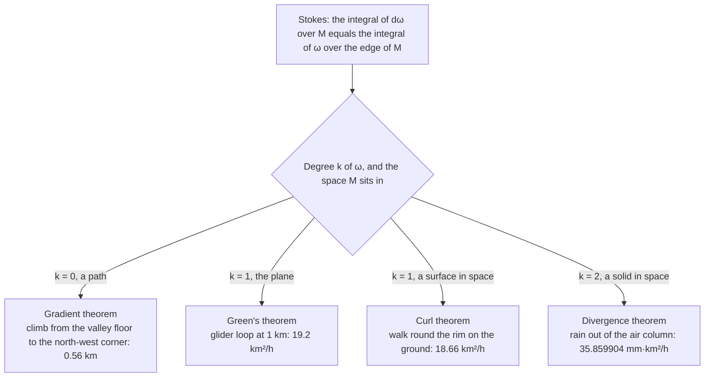

# Green, divergence and curl theorems: three results, one statement

[Syllabus](../../../SYLLABUS.md) → [Differential geometry and Lie groups](../README.md) → [Differential Forms](../README.md#s04) → Green, divergence and curl theorems

---

## General Overview

A valley runs north for 4 km. It is 6 km wide, with its floor along the middle and a ridge on each side. Wind blows up the valley at about 12 km/h. Rain falls from a cloud layer whose top is 2 km up.

A forecaster asks three questions about this valley:

- **A glider flies a rectangle round the valley at 1 km up.** How much does the wind push it along, added once round the loop? This total is the **circulation**, in km²/h. The answer is 19.2.
- **A walker follows the same rectangle on the ground,** up and down the slopes. Same question, on a bent surface. The answer is 18.66.
- **How much rain leaves the column of air above the valley each hour?** The answer is 35.859904 mm·km²/h. One millimetre of water over one square kilometre is 1,000 m³.

Wing 06 answers these with three theorems, each with its own proof: Green's theorem, the curl theorem and the divergence theorem. This card shows they are one theorem. The general Stokes theorem says the integral of $`d\omega`$ over a region equals the integral of $`\omega`$ over its edge. Choose the **degree** of $`\omega`$ (how many directions it measures at once) and the space, and it becomes each classical theorem.

**Green's theorem, the curl theorem and the divergence theorem are all $`\int_M d\omega = \int_{\partial M}\omega`$: a 1-form in the plane gives Green, a 1-form in space gives the curl theorem, a 2-form in space gives the divergence theorem, and $`d`$ turns into curl or divergence by itself.**

**What kind of fact this is:** a theorem. The general Stokes theorem is proved on [Stokes on manifolds](06-stokes-theorem-on-manifolds.md). This card proves the translation from forms to vectors in Why it works, and each classical theorem follows. Each result is global: it needs the whole region and its whole edge.

### The picture: one statement, four choices of degree



Each arrow changes only the degree and the shape. The proof stays the same.

---

## The formula

Reminders, each taught on its own card in this shelf:

- A **$`k`$-form** $`\omega`$ is a rule that takes $`k`$ arrows at a point and returns a number, changing sign when two arrows swap ([Differential form](01-forms-and-the-wedge-product.md)). A 1-form measures one arrow, a 2-form a small parallelogram, a 3-form a small box.
- The **wedge** $`\wedge`$ joins forms; $`dx\wedge dy`$ measures the signed area of a parallelogram's shadow on the $`xy`$-plane. Swapping gives a minus sign: $`dz\wedge dx = -\,dx\wedge dz`$.
- The **exterior derivative** $`d`$ turns a $`k`$-form into a $`(k+1)`$-form ([Exterior derivative](03-exterior-derivative.md)).
- $`\partial M`$ is the **boundary** (edge) of a region $`M`$, carrying the orientation that $`M`$ gives it ([Integration on an oriented manifold](05-integration-on-manifolds.md)).

```math
\int_M d\omega \;=\; \int_{\partial M} \omega
```

**Read it aloud:** the derivative of the form, added over the region, equals the form itself, added over the region's edge.

The classical theorems come from a dictionary, the one built on [Exterior derivative](03-exterior-derivative.md). A field $`\mathbf v = (v_1, v_2, v_3)`$ in space gives two forms. Its **work form** $`\omega_{\mathbf v}`$ measures push along an arrow. Its **flux form** $`\Phi_{\mathbf v}`$ (capital phi) measures flow through a small parallelogram.

```math
\omega_{\mathbf v} = v_1\,dx + v_2\,dy + v_3\,dz, \qquad \Phi_{\mathbf v} = v_1\,dy\wedge dz + v_2\,dz\wedge dx + v_3\,dx\wedge dy
```

**Read it aloud:** the work form pairs each part of the field with its own direction; the flux form pairs each part with the plane at right angles to it.

Then $`d`$ becomes the three derivatives of vector calculus:

```math
df = \omega_{\nabla f}, \qquad d\,\omega_{\mathbf v} = \Phi_{\mathrm{curl}\,\mathbf v}, \qquad d\,\Phi_{\mathbf v} = (\mathrm{div}\,\mathbf v)\;dx\wedge dy\wedge dz
```

**Read it aloud:** $`d`$ of a function is its gradient's work form, $`d`$ of a work form is the curl's flux form, and $`d`$ of a flux form is the divergence times volume.

Put each line into Stokes and the classical theorems come out:

```math
\oint_{\partial D} P\,dx + Q\,dy = \iint_D (Q_x - P_y)\,dA, \qquad \oint_{\partial S}\mathbf v\cdot d\mathbf r = \iint_S \mathrm{curl}\,\mathbf v\cdot\mathbf n\,dS, \qquad \iint_{\partial V}\mathbf j\cdot\mathbf n\,dS = \iiint_V \mathrm{div}\,\mathbf j\,dV
```

**Read it aloud:** Green on a flat region, the curl theorem on a surface, the divergence theorem on a solid.

The valley, with $`x`$ km east, $`y`$ km north and $`z`$ km up:

- Ground height $`h(x, y) = 0.04\,(x-3)^2 + 0.05\,y`$: floor along $`x = 3`$, rising 0.05 km per km northward.
- Wind $`\mathbf v = (P, Q, W) = (-0.1\,y^2 + 0.5\,z,\; 12 + 0.2\,xy + 2z,\; 0.05\,x)`$ in km/h: up the valley, curling, stronger with height.
- Rain flux $`\mathbf j = (0,\; 0.1\,y\,(2-z),\; -0.75\,(2-z))`$ in mm/h: falling, drifting north, zero at the cloud top $`z = 2`$.

These fields are models made up for the example, not measurements. The rain model treats the whole column below 2 km as cloud, so rain is made at every height down to the ground.

| Symbol | Plain meaning | In our example | Push it up and the answer… |
| --- | --- | --- | --- |
| $`M`$, $`\partial M`$; $`C`$, $`D`$, $`S`$, $`V`$ | a region and its edge with matching orientation; a path, a flat region, a surface, a solid | a path, the map, the ground, the air column | — |
| $`k`$ | the degree of the form: how many arrows it takes | 0, 1, 1, 2 | picks which classical theorem appears |
| $`\omega`$, $`d\omega`$, $`f`$ | a $`k`$-form, its exterior derivative; a 0-form, which is a function | the wind's work form; the curl's flux form; the height $`h`$ | — |
| $`dx`$, $`dy`$, $`dz`$, $`\wedge`$ | the three basic 1-forms, and the wedge that joins them | $`dz\wedge dx = -\,dx\wedge dz`$ | swapping two flips the sign |
| $`h`$ | ground height, km | 0 on the valley floor at the south end, 0.56 at the north-west corner | steeper slopes, more tilt in the ground's normal |
| $`\mathbf v = (P, Q, W)`$ | the wind east, north and up, km/h | about 12 km/h up the valley | more circulation |
| $`P_x`$, $`Q_y`$, $`h_x`$ and the like | partial derivatives: $`P_y`$ is $`\partial P/\partial y`$, how fast $`P`$ changes per km north | $`Q_x - P_y = 0.4\,y`$ at 1 km up | steeper change, more curl |
| $`\mathbf j = (j_1, j_2, j_3)`$ | rain flux: water crossing each km² per hour, in mm/h | falling, drifting north, zero at the cloud top | more rain out of the column |
| $`\omega_{\mathbf v}`$, $`\Phi_{\mathbf v}`$ | the work form and flux form of a field | $`P\,dx + Q\,dy + W\,dz`$; the rain's flux form | — |
| $`\nabla f`$, $`\mathrm{curl}`$, $`\mathrm{div}`$ | gradient, curl, divergence, as in wing 06 | $`\mathrm{curl}\,\mathbf v = (-2,\ 0.45,\ 0.4\,y)`$ per hour | — |
| $`\mathbf n`$, $`dS`$, $`dA`$, $`dV`$, $`\oint`$ | unit normal; small patches of surface, flat area and volume; adding once round a loop | $`\mathbf n`$ upward on the ground | flipping $`\mathbf n`$ flips the sign |
| $`\mathbf r(u^1, u^2)`$, $`\mathbf r_1`$, $`\mathbf r_2`$, $`d\mathbf r`$ | a chart placing a surface in space (upper indices are labels, not powers); its rates along the chart's two grid directions; a small step along a path | $`\mathbf r(x, y) = (x, y, h)`$ | — |

Units: circulation is km/h times km, so km²/h. Rain flux times area gives mm·km²/h.

### When it holds

- **$`M`$ is compact (closed and bounded) and oriented, with an edge made of finitely many smooth pieces.** Corners are fine, though the proof on [Stokes on manifolds](06-stokes-theorem-on-manifolds.md) assumes a smooth edge: the version on cubes, which the code follows, and the version for manifolds with corners cover them (both in Sources). A one-sided surface such as a Möbius band has no orientation, so the flux form has nothing to integrate against.
- **$`\omega`$ is smooth on all of $`M`$, edge included.** A whirlwind at the valley's centre has the work form $`\big(-(y-2)\,dx + (x-3)\,dy\big)/\big((x-3)^2 + (y-2)^2\big)`$ times 1 km²/h: the angle form round $`(3, 2)`$, scaled. It has $`d\omega = 0`$ wherever it is defined, yet its circulation round the valley is $`2\pi`$ = 6.283185 km²/h. It is undefined at $`(3, 2)`$.
- **The edge carries the orientation $`M`$ gives it.** Walk the ground's rim clockwise and the 18.66 km²/h becomes −18.66.
- **The edge is the whole edge.** Leave the ground out of the air column's skin and the rain count is 3.400704, not 35.859904.

---

## Why it works

### Step 0: one proof, then only translation

The general Stokes theorem is already proved on [Stokes on manifolds](06-stokes-theorem-on-manifolds.md), through half-space charts and a partition of unity. The code follows a second proof, on cubes: on a small cube it is the fundamental theorem of calculus in each direction, and gluing cubes cancels every inner face. That version also allows corners.

That proof never asks for the degree or the dimension. So each classical theorem needs only two facts. First, the vector-calculus integral equals the integral of a form. Second, $`d`$ of that form is the vector-calculus derivative. Steps 1 to 4 check both facts in each degree. Step 5 matches the orientations.

### Step 1: degree 0 is the gradient theorem

A 0-form is a function $`f`$. Its derivative is $`df = f_x\,dx + f_y\,dy + f_z\,dz`$, the work form of $`\nabla f`$. The edge of a path is its end point, counted plus, and its start point, counted minus. Stokes gives $`\int_C \nabla f\cdot d\mathbf r = f(\text{end}) - f(\text{start})`$.

In the valley take $`f = h`$, the ground height. Walk on the map from the floor at $`(3, 0)`$ to the north-west corner $`(0, 4)`$. The climb is $`h(0, 4) - h(3, 0)`$ = 0.56 km, whatever the route. At $`(1, 2)`$ the code's $`d`$ gives $`dh = -0.16\,dx + 0.05\,dy`$: the slope is 0.16 km per km down eastward and 0.05 up northward.

### Step 2: a 1-form in the plane is Green's theorem

The wing 06 card [Green's theorem](../../06-Calculus%20and%20analysis/09-Vector%20Calculus/06-greens-theorem.md) proves it on rectangles and regions between graphs. Here it comes out of $`d`$:

```math
d(P\,dx + Q\,dy) = P_y\,dy\wedge dx + Q_x\,dx\wedge dy = (Q_x - P_y)\,dx\wedge dy
```

The computation is the plane case of [Exterior derivative](03-exterior-derivative.md). On a region of the plane with the usual orientation, $`dx\wedge dy`$ integrates as plain area $`dA`$, so Stokes reads as Green.

At 1 km up, $`P = -0.1\,y^2 + 0.5`$ and $`Q = 14 + 0.2\,xy`$. So $`Q_x - P_y = 0.2\,y + 0.2\,y = 0.4\,y`$ per hour. Over the 6 km by 4 km map, that adds to $`0.4 \times 6 \times 8`$ = 19.2 km²/h (8 is the integral of $`y`$ from 0 to 4). The glider's four legs, walked anticlockwise, give west −56, east 65.6, south 3 and north 6.6. They also add to 19.2.

### Step 3: a 1-form in space is the curl theorem

The wing 06 card [Stokes' theorem](../../06-Calculus%20and%20analysis/09-Vector%20Calculus/08-stokes-theorem.md) proves the curl theorem with a chart and Green. Here, $`d`$ of the work form is

```math
d(P\,dx + Q\,dy + W\,dz) = (W_y - Q_z)\,dy\wedge dz + (P_z - W_x)\,dz\wedge dx + (Q_x - P_y)\,dx\wedge dy
```

This is computed on [Exterior derivative](03-exterior-derivative.md). The three brackets are the three parts of $`\mathrm{curl}\,\mathbf v`$, so $`d\,\omega_{\mathbf v} = \Phi_{\mathrm{curl}\,\mathbf v}`$. The fold below shows that a flux form, fed the two edge arrows $`\mathbf r_1`$, $`\mathbf r_2`$ of a surface patch, gives $`\mathbf v\cdot(\mathbf r_1\times\mathbf r_2)`$. That is flux through the patch.

For the valley wind, $`\mathrm{curl}\,\mathbf v = (0 - 2,\; 0.5 - 0.05,\; 0.4\,y) = (-2,\ 0.45,\ 0.4\,y)`$ per hour. The ground is $`\mathbf r(x, y) = (x, y, h)`$, with upward area arrow $`\mathbf r_1\times\mathbf r_2 = \mathbf r_x\times\mathbf r_y = (-h_x, -h_y, 1)`$, taking $`u^1 = x`$ and $`u^2 = y`$. The flux of curl through the ground is

```math
\iint \big(0.16\,(x-3) - 0.0225 + 0.4\,y\big)\,dx\,dy = 0 - 0.54 + 19.2 = 18.66
```

The first term cancels across the valley. The second is the northward rise of the floor, worth −0.54. The third is Green's 19.2. The walk round the rim on the ground gives west −51.68, east 61.34, south 0.432 and north 8.568: 18.66 again.

<details>
<summary>Detailed proof: a flux form measures flux, a 3-form measures volume</summary>

Take a surface chart $`\mathbf r(u^1, u^2)`$ with edge arrows $`\mathbf a = \mathbf r_1`$ and $`\mathbf b = \mathbf r_2`$, the rates of $`\mathbf r`$ along $`u^1`$ and $`u^2`$. The 2-form $`dy\wedge dz`$ eats the pair and returns the 2-by-2 determinant of their $`y`$ and $`z`$ parts:

$`\displaystyle (dy\wedge dz)(\mathbf a, \mathbf b) = a_2 b_3 - a_3 b_2,`$

which is the first component of $`\mathbf a\times\mathbf b`$. In the same way $`dz\wedge dx`$ gives $`a_3 b_1 - a_1 b_3`$, the second, and $`dx\wedge dy`$ gives $`a_1 b_2 - a_2 b_1`$, the third. Adding with weights $`v_1`$, $`v_2`$, $`v_3`$:

$`\displaystyle \Phi_{\mathbf v}(\mathbf r_1, \mathbf r_2) = \mathbf v\cdot(\mathbf r_1\times\mathbf r_2).`$

The pullback of $`\Phi_{\mathbf v}`$ to the chart ([Pullback](02-pullback-and-change-of-variables.md)) is therefore $`\mathbf v\cdot(\mathbf r_1\times\mathbf r_2)\,du^1\wedge du^2`$. Since $`\mathbf r_1\times\mathbf r_2 = \mathbf n\,\lvert\mathbf r_1\times\mathbf r_2\rvert`$ and $`dS = \lvert\mathbf r_1\times\mathbf r_2\rvert\,du^1\,du^2`$, the integral of $`\Phi_{\mathbf v}`$ is $`\iint \mathbf v\cdot\mathbf n\,dS`$. This is exactly where the order $`dz\wedge dx`$ matters: $`dx\wedge dz`$ would give minus the second component.

For a solid chart $`\mathbf r(u^1, u^2, u^3)`$, $`dx\wedge dy\wedge dz`$ fed the three edge arrows is the 3-by-3 determinant of the Jacobian, the volume stretch. With the chart right-handed this is positive, so $`\int f\,dx\wedge dy\wedge dz = \iiint f\,dV`$.

A 1-form along a path $`\mathbf r(t)`$ gives $`\omega_{\mathbf v}(\mathbf r') = \mathbf v\cdot\mathbf r'`$, so $`\int\omega_{\mathbf v} = \int \mathbf v\cdot d\mathbf r`$.

</details>

### Step 4: a 2-form in space is the divergence theorem

The wing 06 card [Divergence theorem](../../06-Calculus%20and%20analysis/09-Vector%20Calculus/07-divergence-theorem.md) proves it on boxes and on solids bounded by graphs. Here, $`d`$ of a flux form keeps one term from each piece:

```math
d(j_1\,dy\wedge dz + j_2\,dz\wedge dx + j_3\,dx\wedge dy) = \left(\frac{\partial j_1}{\partial x} + \frac{\partial j_2}{\partial y} + \frac{\partial j_3}{\partial z}\right) dx\wedge dy\wedge dz
```

The bracket is $`\mathrm{div}\,\mathbf j`$, again as on [Exterior derivative](03-exterior-derivative.md). The fold above shows that a 3-form on a right-handed solid chart integrates as plain volume $`dV`$, so Stokes reads as the divergence theorem.

For the rain, $`\mathrm{div}\,\mathbf j = 0 + 0.1\,(2 - z) + 0.75`$, in mm/h per km: rain being made inside the cloud. At height 0.5 km it is 0.9. Added through the air between the ground and the cloud top, it gives 35.859904 mm·km²/h. Through the skin, the ground passes 32.4592, the north wall 3.400704 (the rain's northward drift), and the other walls and the cloud top pass nothing. The sum is again 35.859904.

### Step 5: three orientation rules are one rule

Wing 06 uses three rules: walk anticlockwise with the region on the left; curl the right hand along the rim with the thumb on $`\mathbf n`$; point $`\mathbf n`$ outward on a closed skin. Stokes uses one: the **outward-first rule**. An arrow pointing out of $`M`$, followed by a positive frame of $`\partial M`$, must be a positive frame of $`M`$.

- In the plane, outward then forward is positive when the region lies on the left. That is the anticlockwise walk.
- On a surface, outward then forward then $`\mathbf n`$ is right-handed. That is the right-hand rule.
- On a solid, outward then a positive frame of the skin is right-handed exactly when the skin's normal points outward.

One more pattern falls out. Since $`d(d\omega) = 0`$, the classical identities $`\mathrm{curl}\,\nabla f = 0`$ and $`\mathrm{div}\,\mathrm{curl}\,\mathbf v = 0`$ are one fact, seen at two degrees ([Closed and exact forms](04-closed-and-exact-forms-and-the-poincare-lemma.md)).

---

## Worked numbers, by hand

The curl theorem on the ground: the hardest of the three, done both ways.

| Step | Arithmetic | Value |
| --- | --- | --- |
| curl of the wind | $`(W_y - Q_z,\; P_z - W_x,\; Q_x - P_y)`$ | $`(-2,\ 0.45,\ 0.4\,y)`$ per hour |
| east-west tilt term | $`-2 \times (-0.08\,(x-3))`$, added over $`x`$ from 0 to 6 | 0 |
| northward rise term | $`0.45 \times (-0.05) \times 24`$ km² | −0.54 |
| upward term | $`0.4 \times 6 \times 8`$ | 19.2 |
| flux of curl through the ground | $`0 - 0.54 + 19.2`$ | **18.66 km²/h** |
| circulation round the rim | west −51.68, east 61.34, south 0.432, north 8.568, added | **18.66 km²/h** |

The wind pushes a walker round the valley's rim by 18.66 km²/h, 0.54 less than the glider's 19.2. The rim is a different loop, and the curl has a north-south part, 0.45 per hour, that the ground catches because the valley floor rises to the north.

### What breaks if you drop a piece

| Mistake | Comes out at | What went wrong |
| --- | --- | --- |
| Rim walked clockwise | −18.66 | the edge's orientation no longer matches the upward normal |
| Terrain treated as the flat map | 19.2 | a different rim; the curl has a north-south part, 0.45 per hour, that the tilted ground catches and the flat map does not |
| Flux form written with $`dx\wedge dz`$ for $`dz\wedge dx`$ | 19.74 | the curl's middle part changes sign, so the −0.54 becomes +0.54 |
| Ground left out of the air column's skin | 3.400704 | the skin is no longer closed; 32.4592 of rain is missed |
| Whirlwind at $`(3, 2)`$: boundary against inside | 6.283185 against 0 | the form blows up inside the valley, so Stokes does not apply |

The code prints every row.

---

## Code, from first principles, and it actually runs

The code has one integrator for any $`k`$-form over a cube bent into place: a path, the map, the ground or the air column. It has one exterior derivative $`d`$, with partial derivatives by central differences (the change over a tiny step either side, divided by twice the step). Neither routine knows about curl or divergence. Each case takes four independent roads:

1. **Boundary:** $`\omega`$ integrated over every face of the cube, with signs $`(-1)^{i+a}`$ for face $`i`$ at end $`a`$, counting directions $`i`$ from 1.
2. **Inside:** $`d\omega`$ integrated over the cube.
3. **Classical:** the gradient, curl or divergence worked out by hand, integrated with the vector formulas.
4. **Exact:** the value found by hand on this card.

Integrals use 10-point Gauss–Legendre rules (sample points and weights chosen to be exact for polynomials up to degree 19). The whirlwind is not a polynomial, so its edge is shown at 10 and at 20 points.

### Python

```python
# Green, divergence and curl theorems as one statement -- the check behind the card.  Standard
# library only.  One routine integrates any k-form over a parametrised cube, and one routine takes
# its exterior derivative d by central differences.  Stokes says: integral of dw over M equals
# integral of w over the boundary of M.  The valley's four cases change only the degree of w and
# the shape M.  Road A: w over the boundary.  Road B: dw over the inside.  Road C: the classical
# formula (gradient, curl, divergence) worked out by hand, integrated directly.  Road D: exact values.
import math
from functools import reduce
from itertools import combinations, product

def gauss(n):                                    # Gauss-Legendre nodes and weights on [0, 1]
    out = []
    for i in range(n):
        x = math.cos(math.pi * (i + 0.75) / (n + 0.5))
        for _ in range(60):                      # Newton's method on the Legendre polynomial
            p0, p1 = 1.0, x
            for k in range(2, n + 1):
                p0, p1 = p1, ((2 * k - 1) * x * p1 - (k - 1) * p0) / k
            dp = n * (x * p1 - p0) / (x * x - 1)
            x = x - p1 / dp
        out.append(((1 - x) / 2, 1 / ((1 - x * x) * dp * dp)))
    return out

NODES, H = gauss(10), 1e-5                       # 10 nodes: exact for polynomials up to degree 19

def quad(fn, k):                                 # integral of fn over the unit cube [0, 1]^k
    total = 0.0
    for pt in product(NODES, repeat=k):
        total += math.prod(w for _, w in pt) * fn([x for x, _ in pt])
    return total

def bump(p, i, s):
    q = list(p); q[i] += s; return q

def det(m):                                      # determinant, expanding along the first row
    if not m: return 1.0
    total = 0.0
    for j in range(len(m)):
        total += (-1) ** j * m[0][j] * det([r[:j] + r[j + 1:] for r in m[1:]])
    return total

def d(n, k, f):                                  # exterior derivative: a k-form to a (k+1)-form
    lo, hi = list(combinations(range(n), k)), list(combinations(range(n), k + 1))
    def df(p):
        out = []
        for J in hi:                             # coefficient of dx^J: sum of (-1)^m d_j w_(J without j)
            s = 0.0
            for m, j in enumerate(J):
                r = lo.index(J[:m] + J[m + 1:])
                s += (-1) ** m * (f(bump(p, j, H))[r] - f(bump(p, j, -H))[r]) / (2 * H)
            out.append(s)
        return out
    return df

def integrate(n, k, f, c):                       # pull w back along the cube map c, then add up
    idx = list(combinations(range(n), k))
    def pulled(u):
        p = c(u)
        vs = [[(a - b) / (2 * H) for a, b in zip(c(bump(u, i, H)), c(bump(u, i, -H)))] for i in range(k)]
        total = 0.0
        for fi, I in zip(f(p), idx):             # a k-form eats k arrows: coefficient times a minor
            total += fi * det([[v[i] for i in I] for v in vs])
        return total
    return quad(pulled, k)

def faces(n, k, f, c):                           # faces of a (k+1)-cube, signed (-1)^(i+1+a), i from 0
    out = []
    for i in range(k + 1):
        for a in (0, 1):
            face = lambda t, i=i, a=a: c(t[:i] + [float(a)] + t[i:])
            out.append((-1) ** (i + 1 + a) * integrate(n, k, f, face))
    return out

def boundary(n, k, f, c): return reduce(lambda a, b: a + b, faces(n, k, f, c), 0.0)   # left to right

def h(x, y): return 0.04 * (x - 3) * (x - 3) + 0.05 * y          # ground height, km
def wind(p): x, y, z = p; return [-0.1 * y * y + 0.5 * z, 12 + 0.2 * x * y + 2 * z, 0.05 * x]
def rain(p): x, y, z = p; return [0.0, 0.1 * y * (2 - z), -0.75 * (2 - z)]   # mm/h of water
height = lambda p: [h(p[0], p[1])]                                # 0-form on the map
glider = lambda p: wind([p[0], p[1], 1.0])[:2]                    # 1-form P dx + Q dy at 1 km up
flux = lambda p: (lambda g: [g[2], -g[1], g[0]])(rain(p))         # G1 dy^dz + G2 dz^dx + G3 dx^dy
path = lambda u: [3 - 3 * u[0], 4 * u[0]]                         # valley floor to the north-west corner
floor = lambda u: [6 * u[0], 4 * u[1]]                            # the 6 km by 4 km map
ground = lambda u: [6 * u[0], 4 * u[1], h(6 * u[0], 4 * u[1])]    # the terrain itself
air = lambda u: (lambda x, y: [x, y, h(x, y) + u[2] * (2 - h(x, y))])(6 * u[0], 4 * u[1])

classic = [                                      # road C: hand-derived gradient, curl, divergence
    quad(lambda u: (lambda x, y: 0.08 * (x - 3) * -3 + 0.05 * 4)(*path(u)), 1),
    quad(lambda u: 0.4 * (4 * u[1]) * 24, 2),
    quad(lambda u: (lambda x, y: -2 * -(0.08 * (x - 3)) + 0.45 * -0.05 + 0.4 * y)(*floor(u)) * 24, 2),
    quad(lambda u: (lambda x, y, z: (0.75 + 0.1 * (2 - z)) * 24 * (2 - h(x, y)))(*air(u)), 3)]
cases = [("k=0 path, climb in km", 2, 0, height, path, 0.56),
         ("k=1 plane, Green, km^2/h", 2, 1, glider, floor, 19.2),
         ("k=1 space, curl, km^2/h", 3, 1, wind, ground, 18.66),
         ("k=2 space, divergence", 3, 2, flux, air, 35.859904)]
def f6(v): return f"{v:.6f}".replace("-0.000000", "0.000000")   # no minus sign on a zero
def z6(v): return f"{f6(v):>12}"
def row(vs): return ", ".join(f6(v) for v in vs)
print(f"{'case':<28}{'boundary':>12}{'inside':>12}{'classical':>12}{'exact':>12}")
for (name, n, k, f, c, exact), cl in zip(cases, classic):
    edge, inside = boundary(n, k, f, c), integrate(n, k + 1, d(n, k, f), c)
    print(f"{name:<28}{z6(edge)}{z6(inside)}{z6(cl)}{z6(exact)}")
    assert abs(edge - exact) < 1e-6 and abs(inside - exact) < 1e-6 and abs(cl - exact) < 1e-6

p0 = [1.0, 2.0, 0.5]                             # d reads as gradient, curl and divergence here
g, cw, dv = d(2, 0, height)(p0[:2]), d(3, 1, wind)(p0), d(3, 2, flux)(p0)
print("at (1, 2, 0.5): d(height) =", row(g))
print("  d(wind) on dy^dz, dz^dx, dx^dy =", row((cw[2], -cw[1], cw[0])))
print(f"  d(rain) on dx^dy^dz = {dv[0]:.6f}")
assert abs(g[0] + 0.16) < 1e-8 and abs(g[1] - 0.05) < 1e-8 and abs(dv[0] - 0.9) < 1e-8
assert abs(cw[2] + 2) < 1e-8 and abs(cw[1] + 0.45) < 1e-8 and abs(cw[0] - 0.8) < 1e-8
assert abs(det([[1.0, 2.0], [3.0, 4.0]]) + 2) < 1e-12   # cofactor signs, on a matrix with both off-diagonal entries nonzero
print(f"map area {f6(integrate(2, 2, lambda p: [1.0], floor))} km^2; integral of y dy {f6(quad(lambda u: 16 * u[0], 1))}; curl north part x rise {f6(-cw[1] * g[1])}")

curl_slip = lambda p: (lambda v: [v[0], -v[1], v[2]])(d(3, 1, wind)(p))
tilt = quad(lambda u: (lambda x, y: -2 * -(0.08 * (x - 3)) + 0.45 * -0.05)(*floor(u)) * 24, 2)
sides, rim, box = faces(2, 1, glider, floor), faces(3, 1, wind, ground), faces(3, 2, flux, air)
no_ground = boundary(3, 2, flux, air) - box[4]
clockwise, flat, slip = -boundary(3, 1, wind, ground), boundary(2, 1, glider, floor), integrate(3, 2, curl_slip, ground)
vortex = lambda p: (lambda dx, dy: [-dy / (dx * dx + dy * dy), dx / (dx * dx + dy * dy)])(p[0] - 3, p[1] - 2)
spin10 = boundary(2, 1, vortex, floor)          # not a polynomial: 10 nodes are not exact here
NODES = gauss(20)
spin_edge, spin_inside = boundary(2, 1, vortex, floor), integrate(2, 2, d(2, 1, vortex), floor)
print("sides west, east, south, north:")
print("  glider at 1 km =", row(sides))
print("  rim on the ground =", row(rim))
print("  rain, then ground and ceiling =", row(box))
print(f"curl flux through the ground from the tilt terms: {tilt:.6f}")
print("what breaks:")
print(f"  rim walked clockwise:             {z6(clockwise)}")
print(f"  terrain treated as the flat map:  {z6(flat)}")
print(f"  dz^dx read as dx^dz:              {z6(slip)}")
print(f"  ground left out of the skin:      {z6(no_ground)}")
print(f"  whirlwind, boundary, 10 nodes:    {z6(spin10)}")
print(f"  whirlwind, boundary, 20 nodes:    {z6(spin_edge)}")
print(f"  whirlwind, inside, 20 nodes:      {z6(spin_inside)}")
assert abs(box[4] - 32.4592) < 1e-6 and abs(tilt + 0.54) < 1e-6 and abs(no_ground - 3.400704) < 1e-6
assert abs(spin_edge - 2 * math.pi) < 1e-8 and abs(spin_inside) < 1e-6 and abs(spin10 - 2 * math.pi) > 1e-6
assert abs(slip - 19.74) < 1e-6 and abs(flat - 19.2) < 1e-6 and abs(clockwise + 18.66) < 1e-6
print("ALL CHECKS PASS")
```

**Ran 2026-11-19 on macOS, Python 3.14.10, standard library only. All checks passed. Output, pasted from the run:**

```
case                            boundary      inside   classical       exact
k=0 path, climb in km           0.560000    0.560000    0.560000    0.560000
k=1 plane, Green, km^2/h       19.200000   19.200000   19.200000   19.200000
k=1 space, curl, km^2/h        18.660000   18.660000   18.660000   18.660000
k=2 space, divergence          35.859904   35.859904   35.859904   35.859904
at (1, 2, 0.5): d(height) = -0.160000, 0.050000
  d(wind) on dy^dz, dz^dx, dx^dy = -2.000000, 0.450000, 0.800000
  d(rain) on dx^dy^dz = 0.900000
map area 24.000000 km^2; integral of y dy 8.000000; curl north part x rise 0.022500
sides west, east, south, north:
  glider at 1 km = -56.000000, 65.600000, 3.000000, 6.600000
  rim on the ground = -51.680000, 61.340000, 0.432000, 8.568000
  rain, then ground and ceiling = 0.000000, 0.000000, 0.000000, 3.400704, 32.459200, 0.000000
curl flux through the ground from the tilt terms: -0.540000
what breaks:
  rim walked clockwise:               -18.660000
  terrain treated as the flat map:     19.200000
  dz^dx read as dx^dz:                 19.740000
  ground left out of the skin:          3.400704
  whirlwind, boundary, 10 nodes:        6.283161
  whirlwind, boundary, 20 nodes:        6.283185
  whirlwind, inside, 20 nodes:          0.000000
ALL CHECKS PASS
```

### Rust

Same numbers, same labels, built with `rustc --edition 2021 -O`.

```rust
// Green, divergence and curl theorems as one statement -- the same check as the Python, in Rust.
// No crates.  One routine integrates any k-form over a parametrised cube, and one routine takes its
// exterior derivative d by central differences.  Stokes says: integral of dw over M equals integral
// of w over the boundary of M.  The valley's four cases change only the degree of w and the shape M.
// Road A: w over the boundary.  Road B: dw over the inside.  Road C: the classical formula (gradient,
// curl, divergence) worked out by hand, integrated directly.  Road D: exact values.
use std::rc::Rc;
type Field = Rc<dyn Fn(&[f64]) -> Vec<f64>>;
const H: f64 = 1e-5;
fn gauss(n: usize) -> Vec<(f64, f64)> {          // Gauss-Legendre nodes and weights on [0, 1]
    let mut out = Vec::new();
    for i in 0..n {
        let mut x = (std::f64::consts::PI * (i as f64 + 0.75) / (n as f64 + 0.5)).cos();
        let mut dp = 0.0;
        for _ in 0..60 {                         // Newton's method on the Legendre polynomial
            let (mut p0, mut p1) = (1.0, x);
            for k in 2..=n { (p0, p1) = (p1, ((2 * k - 1) as f64 * x * p1 - (k - 1) as f64 * p0) / k as f64); }
            dp = n as f64 * (x * p1 - p0) / (x * x - 1.0);
            x = x - p1 / dp;
        }
        out.push(((1.0 - x) / 2.0, 1.0 / ((1.0 - x * x) * dp * dp)));
    }
    out
}
fn quad(nodes: &[(f64, f64)], f: &dyn Fn(&[f64]) -> f64, k: usize) -> f64 {   // over [0, 1]^k
    let n = nodes.len();
    let mut total = 0.0;
    for idx in 0..n.pow(k as u32) {
        let (mut dig, mut rest, mut w) = (vec![0; k], idx, 1.0);
        for j in (0..k).rev() { dig[j] = rest % n; rest /= n; }   // first coordinate slowest
        for j in 0..k { w *= nodes[dig[j]].1; }
        let u: Vec<f64> = dig.iter().map(|&j| nodes[j].0).collect();
        total += w * f(&u);
    }
    total
}
fn combos(n: usize, k: usize) -> Vec<Vec<usize>> {   // increasing k-tuples, in dictionary order
    if k == 0 { return vec![vec![]]; }
    let mut out: Vec<Vec<usize>> = combos(n, k - 1).into_iter()
        .flat_map(|c| { let s = c.last().map_or(0, |l| l + 1); (s..n).map(move |j| [c.clone(), vec![j]].concat()) }).collect();
    out.sort();
    out
}
fn bump(p: &[f64], i: usize, s: f64) -> Vec<f64> { let mut q = p.to_vec(); q[i] += s; q }
fn det(m: &[Vec<f64>]) -> f64 {                   // determinant, expanding along the first row
    if m.is_empty() { return 1.0; }
    let mut total = 0.0;
    for j in 0..m.len() {
        let minor: Vec<Vec<f64>> = m[1..].iter()
            .map(|r| r.iter().enumerate().filter(|(c, _)| *c != j).map(|(_, v)| *v).collect()).collect();
        total += if j % 2 == 0 { 1.0 } else { -1.0 } * m[0][j] * det(&minor);
    }
    total
}
fn d(n: usize, k: usize, f: Field) -> Field {    // exterior derivative: a k-form to a (k+1)-form
    let (lo, hi) = (combos(n, k), combos(n, k + 1));
    Rc::new(move |p: &[f64]| {
        let mut out = Vec::new();
        for big in &hi {                         // coefficient of dx^J: sum of (-1)^m d_j w_(J without j)
            let mut s = 0.0;
            for (m, &j) in big.iter().enumerate() {
                let rest: Vec<usize> = big.iter().enumerate().filter(|(i, _)| *i != m).map(|(_, v)| *v).collect();
                let (r, sign) = (lo.iter().position(|c| *c == rest).unwrap(), if m % 2 == 0 { 1.0 } else { -1.0 });
                s += sign * (f(&bump(p, j, H))[r] - f(&bump(p, j, -H))[r]) / (2.0 * H);
            }
            out.push(s);
        }
        out
    })
}
fn integrate(nodes: &[(f64, f64)], n: usize, k: usize, f: &dyn Fn(&[f64]) -> Vec<f64>,
             c: &dyn Fn(&[f64]) -> Vec<f64>) -> f64 {   // pull w back along c, then add up
    let idx = combos(n, k);
    let pulled = |u: &[f64]| -> f64 {
        let p = c(u);
        let vs: Vec<Vec<f64>> = (0..k).map(|i| {
            let (a, b) = (c(&bump(u, i, H)), c(&bump(u, i, -H)));
            a.iter().zip(b.iter()).map(|(x, y)| (x - y) / (2.0 * H)).collect()
        }).collect();
        let mut total = 0.0;
        for (fi, big) in f(&p).iter().zip(idx.iter()) {   // a k-form eats k arrows
            let m: Vec<Vec<f64>> = vs.iter().map(|v| big.iter().map(|&i| v[i]).collect()).collect();
            total += fi * det(&m);
        }
        total
    };
    quad(nodes, &pulled, k)
}
fn faces(nodes: &[(f64, f64)], n: usize, k: usize, f: &dyn Fn(&[f64]) -> Vec<f64>,
         c: &dyn Fn(&[f64]) -> Vec<f64>) -> Vec<f64> {   // faces of a (k+1)-cube, signed (-1)^(i+1+a), i from 0
    let mut out = Vec::new();
    for i in 0..=k {
        for a in 0..2usize {
            let face = |t: &[f64]| { let mut v = t[..i].to_vec(); v.push(a as f64); v.extend_from_slice(&t[i..]); c(&v) };
            out.push(if (i + 1 + a) % 2 == 0 { 1.0 } else { -1.0 } * integrate(nodes, n, k, f, &face));
        }
    }
    out
}
fn boundary(nodes: &[(f64, f64)], n: usize, k: usize, f: &dyn Fn(&[f64]) -> Vec<f64>,
            c: &dyn Fn(&[f64]) -> Vec<f64>) -> f64 { faces(nodes, n, k, f, c).iter().fold(0.0, |a, b| a + b) }
fn h(x: f64, y: f64) -> f64 { 0.04 * (x - 3.0) * (x - 3.0) + 0.05 * y }   // ground height, km
fn wind(p: &[f64]) -> Vec<f64> { let (x, y, z) = (p[0], p[1], p[2]); vec![-0.1 * y * y + 0.5 * z, 12.0 + 0.2 * x * y + 2.0 * z, 0.05 * x] }
fn rain(p: &[f64]) -> Vec<f64> { let (y, z) = (p[1], p[2]); vec![0.0, 0.1 * y * (2.0 - z), -0.75 * (2.0 - z)] }
fn height(p: &[f64]) -> Vec<f64> { vec![h(p[0], p[1])] }                    // 0-form on the map
fn glider(p: &[f64]) -> Vec<f64> { wind(&[p[0], p[1], 1.0])[..2].to_vec() }  // P dx + Q dy at 1 km
fn flux(p: &[f64]) -> Vec<f64> { let g = rain(p); vec![g[2], -g[1], g[0]] }  // G1 dy^dz + G2 dz^dx + G3 dx^dy
fn path(u: &[f64]) -> Vec<f64> { vec![3.0 - 3.0 * u[0], 4.0 * u[0]] }
fn floor(u: &[f64]) -> Vec<f64> { vec![6.0 * u[0], 4.0 * u[1]] }
fn ground(u: &[f64]) -> Vec<f64> { vec![6.0 * u[0], 4.0 * u[1], h(6.0 * u[0], 4.0 * u[1])] }
fn air(u: &[f64]) -> Vec<f64> { let (x, y) = (6.0 * u[0], 4.0 * u[1]); vec![x, y, h(x, y) + u[2] * (2.0 - h(x, y))] }
fn vortex(p: &[f64]) -> Vec<f64> { let (dx, dy) = (p[0] - 3.0, p[1] - 2.0); vec![-dy / (dx * dx + dy * dy), dx / (dx * dx + dy * dy)] }
fn f6(v: f64) -> String { format!("{:.6}", v).replace("-0.000000", "0.000000") }   // no minus on a zero
fn z6(v: f64) -> String { format!("{:>12}", f6(v)) }
fn row(v: &[f64]) -> String { v.iter().map(|x| f6(*x)).collect::<Vec<_>>().join(", ") }
fn main() {
    let g10 = gauss(10);                         // 10 nodes: exact for polynomials up to degree 19
    let classic = [                              // road C: hand-derived gradient, curl, divergence
        quad(&g10, &|u| { let p = path(u); 0.08 * (p[0] - 3.0) * -3.0 + 0.05 * 4.0 }, 1),
        quad(&g10, &|u| 0.4 * (4.0 * u[1]) * 24.0, 2),
        quad(&g10, &|u| { let p = floor(u); (-2.0 * -(0.08 * (p[0] - 3.0)) + 0.45 * -0.05 + 0.4 * p[1]) * 24.0 }, 2),
        quad(&g10, &|u| { let p = air(u); (0.75 + 0.1 * (2.0 - p[2])) * 24.0 * (2.0 - h(p[0], p[1])) }, 3)];
    let cases: [(&str, usize, usize, Field, fn(&[f64]) -> Vec<f64>, f64); 4] = [
        ("k=0 path, climb in km", 2, 0, Rc::new(height), path, 0.56),
        ("k=1 plane, Green, km^2/h", 2, 1, Rc::new(glider), floor, 19.2),
        ("k=1 space, curl, km^2/h", 3, 1, Rc::new(wind), ground, 18.66),
        ("k=2 space, divergence", 3, 2, Rc::new(flux), air, 35.859904)];
    println!("{:<28}{:>12}{:>12}{:>12}{:>12}", "case", "boundary", "inside", "classical", "exact");
    for ((name, n, k, f, c, exact), cl) in cases.iter().zip(classic.iter()) {
        let edge = boundary(&g10, *n, *k, &**f, c);
        let inside = integrate(&g10, *n, k + 1, &*d(*n, *k, f.clone()), c);
        println!("{:<28}{}{}{}{}", name, z6(edge), z6(inside), z6(*cl), z6(*exact));
        assert!((edge - exact).abs() < 1e-6 && (inside - exact).abs() < 1e-6 && (cl - exact).abs() < 1e-6);
    }
    let p0 = [1.0, 2.0, 0.5];                    // d reads as gradient, curl and divergence here
    let (g, cw, dv) = (d(2, 0, Rc::new(height))(&p0[..2]), d(3, 1, Rc::new(wind))(&p0), d(3, 2, Rc::new(flux))(&p0));
    println!("at (1, 2, 0.5): d(height) = {}", row(&g));
    println!("  d(wind) on dy^dz, dz^dx, dx^dy = {}", row(&[cw[2], -cw[1], cw[0]]));
    println!("  d(rain) on dx^dy^dz = {:.6}", dv[0]);
    assert!((g[0] + 0.16).abs() < 1e-8 && (g[1] - 0.05).abs() < 1e-8 && (dv[0] - 0.9).abs() < 1e-8);
    assert!((cw[2] + 2.0).abs() < 1e-8 && (cw[1] + 0.45).abs() < 1e-8 && (cw[0] - 0.8).abs() < 1e-8);
    assert!((det(&[vec![1.0, 2.0], vec![3.0, 4.0]]) + 2.0).abs() < 1e-12);   // cofactor signs, both off-diagonal entries nonzero
    println!("map area {} km^2; integral of y dy {}; curl north part x rise {}", f6(integrate(&g10, 2, 2, &|_p: &[f64]| vec![1.0], &floor)), f6(quad(&g10, &|u: &[f64]| 16.0 * u[0], 1)), f6(-cw[1] * g[1]));
    let dwind = d(3, 1, Rc::new(wind));
    let curl_slip = move |p: &[f64]| { let v = dwind(p); vec![v[0], -v[1], v[2]] };
    let tilt = quad(&g10, &|u| { let p = floor(u); (-2.0 * -(0.08 * (p[0] - 3.0)) + 0.45 * -0.05) * 24.0 }, 2);
    let (sides, rim, bx) = (faces(&g10, 2, 1, &glider, &floor), faces(&g10, 3, 1, &wind, &ground), faces(&g10, 3, 2, &flux, &air));
    let no_ground = boundary(&g10, 3, 2, &flux, &air) - bx[4];
    let (clockwise, flat) = (-boundary(&g10, 3, 1, &wind, &ground), boundary(&g10, 2, 1, &glider, &floor));
    let slip = integrate(&g10, 3, 2, &curl_slip, &ground);
    let spin10 = boundary(&g10, 2, 1, &vortex, &floor);   // not a polynomial: 10 nodes are not exact here
    let g20 = gauss(20);
    let (spin_edge, spin_inside) = (boundary(&g20, 2, 1, &vortex, &floor), integrate(&g20, 2, 2, &*d(2, 1, Rc::new(vortex)), &floor));
    println!("sides west, east, south, north:");
    println!("  glider at 1 km = {}", row(&sides));
    println!("  rim on the ground = {}", row(&rim));
    println!("  rain, then ground and ceiling = {}", row(&bx));
    println!("curl flux through the ground from the tilt terms: {:.6}", tilt);
    println!("what breaks:");
    for (label, v) in [("rim walked clockwise:", clockwise), ("terrain treated as the flat map:", flat),
            ("dz^dx read as dx^dz:", slip), ("ground left out of the skin:", no_ground), ("whirlwind, boundary, 10 nodes:", spin10),
            ("whirlwind, boundary, 20 nodes:", spin_edge), ("whirlwind, inside, 20 nodes:", spin_inside)] {
        println!("  {:<34}{}", label, z6(v));
    }
    let tau = 2.0 * std::f64::consts::PI;
    assert!((bx[4] - 32.4592).abs() < 1e-6 && (tilt + 0.54).abs() < 1e-6 && (no_ground - 3.400704).abs() < 1e-6);
    assert!((spin_edge - tau).abs() < 1e-8 && spin_inside.abs() < 1e-6 && (spin10 - tau).abs() > 1e-6);
    assert!((slip - 19.74).abs() < 1e-6 && (flat - 19.2).abs() < 1e-6 && (clockwise + 18.66).abs() < 1e-6);
    println!("ALL CHECKS PASS");
}
```

**Ran 2026-11-19 on macOS, rustc 1.98.1, no crates. All checks passed. Output, pasted from the run:**

```
case                            boundary      inside   classical       exact
k=0 path, climb in km           0.560000    0.560000    0.560000    0.560000
k=1 plane, Green, km^2/h       19.200000   19.200000   19.200000   19.200000
k=1 space, curl, km^2/h        18.660000   18.660000   18.660000   18.660000
k=2 space, divergence          35.859904   35.859904   35.859904   35.859904
at (1, 2, 0.5): d(height) = -0.160000, 0.050000
  d(wind) on dy^dz, dz^dx, dx^dy = -2.000000, 0.450000, 0.800000
  d(rain) on dx^dy^dz = 0.900000
map area 24.000000 km^2; integral of y dy 8.000000; curl north part x rise 0.022500
sides west, east, south, north:
  glider at 1 km = -56.000000, 65.600000, 3.000000, 6.600000
  rim on the ground = -51.680000, 61.340000, 0.432000, 8.568000
  rain, then ground and ceiling = 0.000000, 0.000000, 0.000000, 3.400704, 32.459200, 0.000000
curl flux through the ground from the tilt terms: -0.540000
what breaks:
  rim walked clockwise:               -18.660000
  terrain treated as the flat map:     19.200000
  dz^dx read as dx^dz:                 19.740000
  ground left out of the skin:          3.400704
  whirlwind, boundary, 10 nodes:        6.283161
  whirlwind, boundary, 20 nodes:        6.283185
  whirlwind, inside, 20 nodes:          0.000000
ALL CHECKS PASS
```

The two outputs match line for line.

### Lean

Lean proves Stokes on a cube bent into place, in every degree and space, and the two translations of $`d`$.

- Take a cube smoothly bent into place as $`M`$, and a $`k`$-form $`\omega`$ smooth on all of $`M`$, edge included. Then $`\int_M d\omega = \int_{\partial M}\omega`$, each face carrying the orientation $`M`$ gives it.
- Take a field $`\mathbf v`$ in space, differentiable at a point, and two arrows $`\mathbf a`$, $`\mathbf b`$. Then $`d\,\omega_{\mathbf v}`$ fed $`\mathbf a`$, $`\mathbf b`$ gives $`\mathrm{curl}\,\mathbf v\cdot(\mathbf a\times\mathbf b)`$.
- Take a field $`\mathbf j`$ in space, differentiable at a point, and three arrows $`\mathbf a`$, $`\mathbf b`$, $`\mathbf c`$. Then $`d\,\Phi_{\mathbf j}`$ fed them gives $`\mathrm{div}\,\mathbf j`$ times $`dx\wedge dy\wedge dz`$ fed them.
- The climb from the valley floor to the north-west corner is 0.56 km.
- Green's sum $`0.4 \times 6 \times 8`$ and the glider's four legs both give 19.2 km²/h.
- The northward rise term is $`0.45 \times (-0.05) \times 24`$ = −0.54.
- The flux of curl through the ground, $`0 - 0.54 + 19.2`$, and the rim's four legs both give 18.66 km²/h.
- The ground's 32.4592 and the north wall's 3.400704 add to 35.859904 mm·km²/h.

The integrals over the valley, the slope $`dh`$, and the What breaks rows are left to the Python and Rust checks.

```lean
-- Green, divergence and curl theorems: Stokes on a smoothly bent cube of any dimension k + 1 in any space, and the two translations that turn d of a work form into the flux of the curl and d of a flux form into the divergence times volume.
import Mathlib.Analysis.Calculus.DifferentialForm.Basic
import Mathlib.LinearAlgebra.CrossProduct
import Mathlib.LinearAlgebra.Matrix.Determinant.Basic
import Mathlib.MeasureTheory.Integral.Bochner.Set
import Mathlib.MeasureTheory.Measure.Lebesgue.Basic
import Mathlib.MeasureTheory.Integral.DivergenceTheorem

open MeasureTheory

/-- The curl of a field `v` on space at `x`, from its partial derivatives
`∂ⱼ vᵢ = fderiv ℝ v x (Pi.single j 1) i`:
`curl v = (∂_y v_z - ∂_z v_y, ∂_z v_x - ∂_x v_z, ∂_x v_y - ∂_y v_x)`. -/
noncomputable def curl (v : (Fin 3 → ℝ) → (Fin 3 → ℝ)) (x : Fin 3 → ℝ) : Fin 3 → ℝ :=
  ![fderiv ℝ v x (Pi.single 1 1) 2 - fderiv ℝ v x (Pi.single 2 1) 1,
    fderiv ℝ v x (Pi.single 2 1) 0 - fderiv ℝ v x (Pi.single 0 1) 2,
    fderiv ℝ v x (Pi.single 0 1) 1 - fderiv ℝ v x (Pi.single 1 1) 0]

/-- The divergence of a field `j` on space at `x`: `∂_x j_x + ∂_y j_y + ∂_z j_z`. -/
noncomputable def div (j : (Fin 3 → ℝ) → (Fin 3 → ℝ)) (x : Fin 3 → ℝ) : ℝ :=
  ∑ i : Fin 3, fderiv ℝ j x (Pi.single i 1) i

/-- Helper: the derivative of `y ↦ j y · c` in direction `d`, written in coordinates. -/
theorem fderiv_dotProduct_const_apply (j : (Fin 3 → ℝ) → (Fin 3 → ℝ)) (x c d : Fin 3 → ℝ)
    (hj : DifferentiableAt ℝ j x) :
    fderiv ℝ (fun y => j y ⬝ᵥ c) x d =
      ∑ i : Fin 3, (∑ m : Fin 3, d m * fderiv ℝ j x (Pi.single m 1) i) * c i := by
  let ℓ : (Fin 3 → ℝ) →L[ℝ] ℝ := ∑ i : Fin 3, c i • ContinuousLinearMap.proj i
  have hℓ : (fun y => j y ⬝ᵥ c) = ℓ ∘ j := by
    funext y; simp [ℓ, dotProduct, mul_comm]
  rw [hℓ, fderiv_comp x ℓ.differentiableAt hj, ContinuousLinearMap.fderiv]
  have hd : d = ∑ m : Fin 3, d m • (Pi.single m 1 : Fin 3 → ℝ) := by
    funext i; simp [Finset.sum_apply, Pi.single_apply]
  conv_lhs => rw [hd]
  simp [ℓ, map_smul, Fin.sum_univ_three]
  ring

#print axioms fderiv_dotProduct_const_apply

/-- **One statement, every degree** (Stokes on a cube bent into place, the version the card's
code follows). Take a box `[a, b]` in `ℝ^(k+1)`, with its standard orientation, and a smooth
chart `φ` that places it in `ℝ^m` as the region `M`: a path (`k = 0`), a flat region, a piece
of ground, or a solid. Let `ω` be a `k`-form on `ℝ^m` that is smooth on an open set holding all
of `M`, edge included. Then `dω` added over `M` equals `ω` added over the whole edge of `M`, each
face carrying the orientation `M` gives it: the face where coordinate `i` (counted from 0) is at
its top end gets the sign `(-1)^i`, and the face at its bottom end the opposite sign.
Choosing `k = 0` gives the gradient theorem, `k = 1` in the plane gives Green's theorem,
`k = 1` on a surface in space gives the curl theorem, and `k = 2` in space gives the
divergence theorem. -/
theorem stokes_integral_d_over_region_eq_integral_over_edge {m k : ℕ}
    (a b : Fin (k + 1) → ℝ) (hab : a ≤ b)
    (φ : (Fin (k + 1) → ℝ) → (Fin m → ℝ)) (V : Set (Fin (k + 1) → ℝ))
    (hV : IsOpen V) (hboxV : Set.Icc a b ⊆ V) (hφ : ContDiffOn ℝ ((⊤ : ℕ∞) : WithTop ℕ∞) φ V)
    (ω : (Fin m → ℝ) → (Fin m → ℝ) [⋀^Fin k]→L[ℝ] ℝ) (U : Set (Fin m → ℝ))
    (hU : IsOpen U) (hMU : φ '' Set.Icc a b ⊆ U) (hω : ContDiffOn ℝ ((⊤ : ℕ∞) : WithTop ℕ∞) ω U) :
    ∫ x in Set.Icc a b, extDeriv ω (φ x) (fun j => fderiv ℝ φ x (Pi.single j 1)) =
      ∑ i : Fin (k + 1), (-1 : ℝ) ^ (i : ℕ) *
        ((∫ y in Set.Icc (a ∘ i.succAbove) (b ∘ i.succAbove),
            ω (φ (i.insertNth (b i) y))
              (fun j => fderiv ℝ φ (i.insertNth (b i) y) (Pi.single (i.succAbove j) 1))) -
          ∫ y in Set.Icc (a ∘ i.succAbove) (b ∘ i.succAbove),
            ω (φ (i.insertNth (a i) y))
              (fun j => fderiv ℝ φ (i.insertNth (a i) y) (Pi.single (i.succAbove j) 1))) := by
  classical
  let e : Fin (k + 1) → (Fin (k + 1) → ℝ) := fun j => Pi.single j 1
  let W := V ∩ φ ⁻¹' U
  have hIW : Set.Icc a b ⊆ W := fun x hx => ⟨hboxV hx, hMU ⟨x, hx, rfl⟩⟩
  have h3 : (3 : WithTop ℕ∞) ≤ ((⊤ : ℕ∞) : WithTop ℕ∞) := WithTop.coe_le_coe.2 le_top
  have hφ3 : ∀ x ∈ V, ContDiffAt ℝ 3 φ x := fun x hx =>
    (hφ.contDiffAt (hV.mem_nhds hx)).of_le h3
  have hω3 : ∀ y ∈ U, ContDiffAt ℝ 3 ω y := fun y hy =>
    (hω.contDiffAt (hU.mem_nhds hy)).of_le h3
  have hdφ : ∀ x ∈ V, DifferentiableAt ℝ (fderiv ℝ φ) x := fun x hx =>
    ((hφ3 x hx).fderiv_right (m := 2) (by norm_num)).differentiableAt (by norm_num)
  have hdω : ∀ y ∈ U, DifferentiableAt ℝ (fderiv ℝ ω) y := fun y hy =>
    ((hω3 y hy).fderiv_right (m := 2) (by norm_num)).differentiableAt (by norm_num)
  let η : (Fin (k + 1) → ℝ) → (Fin (k + 1) → ℝ) [⋀^Fin k]→L[ℝ] ℝ :=
    fun x => (ω (φ x)).compContinuousLinearMap (fderiv ℝ φ x)
  have hη : ∀ x ∈ W, DifferentiableAt ℝ η x := fun x hx =>
    DifferentiableAt.continuousAlternatingMapCompContinuousLinearMap
      (((hω3 _ hx.2).differentiableAt (by norm_num)).comp x
        ((hφ3 x hx.1).differentiableAt (by norm_num))) (hdφ x hx.1)
  have hpull : ∀ x ∈ W, extDeriv η x =
      (extDeriv ω (φ x)).compContinuousLinearMap (fderiv ℝ φ x) := fun x hx =>
    extDeriv_pullback ((hω3 _ hx.2).differentiableAt (by norm_num)) (hφ3 x hx.1)
      (by simp [minSmoothness_of_isRCLikeNormedField]; norm_num)
  let g : Fin (k + 1) → (Fin (k + 1) → ℝ) → ℝ := fun i x =>
    (-1 : ℝ) ^ (i : ℕ) * η x (i.removeNth e)
  let g' : Fin (k + 1) → (Fin (k + 1) → ℝ) → (Fin (k + 1) → ℝ) →L[ℝ] ℝ := fun i x =>
    ((-1 : ℝ) ^ (i : ℕ)) • fderiv ℝ (fun y => η y (i.removeNth e)) x
  have hgd : ∀ i, ∀ x ∈ W, HasFDerivAt (g i) (g' i x) x := fun i x hx =>
    ((hη x hx).continuousAlternatingMap_apply
      (fun _ => differentiableAt_const _)).hasFDerivAt.const_mul _
  -- the integrand on the box
  let F : (Fin (k + 1) → ℝ) → ℝ := fun x =>
    extDeriv ω (φ x) (fun j => fderiv ℝ φ x (Pi.single j 1))
  have hFg : ∀ x ∈ Set.Icc a b, F x = ∑ i, g' i x (e i) := by
    intro x hx
    have h1 : F x = extDeriv η x e := by
      rw [hpull x (hIW hx)]; rfl
    rw [h1, extDeriv_apply (hη x (hIW hx))]
    simp [g']
  have hFc : ContinuousOn F (Set.Icc a b) := by
    intro x hx
    have hxW := hIW hx
    have hd1 : DifferentiableAt ℝ (fun y => extDeriv ω (φ y)) x := by
      have : DifferentiableAt ℝ (extDeriv ω) (φ x) := by
        have he : extDeriv ω = fun y =>
            ContinuousAlternatingMap.alternatizeUncurryFinCLM ℝ _ _ (fderiv ℝ ω y) := by
          funext y; rfl
        rw [he]
        exact ((ContinuousAlternatingMap.alternatizeUncurryFinCLM ℝ (Fin m → ℝ) ℝ
          (n := k)).differentiableAt).comp (φ x) (hdω _ hxW.2)
      exact this.comp x ((hφ3 x hxW.1).differentiableAt (by norm_num))
    exact (hd1.continuousAlternatingMap_apply (fun j => (hdφ x hxW.1).clm_apply
      (differentiableAt_const _))).continuousAt.continuousWithinAt
  have key := integral_divergence_of_hasFDerivAt_off_countable' a b hab g g' ∅
    Set.countable_empty
    (fun i x hx => (hgd i x (hIW hx)).continuousAt.continuousWithinAt)
    (fun x hx i => hgd i x
      (hIW ⟨fun l => (hx.1 l trivial).1.le, fun l => (hx.1 l trivial).2.le⟩))
    ((hFc.integrableOn_compact isCompact_Icc).congr_fun hFg measurableSet_Icc)
  have hL : ∫ x in Set.Icc a b, F x = ∫ x in Set.Icc a b, ∑ i, g' i x (e i) :=
    setIntegral_congr_fun measurableSet_Icc hFg
  refine hL.trans (key.trans ?_)
  refine Finset.sum_congr rfl fun i _ => ?_
  simp only [g, integral_const_mul, mul_sub]
  rfl

/-- **d of a work form is the flux form of the curl.** Let `ω` be the work form of a field `v`
on space, `ω = v₁ dx + v₂ dy + v₃ dz`, so `ω` fed an arrow `u` gives `v · u`. Where `v` is
differentiable, `dω` fed two arrows `a`, `b` gives `curl v · (a × b)`: the flux of the curl
through the small parallelogram they span. -/
theorem d_work_form_eq_flux_form_of_curl
    (v : (Fin 3 → ℝ) → (Fin 3 → ℝ))
    (ω : (Fin 3 → ℝ) → (Fin 3 → ℝ) [⋀^Fin 1]→L[ℝ] ℝ)
    (hω : ∀ x u, ω x ![u] = v x ⬝ᵥ u)
    (x : Fin 3 → ℝ) (hv : DifferentiableAt ℝ v x) (a b : Fin 3 → ℝ) :
    extDeriv ω x ![a, b] = curl v x ⬝ᵥ (crossProduct a b) := by
  have hω' : ∀ y (w : Fin 1 → Fin 3 → ℝ), ω y w = v y ⬝ᵥ w 0 := by
    intro y w
    have : w = ![w 0] := by funext i; fin_cases i; rfl
    rw [this, hω]; rfl
  let B : Fin 3 → (Fin 3 → ℝ) [⋀^Fin 1]→L[ℝ] ℝ := fun i =>
    ContinuousAlternatingMap.ofSubsingleton ℝ (Fin 3 → ℝ) ℝ (0 : Fin 1)
      (ContinuousLinearMap.proj i)
  have hωeq : ω = fun y => ∑ i : Fin 3, v y i • B i := by
    funext y; ext w
    simp [hω' y w, B, dotProduct]
  have hωd : DifferentiableAt ℝ ω x := by
    rw [hωeq]
    exact DifferentiableAt.fun_sum fun i _ => ((differentiableAt_pi.1 hv) i).smul_const _
  rw [extDeriv_apply hωd]
  simp [Fin.sum_univ_two, hω', Fin.removeNth]
  rw [fderiv_dotProduct_const_apply v x b a hv, fderiv_dotProduct_const_apply v x a b hv]
  simp [curl, Fin.sum_univ_three, cross_apply, dotProduct]
  ring

/-- **d of a flux form is the divergence times volume.** Let `Φ` be the flux form of a field
`j` on space, `Φ = j₁ dy∧dz + j₂ dz∧dx + j₃ dx∧dy`, so `Φ` fed two arrows `a`, `b` gives
`j · (a × b)`. Where `j` is differentiable, `dΦ` fed three arrows `a`, `b`, `c` gives
`div j` times the signed volume `det [a; b; c]` of the box they span, that is,
`dΦ = (div j) dx∧dy∧dz`. -/
theorem d_flux_form_eq_div_times_volume
    (j : (Fin 3 → ℝ) → (Fin 3 → ℝ))
    (Φ : (Fin 3 → ℝ) → (Fin 3 → ℝ) [⋀^Fin 2]→L[ℝ] ℝ)
    (hΦ : ∀ x a b, Φ x ![a, b] = j x ⬝ᵥ (crossProduct a b))
    (x : Fin 3 → ℝ) (hj : DifferentiableAt ℝ j x) (a b c : Fin 3 → ℝ) :
    extDeriv Φ x ![a, b, c] = div j x * Matrix.det (Matrix.of ![a, b, c]) := by
  have hΦ' : ∀ y (w : Fin 2 → Fin 3 → ℝ), Φ y w = j y ⬝ᵥ (crossProduct (w 0) (w 1)) := by
    intro y w
    have : w = ![w 0, w 1] := by funext i; fin_cases i <;> rfl
    rw [this, hΦ]; rfl
  let P : Fin 3 → (Fin 3 → ℝ) [⋀^Fin 1]→L[ℝ] ℝ := fun i =>
    ContinuousAlternatingMap.ofSubsingleton ℝ (Fin 3 → ℝ) ℝ (0 : Fin 1)
      (ContinuousLinearMap.proj i)
  let C : Fin 3 → Fin 3 → (Fin 3 → ℝ) [⋀^Fin 2]→L[ℝ] ℝ := fun p q =>
    ContinuousAlternatingMap.alternatizeUncurryFin ((ContinuousLinearMap.proj p).smulRight (P q))
  have hΦeq : Φ = fun y => j y 0 • C 1 2 + j y 1 • C 2 0 + j y 2 • C 0 1 := by
    funext y; ext w
    simp [hΦ' y w, C, P, dotProduct, ContinuousAlternatingMap.alternatizeUncurryFin_apply,
      Fin.sum_univ_two, Fin.sum_univ_three, cross_apply, Fin.removeNth]
    ring
  have hΦd : DifferentiableAt ℝ Φ x := by
    rw [hΦeq]
    have h := differentiableAt_pi.1 hj
    exact (((h 0).smul_const _).add ((h 1).smul_const _)).add ((h 2).smul_const _)
  rw [extDeriv_apply hΦd]
  simp [Fin.sum_univ_three, hΦ', Fin.removeNth]
  have h21 : (Fin.succAbove (2 : Fin 3) 1 : Fin 3) = 1 := rfl
  simp only [h21, fderiv_dotProduct_const_apply j x _ _ hj]
  simp [div, Matrix.det_fin_three, Fin.sum_univ_three, cross_apply, dotProduct]
  ring

-- k = 0: the climb h(0, 4) - h(3, 0), with h = 0.04 (x - 3)² + 0.05 y, is 0.56 km
example : ((1 / 25 : ℚ) * (0 - 3) ^ 2 + 1 / 20 * 4) - ((1 / 25) * (3 - 3) ^ 2 + 1 / 20 * 0)
    = 14 / 25 := by norm_num
-- Green at 1 km: 0.4 × 6 × 8 = 19.2 km²/h, and the glider's legs -56 + 65.6 + 3 + 6.6 agree
example : (2 / 5 : ℚ) * 6 * 8 = 96 / 5 := by norm_num
example : (-56 : ℚ) + 328 / 5 + 3 + 33 / 5 = 96 / 5 := by norm_num
-- curl theorem on the ground: tilt term 0.45 × (-0.05) × 24 = -0.54, and 0 - 0.54 + 19.2 = 18.66
example : (9 / 20 : ℚ) * (-1 / 20) * 24 = -27 / 50 := by norm_num
example : (0 : ℚ) - 27 / 50 + 96 / 5 = 933 / 50 := by norm_num
-- the rim's legs -51.68 + 61.34 + 0.432 + 8.568 also give 18.66 km²/h
example : (-1292 / 25 : ℚ) + 3067 / 50 + 54 / 125 + 1071 / 125 = 933 / 50 := by norm_num
-- divergence theorem: ground 32.4592 plus north wall 3.400704 is 35.859904 mm·km²/h
example : (324592 / 10000 : ℚ) + 3400704 / 1000000 = 35859904 / 1000000 := by norm_num

#print axioms stokes_integral_d_over_region_eq_integral_over_edge
#print axioms d_work_form_eq_flux_form_of_curl
#print axioms d_flux_form_eq_div_times_volume
```

**Checked 2026-11-19 on macOS, Lean 4.36.0-rc2, Mathlib v4.36.0-rc2. Every proof is complete and uses only Lean's standard axioms. Output, pasted from the run:**

```
'fderiv_dotProduct_const_apply' depends on axioms: [propext, Classical.choice, Quot.sound]
'stokes_integral_d_over_region_eq_integral_over_edge' depends on axioms: [propext, Classical.choice, Quot.sound]
'd_work_form_eq_flux_form_of_curl' depends on axioms: [propext, Classical.choice, Quot.sound]
'd_flux_form_eq_div_times_volume' depends on axioms: [propext, Classical.choice, Quot.sound]
```

> [!TIP]
> **Try changing**
> Guess first, then run it. An assert is a line that stops the program if a number comes out wrong. These are pinned to the valley's numbers, so expect one to stop it.
> - **Guess first: flatten the slope northward.** In `h`, change `0.05 * y` to `0.0 * y`. The climb to the north-west corner drops to 0.36 km, and the first assert stops it.
> - **Guess first: does the rim circulation change if the wind strengthens faster with height?** In `wind`, change `2 * z` to `4 * z`. The table is unchanged: the extra curl points east-west, and its flux cancels across the symmetric valley. The curl assert at $`(1, 2, 0.5)`$ stops it.
> - **Guess first: move the whirlwind out of the valley.** In `vortex`, change `p[0] - 3` to `p[0] - 8`, putting it 2 km east of the valley. Its circulation round the valley becomes 0, because it is now smooth everywhere inside. The whirlwind assert stops it.

---

## The usual mistake

> [!warning]
> **Writing the flux form's middle term as $`dx\wedge dz`$.** The order is cyclic: $`dy\wedge dz`$, $`dz\wedge dx`$, $`dx\wedge dy`$, each the plane at right angles to $`x`$, $`y`$, $`z`$. Alphabetical order looks tidy but flips the sign of the second component. For the valley, the curl's flux through the ground comes out at 19.74 instead of 18.66.
>
> - Walking the rim clockwise against an upward normal gives −18.66.
> - Using the flat map for the ground's rim gives 19.2. Two surfaces are sure to give the same flux when they share the same edge; the flat map and the ground do not.
> - Leaving the ground out of the air column's skin gives 3.400704 instead of 35.859904.
> - Applying Stokes to the whirlwind, which blows up at $`(3, 2)`$, predicts 0 against a true 6.283185.

---

## Where you meet it in real life

- **Weather forecasting.** The curl theorem ties circulation round a loop to vorticity (the curl of the wind) inside it, so a storm's spin can be read from winds round its edge.
- **Water budgets.** Hydrologists balance a catchment's rain, river flow and evaporation through its edges, which is the divergence theorem with rain as the flux.
- **Electromagnetism.** Gauss's law and Faraday's law pass between their point form and their integral form through the divergence and curl theorems. In forms all four of Maxwell's equations become two short lines ([Hodge star](09-hodge-star-and-maxwell-in-forms.md)).
- **Simulation on meshes.** Discrete exterior calculus and some finite-element methods store values on a mesh's edges, faces and cells and apply one discrete $`d`$. The three theorems then hold exactly on the mesh.

> **Say it back**
> One theorem, $`\int_M d\omega = \int_{\partial M}\omega`$, holds in every degree and dimension. Feed it a function and it is the gradient theorem. Feed it a 1-form in the plane and it is Green's theorem; a 1-form in space, the curl theorem; a 2-form in space, the divergence theorem. Exterior derivative $`d`$ becomes gradient, curl or divergence by itself, and the three orientation rules are the outward-first rule. In the valley the glider's loop gives 19.2 km²/h, the rim walk 18.66 and the rain 35.859904 mm·km²/h, each the same from the edge and from the inside.

---

## What this builds on

- [Stokes on manifolds](06-stokes-theorem-on-manifolds.md): the general statement and its proof, used here unchanged.
- [Green's theorem](../../06-Calculus%20and%20analysis/09-Vector%20Calculus/06-greens-theorem.md): the planar theorem, its rectangle proof and its area form; here it is the degree-1 case in the plane.
- [Divergence theorem](../../06-Calculus%20and%20analysis/09-Vector%20Calculus/07-divergence-theorem.md): flux out of a closed skin, checked on a box and a ball; here it is the degree-2 case in space.
- [Stokes' theorem](../../06-Calculus%20and%20analysis/09-Vector%20Calculus/08-stokes-theorem.md): the curl theorem on a bowl, proved through a chart; here it is the degree-1 case in space.

Within this shelf, the [Exterior derivative](03-exterior-derivative.md) supplies $`d`$ and the [Pullback](02-pullback-and-change-of-variables.md) moves forms onto charts.

## Where this goes next

- [de Rham cohomology](08-de-rham-cohomology.md): the whirlwind's form has $`d\omega = 0`$ but is not $`d`$ of anything on the valley minus its centre. Counting such forms measures the holes in a space.

Left open: when a form has zero derivative everywhere it is defined, which loops still see a nonzero integral, and why does the answer depend only on the holes?

---

## Sources

Verified 2026-11-19: every link below resolves to the publisher's page.

- Cartan, Élie. "Sur certaines expressions différentielles et le problème de Pfaff." *Annales scientifiques de l'École normale supérieure* 16 (1899): 239–332. [doi:10.24033/asens.467](https://doi.org/10.24033/asens.467). Introduces the exterior derivative of differential forms, the tool that unifies the three theorems.
- Katz, Victor J. "The History of Stokes' Theorem." *Mathematics Magazine* 52, no. 3 (1979): 146–156. [doi:10.1080/0025570X.1979.11976770](https://doi.org/10.1080/0025570X.1979.11976770). How Green, Gauss, Ostrogradsky and Stokes arrived at the classical theorems, and how they were later joined into one.
- Spivak, Michael. *Calculus on Manifolds: A Modern Approach to Classical Theorems of Advanced Calculus*. CRC Press reprint, 2018. [doi:10.1201/9780429501906](https://doi.org/10.1201/9780429501906). Stokes on chains of cubes, the method the code follows, with the classical theorems as exercises.
- Lee, John M. *Introduction to Smooth Manifolds*, 2nd ed. Springer, 2012. [doi:10.1007/978-1-4419-9982-5](https://doi.org/10.1007/978-1-4419-9982-5). Stokes on oriented manifolds with boundary and on manifolds with corners, the outward-first orientation rule, and the classical theorems as special cases.
- do Carmo, Manfredo P. *Differential Forms and Applications*. Springer, 1994. [doi:10.1007/978-3-642-57951-6](https://doi.org/10.1007/978-3-642-57951-6). A short treatment of forms in the plane and in space, with the vector-calculus theorems as examples.
