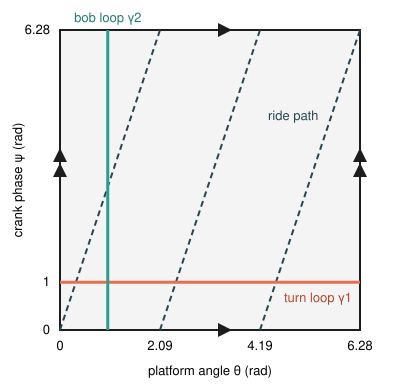

# de Rham cohomology: closed forms that are not derivatives count holes

[Syllabus](../../../SYLLABUS.md) → [Differential geometry and Lie groups](../README.md) → [Differential Forms](../README.md#s04) → de Rham cohomology

---

## General Overview

A carousel platform turns once every 15 s. A ride lasts 180 s, so it makes 12 turns. Each horse also rides up and down on its pole: a crank overhead lifts it 3 times per turn, so 36 bobs in a ride. The control room keeps two counters, one for turns and one for bobs.

Start with the floor: the plane with the centre pole taken out. The **angle form** $`d\theta`$ measures how far a point has turned round the pole. Walk any circle round the pole, at 3 m or at 6 m, and it adds up to $`2\pi`$ = 6.283185 radians, one full turn (360°). Walk a circle beside the pole and it adds up to 0.

The angle form has zero curl everywhere on the floor, yet no single "angle" function produces it all the way round. That pairing, **closed** (zero curl) but not **exact** (not the derivative of any function), is the signal of a hole. [De Rham cohomology](../../22-Algebraic%20geometry/05-Cohomology%20and%20the%20Hodge%20Conjecture/02-de-rham-cohomology-of-varieties.md) already proves that the floor has exactly one such signal: every closed 1-form there is a multiple of $`d\theta`$ plus an exact form.

This card moves to a closed surface. A horse's state is two angles: the platform angle $`\theta`$ and the crank phase $`\psi`$. Each comes back to its start after $`2\pi`$. So the states form a **torus**, the surface of a ring doughnut. On the torus, both $`d\theta`$ and $`d\psi`$ are closed and neither is exact, and no mix of the two is exact. The torus has two independent holes of this kind, and the two counters read one each.

The platform's encoder (the angle sensor) also wobbles: it reads $`\theta + 0.05\cos\theta\cos\psi`$, off by up to 0.05 rad (2.864789°). Its total change over a ride is still exactly 12 turns. The wobble is a true function on the torus, so its derivative is exact and adds 0 round every loop.

**De Rham cohomology keeps the closed forms on a smooth manifold and throws away the exact ones; what is left in degree k has dimension $`b_k`$, the number of independent k-dimensional holes, and on the torus degree 1 has dimension 2, spanned by the turn form dθ and the bob form dψ.**

**What kind of fact this is:** a definition and a theorem. That the torus has $`b_1 = 2`$ is proved on this card in Why it works, by a direct argument and by Mayer–Vietoris. Poincaré duality and de Rham's theorem are stated with sources, not proved in general; the cases the card uses are checked by hand and by the code.

### The picture: the torus as a glued square

<p align="center"></p>

The square, drawn to scale, holds every state: platform angle $`\theta`$ across, crank phase $`\psi`$ up. Glue the edges with matching arrows and it closes into the torus.

The orange **turn loop** $`\gamma_1`$ is one platform turn with the crank held at $`\psi = 1`$. The teal **bob loop** $`\gamma_2`$ is one crank cycle with the platform held at $`\theta = 1`$. The dashed line is one turn of the ride, $`\psi = 3\theta`$.

---

## The formula

Words from the sibling cards, one line each:

- A **k-form** on a smooth manifold M is something that can be integrated over k-dimensional pieces of M: a 1-form over curves, a 2-form over areas ([Differential form](01-forms-and-the-wedge-product.md)). The k-forms make a vector space, $`\Omega^k(M)`$.
- The **exterior derivative** $`d`$ turns a k-form into a (k+1)-form. On a function it is the gradient; on a 1-form in two dimensions it is the curl ([Exterior derivative](03-exterior-derivative.md)). Applied twice it gives zero: $`d\,d = 0`$.
- A form $`\alpha`$ is **closed** when $`d\alpha = 0`$, and **exact** when $`\alpha = d\beta`$ for some form $`\beta`$ one degree lower ([Closed and exact forms](04-closed-and-exact-forms-and-the-poincare-lemma.md)). Every exact form is closed, because $`d\,d = 0`$.

The de Rham cohomology in degree k is the closed k-forms, with two forms counted as the same when their difference is exact:

```math
H^k_{dR}(M) = \frac{\ker\big(d : \Omega^k(M) \to \Omega^{k+1}(M)\big)}{\mathrm{im}\big(d : \Omega^{k-1}(M) \to \Omega^k(M)\big)}, \qquad b_k = \dim H^k_{dR}(M)
```

**Read it aloud:** the k-th de Rham group of M is the closed k-forms modulo the exact k-forms, and the k-th Betti number b_k is its dimension.

Here $`\ker`$ (the kernel) is everything d sends to zero, so the closed forms. $`\mathrm{im}`$ (the image) is everything d produces, so the exact forms. "Modulo" means two closed forms count as one when they differ by an exact form.

A closed form $`\alpha`$ stands for its **class** $`[\alpha]`$: the form together with everything that differs from it by an exact form. For the torus $`T^2`$, the job of this card is this result, where $`\oplus`$ (direct sum) means each class is one unique combination of the two pieces:

```math
H^1_{dR}(T^2) = \mathbb{R}\,[d\theta] \oplus \mathbb{R}\,[d\psi], \qquad [\alpha] = c_1\,[d\theta] + c_2\,[d\psi], \quad c_1 = \frac{1}{2\pi}\oint_{\gamma_1} \alpha, \quad c_2 = \frac{1}{2\pi}\oint_{\gamma_2} \alpha
```

**Read it aloud:** every closed 1-form on the torus is a turn part times dθ, plus a bob part times dψ, plus an exact form; the turn part is its integral once round the turn loop over 2π, and the bob part is the same round the bob loop.

$`\theta`$ itself is not a function on the torus, but $`d\theta`$ is a genuine 1-form: two charts' values of $`\theta`$ differ by a constant, whose derivative is 0 ([Sphere, torus and projective plane](../03-Manifolds/02-example-manifolds-sphere-torus-and-projective-space.md)).

| Symbol | Plain meaning | In our example | Push it up and the answer… |
| --- | --- | --- | --- |
| $`M`$, $`n`$, $`T^2`$ | a smooth manifold; its dimension; the torus, the states of one horse | $`T^2`$, with n = 2 | — |
| $`\Omega^k(M)`$, $`k`$ | the k-forms on M; the degree | 1-forms such as $`d\theta`$ | — |
| $`d`$; $`f`$, $`F`$; $`\beta`$ | the exterior derivative: gradient, then curl; a function, and in the fold its unwrapped version on the plane; a form one degree lower | the curl of $`\alpha`$ is 0; $`f = \varepsilon\cos\theta\cos\psi`$ | — |
| $`H^k_{dR}(M)`$, $`[\alpha]`$, $`\mathbb{R}`$, $`\oplus`$ | closed k-forms modulo exact ones; the class of $`\alpha`$; the real numbers; $`\oplus`$, a direct sum | $`[\alpha] = [d\theta]`$ | — |
| $`b_k`$, $`\chi`$ | the k-th Betti number, $`\dim H^k_{dR}`$; the Euler characteristic $`b_0 - b_1 + b_2`$ | 1, 2, 1; $`\chi = 0`$ | more handles, bigger $`b_1`$, smaller $`\chi`$ |
| $`\theta`$, $`\psi`$ | platform angle; crank phase, in radians | each from 0 to $`2\pi`$ | — |
| $`d\theta`$, $`d\psi`$ | the turn form and the bob form | $`\oint_{\gamma_1} d\theta = 2\pi`$ | — |
| $`\gamma_1`$, $`\gamma_2`$, $`\oint`$ | the turn loop and the bob loop; the integral once round a loop | the orange and teal lines | each extra time round adds $`2\pi c_1`$ or $`2\pi c_2`$ |
| $`c_1`$, $`c_2`$ | the class's turn part and bob part | $`(1, 0)`$ for the encoder | — |
| $`\alpha`$, $`\varepsilon`$ | the encoder form $`d(\theta + \varepsilon\cos\theta\cos\psi)`$; the wobble size | $`\varepsilon`$ = 0.05 rad | the class stays $`(1, 0)`$ |
| $`U`$, $`V`$, $`r_k`$, $`\delta`$; $`\rho_U`$, $`\rho_V`$, $`\omega`$ | two overlapping cylinders that cover the torus; the map to differences on the overlap in degree k; the connecting map; in the fold, two smooth weights adding to 1 and a form on the overlap | each cylinder covers a bit over half the crank cycle | — |
| $`\langle \alpha, \beta \rangle`$, $`\wedge`$ | the duality pairing $`\int_M \alpha \wedge \beta`$; the wedge product | $`\langle d\theta, d\psi \rangle = 4\pi^2`$ = 39.478418 | a bigger area, a bigger pairing |

### When it holds

- **Smooth forms on a smooth manifold.** The forms need derivatives everywhere they are defined. At the carousel's centre pole $`d\theta`$ blows up, so the pole is removed, and that hole is what the class detects.
- **Closed before exact.** Only closed forms have classes. The form $`\sin\psi\,d\theta`$ is not closed, and its turn-loop integral changes with the loop: 0 at $`\psi = 0`$, 6.283185 at $`\psi = \pi/2`$.
- **Real coefficients.** De Rham classes count holes with real numbers. A twist that only shows up as "do it twice and it bounds" (torsion) is invisible. The Klein bottle, the square glued like the torus but with one pair of edges flipped, has such a twist, and de Rham sees only $`b = 1, 1, 0`$.
- **Compact and oriented, for Poincaré duality.** The torus has both. The punctured floor is not compact, and has $`b_0 = 1`$ but $`b_2 = 0`$. The Klein bottle has no consistent orientation, and has $`b_0 = 1`$ but $`b_2 = 0`$.
- **A global answer.** Near any point every closed form is exact (the Poincaré lemma). The class is a property of the whole manifold, and it does not change when the manifold is bent or stretched without tearing.

---

## Why it works

### Step 0: loop integrals cannot see exact forms

If $`\alpha = df`$ for a function f, then $`\oint \alpha`$ round a loop is f at the end minus f at the start, which is 0. This is [Stokes on manifolds](06-stokes-theorem-on-manifolds.md) in its smallest case. So adding an exact form never changes a loop integral, and a loop integral measures the class, not the form.

The two loops tell the two forms apart:

| | $`\oint_{\gamma_1}`$ (one turn) | $`\oint_{\gamma_2}`$ (one bob) |
| --- | --- | --- |
| $`d\theta`$ | $`2\pi`$ | 0 |
| $`d\psi`$ | 0 | $`2\pi`$ |

If $`c_1\,d\theta + c_2\,d\psi`$ were exact, both columns would give 0, which forces $`c_1 = c_2 = 0`$. So $`[d\theta]`$ and $`[d\psi]`$ are independent, and $`b_1 \ge 2`$.

### Step 1: every closed 1-form is a turn part, a bob part and an exact part

Take any closed 1-form $`\alpha`$ on the torus. Set $`c_1`$ and $`c_2`$ to its two loop integrals divided by $`2\pi`$. Then $`\alpha - c_1\,d\theta - c_2\,d\psi`$ is closed and gives 0 round both loops.

A closed form with every loop integral 0 is exact: integrate it from a fixed start point, and the answer does not depend on the path. Every loop on the torus is, up to deforming it, some number of turn loops plus some number of bob loops. So $`\alpha = c_1\,d\theta + c_2\,d\psi + df`$, and $`b_1 = 2`$ exactly.

<details>
<summary>Detailed proof: unwrap the torus onto the plane</summary>

Unwrap the torus onto the plane: the point $`(\theta, \psi)`$ of the plane lands on the torus at the same angles, taken modulo $`2\pi`$. Pull $`\alpha`$ back to the plane ([Pullback](02-pullback-and-change-of-variables.md)); it is still closed. On the plane every closed 1-form is exact ([Closed and exact forms](04-closed-and-exact-forms-and-the-poincare-lemma.md)), so the pulled-back form is $`dF`$ for a function F on the plane.

F need not repeat after $`2\pi`$. Its step across one period is

$`\displaystyle F(\theta + 2\pi, \psi) - F(\theta, \psi) = \int_\theta^{\theta + 2\pi} \alpha \text{ along the row at height } \psi = 2\pi c_1.`$

The step is the same on every row and at every start, because its derivative is the pulled-back form minus its own copy shifted by one period, which is zero. In the same way the step up one period is $`2\pi c_2`$. So

$`\displaystyle f(\theta, \psi) = F(\theta, \psi) - c_1\theta - c_2\psi`$

repeats in both directions, and is a function on the torus. Its derivative is $`\alpha - c_1\,d\theta - c_2\,d\psi`$, which finishes the proof.

</details>

### Step 2: the same count from two cylinders (Mayer–Vietoris)

Cut the torus along two circles of constant crank phase. Let U be the band covering a bit more than the lower half of the crank cycle, and V the band covering a bit more than the upper half. Each is a **cylinder**: a circle times an interval. Their overlap $`U \cap V`$ is two thin cylinders, one near each cut.

A cylinder shrinks onto its circle, so it has one piece ($`b_0 = 1`$), one loop ($`b_1 = 1`$, spanned by $`d\theta`$) and nothing in degree 2. The **Mayer–Vietoris sequence** strings the groups of the whole, the pieces and the overlap into one chain of maps:

```math
0 \to H^0(T^2) \to H^0(U) \oplus H^0(V) \xrightarrow{r_0} H^0(U \cap V) \xrightarrow{\delta} H^1(T^2) \to H^1(U) \oplus H^1(V) \xrightarrow{r_1} H^1(U \cap V) \xrightarrow{\delta} H^2(T^2) \to 0
```

**Read it aloud:** classes on the whole give pairs on U and V, pairs give differences on the overlap, and δ turns an overlap mismatch into a class one degree up; at each place, what arrives is exactly what the next map sends to zero.

The same idea for homology is on [Mayer-Vietoris and exact sequences](../../17-Topology/05-Homology/06-mayer-vietoris-and-long-exact-sequences.md). Here every group in the middle has dimension 2, and both maps $`r_0`$ and $`r_1`$ send a pair (on U, on V) to "V minus U" on each overlap piece. Both have matrix `[[-1, 1], [-1, 1]]`, which has rank 1. Exactness then gives the counts:

| Count | From the sequence | Value |
| --- | --- | --- |
| $`b_0`$ | what $`r_0`$ sends to zero: 2 − 1 | 1 |
| $`b_1`$ | what $`\delta`$ makes, 2 − 1, plus what $`r_1`$ sends to zero, 2 − 1 | 2 |
| $`b_2`$ | what $`\delta`$ makes from degree 1: 2 − 1 | 1 |

The two classes come from different places. $`d\theta`$ is the same class on both cylinders, so $`r_1`$ sends it to zero: a hole each piece already sees. $`d\psi`$ is made by $`\delta`$ from constants that differ between the two overlap pieces: a hole neither cylinder sees alone.

The same bookkeeping, with different pieces, gives the floor and the sphere. Two slit planes covering the floor overlap in two half-planes, and the sequence gives 1, 1, 0: the one hole of [De Rham cohomology](../../22-Algebraic%20geometry/05-Cohomology%20and%20the%20Hodge%20Conjecture/02-de-rham-cohomology-of-varieties.md). Two caps covering a sphere overlap in one band, and it gives 1, 0, 1.

<details>
<summary>Detailed proof sketch: why the sequence is exact</summary>

Pick smooth functions $`\rho_U`$ and $`\rho_V`$ with $`\rho_U + \rho_V = 1`$, where $`\rho_U`$ is zero outside U and $`\rho_V`$ is zero outside V (a partition of unity). Restriction followed by "V minus U" sends forms on the whole to zero, and every pair that agrees on the overlap glues into one form on the whole. Every form $`\omega`$ on the overlap splits as $`\rho_U\,\omega`$ minus $`(-\rho_V\,\omega)`$: the first extends by zero to V, the second to U; so the difference map is onto at the level of forms.

These three facts make a short exact sequence of forms, and d commutes with every map in it. The standard diagram chase then turns it into the long exact sequence above. For a closed form $`\omega`$ on the overlap, the connecting map takes $`d(-\rho_V\,\omega)`$ on U and $`d(\rho_U\,\omega)`$ on V; these agree on the overlap and glue into a closed form on the whole. Bott and Tu (Sources, Section 2) give the chase in full.

</details>

### Step 3: the same count from areas (Poincaré duality)

**Poincaré duality** says: on a compact, oriented n-dimensional manifold without boundary, the pairing

```math
\langle \alpha, \beta \rangle = \int_M \alpha \wedge \beta, \qquad H^k_{dR}(M) \times H^{n-k}_{dR}(M) \to \mathbb{R}
```

is non-degenerate, so $`b_k = b_{n-k}`$. **Read it aloud:** wedge a closed k-form with a closed (n − k)-form and integrate over the whole manifold; no non-zero class pairs to zero with everything, so the two degrees have equal dimension. The general proof uses Mayer–Vietoris on a good cover (open pieces whose overlaps are all ball-like); this card states it (Bott and Tu, Section 5; Lee, Chapter 17).

Exact parts pair to zero: for a closed $`\beta`$, $`\int_M df \wedge \beta = \int_M d(f\beta) = 0`$ by [Stokes on manifolds](06-stokes-theorem-on-manifolds.md), as the torus has no boundary.

For the torus, n = 2, and the count runs in three steps:

1. The torus is one piece, so $`b_0 = 1`$, and duality gives $`b_2 = b_0 = 1`$.
2. A 3 × 3 grid of squares, each cut into 2 triangles, covers the torus with 9 corners, 27 edges and 18 triangles. So $`\chi = 9 - 27 + 18 = 0`$.
3. The Euler count of any triangulation equals $`b_0 - b_1 + b_2`$ ([Homology groups](../../17-Topology/05-Homology/02-homology-groups.md)), which gives $`b_1 = 1 + 1 - 0 = 2`$.

Duality also reads a class by areas instead of loops. The pairing matrix on $`d\theta`$ and $`d\psi`$ is

```math
\begin{pmatrix} \langle d\theta, d\theta \rangle & \langle d\theta, d\psi \rangle \\ \langle d\psi, d\theta \rangle & \langle d\psi, d\psi \rangle \end{pmatrix} = \begin{pmatrix} 0 & 4\pi^2 \\ -4\pi^2 & 0 \end{pmatrix}, \qquad \det = 16\pi^4 \ne 0
```

**Read it aloud:** a form wedged with itself gives zero; the turn form wedged with the bob form integrates to the square's area, 4π²; the determinant is 16π⁴, which is not zero.

So $`c_1 = \langle \alpha, d\psi \rangle / 4\pi^2`$ and $`c_2 = \langle d\theta, \alpha \rangle / 4\pi^2`$. For the encoder form these area integrals give $`(1, 0)`$, the same as the loops.

### Step 4: count against count (de Rham's theorem)

**De Rham's theorem** (1931) says the dimension of $`H^k_{dR}(M)`$ equals the k-th Betti number from [Homology groups](../../17-Topology/05-Homology/02-homology-groups.md): cycles that are not boundaries, counted on any triangulation. It is stated here, not proved (Lee, Chapter 18).

On the 3 × 3 grid torus, the boundary matrix from edges to corners has rank 8, and from triangles to edges rank 17. The Betti numbers are $`9 - 8 = 1`$, $`27 - 8 - 17 = 2`$ and $`18 - 17 = 1`$. Forms and triangles agree: 1, 2, 1.

---

## Worked numbers, by hand

| Step | Arithmetic | Value |
| --- | --- | --- |
| turns and bobs in a ride | 180 s / 15 s; 3 × 12 | 12 turns, 36 bobs |
| floor: circle round the pole, at 3 m or 6 m | $`\oint d\theta`$ | 6.283185 |
| floor: circle beside the pole | $`\oint d\theta`$ | 0 |
| encoder form | $`\alpha = (1 - \varepsilon\sin\theta\cos\psi)\,d\theta - \varepsilon\cos\theta\sin\psi\,d\psi`$, $`\varepsilon`$ = 0.05 | — |
| its curl | $`\varepsilon\sin\theta\sin\psi - \varepsilon\sin\theta\sin\psi`$ | 0: closed |
| turn loop $`\gamma_1`$ | $`2\pi + \oint d(\varepsilon\cos\theta\cos\psi) = 2\pi + 0`$ | 6.283185 |
| bob loop $`\gamma_2`$ | $`0 + 0`$ | 0 |
| class of $`\alpha`$ | $`(6.283185 / 2\pi,\ 0 / 2\pi)`$ | $`(1, 0)`$ |
| the ride, $`\alpha`$ | 12 turn loops and 36 bob loops: $`12 \times 6.283185 + 36 \times 0`$ | 75.398224 = 12 turns |
| the ride, $`d\psi`$ | $`36 \times 2\pi`$ | 226.194671 = 36 bobs |
| Mayer–Vietoris | ranks of $`r_0`$, $`r_1`$: 1, 1 | 1, 2, 1 |
| duality pairing | $`2\pi \times 2\pi`$ | 39.478418 |
| its determinant | $`16\pi^4`$ | 1558.545457 |
| Euler count | $`9 - 27 + 18`$, then $`b_1 = 1 + 1 - 0`$ | **$`b_1 = 2`$** |

The torus has two independent classes in degree 1. The two counters read them, and the wobbling encoder still reads exactly 12 turns, because the wobble is exact.

### What breaks if you drop a piece

| Mistake | Comes out at | What went wrong |
| --- | --- | --- |
| Duality on the Klein bottle (same 3 × 3 grid, top glued to bottom with a flip) | 9 corners, 27 edges, 18 triangles; $`b = 1, 1, 0`$, so $`b_2 \ne b_0`$ | no consistent orientation, so no area pairing |
| Duality on the punctured floor | $`b_0 = 1`$, $`b_2 = 0`$ | not compact: the area pairing needs a manifold without ends |
| A class for $`\sin\psi\,d\theta`$ | turn loop at $`\psi = 0`$: 0; at $`\psi = \pi/2`$: 6.283185 | not closed, so loop integrals depend on the loop |
| Mayer–Vietoris with the overlap as one cylinder | 1, 1, 0 | the overlap has two pieces; dropping one loses $`d\psi`$ |

The code prints all four rows.

---

## Code, from first principles, and it actually runs

Four independent roads reach $`b_1 = 2`$. Road 1 integrates closed forms round loops on the torus with Simpson's rule, written out, and reads the encoder's class. Road 2 builds the Mayer–Vietoris restriction maps and finds their ranks by exact whole-number elimination. Road 3 integrates wedge products over the torus by the midpoint rule, reads the same class by areas, and combines duality with the Euler count. Road 4 builds the 3 × 3 grid torus and computes its Betti numbers by exact rank. The asserts check each road against another one.

### Python

```python
# de Rham cohomology of the torus -- the check behind the card.
# Standard library only.  Four roads to one answer, H^1(torus) has dimension 2:
#   road 1: loop integrals of closed 1-forms, Simpson's rule written out
#   road 2: Mayer-Vietoris, ranks of the restriction maps by exact integer elimination
#   road 3: Poincare duality, area integrals of wedge products, plus the Euler count
#   road 4: simplicial Betti numbers of a 3 x 3 grid torus, by exact rank
from math import pi, sin, cos, gcd
from functools import reduce
TAU = 2 * pi

def f6(x):  # six decimals, with no negative zero
    return "%.6f" % (0.0 if abs(x) < 5e-7 else x)

def simpson(g, a, b, n):
    h = (b - a) / n
    return (g(a) + g(b) + sum((4 if k % 2 else 2) * g(a + k * h) for k in range(1, n))) * h / 3

def loop(form, path, t1, n=2400):  # integral of P du + Q dv along path(t) = (u, v, du/dt, dv/dt)
    def g(t):
        u, v, du, dv = path(t)
        P, Q = form(u, v)
        return P * du + Q * dv
    return simpson(g, 0.0, t1, n)

def angle(x, y):  # the angle form on the punctured plane
    r2 = x * x + y * y
    return (-y / r2, x / r2)

def circle(cx, cy, r):
    return lambda t: (cx + r * cos(t), cy + r * sin(t), -r * sin(t), r * cos(t))

def encoder(amp):  # alpha = d(theta + amp cos(theta) cos(psi)), on the torus
    return lambda th, ps: (1 - amp * sin(th) * cos(ps), -amp * cos(th) * sin(ps))

DTH, DPS = (lambda th, ps: (1.0, 0.0)), (lambda th, ps: (0.0, 1.0))
turn_loop = lambda ps0: (lambda t: (t, ps0, 1.0, 0.0))
bob_loop = lambda th0: (lambda t: (th0, t, 0.0, 1.0))
ride = lambda k: (lambda t: (t, k * t, 1.0, float(k)))

def pair(f1, f2, n=60):  # integral over the torus of f1 ^ f2, midpoint rule
    h, s = TAU / n, 0.0
    for i in range(n):
        for j in range(n):
            P1, Q1 = f1((i + 0.5) * h, (j + 0.5) * h)
            P2, Q2 = f2((i + 0.5) * h, (j + 0.5) * h)
            s += P1 * Q2 - Q1 * P2
    return s * h * h

def rank(rows):  # exact rank by fraction-free integer elimination
    m, r = [list(x) for x in rows], 0
    for c in range(len(m[0]) if m else 0):
        p = next((i for i in range(r, len(m)) if m[i][c] != 0), None)
        if p is None:
            continue
        m[r], m[p] = m[p], m[r]
        for i in range(r + 1, len(m)):
            if m[i][c] != 0:
                a, b = m[r][c], m[i][c]
                row = [a * x - b * y for x, y in zip(m[i], m[r])]
                g = reduce(gcd, row, 0)
                m[i] = [x // g for x in row] if g else row
        r += 1
    return r

def mv(maps):  # maps[k] = (dim H^k(overlap), dim H^k(U) + dim H^k(V), restriction matrix)
    rk = [rank(m) for (_, _, m) in maps]
    return [(maps[k - 1][0] - rk[k - 1] if k else 0) + maps[k][1] - rk[k] for k in range(3)], rk

def grid(n, twist):  # n x n grid of squares, each cut into 2 triangles, edges glued
    def v(i, j):
        if twist and j == n:
            i = -i
        return (i % n) + n * (j % n)
    tris = set()
    for i in range(n):
        for j in range(n):
            a, b, c, d = v(i, j), v(i + 1, j), v(i + 1, j + 1), v(i, j + 1)
            tris |= {tuple(sorted((a, b, c))), tuple(sorted((a, c, d)))}
    tris = sorted(tris)
    edges = sorted({e for t in tris for e in ((t[0], t[1]), (t[0], t[2]), (t[1], t[2]))})
    ei = {e: k for k, e in enumerate(edges)}
    d1 = [[(1 if e[1] == p else -1 if e[0] == p else 0) for e in edges] for p in range(n * n)]
    d2 = [[0] * len(tris) for _ in edges]
    for k, (a, b, c) in enumerate(tris):
        d2[ei[(b, c)]][k] += 1
        d2[ei[(a, c)]][k] -= 1
        d2[ei[(a, b)]][k] += 1
    assert all(sum(1 for x in row if x != 0) == 2 for row in d2)  # every edge on 2 triangles
    r1, r2 = rank(d1), rank(d2)
    V, E, F = n * n, len(edges), len(tris)
    return V, E, F, r1, r2, [V - r1, E - r1 - r2, F - r2]

print("carousel: ride 180 s, 15 s per turn, %d turns; crank 3 bobs per turn, %d bobs" % (180 // 15, 3 * 180 // 15))
pp = [loop(angle, circle(0, 0, 3), TAU), loop(angle, circle(0, 0, 6), TAU), loop(angle, circle(5, 0, 2), TAU)]
print("punctured plane, angle form: circle r 3 m round the pole %s, r 6 m %s, r 2 m centred 5 m out %s" % tuple(map(f6, pp)))
assert abs(pp[0] - TAU) < 1e-9 and abs(pp[1] - TAU) < 1e-9 and abs(pp[2]) < 1e-9
al, h = encoder(0.05), 1e-5
curl = (al(1 + h, 2)[1] - al(1 - h, 2)[1]) / (2 * h) - (al(1, 2 + h)[0] - al(1, 2 - h)[0]) / (2 * h)
print("encoder wobble 0.050000 rad = %s degrees; curl of alpha at (1, 2) %s" % (f6(0.05 * 180 / pi), f6(curl)))
A = [loop(al, turn_loop(p), TAU) for p in (0.0, 1.0, 2.0)]
B = [loop(al, bob_loop(t), TAU) for t in (0.0, 1.0, 2.0)]
print("road 1, turn loop gamma1 at psi = 0, 1, 2: %s %s %s" % tuple(map(f6, A)))
print("road 1, bob loop gamma2 at theta = 0, 1, 2: %s %s %s" % tuple(map(f6, B)))
c1 = (A[1] / TAU, B[1] / TAU)
print("road 1, class of alpha read by loops: (%s, %s)" % tuple(map(f6, c1)))
ra, rp = loop(al, ride(3), 12 * TAU, 24000), loop(DPS, ride(3), 12 * TAU, 24000)
print("ride path theta = t, psi = 3t, 12 turns: alpha %s = %s turns; dpsi %s = %s bobs" % (f6(ra), f6(ra / TAU), f6(rp), f6(rp / TAU)))
assert abs(curl) < 1e-6 and abs(ra - 24 * pi) < 1e-8 and abs(rp - 72 * pi) < 1e-8
R = [[-1, 1], [-1, 1]]
bt, rk = mv([(2, 2, R), (2, 2, R), (0, 0, [])])
print("road 2, Mayer-Vietoris on two cylinders: ranks %d, %d; torus %d %d %d" % (rk[0], rk[1], *bt))
bp, _ = mv([(2, 2, R), (0, 0, []), (0, 0, [])])
bs, _ = mv([(1, 2, [[-1, 1]]), (1, 0, []), (0, 0, [])])
print("road 2, Mayer-Vietoris: punctured plane %d %d %d; sphere %d %d %d" % (*bp, *bs))
assert bp == [1, 1, 0] and bs == [1, 0, 1]
v4 = pair(DTH, DPS)
M = [[pair(DTH, DTH), v4], [pair(DPS, DTH), pair(DPS, DPS)]]
print("road 3, <dtheta, dpsi> = %s = 4 pi^2; matrix [[%s, %s], [%s, %s]], det %s" % (f6(v4), *map(f6, M[0] + M[1]), f6(M[0][0] * M[1][1] - M[0][1] * M[1][0])))
c3 = (pair(al, DPS) / v4, pair(DTH, al) / v4)
print("road 3, class of alpha read by areas: (%s, %s)" % tuple(map(f6, c3)))
assert abs(v4 - 4 * pi * pi) < 1e-9 and abs(M[1][0] + v4) < 1e-9 and abs(c3[0] - c1[0]) < 1e-9 and abs(c3[1] - c1[1]) < 1e-9
V, E, F, r1, r2, bg = grid(3, False)
print("road 3, duality b2 = b0 = 1; Euler count %d - %d + %d = %d; b1 = 1 + 1 - %d = %d" % (V, E, F, V - E + F, V - E + F, 2 - (V - E + F)))
print("road 4, grid torus: V %d, E %d, F %d; rank d1 %d, rank d2 %d; Betti %d %d %d" % (V, E, F, r1, r2, *bg))
assert bg == bt and bt[1] == 2 - (V - E + F)  # simplicial = Mayer-Vietoris = duality count
V, E, F, r1, r2, bk = grid(3, True)
print("break 1, Klein bottle grid: V %d, E %d, F %d; Betti %d %d %d, so b2 is not b0" % (V, E, F, *bk))
assert bk == [1, 1, 0] and bk[2] != bk[0]
print("break 2, punctured plane, not compact: b0 %d, b2 %d" % (bp[0], bp[2]))
nc = [loop(lambda t, p: (sin(p), 0.0), turn_loop(p0), TAU) for p0 in (0.0, pi / 2)]
print("break 3, sin(psi) dtheta, not closed: turn loop at psi = 0 %s, at psi = pi/2 %s" % tuple(map(f6, nc)))
assert abs(nc[1] - nc[0] - TAU) < 1e-9
bw, _ = mv([(1, 2, [[-1, 1]]), (1, 2, [[-1, 1]]), (0, 0, [])])
print("break 4, overlap counted as one cylinder: %d %d %d" % tuple(bw))
assert bw[1] != bt[1]
r4, w2, g = loop(DPS, ride(4), 12 * TAU, 24000), encoder(0.2), 2  # g: the genus, the number of handles
print("try: 4 bobs per turn: dpsi over the ride %s = %s bobs" % (f6(r4), f6(r4 / TAU)))
print("try: wobble 0.2 rad: class (%s, %s); genus %d: chi %d, b1 = 1 + 1 - (%d) = %d" % (f6(loop(w2, turn_loop(1.0), TAU) / TAU), f6(loop(w2, bob_loop(1.0), TAU) / TAU), g, 2 - 2 * g, 2 - 2 * g, 2 - (2 - 2 * g)))
print("figure, square 0 to %s rad both ways; gamma1 at psi = 1; gamma2 at theta = 1; ride segments start at theta = 0.000000, %s, %s" % (f6(TAU), f6(TAU / 3), f6(2 * TAU / 3)))
print("ALL CHECKS PASS")
```

**Ran 2026-11-19 on macOS, Python 3.14.10, standard library only. All checks passed. Output, pasted from the run:**

```
carousel: ride 180 s, 15 s per turn, 12 turns; crank 3 bobs per turn, 36 bobs
punctured plane, angle form: circle r 3 m round the pole 6.283185, r 6 m 6.283185, r 2 m centred 5 m out 0.000000
encoder wobble 0.050000 rad = 2.864789 degrees; curl of alpha at (1, 2) 0.000000
road 1, turn loop gamma1 at psi = 0, 1, 2: 6.283185 6.283185 6.283185
road 1, bob loop gamma2 at theta = 0, 1, 2: 0.000000 0.000000 0.000000
road 1, class of alpha read by loops: (1.000000, 0.000000)
ride path theta = t, psi = 3t, 12 turns: alpha 75.398224 = 12.000000 turns; dpsi 226.194671 = 36.000000 bobs
road 2, Mayer-Vietoris on two cylinders: ranks 1, 1; torus 1 2 1
road 2, Mayer-Vietoris: punctured plane 1 1 0; sphere 1 0 1
road 3, <dtheta, dpsi> = 39.478418 = 4 pi^2; matrix [[0.000000, 39.478418], [-39.478418, 0.000000]], det 1558.545457
road 3, class of alpha read by areas: (1.000000, 0.000000)
road 3, duality b2 = b0 = 1; Euler count 9 - 27 + 18 = 0; b1 = 1 + 1 - 0 = 2
road 4, grid torus: V 9, E 27, F 18; rank d1 8, rank d2 17; Betti 1 2 1
break 1, Klein bottle grid: V 9, E 27, F 18; Betti 1 1 0, so b2 is not b0
break 2, punctured plane, not compact: b0 1, b2 0
break 3, sin(psi) dtheta, not closed: turn loop at psi = 0 0.000000, at psi = pi/2 6.283185
break 4, overlap counted as one cylinder: 1 1 0
try: 4 bobs per turn: dpsi over the ride 301.592895 = 48.000000 bobs
try: wobble 0.2 rad: class (1.000000, 0.000000); genus 2: chi -2, b1 = 1 + 1 - (-2) = 4
figure, square 0 to 6.283185 rad both ways; gamma1 at psi = 1; gamma2 at theta = 1; ride segments start at theta = 0.000000, 2.094395, 4.188790
ALL CHECKS PASS
```

### Rust

Same numbers, same labels, built with `rustc --edition 2021 -O`.

```rust
// de Rham cohomology of the torus -- the same check as the Python, in Rust.
// No crates.  Four roads to one answer, H^1(torus) has dimension 2:
//   road 1: loop integrals of closed 1-forms, Simpson's rule written out
//   road 2: Mayer-Vietoris, ranks of the restriction maps by exact integer elimination
//   road 3: Poincare duality, area integrals of wedge products, plus the Euler count
//   road 4: simplicial Betti numbers of a 3 x 3 grid torus, by exact rank
use std::collections::{BTreeMap, BTreeSet};
use std::f64::consts::PI;
const TAU: f64 = 2.0 * PI;

fn f6(x: f64) -> String { format!("{:.6}", if x.abs() < 5e-7 { 0.0 } else { x }) }

fn simpson(g: &dyn Fn(f64) -> f64, a: f64, b: f64, n: usize) -> f64 {
    let h = (b - a) / n as f64;
    let mut s = 0.0;
    for k in 1..n { s += (if k % 2 == 1 { 4.0 } else { 2.0 }) * g(a + k as f64 * h); }
    (g(a) + g(b) + s) * h / 3.0
}

// integral of P du + Q dv along path(t) = (u, v, du/dt, dv/dt)
fn lp(form: &dyn Fn(f64, f64) -> (f64, f64), path: &dyn Fn(f64) -> (f64, f64, f64, f64), t1: f64, n: usize) -> f64 {
    let g = |t: f64| { let (u, v, du, dv) = path(t); let (p, q) = form(u, v); p * du + q * dv };
    simpson(&g, 0.0, t1, n)
}

fn angle(x: f64, y: f64) -> (f64, f64) { let r2 = x * x + y * y; (-y / r2, x / r2) }

fn circle(cx: f64, cy: f64, r: f64) -> impl Fn(f64) -> (f64, f64, f64, f64) {
    move |t| (cx + r * t.cos(), cy + r * t.sin(), -r * t.sin(), r * t.cos())
}

// alpha = d(theta + amp cos(theta) cos(psi)), on the torus
fn encoder(amp: f64) -> impl Fn(f64, f64) -> (f64, f64) {
    move |th: f64, ps: f64| (1.0 - amp * th.sin() * ps.cos(), -amp * th.cos() * ps.sin())
}
fn dth(_: f64, _: f64) -> (f64, f64) { (1.0, 0.0) }
fn dps(_: f64, _: f64) -> (f64, f64) { (0.0, 1.0) }
fn turn_loop(ps0: f64) -> impl Fn(f64) -> (f64, f64, f64, f64) { move |t| (t, ps0, 1.0, 0.0) }
fn bob_loop(th0: f64) -> impl Fn(f64) -> (f64, f64, f64, f64) { move |t| (th0, t, 0.0, 1.0) }
fn ride(k: f64) -> impl Fn(f64) -> (f64, f64, f64, f64) { move |t| (t, k * t, 1.0, k) }

// integral over the torus of f1 ^ f2, midpoint rule
fn pair(f1: &dyn Fn(f64, f64) -> (f64, f64), f2: &dyn Fn(f64, f64) -> (f64, f64)) -> f64 {
    let n = 60;
    let (h, mut s) = (TAU / n as f64, 0.0);
    for i in 0..n {
        for j in 0..n {
            let (u, v) = ((i as f64 + 0.5) * h, (j as f64 + 0.5) * h);
            let ((p1, q1), (p2, q2)) = (f1(u, v), f2(u, v));
            s += p1 * q2 - q1 * p2;
        }
    }
    s * h * h
}

fn gcd(a: i64, b: i64) -> i64 { if b == 0 { a.abs() } else { gcd(b, a % b) } }

// exact rank by fraction-free integer elimination
fn rank(rows: &[Vec<i64>]) -> usize {
    let mut m: Vec<Vec<i64>> = rows.to_vec();
    let mut r = 0;
    let ncol = if m.is_empty() { 0 } else { m[0].len() };
    for c in 0..ncol {
        let p = match (r..m.len()).find(|&i| m[i][c] != 0) { Some(p) => p, None => continue };
        m.swap(r, p);
        for i in r + 1..m.len() {
            if m[i][c] != 0 {
                let (a, b) = (m[r][c], m[i][c]);
                let row: Vec<i64> = m[i].iter().zip(m[r].iter()).map(|(x, y)| a * x - b * y).collect();
                let g = row.iter().fold(0, |g, &x| gcd(g, x));
                m[i] = if g != 0 { row.iter().map(|x| x / g).collect() } else { row };
            }
        }
        r += 1;
    }
    r
}

// maps[k] = (dim H^k(overlap), dim H^k(U) + dim H^k(V), restriction matrix)
fn mv(maps: &[(usize, usize, Vec<Vec<i64>>)]) -> (Vec<usize>, Vec<usize>) {
    let rk: Vec<usize> = maps.iter().map(|(_, _, m)| rank(m)).collect();
    let b = (0..3).map(|k| (if k > 0 { maps[k - 1].0 - rk[k - 1] } else { 0 }) + maps[k].1 - rk[k]).collect();
    (b, rk)
}

// n x n grid of squares, each cut into 2 triangles, edges glued
fn grid(n: i64, twist: bool) -> (usize, usize, usize, usize, usize, Vec<usize>) {
    let v = |i: i64, j: i64| -> usize {
        let i = if twist && j == n { -i } else { i };
        (i.rem_euclid(n) + n * j.rem_euclid(n)) as usize
    };
    let mut tris = BTreeSet::new();
    for i in 0..n {
        for j in 0..n {
            let (a, b, c, d) = (v(i, j), v(i + 1, j), v(i + 1, j + 1), v(i, j + 1));
            for t in [[a, b, c], [a, c, d]] { let mut t = t; t.sort(); tris.insert(t); }
        }
    }
    let mut edges = BTreeSet::new();
    for t in &tris { edges.insert((t[0], t[1])); edges.insert((t[0], t[2])); edges.insert((t[1], t[2])); }
    let ei: BTreeMap<(usize, usize), usize> = edges.iter().enumerate().map(|(k, &e)| (e, k)).collect();
    let nv = (n * n) as usize;
    let d1: Vec<Vec<i64>> = (0..nv).map(|p| edges.iter().map(|e| if e.1 == p { 1 } else if e.0 == p { -1 } else { 0 }).collect()).collect();
    let mut d2 = vec![vec![0i64; tris.len()]; edges.len()];
    for (k, t) in tris.iter().enumerate() {
        d2[ei[&(t[1], t[2])]][k] += 1;
        d2[ei[&(t[0], t[2])]][k] -= 1;
        d2[ei[&(t[0], t[1])]][k] += 1;
    }
    assert!(d2.iter().all(|row| row.iter().filter(|&&x| x != 0).count() == 2)); // every edge on 2 triangles
    let (r1, r2) = (rank(&d1), rank(&d2));
    let (ne, nf) = (edges.len(), tris.len());
    (nv, ne, nf, r1, r2, vec![nv - r1, ne - r1 - r2, nf - r2])
}

fn main() {
    println!("carousel: ride 180 s, 15 s per turn, {} turns; crank 3 bobs per turn, {} bobs", 180 / 15, 3 * 180 / 15);
    let pp = [lp(&angle, &circle(0.0, 0.0, 3.0), TAU, 2400), lp(&angle, &circle(0.0, 0.0, 6.0), TAU, 2400), lp(&angle, &circle(5.0, 0.0, 2.0), TAU, 2400)];
    println!("punctured plane, angle form: circle r 3 m round the pole {}, r 6 m {}, r 2 m centred 5 m out {}", f6(pp[0]), f6(pp[1]), f6(pp[2]));
    assert!((pp[0] - TAU).abs() < 1e-9 && (pp[1] - TAU).abs() < 1e-9 && pp[2].abs() < 1e-9);
    let (al, h) = (encoder(0.05), 1e-5);
    let curl = (al(1.0 + h, 2.0).1 - al(1.0 - h, 2.0).1) / (2.0 * h) - (al(1.0, 2.0 + h).0 - al(1.0, 2.0 - h).0) / (2.0 * h);
    println!("encoder wobble 0.050000 rad = {} degrees; curl of alpha at (1, 2) {}", f6(0.05 * 180.0 / PI), f6(curl));
    let a: Vec<f64> = [0.0, 1.0, 2.0].iter().map(|&p| lp(&al, &turn_loop(p), TAU, 2400)).collect();
    let b: Vec<f64> = [0.0, 1.0, 2.0].iter().map(|&t| lp(&al, &bob_loop(t), TAU, 2400)).collect();
    println!("road 1, turn loop gamma1 at psi = 0, 1, 2: {} {} {}", f6(a[0]), f6(a[1]), f6(a[2]));
    println!("road 1, bob loop gamma2 at theta = 0, 1, 2: {} {} {}", f6(b[0]), f6(b[1]), f6(b[2]));
    let c1 = (a[1] / TAU, b[1] / TAU);
    println!("road 1, class of alpha read by loops: ({}, {})", f6(c1.0), f6(c1.1));
    let (ra, rp) = (lp(&al, &ride(3.0), 12.0 * TAU, 24000), lp(&dps, &ride(3.0), 12.0 * TAU, 24000));
    println!("ride path theta = t, psi = 3t, 12 turns: alpha {} = {} turns; dpsi {} = {} bobs", f6(ra), f6(ra / TAU), f6(rp), f6(rp / TAU));
    assert!(curl.abs() < 1e-6 && (ra - 24.0 * PI).abs() < 1e-8 && (rp - 72.0 * PI).abs() < 1e-8);
    let rr = vec![vec![-1i64, 1], vec![-1, 1]];
    let one = vec![vec![-1i64, 1]];
    let (bt, rk) = mv(&[(2, 2, rr.clone()), (2, 2, rr.clone()), (0, 0, vec![])]);
    println!("road 2, Mayer-Vietoris on two cylinders: ranks {}, {}; torus {} {} {}", rk[0], rk[1], bt[0], bt[1], bt[2]);
    let (bp, _) = mv(&[(2, 2, rr.clone()), (0, 0, vec![]), (0, 0, vec![])]);
    let (bs, _) = mv(&[(1, 2, one.clone()), (1, 0, vec![]), (0, 0, vec![])]);
    println!("road 2, Mayer-Vietoris: punctured plane {} {} {}; sphere {} {} {}", bp[0], bp[1], bp[2], bs[0], bs[1], bs[2]);
    assert!(bp == vec![1, 1, 0] && bs == vec![1, 0, 1]);
    let v4 = pair(&dth, &dps);
    let m = [[pair(&dth, &dth), v4], [pair(&dps, &dth), pair(&dps, &dps)]];
    println!("road 3, <dtheta, dpsi> = {} = 4 pi^2; matrix [[{}, {}], [{}, {}]], det {}", f6(v4), f6(m[0][0]), f6(m[0][1]), f6(m[1][0]), f6(m[1][1]), f6(m[0][0] * m[1][1] - m[0][1] * m[1][0]));
    let c3 = (pair(&al, &dps) / v4, pair(&dth, &al) / v4);
    println!("road 3, class of alpha read by areas: ({}, {})", f6(c3.0), f6(c3.1));
    assert!((v4 - 4.0 * PI * PI).abs() < 1e-9 && (m[1][0] + v4).abs() < 1e-9 && (c3.0 - c1.0).abs() < 1e-9 && (c3.1 - c1.1).abs() < 1e-9);
    let (nv, ne, nf, r1, r2, bg) = grid(3, false);
    let chi = nv as i64 - ne as i64 + nf as i64;
    println!("road 3, duality b2 = b0 = 1; Euler count {} - {} + {} = {}; b1 = 1 + 1 - {} = {}", nv, ne, nf, chi, chi, 2 - chi);
    println!("road 4, grid torus: V {}, E {}, F {}; rank d1 {}, rank d2 {}; Betti {} {} {}", nv, ne, nf, r1, r2, bg[0], bg[1], bg[2]);
    assert!(bg == bt && bt[1] as i64 == 2 - chi); // simplicial = Mayer-Vietoris = duality count
    let (nv, ne, nf, _, _, bk) = grid(3, true);
    println!("break 1, Klein bottle grid: V {}, E {}, F {}; Betti {} {} {}, so b2 is not b0", nv, ne, nf, bk[0], bk[1], bk[2]);
    assert!(bk == vec![1, 1, 0] && bk[2] != bk[0]);
    println!("break 2, punctured plane, not compact: b0 {}, b2 {}", bp[0], bp[2]);
    let nc: Vec<f64> = [0.0, PI / 2.0].iter().map(|&p0| lp(&|_t: f64, p: f64| (p.sin(), 0.0), &turn_loop(p0), TAU, 2400)).collect();
    println!("break 3, sin(psi) dtheta, not closed: turn loop at psi = 0 {}, at psi = pi/2 {}", f6(nc[0]), f6(nc[1]));
    assert!((nc[1] - nc[0] - TAU).abs() < 1e-9);
    let (bw, _) = mv(&[(1, 2, one.clone()), (1, 2, one.clone()), (0, 0, vec![])]);
    println!("break 4, overlap counted as one cylinder: {} {} {}", bw[0], bw[1], bw[2]);
    assert!(bw[1] != bt[1]);
    let (r4, w2) = (lp(&dps, &ride(4.0), 12.0 * TAU, 24000), encoder(0.2));
    println!("try: 4 bobs per turn: dpsi over the ride {} = {} bobs", f6(r4), f6(r4 / TAU));
    let g = 2i64; // the genus, the number of handles
    println!("try: wobble 0.2 rad: class ({}, {}); genus {}: chi {}, b1 = 1 + 1 - ({}) = {}", f6(lp(&w2, &turn_loop(1.0), TAU, 2400) / TAU), f6(lp(&w2, &bob_loop(1.0), TAU, 2400) / TAU), g, 2 - 2 * g, 2 - 2 * g, 2 - (2 - 2 * g));
    println!("figure, square 0 to {} rad both ways; gamma1 at psi = 1; gamma2 at theta = 1; ride segments start at theta = 0.000000, {}, {}", f6(TAU), f6(TAU / 3.0), f6(2.0 * TAU / 3.0));
    println!("ALL CHECKS PASS");
}
```

**Ran 2026-11-19 on macOS, rustc 1.98.1, no crates. All checks passed. Output, pasted from the run:**

```
carousel: ride 180 s, 15 s per turn, 12 turns; crank 3 bobs per turn, 36 bobs
punctured plane, angle form: circle r 3 m round the pole 6.283185, r 6 m 6.283185, r 2 m centred 5 m out 0.000000
encoder wobble 0.050000 rad = 2.864789 degrees; curl of alpha at (1, 2) 0.000000
road 1, turn loop gamma1 at psi = 0, 1, 2: 6.283185 6.283185 6.283185
road 1, bob loop gamma2 at theta = 0, 1, 2: 0.000000 0.000000 0.000000
road 1, class of alpha read by loops: (1.000000, 0.000000)
ride path theta = t, psi = 3t, 12 turns: alpha 75.398224 = 12.000000 turns; dpsi 226.194671 = 36.000000 bobs
road 2, Mayer-Vietoris on two cylinders: ranks 1, 1; torus 1 2 1
road 2, Mayer-Vietoris: punctured plane 1 1 0; sphere 1 0 1
road 3, <dtheta, dpsi> = 39.478418 = 4 pi^2; matrix [[0.000000, 39.478418], [-39.478418, 0.000000]], det 1558.545457
road 3, class of alpha read by areas: (1.000000, 0.000000)
road 3, duality b2 = b0 = 1; Euler count 9 - 27 + 18 = 0; b1 = 1 + 1 - 0 = 2
road 4, grid torus: V 9, E 27, F 18; rank d1 8, rank d2 17; Betti 1 2 1
break 1, Klein bottle grid: V 9, E 27, F 18; Betti 1 1 0, so b2 is not b0
break 2, punctured plane, not compact: b0 1, b2 0
break 3, sin(psi) dtheta, not closed: turn loop at psi = 0 0.000000, at psi = pi/2 6.283185
break 4, overlap counted as one cylinder: 1 1 0
try: 4 bobs per turn: dpsi over the ride 301.592895 = 48.000000 bobs
try: wobble 0.2 rad: class (1.000000, 0.000000); genus 2: chi -2, b1 = 1 + 1 - (-2) = 4
figure, square 0 to 6.283185 rad both ways; gamma1 at psi = 1; gamma2 at theta = 1; ride segments start at theta = 0.000000, 2.094395, 4.188790
ALL CHECKS PASS
```

The two outputs match line for line.

### Lean

Lean proves the torus result for every smooth closed 1-form, both ways to read a class, and the worked counts.

- Take a smooth closed 1-form $`\alpha`$ on the torus. Then exactly one pair $`(c_1, c_2)`$ makes $`\alpha - c_1\,d\theta - c_2\,d\psi`$ exact. So $`b_1 = 2`$.
- Take $`\alpha = c_1\,d\theta + c_2\,d\psi + df`$, with f a function on the torus. Then $`\alpha`$ gives $`2\pi c_1`$ round every turn loop and $`2\pi c_2`$ round every bob loop.
- The duality pairing $`\langle d\theta, d\psi \rangle`$ is $`4\pi^2`$, the area of the square.
- Take the same $`\alpha`$. Then $`\langle \alpha, d\psi \rangle = 4\pi^2 c_1`$ and $`\langle d\theta, \alpha \rangle = 4\pi^2 c_2`$.
- The ride makes 12 turns and 36 bobs. The Mayer–Vietoris matrix `[[-1, 1], [-1, 1]]` has determinant 0.
- Take the 3 × 3 grid torus. Then $`\chi = 9 - 27 + 18 = 0`$, so $`b_1 = 1 + 1 - 0 = 2`$.
- Take ranks 8 and 17 for the grid's two boundary matrices. Then its Betti numbers are 1, 2, 1.
- A surface with two handles has $`\chi = -2`$, so $`b_1 = 4`$.

The ranks themselves, the encoder form's numbers and the four breaks are left to the Python and Rust checks.

```lean
-- de Rham cohomology: on the torus every closed smooth 1-form is, in exactly one way, c₁ dθ + c₂ dψ plus the derivative of a smooth function on the torus, so the first de Rham group has dimension 2, and c₁, c₂ are read both by loop integrals over 2π and by area integrals over 4π².
import Mathlib.Analysis.Calculus.ContDiff.Defs
import Mathlib.Analysis.Calculus.FDeriv.Basic
import Mathlib.Analysis.SpecialFunctions.Trigonometric.Basic
import Mathlib.MeasureTheory.Integral.IntervalIntegral.Basic
import Mathlib.Algebra.Ring.Periodic
import Mathlib.LinearAlgebra.Matrix.Determinant.Basic
import Mathlib.LinearAlgebra.Matrix.Notation
import Mathlib.Tactic.NormNum
import Mathlib.Analysis.Calculus.ParametricIntervalIntegral
import Mathlib.Analysis.Calculus.ContDiff.Operations
import Mathlib.MeasureTheory.Integral.IntervalIntegral.FundThmCalculus
import Mathlib.MeasureTheory.Integral.IntervalIntegral.Periodic
import Mathlib.MeasureTheory.Integral.Prod

open Real
open scoped ContDiff

/-! The torus is the square of states (θ, ψ), platform angle and crank phase, with opposite edges
glued. A smooth 1-form α = P dθ + Q dψ on the torus is a pair of smooth functions P, Q on the plane
ℝ × ℝ that repeat after 2π in θ and after 2π in ψ (`Function.Periodic`). It is closed when its
curl is zero, ∂Q/∂θ = ∂P/∂ψ. It is exact when α = df for a smooth function f on the torus, that is
a smooth f on the plane repeating after 2π in both directions, with P = ∂f/∂θ and Q = ∂f/∂ψ.
The partial derivative ∂f/∂θ at p is `fderiv ℝ f p (1, 0)`, and ∂f/∂ψ is `fderiv ℝ f p (0, 1)`. -/

open scoped Interval in
theorem dr_hasFDerivAt_param {E F : Type} [NormedAddCommGroup E] [NormedSpace ℝ E]
    [FiniteDimensional ℝ E] [NormedAddCommGroup F] [NormedSpace ℝ F] [CompleteSpace F]
    {g : E × ℝ → F} (hg : ContDiff ℝ 1 g) (x₀ : E) :
    HasFDerivAt (fun x => ∫ t in (0:ℝ)..1, g (x, t))
      (∫ t in (0:ℝ)..1, (fderiv ℝ g (x₀, t)).comp (ContinuousLinearMap.inl ℝ E ℝ)) x₀ := by
  have hgc : Continuous g := hg.continuous
  have hDc : Continuous (fderiv ℝ g) := hg.continuous_fderiv one_ne_zero
  have hF'c : Continuous (fun p : E × ℝ => (fderiv ℝ g p).comp (ContinuousLinearMap.inl ℝ E ℝ)) :=
    hDc.clm_comp continuous_const
  have hSc : IsCompact (Metric.closedBall x₀ 1 ×ˢ Set.Icc (0:ℝ) 1) :=
    (isCompact_closedBall x₀ 1).prod isCompact_Icc
  obtain ⟨B, hB⟩ := hSc.exists_bound_of_continuousOn hF'c.continuousOn
  have hIoc : Ι (0:ℝ) 1 ⊆ Set.Icc 0 1 := by
    intro t ht; rw [Set.uIoc_of_le zero_le_one] at ht; exact ⟨ht.1.le, ht.2⟩
  refine intervalIntegral.hasFDerivAt_integral_of_dominated_of_fderiv_le (𝕜 := ℝ)
    (bound := fun _ => B) (F := fun x t => g (x, t))
    (F' := fun x t => (fderiv ℝ g (x, t)).comp (ContinuousLinearMap.inl ℝ E ℝ))
    (Metric.ball_mem_nhds x₀ one_pos) ?_ ?_ ?_ ?_ ?_ ?_
  · exact Filter.Eventually.of_forall (fun x =>
      (hgc.comp (by fun_prop : Continuous fun t : ℝ => (x, t))).aestronglyMeasurable)
  · exact (hgc.comp (by fun_prop : Continuous fun t : ℝ => (x₀, t))).intervalIntegrable _ _
  · exact (hF'c.comp (by fun_prop : Continuous fun t : ℝ => (x₀, t))).aestronglyMeasurable
  · exact Filter.Eventually.of_forall (fun t ht x hx =>
      hB (x, t) ⟨Metric.ball_subset_closedBall hx, hIoc ht⟩)
  · exact intervalIntegrable_const
  · refine Filter.Eventually.of_forall (fun t _ x _ => ?_)
    exact ((hg.differentiable one_ne_zero (x, t)).hasFDerivAt).comp x (hasFDerivAt_prodMk_left x t)

theorem dr_contDiff_param_nat {E : Type} [NormedAddCommGroup E] [NormedSpace ℝ E]
    [FiniteDimensional ℝ E] (n : ℕ) :
    ∀ {F : Type} [NormedAddCommGroup F] [NormedSpace ℝ F] [CompleteSpace F] {g : E × ℝ → F},
      ContDiff ℝ n g → ContDiff ℝ n (fun x => ∫ t in (0:ℝ)..1, g (x, t)) := by
  induction n with
  | zero =>
    intro F _ _ _ g hg
    rw [Nat.cast_zero, contDiff_zero] at hg ⊢
    exact intervalIntegral.continuous_parametric_intervalIntegral_of_continuous'
      (f := fun x t => g (x, t)) hg 0 1
  | succ n ih =>
    intro F _ _ _ g hg
    have hg1 : ContDiff ℝ 1 g := hg.of_le (by exact_mod_cast Nat.le_add_left 1 n)
    rw [Nat.cast_succ, contDiff_succ_iff_fderiv] at hg ⊢
    refine ⟨fun x => (dr_hasFDerivAt_param hg1 x).differentiableAt, by simp, ?_⟩
    have heq : fderiv ℝ (fun x => ∫ t in (0:ℝ)..1, g (x, t)) =
        fun x => ∫ t in (0:ℝ)..1, (fderiv ℝ g (x, t)).comp (ContinuousLinearMap.inl ℝ E ℝ) := by
      funext x; exact (dr_hasFDerivAt_param hg1 x).fderiv
    rw [heq]
    exact ih (g := fun p => (fderiv ℝ g p).comp (ContinuousLinearMap.inl ℝ E ℝ))
      (hg.2.2.clm_comp contDiff_const)

theorem dr_contDiff_param {E F : Type} [NormedAddCommGroup E] [NormedSpace ℝ E]
    [FiniteDimensional ℝ E] [NormedAddCommGroup F] [NormedSpace ℝ F] [CompleteSpace F]
    {g : E × ℝ → F} (hg : ContDiff ℝ ∞ g) :
    ContDiff ℝ ∞ (fun x => ∫ t in (0:ℝ)..1, g (x, t)) :=
  contDiff_infty.2 fun n => dr_contDiff_param_nat n (contDiff_infty.1 hg n)

theorem dr_contDiff_primitive {h : ℝ × ℝ → ℝ} (hh : ContDiff ℝ ∞ h) :
    ContDiff ℝ ∞ (fun p : ℝ × ℝ => ∫ s in (0:ℝ)..p.2, h (p.1, s)) := by
  have heq : (fun p : ℝ × ℝ => ∫ s in (0:ℝ)..p.2, h (p.1, s)) =
      fun p => p.2 * ∫ u in (0:ℝ)..1, h (p.1, u * p.2) := by
    funext p
    have := intervalIntegral.smul_integral_comp_mul_right (a := 0) (b := 1)
      (fun s => h (p.1, s)) p.2
    simpa using this.symm
  rw [heq]
  exact contDiff_snd.mul (dr_contDiff_param (g := fun q : (ℝ × ℝ) × ℝ => h (q.1.1, q.2 * q.1.2))
    (hh.comp (by fun_prop)))

theorem dr_hasDerivAt_fst {f : ℝ × ℝ → ℝ} {t y : ℝ} (hf : DifferentiableAt ℝ f (t, y)) :
    HasDerivAt (fun t => f (t, y)) (fderiv ℝ f (t, y) (1, 0)) t :=
  hf.hasFDerivAt.comp_hasDerivAt t ((hasDerivAt_id t).prodMk (hasDerivAt_const t y))

theorem dr_hasDerivAt_snd {f : ℝ × ℝ → ℝ} {x s : ℝ} (hf : DifferentiableAt ℝ f (x, s)) :
    HasDerivAt (fun s => f (x, s)) (fderiv ℝ f (x, s) (0, 1)) s :=
  hf.hasFDerivAt.comp_hasDerivAt s ((hasDerivAt_const s x).prodMk (hasDerivAt_id s))

theorem dr_continuous_fst {f : ℝ × ℝ → ℝ} (hf : ContDiff ℝ 1 f) :
    Continuous (fun p : ℝ × ℝ => fderiv ℝ f p (1, 0)) :=
  (hf.continuous_fderiv one_ne_zero).clm_apply continuous_const

theorem dr_continuous_snd {f : ℝ × ℝ → ℝ} (hf : ContDiff ℝ 1 f) :
    Continuous (fun p : ℝ × ℝ => fderiv ℝ f p (0, 1)) :=
  (hf.continuous_fderiv one_ne_zero).clm_apply continuous_const

theorem dr_integral_fst {f : ℝ × ℝ → ℝ} (hf : ContDiff ℝ 1 f) (a b y : ℝ) :
    ∫ t in a..b, fderiv ℝ f (t, y) (1, 0) = f (b, y) - f (a, y) :=
  intervalIntegral.integral_eq_sub_of_hasDerivAt
    (fun t _ => dr_hasDerivAt_fst (hf.differentiable one_ne_zero _))
    (((dr_continuous_fst hf).comp (by fun_prop : Continuous fun t : ℝ => (t, y))).intervalIntegrable _ _)

theorem dr_integral_snd {f : ℝ × ℝ → ℝ} (hf : ContDiff ℝ 1 f) (a b x : ℝ) :
    ∫ s in a..b, fderiv ℝ f (x, s) (0, 1) = f (x, b) - f (x, a) :=
  intervalIntegral.integral_eq_sub_of_hasDerivAt
    (fun s _ => dr_hasDerivAt_snd (hf.differentiable one_ne_zero _))
    (((dr_continuous_snd hf).comp (by fun_prop : Continuous fun s : ℝ => (x, s))).intervalIntegrable _ _)

theorem dr_swap {F : ℝ → ℝ → ℝ} (hF : Continuous (Function.uncurry F)) (a b c d : ℝ) :
    ∫ x in a..b, ∫ y in c..d, F x y = ∫ y in c..d, ∫ x in a..b, F x y :=
  MeasureTheory.intervalIntegral_intervalIntegral_swap
    ((hF.continuousOn.integrableOn_compact (isCompact_uIcc.prod isCompact_uIcc)).mono_set
      (Set.prod_mono Set.uIoc_subset_uIcc Set.uIoc_subset_uIcc))

theorem dr_loop_fst {P f : ℝ × ℝ → ℝ} {c₁ : ℝ} (hf : ContDiff ℝ ∞ f)
    (hfθ : Function.Periodic f ((2 * π, 0) : ℝ × ℝ))
    (hPf : ∀ p : ℝ × ℝ, P p = c₁ + fderiv ℝ f p (1, 0)) (ψ₀ : ℝ) :
    ∫ t in (0 : ℝ)..2 * π, P (t, ψ₀) = 2 * π * c₁ := by
  have hf1 : ContDiff ℝ 1 f := hf.of_le (by simp)
  have hd : ∀ t, HasDerivAt (fun t => c₁ * t + f (t, ψ₀)) (P (t, ψ₀)) t := by
    intro t
    rw [hPf]
    have h := ((hasDerivAt_id t).const_mul c₁).add
      (dr_hasDerivAt_fst (hf1.differentiable one_ne_zero (t, ψ₀)))
    simp only [id, mul_one] at h
    exact h
  have hPc : Continuous P := by
    rw [show P = fun p => c₁ + fderiv ℝ f p (1, 0) from funext hPf]
    exact continuous_const.add (dr_continuous_fst hf1)
  rw [intervalIntegral.integral_eq_sub_of_hasDerivAt (fun t _ => hd t)
    ((hPc.comp (by fun_prop : Continuous fun t : ℝ => (t, ψ₀))).intervalIntegrable _ _)]
  have : f (2 * π, ψ₀) = f (0, ψ₀) := by simpa using hfθ (0, ψ₀)
  rw [this]; ring

theorem dr_loop_snd {Q f : ℝ × ℝ → ℝ} {c₂ : ℝ} (hf : ContDiff ℝ ∞ f)
    (hfψ : Function.Periodic f ((0, 2 * π) : ℝ × ℝ))
    (hQf : ∀ p : ℝ × ℝ, Q p = c₂ + fderiv ℝ f p (0, 1)) (θ₀ : ℝ) :
    ∫ t in (0 : ℝ)..2 * π, Q (θ₀, t) = 2 * π * c₂ := by
  have hf1 : ContDiff ℝ 1 f := hf.of_le (by simp)
  have hd : ∀ t, HasDerivAt (fun t => c₂ * t + f (θ₀, t)) (Q (θ₀, t)) t := by
    intro t
    rw [hQf]
    have h := ((hasDerivAt_id t).const_mul c₂).add
      (dr_hasDerivAt_snd (hf1.differentiable one_ne_zero (θ₀, t)))
    simp only [id, mul_one] at h
    exact h
  have hQc : Continuous Q := by
    rw [show Q = fun p => c₂ + fderiv ℝ f p (0, 1) from funext hQf]
    exact continuous_const.add (dr_continuous_snd hf1)
  rw [intervalIntegral.integral_eq_sub_of_hasDerivAt (fun t _ => hd t)
    ((hQc.comp (by fun_prop : Continuous fun t : ℝ => (θ₀, t))).intervalIntegrable _ _)]
  have : f (θ₀, 2 * π) = f (θ₀, 0) := by simpa using hfψ (θ₀, 0)
  rw [this]; ring

theorem dr_green {P Q : ℝ × ℝ → ℝ} (hP : ContDiff ℝ 1 P) (hQ : ContDiff ℝ 1 Q)
    (hclosed : ∀ p : ℝ × ℝ, fderiv ℝ Q p (1, 0) = fderiv ℝ P p (0, 1)) (c θ ψ : ℝ) :
    ∫ s in (0:ℝ)..ψ, (Q (θ, s) - c) =
      (∫ s in (0:ℝ)..ψ, (Q (0, s) - c)) + ∫ t in (0:ℝ)..θ, (P (t, ψ) - P (t, 0)) := by
  have hQc := hQ.continuous
  have hPc := hP.continuous
  have key : ∫ s in (0:ℝ)..ψ, (Q (θ, s) - Q (0, s)) = ∫ t in (0:ℝ)..θ, (P (t, ψ) - P (t, 0)) := by
    calc ∫ s in (0:ℝ)..ψ, (Q (θ, s) - Q (0, s))
        = ∫ s in (0:ℝ)..ψ, ∫ t in (0:ℝ)..θ, fderiv ℝ P (t, s) (0, 1) := by
          congr 1; funext s
          rw [← dr_integral_fst hQ]
          simp only [hclosed]
      _ = ∫ t in (0:ℝ)..θ, ∫ s in (0:ℝ)..ψ, fderiv ℝ P (t, s) (0, 1) :=
          dr_swap (F := fun s t => fderiv ℝ P (t, s) (0, 1))
            ((dr_continuous_snd hP).comp (by fun_prop)) _ _ _ _
      _ = ∫ t in (0:ℝ)..θ, (P (t, ψ) - P (t, 0)) := by
          congr 1; funext t
          rw [dr_integral_snd hP]
  rw [← key, ← intervalIntegral.integral_add]
  · congr 1; funext s; ring
  · exact (by fun_prop : Continuous fun s : ℝ => Q ((0:ℝ), s) - c).intervalIntegrable _ _
  · exact (by fun_prop : Continuous fun s : ℝ => Q (θ, s) - Q ((0:ℝ), s)).intervalIntegrable _ _

#print axioms dr_hasFDerivAt_param
#print axioms dr_contDiff_param_nat
#print axioms dr_contDiff_param
#print axioms dr_contDiff_primitive
#print axioms dr_hasDerivAt_fst
#print axioms dr_hasDerivAt_snd
#print axioms dr_continuous_fst
#print axioms dr_continuous_snd
#print axioms dr_integral_fst
#print axioms dr_integral_snd
#print axioms dr_swap
#print axioms dr_loop_fst
#print axioms dr_loop_snd
#print axioms dr_green

/-- **The torus has b₁ = 2: H¹_dR(T²) is spanned by the turn form dθ and the bob form dψ.**
Let α = P dθ + Q dψ be a smooth 1-form on the torus (P and Q smooth on the plane and 2π-periodic
in θ and in ψ) that is closed (∂Q/∂θ = ∂P/∂ψ everywhere). Then there is exactly one pair of real
numbers (c₁, c₂) such that α − c₁ dθ − c₂ dψ is exact, that is, equals df for a smooth function f
on the torus. Existence says the classes [dθ] and [dψ] span the closed 1-forms modulo the exact
ones; uniqueness says no combination c₁ dθ + c₂ dψ other than 0 is exact. So the first de Rham
group of the torus has dimension 2. -/
theorem torus_first_de_rham_group_has_dimension_two {P Q : ℝ × ℝ → ℝ}
    (hP : ContDiff ℝ ∞ P) (hQ : ContDiff ℝ ∞ Q)
    (hPθ : Function.Periodic P ((2 * π, 0) : ℝ × ℝ)) (hPψ : Function.Periodic P ((0, 2 * π) : ℝ × ℝ))
    (hQθ : Function.Periodic Q ((2 * π, 0) : ℝ × ℝ)) (hQψ : Function.Periodic Q ((0, 2 * π) : ℝ × ℝ))
    (hclosed : ∀ p : ℝ × ℝ, fderiv ℝ Q p (1, 0) = fderiv ℝ P p (0, 1)) :
    ∃! c : ℝ × ℝ, ∃ f : ℝ × ℝ → ℝ, ContDiff ℝ ∞ f ∧
      Function.Periodic f ((2 * π, 0) : ℝ × ℝ) ∧ Function.Periodic f ((0, 2 * π) : ℝ × ℝ) ∧
      ∀ p : ℝ × ℝ, P p = c.1 + fderiv ℝ f p (1, 0) ∧ Q p = c.2 + fderiv ℝ f p (0, 1) := by
  have hP1 : ContDiff ℝ 1 P := hP.of_le (by simp)
  have hQ1 : ContDiff ℝ 1 Q := hQ.of_le (by simp)
  have hPc := hP1.continuous
  have hQc := hQ1.continuous
  have hπ : (2 * π) ≠ 0 := by positivity
  set c₁ := (2 * π)⁻¹ * ∫ t in (0:ℝ)..2 * π, P (t, 0) with hc₁
  set c₂ := (2 * π)⁻¹ * ∫ s in (0:ℝ)..2 * π, Q (0, s) with hc₂
  refine ⟨(c₁, c₂), ?_, ?_⟩
  · let f : ℝ × ℝ → ℝ := fun p =>
      (∫ s in (0:ℝ)..p.2, (Q (p.1, s) - c₂)) + ∫ t in (0:ℝ)..p.1, (P (t, 0) - c₁)
    have hfs : ContDiff ℝ ∞ f := by
      apply ContDiff.add
      · exact dr_contDiff_primitive (h := fun q => Q q - c₂) (hQ.sub contDiff_const)
      · have := dr_contDiff_primitive (h := fun q : ℝ × ℝ => P (q.2, 0) - c₁)
          ((hP.comp (by fun_prop)).sub contDiff_const)
        exact this.comp (contDiff_snd.prodMk contDiff_fst)
    have hf1 : ContDiff ℝ 1 f := hfs.of_le (by simp)
    have hθ : ∀ θ ψ, HasDerivAt (fun θ => f (θ, ψ)) (P (θ, ψ) - c₁) θ := by
      intro θ ψ
      have heq : (fun θ => f (θ, ψ)) = fun θ => (∫ s in (0:ℝ)..ψ, (Q (0, s) - c₂)) +
          (∫ t in (0:ℝ)..θ, (P (t, ψ) - P (t, 0))) + ∫ t in (0:ℝ)..θ, (P (t, 0) - c₁) := by
        funext θ
        simp only [f]
        rw [dr_green hP1 hQ1 hclosed]
      rw [heq]
      have h1 := ((by fun_prop : Continuous fun t : ℝ => P (t, ψ) - P (t, (0:ℝ))
        ).integral_hasStrictDerivAt 0 θ).hasDerivAt
      have h2 := ((by fun_prop : Continuous fun t : ℝ => P (t, (0:ℝ)) - c₁
        ).integral_hasStrictDerivAt 0 θ).hasDerivAt
      convert (h1.const_add _).add h2 using 1
      ring
    have hψ : ∀ θ ψ, HasDerivAt (fun ψ => f (θ, ψ)) (Q (θ, ψ) - c₂) ψ := by
      intro θ ψ
      have h1 := ((by fun_prop : Continuous fun s : ℝ => Q (θ, s) - c₂
        ).integral_hasStrictDerivAt 0 ψ).hasDerivAt
      exact h1.add_const (∫ t in (0:ℝ)..θ, (P (t, 0) - c₁))
    have hPint : ∫ t in (0:ℝ)..2 * π, (P (t, 0) - c₁) = 0 := by
      rw [intervalIntegral.integral_sub
        ((by fun_prop : Continuous fun t : ℝ => P (t, (0:ℝ))).intervalIntegrable _ _)
        intervalIntegrable_const, intervalIntegral.integral_const, hc₁]
      simp only [smul_eq_mul, sub_zero]
      rw [mul_inv_cancel_left₀ hπ]
      ring
    have hQint : ∫ s in (0:ℝ)..2 * π, (Q (0, s) - c₂) = 0 := by
      rw [intervalIntegral.integral_sub
        ((by fun_prop : Continuous fun s : ℝ => Q ((0:ℝ), s)).intervalIntegrable _ _)
        intervalIntegrable_const, intervalIntegral.integral_const, hc₂]
      simp only [smul_eq_mul, sub_zero]
      rw [mul_inv_cancel_left₀ hπ]
      ring
    refine ⟨f, hfs, ?_, ?_, ?_⟩
    · rintro ⟨θ, ψ⟩
      have hQ' : ∀ s, Q (θ + 2 * π, s) = Q (θ, s) := fun s => by simpa using hQθ (θ, s)
      have hper : Function.Periodic (fun t => P (t, 0) - c₁) (2 * π) := fun t => by
        have := hPθ (t, 0); simp only [Prod.mk_add_mk, add_zero] at this; simp [this]
      simp only [f, Prod.mk_add_mk, add_zero, hQ']
      congr 1
      rw [← intervalIntegral.integral_add_adjacent_intervals (b := θ)
        ((by fun_prop : Continuous fun t : ℝ => P (t, (0:ℝ)) - c₁).intervalIntegrable _ _)
        ((by fun_prop : Continuous fun t : ℝ => P (t, (0:ℝ)) - c₁).intervalIntegrable _ _),
        hper.intervalIntegral_add_eq θ 0, zero_add, hPint, add_zero]
    · rintro ⟨θ, ψ⟩
      have hper : Function.Periodic (fun s => Q (θ, s) - c₂) (2 * π) := fun s => by
        have := hQψ (θ, s); simp only [Prod.mk_add_mk, add_zero] at this; simp [this]
      have hP' : ∀ t, P (t, 2 * π) = P (t, 0) := fun t => by simpa using hPψ (t, 0)
      simp only [f, Prod.mk_add_mk, add_zero]
      congr 1
      rw [← intervalIntegral.integral_add_adjacent_intervals (b := ψ)
        ((by fun_prop : Continuous fun s : ℝ => Q (θ, s) - c₂).intervalIntegrable _ _)
        ((by fun_prop : Continuous fun s : ℝ => Q (θ, s) - c₂).intervalIntegrable _ _),
        hper.intervalIntegral_add_eq ψ 0, zero_add, dr_green hP1 hQ1 hclosed c₂ θ (2 * π), hQint]
      simp [hP']
    · rintro ⟨θ, ψ⟩
      constructor
      · have := (dr_hasDerivAt_fst (hf1.differentiable one_ne_zero (θ, ψ))).unique (hθ θ ψ)
        simp only; linarith
      · have := (dr_hasDerivAt_snd (hf1.differentiable one_ne_zero (θ, ψ))).unique (hψ θ ψ)
        simp only; linarith
  · rintro ⟨d₁, d₂⟩ ⟨g, hg, hgθ, hgψ, hPg⟩
    have h1 := dr_loop_fst hg hgθ (fun p => (hPg p).1) 0
    have h2 := dr_loop_snd hg hgψ (fun p => (hPg p).2) 0
    simp only at h1 h2
    rw [h1] at hc₁
    rw [h2] at hc₂
    ext
    · simp only; rw [hc₁]; field_simp
    · simp only; rw [hc₂]; field_simp

/-- **Loop integrals read the class (Step 0).** If α = c₁ dθ + c₂ dψ + df with f a smooth function
on the torus, then the integral of α once round any turn loop γ₁ (θ from 0 to 2π at a fixed crank
phase ψ₀) is 2π c₁, and once round any bob loop γ₂ (ψ from 0 to 2π at a fixed platform angle θ₀)
is 2π c₂: the exact part df adds 0 round every loop. -/
theorem loop_integrals_read_the_class {P Q f : ℝ × ℝ → ℝ} {c₁ c₂ : ℝ}
    (hf : ContDiff ℝ ∞ f)
    (hfθ : Function.Periodic f ((2 * π, 0) : ℝ × ℝ)) (hfψ : Function.Periodic f ((0, 2 * π) : ℝ × ℝ))
    (hPf : ∀ p : ℝ × ℝ, P p = c₁ + fderiv ℝ f p (1, 0))
    (hQf : ∀ p : ℝ × ℝ, Q p = c₂ + fderiv ℝ f p (0, 1)) :
    (∀ ψ₀ : ℝ, ∫ t in (0 : ℝ)..2 * π, P (t, ψ₀) = 2 * π * c₁) ∧
    (∀ θ₀ : ℝ, ∫ t in (0 : ℝ)..2 * π, Q (θ₀, t) = 2 * π * c₂) := by
  exact ⟨dr_loop_fst hf hfθ hPf, dr_loop_snd hf hfψ hQf⟩

/-- **Areas read the class too (Poincaré duality on the torus, Step 3).** With the duality pairing
⟨α, β⟩ = ∫ over the torus of α ∧ β, a form α = P dθ + Q dψ has ⟨α, dψ⟩ = ∫∫ P dθ dψ and
⟨dθ, α⟩ = ∫∫ Q dθ dψ over the square [0, 2π] × [0, 2π], while ⟨dθ, dψ⟩ = 4π². If
α = c₁ dθ + c₂ dψ + df with f a smooth function on the torus, then ⟨α, dψ⟩ = 4π² c₁ and
⟨dθ, α⟩ = 4π² c₂, so c₁ = ⟨α, dψ⟩ / 4π² and c₂ = ⟨dθ, α⟩ / 4π², the same numbers the loops give. -/
theorem area_pairings_read_the_class {P Q f : ℝ × ℝ → ℝ} {c₁ c₂ : ℝ}
    (hf : ContDiff ℝ ∞ f)
    (hfθ : Function.Periodic f ((2 * π, 0) : ℝ × ℝ)) (hfψ : Function.Periodic f ((0, 2 * π) : ℝ × ℝ))
    (hPf : ∀ p : ℝ × ℝ, P p = c₁ + fderiv ℝ f p (1, 0))
    (hQf : ∀ p : ℝ × ℝ, Q p = c₂ + fderiv ℝ f p (0, 1)) :
    (∫ ψ in (0 : ℝ)..2 * π, ∫ θ in (0 : ℝ)..2 * π, (1 : ℝ)) = 4 * π ^ 2 ∧
    (∫ ψ in (0 : ℝ)..2 * π, ∫ θ in (0 : ℝ)..2 * π, P (θ, ψ)) = 4 * π ^ 2 * c₁ ∧
    (∫ ψ in (0 : ℝ)..2 * π, ∫ θ in (0 : ℝ)..2 * π, Q (θ, ψ)) = 4 * π ^ 2 * c₂ := by
  have hf1 : ContDiff ℝ 1 f := hf.of_le (by simp)
  have hQc : Continuous Q := by
    rw [show Q = fun p => c₂ + fderiv ℝ f p (0, 1) from funext hQf]
    exact continuous_const.add (dr_continuous_snd hf1)
  refine ⟨?_, ?_, ?_⟩
  · simp only [intervalIntegral.integral_const, smul_eq_mul, sub_zero, mul_one]; ring
  · simp only [dr_loop_fst hf hfθ hPf]
    simp; ring
  · rw [dr_swap (F := fun ψ θ => Q (θ, ψ)) (hQc.comp (by fun_prop))]
    simp only [dr_loop_snd hf hfψ hQf]
    simp; ring

-- The carousel: a ride of 180 s at 15 s per turn makes 12 turns; 3 bobs per turn make 36 bobs.
example : (180 : ℕ) / 15 = 12 ∧ 3 * 12 = 36 := by decide

-- Mayer–Vietoris on two cylinders: both restriction maps have matrix [[-1, 1], [-1, 1]],
-- whose determinant is 0 (rank below 2); with rank 1, b₀ = 2 − 1, b₁ = (2 − 1) + (2 − 1), b₂ = 2 − 1.
example : !![(-1 : ℤ), 1; -1, 1].det = 0 := by norm_num [Matrix.det_fin_two]
example : (2 - 1 : ℕ) = 1 ∧ (2 - 1) + (2 - 1) = 2 ∧ (2 - 1 : ℕ) = 1 := by decide

-- The 3 × 3 grid torus: 9 corners, 27 edges, 18 triangles; Euler count 9 − 27 + 18 = 0,
-- so with b₀ = b₂ = 1 (duality), b₁ = 1 + 1 − 0 = 2.
example : 3 * 3 = 9 ∧ 3 * 9 = 27 ∧ 2 * 9 = 18 := by decide
example : (9 : ℤ) - 27 + 18 = 0 ∧ (1 : ℤ) + 1 - (9 - 27 + 18) = 2 := by decide

-- Exact ranks on the grid torus: rank d₁ = 8, rank d₂ = 17, so Betti numbers 9 − 8, 27 − 8 − 17, 18 − 17.
example : (9 - 8 : ℕ) = 1 ∧ 27 - 8 - 17 = 2 ∧ 18 - 17 = 1 := by decide

-- Try it: a surface with g = 2 handles has χ = 2 − 2g = −2, so b₁ = 1 + 1 − (−2) = 4.
example : (2 : ℤ) - 2 * 2 = -2 ∧ (1 : ℤ) + 1 - (2 - 2 * 2) = 4 := by decide

#print axioms torus_first_de_rham_group_has_dimension_two
#print axioms loop_integrals_read_the_class
#print axioms area_pairings_read_the_class
```

**Checked 2026-11-19 on macOS, Lean 4.36.0-rc2, Mathlib v4.36.0-rc2. Every proof is complete and uses only Lean's standard axioms. Output, pasted from the run:**

```
'dr_hasFDerivAt_param' depends on axioms: [propext, Classical.choice, Quot.sound]
'dr_contDiff_param_nat' depends on axioms: [propext, Classical.choice, Quot.sound]
'dr_contDiff_param' depends on axioms: [propext, Classical.choice, Quot.sound]
'dr_contDiff_primitive' depends on axioms: [propext, Classical.choice, Quot.sound]
'dr_hasDerivAt_fst' depends on axioms: [propext, Classical.choice, Quot.sound]
'dr_hasDerivAt_snd' depends on axioms: [propext, Classical.choice, Quot.sound]
'dr_continuous_fst' depends on axioms: [propext, Classical.choice, Quot.sound]
'dr_continuous_snd' depends on axioms: [propext, Classical.choice, Quot.sound]
'dr_integral_fst' depends on axioms: [propext, Classical.choice, Quot.sound]
'dr_integral_snd' depends on axioms: [propext, Classical.choice, Quot.sound]
'dr_swap' depends on axioms: [propext, Classical.choice, Quot.sound]
'dr_loop_fst' depends on axioms: [propext, Classical.choice, Quot.sound]
'dr_loop_snd' depends on axioms: [propext, Classical.choice, Quot.sound]
'dr_green' depends on axioms: [propext, Classical.choice, Quot.sound]
'torus_first_de_rham_group_has_dimension_two' depends on axioms: [propext, Classical.choice, Quot.sound]
'loop_integrals_read_the_class' depends on axioms: [propext, Classical.choice, Quot.sound]
'area_pairings_read_the_class' depends on axioms: [propext, Classical.choice, Quot.sound]
```

> [!TIP]
> **Try changing**
> - Guess first: the crank gives 4 bobs per turn instead of 3. The setting is the `4` in `ride(4)` on the line starting `r4`: $`d\psi`$ over the ride gives 301.592895, which is 48 bobs. (The same change on the line starting `ra, rp` stops at the assert below it, which expects 36 bobs.)
> - Guess first: the encoder wobbles four times as much, 0.2 rad. Change `encoder(0.05)` to `encoder(0.2)`: the class stays (1.000000, 0.000000). Exact parts never move a class.
> - Guess first: a surface with two handles. The setting is the genus `g` (the number of handles), set to 2 on the line starting `r4`: its Euler count is $`2 - 2g = -2`$, and duality gives $`b_1 = 1 + 1 - (-2) = 4`$: two turn-like loops and two bob-like loops.
> - Guess first: glue the grid with a flip. Change `grid(3, False)` to `grid(3, True)`: the Betti numbers become 1, 1, 0, and the assert that ties the grid to Mayer–Vietoris fails.

---

## The usual mistake

> [!warning]
> **Treating $`d\theta`$ as exact because it is "d of θ".** On the torus and on the punctured floor, $`\theta`$ is not a function: after one turn its chart value must jump from $`2\pi`$ back to 0. So $`d\theta`$ has no potential, and the turn loop gives 6.283185, not 0.
>
> - **Counting forms instead of classes.** The encoder form $`\alpha`$ looks nothing like $`d\theta`$, but its class is $`(1, 0)`$, the same class. The dimension stays 2, not 3.
> - **Duality without its hypotheses.** On the punctured floor and on the Klein bottle it predicts $`b_2 = 1`$; both have $`b_2 = 0`$.
> - **Miscounting the overlap.** Taking the two overlap cylinders as one gives 1, 1, 0 and loses $`d\psi`$.
> - **A class for a form that is not closed.** $`\sin\psi\,d\theta`$ gives 0 on one turn loop and 6.283185 on another.

---

## Where you meet it in real life

- **Rotary encoders.** A multi-turn encoder on a ride, a crane or a motor reports whole turns. Its reading may wobble, but the wobble is a function of the shaft position, so it is exact and the turn count, 12 for this ride, comes out exact.
- **Robot arms with two rotating joints.** The two joint angles give a torus of states. Where cables run through joints allowed a limited number of turns, they wind up by the two turn counts, one class per joint, and controllers track both counts to unwind them.
- **Protein backbones.** A Ramachandran plot shows two backbone angles of each amino acid, each running round a full circle. Its square, with opposite edges glued, is the same torus as the carousel's.
- **Motion with two frequencies.** In mechanics, a system with two independent rotations moves on a torus of states, and the ratio of the two turn counts, 3 bobs per turn here, is its frequency ratio.

> **Say it back**
> A closed form has zero exterior derivative; an exact form is the derivative of something one degree lower; every exact form is closed. De Rham cohomology keeps the closed forms and treats exact ones as zero, and its dimension in degree k is the Betti number $`b_k`$. Loop integrals cannot see exact forms, so they read classes. On the carousel's torus, the turn form and the bob form are closed, not exact and independent, and every closed 1-form is a mix of them plus an exact form: $`b_1 = 2`$. Mayer–Vietoris on two cylinders, Poincaré duality with the Euler count, and a triangulated grid all give 1, 2, 1.

---

## What this builds on

- [Green, divergence and curl theorems](07-classical-vector-calculus-as-stokes.md): the curl test that makes a form closed, and Green's theorem, which makes closed forms give equal integrals round loops that bound a region together.
- [Homology groups](../../17-Topology/05-Homology/02-homology-groups.md): Betti numbers from triangulations, which de Rham's theorem matches with forms.
- [De Rham cohomology](../../22-Algebraic%20geometry/05-Cohomology%20and%20the%20Hodge%20Conjecture/02-de-rham-cohomology-of-varieties.md): the punctured plane and the angle form, with $`H^1`$ of dimension 1; this card takes it to closed manifolds.
- [Closed and exact forms](04-closed-and-exact-forms-and-the-poincare-lemma.md): the definitions, and the Poincaré lemma, which makes every closed form exact near a point.
- [Stokes on manifolds](06-stokes-theorem-on-manifolds.md): why exact forms integrate to zero round loops and over closed manifolds.
- [Mayer-Vietoris and exact sequences](../../17-Topology/05-Homology/06-mayer-vietoris-and-long-exact-sequences.md): the same sequence for homology, worked on a dome.

## Where this goes next

- [Hodge star](09-hodge-star-and-maxwell-in-forms.md): the next card. With a metric, each class gets one best form, the harmonic one; on the flat torus that form for $`[\alpha]`$ is $`d\theta`$ itself, with the wobble removed.
- [Hodge decomposition](../../22-Algebraic%20geometry/05-Cohomology%20and%20the%20Hodge%20Conjecture/05-hodge-decomposition.md): on a complex manifold, these groups split further by type.
- [Cohomology and the cup product in outline](../../17-Topology/05-Homology/08-cohomology-and-cup-product-in-outline.md): the wedge of two classes becomes a product of classes; $`[d\theta] \wedge [d\psi]`$ spans the torus's degree 2.
- [Hodge's theorem](../05-Riemannian%20Geometry/12-hodge-laplacian-and-harmonic-forms.md): every cohomology class has exactly one harmonic form.
- [Bochner's theorem](../05-Riemannian%20Geometry/13-bochner-technique-and-vanishing-theorems.md): positive Ricci curvature leaves no room for harmonic loops.
- [Chern-Weil](../06-Lie%20Groups/13-chern-weil-theory-and-characteristic-classes.md): whole numbers from curvature that no connection can change.

The groups count the holes, but they do not choose a form for each class; which form is the natural one to pick is the question the Hodge star answers.

---

## Sources

Verified 2026-11-19: every link below resolves to the publisher's page, except the 1931 paper's, which resolves to its record in the Numdam digital archive.

- Bott, Raoul, and Loring W. Tu. *Differential Forms in Algebraic Topology*. Springer, 1982. [DOI 10.1007/978-1-4757-3951-0](https://doi.org/10.1007/978-1-4757-3951-0). De Rham cohomology, the Mayer–Vietoris sequence for forms and Poincaré duality, with the torus as an example.
- Lee, John M. *Introduction to Smooth Manifolds*, 2nd ed. Springer, 2012. [DOI 10.1007/978-1-4419-9982-5](https://doi.org/10.1007/978-1-4419-9982-5). De Rham cohomology on smooth manifolds, homotopy invariance, Poincaré duality, and the proof of de Rham's theorem.
- de Rham, Georges. "Sur l'analysis situs des variétés à n dimensions." *Journal de Mathématiques Pures et Appliquées* 10 (1931), 115–200. [Numdam archive record](http://www.numdam.org/item/JMPA_1931_9_10__115_0/). The original theorem that forms and triangulations give the same Betti numbers.
