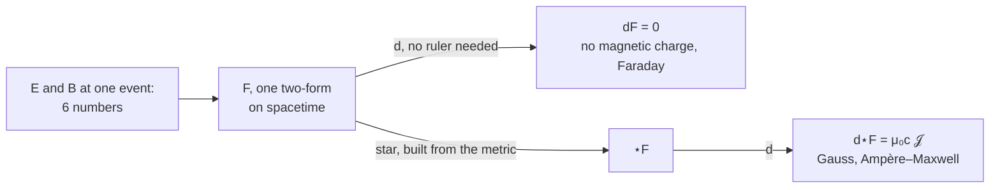

# Hodge star: Maxwell's equations in two lines

[Syllabus](../../../SYLLABUS.md) → [Differential geometry and Lie groups](../README.md) → [Differential Forms](../README.md#s04) → Hodge star

---

## General Overview

A radio mast broadcasts at 100 MHz. Its antenna stands upright, so the wave it sends out is vertically polarised: the electric field points up and down. At a house 10 km away the electric field swings between +0.1 and −0.1 V/m. The magnetic field swings with it, horizontal, between ±0.333564 nT. Each swing repeats every 2.997925 m along the ground.

That is six numbers at every place and moment: three for the electric field and three for the magnetic field. The [Maxwell's equations](../../13-Engineering%20mathematics/06-Circuits%20and%20Electromagnetism/07-maxwells-equations.md) card writes the laws they obey as four vector equations, eight equations in components. They look like four separate facts, with the speed of light hidden inside two constants.

This card packs the six numbers into one object, the **field two-form** $`F`$, on spacetime: the four-dimensional space of events, each with a time and a place. Four dimensions have exactly six coordinate planes, one slot for each number. The four equations then collapse to two lines. One line, $`dF = 0`$, needs no ruler at all. The other needs one operation that knows the geometry of spacetime: the **Hodge star** $`\star`$, which swaps each plane for the plane at right angles to it.

**Write the electric and magnetic fields as one two-form $`F`$ on spacetime; then Maxwell's four equations are $`dF = 0`$ and $`d{\star}F = \mu_0 c\,\mathcal J`$, where $`\mathcal J`$ holds the charge and current, and the Hodge star $`\star`$, built from the spacetime metric, is the only place where the speed of light and the geometry enter.**

**What kind of fact this is:** a theorem: the two lines are equivalent to the four vector equations, proved on this card in Why it works by expanding both sides. The equations themselves are a model, classical electromagnetism, tested from power lines to light. The Hodge star is a definition.

### The picture: six numbers, one form, two lines



The left branch holds the two laws without sources. The right branch holds the two laws with charge and current, and it is the only branch that passes through the metric.

---

## The formula

### Spacetime's ruler: the Minkowski metric

No card in this library teaches special relativity, so here is the one piece this card needs. An **event** is a place at a time, with coordinates $`(t, x, y, z)`$: time $`t`$ in seconds, position in metres. Between two events the **interval** is

```math
s^2 = -c^2 \Delta t^2 + \Delta x^2 + \Delta y^2 + \Delta z^2
```

**Read it aloud:** the squared interval is minus the light-distance of the time gap, squared, plus the squared distance in space.

Here $`c`$ = 299,792,458 m/s is the speed of light, and $`\Delta`$ means "the difference between the two events". Every observer moving at steady speed measures the same $`s^2`$; that sameness is the content of special relativity. A light flash from the mast reaches the house 10 km away after 33.356410 µs, and the interval is $`-(10\text{ km})^2 + (10\text{ km})^2`$ = 0: light travels on intervals of zero.

The **Minkowski metric** $`g = -c^2\,dt^2 + dx^2 + dy^2 + dz^2`$ is this ruler written as a metric ([Riemannian metric](../05-Riemannian%20Geometry/01-riemannian-metrics.md) has the all-plus version). Its list of signs, $`(-, +, +, +)`$, is its **signature**: one minus sign, for time. That minus sign is why the Hodge star carries a sign that it does not carry in ordinary space (Step 1).

### Forms, the field, and the star

Reminders. A k-form measures k-dimensional pieces, and $`\wedge`$ (wedge) is their oriented product, with $`dx \wedge dt = -dt \wedge dx`$ ([Differential form](01-forms-and-the-wedge-product.md)). $`d`$ is the exterior derivative, which turns a k-form into a (k+1)-form and satisfies $`dd = 0`$ ([Exterior derivative](03-exterior-derivative.md)). Here $`\wedge`$ is not logical "and", and $`\star`$ is not convolution.

The electric field $`\mathbf E`$ (V/m) and magnetic field $`\mathbf B`$ (tesla, T) go into one two-form:

```math
F = (E_x\,dx + E_y\,dy + E_z\,dz)\wedge dt + B_x\,dy\wedge dz + B_y\,dz\wedge dx + B_z\,dx\wedge dy
```

**Read it aloud:** the electric field fills the three planes that contain time, and the magnetic field fills the three planes of space.

The units match: volts per metre times metres times seconds, and teslas times square metres, are both volt-seconds.

The **Hodge star** turns a two-form into the two-form on the complementary planes. It is defined by one rule. For any two-forms $`\alpha`$ and $`\beta`$,

```math
\alpha \wedge {\star}\beta = \langle \alpha, \beta\rangle\, \mathrm{vol}, \qquad \mathrm{vol} = c\,dt\wedge dx\wedge dy\wedge dz
```

**Read it aloud:** alpha wedge star beta is the metric's inner product of alpha and beta, times the volume form.

The inner product $`\langle\ ,\ \rangle`$ of two-forms comes from the **inverse metric**, whose entries are one over the metric's: $`-1/c^2`$ for $`t`$, and 1 for $`x`$, $`y`$ and $`z`$. On the basis, $`\langle dx\wedge dy, dx\wedge dy\rangle = 1`$, and $`\langle dx\wedge dt, dx\wedge dt\rangle = -1/c^2`$, the product of the inverse metric's entries for $`x`$ and $`t`$. The volume form $`\mathrm{vol}`$ measures four-dimensional volume, with $`c\,dt`$ turning seconds into metres. The rule fixes the star on all six planes:

| Plane | Its star |
| --- | --- |
| $`dx\wedge dt`$, $`dy\wedge dt`$, $`dz\wedge dt`$ | $`\tfrac{1}{c}\,dy\wedge dz`$, $`\tfrac{1}{c}\,dz\wedge dx`$, $`\tfrac{1}{c}\,dx\wedge dy`$ |
| $`dy\wedge dz`$, $`dz\wedge dx`$, $`dx\wedge dy`$ | $`-c\,dx\wedge dt`$, $`-c\,dy\wedge dt`$, $`-c\,dz\wedge dt`$ |

So $`{\star}F`$ has the shape of $`F`$ with $`\mathbf E`$ replaced by $`-c\mathbf B`$ and $`\mathbf B`$ replaced by $`\mathbf E/c`$. Maxwell's equations are then

```math
dF = 0, \qquad d{\star}F = \mu_0 c\,\mathcal J, \qquad \mathcal J = \rho\,dx\wedge dy\wedge dz - (J_x\,dy\wedge dz + J_y\,dz\wedge dx + J_z\,dx\wedge dy)\wedge dt
```

**Read it aloud:** the field form has zero exterior derivative, and the exterior derivative of its star is mu-nought c times the current three-form.

The **current three-form** $`\mathcal J`$ holds the charge density $`\rho`$ and the current density $`\mathbf J`$. With units chosen so that $`\mu_0 = c = 1`$, the second line reads $`d{\star}F = \mathcal J`$.

| Symbol | Plain meaning | In our example | Push it up and the answer… |
| --- | --- | --- | --- |
| $`t`$, $`x`$, $`y`$, $`z`$ | time (s); east, north and up (m) | $`x`$ runs from the mast to the house, 10 km away; the origin sits at the house, since the plane wave depends only on its phase | — |
| $`c`$, $`v`$ | speed of light; an observer's speed | 299,792,458 m/s; 0.6 $`c`$ in a test | larger $`v`$ away from the mast, weaker field seen |
| $`g`$, $`s^2`$, signature | the Minkowski metric; the interval it measures; its signs | $`(-, +, +, +)`$; $`s^2 = 0`$ from mast to house by light | flip the minus and waves are lost |
| $`\mathbf E`$ | electric field, V/m | 0.1 V/m along $`z`$ at a crest | more push on charges |
| $`\mathbf B`$ | magnetic field, T | 0.333564 nT along $`-y`$ at a crest | — |
| $`F`$, $`A`$ | the field two-form; a potential one-form with $`F = dA`$ | $`0.1\,dz\wedge dt - 0.333564\text{ nT}\,dz\wedge dx`$ | — |
| $`\wedge`$, $`d`$ | wedge product; exterior derivative | $`dF`$ has 4 components | — |
| $`\star`$, $`\delta`$ | Hodge star: complementary plane, scaled by the metric; the codifferential, the adjoint of $`d`$, which lowers the degree by one | turns the vertical wave horizontal | — |
| $`\langle\ ,\ \rangle`$, $`\mathrm{vol}`$, $`\alpha`$, $`\beta`$ | inner product of two-forms; volume form; any two two-forms | $`c^2\langle F, F\rangle = c^2B^2 - E^2 = 0`$ | — |
| $`\rho`$, $`\mathbf J`$, $`\mathcal J`$ | charge density, C/m³; current density, A/m²; current three-form | zero at the house | more $`d{\star}F`$ |
| $`\mu_0`$, $`\varepsilon_0`$ | vacuum constants, $`\mu_0\varepsilon_0 = 1/c^2`$ | 1.25663706127 µN/A² (CODATA 2022) | — |
| $`f`$, $`\lambda`$, $`k`$, $`E_0`$, $`r`$ | frequency; wavelength; wavenumber $`2\pi/\lambda`$; peak field; distance | 100 MHz; 2.997925 m; 2.095845 rad/m; 0.1 V/m; 10 km | higher $`f`$, shorter $`\lambda`$ |

### When it holds

- **Flat spacetime.** The star here uses the Minkowski metric. Near a heavy mass, spacetime curves and the star uses the curved metric; the two lines keep their form, and only $`\star`$ changes.
- **Vacuum, or air.** In a material, bound charges respond to the field and the second line uses a different two-form built from the material's response. The first line, $`dF = 0`$, stays exactly as it is.
- **Signature $`(-, +, +, +)`$.** With all plus signs the star squares to +1, and the 100 MHz wave fails the second line by 0.419169 V/m² (What breaks).
- **A chosen orientation.** The star needs a handedness, here the order $`(t, x, y, z)`$. Reversing it flips the sign of $`\star`$; mixing conventions from two sources gives sign errors.
- **Classical scales.** Many photons, distances far above atoms. Single photons need quantum theory.

---

## Why it works

### Step 0: six planes, and only one half needs a ruler

A two-form gives a number for each small flat piece of a plane. In four dimensions there are six coordinate planes, and six is exactly the count of field numbers. A one-form would have only four slots, which is too few. The three space planes take $`\mathbf B`$: magnetic flux through an area. The three planes with time take $`\mathbf E`$: push along a line, over a time.

The exterior derivative $`d`$ is defined from coordinates alone; it needs no lengths and no angles. So any law of the form $`dF = 0`$ is a statement without a ruler. The laws with sources are different. Gauss's law counts electric flux out through a closed surface, but $`\mathbf E`$ sits in the planes with time, not the planes of space. Something must move it across, and how far "across" is depends on how time and space are measured against each other. That move is the Hodge star, and it is the only part built from the metric.

### Step 1: the star from its rule, and its sign

Take $`\alpha = \beta = dx\wedge dt`$. The rule asks for a two-form $`{\star}(dx\wedge dt)`$ whose wedge with $`dx\wedge dt`$ gives $`\langle dx\wedge dt, dx\wedge dt\rangle\,\mathrm{vol}`$.

1. The inner product multiplies the inverse metric's entries for $`x`$ and $`t`$: $`1 \times (-1/c^2) = -1/c^2`$. The minus comes from the minus in the signature.
2. Only $`dy\wedge dz`$ has a nonzero wedge with $`dx\wedge dt`$, so try $`{\star}(dx\wedge dt) = a\,dy\wedge dz`$.
3. Reordering, $`dx\wedge dt\wedge dy\wedge dz = -dt\wedge dx\wedge dy\wedge dz`$: one swap, one sign.
4. So $`-a\,dt\wedge dx\wedge dy\wedge dz = -\tfrac{1}{c^2}\,c\,dt\wedge dx\wedge dy\wedge dz`$, and $`a = 1/c`$.

The same steps give $`{\star}(dy\wedge dz) = -c\,dx\wedge dt`$, with no minus from the metric this time. Apply the star twice: $`dx\wedge dt \mapsto \tfrac{1}{c}dy\wedge dz \mapsto -dx\wedge dt`$. The code checks all six planes: in spacetime, $`{\star}{\star} = -1`$ on every two-form. With the all-plus metric the same rule gives $`{\star}{\star} = +1`$. The sign is the signature, seen through the star.

### Step 2: dF = 0 holds the two laws without sources

Take $`d`$ of each term of $`F`$. A derivative of a coefficient in a direction already in the term wedges to zero, so only the other directions survive. The result sorts into four three-dimensional pieces:

```math
dF = (\mathrm{div}\,\mathbf B)\,dx\wedge dy\wedge dz + \Big(\mathrm{curl}\,\mathbf E + \frac{\partial\mathbf B}{\partial t}\Big)_x dy\wedge dz\wedge dt + (\ldots)_y\,dz\wedge dx\wedge dt + (\ldots)_z\,dx\wedge dy\wedge dt
```

**Read it aloud:** the space piece of dF is the divergence of B, and each piece with time is one component of curl E plus the rate of change of B.

So $`dF = 0`$ says $`\mathrm{div}\,\mathbf B = 0`$ (no magnetic charge) and $`\mathrm{curl}\,\mathbf E = -\partial\mathbf B/\partial t`$ (Faraday's law). Here $`\mathrm{div}`$ and $`\mathrm{curl}`$ are the outflow and the spin of a field, as on the Maxwell card.

<details>
<summary>Detailed proof: the x piece of dF, term by term</summary>

The pieces of $`F`$ that can produce $`dy\wedge dz\wedge dt`$ are $`E_z\,dz\wedge dt`$, $`E_y\,dy\wedge dt`$ and $`B_x\,dy\wedge dz`$.

From $`E_z\,dz\wedge dt`$, the $`y`$-derivative gives $`\partial_y E_z\,dy\wedge dz\wedge dt`$.

From $`E_y\,dy\wedge dt`$, the $`z`$-derivative gives $`\partial_z E_y\,dz\wedge dy\wedge dt = -\partial_z E_y\,dy\wedge dz\wedge dt`$.

From $`B_x\,dy\wedge dz`$, the $`t`$-derivative gives $`\partial_t B_x\,dt\wedge dy\wedge dz`$. Moving $`dt`$ past two one-forms takes two sign flips, so this is $`+\partial_t B_x\,dy\wedge dz\wedge dt`$.

The total coefficient is $`\partial_y E_z - \partial_z E_y + \partial_t B_x`$: the x-component of $`\mathrm{curl}\,\mathbf E + \partial\mathbf B/\partial t`$. The y and z pieces follow by renaming $`x \to y \to z \to x`$. The space piece collects $`\partial_x B_x + \partial_y B_y + \partial_z B_z`$, which is $`\mathrm{div}\,\mathbf B`$.

</details>

At the house, a quarter period after a crest, the field is changing fastest. The code finds the y-component of $`\mathrm{curl}\,\mathbf E`$ at −0.209585 V/m² and $`\partial B_y/\partial t`$ at +0.209585 V/m². Each is $`E_0 k`$ in size, and they cancel.

### Step 3: d⋆F holds the two laws with sources

$`{\star}F`$ is $`F`$ with $`\mathbf E \to -c\mathbf B`$ and $`\mathbf B \to \mathbf E/c`$ (the table). So Step 2's expansion applies with those swaps:

```math
d{\star}F = \frac{1}{c}(\mathrm{div}\,\mathbf E)\,dx\wedge dy\wedge dz + \Big(-c\,\mathrm{curl}\,\mathbf B + \frac{1}{c}\frac{\partial\mathbf E}{\partial t}\Big)_x dy\wedge dz\wedge dt + \ldots
```

**Read it aloud:** the space piece of d-star-F is the divergence of E over c, and each piece with time is minus c times curl B plus the rate of change of E over c.

Set this equal to $`\mu_0 c\,\mathcal J`$ and match pieces, using $`\mu_0\varepsilon_0 = 1/c^2`$:

- Space piece: $`\mathrm{div}\,\mathbf E / c = \mu_0 c\,\rho`$, which is $`\mathrm{div}\,\mathbf E = \rho/\varepsilon_0`$, Gauss's law.
- Time pieces: $`-c\,\mathrm{curl}\,\mathbf B + \tfrac{1}{c}\partial_t\mathbf E = -\mu_0 c\,\mathbf J`$, which is $`\mathrm{curl}\,\mathbf B = \mu_0\mathbf J + \mu_0\varepsilon_0\,\partial_t\mathbf E`$, the Ampère–Maxwell law.

The plus sign in front of $`\tfrac{1}{c}\partial_t\mathbf E`$ came from the signature, through $`{\star}(dx\wedge dt) = +\tfrac{1}{c}\,dy\wedge dz`$. With the all-plus metric it turns to minus, and for a travelling wave the two terms of the Ampère–Maxwell law add, to 0.419169 V/m², instead of cancelling. The code checks this line on a test field with a uniform charge of 1 nC/m³ and a uniform current of 1 A/m², solved first by vector calculus: $`d{\star}F/(\mu_0 c)`$ returns 1.000000 nC/m³ in the space piece and −1.000000 A/m² in the $`dx\wedge dy\wedge dt`$ piece, the slot of $`-J_z`$.

### Step 4: charge conservation comes free

Apply $`d`$ to the second line. Since $`dd = 0`$, the left side vanishes, so $`d\mathcal J = 0`$. Written out, $`d\mathcal J = (\partial_t\rho + \mathrm{div}\,\mathbf J)\,dt\wedge dx\wedge dy\wedge dz`$, so charge can change in a region only by flowing out. The Maxwell card added the displacement current to make exactly this hold. In forms it is one line: a law of the shape $`d(\text{something}) = \mathcal J`$ forces $`d\mathcal J = 0`$.

### Step 5: the same two lines for every observer

A steadily moving observer uses new coordinates related by a **boost**, a change of chart that keeps the Minkowski metric. The star is built only from the metric and the orientation, so it commutes with the boost: star then change chart, or change chart then star, give the same form. The code checks this on the radio wave and on the test field.

The components of $`F`$ do change. An observer moving away from the mast at 0.6 c sees the electric field peak at 0.05 V/m, half of 0.1, since $`\sqrt{0.4/1.6} = 0.5`$. What stays fixed is the number $`c^2\langle F, F\rangle = c^2B^2 - E^2`$. For the radio wave it is 0 in both charts, because the card models it as a plane wave, which has $`E = cB`$ exactly; far from the mast, a real mast's field is very close to that model. For the test field it is 4074.014373 V²/m² in both. That number belongs to the field; $`E`$ alone belongs to the observer.

### Step 6: potentials, holes, and Hodge theory

On all of spacetime, a closed form is exact ([Closed and exact forms](04-closed-and-exact-forms-and-the-poincare-lemma.md)). So $`dF = 0`$ gives a **potential** one-form $`A`$ with $`F = dA`$, and the first line holds automatically. Remove a point from space, where a magnetic monopole (a magnetic charge, never observed) might sit, and this can fail. The region then has a two-dimensional hole that [de Rham cohomology](08-de-rham-cohomology.md) detects. The code takes a 1 Wb monopole: its $`F`$ is closed away from the point, yet the flux through a sphere round it is 1.0000 Wb. An exact form would give 0 there by Stokes' theorem, since a sphere has no boundary.

The star also builds the **codifferential** $`\delta = \pm{\star}d{\star}`$, the adjoint of $`d`$: it lowers the degree by one, and on a closed manifold pairing $`d\alpha`$ with $`\beta`$ by the metric gives the same integral as pairing $`\alpha`$ with $`\delta\beta`$. It does not undo $`d`$. With the all-plus metric of a compact Riemannian manifold (one that is closed and bounded, like a sphere), a form $`\alpha`$ with $`d\alpha = 0`$ and $`d{\star}\alpha = 0`$ is **harmonic**, and Hodge's theorem says each de Rham class contains exactly one harmonic form. This card states that theorem without proof; Warner's textbook in Sources proves it. The [Hodge decomposition](../../22-Algebraic%20geometry/05-Cohomology%20and%20the%20Hodge%20Conjecture/05-hodge-decomposition.md) card uses it on complex manifolds. Vacuum Maxwell, $`dF = 0`$ and $`d{\star}F = 0`$, is the same pair of equations with the spacetime metric, where the minus sign turns "harmonic" into "travels as a wave".

---

## Worked numbers, by hand

The mast's wave at the house, 10 km out, at a crest. $`c`$ = 299,792,458 m/s and $`\mu_0`$ = 1.25663706127 µN/A².

| Step | Arithmetic | Value |
| --- | --- | --- |
| wavelength $`\lambda = c/f`$ | 299,792,458 / 100,000,000 | 2.997925 m |
| wavenumber $`k = 2\pi/\lambda`$ | $`2\pi`$ / 2.997925 | 2.095845 rad/m |
| magnetic peak $`B_0 = E_0/c`$ | 0.1 / 299,792,458 | 0.333564 nT |
| field form at the crest | $`E_z = 0.1`$, $`B_y = -0.333564`$ nT | $`F = 0.1\,dz\wedge dt - 0.333564\text{ nT}\,dz\wedge dx`$ |
| star, from the table | $`dz\wedge dt \to \tfrac1c\,dx\wedge dy`$; $`dz\wedge dx \to -c\,dy\wedge dt`$ | $`{\star}F = 0.333564\text{ nT}\,dx\wedge dy + 0.1\,dy\wedge dt`$ |
| read $`{\star}F`$ as a field | electric part along $`y`$, magnetic along $`z`$ | $`E_y`$ = 0.100000 V/m, $`B_z`$ = 0.333564 nT |
| star twice | $`{\star}{\star}F = -F`$ | $`E_z`$ = −0.100000 V/m |
| invariant $`c^2\langle F, F\rangle`$ | $`(cB_0)^2 - E_0^2 = 0.1^2 - 0.1^2`$ | **0** |
| mean power per square metre | $`E_0^2/(2\mu_0 c)`$ = $`0.1^2`$ / 753.46 Ω | 13.272094 µW/m² |
| spread over a sphere of 10 km | $`4\pi r^2 \times`$ 13.272094 µW/m² | 16.678205 kW |

The star turns the mast's vertical wave into a horizontal one with the same strength. The invariant is zero: in the plane-wave model of the field at the house, $`E = cB`$ exactly, which is pure radiation. The last row is the **equivalent isotropic power**: what a mast sending equally in every direction would need to radiate to give 0.1 V/m at 10 km.

### What breaks if you drop a piece

| Mistake | Comes out at | What went wrong |
| --- | --- | --- |
| Star built from the all-plus metric | $`{\star}{\star} = +1`$; the wave fails Ampère–Maxwell by 0.419169 V/m² (right: 0) | without the signature's minus sign the two terms, 0.209585 each, add instead of cancelling |
| Field as a one-form | 4 slots for 6 numbers | only two-forms in four dimensions have six components |
| Treating $`E`$ as fixed by the field | 0.05 V/m seen at 0.6 c away, 0.2 V/m at 0.6 c towards (right: depends on the observer) | only $`c^2B^2 - E^2`$ is the same for all: 0 in every chart |
| Assuming $`dF = 0`$ gives a potential round a 1 Wb monopole | flux 1.0000 Wb through a sphere (an exact form gives 0) | space without a point has a hole: closed does not mean exact there |

The code prints every row.

---

## Code, from first principles, and it actually runs

Both programs store a two-form as a 4 × 4 table of numbers that changes sign when flipped across its diagonal. Nothing imported knows about forms or fields. The star is reached **two independent ways**: the index formula, and the defining rule checked on all 36 pairs of basis planes. Maxwell's equations are checked **two ways**: by $`d`$ and $`\star`$ on the form, and by the vector-calculus terms computed separately by finite differences (a derivative estimated from two nearby points). A **chart against chart** road boosts the field to a moving observer and checks that the star and the invariant do not care.

### Python

```python
# Hodge star and Maxwell in forms -- the check behind the card.  Standard library only.
# Coordinates 0 = t (s), 1 = x, 2 = y, 3 = z (m).  A two-form is a 4x4 antisymmetric list F[a][b].
from math import pi, sqrt, cos, sin
C, MU0 = 299792458.0, 1.25663706127e-6            # CODATA 2022
EPS0 = 1.0 / (MU0 * C * C)
PAIRS = [(0, 1), (0, 2), (0, 3), (1, 2), (1, 3), (2, 3)]
TRIPLES = [(0, 1, 2), (0, 1, 3), (0, 2, 3), (1, 2, 3)]

def sign(p):                                        # sign of a permutation of 0..3, by inversions
    return (-1) ** sum(1 for i in range(4) for j in range(i + 1, 4) if p[i] > p[j])
def form(E, B):                                     # F = E_i dx^i ^ dt + Bx dy^dz + By dz^dx + Bz dx^dy
    F = [[0.0] * 4 for _ in range(4)]
    for i in range(3):
        F[i + 1][0], F[0][i + 1] = E[i], -E[i]
    for (a, b), v in (((2, 3), B[0]), ((3, 1), B[1]), ((1, 2), B[2])):
        F[a][b], F[b][a] = v, -v
    return F
def fields(F):
    return [F[1][0], F[2][0], F[3][0]], [F[2][3], F[3][1], F[1][2]]
def rest(a, b):                                     # the other two coordinates, in order
    return [k for k in range(4) if k not in (a, b)]
def star(F, sg=-1.0):                               # road 1: (*F)_ab = sqrt|g| eps_abcd F^cd, g = diag(sg c^2, 1, 1, 1)
    gi = [1.0 / (sg * C * C), 1.0, 1.0, 1.0]
    S = [[0.0] * 4 for _ in range(4)]
    for a in range(4):
        for b in range(4):
            if a != b:
                c, d = rest(a, b)
                S[a][b] = C * sign((a, b, c, d)) * gi[c] * gi[d] * F[c][d]
    return S
def inner(A, B, sg=-1.0):                           # <A, B> from the inverse metric
    gi = [1.0 / (sg * C * C), 1.0, 1.0, 1.0]
    return sum(gi[a] * gi[b] * A[a][b] * B[a][b] for a, b in PAIRS)
def wedge(A, B):                                    # coefficient of dt^dx^dy^dz in A ^ B
    return sum(sign((a, b, *rest(a, b))) * A[a][b] * B[rest(a, b)[0]][rest(a, b)[1]] for a, b in PAIRS)
def basis(a, b):
    F = [[0.0] * 4 for _ in range(4)]
    F[a][b], F[b][a] = 1.0, -1.0
    return F
def d(Ffun, p, h):                                  # exterior derivative by central differences
    def dd(k, a, b):
        q1, q2 = list(p), list(p)
        q1[k] += h[k]; q2[k] -= h[k]
        return (Ffun(q1)[a][b] - Ffun(q2)[a][b]) / (2 * h[k])
    return [dd(a, b, c) + dd(b, c, a) + dd(c, a, b) for a, b, c in TRIPLES]
def z(v, n=6):                                      # print a rounded zero as 0, never -0
    return 0.0 if round(v, n) == 0 else v

# ---- the radio mast: 100 MHz, vertical mast, field 0.1 V/m at 10 km ----
f, r, E0 = 100e6, 10000.0, 0.1
lam, w, k = C / f, 2 * pi * f, 2 * pi * f / C
S_pow = E0 * E0 / (2 * MU0 * C)                    # mean power per square metre
eirp = 4 * pi * r * r * S_pow                       # the same, spread over a whole sphere of radius r
def wave(p, f0=f):
    ph = (2 * pi * f0 / C) * p[1] - 2 * pi * f0 * p[0]
    return form([0.0, 0.0, E0 * cos(ph)], [0.0, -E0 / C * cos(ph), 0.0])
print(f"wavelength (m)                    {lam:.6f}")
print(f"k (rad/m)                         {k:.6f}")
print(f"E0 (V/m), B0 = E0/c (nT)          {E0:.6f} {E0 / C * 1e9:.6f}")
print(f"power density (uW/m^2), 2 mu0 c   {S_pow * 1e6:.6f} {2 * MU0 * C:.2f}")
print(f"equivalent isotropic power (kW)   {eirp / 1e3:.6f}")
print(f"light time to 10 km (us), s^2     {r / C * 1e6:.6f} {z(-(C * (r / C)) ** 2 + r * r):.6f}")
print(f"2-form slots, 1-form slots, eqns  {len(PAIRS)} 4 {2 * len(TRIPLES)}")

# road 2: the star against its definition A ^ *B = <A, B> vol, vol = c dt^dx^dy^dz, all 36 pairs
err = max(abs(wedge(basis(*P), star(basis(*Q))) - inner(basis(*P), basis(*Q)) * C) for P in PAIRS for Q in PAIRS)
names = "t x y z".split()
for a, b in PAIRS:
    S = star(basis(a, b))
    m, n = rest(a, b)
    unit = "c" if abs(S[m][n]) > 1 else "(1/c)"
    print(f"*(d{names[a]}^d{names[b]}) = {'+' if S[m][n] > 0 else '-'}{unit} d{names[m]}^d{names[n]}")
ss_m, ss_e = ([star(star(basis(*P), sg), sg)[P[0]][P[1]] for P in PAIRS] for sg in (-1.0, 1.0))
print(f"** on the six planes, (-,+,+,+)   {' '.join(f'{v:+.0f}' for v in ss_m)}")
print(f"** on the six planes, (+,+,+,+)   {' '.join(f'{v:+.0f}' for v in ss_e)}")

# the wave at a crest (phase 0): F, *F, **F
F = wave([0.0, 0.0, 0.0, 0.0])
E1, B1 = fields(star(F))
E2, B2 = fields(star(star(F)))
print(f"*F: E_y (V/m), B_z (nT)           {E1[1]:.6f} {B1[2] * 1e9:.6f}")
print(f"**F: E_z (V/m)                    {E2[2]:.6f}")
print(f"c^2<F,F> = c^2B^2 - E^2, F^F      {z(inner(F, F) * C * C):.6f} {z(wedge(F, F)):.6f}")

# road 3: Maxwell, by forms against vector calculus, where the field's derivative peaks (phase -pi/2)
p0, h = [0.25 / f, 0.0, 0.0, 0.0], [1e-4 / C, 1e-4, 1e-4, 1e-4]
Ez, By = (lambda t, x: wave([t, x, 0, 0])[3][0]), (lambda t, x: wave([t, x, 0, 0])[3][1])
curlE_y = -(Ez(p0[0], h[1]) - Ez(p0[0], -h[1])) / (2 * h[1])
dBy_dt = (By(p0[0] + h[0], 0.0) - By(p0[0] - h[0], 0.0)) / (2 * h[0])
print(f"Faraday y: curl E, dB/dt (V/m^2)  {curlE_y:.6f} {dBy_dt:.6f}")
dF = d(wave, p0, h)
dsF = d(lambda q: star(wave(q)), p0, h)
dsF_e = d(lambda q: star(wave(q), 1.0), p0, h)
print(f"wave: max |dF|, max |d*F|         {z(max(map(abs, dF))):.6f} {z(max(map(abs, dsF))):.6f}")
print(f"wave, all-plus star: d*F Ampere z {abs(dsF_e[0]):.6f}")
dsF_g = d(lambda q: star(wave(q, 1e9)), p0, [1e-5 / C, 1e-5, 1e-5, 1e-5])
print(f"try: 1 GHz, max |d*F|, E0 k       {z(max(map(abs, dsF_g))):.6f} {E0 * 2 * pi * 1e9 / C:.6f}")

# sources: uniform charge 1 nC/m^3 and current 1 A/m^2 along z; vector solution E = rho r/(3 eps0), B = mu0 J (-y, x, 0)/2
rho, J = 1e-9, 1.0
src = lambda q: form([rho * q[1] / (3 * EPS0), rho * q[2] / (3 * EPS0), rho * q[3] / (3 * EPS0)],
                     [-MU0 * J * q[2] / 2, MU0 * J * q[1] / 2, 0.0])
ps = [0.0, 0.3, -0.2, 0.5]
dsS = d(lambda q: star(src(q)), ps, [1e-3 / C, 1e-3, 1e-3, 1e-3])
want = [-J, 0.0, 0.0, rho]                          # current three-form: rho dx^dy^dz - J dx^dy^dt
print(f"d*F / (mu0 c): dtdxdy, dxdydz     {dsS[0] / (MU0 * C):.6f} {dsS[3] / (MU0 * C) * 1e9:.6f}")
print(f"source field: max |dF|            {z(max(map(abs, d(src, ps, [1e-3 / C, 1e-3, 1e-3, 1e-3])))):.6f}")

# road 4: chart against chart, a boost along x at beta (inverse map t = g(t' + b x'/c), x = g(x' + b c t'))
def boost(F, beta):
    g = 1 / sqrt(1 - beta * beta)
    M = [[g, g * beta / C, 0, 0], [g * beta * C, g, 0, 0], [0, 0, 1, 0], [0, 0, 0, 1]]
    return [[sum(M[a][m] * F[a][b] * M[b][n] for a in range(4) for b in range(4)) for n in range(4)] for m in range(4)]
Fs = src(ps)
chart = max(abs(x[a][b] - y[a][b]) / (abs(y[a][b]) or 1.0)
            for G in (F, Fs) for x, y in [(star(boost(G, 0.6)), boost(star(G), 0.6))] for a, b in PAIRS)
print(f"boost 0.6c: E_z (V/m), c^2<F,F>   {fields(boost(F, 0.6))[0][2]:.6f} {z(inner(boost(F, 0.6), boost(F, 0.6)) * C * C):.6f}")
print(f"source field c^2<F,F>, both charts {inner(Fs, Fs) * C * C:.6f} {inner(boost(Fs, 0.6), boost(Fs, 0.6)) * C * C:.6f}")
print(f"try: boost -0.6c, E_z (V/m)       {fields(boost(F, -0.6))[0][2]:.6f}")
print(f"try: 20 km, same power, E0 (V/m)  {sqrt(2 * MU0 * C * eirp / (4 * pi * 20000.0 ** 2)):.6f}")

# a hole in space: a monopole of 1 Wb, B = g r/(4 pi |r|^3); closed, yet its flux through a sphere is not 0
gm, n, R = 1.0, 200, 2.0                            # the sphere: radius 2 m round the point, n x 2n midpoint cells
mono = lambda q: form([0, 0, 0], [gm * q[m] / (4 * pi * (q[1] ** 2 + q[2] ** 2 + q[3] ** 2) ** 1.5) for m in (1, 2, 3)])
dFm = max(map(abs, d(mono, [0, 1, 1, 1], [1e-4] * 4)))
flux = sum(sum(b * x for b, x in zip(fields(mono(q))[1], q[1:])) * R * sin(th) * (pi / n) ** 2 for i in range(n) for j in range(2 * n)
           for th, ph in [((i + 0.5) * pi / n, (j + 0.5) * pi / n)] for q in [[0.0, R * sin(th) * cos(ph), R * sin(th) * sin(ph), R * cos(th)]])
print(f"monopole: |dF| at (1,1,1) m, flux {z(dFm):.6f} {flux:.4f}")

assert err < 1e-15, "star against its definition A ^ *B = <A,B> vol"
assert all(v == -1.0 for v in ss_m) and all(v == 1.0 for v in ss_e), "star twice: -1 in spacetime, +1 all-plus"
assert abs(E1[1] - E0) < 1e-12 and abs(E2[2] + E0) < 1e-12, "*F turns the vertical wave horizontal; **F = -F"
assert max(map(abs, dF)) < 1e-6 * E0 * k and max(map(abs, dsF)) < 1e-6 * E0 * k, "the radio wave solves both lines"
assert abs(curlE_y + E0 * k) < 1e-6 and abs(dBy_dt - E0 * k) < 1e-6, "Faraday terms against E0 k by hand"
assert abs(abs(dsF_e[0]) - 2 * E0 * k) < 1e-6, "all-plus star: the two Ampere terms add"
assert all(abs(dsS[i] / (MU0 * C) - want[i]) < 1e-6 * max(abs(want[i]), rho) for i in range(4)), "d*F = mu0 c J"
assert chart < 1e-9 and abs(inner(boost(Fs, 0.6), boost(Fs, 0.6)) / inner(Fs, Fs) - 1) < 1e-9, "star and c^2<F,F> ignore a boost"
assert abs(fields(boost(F, 0.6))[0][2] - 0.5 * E0) < 1e-12, "Doppler factor sqrt(0.4/1.6) = 0.5"
assert dFm < 1e-6 and abs(flux - gm) < 1e-4, "monopole: dF = 0 off the point; flux of its B through the sphere = g"
print("ALL CHECKS PASS")
```

**Ran 2026-11-19 on macOS, Python 3.14.10, standard library only. All checks passed. Output, pasted from the run:**

```
wavelength (m)                    2.997925
k (rad/m)                         2.095845
E0 (V/m), B0 = E0/c (nT)          0.100000 0.333564
power density (uW/m^2), 2 mu0 c   13.272094 753.46
equivalent isotropic power (kW)   16.678205
light time to 10 km (us), s^2     33.356410 0.000000
2-form slots, 1-form slots, eqns  6 4 8
*(dt^dx) = -(1/c) dy^dz
*(dt^dy) = +(1/c) dx^dz
*(dt^dz) = -(1/c) dx^dy
*(dx^dy) = +c dt^dz
*(dx^dz) = -c dt^dy
*(dy^dz) = +c dt^dx
** on the six planes, (-,+,+,+)   -1 -1 -1 -1 -1 -1
** on the six planes, (+,+,+,+)   +1 +1 +1 +1 +1 +1
*F: E_y (V/m), B_z (nT)           0.100000 0.333564
**F: E_z (V/m)                    -0.100000
c^2<F,F> = c^2B^2 - E^2, F^F      0.000000 0.000000
Faraday y: curl E, dB/dt (V/m^2)  -0.209585 0.209585
wave: max |dF|, max |d*F|         0.000000 0.000000
wave, all-plus star: d*F Ampere z 0.419169
try: 1 GHz, max |d*F|, E0 k       0.000000 2.095845
d*F / (mu0 c): dtdxdy, dxdydz     -1.000000 1.000000
source field: max |dF|            0.000000
boost 0.6c: E_z (V/m), c^2<F,F>   0.050000 0.000000
source field c^2<F,F>, both charts 4074.014373 4074.014373
try: boost -0.6c, E_z (V/m)       0.200000
try: 20 km, same power, E0 (V/m)  0.050000
monopole: |dF| at (1,1,1) m, flux 0.000000 1.0000
ALL CHECKS PASS
```

The star table, $`{\star}{\star} = -1`$ and the zero residuals agree between roads. The code names each plane in index order (t, x, y, z), so it writes $`dt\wedge dx`$ where the table writes $`dx\wedge dt`$; swapping two factors flips the sign, and each printed line equals the table's row once both sides are put in the table's order. The "try" lines feed the box below.

### Rust

The same checks with the same inputs. Closures stand in for the Python lambdas.

```rust
// Hodge star and Maxwell in forms -- the same check as hodge_star_and_maxwell_in_forms_check.py.
// Standard library only, no crates.  Coordinates 0 = t (s), 1 = x, 2 = y, 3 = z (m).
// A two-form is a 4x4 antisymmetric array F[a][b].
use std::f64::consts::PI;
const C: f64 = 299792458.0;
const MU0: f64 = 1.25663706127e-6; // CODATA 2022
type Form = [[f64; 4]; 4];
const PAIRS: [(usize, usize); 6] = [(0, 1), (0, 2), (0, 3), (1, 2), (1, 3), (2, 3)];
const TRIPLES: [(usize, usize, usize); 4] = [(0, 1, 2), (0, 1, 3), (0, 2, 3), (1, 2, 3)];

fn sign(p: [usize; 4]) -> f64 {
    let inv = (0..4).flat_map(|i| (i + 1..4).map(move |j| (i, j))).filter(|&(i, j)| p[i] > p[j]).count();
    if inv % 2 == 0 { 1.0 } else { -1.0 }
}
fn form(e: [f64; 3], b: [f64; 3]) -> Form {
    let mut f = [[0.0; 4]; 4];
    for i in 0..3 { f[i + 1][0] = e[i]; f[0][i + 1] = -e[i]; }
    for &((p, q), v) in &[((2, 3), b[0]), ((3, 1), b[1]), ((1, 2), b[2])] { f[p][q] = v; f[q][p] = -v; }
    f
}
fn fields(f: &Form) -> ([f64; 3], [f64; 3]) { ([f[1][0], f[2][0], f[3][0]], [f[2][3], f[3][1], f[1][2]]) }
fn rest(a: usize, b: usize) -> (usize, usize) { // the other two coordinates, in order
    let r: Vec<usize> = (0..4).filter(|k| *k != a && *k != b).collect(); (r[0], r[1])
}
fn ginv(sg: f64) -> [f64; 4] { [1.0 / (sg * C * C), 1.0, 1.0, 1.0] }
// road 1: (*F)_ab = sqrt|g| eps_abcd F^cd, g = diag(sg c^2, 1, 1, 1)
fn star(f: &Form, sg: f64) -> Form {
    let gi = ginv(sg);
    let mut s = [[0.0; 4]; 4];
    for a in 0..4 { for b in 0..4 { if a != b {
        let (c, d) = rest(a, b); s[a][b] = C * sign([a, b, c, d]) * gi[c] * gi[d] * f[c][d];
    } } }
    s
}
fn inner(x: &Form, y: &Form, sg: f64) -> f64 {
    let gi = ginv(sg);
    PAIRS.iter().fold(0.0, |s, &(a, b)| s + gi[a] * gi[b] * x[a][b] * y[a][b])
}
fn wedge(x: &Form, y: &Form) -> f64 {
    PAIRS.iter().fold(0.0, |s, &(a, b)| { let (c, d) = rest(a, b); s + sign([a, b, c, d]) * x[a][b] * y[c][d] })
}
fn basis(a: usize, b: usize) -> Form { let mut f = [[0.0; 4]; 4]; f[a][b] = 1.0; f[b][a] = -1.0; f }
// exterior derivative by central differences
fn d(ff: &dyn Fn([f64; 4]) -> Form, p: [f64; 4], h: [f64; 4]) -> [f64; 4] {
    let dd = |k: usize, a: usize, b: usize| {
        let (mut q1, mut q2) = (p, p);
        q1[k] += h[k]; q2[k] -= h[k];
        (ff(q1)[a][b] - ff(q2)[a][b]) / (2.0 * h[k])
    };
    let mut out = [0.0; 4];
    for (i, &(a, b, c)) in TRIPLES.iter().enumerate() { out[i] = dd(a, b, c) + dd(b, c, a) + dd(c, a, b); }
    out
}
fn z(v: f64) -> f64 { if (v * 1e6).round() == 0.0 { 0.0 } else { v } } // print a rounded zero as 0, never -0
fn maxabs(v: [f64; 4]) -> f64 { v.iter().fold(0.0, |m: f64, x| m.max(x.abs())) }
fn boost(f: &Form, beta: f64) -> Form {
    let g = 1.0 / (1.0 - beta * beta).sqrt();
    let m = [[g, g * beta / C, 0.0, 0.0], [g * beta * C, g, 0.0, 0.0], [0.0, 0.0, 1.0, 0.0], [0.0, 0.0, 0.0, 1.0]];
    let mut o = [[0.0; 4]; 4];
    for mu in 0..4 { for nu in 0..4 { for a in 0..4 { for b in 0..4 { o[mu][nu] += m[a][mu] * f[a][b] * m[b][nu]; } } } }
    o
}

fn main() {
    let eps0 = 1.0 / (MU0 * C * C);
    // ---- the radio mast: 100 MHz, vertical mast, field 0.1 V/m at 10 km ----
    let (f, r, e0) = (100e6, 10000.0, 0.1);
    let (lam, k) = (C / f, 2.0 * PI * f / C);
    let s_pow = e0 * e0 / (2.0 * MU0 * C); // mean power per square metre
    let eirp = 4.0 * PI * r * r * s_pow; // the same, spread over a whole sphere of radius r
    let wave_f = |p: [f64; 4], f0: f64| {
        let ph = (2.0 * PI * f0 / C) * p[1] - 2.0 * PI * f0 * p[0];
        form([0.0, 0.0, e0 * ph.cos()], [0.0, -e0 / C * ph.cos(), 0.0])
    };
    let wave = |p: [f64; 4]| wave_f(p, f);
    println!("wavelength (m)                    {:.6}", lam);
    println!("k (rad/m)                         {:.6}", k);
    println!("E0 (V/m), B0 = E0/c (nT)          {:.6} {:.6}", e0, e0 / C * 1e9);
    println!("power density (uW/m^2), 2 mu0 c   {:.6} {:.2}", s_pow * 1e6, 2.0 * MU0 * C);
    println!("equivalent isotropic power (kW)   {:.6}", eirp / 1e3);
    println!("light time to 10 km (us), s^2     {:.6} {:.6}", r / C * 1e6, z(-(C * (r / C)).powi(2) + r * r));
    println!("2-form slots, 1-form slots, eqns  {} 4 {}", PAIRS.len(), 2 * TRIPLES.len());

    // road 2: the star against its definition A ^ *B = <A, B> vol, vol = c dt^dx^dy^dz, all 36 pairs
    let err = PAIRS.iter().flat_map(|&p| PAIRS.iter().map(move |&q| (p, q))).fold(0.0f64, |m, ((a, b), (c, d2))|
        m.max((wedge(&basis(a, b), &star(&basis(c, d2), -1.0)) - inner(&basis(a, b), &basis(c, d2), -1.0) * C).abs()));
    let names = ["t", "x", "y", "z"];
    for &(a, b) in &PAIRS {
        let s = star(&basis(a, b), -1.0);
        let (m, n) = rest(a, b);
        let unit = if s[m][n].abs() > 1.0 { "c" } else { "(1/c)" };
        println!("*(d{}^d{}) = {}{} d{}^d{}", names[a], names[b], if s[m][n] > 0.0 { "+" } else { "-" }, unit, names[m], names[n]);
    }
    let ss_m: Vec<f64> = PAIRS.iter().map(|&(a, b)| star(&star(&basis(a, b), -1.0), -1.0)[a][b]).collect();
    let ss_e: Vec<f64> = PAIRS.iter().map(|&(a, b)| star(&star(&basis(a, b), 1.0), 1.0)[a][b]).collect();
    let show = |v: &Vec<f64>| v.iter().map(|x| format!("{:+.0}", x)).collect::<Vec<_>>().join(" ");
    println!("** on the six planes, (-,+,+,+)   {}", show(&ss_m));
    println!("** on the six planes, (+,+,+,+)   {}", show(&ss_e));

    // the wave at a crest (phase 0): F, *F, **F
    let fw = wave([0.0; 4]);
    let (e1, b1) = fields(&star(&fw, -1.0));
    let (e2, _) = fields(&star(&star(&fw, -1.0), -1.0));
    println!("*F: E_y (V/m), B_z (nT)           {:.6} {:.6}", e1[1], b1[2] * 1e9);
    println!("**F: E_z (V/m)                    {:.6}", e2[2]);
    println!("c^2<F,F> = c^2B^2 - E^2, F^F      {:.6} {:.6}", z(inner(&fw, &fw, -1.0) * C * C), z(wedge(&fw, &fw)));

    // road 3: Maxwell, by forms against vector calculus, where the field's derivative peaks (phase -pi/2)
    let (p0, h) = ([0.25 / f, 0.0, 0.0, 0.0], [1e-4 / C, 1e-4, 1e-4, 1e-4]);
    let (ez, by) = (|t: f64, x: f64| wave([t, x, 0.0, 0.0])[3][0], |t: f64, x: f64| wave([t, x, 0.0, 0.0])[3][1]);
    let curle_y = -(ez(p0[0], h[1]) - ez(p0[0], -h[1])) / (2.0 * h[1]);
    let dby_dt = (by(p0[0] + h[0], 0.0) - by(p0[0] - h[0], 0.0)) / (2.0 * h[0]);
    println!("Faraday y: curl E, dB/dt (V/m^2)  {:.6} {:.6}", curle_y, dby_dt);
    let df = d(&wave, p0, h);
    let dsf = d(&|q| star(&wave(q), -1.0), p0, h);
    let dsf_e = d(&|q| star(&wave(q), 1.0), p0, h);
    println!("wave: max |dF|, max |d*F|         {:.6} {:.6}", z(maxabs(df)), z(maxabs(dsf)));
    println!("wave, all-plus star: d*F Ampere z {:.6}", dsf_e[0].abs());
    let dsf_g = d(&|q| star(&wave_f(q, 1e9), -1.0), p0, [1e-5 / C, 1e-5, 1e-5, 1e-5]);
    println!("try: 1 GHz, max |d*F|, E0 k       {:.6} {:.6}", z(maxabs(dsf_g)), e0 * 2.0 * PI * 1e9 / C);

    // sources: uniform charge 1 nC/m^3 and current 1 A/m^2 along z; E = rho r/(3 eps0), B = mu0 J (-y, x, 0)/2
    let (rho, j) = (1e-9, 1.0);
    let src = |q: [f64; 4]| form([rho * q[1] / (3.0 * eps0), rho * q[2] / (3.0 * eps0), rho * q[3] / (3.0 * eps0)],
                                 [-MU0 * j * q[2] / 2.0, MU0 * j * q[1] / 2.0, 0.0]);
    let ps = [0.0, 0.3, -0.2, 0.5];
    let hs = [1e-3 / C, 1e-3, 1e-3, 1e-3];
    let dss = d(&|q| star(&src(q), -1.0), ps, hs);
    let want = [-j, 0.0, 0.0, rho]; // current three-form: rho dx^dy^dz - J dx^dy^dt
    println!("d*F / (mu0 c): dtdxdy, dxdydz     {:.6} {:.6}", dss[0] / (MU0 * C), dss[3] / (MU0 * C) * 1e9);
    println!("source field: max |dF|            {:.6}", z(maxabs(d(&src, ps, hs))));

    // road 4: chart against chart, a boost along x
    let fs = src(ps);
    let mut chart: f64 = 0.0;
    for g in [&fw, &fs] {
        let (x, y) = (star(&boost(g, 0.6), -1.0), boost(&star(g, -1.0), 0.6));
        for &(a, b) in &PAIRS {
            let den = if y[a][b] == 0.0 { 1.0 } else { y[a][b].abs() };
            chart = chart.max((x[a][b] - y[a][b]).abs() / den);
        }
    }
    let (fb, fsb) = (boost(&fw, 0.6), boost(&fs, 0.6));
    println!("boost 0.6c: E_z (V/m), c^2<F,F>   {:.6} {:.6}", fields(&fb).0[2], z(inner(&fb, &fb, -1.0) * C * C));
    println!("source field c^2<F,F>, both charts {:.6} {:.6}", inner(&fs, &fs, -1.0) * C * C, inner(&fsb, &fsb, -1.0) * C * C);
    println!("try: boost -0.6c, E_z (V/m)       {:.6}", fields(&boost(&fw, -0.6)).0[2]);
    println!("try: 20 km, same power, E0 (V/m)  {:.6}", (2.0 * MU0 * C * eirp / (4.0 * PI * 20000.0f64.powi(2))).sqrt());

    let (gm, n, rr) = (1.0, 200, 2.0); // a hole in space: a 1 Wb monopole, B = g r/(4 pi |r|^3); a 2 m sphere round it
    let mono = |q: [f64; 4]| { let r3 = (q[1] * q[1] + q[2] * q[2] + q[3] * q[3]).powf(1.5);
        form([0.0; 3], [gm * q[1] / (4.0 * PI * r3), gm * q[2] / (4.0 * PI * r3), gm * q[3] / (4.0 * PI * r3)]) };
    let (dfm, mut flux) = (maxabs(d(&mono, [0.0, 1.0, 1.0, 1.0], [1e-4; 4])), 0.0);
    for i in 0..n { for j in 0..2 * n { // B.n R^2 sin(th) dth dph
        let (th, ph) = ((i as f64 + 0.5) * PI / n as f64, (j as f64 + 0.5) * PI / n as f64);
        let q = [0.0, rr * th.sin() * ph.cos(), rr * th.sin() * ph.sin(), rr * th.cos()];
        let b = fields(&mono(q)).1; flux += (b[0] * q[1] + b[1] * q[2] + b[2] * q[3]) * rr * th.sin() * (PI / n as f64).powi(2); } }
    println!("monopole: |dF| at (1,1,1) m, flux {:.6} {:.4}", z(dfm), flux);

    assert!(err < 1e-15, "star against its definition");
    assert!(ss_m.iter().all(|v| *v == -1.0) && ss_e.iter().all(|v| *v == 1.0), "star twice");
    assert!((e1[1] - e0).abs() < 1e-12 && (e2[2] + e0).abs() < 1e-12, "*F horizontal, **F = -F");
    assert!(maxabs(df) < 1e-6 * e0 * k && maxabs(dsf) < 1e-6 * e0 * k, "the wave solves both lines");
    assert!((curle_y + e0 * k).abs() < 1e-6 && (dby_dt - e0 * k).abs() < 1e-6, "Faraday terms");
    assert!((dsf_e[0].abs() - 2.0 * e0 * k).abs() < 1e-6, "all-plus star: Ampere terms add");
    for i in 0..4 { assert!((dss[i] / (MU0 * C) - want[i]).abs() < 1e-6 * want[i].abs().max(rho), "d*F = mu0 c J"); }
    assert!(chart < 1e-9 && (inner(&fsb, &fsb, -1.0) / inner(&fs, &fs, -1.0) - 1.0).abs() < 1e-9, "star and c^2<F,F> ignore a boost");
    assert!((fields(&fb).0[2] - 0.5 * e0).abs() < 1e-12, "Doppler factor 0.5");
    assert!(dfm < 1e-6 && (flux - gm).abs() < 1e-4, "monopole: dF = 0, flux = g");
    println!("ALL CHECKS PASS");
}
```

**Ran 2026-11-19 on macOS, rustc 1.98.1, no crates. All checks passed. Output, pasted from the run:**

```
wavelength (m)                    2.997925
k (rad/m)                         2.095845
E0 (V/m), B0 = E0/c (nT)          0.100000 0.333564
power density (uW/m^2), 2 mu0 c   13.272094 753.46
equivalent isotropic power (kW)   16.678205
light time to 10 km (us), s^2     33.356410 0.000000
2-form slots, 1-form slots, eqns  6 4 8
*(dt^dx) = -(1/c) dy^dz
*(dt^dy) = +(1/c) dx^dz
*(dt^dz) = -(1/c) dx^dy
*(dx^dy) = +c dt^dz
*(dx^dz) = -c dt^dy
*(dy^dz) = +c dt^dx
** on the six planes, (-,+,+,+)   -1 -1 -1 -1 -1 -1
** on the six planes, (+,+,+,+)   +1 +1 +1 +1 +1 +1
*F: E_y (V/m), B_z (nT)           0.100000 0.333564
**F: E_z (V/m)                    -0.100000
c^2<F,F> = c^2B^2 - E^2, F^F      0.000000 0.000000
Faraday y: curl E, dB/dt (V/m^2)  -0.209585 0.209585
wave: max |dF|, max |d*F|         0.000000 0.000000
wave, all-plus star: d*F Ampere z 0.419169
try: 1 GHz, max |d*F|, E0 k       0.000000 2.095845
d*F / (mu0 c): dtdxdy, dxdydz     -1.000000 1.000000
source field: max |dF|            0.000000
boost 0.6c: E_z (V/m), c^2<F,F>   0.050000 0.000000
source field c^2<F,F>, both charts 4074.014373 4074.014373
try: boost -0.6c, E_z (V/m)       0.200000
try: 20 km, same power, E0 (V/m)  0.050000
monopole: |dF| at (1,1,1) m, flux 0.000000 1.0000
ALL CHECKS PASS
```

### Lean

Lean proves Maxwell's two lines and the Hodge star's rule exactly, for the Minkowski metric with orientation $`(t, x, y, z)`$.

- Take any fields $`\mathbf E`$, $`\mathbf B`$, $`\rho`$ and $`\mathbf J`$, with $`\mu_0\varepsilon_0 = 1/c^2`$. Then $`dF = 0`$ and $`d{\star}F = \mu_0 c\,\mathcal J`$ hold everywhere exactly when the four vector equations hold everywhere.
- Take any two-form $`\beta`$. Then $`{\star}\beta`$ from the table is the only two-form $`\sigma`$ with $`\alpha \wedge \sigma = \langle \alpha, \beta\rangle\,\mathrm{vol}`$ for every two-form $`\alpha`$.
- Take any two-form $`\omega`$. Then $`{\star}{\star}\omega = -\omega`$.
- Four dimensions have six coordinate planes, a one-form has four slots, and the two lines are eight component equations.
- Take the mast's wave at a crest. Then $`c^2\langle F, F\rangle = 0`$, and $`{\star}F`$ has $`E_y`$ = 0.1 V/m and $`B_z = 0.1/c`$ T.

The finite-difference numbers, the boosts, the all-plus star and the monopole's flux are left to the Python and Rust checks.

```lean
-- Hodge star: with the field two-form F built from E and B, the two lines dF = 0 and d⋆F = μ₀ c 𝒥 hold exactly when Maxwell's four vector equations hold.
import Mathlib.Analysis.Calculus.FDeriv.Basic
import Mathlib.Analysis.Calculus.FDeriv.Add
import Mathlib.Analysis.Calculus.FDeriv.Const
import Mathlib.Tactic
import Mathlib.LinearAlgebra.Matrix.Notation
import Mathlib.LinearAlgebra.Matrix.Determinant.Basic
import Mathlib.Data.Nat.Choose.Basic

open Matrix

namespace HodgeMaxwell

/-- An event in spacetime: coordinate 0 is the time t (s); 1, 2, 3 are x, y, z (m). -/
abbrev Spacetime := Fin 4 → ℝ

/-- The partial derivative `∂f/∂xᵏ` at the event `p`, from Mathlib's `fderiv`. -/
noncomputable def pd (k : Fin 4) (f : Spacetime → ℝ) (p : Spacetime) : ℝ :=
  fderiv ℝ f p (Pi.single k 1)

theorem pd_neg (k : Fin 4) (f : Spacetime → ℝ) (p : Spacetime) :
    pd k (fun q => -f q) p = -pd k f p := by
  simp [pd, fderiv_fun_neg]

theorem pd_zero (k : Fin 4) (p : Spacetime) : pd k (fun _ => (0 : ℝ)) p = 0 := by
  simp [pd]

theorem pd_const_mul (k : Fin 4) (a : ℝ) (f : Spacetime → ℝ) (p : Spacetime) :
    pd k (fun q => a * f q) p = a * pd k f p := by
  have h : (fun q => a * f q) = a • f := by ext q; simp
  simp [pd, h, fderiv_const_smul_field]

theorem pd_div_const (k : Fin 4) (a : ℝ) (f : Spacetime → ℝ) (p : Spacetime) :
    pd k (fun q => f q / a) p = pd k f p / a := by
  simpa [div_eq_inv_mul] using pd_const_mul k a⁻¹ f p

theorem antisym_entry {M : Matrix (Fin 4) (Fin 4) ℝ} (h : Mᵀ = -M) (i j : Fin 4) :
    M j i = -M i j := by
  simpa using congrFun (congrFun h i) j

theorem antisym_diag {M : Matrix (Fin 4) (Fin 4) ℝ} (h : Mᵀ = -M) (i : Fin 4) :
    M i i = 0 := by
  have := antisym_entry h i i
  linarith

#print axioms pd_neg
#print axioms pd_zero
#print axioms pd_const_mul
#print axioms pd_div_const
#print axioms antisym_entry
#print axioms antisym_diag

/-! ### Two-forms at one event

A two-form at one event is stored by its values `ω a b` on pairs of coordinate directions
`(e_a, e_b)`: a 4 × 4 table that changes sign when flipped (`ωᵀ = -ω`), so
`ω = ∑_{a<b} ω a b dxᵃ ∧ dxᵇ`. -/

/-- The field two-form `F = (E_x dx + E_y dy + E_z dz) ∧ dt + B_x dy∧dz + B_y dz∧dx + B_z dx∧dy`
at one event. -/
def fieldForm (E B : Fin 3 → ℝ) : Matrix (Fin 4) (Fin 4) ℝ :=
  !![0, -E 0, -E 1, -E 2;
     E 0, 0, B 2, -B 1;
     E 1, -B 2, 0, B 0;
     E 2, B 1, -B 0, 0]

/-- The Hodge star of the Minkowski metric `-c² dt² + dx² + dy² + dz²` with orientation
`(t, x, y, z)`, as the card's table: `⋆(dx∧dt) = (1/c) dy∧dz`, ..., `⋆(dy∧dz) = -c dx∧dt`, ...
So `⋆F` is `F` with `E` replaced by `-c B` and `B` by `E / c`. -/
noncomputable def minkStar (c : ℝ) (ω : Matrix (Fin 4) (Fin 4) ℝ) : Matrix (Fin 4) (Fin 4) ℝ :=
  !![0, c * ω 2 3, c * ω 3 1, c * ω 1 2;
     -(c * ω 2 3), 0, ω 3 0 / c, -(ω 2 0 / c);
     -(c * ω 3 1), -(ω 3 0 / c), 0, ω 1 0 / c;
     -(c * ω 1 2), ω 2 0 / c, -(ω 1 0 / c), 0]

/-- The diagonal of the inverse Minkowski metric: `-1/c²` for t, and 1 for x, y, z. -/
noncomputable def invMetric (c : ℝ) : Fin 4 → ℝ := ![-1 / c ^ 2, 1, 1, 1]

/-- The inner product of two-forms from the inverse metric,
`⟨α, β⟩ = ∑_{a<b} g^aa g^bb α_ab β_ab`. -/
noncomputable def minkInner (c : ℝ) (α β : Matrix (Fin 4) (Fin 4) ℝ) : ℝ :=
  (1 / 2) * ∑ a, ∑ b, invMetric c a * invMetric c b * α a b * β a b

/-- The coefficient of `dt∧dx∧dy∧dz` in the four-form `α ∧ β` of two two-forms. -/
def wedgeTop (α β : Matrix (Fin 4) (Fin 4) ℝ) : ℝ :=
  α 0 1 * β 2 3 - α 0 2 * β 1 3 + α 0 3 * β 1 2 + α 1 2 * β 0 3 - α 1 3 * β 0 2 + α 2 3 * β 0 1

/-! ### Fields on spacetime -/

/-- The exterior derivative of a two-form field, evaluated on `(e_i, e_j, e_k)`:
`(dF)_ijk = ∂_i F_jk + ∂_j F_ki + ∂_k F_ij`. -/
noncomputable def extD (F : Spacetime → Matrix (Fin 4) (Fin 4) ℝ) (p : Spacetime) (i j k : Fin 4) : ℝ :=
  pd i (fun q => F q j k) p + pd j (fun q => F q k i) p + pd k (fun q => F q i j) p

/-- The value of `dxᵃ ∧ dxᵇ ∧ dxᵈ` on `(e_i, e_j, e_k)`: the determinant of the 3 × 3 table
of matches. -/
noncomputable def wedge3 (a b d i j k : Fin 4) : ℝ :=
  Matrix.det (Matrix.of fun r s => if ![a, b, d] r = ![i, j, k] s then (1 : ℝ) else 0)

/-- The current three-form `𝒥 = ρ dx∧dy∧dz - (J_x dy∧dz + J_y dz∧dx + J_z dx∧dy) ∧ dt`
at one event, evaluated on `(e_i, e_j, e_k)`. -/
noncomputable def currentForm (ρ : ℝ) (J : Fin 3 → ℝ) (i j k : Fin 4) : ℝ :=
  ρ * wedge3 1 2 3 i j k
    - (J 0 * wedge3 2 3 0 i j k + J 1 * wedge3 3 1 0 i j k + J 2 * wedge3 1 2 0 i j k)

/-- The divergence of a space vector field, taken at an event. -/
noncomputable def divergence (V : Spacetime → Fin 3 → ℝ) (p : Spacetime) : ℝ :=
  pd 1 (fun q => V q 0) p + pd 2 (fun q => V q 1) p + pd 3 (fun q => V q 2) p

/-- The curl of a space vector field, taken at an event. -/
noncomputable def curl (V : Spacetime → Fin 3 → ℝ) (p : Spacetime) : Fin 3 → ℝ :=
  ![pd 2 (fun q => V q 2) p - pd 3 (fun q => V q 1) p,
    pd 3 (fun q => V q 0) p - pd 1 (fun q => V q 2) p,
    pd 1 (fun q => V q 1) p - pd 2 (fun q => V q 0) p]

/-- The time derivative of a space vector field, taken at an event. -/
noncomputable def timeDeriv (V : Spacetime → Fin 3 → ℝ) (p : Spacetime) : Fin 3 → ℝ :=
  fun i => pd 0 (fun q => V q i) p

theorem dF_zero_of (E B : Spacetime → Fin 3 → ℝ) (p : Spacetime)
    (hd : divergence B p = 0) (hf : curl E p + timeDeriv B p = 0) (i j k : Fin 4) :
    extD (fun q => fieldForm (E q) (B q)) p i j k = 0 := by
  have hf0 := congrFun hf 0
  have hf1 := congrFun hf 1
  have hf2 := congrFun hf 2
  simp [divergence, curl, timeDeriv] at hd hf0 hf1 hf2
  fin_cases i <;> fin_cases j <;> fin_cases k <;>
    simp [extD, fieldForm, pd_neg, pd_zero] <;> linarith

set_option maxHeartbeats 2000000 in
theorem dStarF_of (c μ₀ ε₀ : ℝ) (hc0 : c ≠ 0) (hε : ε₀ ≠ 0) (hμ : μ₀ = 1 / (c ^ 2 * ε₀))
    (E B J : Spacetime → Fin 3 → ℝ) (ρ : Spacetime → ℝ) (p : Spacetime)
    (hg : divergence E p = ρ p / ε₀) (ha : curl B p = μ₀ • J p + (μ₀ * ε₀) • timeDeriv E p)
    (i j k : Fin 4) :
    extD (fun q => minkStar c (fieldForm (E q) (B q))) p i j k
      = μ₀ * c * currentForm (ρ p) (J p) i j k := by
  have ha0 := congrFun ha 0
  have ha1 := congrFun ha 1
  have ha2 := congrFun ha 2
  simp [divergence, curl, timeDeriv] at hg ha0 ha1 ha2
  subst hμ
  field_simp at hg ha0 ha1 ha2
  clear ha
  fin_cases i <;> fin_cases j <;> fin_cases k <;>
    simp [extD, fieldForm, minkStar, currentForm, wedge3, Matrix.det_fin_three, pd_neg,
      pd_zero, pd_const_mul, pd_div_const] <;> field_simp <;> linarith

#print axioms dF_zero_of
#print axioms dStarF_of

/-- **Maxwell's equations in two lines.** In flat spacetime with the Minkowski metric of
signature `(-, +, +, +)` and orientation `(t, x, y, z)`, in vacuum, write the electric field `E`
and magnetic field `B` as one two-form `F`. Then `dF = 0` and `d⋆F = μ₀ c 𝒥` hold exactly when
the four vector equations hold everywhere: no magnetic charge, Faraday's law, Gauss's law and
the Ampère–Maxwell law (with `μ₀ ε₀ = 1/c²`). -/
theorem maxwell_iff_dF_eq_zero_and_d_star_F_eq_current
    (c μ₀ ε₀ : ℝ) (hc : 0 < c) (hμε : μ₀ * ε₀ = 1 / c ^ 2)
    (E B J : Spacetime → Fin 3 → ℝ) (ρ : Spacetime → ℝ) :
    ((∀ p i j k, extD (fun q => fieldForm (E q) (B q)) p i j k = 0) ∧
      (∀ p i j k, extD (fun q => minkStar c (fieldForm (E q) (B q))) p i j k
        = μ₀ * c * currentForm (ρ p) (J p) i j k)) ↔
    ∀ p, divergence B p = 0 ∧
      curl E p + timeDeriv B p = 0 ∧
      divergence E p = ρ p / ε₀ ∧
      curl B p = μ₀ • J p + (μ₀ * ε₀) • timeDeriv E p := by
  have hc0 : c ≠ 0 := hc.ne'
  have hε : ε₀ ≠ 0 := by
    rintro rfl
    have : (1 : ℝ) / c ^ 2 ≠ 0 := by positivity
    simp at hμε
    exact this (by simpa using hμε.symm)
  have hμ : μ₀ = 1 / (c ^ 2 * ε₀) := by
    field_simp
    field_simp at hμε
    linarith
  constructor
  · rintro ⟨h1, h2⟩ p
    have a1 := h1 p 1 2 3
    have a2 := h1 p 0 2 3
    have a3 := h1 p 0 3 1
    have a4 := h1 p 0 1 2
    have b1 := h2 p 1 2 3
    have b2 := h2 p 0 2 3
    have b3 := h2 p 0 3 1
    have b4 := h2 p 0 1 2
    simp [extD, fieldForm, minkStar, currentForm, wedge3, Matrix.det_fin_three, pd_neg,
      pd_const_mul, pd_div_const] at a1 a2 a3 a4 b1 b2 b3 b4
    refine ⟨?_, ?_, ?_, ?_⟩
    · simp only [divergence]; linarith
    · ext i; fin_cases i <;> simp [curl, timeDeriv] <;> linarith
    · simp only [divergence]
      rw [hμ] at b1
      field_simp at b1 ⊢
      linarith
    · ext i; fin_cases i <;> simp [curl, timeDeriv] <;> rw [hμ] at * <;> field_simp at * <;> linarith
  · intro h
    refine ⟨fun p => ?_, fun p => ?_⟩
    · exact dF_zero_of E B p (h p).1 (h p).2.1
    · exact dStarF_of c μ₀ ε₀ hc0 hε hμ E B J ρ p (h p).2.2.1 (h p).2.2.2

/-- **The rule fixes the star.** For two-forms, `⋆β` is the one two-form `σ` with
`α ∧ σ = ⟨α, β⟩ vol` for every two-form `α`, where `vol = c dt∧dx∧dy∧dz`. -/
theorem star_unique_by_rule (c : ℝ) (hc : 0 < c) (β σ : Matrix (Fin 4) (Fin 4) ℝ)
    (hβ : βᵀ = -β) (hσ : σᵀ = -σ) :
    (∀ α : Matrix (Fin 4) (Fin 4) ℝ, αᵀ = -α → wedgeTop α σ = c * minkInner c α β) ↔
      σ = minkStar c β := by
  have hc0 : c ≠ 0 := hc.ne'
  have eb := antisym_entry hβ
  have es := antisym_entry hσ
  constructor
  · intro h
    have key : ∀ a b : Fin 4, a ≠ b → wedgeTop (Matrix.of fun i j =>
        if i = a ∧ j = b then (1 : ℝ) else if i = b ∧ j = a then -1 else 0) σ =
        c * minkInner c (Matrix.of fun i j =>
          if i = a ∧ j = b then (1 : ℝ) else if i = b ∧ j = a then -1 else 0) β := by
      intro a b hab
      apply h
      ext i j
      simp only [Matrix.transpose_apply, Matrix.of_apply, Matrix.neg_apply]
      by_cases h1 : i = a <;> by_cases h2 : j = b <;> by_cases h3 : i = b <;>
        by_cases h4 : j = a <;> simp_all
    have k01 := key 0 1 (by decide)
    have k02 := key 0 2 (by decide)
    have k03 := key 0 3 (by decide)
    have k12 := key 1 2 (by decide)
    have k13 := key 1 3 (by decide)
    have k23 := key 2 3 (by decide)
    simp [wedgeTop, minkInner, invMetric, Fin.sum_univ_succ,
      eb 0 1, eb 0 2, eb 0 3, eb 1 2, eb 1 3, eb 2 3] at k01 k02 k03 k12 k13 k23
    ext i j
    fin_cases i <;> fin_cases j <;>
      simp [minkStar, es 0 1, es 0 2, es 0 3, es 1 2, es 1 3, es 2 3, antisym_diag hσ,
        eb 0 1, eb 0 2, eb 0 3, eb 1 3] <;>
      field_simp at * <;> linarith
  · rintro rfl α hα
    have ea := antisym_entry hα
    simp [wedgeTop, minkInner, invMetric, minkStar, Fin.sum_univ_succ, antisym_diag hα,
      antisym_diag hβ, ea 0 1, ea 0 2, ea 0 3, ea 1 2, ea 1 3, ea 2 3,
      eb 0 1, eb 0 2, eb 0 3, eb 1 2, eb 1 3, eb 2 3]
    field_simp
    ring

/-- **The star twice is minus one.** With the spacetime signature `(-, +, +, +)`,
`⋆⋆ω = -ω` for every two-form `ω`. -/
theorem star_star_eq_neg (c : ℝ) (hc : 0 < c) (ω : Matrix (Fin 4) (Fin 4) ℝ) (hω : ωᵀ = -ω) :
    minkStar c (minkStar c ω) = -ω := by
  have hc0 : c ≠ 0 := hc.ne'
  have e := antisym_entry hω
  ext i j
  fin_cases i <;> fin_cases j <;>
    simp [minkStar, e 0 1, e 0 2, e 0 3, e 1 2, e 1 3, e 2 3, antisym_diag hω, hc0] <;>
    field_simp

/-- Four dimensions have six coordinate planes: one slot for each of the six field numbers. -/
example : Nat.choose 4 2 = 6 := by decide

/-- A one-form has only four slots, too few for six numbers. -/
example : Nat.choose 4 1 = 4 := by decide

/-- A three-form has four components, so the two lines are 2 × 4 = 8 component equations. -/
example : 2 * Nat.choose 4 3 = 8 := by decide

/-- The mast's wave at a crest, `F = 0.1 dz∧dt - (0.1/c) dz∧dx`, has invariant
`c² ⟨F, F⟩ = c² B² - E² = 0`. -/
example : (299792458 : ℝ) ^ 2 *
    minkInner 299792458 (fieldForm ![0, 0, 1 / 10] ![0, -(1 / 10) / 299792458, 0])
      (fieldForm ![0, 0, 1 / 10] ![0, -(1 / 10) / 299792458, 0]) = 0 := by
  norm_num [minkInner, invMetric, fieldForm, Fin.sum_univ_succ]

/-- The star turns the vertical wave horizontal: `⋆F` has `E_y = 0.1` V/m and `B_z = 0.1/c`. -/
example : minkStar 299792458 (fieldForm ![0, 0, 1 / 10] ![0, -(1 / 10) / 299792458, 0]) =
    fieldForm ![0, 1 / 10, 0] ![0, 0, (1 / 10) / 299792458] := by
  ext i j
  fin_cases i <;> fin_cases j <;> norm_num [minkStar, fieldForm]

#print axioms maxwell_iff_dF_eq_zero_and_d_star_F_eq_current
#print axioms star_unique_by_rule
#print axioms star_star_eq_neg

end HodgeMaxwell
```

**Checked 2026-11-19 on macOS, Lean 4.36.0-rc2, Mathlib v4.36.0-rc2. Every proof is complete and uses only Lean's standard axioms. Output, pasted from the run:**

```
'HodgeMaxwell.pd_neg' depends on axioms: [propext, Classical.choice, Quot.sound]
'HodgeMaxwell.pd_zero' depends on axioms: [propext, Classical.choice, Quot.sound]
'HodgeMaxwell.pd_const_mul' depends on axioms: [propext, Classical.choice, Quot.sound]
'HodgeMaxwell.pd_div_const' depends on axioms: [propext, Classical.choice, Quot.sound]
'HodgeMaxwell.antisym_entry' depends on axioms: [propext, Classical.choice, Quot.sound]
'HodgeMaxwell.antisym_diag' depends on axioms: [propext, Classical.choice, Quot.sound]
'HodgeMaxwell.dF_zero_of' depends on axioms: [propext, Classical.choice, Quot.sound]
'HodgeMaxwell.dStarF_of' depends on axioms: [propext, Classical.choice, Quot.sound]
'HodgeMaxwell.maxwell_iff_dF_eq_zero_and_d_star_F_eq_current' depends on axioms: [propext, Classical.choice, Quot.sound]
'HodgeMaxwell.star_unique_by_rule' depends on axioms: [propext, Classical.choice, Quot.sound]
'HodgeMaxwell.star_star_eq_neg' depends on axioms: [propext, Classical.choice, Quot.sound]
```

> [!TIP]
> **Try changing**
> - Guess first: raise the frequency to 1 GHz. Do the equations still hold? Yes: the residual stays 0.000000, while each Faraday term grows tenfold, to 2.095845 V/m².
> - Guess first: an observer moving towards the mast at 0.6 c (`boost(F, -0.6)`). The field doubles to 0.200000 V/m, and $`c^2\langle F, F\rangle`$ stays 0.
> - Guess first: move the house to 20 km at the same 16.678205 kW (the `try: 20 km` line). The field halves to 0.050000 V/m, since power per square metre falls as $`1/r^2`$.
> - Guess first: call `star(F, 1.0)`, the all-plus metric. Every plane gives $`{\star}{\star} = +1`$, and the wave fails by 0.419169 V/m².

---

## The usual mistake

> [!warning]
> **Treating the Hodge star as a fixed swap of planes, the same in every geometry.** It is built from the metric. In spacetime it carries the factors $`c`$ and $`1/c`$ and a minus sign from the signature, and $`{\star}{\star} = -1`$ on two-forms. Copy the all-plus star from ordinary space and the radio wave stops being a solution: the two Ampère–Maxwell terms, 0.209585 V/m² each, add to 0.419169 instead of cancelling.
>
> Smaller traps:
> - **Mixing sign conventions.** Some books use the signature $`(+, -, -, -)`$ or write $`F`$ with $`dt\wedge dx`$ first. Each choice flips signs in $`{\star}F`$. Within one convention the equations agree; a formula copied across conventions flips the sign of $`{\star}F`$, and with it the sign of the source term.
> - **Reading $`E`$ as the field.** Observers moving at ±0.6 c read 0.05 and 0.2 V/m for one wave. The field is $`F`$; the observer-free number is $`c^2B^2 - E^2`$, here 0.
> - **Expecting a potential everywhere.** Around a point removed from space, a closed $`F`$ can carry 1.0000 Wb of flux through a sphere, which no potential allows.
> - **Forgetting the constants.** $`d{\star}F = \mathcal J`$ holds only in units with $`\mu_0 = c = 1`$. In SI the right side is $`\mu_0 c\,\mathcal J`$.

---

## Where you meet it in real life

- **Antenna polarisation.** The star turns the mast's vertical wave into a horizontal one of equal strength. In empty space, swapping $`F`$ for $`{\star}F`$ maps solutions to solutions, so a horizontal antenna works by the same equations.
- **Field simulation software.** The Yee scheme, used for antennas and phone design, stores $`\mathbf E`$ and $`\mathbf B`$ on two interleaved grids. The exterior derivative becomes a table of +1 and −1 that needs no metric; all the material and geometry go into a discrete star.
- **Materials.** In glass or plastic, $`dF = 0`$ holds unchanged. Only the second line changes, with the material's response in place of the vacuum star.
- **Gravity.** Near the Sun, light still obeys $`dF = 0`$ and $`d{\star}F = 0`$, with the star built from the curved metric of [Einstein equations](../07-Geometric%20Analysis%20and%20Physics/02-einstein-equations-in-outline.md).
- **Wind over a valley.** Weather models split a wind field into a part that flows along a gradient, a part that swirls, and a harmonic remainder fixed by the shape of the region. On a closed surface such as the whole globe, Hodge's theorem makes that split exact and unique.

> **Say it back**
> The electric and magnetic fields are six numbers, and a two-form in four dimensions has six slots, so they become one form $`F`$. The law with no sources is $`dF = 0`$, which needs no ruler. The law with sources needs the Hodge star, which moves each plane to its complementary plane, scaled by the Minkowski metric. That metric's minus sign gives $`{\star}{\star} = -1`$ and lets waves travel. So Maxwell's equations are $`dF = 0`$ and $`d{\star}F = \mu_0 c\,\mathcal J`$, and charge conservation follows from $`dd = 0`$.

---

## What this builds on

- [de Rham cohomology](08-de-rham-cohomology.md): closed forms modulo exact ones, which says when $`dF = 0`$ gives a potential and when a hole prevents it.
- [Maxwell's equations](../../13-Engineering%20mathematics/06-Circuits%20and%20Electromagnetism/07-maxwells-equations.md): the four laws in divergence and curl form, and the displacement current that this card gets from $`dd = 0`$.
- [Hodge decomposition](../../22-Algebraic%20geometry/05-Cohomology%20and%20the%20Hodge%20Conjecture/05-hodge-decomposition.md): harmonic forms, one per class, which the star defines.

## Where this goes next

- [Yang-Mills](../07-Geometric%20Analysis%20and%20Physics/03-yang-mills-fields-and-gauge-theory.md): the same two lines with a group of turns in place of numbers, $`D_A F = 0`$ and $`D_A{\star}F = 0`$, where the field acts on itself.
- [Einstein equations](../07-Geometric%20Analysis%20and%20Physics/02-einstein-equations-in-outline.md): the Minkowski metric taught here, curved by matter.
- [Symplectic form](10-symplectic-form-and-hamiltonian-flow.md), the next card: another two-form, $`dq\wedge dp`$, that measures area in phase space without any metric.

The question this card leaves open: when the field acts on itself, as in Yang-Mills, and quantum theory is added, does the lightest wave carry a fixed minimum energy, unlike light? That is the [Mass gap](../07-Geometric%20Analysis%20and%20Physics/04-the-mass-gap-statement.md) problem, open as of 2026-11-19.

---

## Sources

Verified 2026-11-19: every link below resolves to the publisher's page.

- Misner, Charles W., Kip S. Thorne, and John Archibald Wheeler. *Gravitation*. Princeton University Press, 2017 (first published 1973). [Publisher page](https://press.princeton.edu/books/hardcover/9780691177793/gravitation). The Minkowski metric with signature $`(-, +, +, +)`$, the field two-form and Maxwell's equations as two lines in forms, in Gaussian units.
- Baez, John, and Javier P. Muniain. *Gauge Fields, Knots and Gravity*. World Scientific, 1994. [doi:10.1142/2324](https://doi.org/10.1142/2324). The Hodge star from the rule $`\alpha\wedge{\star}\beta = \langle\alpha, \beta\rangle\,\mathrm{vol}`$, its square in each signature, and Maxwell's equations in forms.
- Deschamps, G. A. "Electromagnetics and differential forms." *Proceedings of the IEEE* 69, no. 6 (1981): 676–696. [doi:10.1109/PROC.1981.12048](https://doi.org/10.1109/PROC.1981.12048). Forms for engineers: which laws need no metric, and the material law as a star.
- Warner, Frank W. *Foundations of Differentiable Manifolds and Lie Groups*. Springer, 1983. [doi:10.1007/978-1-4757-1799-0](https://doi.org/10.1007/978-1-4757-1799-0). Hodge's theorem with full proof: one harmonic form in each de Rham class (Step 6).
- Mohr, Peter J., et al. "CODATA recommended values of the fundamental physical constants: 2022." *Reviews of Modern Physics* 97, no. 2 (2025): 025002. [doi:10.1103/RevModPhys.97.025002](https://doi.org/10.1103/RevModPhys.97.025002). The values of $`c`$ and $`\mu_0`$.
